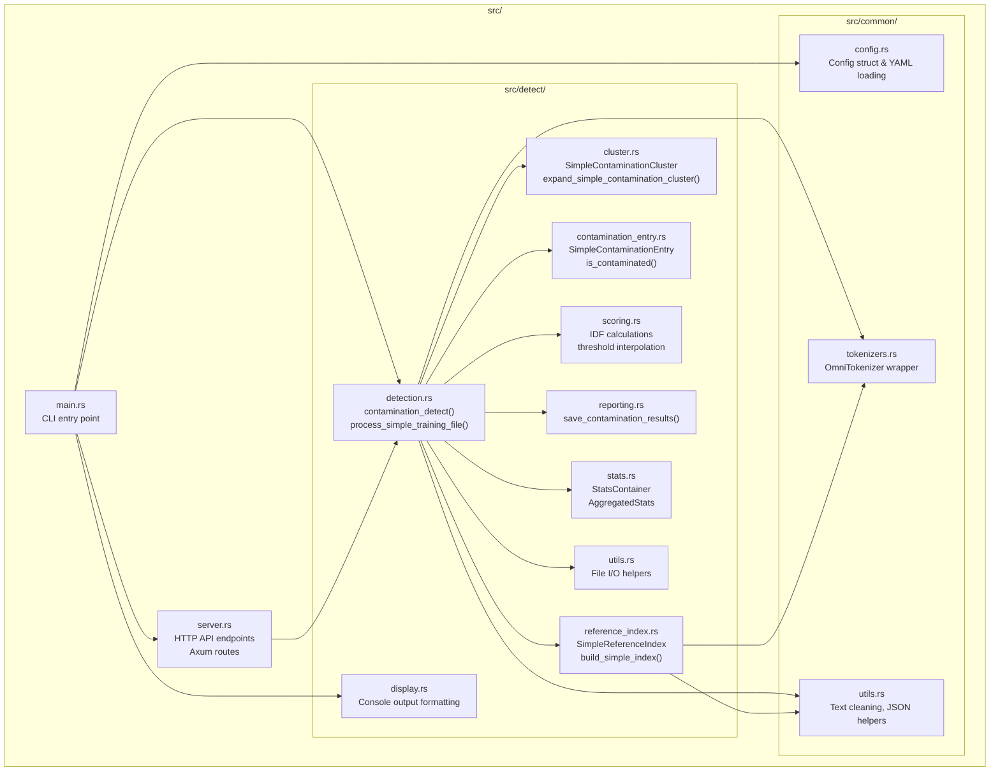
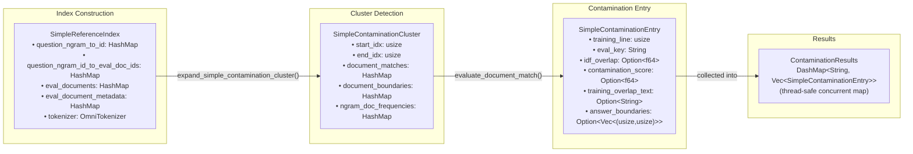
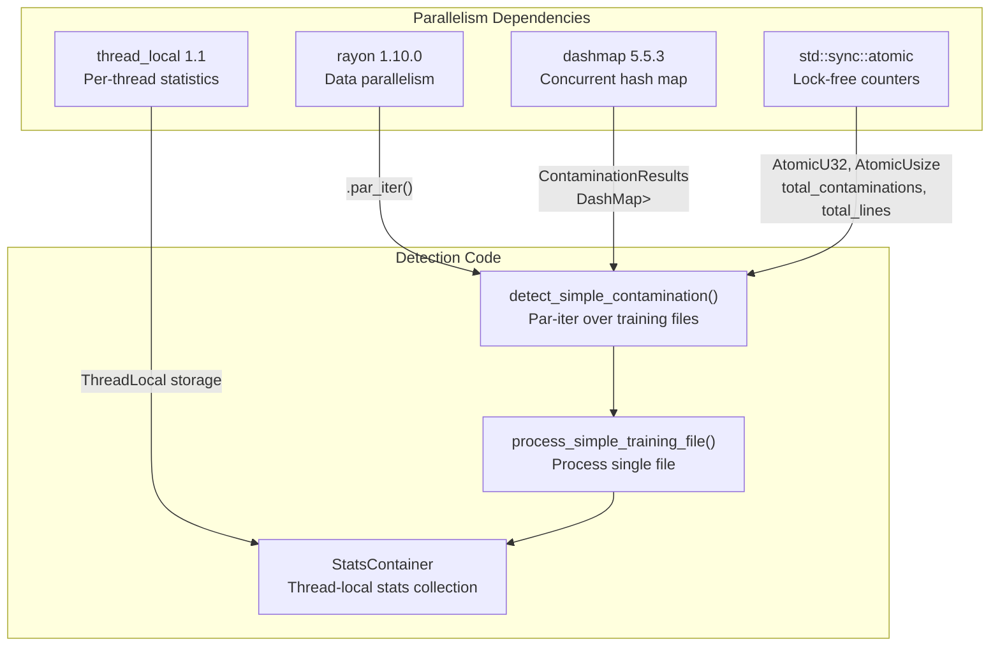
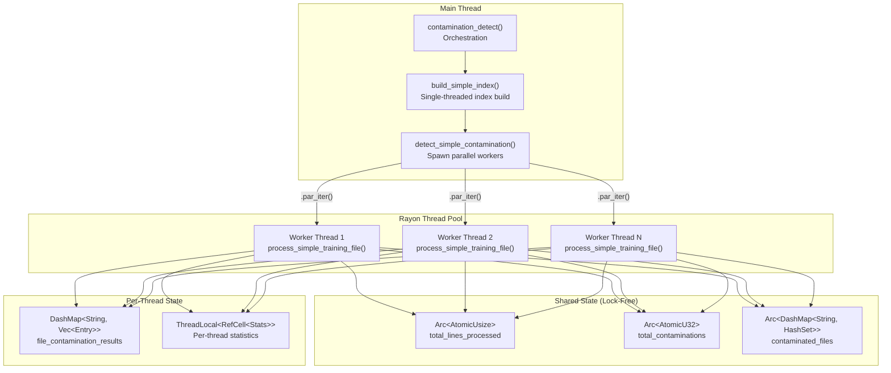

<!-- source: DeepWiki mcp.deepwiki.com · repo allenai/decon · page 6 Implementation Architecture · fetched 2026-10-26 -->

# Implementation Architecture

<details>
<summary>Relevant source files</summary>

The following files were used as context for generating this wiki page:

- [Cargo.toml](Cargo.toml)
- [src/detect/detection.rs](src/detect/detection.rs)

</details>


## Purpose and Scope

This page provides a technical overview of the Rust implementation of the decon detection engine. It covers the core module organization, key data structures, dependency architecture, and concurrency primitives that enable high-performance contamination detection.

For detailed walkthroughs of specific subsystems, see:
- [Detection Pipeline Implementation](#6.1) - main detection workflow and processing logic
- [Parallel Processing Architecture](#6.2) - multi-threading and synchronization mechanisms  
- [Output and Reporting Systems](#6.3) - result formatting and statistical aggregation

For algorithm details independent of implementation, see [The SIMPLE Algorithm](#4).

---

## Core Module Organization

The Rust implementation is organized into a hierarchical module structure under `src/`:



**Module Responsibilities:**

| Module | Primary Types | Responsibility |
|--------|---------------|----------------|
| `src/detect/detection.rs` | `contamination_detect()`, `process_simple_training_file()` | Main detection orchestration, file processing loop |
| `src/detect/reference_index.rs` | `SimpleReferenceIndex` | N-gram index construction from evaluation data |
| `src/detect/cluster.rs` | `SimpleContaminationCluster`, `expand_simple_contamination_cluster()` | Bidirectional cluster expansion from seed matches |
| `src/detect/contamination_entry.rs` | `SimpleContaminationEntry`, `is_contaminated()` | Scoring and contamination determination |
| `src/detect/scoring.rs` | `calculate_question_idf_overlap()`, `interpolate_threshold()` | IDF-weighted overlap calculations |
| `src/detect/reporting.rs` | `save_contamination_results()`, `create_purified_files_streaming()` | Result serialization and dataset purification |
| `src/detect/display.rs` | Display formatting functions | Console output and progress reporting |
| `src/common/config.rs` | `Config` | Configuration parsing from YAML |
| `src/common/tokenizers.rs` | `OmniTokenizer` | Unified tokenizer interface (BPE, char, uniseg) |
| `src/server.rs` | HTTP handlers | Distributed processing API |

Sources: [src/detect/detection.rs:1-1039](), [Cargo.toml:1-39]()

---

## Key Data Structures

### Primary Detection Types

The implementation uses several core structures that represent different stages of contamination detection:



**Type Definitions:**

- `SimpleReferenceIndex` [src/detect/reference_index.rs]() - The searchable index built from evaluation data
- `SimpleContaminationCluster` [src/detect/cluster.rs]() - A region in training data with potential matches
- `SimpleContaminationEntry` [src/detect/contamination_entry.rs]() - A scored contamination match
- `ContaminationResults` [src/detect/detection.rs:43]() - Type alias for `DashMap<String, Vec<SimpleContaminationEntry>>`

Sources: [src/detect/detection.rs:43-50](), [src/detect/detection.rs:52-65]()

### Context Structures

To reduce function parameter count and improve code clarity, the implementation uses context structures:

```rust
// Context for contamination evaluation
pub(crate) struct ContaminationContext<'a> {
    pub training_tokens: &'a [usize],
    pub config: &'a Config,
    pub index: &'a SimpleReferenceIndex,
    pub stats: Option<&'a StatsContainer>,
}
```

- `ContaminationContext` [src/detect/detection.rs:53-58]() - Bundles parameters for contamination evaluation
- `ExpansionContext` [src/detect/cluster.rs]() - Parameters for cluster expansion
- `FileProcessingState` [src/detect/detection.rs:46-50]() - Shared state for parallel file processing
- `OverlapExtractionContext` [src/detect/detection.rs:61-65]() - Parameters for text snippet extraction

Sources: [src/detect/detection.rs:46-65]()

---

## Dependency Stack

The implementation relies on carefully chosen external crates for performance-critical operations:

### Concurrency and Parallelism



**Key Dependencies:**

| Crate | Version | Purpose | Usage Location |
|-------|---------|---------|----------------|
| `rayon` | 1.10.0 | Data parallelism | `.par_iter()` on training files [src/detect/detection.rs:262]() |
| `dashmap` | 5.5.3 | Lock-free concurrent HashMap | `ContaminationResults`, `contaminated_files` [src/detect/detection.rs:43]() |
| `std::sync::atomic` | stdlib | Atomic counters | `total_contaminations`, `total_lines_processed` [src/detect/detection.rs:257]() |
| `thread_local` | 1.1 | Per-thread storage | Statistics collection [src/detect/stats.rs]() |
| `tiktoken-rs` | 0.5.8 | BPE tokenization | OpenAI tokenizers (cl100k, p50k) [src/common/tokenizers.rs]() |
| `unicode-segmentation` | 1.12.0 | Grapheme segmentation | Character-level tokenizer [src/common/tokenizers.rs]() |
| `serde` / `serde_json` | 1.0 | Serialization | JSON parsing and output [src/detect/detection.rs:4]() |
| `anyhow` | 1.0 | Error handling | Result types throughout [src/detect/detection.rs:1]() |

### I/O and Compression

| Crate | Version | Purpose |
|-------|---------|---------|
| `flate2` | 1.0 | gzip decompression |
| `zstd` | 0.13.1 | Zstandard decompression |
| `bzip2` | 0.4 | bzip2 decompression |
| `xz2` | 0.1 | LZMA/XZ decompression |
| `mj_io` | 0.1.3 | Directory expansion utilities |

### Web Server (Distributed Mode)

| Crate | Version | Purpose |
|-------|---------|---------|
| `axum` | 0.7 | HTTP server framework |
| `tokio` | 1.x | Async runtime |
| `uuid` | 1.x | Batch job identifiers |

Sources: [Cargo.toml:14-36]()

---

## Concurrency Model

The detection engine uses a multi-level concurrency strategy to maximize throughput:



### Parallelization Strategy

**File-Level Parallelism:** Training files are processed in parallel using Rayon's `.par_iter()` [src/detect/detection.rs:262](). Each worker thread processes one file at a time, and there is no shared mutable state between files.

**Lock-Free Synchronization:** Shared counters use atomic operations:
- `total_lines_processed: Arc<AtomicUsize>` [src/detect/detection.rs:255]()
- `total_contaminations: Arc<AtomicU32>` [src/detect/detection.rs:257]()
- `contaminated_files: Arc<DashMap<...>>` [src/detect/detection.rs:256]()

**Thread-Local Statistics:** Optional verbose statistics are collected in thread-local storage to avoid contention [src/detect/detection.rs:243-247]().

### Read-Only Index Sharing

The `SimpleReferenceIndex` is built once in the main thread and shared as an immutable reference across all worker threads. This is safe because:
1. Index construction completes before parallel processing begins
2. The index is never modified during detection
3. Rust's borrow checker enforces this at compile time

Sources: [src/detect/detection.rs:242-317](), [src/detect/detection.rs:46-50]()

---

## Main Processing Flow

The detection engine follows a two-phase architecture:

```mermaid
graph TB
    start["contamination_detect()"]
    
    subgraph "Phase 1: Index Construction"
        build["build_simple_index()<br/>[reference_index.rs]"]
        load_evals["Load eval JSONL files"]
        tokenize_evals["Tokenize Q/A/P components"]
        build_ngrams["Build n-gram maps:<br/>• question_ngram_to_id<br/>• question_ngram_id_to_eval_doc_ids"]
        compute_idf["Pre-compute IDF weights"]
        hot_bucket["Identify hot bucket n-grams"]
    end
    
    subgraph "Phase 2: Parallel Detection"
        iterate["detect_simple_contamination()<br/>Iterate training files"]
        
        subgraph "Per File [in parallel]"
            process_file["process_simple_training_file()"]
            read_lines["Read & parse JSONL lines"]
            tokenize_train["Tokenize training text"]
            identify["identify_contamination_clusters()<br/>Sample n-grams every M tokens"]
            expand["expand_simple_contamination_cluster()<br/>Bidirectional expansion"]
            evaluate["evaluate_document_match()<br/>Score each doc in cluster"]
            finalize["finalize_contaminated_entry()<br/>Extract text snippets"]
            save["save_contamination_results()"]
        end
    end
    
    subgraph "Phase 3: Aggregation"
        aggregate["Aggregate stats from all threads"]
        display["Display results"]
        purify["Optional: create_purified_files_streaming()"]
    end
    
    start --> build
    build --> load_evals --> tokenize_evals --> build_ngrams --> compute_idf --> hot_bucket
    hot_bucket --> iterate
    
    iterate -->|rayon .par_iter()| process_file
    process_file --> read_lines --> tokenize_train --> identify --> expand --> evaluate --> finalize --> save
    
    iterate --> aggregate --> display --> purify
```

### Phase 1: Index Construction [src/detect/detection.rs:73-77]()

1. Load evaluation JSONL files from `config.evals_dir`
2. Tokenize question, answer, and passage components
3. Build two-tier n-gram lookup maps
4. Compute IDF weights for all n-grams
5. Identify and mark "hot bucket" n-grams (very common)

### Phase 2: Parallel Detection [src/detect/detection.rs:88-91]()

For each training file (in parallel):

1. **Load and Parse** [src/detect/detection.rs:320]() - Read file, decompress if needed
2. **Line Processing Loop** [src/detect/detection.rs:326]() - Iterate over JSONL lines
3. **Tokenization** [src/detect/detection.rs:334-346]() - Extract text, clean punctuation, tokenize
4. **Cluster Identification** [src/detect/detection.rs:346]() - Sample n-grams and expand matches
5. **Scoring** [src/detect/detection.rs:354-403]() - Evaluate each document match in clusters
6. **Deduplication** [src/detect/detection.rs:391-402]() - Filter duplicate contaminations
7. **Result Storage** [src/detect/detection.rs:405-410]() - Add to concurrent results map

### Phase 3: Aggregation and Output [src/detect/detection.rs:293-316]()

1. Aggregate statistics from thread-local storage
2. Display summary results to console
3. Optionally create purified datasets with contaminated lines removed

Sources: [src/detect/detection.rs:69-112](), [src/detect/detection.rs:242-317](), [src/detect/detection.rs:319-415]()

---

## Error Handling and Recovery

The implementation uses `anyhow::Result` for error propagation with context-aware error messages:

**File Processing Errors:** Individual file failures are logged but don't halt the entire detection run [src/detect/detection.rs:283-286]():

```rust
Err(e) => {
    eprintln!("Error processing training file {:?}: {:?}", file_path, e);
}
```

**Tokenization Panics:** BPE tokenization can panic on malformed input, so it's wrapped in `catch_unwind` [src/detect/detection.rs:438-444]():

```rust
let Ok(training_tokens) = catch_unwind(move || tokenizer.encode(&padded_text)) else {
    eprintln!("Tokenization failed on {:?} | line {:?}", file_path, line_num);
    return None;
};
```

**Index Validation:** Empty index detection provides actionable error messages [src/detect/detection.rs:79-82](), [src/detect/detection.rs:115-132]():

```rust
if index_stats.lines_indexed == 0 {
    return Err(create_no_data_indexed_error(&index_stats, config));
}
```

Sources: [src/detect/detection.rs:69-112](), [src/detect/detection.rs:115-132](), [src/detect/detection.rs:283-286](), [src/detect/detection.rs:438-444]()

---

## Memory Management Strategy

The implementation optimizes memory usage through several techniques:

### Lazy Allocation

Detailed metadata (text snippets, eval metadata) is only loaded when a match is confirmed as contamination [src/detect/detection.rs:581-676]():

```rust
// Load metadata for reports now that we know this is an actual contamination
if let Some(metadata) = context.index.eval_document_metadata.get(&doc_id) {
    entry.eval_key = metadata.eval_key.clone();
    // ... additional fields
}
```

This defers expensive allocations until after scoring thresholds are passed.

### Deduplication

Within each training document, duplicate contaminations are filtered using a `HashSet` [src/detect/detection.rs:330-331]():

```rust
let mut processed_contaminations: HashSet<(String, usize, usize)> = HashSet::new();
```

This prevents reporting the same contamination multiple times when clusters overlap.

### Streaming File Processing

Files are processed line-by-line without loading entire files into memory [src/detect/detection.rs:326]():

```rust
for (line_num, line) in data.lines().enumerate() {
    // Process line
}
```

Sources: [src/detect/detection.rs:319-415](), [src/detect/detection.rs:581-676]()

---

## Type Safety and Compile-Time Guarantees

Rust's type system provides several guarantees:

**Lifetime Management:** References are bound to stack-allocated contexts with explicit lifetimes [src/detect/detection.rs:53-58]():

```rust
pub(crate) struct ContaminationContext<'a> {
    pub training_tokens: &'a [usize],
    pub config: &'a Config,
    pub index: &'a SimpleReferenceIndex,
    pub stats: Option<&'a StatsContainer>,
}
```

**Thread Safety:** `Arc<DashMap<...>>` is `Send + Sync`, enforced at compile time [src/detect/detection.rs:256]().

**Immutable Sharing:** The `SimpleReferenceIndex` is shared as `&SimpleReferenceIndex` across threads, preventing accidental mutation.

**Result Types:** All fallible operations return `Result<T, E>`, forcing explicit error handling.

Sources: [src/detect/detection.rs:43-65](), [src/detect/detection.rs:242-317]()

---

