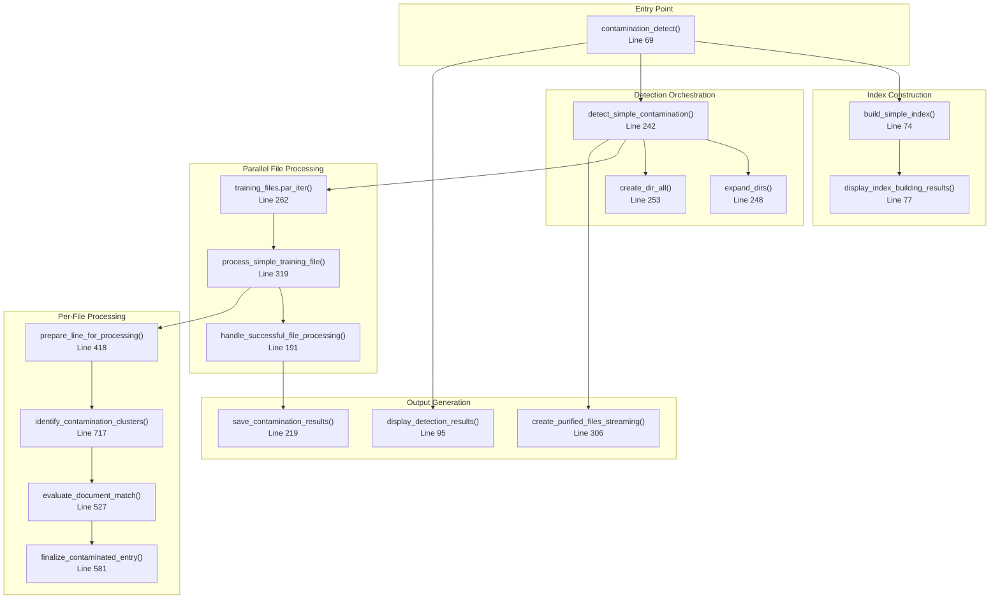
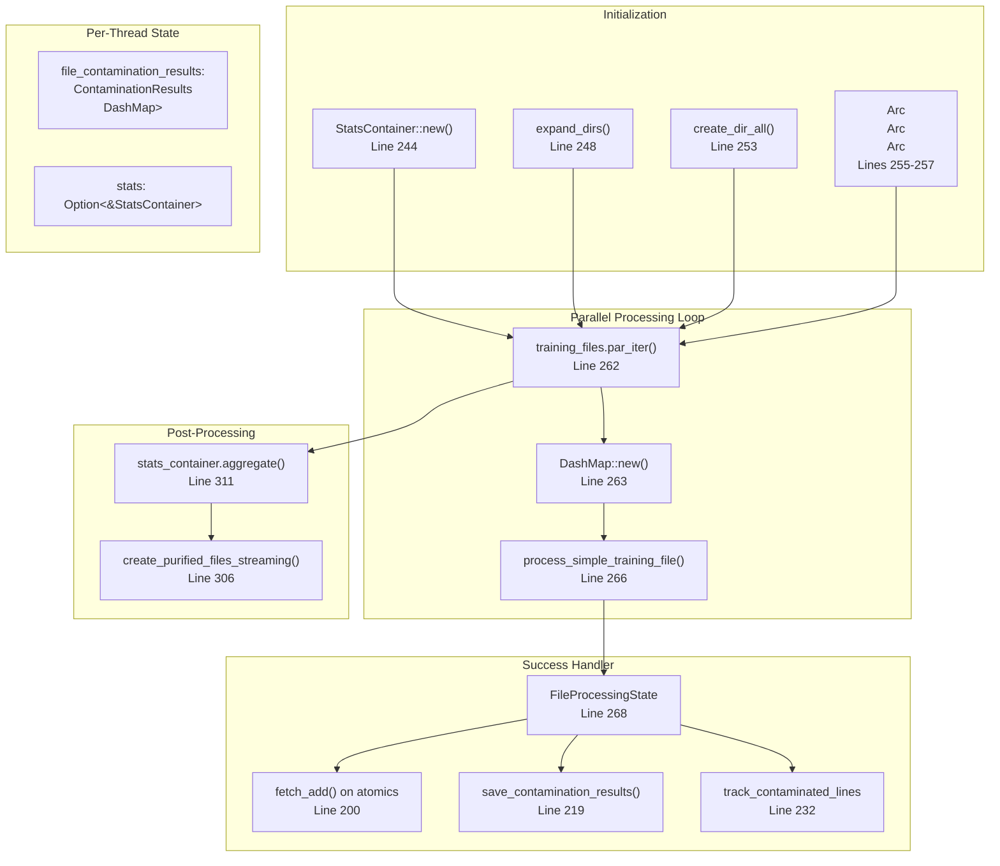
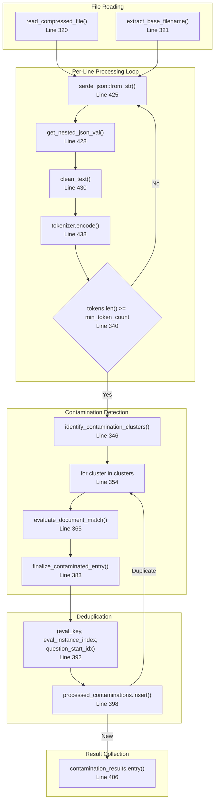
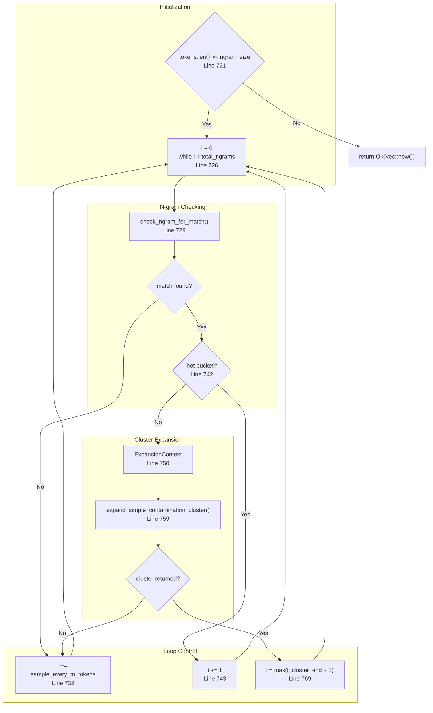
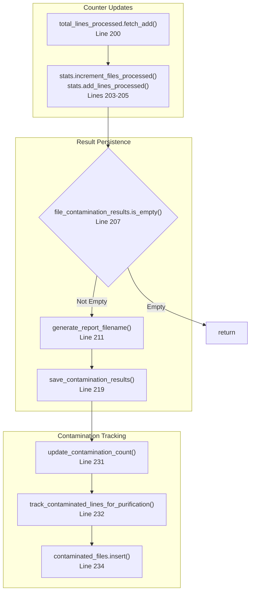

<!-- source: DeepWiki mcp.deepwiki.com · repo allenai/decon · page 6.1 Detection Pipeline Implementation · fetched 2026-10-26 -->

# Detection Pipeline Implementation

<details>
<summary>Relevant source files</summary>

The following files were used as context for generating this wiki page:

- [doc/simple-details.md](doc/simple-details.md)
- [src/detect/detection.rs](src/detect/detection.rs)

</details>


## Purpose and Scope

This page provides a technical walkthrough of the contamination detection pipeline implementation in `src/detect/detection.rs`. It covers the main workflow from entry point through parallel file processing, cluster identification, contamination evaluation, and result aggregation. For details on the SIMPLE algorithm concepts, see [Algorithm Overview](#4.1). For information on the reference index construction that precedes detection, see [Reference Index Construction](#4.2). For cluster expansion logic, see [Detection and Cluster Expansion](#4.3).

## Pipeline Architecture Overview

The detection pipeline follows a hierarchical execution model with three processing levels: orchestration, parallel file processing, and per-document analysis.



**Sources:** [src/detect/detection.rs:69-112](), [src/detect/detection.rs:242-317](), [src/detect/detection.rs:319-415]()

## Main Entry Point: contamination_detect

The `contamination_detect` function at [src/detect/detection.rs:69-112]() serves as the primary entry point for contamination detection. It orchestrates the two-phase process:

| Phase | Operation | Output |
|-------|-----------|--------|
| **Index Building** | Calls `build_simple_index()` to process evaluation datasets | `SimpleReferenceIndex` with n-gram mappings and IDF weights |
| **Detection** | Calls `detect_simple_contamination()` to scan training data | Contamination counts, report files, and optional purified datasets |

### Workflow Steps

1. **Index Construction** [src/detect/detection.rs:73-77](): Builds the reference index from evaluation data and captures timing statistics
2. **Index Validation** [src/detect/detection.rs:79-86](): Verifies that at least one evaluation instance was indexed; returns error via `create_no_data_indexed_error()` if empty
3. **Detection Execution** [src/detect/detection.rs:89-91](): Processes all training files and detects contamination
4. **Results Display** [src/detect/detection.rs:95-109](): Outputs summary statistics including timing, contamination counts, and completion status

### Key Data Structures Returned

The function returns a `Result<(), Error>` but internally tracks:
- `total_contaminations`: Number of contaminated eval instances found
- `contaminated_documents`: Number of training documents containing contamination
- `contaminated_lines`: Number of individual training lines marked as contaminated
- `aggregated_stats`: Thread-local timing statistics (when `verbose` mode enabled)

**Sources:** [src/detect/detection.rs:69-112](), [src/detect/detection.rs:114-132]()

## Parallel File Processing Architecture

The `detect_simple_contamination` function at [src/detect/detection.rs:242-317]() implements the parallel processing infrastructure using Rayon's work-stealing scheduler.



### Thread-Safe Shared State

The function uses three atomic structures for coordination across threads:

| Structure | Type | Purpose |
|-----------|------|---------|
| `total_lines_processed` | `Arc<AtomicUsize>` | Tracks cumulative lines processed across all threads |
| `total_contaminations` | `Arc<AtomicU32>` | Accumulates total contamination count |
| `contaminated_files` | `Arc<DashMap<String, HashSet<usize>>>` | Maps filenames to sets of contaminated line numbers |

**Sources:** [src/detect/detection.rs:242-317](), [src/detect/detection.rs:45-50]()

### Per-Thread Workflow

Each thread processes files independently:

1. **File Assignment** [src/detect/detection.rs:262](): Rayon's `par_iter()` distributes files to worker threads
2. **Local Results Map** [src/detect/detection.rs:263](): Creates thread-local `DashMap` for contamination results
3. **File Processing** [src/detect/detection.rs:266](): Calls `process_simple_training_file()` and receives line count
4. **Success Handling** [src/detect/detection.rs:268-281](): Updates shared state via `FileProcessingState` struct
5. **Progress Update** [src/detect/detection.rs:287](): Increments progress bar (thread-safe)

### FileProcessingState Structure

Defined at [src/detect/detection.rs:45-50](), this struct groups shared state references to reduce parameter passing:

```rust
pub struct FileProcessingState<'a> {
    pub total_lines_processed: &'a Arc<AtomicUsize>,
    pub total_contaminations: &'a Arc<AtomicU32>,
    pub contaminated_files: &'a Arc<DashMap<String, HashSet<usize>>>,
}
```

**Sources:** [src/detect/detection.rs:242-317](), [src/detect/detection.rs:262-288]()

## Single File Processing: process_simple_training_file

The `process_simple_training_file` function at [src/detect/detection.rs:319-415]() processes each training file line-by-line to identify contaminated content.



**Sources:** [src/detect/detection.rs:319-415]()

### Line Preparation Pipeline

The `prepare_line_for_processing` helper at [src/detect/detection.rs:418-447]() handles input normalization:

1. **JSON Parsing** [src/detect/detection.rs:425](): Deserializes line to `serde_json::Value`
2. **Text Extraction** [src/detect/detection.rs:428](): Uses `get_nested_json_val()` with configured `content_key`
3. **Text Cleaning** [src/detect/detection.rs:430](): Strips punctuation via `clean_text()`
4. **Tokenization** [src/detect/detection.rs:437-444](): Adds leading space for BPE tokenizers, with panic recovery via `catch_unwind`

### Minimum Token Threshold

At [src/detect/detection.rs:324](), a conservative minimum is enforced:

```rust
let min_token_count = config.ngram_size * 2;  // Minimum tokens needed for meaningful n-gram analysis
```

Lines with fewer tokens are skipped at [src/detect/detection.rs:340-342]().

### Deduplication Strategy

To prevent duplicate contamination reports for the same eval instance within a training line, the function maintains a `HashSet` keyed by `(eval_key, eval_instance_index, question_start_idx)` at [src/detect/detection.rs:331]() and [src/detect/detection.rs:392-402]().

**Sources:** [src/detect/detection.rs:319-415](), [src/detect/detection.rs:418-447]()

## Cluster Identification Pipeline

The `identify_contamination_clusters` function at [src/detect/detection.rs:717-777]() implements the sampled n-gram matching strategy with progressive expansion.

### Sampling Strategy with Known Limitation

The function uses a sampling-based approach that trades exhaustiveness for efficiency. At [src/detect/detection.rs:684-716](), extensive documentation describes a known blind spot:

**Edge Case Scenario:** If cluster expansion identifies documents A, B, C based on an initial seed at position 10, and expansion ends at position 40, then sampling resumes after position 41. A hypothetical document D that would match at position 25 but shares no n-grams with the seed will be missed.

This is mitigated by bidirectional expansion (documents can be caught by seeds to the right) and is rare in practice since most contamination shares multiple n-grams.

### Cluster Discovery Loop



**Sources:** [src/detect/detection.rs:717-777]()

### N-gram Matching Logic

The `check_ngram_for_match` function at [src/detect/detection.rs:780-800]() performs index lookups:

1. **Extract N-gram** [src/detect/detection.rs:788](): Slices `config.ngram_size` tokens
2. **Hash N-gram** [src/detect/detection.rs:791](): Calls `hash_ngram()` to get u64 hash
3. **First-Tier Lookup** [src/detect/detection.rs:792](): Checks `question_ngram_to_id` map for u32 n-gram ID
4. **Second-Tier Lookup** [src/detect/detection.rs:794](): Uses n-gram ID to retrieve `HashSet<u32>` of document IDs

### Hot Bucket Handling

When a match contains only the sentinel `hot_bucket_id` at [src/detect/detection.rs:742-745](), the function advances by 1 token instead of sampling, continuing until finding a non-hot match or a miss. This prevents wasting cluster expansion on common n-grams.

### ExpansionContext Structure

At [src/detect/detection.rs:750-757](), the function assembles context for cluster expansion:

| Field | Type | Purpose |
|-------|------|---------|
| `question_ngram_to_id` | `&QuestionNgramToIdMap` | First-tier index lookup |
| `question_ngram_id_to_eval_doc_ids` | `&QuestionNgramIdToEvalDocIdsMap` | Second-tier index lookup |
| `ngram_size` | `usize` | N-gram window size |
| `question_max_consecutive_misses` | `u32` | Miss tolerance for expansion |
| `hot_bucket_id` | `u32` | Sentinel ID for hot buckets |
| `question_ngram_id_to_hot_bucket_doc_ids` | Map reference | Documents in hot buckets |

**Sources:** [src/detect/detection.rs:717-777](), [src/detect/detection.rs:780-800]()

## Contamination Evaluation and Scoring

Once clusters are identified, each document match within a cluster is evaluated to determine if it represents actual contamination.

### Two-Stage Evaluation Process

```mermaid
graph TB
    subgraph "Stage 1: Build Entry"
        build["build_contamination_entry_from_match()<br/>Line 534"]
        get_doc["index.eval_documents.get(&doc_id)<br/>Line 459"]
        calc_idf["calculate_question_idf_overlap()<br/>Line 462"]
        check_min{"idf >= minimum_question_idf_threshold<br/>Line 470"}
    end
    
    subgraph "Stage 2: Threshold Check"
        interpolate["interpolate_threshold()<br/>Line 549"]
        check_threshold{"question_idf >= required_threshold<br/>Line 555"}
    end
    
    subgraph "Stage 3: Full Scoring"
        is_contaminated["entry.is_contaminated()<br/>Line 560"]
        check_result{"result.is_contaminated<br/>Line 570"}
    end
    
    subgraph "Return"
        return_some["Some((entry, result))"]
        return_none["None"]
    end
    
    build --> get_doc
    get_doc --> calc_idf
    calc_idf --> check_min
    
    check_min -->|No| return_none
    check_min -->|Yes| interpolate
    
    interpolate --> check_threshold
    check_threshold -->|No| return_none
    check_threshold -->|Yes| is_contaminated
    
    is_contaminated --> check_result
    check_result -->|Yes| return_some
    check_result -->|No| return_none
```

**Sources:** [src/detect/detection.rs:527-575]()

### Early Exit Optimizations

The `evaluate_document_match` function at [src/detect/detection.rs:527-575]() implements two early exit checks before full scoring:

1. **Minimum IDF Check** [src/detect/detection.rs:470-475](): Rejects matches below `minimum_question_idf_threshold`
2. **Length-Adjusted Threshold** [src/detect/detection.rs:549-557](): Uses `interpolate_threshold()` to increase required threshold for shorter evaluation questions

### ContaminationContext Structure

Defined at [src/detect/detection.rs:52-58](), this struct reduces function parameters:

```rust
pub(crate) struct ContaminationContext<'a> {
    pub training_tokens: &'a [usize],
    pub config: &'a Config,
    pub index: &'a SimpleReferenceIndex,
    pub stats: Option<&'a StatsContainer>,
}
```

### Full Contamination Scoring

The `entry.is_contaminated()` call at [src/detect/detection.rs:560-567]() delegates to the contamination entry's scoring logic (documented in [Contamination Scoring System](#4.4)), which:

1. Evaluates answer component matches (if present)
2. Evaluates passage component matches (if present)
3. Combines component scores with adaptive weights
4. Applies length penalties
5. Returns `ContaminationCheckResult` with detailed breakdown

**Sources:** [src/detect/detection.rs:527-575](), [src/detect/detection.rs:449-524](), [src/detect/detection.rs:52-58]()

## Result Finalization and Metadata Enrichment

Once a match is confirmed as contamination, the `finalize_contaminated_entry` function at [src/detect/detection.rs:581-676]() enriches it with metadata for reporting.

### Metadata Population

The function performs several lookup operations to populate reporting fields:

| Data Source | Fields Populated | Code Location |
|-------------|-----------------|---------------|
| `index.eval_document_metadata` | `eval_key`, `eval_line`, `eval_instance_index`, `split`, `fingerprint`, `is_correct`, `reference_file` | [Line 589-599]() |
| `result.answer_boundaries` | `answer_start_idx`, `answer_end_idx` | [Line 646-650]() |
| `result.passage_boundaries` | `passage_start_idx`, `passage_end_idx` | [Line 655-658]() |
| `index.eval_text_snippets` | `eval_question_text` | [Line 661-663]() |
| `index.eval_answer_text_snippets` | `eval_answer_text` | [Line 666-668]() |
| `index.eval_passage_text_snippets` | `eval_passage_text` | [Line 671-673]() |

### Question Boundary Adjustment

At [src/detect/detection.rs:606-618](), the function handles an edge case where the cluster is longer than the evaluation question and overlaps with answer boundaries:

```rust
if let Some(ref boundaries) = result.answer_boundaries
    && !boundaries.is_empty() {
        let first_answer_start = boundaries[0].0;
        if first_answer_start <= question_end_idx && cluster_token_length > eval_token_count {
            question_end_idx = first_answer_start.saturating_sub(1);
        }
    }
```

This truncates the question region to avoid double-counting tokens in both question and answer highlights.

### Training Text Extraction

The `extract_overlap_with_question_and_answer` function at [src/detect/detection.rs:931-990]() generates highlighted text snippets:

1. **Context Calculation** [src/detect/detection.rs:967-976](): Adds 30 tokens before and 60 tokens after
2. **BPE Decoding** [src/detect/detection.rs:942-952](): Uses `tiktoken_rs::CoreBPE` for BPE tokenizers
3. **Highlight Formatting** [src/detect/detection.rs:816-928](): Adds special characters:
   - `【question】` for question text
   - `⟦answer⟧` for answer text
   - `⟨passage⟩` for passage text
   - `...` for truncated context

**Sources:** [src/detect/detection.rs:581-676](), [src/detect/detection.rs:931-990](), [src/detect/detection.rs:816-928]()

## Result Aggregation and Persistence

After processing each file, results are persisted and shared state is updated.

### Success Handler Workflow

The `handle_successful_file_processing` function at [src/detect/detection.rs:191-240]() performs several operations:



**Sources:** [src/detect/detection.rs:191-240]()

### Report File Generation

The function generates unique report filenames at [src/detect/detection.rs:211-217]() using `generate_report_filename()`, which creates hierarchical directory structures when processing nested training directories.

### Contamination Count Aggregation

The `update_contamination_count` helper at [src/detect/detection.rs:136-148]() aggregates counts:

```rust
let contamination_count = file_contamination_results
    .iter()
    .map(|entry| entry.value().len())
    .sum::<usize>();

total_contaminations.fetch_add(contamination_count as u32, Ordering::Relaxed);
```

### Purification Tracking

The `track_contaminated_lines_for_purification` function at [src/detect/detection.rs:168-188]():

1. Extracts base filename using `extract_base_filename()` at [src/detect/detection.rs:151-164]()
2. Collects all contaminated line numbers into a `HashSet`
3. Returns tuple `(filename, line_numbers)` for later purification

This data enables the optional purification feature at [src/detect/detection.rs:305-307](), which calls `create_purified_files_streaming()` to generate cleaned datasets.

**Sources:** [src/detect/detection.rs:191-240](), [src/detect/detection.rs:136-148](), [src/detect/detection.rs:168-188]()

## Key Data Structures and Type Aliases

### ContaminationResults

Defined at [src/detect/detection.rs:43]():

```rust
pub type ContaminationResults = DashMap<String, Vec<SimpleContaminationEntry>>;
```

This thread-safe map accumulates contamination entries per file during processing. Keys are filenames, values are vectors of contamination entries.

### SimpleContaminationEntry

The primary result structure (defined in `contamination_entry.rs`) contains:

- **Training location**: `training_line`, `contamination_start_idx`, `contamination_end_idx`
- **Eval identification**: `eval_key`, `eval_line`, `eval_instance_index`, `split`
- **Scoring metrics**: `contamination_score`, `idf_overlap`, `answer_idf_overlap`, `passage_idf_overlap`
- **Component details**: `ngram_match_cnt`, `cluster_token_length`, `eval_token_length`
- **Text snippets**: `training_overlap_text`, `eval_question_text`, `eval_answer_text`, `eval_passage_text`
- **Metadata**: `fingerprint`, `is_correct`, `reference_file`

### OverlapExtractionContext

Defined at [src/detect/detection.rs:61-65](), this struct configures text extraction:

```rust
struct OverlapExtractionContext<'a> {
    pub tokenizer: &'a OmniTokenizer,
    pub context_words_before: usize,
    pub context_words_after: usize,
}
```

Used at [src/detect/detection.rs:621-625]() with fixed context windows: 30 words before, 60 words after.

**Sources:** [src/detect/detection.rs:43](), [src/detect/detection.rs:61-65]()

## Statistics Collection (Verbose Mode)

When `config.verbose` is enabled, the pipeline collects detailed timing statistics using thread-local storage.

### StatsContainer

Created at [src/detect/detection.rs:243-247](), the `StatsContainer` maintains per-thread statistics that are aggregated at [src/detect/detection.rs:310-314]():

| Metric | Update Location | Purpose |
|--------|----------------|---------|
| Files processed | [Line 203]() | Count of training files processed |
| Lines processed | [Line 204]() | Total training lines analyzed |
| Contaminations found | [Line 238]() | Number of contamination instances |
| Excluded (low IDF) | [Line 472]() | Matches rejected by minimum IDF threshold |

The `display_timing_stats()` call at [src/detect/detection.rs:106]() outputs aggregated statistics to console.

**Sources:** [src/detect/detection.rs:243-247](), [src/detect/detection.rs:310-314]()

---

