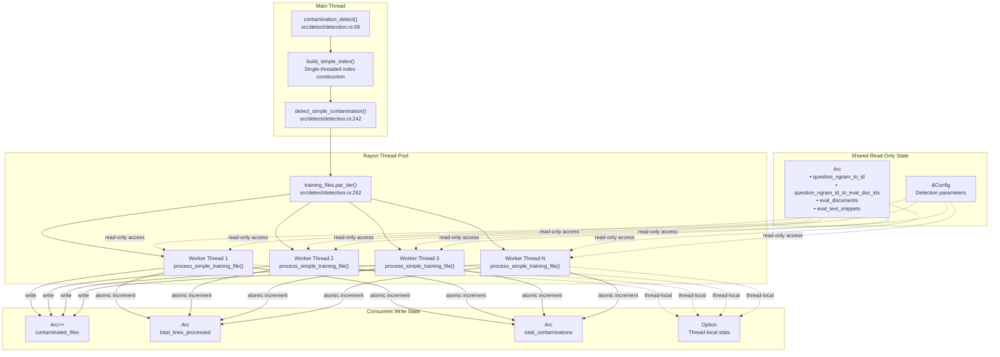
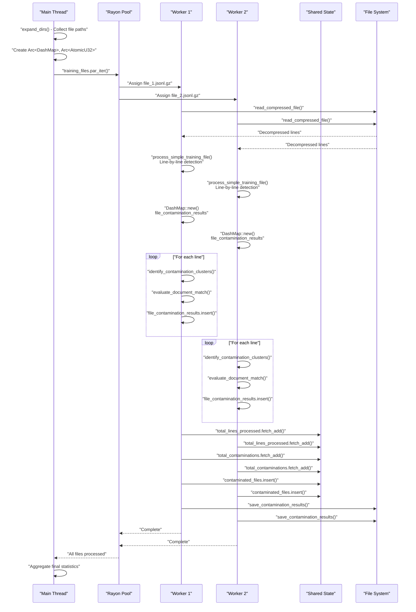
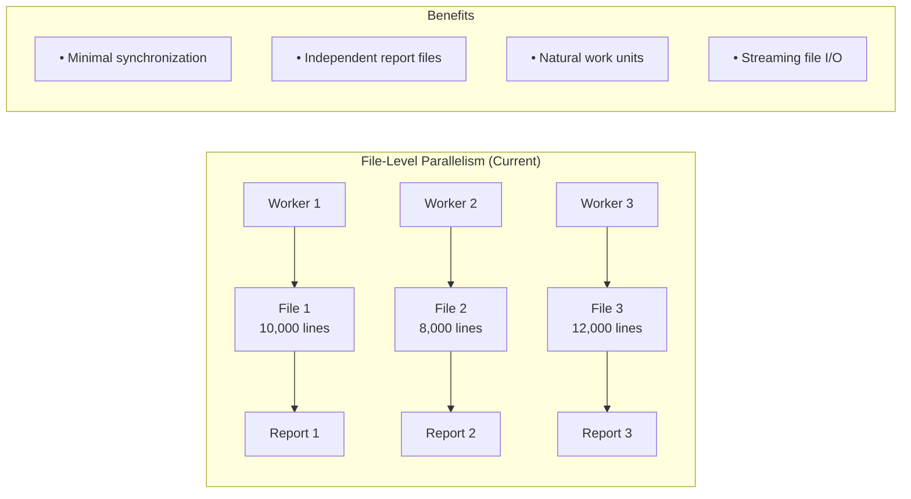
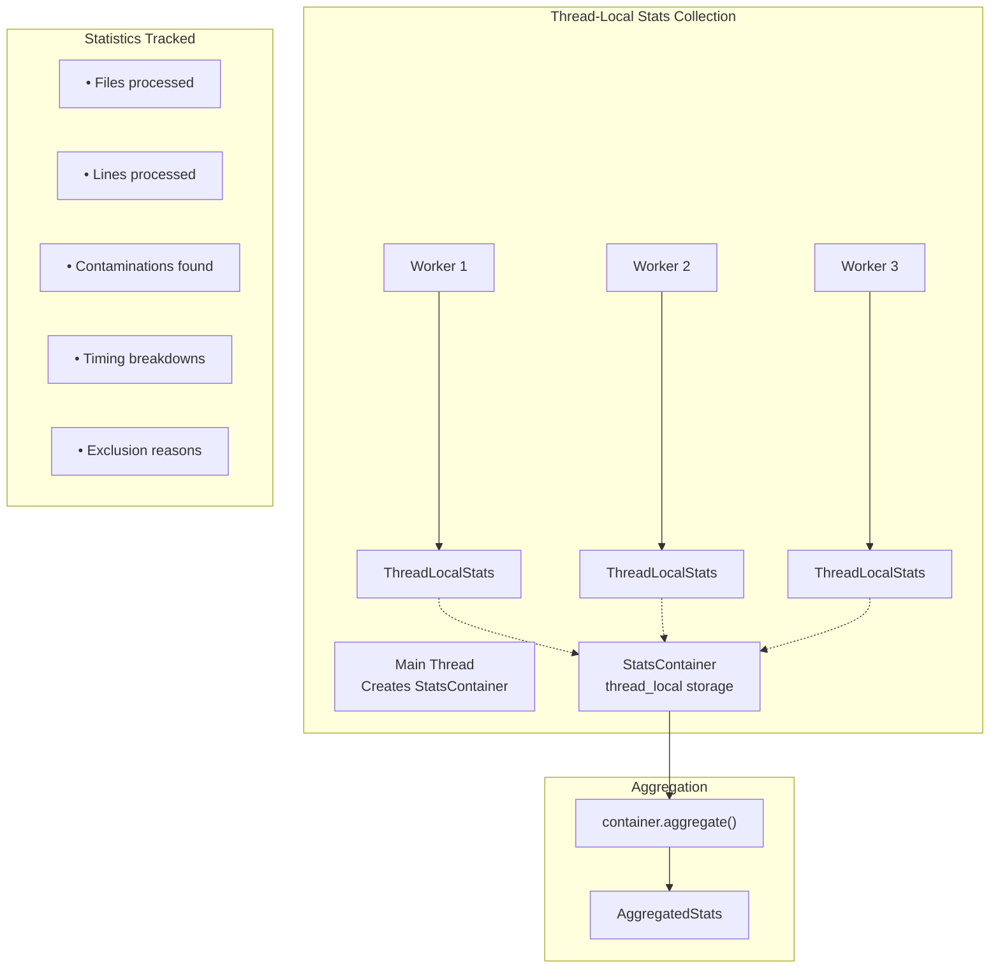
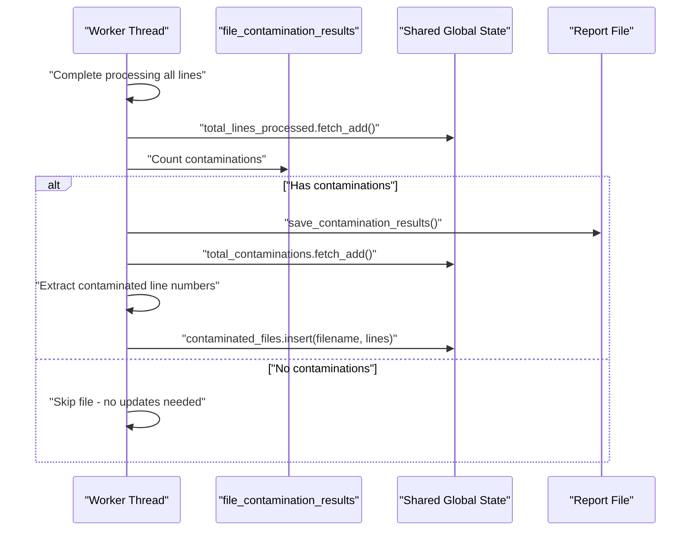

<!-- source: DeepWiki mcp.deepwiki.com · repo allenai/decon · page 6.2 Parallel Processing Architecture · fetched 2026-10-26 -->

# Parallel Processing Architecture

<details>
<summary>Relevant source files</summary>

The following files were used as context for generating this wiki page:

- [Cargo.toml](Cargo.toml)
- [src/detect/detection.rs](src/detect/detection.rs)

</details>


## Purpose and Scope

This page documents the parallel processing implementation in decon's detection engine. It covers how Rayon, DashMap, and atomic operations enable efficient multi-threaded contamination detection across training data files.

For the overall detection pipeline workflow, see [Detection Pipeline Implementation](#6.1). For how results are formatted and reported, see [Output and Reporting Systems](#6.3). For performance optimization strategies including sampling and index design, see [Performance Optimization](#7.1).

---

## Overview

The decon detection engine achieves parallelism through **file-level work distribution**. Each training file is processed independently by a worker thread from Rayon's thread pool, with all workers sharing read-only access to the reference index. This design choice enables embarrassingly parallel processing with minimal synchronization overhead.

The architecture relies on three key components:
1. **Rayon** - Provides the work-stealing thread pool and parallel iterators
2. **DashMap** - Enables lock-free concurrent result collection
3. **Atomic operations** - Track global statistics without mutex contention

Sources: [src/detect/detection.rs:1-43](), [Cargo.toml:26-27]()

---

## Thread Pool and Work Distribution



**Parallel File Processing with Rayon Work Stealing**

The detection engine processes training files in parallel using Rayon's `.par_iter()` method. Each file is assigned to a worker thread from the pool, which processes it completely before moving to the next file. This file-level granularity provides good load balancing while avoiding the overhead of finer-grained parallelism.

Sources: [src/detect/detection.rs:242-317]()

---

## Thread-Safe Data Structures

### DashMap for Concurrent Results Collection

```rust
pub type ContaminationResults = DashMap<String, Vec<SimpleContaminationEntry>>;
```

`DashMap` is a concurrent hash map that provides lock-free reads and writes through internal sharding. Each worker thread writes contamination results to the shared `DashMap` without explicit locking.

| Data Structure | Purpose | Synchronization Mechanism |
|---------------|---------|--------------------------|
| `Arc<DashMap<String, HashSet<usize>>>` | Track contaminated files and line numbers | Lock-free sharding |
| `Arc<AtomicUsize>` | Count total lines processed | Atomic fetch-add operations |
| `Arc<AtomicU32>` | Count total contaminations found | Atomic fetch-add operations |
| `DashMap<String, Vec<SimpleContaminationEntry>>` | Per-file contamination entries | Lock-free sharding |

Sources: [src/detect/detection.rs:2-3, 43, 45-50, 255-257]()

### Atomic Counters for Lock-Free Statistics

Worker threads update global counters using atomic operations with `Ordering::Relaxed` or `Ordering::SeqCst`:

```rust
// Increment lines processed counter
total_lines_processed.fetch_add(lines_processed, std::sync::atomic::Ordering::SeqCst);

// Increment contamination counter
total_contaminations.fetch_add(contamination_count as u32, Ordering::Relaxed);
```

The choice of memory ordering depends on synchronization requirements:
- `Ordering::SeqCst` for `total_lines_processed` ensures visibility for progress tracking
- `Ordering::Relaxed` for `total_contaminations` is sufficient since exact ordering doesn't matter

Sources: [src/detect/detection.rs:10, 138-148, 200]()

### Arc for Shared Ownership

```rust
pub struct FileProcessingState<'a> {
    pub total_lines_processed: &'a Arc<std::sync::atomic::AtomicUsize>,
    pub total_contaminations: &'a Arc<AtomicU32>,
    pub contaminated_files: &'a Arc<DashMap<String, HashSet<usize>>>,
}
```

`Arc` (Atomic Reference Counting) enables multiple worker threads to share ownership of the same data structures. The reference count is managed atomically, and the wrapped data is immutable or internally synchronized (via `DashMap` or atomics).

Sources: [src/detect/detection.rs:11, 45-50, 255-257]()

---

## Parallel File Processing Workflow



**File Processing Sequence in Parallel Execution**

Each worker thread follows this sequence for its assigned file:

1. **Read and decompress** the file using `read_compressed_file()`
2. **Create local results map** using `DashMap::new()` 
3. **Process each line** by identifying clusters and evaluating matches
4. **Update global counters** atomically
5. **Write results to disk** via `save_contamination_results()`
6. **Update shared contaminated files map**

Sources: [src/detect/detection.rs:262-288, 319-415]()

---

## File-Level Parallelism Strategy

The system parallelizes at the file level rather than the document (line) level for several architectural reasons:

### Why File-Level Parallelism



**Advantages of File-Level Parallelism**

| Aspect | File-Level | Document-Level (Alternative) |
|--------|-----------|------------------------------|
| **Synchronization** | Minimal - only counters and final results map | High - shared queue, frequent contention |
| **Report Generation** | One report per file, written independently | Complex aggregation required |
| **Memory Usage** | Streaming per file | Buffering across many documents |
| **Load Balancing** | Good for similarly-sized files | Better for files with variable line counts |
| **Implementation Complexity** | Simple | More complex coordination |

Sources: [src/detect/detection.rs:242-317]()

### Per-File Result Isolation

Each worker thread creates its own local `DashMap` to collect contamination results for its assigned file:

```rust
training_files.par_iter().for_each(|file_path| {
    let file_contamination_results = DashMap::new();  // Local to this worker
    // ... process file ...
});
```

This local map is not shared across threads during processing. Only after a file is completely processed does the worker update the global shared state and write its results to disk.

Sources: [src/detect/detection.rs:262-288]()

---

## Thread-Local Statistics Collection

When verbose mode is enabled (`config.verbose = true`), the system collects detailed timing statistics using thread-local storage:



**Thread-Local Statistics Architecture**

The `StatsContainer` uses Rust's `thread_local!` macro to maintain separate statistics for each worker thread. This avoids synchronization overhead during the hot path of detection. After all files are processed, the main thread calls `container.aggregate()` to collect and sum statistics from all threads.

Sources: [src/detect/detection.rs:41, 243-247, 264, 310-314]()

---

## State Tracking During Parallel Execution

### FileProcessingState Structure

```rust
pub struct FileProcessingState<'a> {
    pub total_lines_processed: &'a Arc<std::sync::atomic::AtomicUsize>,
    pub total_contaminations: &'a Arc<AtomicU32>,
    pub contaminated_files: &'a Arc<DashMap<String, HashSet<usize>>>,
}
```

This structure groups the shared state references passed to each file processing operation. It encapsulates the three key pieces of global state that workers update:

1. **`total_lines_processed`** - Running count of all lines examined
2. **`total_contaminations`** - Running count of contamination instances found  
3. **`contaminated_files`** - Map of filename to set of contaminated line numbers (used for purification)

Sources: [src/detect/detection.rs:45-50, 268-272]()

### Updating Shared State After File Processing



**State Update Sequence After File Processing**

The `handle_successful_file_processing()` function coordinates all shared state updates after a file completes:

1. Always update `total_lines_processed` counter
2. If contaminations found:
   - Generate unique report filename
   - Save results to report file
   - Update `total_contaminations` counter
   - Extract contaminated line numbers
   - Insert into `contaminated_files` map for purification

Sources: [src/detect/detection.rs:190-240]()

---

## Contamination Results Aggregation

### DashMap-Based Result Collection

```rust
pub type ContaminationResults = DashMap<String, Vec<SimpleContaminationEntry>>;
```

Each file's contamination results are stored in a `DashMap` keyed by filename. The value is a vector of `SimpleContaminationEntry` objects, each representing one detected contamination instance.

The map structure enables:
- **Lock-free concurrent inserts** from multiple workers
- **Efficient lookup** during result aggregation
- **Automatic deduplication** by filename

Sources: [src/detect/detection.rs:43]()

### Duplicate Detection Within Files

Within a single training document (line), duplicate contaminations are prevented using a `HashSet`:

```rust
let mut processed_contaminations: HashSet<(String, usize, usize)> = HashSet::new();

let contamination_key = (
    finalized_entry.eval_key.clone(),
    finalized_entry.eval_instance_index,
    finalized_entry.contamination_start_idx.unwrap_or(0),
);

if processed_contaminations.insert(contamination_key) {
    cluster_results.push(finalized_entry);
}
```

The key is a tuple of `(eval_key, eval_instance_index, question_start_idx)`, ensuring that the same evaluation document contamination at the same position is only recorded once per training line.

Sources: [src/detect/detection.rs:329-402]()

---

## Performance Characteristics

### Memory Efficiency

The parallel architecture is designed for memory efficiency:

| Component | Memory Strategy | Justification |
|-----------|----------------|---------------|
| **Reference Index** | Single shared instance via `Arc` | Read-only after construction, no duplication needed |
| **Per-file Results** | Local `DashMap` per worker | Bounds memory per worker; results written immediately after file completes |
| **Training Data** | Streaming line-by-line | Never loads entire file into memory |
| **Contaminated Files Map** | Shared `DashMap` of line numbers only | Only stores metadata, not full contamination entries |

Sources: [src/detect/detection.rs:242-317, 319-415]()

### Lock-Free Hot Path

The detection hot path (identifying n-gram matches and expanding clusters) operates entirely without locks:

1. **Index lookups** - Read-only access to shared `SimpleReferenceIndex`
2. **Cluster expansion** - Operates on local training token slice
3. **Scoring** - Pure computation with no shared state access
4. **Local results collection** - Writes to thread-local `DashMap`

Only when a file completes does the worker acquire internal locks (via `DashMap` or atomic operations) to update shared state.

Sources: [src/detect/detection.rs:678-777]()

### Atomic Operation Ordering

```rust
// Relaxed ordering for simple counter increments
total_contaminations.fetch_add(contamination_count as u32, Ordering::Relaxed);

// SeqCst ordering when visibility matters for progress tracking  
total_lines_processed.fetch_add(lines_processed, Ordering::SeqCst);
```

The system uses `Ordering::Relaxed` when possible to minimize memory barrier overhead. `Ordering::SeqCst` is used only when stronger guarantees are needed, such as ensuring progress counters are visible to monitoring threads.

Sources: [src/detect/detection.rs:10, 145, 200, 293-294]()

---

## Error Handling in Parallel Execution

### Per-File Error Isolation

```rust
training_files.par_iter().for_each(|file_path| {
    match process_simple_training_file(file_path, config, index, &file_contamination_results, stats) {
        Ok(lines_processed) => {
            // Handle successful processing
        }
        Err(e) => {
            eprintln!("Error processing training file {:?}: {:?}", file_path, e);
        }
    }
    pbar.inc(1);
});
```

Errors in processing individual files are isolated and logged but do not stop other workers. Each file is processed independently, so a corrupted or malformed file affects only its own processing.

The progress bar increments regardless of success or failure, ensuring that overall progress tracking remains accurate.

Sources: [src/detect/detection.rs:262-288]()

### Panic Recovery

The system uses `catch_unwind` to recover from panics during tokenization, a known issue with some tokenizer implementations:

```rust
let Ok(training_tokens) = catch_unwind(move || tokenizer.encode(&padded_text)) else {
    eprintln!("Tokenization failed on {:?} | line {:?}", file_path, line_num);
    return None;
};
```

This prevents a single problematic document from crashing the entire detection process. The file continues processing subsequent lines after logging the error.

Sources: [src/detect/detection.rs:8, 438-444]()

---

## Dependencies and Concurrency Primitives

### Rayon Configuration

Rayon automatically configures the thread pool size based on available CPU cores. The system relies on Rayon's default configuration with no custom thread pool settings.

```toml
[dependencies]
rayon = "1.10.0"
```

The `.par_iter()` method uses Rayon's work-stealing scheduler to distribute files across worker threads efficiently.

Sources: [Cargo.toml:27]()

### DashMap Rayon Integration  

```toml
[dependencies]
dashmap = {version = "5.5.3", features=["rayon"]}
```

The `rayon` feature enables integration between DashMap and Rayon's parallel iterators, allowing efficient parallel iteration over the map's contents if needed.

Sources: [Cargo.toml:26]()

### Standard Library Concurrency Primitives

The implementation relies on standard Rust concurrency primitives:

- **`std::sync::Arc`** - Atomic reference counting for shared ownership
- **`std::sync::atomic::{AtomicUsize, AtomicU32, Ordering}`** - Lock-free counters
- **`std::panic::catch_unwind`** - Panic recovery for fault isolation

Sources: [src/detect/detection.rs:8-11]()

---

