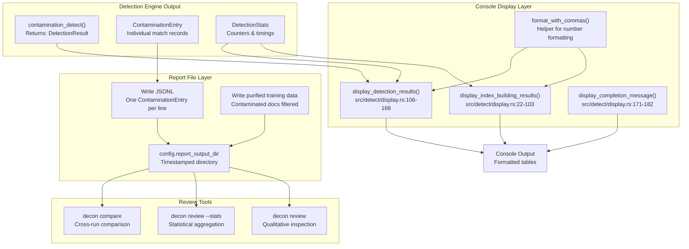
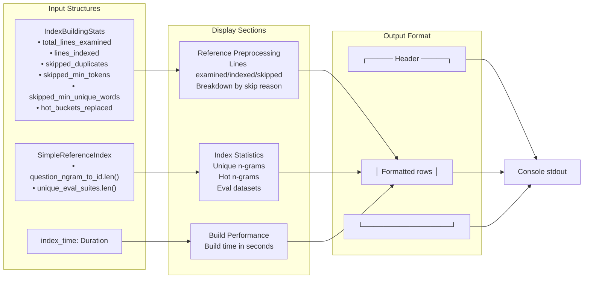
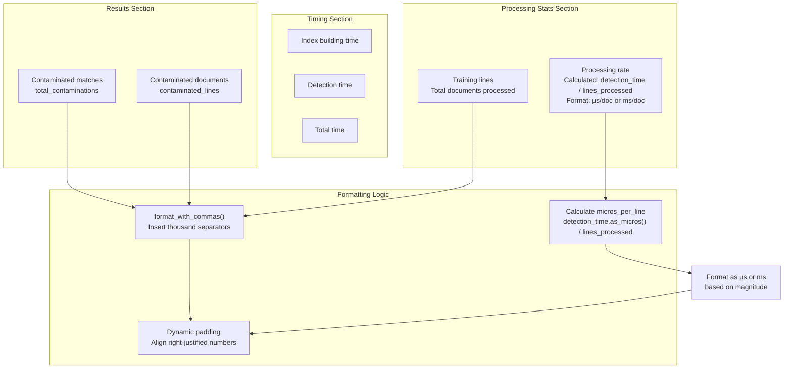
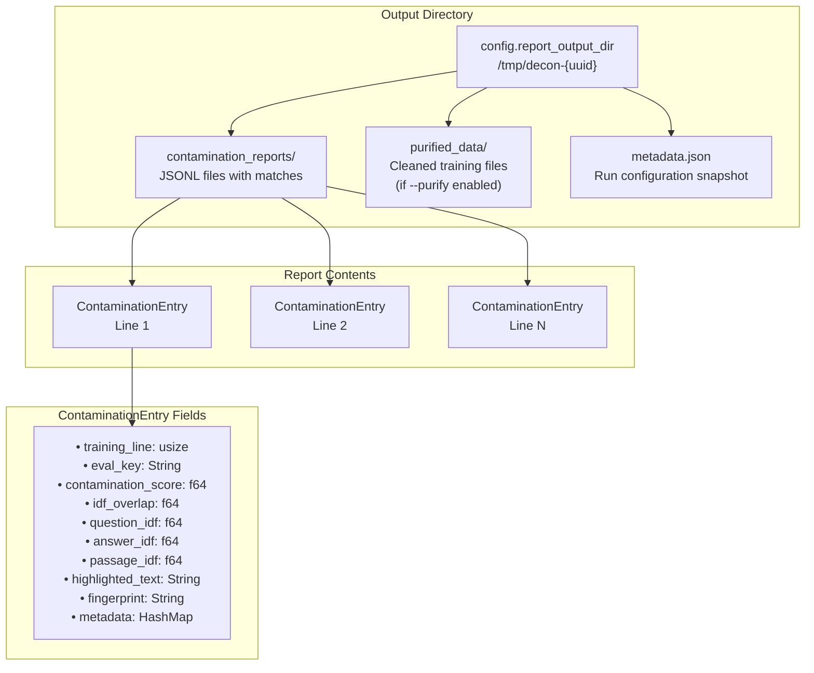
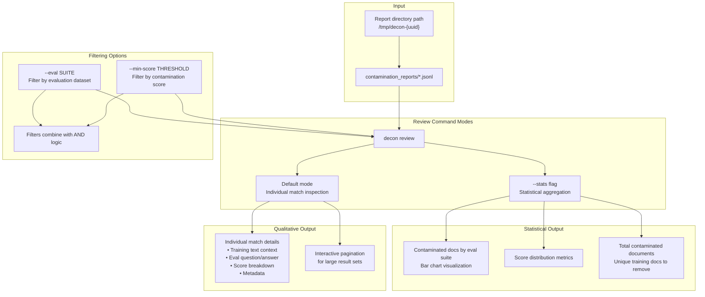
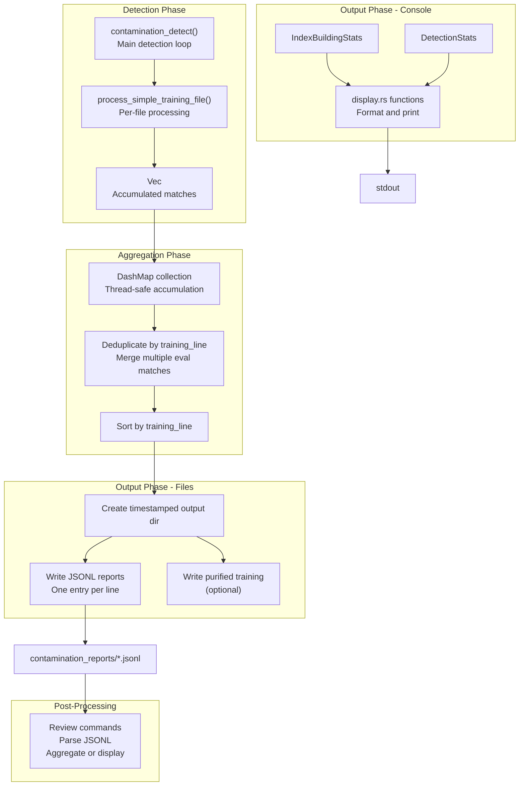

<!-- source: DeepWiki mcp.deepwiki.com · repo allenai/decon · page 6.3 Output and Reporting Systems · fetched 2026-10-26 -->

# Output and Reporting Systems

<details>
<summary>Relevant source files</summary>

The following files were used as context for generating this wiki page:

- [README.md](README.md)
- [src/detect/display.rs](src/detect/display.rs)

</details>


## Purpose and Scope

This page documents the output and reporting systems that present contamination detection results to users. It covers console display formatting, report file structures, and review tools. For information about the detection algorithms that generate these outputs, see [Detection and Cluster Expansion](#4.3). For data format specifications of input files, see [Data Formats and Structures](#5.3).

The output systems serve three primary functions:
1. **Real-time progress display** - Console output during detection runs showing progress and summary statistics
2. **Persistent report generation** - JSONL files containing detailed contamination matches with metadata
3. **Post-detection analysis** - Review tools for statistical aggregation and qualitative inspection

---

## System Architecture

The output system consists of three layers that transform detection results into actionable information:



**Sources:** [src/detect/display.rs:1-184](), [README.md:136-152]()

---

## Console Display System

The [src/detect/display.rs]() module implements formatted console output for real-time feedback during detection runs. All display functions use box-drawing characters to create visually distinct tables.

### Display Functions

The module provides three primary display functions called at different stages of the detection pipeline:

| Function | Call Location | Purpose |
|----------|---------------|---------|
| `display_index_building_results()` | After reference index construction | Shows index statistics and preprocessing metrics |
| `display_detection_results()` | After contamination detection completes | Summarizes detection performance and match counts |
| `display_completion_message()` | End of detection run | Provides next-step instructions |

**Sources:** [src/detect/display.rs:22-182]()

### Index Building Results Display

The `display_index_building_results()` function [src/detect/display.rs:22-103]() presents a comprehensive summary of reference index construction:



**Example output:**
```
┌──────────────────────────────────────────────────────────────────┐
│                  Reference Index Building Summary                │
├──────────────────────────────────────────────────────────────────┤
│   Total lines examined                                    15,423 │
│   Lines indexed                                           12,891 │
│   Lines skipped                                            2,532 │
│     - Duplicates                                           1,204 │
│     - Below minimum tokens                                   856 │
│     - Below min unique words                                 472 │
├──────────────────────────────────────────────────────────────────┤
│   Unique n-grams                                         127,456 │
│   Hot n-grams                                              3,421 │
│   Eval datasets                                          42 suites │
├──────────────────────────────────────────────────────────────────┤
│   Build time                                               38.59s │
└──────────────────────────────────────────────────────────────────┘
```

**Sources:** [src/detect/display.rs:22-103](), [README.md:36-43]()

### Detection Results Display

The `display_detection_results()` function [src/detect/display.rs:106-168]() presents detection performance metrics and contamination counts:

**Input Parameters:**
- `index_time: Duration` - Time spent building reference index
- `detection_time: Duration` - Time spent scanning training data
- `total_time: Duration` - Total elapsed time
- `total_contaminations: usize` - Number of contamination matches found
- `contaminated_lines: usize` - Number of distinct training documents contaminated

**Display Components:**



The throughput calculation [src/detect/display.rs:125-139]() automatically selects appropriate units:
- If `micros_per_line >= 1000.0`: display as milliseconds (`ms/doc`)
- If `micros_per_line > 0.0`: display as microseconds (`μs/doc`)

**Sources:** [src/detect/display.rs:106-168](), [README.md:29-43]()

### Number Formatting

The `format_with_commas()` helper function [src/detect/display.rs:4-19]() improves readability of large numbers by inserting thousand separators:

**Algorithm:**
1. Convert number to string
2. Iterate through characters in reverse
3. Insert comma every 3 digits
4. Return formatted string

**Examples:**
- `1851` → `"1,851"`
- `5162084` → `"5,162,084"`
- `127` → `"127"`

**Sources:** [src/detect/display.rs:4-19]()

### Completion Message

The `display_completion_message()` function [src/detect/display.rs:171-182]() provides guidance for next steps:

| Condition | Message |
|-----------|---------|
| `total_contaminations == 0` | "No contamination detected!" |
| `total_contaminations > 0` | "To review results:" followed by review command |

**Example:**
```
To review results:
  decon review /tmp/decon-295c0cbd
```

**Sources:** [src/detect/display.rs:171-182](), [README.md:45-57]()

---

## Report File Format

Detection results are persisted as JSONL (JSON Lines) files in the output directory specified by `config.report_output_dir`. Each line represents a single `ContaminationEntry` record.

### Output Directory Structure



**Sources:** [README.md:6-7](), [README.md:98-100]()

### ContaminationEntry Structure

Each contamination match is serialized as a JSON object with the following fields:

| Field | Type | Description |
|-------|------|-------------|
| `training_line` | `usize` | Line number in training file (0-indexed) |
| `eval_key` | `String` | Identifier for evaluation dataset (e.g., "mmlu", "gsm8k") |
| `contamination_score` | `f64` | Composite score combining all components (0.0-1.0) |
| `idf_overlap` | `f64` | IDF-weighted overlap between training and eval text |
| `question_idf` | `f64` | IDF overlap for question component |
| `answer_idf` | `f64` | IDF overlap for answer component |
| `passage_idf` | `f64` | IDF overlap for passage component (if present) |
| `highlighted_text` | `String` | Snippet of training text with matches highlighted |
| `fingerprint` | `String` | SHA256 hash of eval instance |
| `metadata` | `HashMap<String, Value>` | Additional context from eval dataset |

**Example JSONL entry:**
```json
{
  "training_line": 42387,
  "eval_key": "mmlu",
  "contamination_score": 0.87,
  "idf_overlap": 0.92,
  "question_idf": 0.89,
  "answer_idf": 0.95,
  "passage_idf": 0.0,
  "highlighted_text": "... the plane face of plano convex lens ...",
  "fingerprint": "a3f5b9c2...",
  "metadata": {
    "subject": "physics",
    "difficulty": "easy"
  }
}
```

**Sources:** [README.md:14-22]()

---

## Review and Analysis Tools

The `decon review` and `decon compare` commands provide post-detection analysis capabilities for both qualitative inspection and statistical aggregation.

### Review Command Architecture



**Sources:** [README.md:136-151]()

### Statistical Analysis Mode

When invoked with `--stats`, the review command aggregates contamination reports by evaluation suite:

**Example output:**
```
=== TRAINING DOCUMENTS CONTAMINATED BY EVAL SUITE ===
(Each count represents unique training documents that need removal)

  sciq                                  652 │███████████████████████████████████████│
  mmlu                                  278 │█████████████████████                  │
  mmlu_pro                              211 │████████████████                       │
  ai2_arc_easy                           83 │██████                                 │
  super_gpqa                             65 │████                                   │
  ...
```

The statistical view provides:
- **Unique training documents** contaminated per eval suite
- **Visual bar chart** showing relative contamination levels
- **Actionable counts** for dataset purification decisions

**Sources:** [README.md:45-57]()

### Qualitative Review Mode

The default review mode displays individual contamination matches for detailed inspection:

**Display components:**
1. **Training document context** - Surrounding text with highlighted match regions
2. **Evaluation instance** - Original question, answer, and passage (if applicable)
3. **Score breakdown** - Component scores (question_idf, answer_idf, passage_idf) and composite score
4. **Metadata** - Eval suite identifier, fingerprint, additional metadata from eval dataset

**Filtering examples:**

```bash
# Review only MMLU contamination with high confidence
decon review /tmp/decon-output --eval mmlu --min-score 0.9

# Review all high-confidence matches across all evals
decon review /tmp/decon-output --min-score 0.95

# Review specific eval suite
decon review /tmp/decon-output --eval gsm8k
```

**Sources:** [README.md:139-148]()

### Compare Command

The `decon compare` command enables cross-run analysis to track changes between different detection configurations or training dataset versions:

```bash
decon compare /tmp/results-a /tmp/results-b
```

**Use cases:**
- Evaluate effect of parameter changes
- Compare contamination before/after data cleaning
- Track contamination across training dataset versions
- A/B test different contamination thresholds

**Sources:** [README.md:149-151]()

---

## Output Generation Flow

The complete flow from detection engine to user-facing output:



**Key design decisions:**

1. **Thread-safe accumulation** - `DashMap` enables parallel detection threads to write contamination entries without blocking [src/detect/detection.rs]()

2. **Deduplication strategy** - Multiple evaluation instances may match the same training line; deduplication prevents inflated counts

3. **Progressive display** - Console output appears during detection (progress bars) and at completion (summary tables), providing real-time feedback

4. **Separation of concerns** - Display formatting logic isolated in [src/detect/display.rs](), independent of detection algorithms

5. **Machine-readable output** - JSONL format enables automated analysis pipelines beyond built-in review tools

**Sources:** [src/detect/display.rs:1-184](), [README.md:6-7](), [README.md:136-152]()

---

## Summary Table: Output Artifacts

| Artifact | Location | Format | Purpose |
|----------|----------|--------|---------|
| Console summary | stdout | Formatted tables | Real-time progress and final statistics |
| Contamination reports | `{output_dir}/contamination_reports/` | JSONL | Detailed match records for analysis |
| Purified training data | `{output_dir}/purified_data/` | Original format | Cleaned dataset with contamination removed |
| Metadata snapshot | `{output_dir}/metadata.json` | JSON | Configuration used for run reproducibility |
| Statistical summary | stdout (review --stats) | Formatted text + bar charts | Aggregated contamination by eval suite |
| Individual matches | stdout (review) | Formatted text | Qualitative inspection of specific contaminations |

**Sources:** [README.md:6-7](), [README.md:77-78](), [README.md:136-151]()

---

