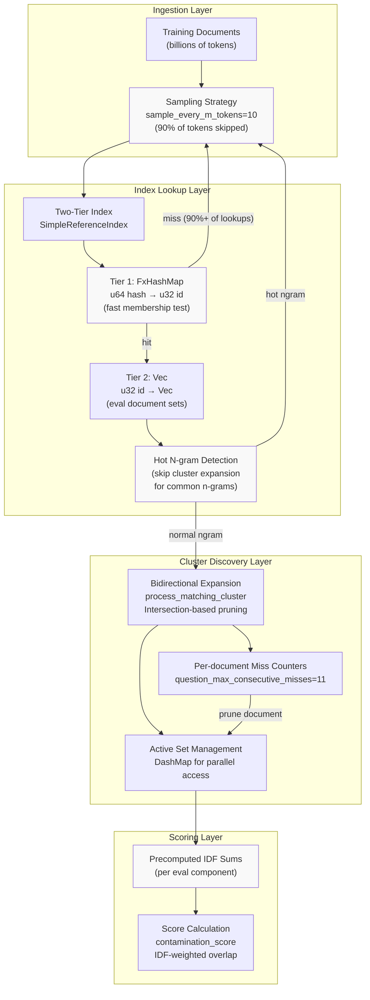
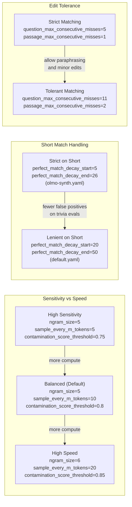
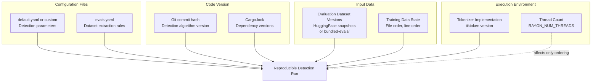
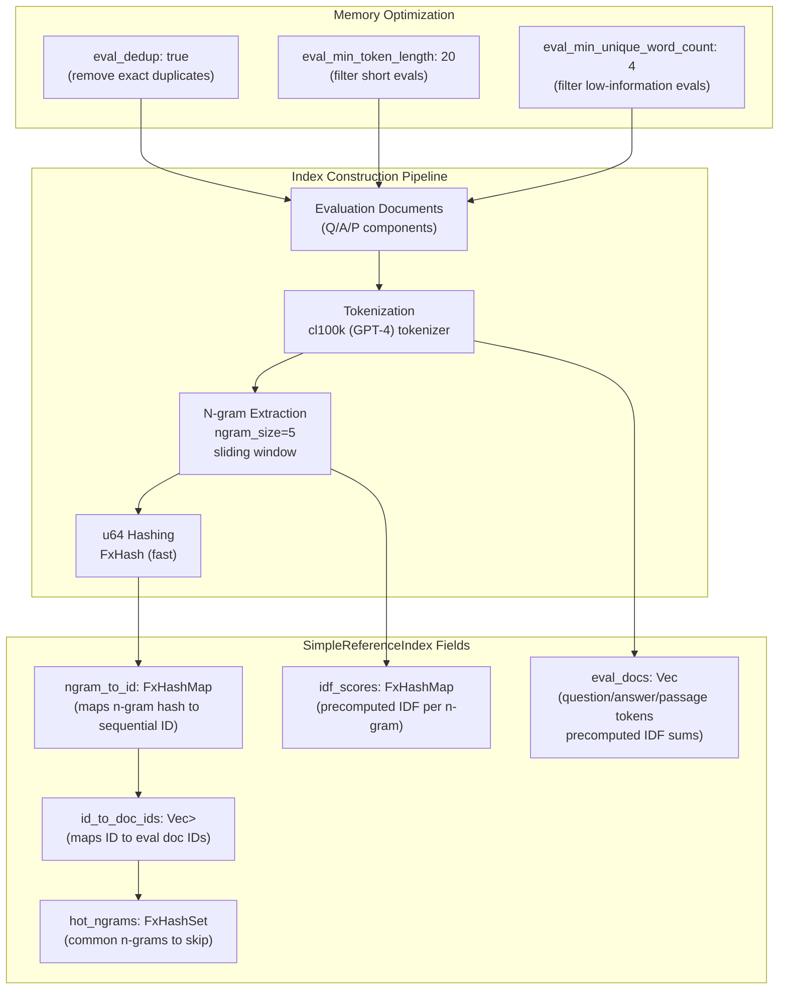
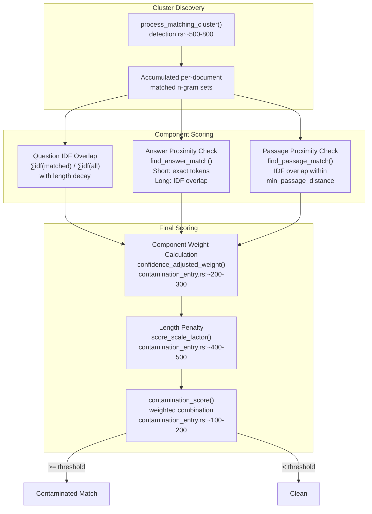

<!-- source: DeepWiki mcp.deepwiki.com · repo allenai/decon · page 7 Advanced Topics · fetched 2026-10-26 -->

# Advanced Topics

<details>
<summary>Relevant source files</summary>

The following files were used as context for generating this wiki page:

- [doc/repro/olmo-synth.yaml](doc/repro/olmo-synth.yaml)
- [doc/simple-details.md](doc/simple-details.md)

</details>


This section covers advanced usage patterns, performance optimization techniques, and reproducibility considerations for experienced decon users. These topics assume familiarity with basic detection workflows and configuration parameters.

For basic command usage and workflows, see [Getting Started](#2) and [User Guide](#3). For detailed algorithm explanations, see [The SIMPLE Algorithm](#4). For standard configuration parameters, see [Configuration Guide](#3.3).

This page provides an overview of advanced concepts, with detailed coverage in:
- [Performance Optimization](#7.1) - Index design, sampling strategies, and performance characteristics
- [Reproducing Historical Runs](#7.2) - Using historical configurations for reproducibility

---

## Overview of Advanced Configuration

The decon system is highly parameterized to support diverse use cases. While `config/default.yaml` provides sensible defaults for most scenarios, advanced users often need to tune parameters based on:

1. **Dataset characteristics**: Training data size, eval suite composition, expected contamination patterns
2. **Performance requirements**: Available memory, CPU cores, acceptable runtime
3. **Detection sensitivity**: Trade-offs between false positives, false negatives, and execution speed
4. **Reproducibility needs**: Matching historical decontamination runs or comparing detection strategies

### Key Configuration Dimensions

| Configuration Area | Primary Parameters | Impact |
|-------------------|-------------------|---------|
| **Index Construction** | `ngram_size`, `index_passages`, `index_answers` | Memory usage, initial match sensitivity |
| **Sampling Strategy** | `sample_every_m_tokens` | Detection speed vs. recall trade-off |
| **Cluster Expansion** | `question_max_consecutive_misses`, `passage_max_consecutive_misses` | Tolerance for edits and insertions |
| **Scoring Thresholds** | `contamination_score_threshold`, `perfect_match_decay_start`, `perfect_match_decay_end` | False positive vs. false negative balance |
| **Performance Optimization** | Hot n-gram threshold (code-level), two-tier index | Execution speed for common cases |

**Sources**: [doc/simple-details.md:1-220](), [doc/repro/olmo-synth.yaml:1-49]()

---

## Performance Optimization Architecture

The decon system employs multiple optimization techniques that work together to achieve high throughput on large training datasets. Understanding these optimizations helps when tuning for specific workloads.



### Optimization Techniques

**1. Sampling Strategy**

Rather than checking every token position, decon samples every M tokens (default: 10). When an initial match is found, the system switches to exhaustive analysis within the contamination cluster. This provides:
- **Speed**: 10x reduction in index lookups for clean documents
- **Recall**: No contamination missed (expansion finds cluster boundaries)
- **Tuning**: Lower `sample_every_m_tokens` increases sensitivity to short matches at cost of speed

**2. Two-Tier Index Lookup**

The system uses `FxHashMap<u64, u32>` followed by `Vec<Vec<u32>>` instead of a single-tier `HashMap<u64, Vec<u32>>`:
- **Tier 1**: Fast membership test for n-gram presence (u64 hash → u32 sequential id)
- **Tier 2**: Resolve to eval document IDs only for confirmed matches
- **Rationale**: 90%+ of lookups are misses; optimizing the miss case provides substantial speedup

**3. Hot N-gram Optimization**

Extremely common n-grams (e.g., "the", "of", "and") appear frequently in both training and eval data. Starting cluster expansion on these leads to many false initial hits:
- **Detection**: N-grams appearing in many eval documents are marked "hot"
- **Handling**: On hot n-gram hit, switch to token-by-token traversal until miss or normal n-gram
- **Impact**: Avoids expensive cluster expansion for low-signal matches

**4. Precomputed IDF Sums**

During index construction, decon precomputes the denominator for IDF-weighted overlap:

```
∑_{y ∈ U_e} idf(y)
```

This is stored per eval document component (question/answer/passage) in the reference index. At detection time, only the numerator (matching n-grams) needs computation.

**Sources**: [doc/simple-details.md:137-147](), [doc/simple-details.md:91-100](), [doc/simple-details.md:102-108]()

---

## Trade-offs in Configuration

Different use cases benefit from different parameter configurations. The following patterns represent common trade-off decisions.



### Configuration Patterns

| Use Case | Configuration Adjustments | Rationale |
|----------|--------------------------|-----------|
| **Large Web Scrapes** | `contamination_score_threshold=0.8`, `perfect_match_decay_end=50` | Balance false positives from common phrases |
| **Synthetic/Generated Data** | `contamination_score_threshold=0.78`, `perfect_match_decay_start=5` | Stricter on short matches (olmo-synth pattern) |
| **High-Confidence Only** | `contamination_score_threshold=0.9`, `question_max_consecutive_misses=5` | Minimize false positives, accept lower recall |
| **Maximum Recall** | `sample_every_m_tokens=5`, `contamination_score_threshold=0.75` | Find all potential contamination, manual review later |
| **Memory-Constrained** | `index_passages=false`, `ngram_size=6` | Reduce index size (passages often long) |

**Sources**: [doc/repro/olmo-synth.yaml:1-49](), [doc/simple-details.md:115-120]()

---

## Reproducibility Considerations

Exact reproducibility of detection runs requires controlling multiple factors beyond configuration files.

### Reproducibility Factors



### Historical Run Reproduction

The `doc/repro/` directory contains configurations used for published decontamination runs:

- **`olmo-synth.yaml`**: Configuration approximating the synthetic data decontamination for OLMo midtraining
- **`olmo-web.yaml`**: Configuration for web data decontamination (if present)

These configurations document parameter values that differ from current defaults, with comments explaining the rationale. For example, `olmo-synth.yaml` uses stricter short-match thresholds:

```yaml
perfect_match_decay_start: 5  # Require perfect match for length <= 5
perfect_match_decay_end: 26   # vs. default 20/50
contamination_score_threshold: 0.78  # vs. default 0.8
```

**Important**: Exact reproduction also requires matching:
1. **Evaluation data**: Same dataset versions (use bundled evals from the release)
2. **Code version**: Git commit hash or release tag
3. **Tokenizer version**: `tiktoken` version affects token boundaries

Approximate reproduction (90% overlap) is achievable with configuration files alone; exact reproduction requires matching all inputs.

**Sources**: [doc/repro/olmo-synth.yaml:1-49]()

---

## Index Construction Details

Understanding the reference index structure helps with memory optimization and debugging.

### SimpleReferenceIndex Structure



### Index Size Estimation

For a typical evaluation suite (~150 datasets, ~50k instances):

| Component | Typical Size | Notes |
|-----------|--------------|-------|
| `ngram_to_id` | ~10-20 MB | Depends on eval diversity |
| `id_to_doc_ids` | ~5-10 MB | Small due to u32 IDs |
| `idf_scores` | ~5-10 MB | One f32 per unique n-gram |
| `eval_docs` | ~50-100 MB | Tokenized eval content |
| **Total** | ~100-200 MB | Fits comfortably in memory |

Passages dominate index size. If memory is constrained, set `index_passages: false` to reduce by ~40-60%.

**Sources**: [doc/simple-details.md:137-147]()

---

## Scoring System Deep Dive

The contamination scoring system combines multiple signals with adaptive weighting.

### Scoring Pipeline Code Mapping



### Advanced Scoring Features

**1. Confidence-Adjusted Weights**

For evals with short questions but long answers, the default 75%/25% Q/A weight may not reflect information content. Decon adjusts weights based on component lengths:

- Question confidence: `0.5 + 0.5 * min(ngram_count / 20, 1.0)`
- Low-confidence components redistribute weight to high-confidence ones
- Perfect overlaps are never penalized

This prevents false negatives on passages with formulaic questions like "What is the answer?" followed by substantive answer text.

**2. Length-Based Threshold Scaling**

Short texts require stricter matches to avoid coincidental overlap. The system applies a decay function:

- Below `perfect_match_decay_start` tokens: requires perfect match (score = 1.0)
- Between start and `perfect_match_decay_end`: linear interpolation
- Above end: uses base `contamination_score_threshold`

This makes trivia questions with short answers require near-perfect matches while allowing legitimate variations in longer texts.

**3. Proximity Requirements**

For QA evals, the answer must appear within a window after the question cluster. For QP or QAP evals, the passage must appear within `min_passage_distance` tokens of the question. This prevents false positives from unrelated text in long training documents.

**Sources**: [doc/simple-details.md:149-218]()

---

## Advanced Debugging Techniques

When detection results are unexpected, several techniques help diagnose issues.

### Diagnostic Configuration Patterns

| Issue | Diagnostic Configuration | Expected Outcome |
|-------|-------------------------|------------------|
| **Too many false positives** | Lower `contamination_score_threshold` to 0.6, review matches | Identify score distribution, adjust threshold |
| **Missing known contamination** | Set `sample_every_m_tokens=1`, lower threshold | Find if sampling or scoring is the issue |
| **Inconsistent results** | Check `eval_dedup=true`, verify eval data SHA256 | Ensure deterministic evaluation set |
| **Memory issues** | Set `index_passages=false`, increase `eval_min_token_length` | Reduce index size |
| **Performance debugging** | Use `decon server` with single worker, profile | Isolate bottlenecks |

### Using Review Mode for Analysis

The `decon review` command provides statistical breakdowns:

```bash
# Review contamination reports
decon review --contamination-dir results/

# Output:
# - Per-eval suite contamination rates
# - Score distributions
# - Component overlap statistics
# - Individual match inspection
```

This helps identify:
- Eval suites with unusual contamination patterns (data quality issues?)
- Score threshold sensitivity (many matches near threshold?)
- Component contribution (is contamination driven by passages?)

**Sources**: Referenced from general decon usage patterns

---

## Next Steps

For detailed coverage of specific advanced topics:

- **Performance optimization internals**: See [Performance Optimization](#7.1) for deep dives into hot bucket optimization, index lookup implementation details, and performance characteristics
- **Historical run reproduction**: See [Reproducing Historical Runs](#7.2) for step-by-step guides to reproducing OLMo decontamination results

For extending decon with new features or contributing:
- See [Development Guide](#8) for development setup, testing, and code structure

**Sources**: Table of contents structure

---

