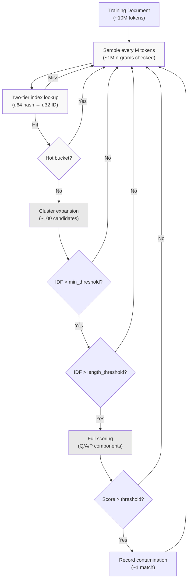
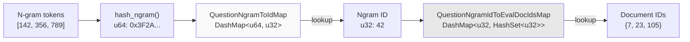
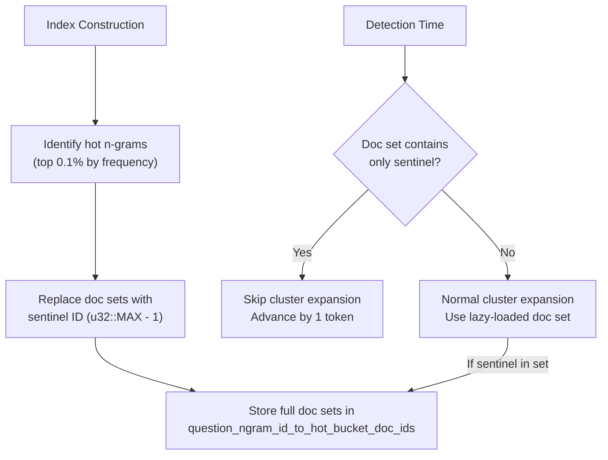
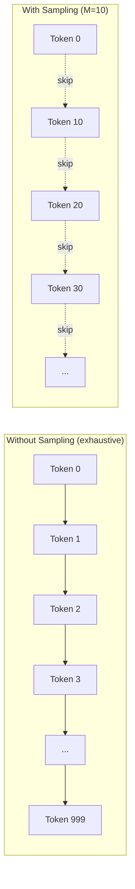
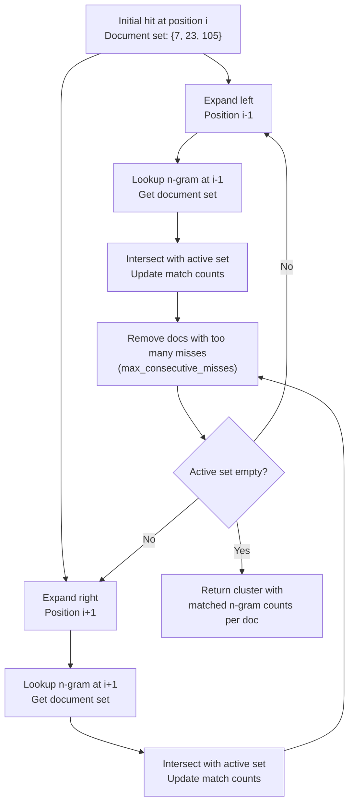
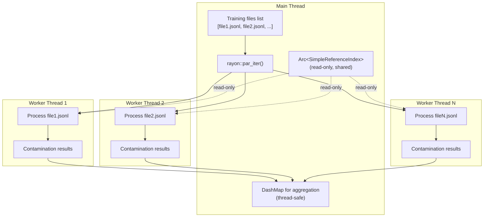
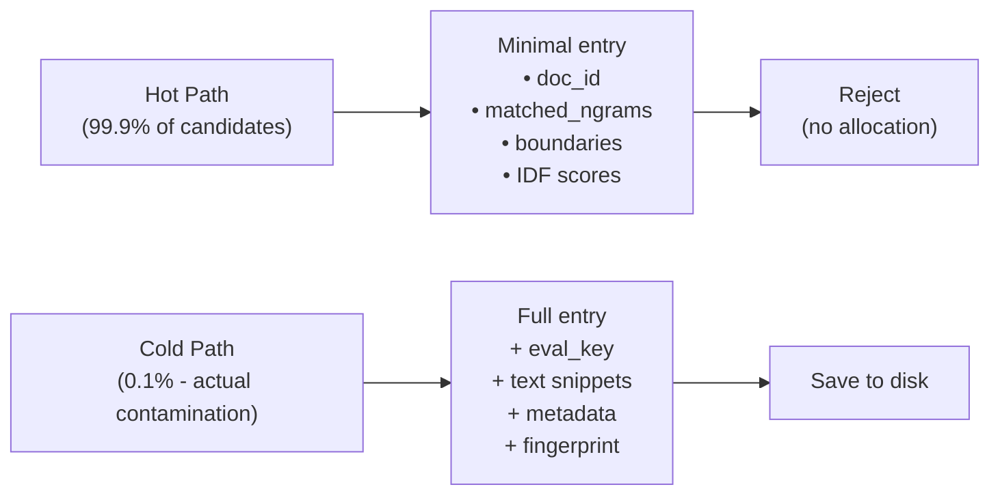

<!-- source: DeepWiki mcp.deepwiki.com · repo allenai/decon · page 7.1 Performance Optimization · fetched 2026-10-26 -->

# Performance Optimization

<details>
<summary>Relevant source files</summary>

The following files were used as context for generating this wiki page:

- [doc/simple-details.md](doc/simple-details.md)
- [doc/simple.md](doc/simple.md)
- [src/detect/detection.rs](src/detect/detection.rs)

</details>


This document describes the performance optimizations employed in the decon contamination detection system. It covers the multi-stage filtering approach, hot bucket optimization, sampling strategies, and parallel processing techniques that enable efficient processing of billion-token training datasets against hundreds of evaluation benchmarks.

For information about the overall algorithm design, see [The SIMPLE Algorithm](#4). For implementation details of the detection pipeline, see [Detection Pipeline Implementation](#6.1). For configuration of performance parameters, see [Configuration Guide](#3.3).

## Performance Characteristics Overview

The decon system is designed to handle asymmetric workloads where `|T| >> |E|` (training data vastly exceeds evaluation data) and `|C| << |P|` (contaminated documents are rare). Performance optimizations exploit this sparsity through:

- **Index-once, query-many**: Evaluation data is indexed once; training data is streamed
- **Sampling for sparsity**: Most training n-grams don't match; sampling reduces wasted work
- **Progressive filtering**: Multiple early-exit checks before expensive scoring
- **Parallelism**: Training files processed independently across threads
- **Hot bucket handling**: Common n-grams bypass cluster expansion

| Optimization | Impact | Configuration Parameter |
|--------------|--------|------------------------|
| N-gram sampling | 10-100x speedup | `sample_every_m_tokens` (default: 10) |
| Hot bucket skipping | Avoids false expansion | Automatic (top 0.1% frequency) |
| Two-tier index | Faster miss detection | Automatic |
| Early IDF threshold | ~50% cluster reduction | `minimum_question_idf_threshold` |
| Length-adjusted threshold | ~30% cluster reduction | `perfect_match_decay_start/end` |
| Parallel file processing | Linear with cores | Automatic (Rayon) |

Sources: [src/detect/detection.rs:242-317](), [doc/simple-details.md:137-148]()

## Multi-Stage Filtering Pipeline

Detection uses progressive filtering with increasingly expensive checks, ensuring most false positives are rejected early:



Sources: [src/detect/detection.rs:717-777](), [src/detect/detection.rs:527-575]()

### Stage Breakdown

**Stage 1: Sampling (Lines per Second: ~100K)**
- Extract n-gram every `M` tokens (default: 10)
- Hash n-gram to u64
- **Exit**: 90-99% of samples (no index match)

[src/detect/detection.rs:728-733]()

**Stage 2: Two-Tier Lookup (Nanosecond-scale)**
- Check if u64 hash exists in `question_ngram_to_id`
- Retrieve u32 ID
- Lookup document set in `question_ngram_id_to_eval_doc_ids`
- **Exit**: Most remaining samples (not in eval index)

[src/detect/detection.rs:779-800]()

**Stage 3: Hot Bucket Check (Single comparison)**
- Check if document set contains only `hot_bucket_id`
- Switch to single-token traversal if hot
- **Exit**: Common n-grams (e.g., "the", "of", "and")

[src/detect/detection.rs:741-745]()

**Stage 4: Cluster Expansion (Microsecond-scale)**
- Bidirectional expansion with set intersection
- Track matched n-gram IDs per document
- **Exit**: Documents that don't maintain sufficient overlap

[src/detect/cluster.rs]()

**Stage 5: Minimum IDF Check (Single division)**
- Calculate IDF-weighted overlap for question
- Compare against `minimum_question_idf_threshold` (default: 0.3)
- **Exit**: ~50% of expanded clusters

[src/detect/detection.rs:462-475]()

**Stage 6: Length-Adjusted Threshold (Interpolation)**
- Compute required threshold based on eval length
- Short evals need higher scores
- **Exit**: ~30% of remaining clusters

[src/detect/detection.rs:549-557]()

**Stage 7: Full Scoring (Millisecond-scale)**
- Compute answer and passage overlaps
- Apply component weighting
- Check proximity constraints
- **Exit**: Final threshold comparison

[src/detect/contamination_entry.rs]()

Sources: [src/detect/detection.rs:717-777](), [src/detect/detection.rs:527-575](), [src/detect/detection.rs:462-475]()

## Index Construction Optimizations

### Two-Tier Lookup Structure

The reference index uses a two-tier structure optimized for sparse matches:



**Why Two Tiers?**

Training n-grams space >> Eval n-gram space. Most lookups are misses. A single-tier map with `DashMap<u64, HashSet<u32>>` would waste memory and incur unnecessary HashSet clones on hits. The two-tier approach:

1. **Fast miss detection**: Check if u64 exists in compact u32 ID space
2. **Lazy document retrieval**: Only lookup document sets on confirmed hits
3. **Memory efficiency**: Store document sets once, indexed by small u32 IDs

Sources: [src/detect/reference_index.rs](), [doc/simple-details.md:137-141]()

### Hot Bucket Optimization

High-frequency n-grams (e.g., "the", "of", "in") appear in many eval documents but provide weak contamination signal. The hot bucket system identifies and handles these specially:



**Hot Bucket Detection Logic:**

```rust
// At detection time
if document_ids.len() == 1 && document_ids.contains(&index.hot_bucket_id) {
    i += 1;  // Skip cluster expansion, advance by 1 token
    continue;
}
```

[src/detect/detection.rs:742-745]()

**Benefits:**
- Prevents wasted cluster expansion on common n-grams
- Single-token traversal until non-hot match found
- Lazy evaluation of large document sets only when needed

Sources: [src/detect/detection.rs:741-745](), [src/detect/reference_index.rs]()

## Detection Phase Optimizations

### Sampling Strategy

N-gram sampling reduces computational work by skipping most tokens:



**Implementation:**

```rust
let mut i = 0;
while i < total_ngrams {
    let document_ids = check_ngram_for_match(...);
    
    if document_ids.is_none() {
        i += config.sample_every_m_tokens;  // Jump ahead
        continue;
    }
    
    // Found match - switch to exhaustive expansion
    let cluster = expand_simple_contamination_cluster(...);
    i = i.max(cluster_end + 1);  // Resume sampling after cluster
}
```

[src/detect/detection.rs:728-774]()

**Key Insight:** Once a match is found, the system switches to exhaustive bidirectional expansion. Sampling only applies when traversing clean regions.

**Configuration:**
- `sample_every_m_tokens: 10` (default): Check 1 in 10 n-grams
- Higher values: Faster but may miss contamination
- Lower values: More thorough but slower
- `sample_every_m_tokens: 1`: Exhaustive (no sampling)

Sources: [src/detect/detection.rs:728-774](), [doc/simple.md:23-25]()

### Early Exit Checks

Multiple threshold checks filter candidates before expensive operations:

| Check | Location | Cost | Rejection Rate |
|-------|----------|------|----------------|
| Minimum token count | Line 340 | O(1) | ~5% |
| Minimum IDF | Line 470 | O(n) n=matched_ngrams | ~50% |
| Length-adjusted IDF | Line 549 | O(1) + interpolation | ~30% |
| Final score threshold | Line 560 | O(k) k=components | ~10% |

**Minimum IDF Check:**

```rust
let idf_overlap = calculate_question_idf_overlap(...);

if idf_overlap.unwrap_or(0.0) < config.minimum_question_idf_threshold {
    if let Some(stats) = stats {
        stats.increment_excluded_low_idf_threshold();
    }
    return None;  // Early exit
}
```

[src/detect/detection.rs:462-475]()

**Length-Adjusted Threshold:**

```rust
let question_idf = entry.idf_overlap.unwrap_or(0.0);
let required_question_threshold = interpolate_threshold(
    entry.eval_token_length.unwrap_or(usize::MAX),
    context.config.perfect_match_decay_start,  // 20 tokens
    context.config.perfect_match_decay_end,    // 50 tokens
    context.config.minimum_question_idf_threshold,
);

if question_idf < required_question_threshold {
    return None;  // Early exit
}
```

[src/detect/detection.rs:549-557]()

Sources: [src/detect/detection.rs:462-475](), [src/detect/detection.rs:549-557](), [src/detect/detection.rs:340-342]()

### Cluster Expansion Efficiency

Bidirectional expansion uses set intersection to efficiently track multiple document matches:



**Benefits:**
- Single pass per direction
- Documents removed as soon as they fail to match
- No backtracking or re-scoring
- Miss tolerance allows for edits/insertions

Sources: [src/detect/cluster.rs](), [doc/simple-details.md:92-100]()

## Parallel Processing Architecture

Training files are processed independently using Rayon's parallel iterator:



**Key Implementation Details:**

```rust
training_files.par_iter().for_each(|file_path| {
    let file_contamination_results = DashMap::new();
    
    match process_simple_training_file(file_path, config, index, &file_contamination_results, stats) {
        Ok(lines_processed) => {
            // Save results, update counters
        }
        Err(e) => {
            eprintln!("Error processing {:?}: {:?}", file_path, e);
        }
    }
});
```

[src/detect/detection.rs:262-288]()

**Thread-Safe Data Structures:**
- `Arc<SimpleReferenceIndex>`: Read-only shared reference to index
- `DashMap<String, Vec<SimpleContaminationEntry>>`: Concurrent hash map for results
- `Arc<AtomicU32>`: Atomic counters for statistics
- `Arc<DashMap<String, HashSet<usize>>>`: Contaminated files tracking

Sources: [src/detect/detection.rs:242-317](), [src/detect/detection.rs:262-288]()

## Memory Efficiency

### Delayed Metadata Loading

Contamination entries are created with minimal data during detection. Full metadata (text snippets, eval details) is only loaded when a match exceeds the final threshold:



**Implementation:**

```rust
// Hot path: minimal allocation
Some(SimpleContaminationEntry {
    training_line: line_num,
    eval_key: String::new(),  // Empty - filled later
    eval_line: 0,
    // ... numeric fields only
    eval_question_text: None,  // Not loaded yet
    eval_answer_text: None,
    eval_passage_text: None,
    // ...
})

// Cold path: load metadata only for confirmed contamination
if result.is_contaminated {
    if let Some(metadata) = context.index.eval_document_metadata.get(&doc_id) {
        entry.eval_key = metadata.eval_key.clone();
        entry.fingerprint = metadata.fingerprint.clone();
        // ... load all text snippets
    }
}
```

[src/detect/detection.rs:488-524](), [src/detect/detection.rs:581-676]()

Sources: [src/detect/detection.rs:449-524](), [src/detect/detection.rs:581-676]()

### Index Memory Layout

The reference index is designed for read-only access with minimal memory overhead:

| Structure | Type | Purpose | Size (typical) |
|-----------|------|---------|----------------|
| `question_ngram_to_id` | `DashMap<u64, u32>` | Hash to ID | ~4MB (100K n-grams) |
| `question_ngram_id_to_eval_doc_ids` | `DashMap<u32, HashSet<u32>>` | ID to docs | ~8MB (100K n-grams) |
| `eval_documents` | `DashMap<u32, (usize, usize, f64, usize, usize)>` | Doc metadata | ~40B per eval |
| `eval_text_snippets` | `DashMap<u32, String>` | Question text | Only loaded for contamination |
| `eval_answer_text_snippets` | `DashMap<u32, String>` | Answer text | Only loaded for contamination |
| `hot_bucket_doc_ids` | `DashMap<u32, HashSet<u32>>` | Lazy hot sets | ~1MB (sparse) |

**Memory Characteristics:**
- Index size grows with unique n-gram count, not dataset size
- Document metadata is compact (5 integers + 1 float per eval)
- Text snippets stored separately and accessed rarely
- Hot bucket document sets loaded on-demand

Sources: [src/detect/reference_index.rs]()

## Performance Tuning Parameters

### Detection Speed vs Thoroughness

| Parameter | Default | Effect on Speed | Effect on Recall |
|-----------|---------|-----------------|------------------|
| `sample_every_m_tokens` | 10 | 10x faster | ~95-99% recall |
| `ngram_size` | 5 | Smaller = faster lookup | Larger = fewer false positives |
| `question_max_consecutive_misses` | 11 | Lower = faster expansion | Higher = handles more edits |
| `minimum_question_idf_threshold` | 0.3 | Higher = earlier rejection | Lower = more sensitive |

### Memory vs Accuracy

| Parameter | Default | Effect on Memory | Effect on Accuracy |
|-----------|---------|------------------|-------------------|
| Hot bucket threshold | Top 0.1% | Lower = less memory | Higher = may miss some matches |
| `eval_min_token_length` | 10 | Higher = smaller index | Higher = may exclude short evals |
| `eval_min_unique_word_count` | 5 | Higher = smaller index | Higher = may exclude simple evals |

### Example Tuning Scenarios

**Maximum Speed (for quick scans):**
```yaml
sample_every_m_tokens: 20
minimum_question_idf_threshold: 0.5
question_max_consecutive_misses: 5
```

**Maximum Recall (for critical decontamination):**
```yaml
sample_every_m_tokens: 1
minimum_question_idf_threshold: 0.2
question_max_consecutive_misses: 20
```

**Balanced (default configuration):**
```yaml
sample_every_m_tokens: 10
minimum_question_idf_threshold: 0.3
question_max_consecutive_misses: 11
```

Sources: [config/default.yaml](), [doc/simple-details.md]()

## Benchmarking and Profiling

When verbose mode is enabled (`--verbose`), the system collects detailed timing statistics:

```rust
pub struct AggregatedStats {
    pub files_processed: usize,
    pub lines_processed: usize,
    pub contaminations_found: usize,
    pub excluded_low_idf_threshold: usize,
    // ... timing stats for each phase
}
```

**Key Metrics to Monitor:**
- Lines processed per second
- Average cluster expansion time
- Index lookup hit rate
- Early exit rejection rates per stage

Enable verbose output to see these statistics:
```bash
decon detect --training-dir ./data --verbose
```

Sources: [src/detect/stats.rs](), [src/detect/utils.rs]()

---

