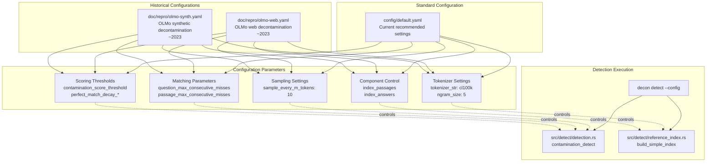
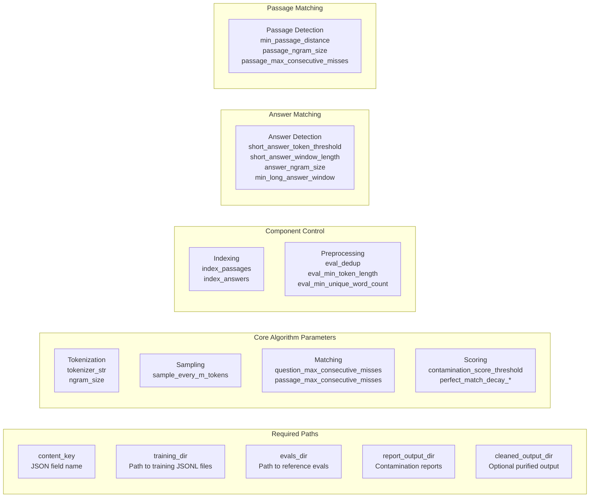
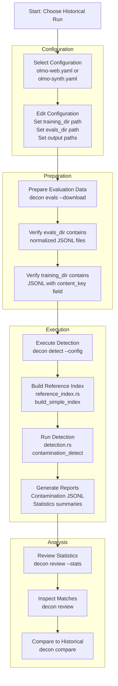
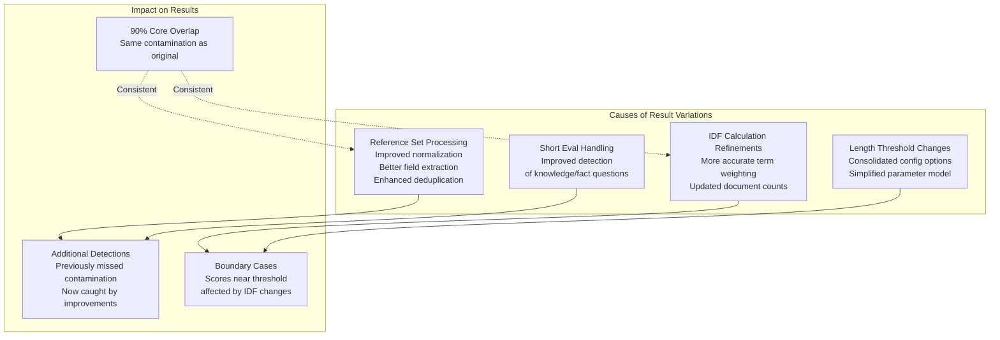
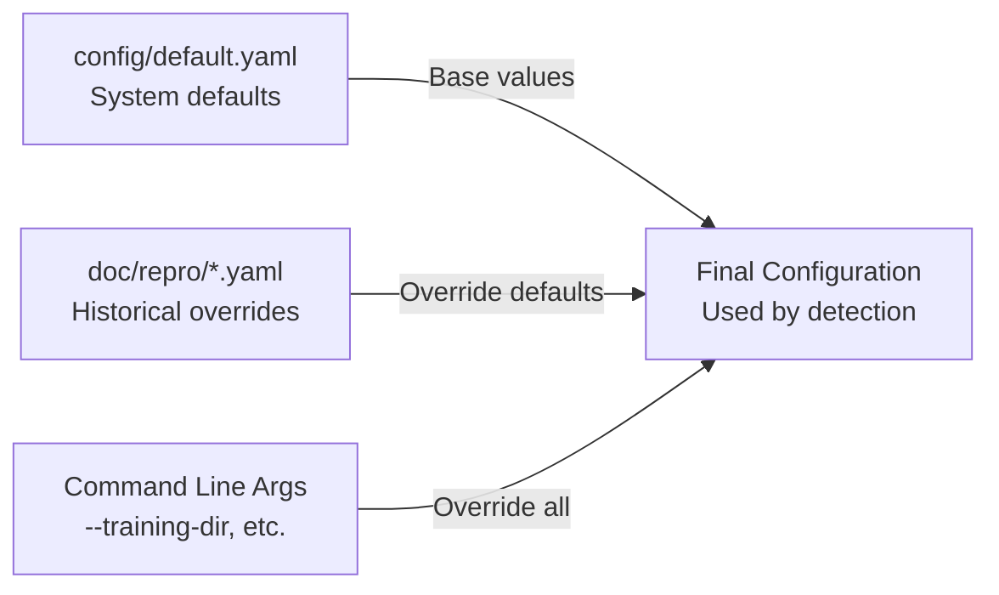

<!-- source: DeepWiki mcp.deepwiki.com · repo allenai/decon · page 7.2 Reproducing Historical Runs · fetched 2026-10-26 -->

# Reproducing Historical Runs

<details>
<summary>Relevant source files</summary>

The following files were used as context for generating this wiki page:

- [README.md](README.md)
- [doc/repro/olmo-synth.yaml](doc/repro/olmo-synth.yaml)
- [doc/repro/olmo-web.yaml](doc/repro/olmo-web.yaml)

</details>


This page documents how to reproduce historical contamination detection runs using the archived configuration files in `doc/repro/`. These configurations capture the exact parameters used for published decontamination work, enabling scientific reproducibility and serving as reference templates for similar use cases.

For general configuration guidance, see [Configuration Guide](#3.3). For performance characteristics of different parameter choices, see [Performance Optimization](#7.1).

## Purpose and Scope

The `doc/repro/` directory contains YAML configuration files that document the specific parameter combinations used for production decontamination runs. These files serve three purposes:

1. **Historical Record**: Document exactly how contamination detection was performed for published work
2. **Reproducibility Aid**: Enable approximate reproduction of historical results with current decon versions
3. **Configuration Templates**: Provide proven parameter combinations for similar detection scenarios

Currently, two historical runs are documented:
- **OLMo Web Decontamination** (`olmo-web.yaml`): Parameters used to decontaminate web-scraped training data
- **OLMo Synthetic Decontamination** (`olmo-synth.yaml`): Parameters used to decontaminate synthetically generated training data

**Sources**: [doc/repro/olmo-web.yaml:1-9](), [doc/repro/olmo-synth.yaml:1-8]()

## Historical Configuration Architecture

The following diagram shows how historical reproduction configurations relate to the standard configuration system and the detection pipeline:



**Sources**: [doc/repro/olmo-web.yaml:1-50](), [doc/repro/olmo-synth.yaml:1-49]()

## Available Historical Configurations

### OLMo Web Decontamination

The `olmo-web.yaml` configuration reproduces the decontamination performed on web-scraped training data for OLMo model midtraining.

**Key Characteristics**:
| Parameter | Value | Purpose |
|-----------|-------|---------|
| `contamination_score_threshold` | 0.88 | Higher threshold for web data (more conservative) |
| `perfect_match_decay_start` | 25 | Requires perfect match for eval instances ≤25 tokens |
| `perfect_match_decay_end` | 50 | Uses threshold for instances ≥50 tokens |
| `index_passages` | false | Passages not indexed for web decontamination |
| `short_answer_window_length` | 20 | Smaller window for answer matching |
| `min_long_answer_window` | 20 | Smaller minimum window for long answers |

**Expected Reproducibility**: ~90% overlap with original contamination detections, plus ~25% additional contamination discoveries due to improved reference set processing and IDF calculation refinements in current decon versions.

**Sources**: [doc/repro/olmo-web.yaml:10-50]()

### OLMo Synthetic Decontamination

The `olmo-synth.yaml` configuration reproduces the decontamination performed on synthetically generated training data.

**Key Characteristics**:
| Parameter | Value | Purpose |
|-----------|-------|---------|
| `contamination_score_threshold` | 0.78 | Lower threshold for synthetic data (more sensitive) |
| `perfect_match_decay_start` | 5 | Requires perfect match only for very short instances |
| `perfect_match_decay_end` | 26 | Earlier transition to threshold scoring |
| `index_passages` | true | Passages indexed for synthetic decontamination |
| `short_answer_window_length` | 50 | Larger window for answer matching |
| `min_long_answer_window` | 50 | Larger minimum window for long answers |

**Expected Reproducibility**: ~90% overlap with original contamination detections. Differences driven primarily by short knowledge/fact evaluations and consolidation of length threshold configuration options.

**Sources**: [doc/repro/olmo-synth.yaml:10-49]()

## Running Historical Configurations

### Basic Execution

To reproduce a historical run, use the `--config` flag with the `decon detect` command:

```bash
# Reproduce OLMo web decontamination
cargo run --release -- detect --config doc/repro/olmo-web.yaml

# Reproduce OLMo synthetic decontamination
cargo run --release -- detect --config doc/repro/olmo-synth.yaml
```

**Important**: You must edit the configuration file to specify your training data location before running:

```yaml
# In doc/repro/olmo-web.yaml or doc/repro/olmo-synth.yaml
training_dir: /path/to/your/training/data  # Update this path
```

**Sources**: [README.md:74-81](), [doc/repro/olmo-web.yaml:11]()

### Configuration File Structure

Both historical configurations follow the same structure as the standard configuration:



**Sources**: [doc/repro/olmo-web.yaml:10-49](), [doc/repro/olmo-synth.yaml:10-49]()

## Parameter Comparison

The following table compares the key parameters between the two historical runs and current defaults:

| Parameter | olmo-web.yaml | olmo-synth.yaml | Notes |
|-----------|---------------|-----------------|-------|
| **Threshold Settings** |
| `contamination_score_threshold` | 0.88 | 0.78 | Web uses higher threshold (more conservative) |
| `perfect_match_decay_start` | 25 | 5 | Web requires perfect match for longer instances |
| `perfect_match_decay_end` | 50 | 26 | Web has wider decay range |
| **Answer Matching** |
| `short_answer_window_length` | 20 | 50 | Synthetic uses larger window |
| `min_long_answer_window` | 20 | 50 | Synthetic uses larger window |
| **Component Indexing** |
| `index_passages` | false | true | Web omits passage indexing |
| `index_answers` | true | true | Both index answers |
| **Passage Matching** |
| `min_passage_distance` | 100 | 100 | Same for both |
| `passage_ngram_size` | 4 | 4 | Same for both |
| `passage_max_consecutive_misses` | 2 | 2 | Same for both |
| **Shared Settings** |
| `tokenizer_str` | cl100k | cl100k | OpenAI tokenizer |
| `ngram_size` | 5 | 5 | 5-gram indexing |
| `sample_every_m_tokens` | 10 | 10 | Same sampling rate |
| `question_max_consecutive_misses` | 11 | 11 | Same expansion tolerance |

**Sources**: [doc/repro/olmo-web.yaml:15-40](), [doc/repro/olmo-synth.yaml:15-40]()

## Execution Workflow

The following diagram shows the complete workflow for reproducing historical runs:



**Sources**: [README.md:59-84](), [README.md:136-151]()

## Understanding Result Variations

### Why Results Differ from Original Runs

The historical configuration files contain important disclaimers explaining expected variations:

**From olmo-web.yaml**:
> "Many improvements have been made to decon including performance, usability, and accuracy as time has progressed from the original decontamination work. In the interest of accessible reproducibility, this configuration produces approximately the same outcomes as the decontamination run against web data for olmo midtraining. You can expect 90% overlap for original contamination with and 25% additional contamination discoveries due largely to improved reference set processing which change the match targets as well as idf values which effect cases on decision boundary."

**From olmo-synth.yaml**:
> "You can expect 90% overlap. The differences are largely driven by short knowledge/fact evals and a consolidation of length threshold config options."

**Sources**: [doc/repro/olmo-web.yaml:1-8](), [doc/repro/olmo-synth.yaml:1-7]()

### Sources of Variation



**Sources**: [doc/repro/olmo-web.yaml:4-8](), [doc/repro/olmo-synth.yaml:4-7]()

## Comparing Results

### Using decon compare

To compare results from a historical reproduction run against another run (or against original results if available):

```bash
# Compare two result directories
cargo run --release -- compare /tmp/decon-olmo-web /tmp/decon-current-defaults

# With statistical output
cargo run --release -- compare --stats /tmp/historical /tmp/current
```

The `compare` command identifies:
- Contamination matches found in both runs
- Contamination unique to each run
- Score differences for shared matches
- Statistical summaries of differences

**Sources**: [README.md:149-151]()

### Key Metrics for Validation

When validating a reproduction, focus on these metrics:

| Metric | Expected Outcome |
|--------|------------------|
| **Total Contaminated Documents** | ~90% overlap with historical count |
| **High-Confidence Matches** | Near-perfect agreement (score > 0.95) |
| **Eval Suite Distribution** | Similar proportions across suites |
| **Boundary Cases** | Expected variation (scores near threshold) |
| **Additional Contamination** | 10-25% more detections (improvements) |

**Sources**: [doc/repro/olmo-web.yaml:4-6](), [doc/repro/olmo-synth.yaml:4-5]()

## Practical Considerations

### When to Use Historical Configurations

Use historical configurations when:

1. **Reproducing Published Work**: You need to validate or understand decontamination performed for a specific publication
2. **Baseline Comparison**: You want to compare current detection capabilities against historical baselines
3. **Template for Similar Data**: Your training data has similar characteristics (web vs. synthetic)

Do **not** use historical configurations for:
- New decontamination projects (use current defaults from `config/default.yaml`)
- Production pipelines requiring maximum accuracy
- Situations where reproducibility of historical runs is not required

**Sources**: [doc/repro/olmo-web.yaml:1-8](), [README.md:84]()

### Adapting Historical Configurations

To adapt a historical configuration for your use case:

1. Start with the closest historical configuration (`olmo-web.yaml` or `olmo-synth.yaml`)
2. Update paths: `training_dir`, `evals_dir`, `report_output_dir`
3. Consider updating to current recommended parameters (see [Configuration Guide](#3.3))
4. If staying with historical parameters, document your reasons
5. Run comparative analysis against current defaults using `decon compare`

**Sources**: [doc/repro/olmo-web.yaml:10-14](), [doc/repro/olmo-synth.yaml:10-14]()

## Implementation Details

### Configuration Loading

Historical configurations are loaded through the same configuration system as standard configurations:

1. CLI parses `--config` argument in [src/main.rs]()
2. Configuration merged with defaults in [src/common/config.rs]()
3. Parameters validated and passed to detection pipeline
4. Reference index built with specified parameters in [src/detect/reference_index.rs]()
5. Detection runs with historical parameters in [src/detect/detection.rs]()

**Sources**: [doc/repro/olmo-web.yaml:1-50](), [doc/repro/olmo-synth.yaml:1-49]()

### Parameter Precedence

When using `--config` with a historical configuration file:



Command-line arguments have the highest precedence and will override values in historical configuration files.

**Sources**: [doc/repro/olmo-web.yaml:10-14](), [doc/repro/olmo-synth.yaml:10-14]()

---

