# Page: Overview

# Overview

<details>
<summary>Relevant source files</summary>

The following files were used as context for generating this wiki page:

- [README.md](README.md)
- [doc/simple.md](doc/simple.md)

</details>


This document provides a high-level introduction to the **decon** contamination detection system. It covers the system's purpose, architecture, key components, and operational modes. For installation and usage instructions, see [Getting Started](#2). For algorithm details, see [The SIMPLE Algorithm](#4). For configuration options, see [Configuration Guide](#3.3).

## Purpose

**Decon** identifies contamination between training datasets and evaluation datasets. Contamination occurs when evaluation data (test questions, answers, passages) leaks into training data, invalidating benchmark results. Decon uses deterministic, token-based sampling and counting methods to detect such contamination at scale.

The system produces:
- **Contamination reports**: JSONL files identifying which training documents contain which evaluation instances
- **Purified datasets**: Cleaned training data with contaminated documents removed
- **Statistical summaries**: Breakdown of contamination by evaluation suite

Decon is designed for large-scale datasets (billions of tokens) and emphasizes reproducibility through configuration files and deterministic algorithms.

**Sources:** [README.md:1-8](), [README.md:10-23]()

## System Architecture

Decon uses a **two-stage architecture** separating data preparation from detection:

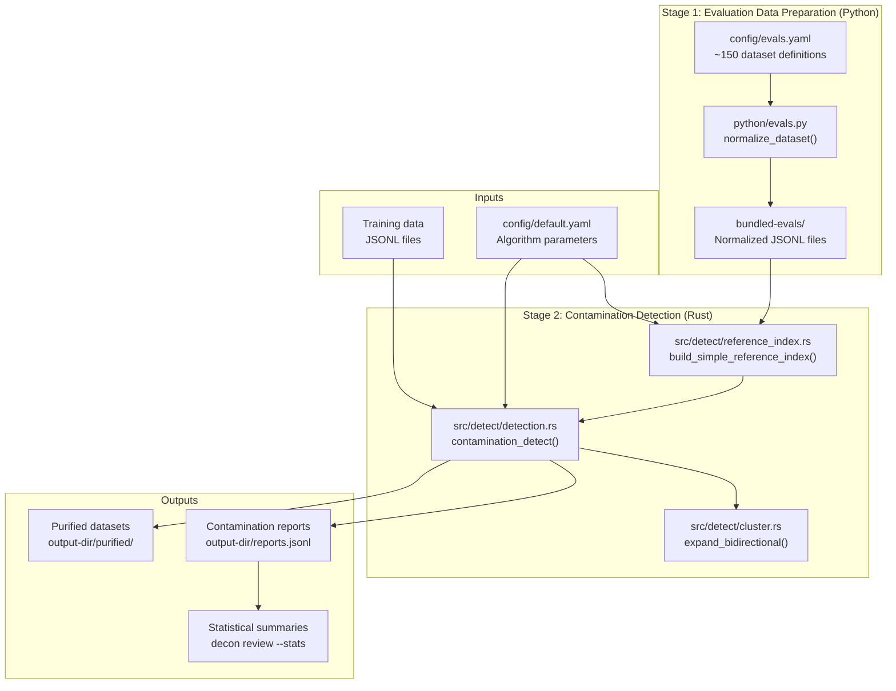

**Sources:** [README.md:1-23](), [doc/simple.md:1-11]()

## Key Components

### CLI Interface

The main entry point is `src/main.rs`, which provides five primary commands:

| Command | Purpose | Key Implementation |
|---------|---------|-------------------|
| `detect` | Run contamination detection | [src/detect/detection.rs:contamination_detect()]() |
| `review` | Analyze detection results | [src/detect/display.rs:print_highlighted_output()]() |
| `evals` | Manage evaluation datasets | [python/evals.py:download_and_normalize()]() |
| `compare` | Compare detection runs | [src/detect/display.rs:compare_reports()]() |
| `server` | Launch HTTP API server | [src/server.rs:run_server()]() |

**Sources:** [README.md:62-82](), [README.md:124-129]()

### Detection Pipeline

The detection pipeline follows this workflow:

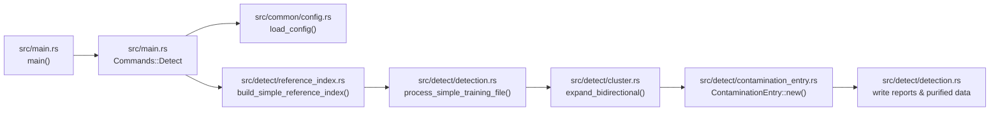

**Sources:** [doc/simple.md:7-10](), [README.md:24-57]()

### Reference Index Structure

The `SimpleReferenceIndex` in [src/detect/reference_index.rs]() implements a two-tier lookup structure:

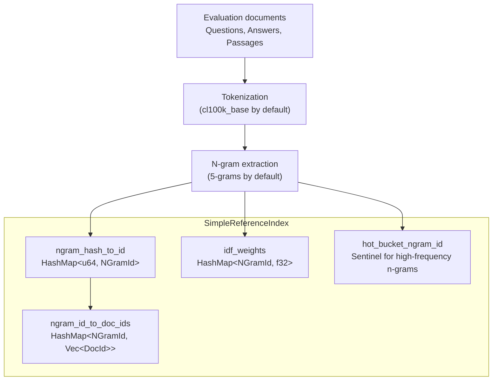

The two-tier design optimizes for the sparsity of initial matches: most n-grams from training data won't match anything, so the first hash lookup quickly filters non-matches before accessing document sets.

**Sources:** [doc/simple.md:12-19]()

## Data Flow

### Evaluation Data Pipeline

Evaluation datasets flow through a normalization pipeline to produce a unified format:

| Source Format | Examples | Normalization | Output Format |
|--------------|----------|---------------|---------------|
| Multiple choice | MMLU (57 domains) | `expand_choices` | Q/A/P JSONL |
| Math reasoning | GSM8K | Field extraction | Q/A/P JSONL |
| Code generation | HumanEval | `concat_messages` | Q/A/P JSONL |
| Extractive QA | SQuAD | Field mapping | Q/A/P JSONL |

All datasets are normalized to include:
- `question`: String
- `answer`: String
- `passage`: Optional string
- `fingerprint`: SHA256 hash for deduplication
- `metadata`: Dataset-specific information

**Sources:** [README.md:88-120]()

### Training Data Processing

Training data is processed in parallel using sampling and cluster expansion:

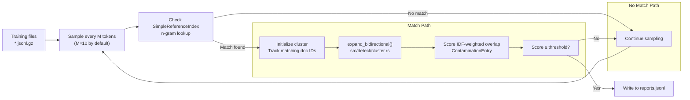

**Sources:** [doc/simple.md:21-33](), [README.md:10-23]()

## Execution Modes

Decon supports two operational modes:

### Single-Machine CLI Mode

The CLI mode is a sequential workflow for processing datasets on a single machine:

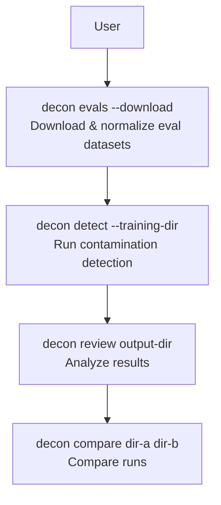

**Sources:** [README.md:59-82]()

### Distributed Server Mode

The server mode enables horizontal scaling for large training datasets:

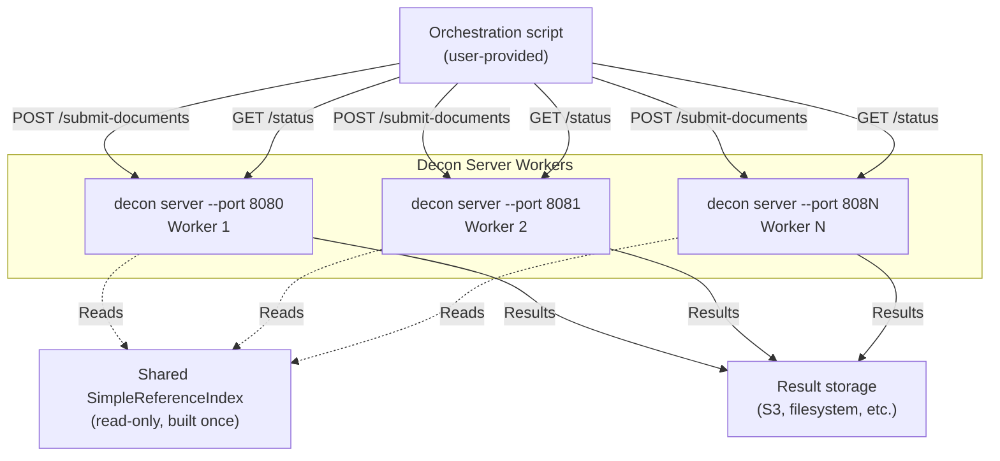

The server exposes HTTP endpoints implemented in [src/server.rs](). Each worker processes batches independently, with the reference index built once and shared read-only across all workers.

**Sources:** [README.md:122-133]()

## Technology Stack

### Languages and Frameworks

| Component | Language | Key Dependencies |
|-----------|----------|-----------------|
| Detection engine | Rust 1.88+ | `rayon` (parallelism), `tokio` (async), `axum` (HTTP) |
| Data normalization | Python 3 | `datasets` (HuggingFace), `PyYAML` |
| Configuration | YAML | `serde_yaml` parser |

### File Structure

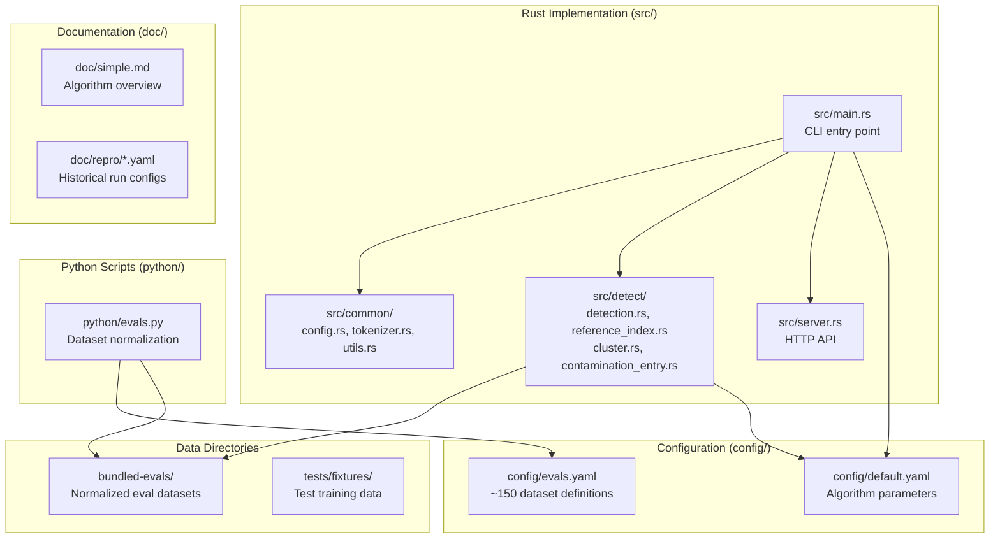

**Sources:** [README.md:1-154]()

## Configuration System

Decon's behavior is controlled entirely through YAML configuration files:

| Configuration File | Purpose | Key Parameters |
|-------------------|---------|----------------|
| `config/default.yaml` | Detection algorithm parameters | `ngram_size`, `sample_every_m_tokens`, `contamination_score_threshold` |
| `config/evals.yaml` | Evaluation dataset definitions | `dataset_name`, `field_extractions`, `split` |
| `doc/repro/*.yaml` | Historical run configurations | Complete parameter sets for reproducing published results |

Parameters in `config/default.yaml` control every aspect of the SIMPLE algorithm, from index construction through scoring thresholds. See [Configuration Guide](#3.3) for detailed parameter documentation.

**Sources:** [README.md:84](), [README.md:102-118]()

## Output Formats

Decon produces structured outputs for both machine and human consumption:

### Contamination Reports

Reports are written as JSONL files in the output directory. Each line represents one contaminated match:

```jsonl
{
  "training_line": 42,
  "eval_key": "mmlu:abstract_algebra:test:0",
  "contamination_score": 0.95,
  "idf_overlap": 0.87,
  "question_cluster": {"start": 100, "end": 150},
  "answer_cluster": {"start": 160, "end": 175}
}
```

### Purified Datasets

When `--purify` flag is used, decon creates cleaned versions of training data with contaminated documents removed, preserving directory structure and compression formats.

### Statistical Summaries

The `decon review --stats` command aggregates reports by evaluation suite, showing counts of contaminated documents per benchmark.

**Sources:** [README.md:135-154](), [README.md:24-57]()

## Key Design Principles

1. **Deterministic**: Same input always produces same output; no randomness in detection
2. **Interpretable**: Every contamination match includes highlighted text snippets showing overlap
3. **Scalable**: Sampling and parallel processing enable billion-token dataset analysis
4. **Configurable**: All algorithm parameters exposed through YAML for reproducibility
5. **Language-separated**: Python handles messy data wrangling; Rust handles performance-critical detection

**Sources:** [README.md:3-8](), [doc/simple.md:1-3]()

---

# Page: Getting Started

# Getting Started

<details>
<summary>Relevant source files</summary>

The following files were used as context for generating this wiki page:

- [README.md](README.md)
- [config/evals.yaml](config/evals.yaml)

</details>


This page provides installation instructions and a walkthrough for running your first contamination detection. It covers the basic workflow of preparing evaluation data, running detection on training data, and reviewing results.

For a comprehensive guide to all features and configuration options, see [User Guide](#3). For detailed command documentation, see [CLI Commands Reference](#3.1). For understanding the underlying detection algorithm, see [The SIMPLE Algorithm](#4).

---

## Purpose and Scope

This guide walks you through:
- Installing decon and its dependencies
- Understanding the two-phase detection workflow
- Running your first contamination detection
- Interpreting basic results

By the end of this guide, you will have run contamination detection on sample data and understand the core workflow.

---

## Prerequisites

### System Requirements

| Requirement | Version | Purpose |
|------------|---------|---------|
| Rust | 1.88+ | Building and running decon CLI |
| Python | 3.x | Processing evaluation datasets (optional) |
| `datasets` library | Latest | Downloading HuggingFace datasets (optional) |

**Note**: Python and the `datasets` library are only required if you need to download additional evaluation datasets beyond the bundled defaults.

Sources: [README.md:64-66]()

---

## Installation

### Clone and Build

```bash
# Clone the repository
git clone https://github.com/allenai/decon
cd decon

# Build in release mode (optimized for performance)
cargo build --release

# Verify installation
cargo run --release -- --help
```

The release build is important for performance, as decon processes large datasets and uses sampling optimizations that benefit significantly from compiler optimizations.

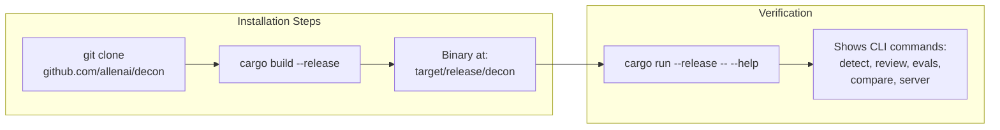

**Installation Verification**

Sources: [README.md:62-69](), [README.md:113-118]()

---

## Understanding the Decon Workflow

Decon operates in two distinct phases:

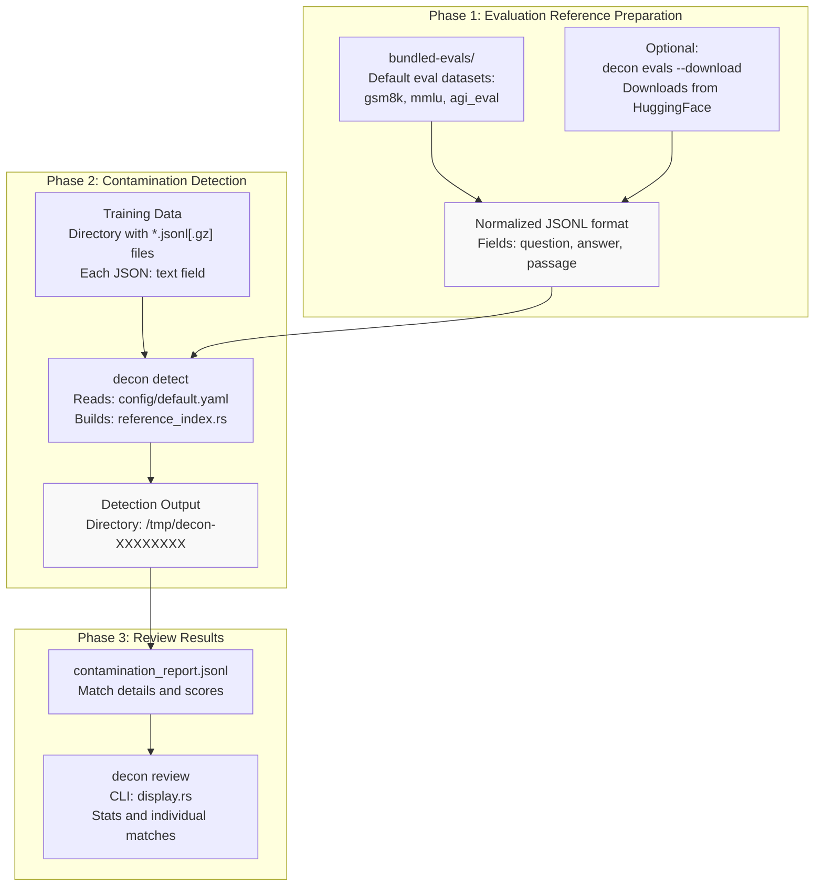

**Two-Phase Detection Architecture**

The separation between phases allows you to:
- Build the reference index once and reuse it for multiple training datasets
- Add or remove evaluation datasets without re-processing training data
- Share reference indexes across distributed workers

Sources: [README.md:9-57]()

---

## Your First Detection Run

### Step 1: Check Available Evaluation Datasets

```bash
cargo run --release -- evals
```

This lists all evaluation datasets currently in the reference directory. By default, three eval suites are included:

| Eval Suite | Description | Records |
|-----------|-------------|---------|
| `gsm8k` | Grade school math problems | ~8.5K |
| `mmlu` | Massive Multitask Language Understanding | ~15K |
| `agi_eval` | AGI evaluation benchmarks | ~8K |

The evaluation data is stored in `bundled-evals/` as normalized JSONL files with consistent `question`, `answer`, and optional `passage` fields.

Sources: [README.md:71-73](), [README.md:103-105](), [config/evals.yaml:71-77](), [config/evals.yaml:602-609](), [config/evals.yaml:925-940]()

### Step 2: Run Detection on Sample Data

```bash
cargo run --release -- detect --training-dir tests/fixtures/training/
```

This command:
1. Loads evaluation datasets from `bundled-evals/`
2. Builds n-gram index (implemented in `src/detect/reference_index.rs`)
3. Processes training files in parallel (implemented in `src/detect/detection.rs`)
4. Outputs results to a temporary directory (e.g., `/tmp/decon-295c0cbd`)

**Expected Output:**

```
Training files 4/4 [00:00:02/00:00:00] [████████████████████████████████████]

┌───────────────────────────────────────────┐
│     Contamination Detection Results       │
├───────────────────────────────────────────┤
│ Training lines                        245 │
│ Processing rate                 15 μs/doc │
├───────────────────────────────────────────┤
│ Index building time                 2.45s │
│ Detection time                      0.12s │
│ Total time                          2.57s │
├───────────────────────────────────────────┤
│ Contaminated matches                   12 │
│ Contaminated documents                  8 │
└───────────────────────────────────────────┘

Results written to: /tmp/decon-295c0cbd
```

Sources: [README.md:74-76](), [README.md:26-44]()

### Step 3: Review Results

```bash
# View summary statistics
cargo run --release -- review --stats /tmp/decon-295c0cbd

# Interactive review of individual matches
cargo run --release -- review /tmp/decon-295c0cbd
```

**Statistical Summary Format:**

```
=== TRAINING DOCUMENTS CONTAMINATED BY EVAL SUITE ===
(Each count represents unique training documents that need removal)

  gsm8k                                    5 │████████████████████████           │
  mmlu                                     2 │██████████                         │
  agi_eval                                 1 │█████                              │
```

Sources: [README.md:80-82](), [README.md:45-56]()

---

## Understanding Detection Output

### Output Directory Structure

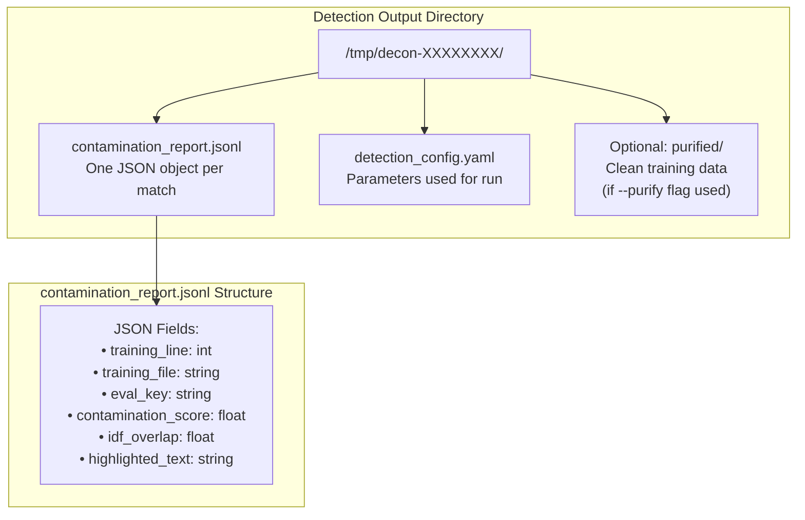

**Output Directory Contents**

Sources: [README.md:80-82](), [README.md:152-154]()

### Contamination Report Format

Each line in `contamination_report.jsonl` represents one detected match:

```json
{
  "training_line": 1234,
  "training_file": "web_data_00001.jsonl.gz",
  "eval_key": "mmlu/professional_accounting",
  "contamination_score": 0.92,
  "idf_overlap": 0.87,
  "question_match": {
    "start": 45,
    "end": 120,
    "text": "what is the present value of..."
  },
  "answer_match": {
    "start": 125,
    "end": 145,
    "text": "discount rate method"
  }
}
```

**Key Fields:**
- `training_line`: Line number in the training file (0-indexed)
- `eval_key`: Evaluation dataset identifier (format: `dataset/split`)
- `contamination_score`: Overall match score (0.0-1.0), threshold configurable in `config/default.yaml`
- `idf_overlap`: IDF-weighted token overlap score
- Match locations: Character offsets for highlighted text

Sources: [README.md:152-154]()

---

## Data Format Requirements

### Training Data Format

Training data must be JSONL files (optionally gzip compressed) with each line containing a JSON object with a `text` field:

```json
{"text": "This is a training document..."}
{"text": "Another document with content..."}
```

Decon processes all `*.jsonl` and `*.jsonl.gz` files in the specified directory recursively.

**Supported field names** (configurable via `--training-text-field`):
- `text` (default)
- `content`
- Custom field name

Sources: [README.md:90-94]()

### Evaluation Data Format

The bundled evaluation datasets follow a normalized format produced by `python/evals.py`:

```json
{
  "question": "What is the capital of France?",
  "answer": "Paris",
  "passage": "France is a country in Europe...",
  "is_correct": true,
  "fingerprint": "sha256_hash_here",
  "metadata": {"dataset": "trivia_qa", "split": "train"}
}
```

**Required fields:**
- `question`: The evaluation prompt or question text
- `answer`: The expected answer(s)

**Optional fields:**
- `passage`: Supporting context (used if `index_passages: true` in config)
- `is_correct`: For multiple-choice datasets
- `fingerprint`: SHA256 hash for deduplication

Sources: [README.md:96-101]()

---

## Common Options and Flags

### Detection Options

| Option | Description | Default |
|--------|-------------|---------|
| `--training-dir PATH` | Directory containing training data | Required |
| `--evals-dir PATH` | Directory containing evaluation data | `bundled-evals/` |
| `--config PATH` | Configuration file | `config/default.yaml` |
| `--output-dir PATH` | Where to write results | `/tmp/decon-XXXXXXXX` |
| `--purify` | Create cleaned dataset (removes contaminated docs) | False |
| `--training-text-field NAME` | JSON field containing document text | `text` |

### Review Options

| Option | Description |
|--------|-------------|
| `--stats` | Show statistical summary instead of interactive review |
| `--eval NAME` | Filter to specific evaluation dataset |
| `--min-score FLOAT` | Show only matches above threshold |

Sources: [README.md:74-82](), [README.md:139-151]()

---

## Configuration Basics

Decon behavior is controlled by `config/default.yaml`. Key parameters include:

```yaml
# Index construction
ngram_size: 5                    # N-gram size for matching
tokenizer_str: "cl100k"          # Tokenizer to use
index_passages: true             # Index passage fields
index_answers: true              # Index answer fields

# Detection parameters
sample_every_m_tokens: 10        # Sampling rate for efficiency
contamination_score_threshold: 0.8  # Minimum score to report

# Scoring weights
question_weight: 1.0
answer_weight: 0.5
passage_weight: 0.3
```

**Most Important Parameter:**
- `contamination_score_threshold`: Controls sensitivity. Lower values (e.g., 0.6) detect more matches but may include false positives. Higher values (e.g., 0.9) are stricter.

For detailed configuration options, see [Configuration Guide](#3.3).

Sources: [README.md:84]()

---

## Creating a Clean Dataset (Purification)

To create a version of your training data with contaminated documents removed:

```bash
cargo run --release -- detect \
  --training-dir ~/my-training-data \
  --purify \
  --output-dir ~/decon-output
```

This creates a `purified/` subdirectory in the output directory containing cleaned JSONL files with the same structure as the input, minus the contaminated documents.

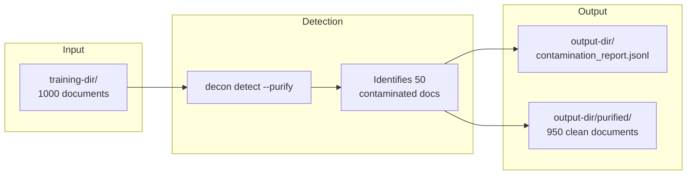

**Purification Workflow**

The purified dataset maintains:
- Original directory structure
- Original filenames
- Original JSON structure
- Original compression (if input was gzipped)

Sources: [README.md:77-78]()

---

## Next Steps

Now that you've run your first detection, you can:

1. **Download more evaluation datasets**: See [Evaluation Dataset Configuration](#5.1) for adding datasets from HuggingFace
2. **Tune detection parameters**: See [Configuration Guide](#3.3) for adjusting sensitivity and performance
3. **Process large datasets**: See [Server Mode and Distributed Processing](#3.2) for scaling to billions of documents
4. **Understand the algorithm**: See [The SIMPLE Algorithm](#4) for details on how detection works
5. **Compare detection runs**: Use `decon compare` to analyze differences between runs (see [CLI Commands Reference](#3.1))

---

## Downloading Additional Evaluation Datasets

The default bundle includes only three eval suites. To download all ~150 pre-configured datasets:

```bash
# Requires Python 3 with datasets library
pip install datasets

# Download all configured evaluations
cargo run --release -- evals --download --config config/evals.yaml
```

This processes datasets defined in `config/evals.yaml` and normalizes them into the `bundled-evals/` directory. The download may take 10-30 minutes depending on your network connection.

**Commonly added datasets:**
- `humaneval`: Code generation benchmarks
- `hellaswag`: Commonsense reasoning
- `squad`: Reading comprehension
- `drop`: Discrete reasoning
- `mathqa`: Mathematical reasoning

For details on the dataset configuration format and adding custom datasets, see [Evaluation Dataset Configuration](#5.1).

Sources: [README.md:106-118](), [config/evals.yaml:1-69]()

---

## Troubleshooting

### Common Issues

**Issue**: "No evaluation datasets found"
- **Cause**: Empty or missing `bundled-evals/` directory
- **Solution**: The repository includes default evals. If missing, re-clone or run `cargo run --release -- evals --download`

**Issue**: "Failed to parse training file"
- **Cause**: Training JSONL files don't have expected `text` field
- **Solution**: Use `--training-text-field FIELDNAME` to specify the correct field

**Issue**: Detection is slow
- **Cause**: Not using release build
- **Solution**: Always use `cargo run --release` (not `cargo run`)

**Issue**: High memory usage
- **Cause**: Large evaluation reference set with many n-grams
- **Solution**: Reduce `ngram_size` in config or limit evaluation datasets

Sources: [README.md:62-69](), [README.md:90-94]()

---

## Example: Complete First Run

Here's a complete example showing all steps:

```bash
# 1. Build decon
git clone https://github.com/allenai/decon
cd decon
cargo build --release

# 2. Check what evaluations are available
cargo run --release -- evals

# 3. Run detection on test data
cargo run --release -- detect --training-dir tests/fixtures/training/

# 4. Review results (replace with actual output path)
cargo run --release -- review --stats /tmp/decon-a1b2c3d4

# 5. Interactive review of individual matches
cargo run --release -- review /tmp/decon-a1b2c3d4

# 6. Create a cleaned dataset
cargo run --release -- detect \
  --training-dir tests/fixtures/training/ \
  --purify \
  --output-dir ./my-first-run
```

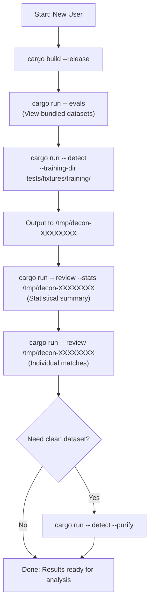

**Complete Getting Started Workflow**

Sources: [README.md:59-82]()

---

# Page: User Guide

# User Guide

<details>
<summary>Relevant source files</summary>

The following files were used as context for generating this wiki page:

- [README.md](README.md)

</details>


This guide provides comprehensive instructions for using decon to detect contamination between training datasets and evaluation benchmarks. It covers the primary workflows, command-line interface usage patterns, input/output file formats, and common usage scenarios.

For detailed command syntax and options, see [CLI Commands Reference](#3.1). For distributed processing setup, see [Server Mode and Distributed Processing](#3.2). For parameter tuning, see [Configuration Guide](#3.3).

## Purpose and Scope

This user guide is organized around practical workflows for contamination detection. It assumes you have decon installed and are ready to run detection on your datasets. For installation instructions, see [Getting Started](#2).

## Core Workflow

Decon operates through a three-phase workflow: preparing evaluation references, detecting contamination, and reviewing results. Each phase corresponds to specific CLI commands that transform data through the system.

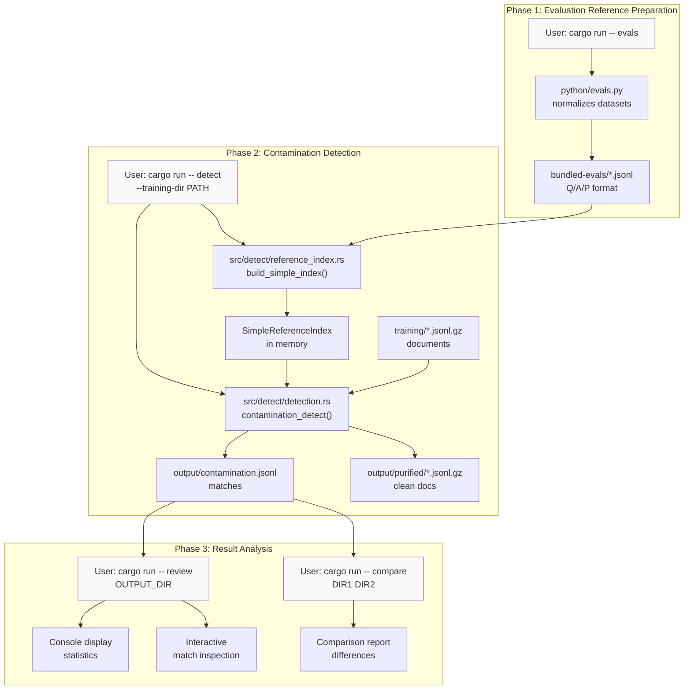

**Sources:** [README.md:59-154](), [src/main.rs](), [src/detect/detection.rs](), [src/detect/reference_index.rs]()

## Command Overview

Decon provides five primary commands, each addressing a specific phase of the contamination detection workflow:

| Command | Purpose | Typical Usage |
|---------|---------|---------------|
| `evals` | List, download, or manage evaluation datasets | `cargo run --release -- evals --download` |
| `detect` | Run contamination detection on training data | `cargo run --release -- detect --training-dir ~/data` |
| `review` | Inspect detection results and statistics | `cargo run --release -- review /tmp/decon-output` |
| `compare` | Compare results from different detection runs | `cargo run --release -- compare /tmp/run-a /tmp/run-b` |
| `server` | Launch HTTP server for distributed processing | `cargo run --release -- server --port 8080` |

**Sources:** [README.md:59-154](), [src/main.rs]()

## File Format Requirements

Understanding decon's input and output formats is essential for integrating it into your data pipeline.

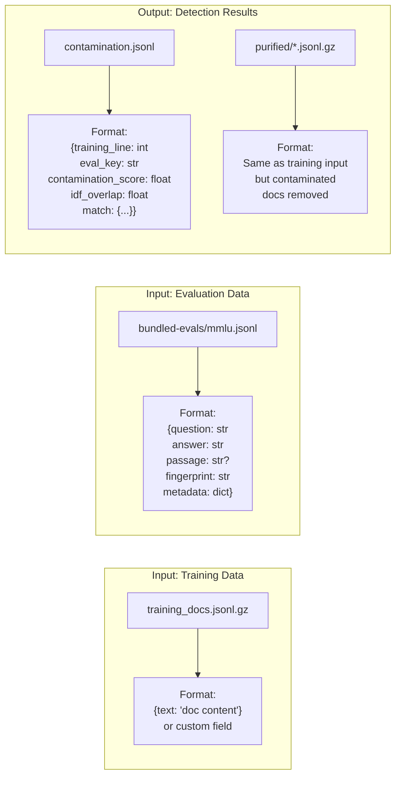

**Sources:** [README.md:90-101](), [tests/fixtures/training/contaminated_mixed.jsonl](), [bundled-evals/]()

### Training Data Format

Training data must be provided as a directory containing JSONL files (optionally gzip compressed). Each JSON object must contain a text field with the document content. The field name defaults to `text` but can be customized via the `--training-field` option.

Example training document:
```json
{
  "text": "The plane face of plano convex lens of focal length 20 cm is silvered...",
  "metadata": {"source": "web", "timestamp": "2023-01-15"}
}
```

The system processes common compression formats: `.jsonl`, `.jsonl.gz`, `.jsonl.zst`, `.jsonl.bz2`.

**Sources:** [README.md:90-94](), [tests/fixtures/training/]()

### Evaluation Data Format

Evaluation datasets use a normalized JSONL format with three primary fields: `question`, `answer`, and optionally `passage`. Each record also includes a `fingerprint` (SHA256 hash) and `metadata` dictionary.

Example evaluation record:
```json
{
  "question": "the plane face of plano convex lens of focal length 20 cm is silvered this combination is equivalent to the type of mirror and its focal length is",
  "answer": "concave f 10 cm",
  "passage": null,
  "fingerprint": "a3f2e9b8c1d4...",
  "metadata": {"dataset": "physics_mcq", "category": "optics", "index": 42}
}
```

**Sources:** [README.md:96-101](), [bundled-evals/]()

### Output Format

Detection results are written to a timestamped output directory (e.g., `/tmp/decon-295c0cbd/`) containing:

- `contamination.jsonl` - Detailed match records
- `purified/` - Cleaned training files (if `--purify` enabled)
- `config.yaml` - Detection parameters used for this run

Each line in `contamination.jsonl` represents one contaminated match:
```json
{
  "training_line": 12543,
  "eval_key": "mmlu/physics/optical_instruments/question_17",
  "contamination_score": 0.92,
  "idf_overlap": 0.87,
  "match": {
    "matched_components": ["question"],
    "highlighted_training_text": "...",
    "matched_eval_text": "..."
  }
}
```

**Sources:** [src/detect/contamination_entry.rs](), [src/detect/display.rs]()

## Basic Usage Patterns

### Pattern 1: Quick Detection with Default Evals

The simplest workflow uses the bundled evaluation datasets (gsm8k, mmlu, agi_eval) that come pre-configured with decon.

```bash
# Step 1: List included evaluations
cargo run --release -- evals

# Step 2: Run detection
cargo run --release -- detect --training-dir ~/my-training-data

# Step 3: Review results (use path from previous output)
cargo run --release -- review /tmp/decon-295c0cbd
```

This workflow builds the reference index from bundled evaluations, scans training files, and reports contaminated documents to the console.

**Sources:** [README.md:62-82]()

### Pattern 2: Custom Evaluation Suite

For production decontamination, you typically need to include all evaluation datasets your model will be tested against.

```bash
# Step 1: Download extended evaluation suite
cargo run --release -- evals --download --config config/evals.yaml

# Step 2: Verify evaluations were downloaded
cargo run --release -- evals

# Step 3: Run detection with custom config
cargo run --release -- detect \
  --training-dir ~/training-corpus \
  --config config/my-detection-params.yaml \
  --purify

# Step 4: Generate statistics by eval suite
cargo run --release -- review --stats /tmp/decon-output
```

The `--purify` flag creates cleaned versions of training files in the output directory's `purified/` subdirectory.

**Sources:** [README.md:102-120](), [config/evals.yaml]()

### Pattern 3: Iterative Parameter Tuning

Decon's scoring threshold can be adjusted to control sensitivity. Lower thresholds catch more potential contamination but increase false positives.

```bash
# Run with high precision (default threshold 0.8)
cargo run --release -- detect --training-dir ~/data

# Run with high recall (lower threshold)
cargo run --release -- detect \
  --training-dir ~/data \
  --contamination-score-threshold 0.6

# Compare the two runs
cargo run --release -- compare /tmp/decon-run1 /tmp/decon-run2

# Review specific eval suite at high threshold
cargo run --release -- review /tmp/decon-run1 \
  --eval mmlu --min-score 0.9
```

**Sources:** [README.md:84-85](), [README.md:145-151](), [config/default.yaml]()

### Pattern 4: Filtered Review

When analyzing results, you often want to focus on specific evaluation suites or score ranges:

```bash
# View only MMLU contamination
cargo run --release -- review /tmp/decon-output --eval mmlu

# View high-confidence matches only
cargo run --release -- review /tmp/decon-output --min-score 0.95

# Combine filters
cargo run --release -- review /tmp/decon-output \
  --eval gsm8k --min-score 0.85
```

**Sources:** [README.md:136-151]()

## Command-Specific Details

### evals Command

The `evals` command manages evaluation reference datasets. Without arguments, it lists currently available evaluations in `bundled-evals/`.

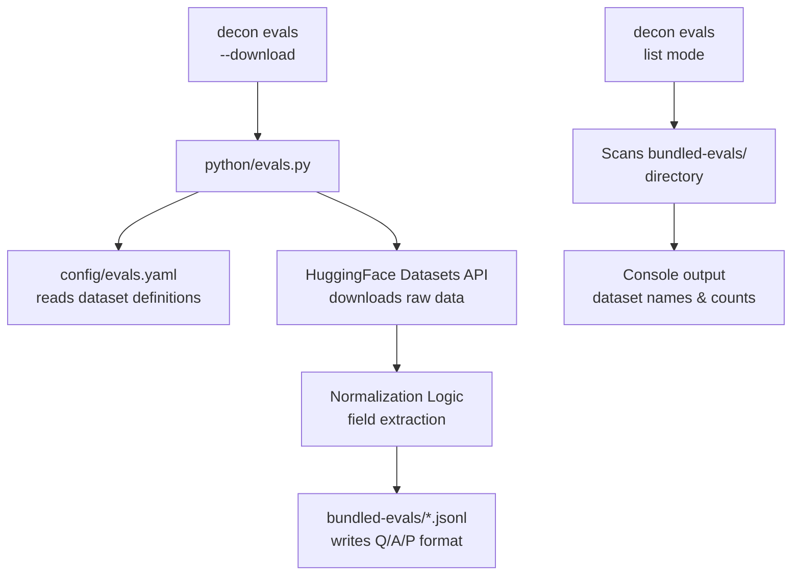

Key behaviors:
- Reads dataset definitions from `config/evals.yaml` (or custom config via `--config`)
- Invokes Python script [python/evals.py]() to download and normalize
- Writes normalized JSONL files to `bundled-evals/` directory
- Each dataset becomes a separate JSONL file named by dataset key

**Sources:** [README.md:102-120](), [python/evals.py](), [config/evals.yaml]()

### detect Command

The `detect` command is the core contamination detection engine. It builds an in-memory reference index and scans training files in parallel.

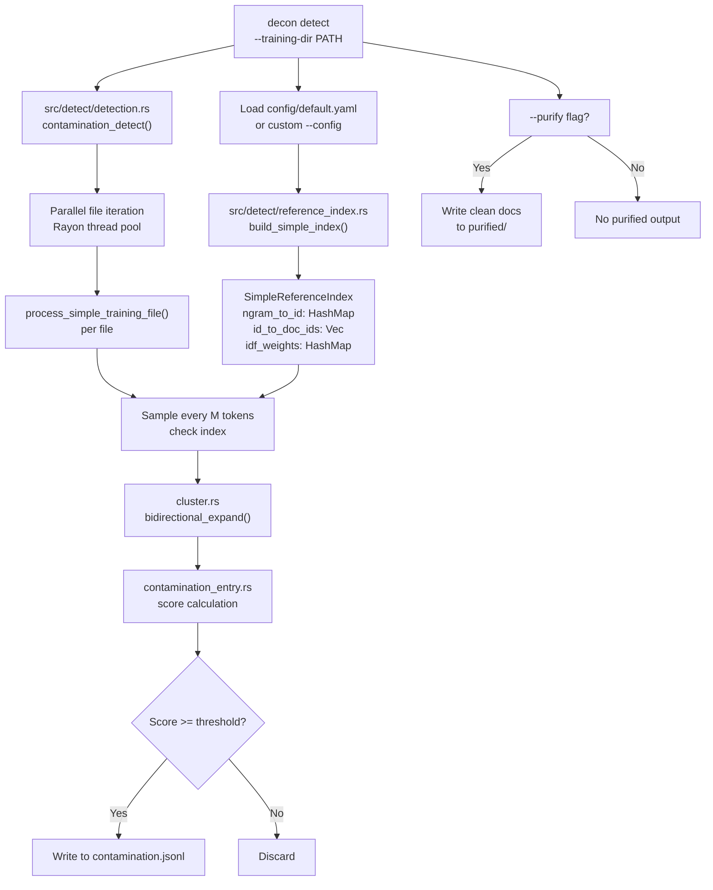

Important options:
- `--training-dir` - Required. Directory containing JSONL training files
- `--training-field` - Field name containing document text (default: `text`)
- `--purify` - Generate cleaned dataset with contaminated documents removed
- `--config` - Path to custom configuration file
- `--contamination-score-threshold` - Override default threshold (0.8)
- `--evals-dir` - Path to evaluation reference directory (default: `bundled-evals/`)

The command creates an output directory (reported to console) containing all results and configuration.

**Sources:** [README.md:74-78](), [src/detect/detection.rs](), [src/detect/reference_index.rs](), [src/detect/cluster.rs]()

### review Command

The `review` command provides interactive and statistical analysis of detection results.

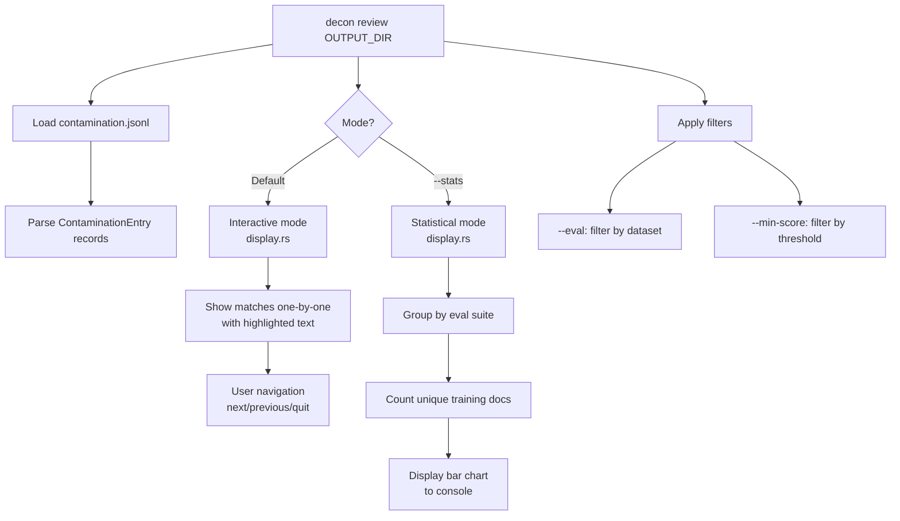

Operating modes:
- **Interactive mode** (default) - Step through individual matches with highlighted text
- **Statistics mode** (`--stats`) - Display aggregate counts by evaluation suite

Filtering options:
- `--eval <name>` - Show only matches for specific evaluation dataset
- `--min-score <float>` - Show only matches above score threshold

**Sources:** [README.md:136-148](), [src/detect/display.rs]()

### compare Command

The `compare` command analyzes differences between two detection runs, useful for understanding the impact of parameter changes.

```bash
cargo run --release -- compare /tmp/decon-run-a /tmp/decon-run-b
```

The command loads `contamination.jsonl` from both directories and reports:
- Documents contaminated in A but not B
- Documents contaminated in B but not A
- Documents contaminated in both runs
- Score distribution differences

**Sources:** [README.md:149-150](), [src/main.rs]()

### server Command

The `server` command launches an HTTP API server for distributed processing workloads. See [Server Mode and Distributed Processing](#3.2) for detailed usage.

```bash
cargo run --release -- server --port 8080
```

**Sources:** [README.md:122-133](), [src/server.rs]()

## Working with Large Datasets

### Memory Considerations

The reference index is held entirely in memory. Memory usage scales with:
- Number of evaluation examples (typically 100K-500K)
- Vocabulary size in evaluations
- N-gram size (default: 5 tokens)

Typical memory footprint: 1-4 GB for comprehensive evaluation suites.

### Processing Performance

Detection speed depends on:
- Training corpus size
- Sampling rate (`sample_every_m_tokens` parameter, default: 10)
- Number of CPU cores (parallel processing via Rayon)
- Disk I/O for reading compressed files

Typical throughput: 20-40 μs per document on modern hardware.

**Sources:** [README.md:29-43](), [config/default.yaml](), [src/detect/detection.rs]()

## Integration Patterns

### Pipeline Integration

Decon can be integrated into data processing pipelines using its deterministic JSONL output format:

```bash
# Upstream: Your data collection
collect_data.sh > training_data.jsonl.gz

# Decontamination step
decon detect --training-dir ./training_data --purify
OUTPUT_DIR=$(decon detect ... | grep "Results:" | awk '{print $2}')

# Downstream: Use cleaned data
cp $OUTPUT_DIR/purified/* ./cleaned_training_data/
train_model.sh --data ./cleaned_training_data/
```

### Programmatic Access

Detection results in `contamination.jsonl` are structured for programmatic analysis:

```python
import json

contaminated_docs = set()
with open('/tmp/decon-output/contamination.jsonl') as f:
    for line in f:
        entry = json.loads(line)
        if entry['contamination_score'] > 0.9:
            contaminated_docs.add(entry['training_line'])

print(f"High-confidence contaminated docs: {len(contaminated_docs)}")
```

**Sources:** [README.md:153-154](), [src/detect/contamination_entry.rs]()

## Troubleshooting Common Issues

### Issue: No Contamination Found

If detection reports zero contaminated documents when you expect contamination:

1. Verify evaluation datasets are properly loaded: `decon evals`
2. Check training data format matches expected structure
3. Lower the contamination threshold: `--contamination-score-threshold 0.5`
4. Verify tokenizer matches training data encoding (default: `cl100k`)

### Issue: Too Many False Positives

If detection reports many low-score matches that appear non-contaminated:

1. Increase threshold: `--contamination-score-threshold 0.9`
2. Review false positives to understand patterns: `decon review --min-score 0.7`
3. Adjust component weights in configuration if specific eval components are problematic

### Issue: Out of Memory

If the process crashes due to memory exhaustion:

1. Reduce evaluation suite size (process in batches)
2. Increase system memory or use distributed mode
3. Consider sampling evaluation datasets for very large suites

**Sources:** [README.md:84-85](), [config/default.yaml]()

## Next Steps

- For detailed command syntax and all available options, see [CLI Commands Reference](#3.1)
- For setting up distributed processing, see [Server Mode and Distributed Processing](#3.2)
- For understanding and tuning configuration parameters, see [Configuration Guide](#3.3)
- For understanding the detection algorithm, see [The SIMPLE Algorithm](#4)

---

# Page: CLI Commands Reference

# CLI Commands Reference

<details>
<summary>Relevant source files</summary>

The following files were used as context for generating this wiki page:

- [README.md](README.md)
- [src/detect/display.rs](src/detect/display.rs)

</details>


This page documents all decon command-line interface commands, their arguments, options, and behaviors. For details on server mode deployment patterns, see [Server Mode and Distributed Processing](#3.2). For configuration parameters that control command behavior, see [Configuration Guide](#3.3).

## Command Structure

The decon CLI follows a subcommand pattern where each primary operation is exposed as a distinct command:

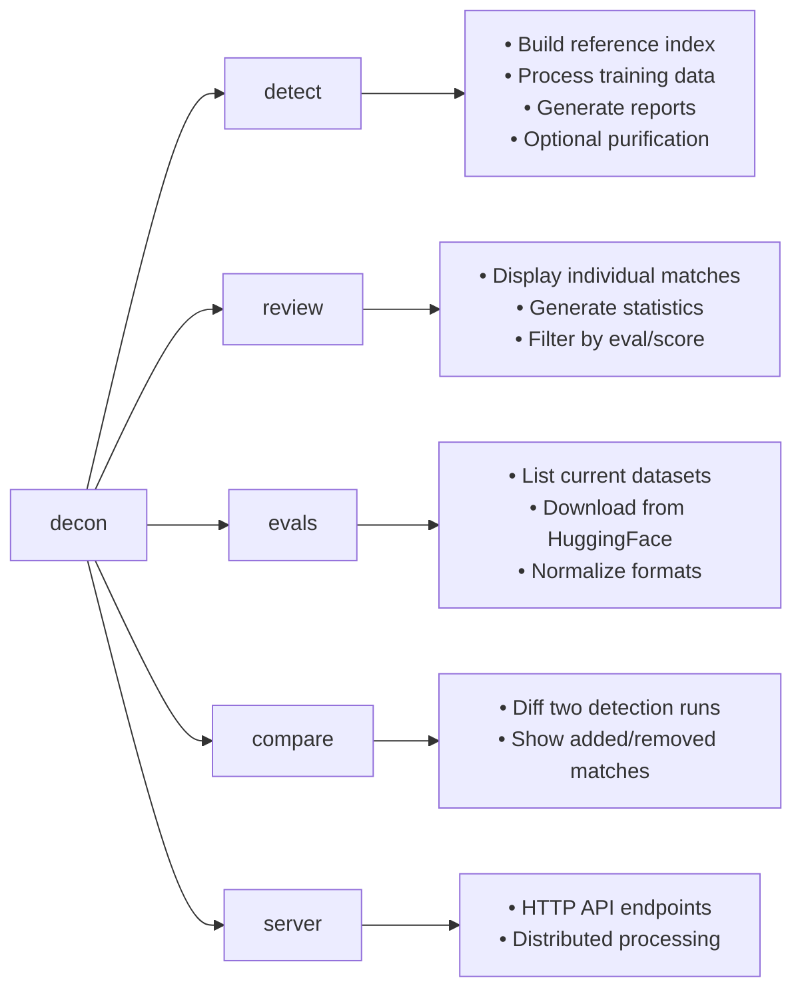

**Sources:** [README.md:62-82](), [README.md:123-133](), [README.md:136-151]()

## Command Execution Model

All commands share a common execution pattern implemented in [src/main.rs]():

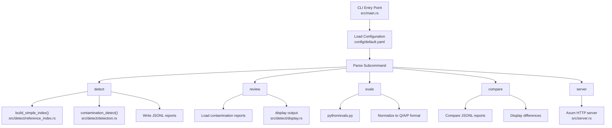

**Sources:** [README.md:69-82](), [src/detect/display.rs:1-184]()

---

## `decon detect`

The primary command for contamination detection. Builds a reference index from evaluation datasets and scans training data to identify contaminated documents.

### Basic Usage

```bash
# Detect contamination in training data
decon detect --training-dir ~/sample-data --evals-dir ~/references

# With custom configuration
decon detect --training-dir ~/data --config custom-config.yaml

# With purification (creates clean output)
decon detect --training-dir ~/data --purify
```

### Arguments and Options

| Argument | Required | Description |
|----------|----------|-------------|
| `--training-dir <PATH>` | Yes | Directory containing training data JSONL files |
| `--evals-dir <PATH>` | No | Directory containing evaluation reference data (default: `bundled-evals/`) |
| `--config <PATH>` | No | Path to configuration YAML file (default: `config/default.yaml`) |
| `--purify` | No | Generate cleaned dataset with contaminated documents removed |
| `--report-output-dir <PATH>` | No | Output directory for reports (default: `/tmp/decon-<random>`) |

### Behavior

The `detect` command executes the following pipeline:

1. **Index Construction Phase** - Invokes [src/detect/reference_index.rs:build_simple_index()]() to:
   - Load evaluation datasets from `--evals-dir`
   - Tokenize questions, answers, and passages
   - Build n-gram hash tables with IDF weights
   - Apply hot bucket optimization

2. **Detection Phase** - Calls [src/detect/detection.rs:contamination_detect()]() to:
   - Process training files in parallel using Rayon
   - Sample every M tokens (configurable via `sample_every_m_tokens`)
   - Expand clusters bidirectionally when matches found
   - Score contamination using IDF-weighted overlap

3. **Output Generation** - Produces:
   - `contamination_report.jsonl` - Full contamination matches with scores
   - `purified/*.jsonl.gz` - Clean training data (if `--purify` specified)
   - Console statistics via [src/detect/display.rs:display_detection_results()]()

### Output Format

The command displays a formatted summary table:

```
┌───────────────────────────────────────────┐
│     Contamination Detection Results       │
├───────────────────────────────────────────┤
│ Training lines                  5,162,084 │
│ Processing rate                 34 μs/doc │
├───────────────────────────────────────────┤
│ Index building time                38.59s │
│ Detection time                    175.69s │
│ Total time                        214.28s │
├───────────────────────────────────────────┤
│ Contaminated matches                7,699 │
│ Contaminated documents              1,851 │
└───────────────────────────────────────────┘
```

Implemented in [src/detect/display.rs:106-168]()

### Configuration Dependencies

The detect command respects all parameters in `config/default.yaml`:

- **Index parameters:** `ngram_size`, `tokenizer_str`, `index_passages`, `index_answers`
- **Detection parameters:** `sample_every_m_tokens`, `question_max_consecutive_misses`, `passage_max_consecutive_misses`
- **Scoring parameters:** `contamination_score_threshold`, `perfect_match_decay_start`, `perfect_match_decay_end`

See [Configuration Guide](#3.3) for complete parameter reference.

**Sources:** [README.md:26-57](), [README.md:73-78](), [src/detect/display.rs:106-168]()

---

## `decon review`

Interactive review tool for examining contamination detection results. Supports qualitative review of individual matches and statistical analysis.

### Basic Usage

```bash
# Interactive review of all matches
decon review /tmp/decon-295c0cbd

# Display statistics only
decon review --stats /tmp/decon-295c0cbd

# Filter by evaluation suite
decon review /tmp/decon-295c0cbd --eval mmlu

# Filter by minimum score
decon review /tmp/decon-295c0cbd --min-score 0.9

# Combined filters
decon review /tmp/decon-295c0cbd --eval mmlu --min-score 0.9
```

### Arguments and Options

| Argument | Required | Description |
|----------|----------|-------------|
| `<REPORT_DIR>` | Yes | Path to detection output directory containing `contamination_report.jsonl` |
| `--stats` | No | Display statistical summary instead of interactive review |
| `--eval <NAME>` | No | Filter results to specific evaluation suite (e.g., `mmlu`, `gsm8k`) |
| `--min-score <FLOAT>` | No | Only show matches with contamination score ≥ threshold |
| `--max-score <FLOAT>` | No | Only show matches with contamination score ≤ threshold |

### Review Modes

#### Interactive Mode (Default)

Without `--stats`, presents matches one at a time with:
- Training document text with highlighted contaminated regions
- Matching evaluation question/answer/passage
- Contamination score and component breakdown
- Navigation controls to move between matches

#### Statistics Mode

With `--stats`, displays:

```
=== TRAINING DOCUMENTS CONTAMINATED BY EVAL SUITE ===
(Each count represents unique training documents that need removal)

  sciq                                  652 │███████████████████████████████████████│
  mmlu                                  278 │█████████████████████                  │
  mmlu_pro                              211 │████████████████                       │
  ai2_arc_easy                           83 │██████                                 │
  super_gpqa                             65 │████                                   │
```

Bar chart implementation in [src/detect/display.rs:1-184]()

### Report File Format

The review command reads JSONL files with structure:
```json
{
  "training_line": 42,
  "eval_key": "mmlu/high_school_physics/001",
  "contamination_score": 0.94,
  "idf_overlap_question": 0.91,
  "idf_overlap_answer": 0.88,
  "matched_text_snippets": ["...highlighted text..."]
}
```

For complete format specification, see [Data Formats and Structures](#5.3).

**Sources:** [README.md:136-154](), [README.md:45-56](), [src/detect/display.rs:1-184]()

---

## `decon evals`

Management tool for evaluation reference datasets. Lists currently available datasets and downloads/normalizes new ones from HuggingFace.

### Basic Usage

```bash
# List current evaluation datasets
decon evals

# Download all datasets defined in config
decon evals --download --config config/evals.yaml

# Download to custom directory
decon evals --download --output-dir ~/my-evals
```

### Arguments and Options

| Argument | Required | Description |
|----------|----------|-------------|
| `--download` | No | Download and normalize datasets (requires Python environment) |
| `--config <PATH>` | No | Path to evals configuration file (default: `config/evals.yaml`) |
| `--output-dir <PATH>` | No | Target directory for normalized datasets (default: `bundled-evals/`) |
| `--dataset <NAME>` | No | Download only specific dataset(s) instead of all |

### Dataset Processing Pipeline

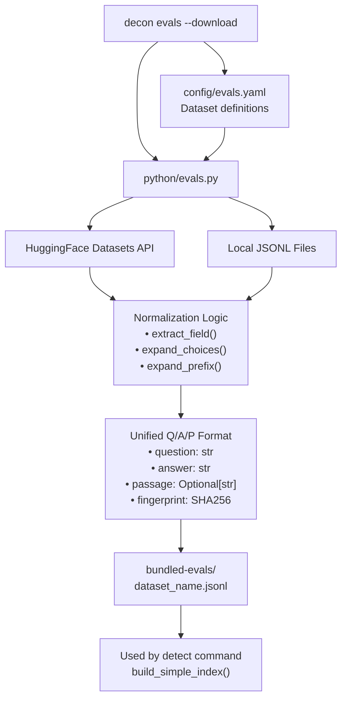

**Sources:** [README.md:108-120](), [README.md:72-73]()

### List Mode (Default)

Without `--download`, displays:
- Number of evaluation datasets currently available
- Names of each dataset
- Number of examples per dataset
- Total examples across all datasets

### Download Mode

With `--download`:
1. Invokes `python/evals.py` with configuration from `config/evals.yaml`
2. Downloads datasets via HuggingFace `datasets` library
3. Applies field extraction rules (see [Evaluation Dataset Configuration](#5.1))
4. Normalizes to Q/A/P format (see [Dataset Normalization Process](#5.2))
5. Computes SHA256 fingerprints for deduplication
6. Writes JSONL to output directory

### Python Environment Requirements

The download functionality requires:
- Python 3.7+
- `datasets` library (HuggingFace)
- `pyyaml` library

Installation:
```bash
pip install datasets pyyaml
```

### Dataset Configuration

Each dataset in `config/evals.yaml` specifies:
- HuggingFace dataset path or local file
- Split to use (train/validation/test)
- Field extraction methods for question/answer/passage
- Optional filtering criteria

See [Evaluation Dataset Configuration](#5.1) for complete configuration syntax.

**Sources:** [README.md:102-120]()

---

## `decon compare`

Compares contamination detection results from two separate runs, highlighting differences in matched documents and scores.

### Basic Usage

```bash
# Compare two detection runs
decon compare /tmp/results-a /tmp/results-b

# With descriptive labels
decon compare --label-a "baseline" --label-b "experimental" /tmp/results-a /tmp/results-b
```

### Arguments and Options

| Argument | Required | Description |
|----------|----------|-------------|
| `<REPORT_DIR_A>` | Yes | First detection output directory |
| `<REPORT_DIR_B>` | Yes | Second detection output directory |
| `--label-a <NAME>` | No | Label for first run (default: directory name) |
| `--label-b <NAME>` | No | Label for second run (default: directory name) |
| `--show-common` | No | Display matches common to both runs (default: only differences) |

### Comparison Logic

The compare command performs set operations on contamination reports:

```mermaid
graph LR
    ReportA["Report A<br/>contamination_report.jsonl"]
    ReportB["Report B<br/>contamination_report.jsonl"]
    
    LoadA["Load matches<br/>training_line + eval_key"]
    LoadB["Load matches<br/>training_line + eval_key"]
    
    ReportA --> LoadA
    ReportB --> LoadB
    
    SetOps["Set Operations"]
    LoadA --> SetOps
    LoadB --> SetOps
    
    SetOps --> OnlyA["Only in A<br/>(Removed matches)"]
    SetOps --> OnlyB["Only in B<br/>(New matches)"]
    SetOps --> Both["In both<br/>(Common matches)"]
    
    OnlyA --> Display["Display Results<br/>• Count summaries<br/>• Detail listings<br/>• Score deltas"]
    OnlyB --> Display
    Both --> Display
```

**Sources:** [README.md:149-151]()

### Output Format

```
=== COMPARISON SUMMARY ===
Matches only in baseline:             42
Matches only in experimental:         38
Matches in both:                   7,619

=== REMOVED MATCHES (in baseline, not in experimental) ===
Training line 1234 → mmlu/physics/001 (score: 0.85)
Training line 5678 → gsm8k/train/042 (score: 0.92)
...

=== NEW MATCHES (in experimental, not in baseline) ===
Training line 9012 → ai2_arc/easy/103 (score: 0.88)
...
```

### Use Cases

- **Configuration tuning:** Compare results before/after parameter adjustments
- **Threshold analysis:** Evaluate impact of `contamination_score_threshold` changes
- **Eval set updates:** Identify new contamination from added evaluation datasets
- **Reproducibility verification:** Confirm identical results across runs

**Sources:** [README.md:149-151]()

---

## `decon server`

Launches decon as an HTTP API server for distributed contamination detection. Detailed deployment patterns covered in [Server Mode and Distributed Processing](#3.2).

### Basic Usage

```bash
# Launch server on default port
decon server

# Specify port
decon server --port 8080

# With custom configuration
decon server --config production.yaml --port 8080
```

### Arguments and Options

| Argument | Required | Description |
|----------|----------|-------------|
| `--port <NUMBER>` | No | HTTP port (default: 8080) |
| `--config <PATH>` | No | Configuration file (default: `config/default.yaml`) |
| `--evals-dir <PATH>` | No | Evaluation reference directory (default: `bundled-evals/`) |

### Server Architecture

```mermaid
graph TB
    Client["HTTP Client<br/>(Orchestration script)"]
    
    Server["Axum HTTP Server<br/>src/server.rs"]
    
    SharedIndex["Shared Reference Index<br/>Arc&lt;SimpleReferenceIndex&gt;<br/>Built once at startup"]
    
    POST["/detect endpoint<br/>POST JSON batch"]
    GET["/health endpoint<br/>GET status"]
    
    Client --> POST
    Client --> GET
    
    POST --> Server
    GET --> Server
    
    Server --> SharedIndex
    
    POST --> Detection["contamination_detect()<br/>src/detect/detection.rs"]
    Detection --> Response["JSON Response<br/>Array of matches"]
    
    SharedIndex --> Detection
```

**Sources:** [README.md:123-133]()

### API Endpoints

#### `POST /detect`

Accepts batch of training documents, returns contamination matches.

**Request:**
```json
{
  "documents": [
    {"id": 1, "text": "training document 1..."},
    {"id": 2, "text": "training document 2..."}
  ]
}
```

**Response:**
```json
{
  "matches": [
    {
      "document_id": 1,
      "eval_key": "mmlu/physics/001",
      "contamination_score": 0.94,
      "matched_text": "..."
    }
  ]
}
```

#### `GET /health`

Returns server status and index statistics.

**Response:**
```json
{
  "status": "ready",
  "index_loaded": true,
  "eval_suites": 150,
  "unique_ngrams": 4582910
}
```

### Shared Index Model

The server loads the reference index once at startup and shares it immutably across all request handlers. This enables:
- **Zero-cost sharing:** Arc provides lock-free reads
- **Horizontal scaling:** Multiple server instances with same index
- **Consistent results:** All workers use identical reference data

Implementation uses `Arc<SimpleReferenceIndex>` for thread-safe reference counting.

### Orchestration Pattern

For multi-worker deployments:

1. Start N server instances on different ports
2. Orchestrator retrieves training data batches
3. Load-balance document submissions across servers
4. Poll for completion
5. Aggregate results

Example orchestration script structure in [doc/deployment.md]().

**Sources:** [README.md:123-133]()

---

## Global Options

All commands support common flags:

| Flag | Description |
|------|-------------|
| `--help` / `-h` | Display command-specific help |
| `--version` / `-V` | Show version information |
| `--verbose` / `-v` | Increase logging verbosity |
| `--quiet` / `-q` | Suppress non-error output |

### Help System

```bash
# Top-level help
decon --help

# Command-specific help
decon detect --help
decon review --help
decon evals --help
```

Each subcommand provides detailed help including:
- Argument descriptions
- Option flags
- Default values
- Example usage

**Sources:** [README.md:69]()

---

## Exit Codes

| Code | Meaning |
|------|---------|
| 0 | Success |
| 1 | General error (invalid arguments, file not found, etc.) |
| 2 | Configuration error |
| 3 | Python environment error (for `evals --download`) |

---

## File Path Conventions

The CLI follows these conventions for file paths:

### Input Directories

- `--training-dir`: Directory with `.jsonl` or `.jsonl.gz` files
- `--evals-dir`: Directory with normalized evaluation `.jsonl` files

Both support recursive directory traversal.

### Output Directories

- `--report-output-dir`: Defaults to `/tmp/decon-<random-id>`
- `--output-dir` (for evals): Defaults to `bundled-evals/`

Output structure:
```
/tmp/decon-295c0cbd/
├── contamination_report.jsonl
├── config.yaml (copy of configuration used)
└── purified/ (if --purify specified)
    ├── file1.jsonl.gz
    └── file2.jsonl.gz
```

### Configuration Files

- `config/default.yaml`: Default detection parameters
- `config/evals.yaml`: Evaluation dataset definitions
- `doc/repro/*.yaml`: Historical run configurations

**Sources:** [README.md:91-100](), [README.md:84]()

---

## Command Composition Patterns

### Standard Workflow

```bash
# 1. Prepare evaluation reference
decon evals --download

# 2. Run detection
decon detect --training-dir ~/data --purify
# Output: /tmp/decon-abc123

# 3. Review results
decon review --stats /tmp/decon-abc123
decon review /tmp/decon-abc123 --eval mmlu --min-score 0.9

# 4. Use cleaned data
# purified data in /tmp/decon-abc123/purified/
```

### Configuration Experimentation

```bash
# Baseline run
decon detect --training-dir ~/data --config baseline.yaml
# Output: /tmp/decon-baseline

# Experimental run with different threshold
decon detect --training-dir ~/data --config experimental.yaml
# Output: /tmp/decon-experimental

# Compare
decon compare /tmp/decon-baseline /tmp/decon-experimental
```

### Incremental Evaluation Updates

```bash
# Initial run with base eval set
decon detect --training-dir ~/data --evals-dir ~/evals-v1
# Output: /tmp/decon-v1

# Add new eval datasets
decon evals --download --output-dir ~/evals-v2

# Re-run with expanded eval set
decon detect --training-dir ~/data --evals-dir ~/evals-v2
# Output: /tmp/decon-v2

# Identify new contamination
decon compare /tmp/decon-v1 /tmp/decon-v2
```

**Sources:** [README.md:59-154]()

---

# Page: Server Mode and Distributed Processing

# Server Mode and Distributed Processing

<details>
<summary>Relevant source files</summary>

The following files were used as context for generating this wiki page:

- [Cargo.toml](Cargo.toml)
- [README.md](README.md)

</details>


## Purpose and Scope

This document describes how to run decon in server mode to enable distributed processing of large training datasets across multiple worker instances. Server mode exposes an HTTP API for submitting detection jobs, checking status, and retrieving results, allowing orchestration scripts to coordinate parallel processing across multiple machines or processes.

For information about the CLI commands for single-machine detection, see [CLI Commands Reference](#3.1). For details on configuring detection parameters, see [Configuration Guide](#3.3).

---

## Server Mode Overview

Server mode transforms decon from a command-line tool into an HTTP service that accepts contamination detection requests via REST API. This enables:

- **Parallel processing** of large training datasets by distributing work across multiple server instances
- **Stateful job management** with unique job IDs for tracking and result retrieval
- **Asynchronous execution** where clients submit work and poll for completion
- **Shared reference index** that is built once and reused across all detection requests

### When to Use Server Mode

| Use Case | Recommended Mode |
|----------|------------------|
| Small datasets (< 10GB) | CLI mode (`decon detect`) |
| Single machine, interactive analysis | CLI mode |
| Large datasets (> 100GB) | Server mode |
| Processing across multiple machines | Server mode |
| Integration with data pipelines | Server mode |
| Batch processing workflows | Server mode |

Sources: [README.md:122-133]()

---

## Starting a Server Instance

### Basic Server Startup

```bash
# Start server on default port 8080
decon server

# Specify custom port
decon server --port 8081

# Use custom configuration
decon server --config /path/to/custom-config.yaml --evals-dir /path/to/evals
```

### Server Initialization Process

When a server starts, it performs the following initialization:

1. **Load configuration** from `config/default.yaml` or specified config file
2. **Build reference index** from evaluation datasets in `--evals-dir` (or default location)
3. **Initialize HTTP server** using Axum web framework
4. **Bind to specified port** and begin accepting requests

The reference index building occurs once at startup and is then shared (read-only) across all incoming detection requests. This is a key performance optimization for distributed processing.

```mermaid
sequenceDiagram
    participant Admin as "Administrator"
    participant Server as "decon server"
    participant FS as "File System"
    
    Admin->>Server: "decon server --port 8080"
    Server->>FS: "Read config/default.yaml"
    FS-->>Server: "Configuration loaded"
    Server->>FS: "Read evals from bundled-evals/"
    FS-->>Server: "Eval datasets loaded"
    Server->>Server: "Build SimpleReferenceIndex"
    Note over Server: "Index built once, shared for all jobs"
    Server->>Server: "Initialize Axum router"
    Server->>Server: "Bind to 0.0.0.0:8080"
    Server-->>Admin: "Server ready, listening on :8080"
```

**Server Initialization Sequence**

Sources: [README.md:126-129](), [Cargo.toml:32]()

---

## Server Architecture

### HTTP API Endpoints

The server exposes a REST API for job submission, status checking, and result retrieval. While the exact endpoint structure is defined in [src/server.rs](), the typical API pattern follows:

| Endpoint | Method | Purpose |
|----------|--------|---------|
| `/api/jobs` | POST | Submit new detection job |
| `/api/jobs/{job_id}` | GET | Check job status |
| `/api/jobs/{job_id}/results` | GET | Retrieve contamination results |
| `/health` | GET | Health check endpoint |

### Job Lifecycle Management

```mermaid
stateDiagram-v2
    [*] --> Queued: "POST /api/jobs"
    Queued --> Processing: "Worker thread available"
    Processing --> Completed: "Detection finished successfully"
    Processing --> Failed: "Error during detection"
    Completed --> [*]: "Results retrieved"
    Failed --> [*]: "Error logged"
    
    note right of Queued
        Job ID (UUID) assigned
        Documents stored in memory
    end note
    
    note right of Processing
        contamination_detect() called
        Progress tracked internally
    end note
    
    note right of Completed
        Results in JSONL format
        Statistics computed
    end note
```

**Job State Machine**

### Internal Components

```mermaid
graph TB
    subgraph "Axum HTTP Server"
        Router["Router<br/>(axum::Router)"]
        Handler1["POST /api/jobs<br/>Handler"]
        Handler2["GET /api/jobs/:id<br/>Handler"]
        Handler3["GET /api/jobs/:id/results<br/>Handler"]
    end
    
    subgraph "Job Management"
        JobStore["DashMap&lt;Uuid, JobState&gt;<br/>(Concurrent job storage)"]
        JobState["JobState<br/>• status: enum<br/>• documents: Vec&lt;String&gt;<br/>• results: Option&lt;Vec&lt;ContaminationEntry&gt;&gt;"]
    end
    
    subgraph "Detection Engine"
        SharedIndex["Arc&lt;SimpleReferenceIndex&gt;<br/>(Shared reference index)"]
        DetectFn["contamination_detect()<br/>(src/detect/detection.rs)"]
    end
    
    subgraph "Async Runtime"
        Tokio["Tokio Runtime<br/>(multi-threaded executor)"]
        Tasks["Spawned Tasks<br/>(async detection jobs)"]
    end
    
    Router --> Handler1
    Router --> Handler2
    Router --> Handler3
    
    Handler1 --> JobStore
    Handler1 --> Tokio
    Handler2 --> JobStore
    Handler3 --> JobStore
    
    Tokio --> Tasks
    Tasks --> DetectFn
    DetectFn --> SharedIndex
    
    Tasks --> JobState
    
    note1["Jobs keyed by UUID<br/>Thread-safe access"]
    JobStore -.-> note1
```

**Server Architecture Components**

The server uses:
- **Axum** for HTTP routing and request handling
- **DashMap** for thread-safe job storage without global locks
- **Arc** for sharing the reference index across async tasks
- **Tokio** for async runtime and task spawning
- **UUID v4** for unique job identifiers

Sources: [Cargo.toml:32-34](), [src/server.rs]()

---

## Orchestration Patterns

Server mode requires external orchestration to coordinate work distribution. The orchestrator is responsible for:

1. **Partitioning** the training dataset into batches
2. **Distributing** batches across available server instances
3. **Polling** for job completion
4. **Aggregating** results from all workers
5. **Handling** failures and retries

### Example Orchestration Workflow

```mermaid
sequenceDiagram
    participant Orch as "Orchestrator Script"
    participant Storage as "Training Data Storage"
    participant Server1 as "decon server :8080"
    participant Server2 as "decon server :8081"
    participant ServerN as "decon server :808N"
    participant Results as "Results Storage"
    
    Note over Orch: "1. Initialization"
    Orch->>Storage: "List available partitions"
    Storage-->>Orch: "partition-001.jsonl.gz ... partition-500.jsonl.gz"
    
    Note over Orch: "2. Batch Submission Loop"
    loop For each partition
        Orch->>Storage: "Download partition-001.jsonl.gz"
        Storage-->>Orch: "Training documents"
        Orch->>Orch: "Parse JSONL, extract documents"
        Orch->>Server1: "POST /api/jobs (batch 1)"
        Server1-->>Orch: "job_id: uuid-1"
        Orch->>Server2: "POST /api/jobs (batch 2)"
        Server2-->>Orch: "job_id: uuid-2"
        Orch->>ServerN: "POST /api/jobs (batch 3)"
        ServerN-->>Orch: "job_id: uuid-3"
    end
    
    Note over Orch: "3. Status Polling Loop"
    loop Until all jobs complete
        Orch->>Server1: "GET /api/jobs/uuid-1"
        Server1-->>Orch: "status: Completed"
        Orch->>Server2: "GET /api/jobs/uuid-2"
        Server2-->>Orch: "status: Processing"
        Orch->>ServerN: "GET /api/jobs/uuid-3"
        ServerN-->>Orch: "status: Completed"
    end
    
    Note over Orch: "4. Result Retrieval"
    Orch->>Server1: "GET /api/jobs/uuid-1/results"
    Server1-->>Orch: "contamination_entries.jsonl"
    Orch->>ServerN: "GET /api/jobs/uuid-3/results"
    ServerN-->>Orch: "contamination_entries.jsonl"
    
    Note over Orch: "5. Aggregation & Upload"
    Orch->>Orch: "Merge results, deduplicate"
    Orch->>Results: "Upload merged results"
    Orch->>Results: "Upload cleaned dataset"
```

**Distributed Processing Workflow with Orchestration**

### Orchestration Script Responsibilities

An orchestration script typically implements the following logic:

```python
# Pseudocode for orchestration pattern
def orchestrate_detection(training_data_path, server_urls, batch_size):
    # 1. Discover and partition data
    partitions = discover_partitions(training_data_path)
    batches = create_batches(partitions, batch_size)
    
    # 2. Distribute work across servers
    job_tracker = {}  # {job_id: (server_url, batch_info)}
    
    for batch in batches:
        server_url = select_available_server(server_urls)
        documents = load_batch(batch)
        
        response = requests.post(
            f"{server_url}/api/jobs",
            json={"documents": documents}
        )
        job_id = response.json()["job_id"]
        job_tracker[job_id] = (server_url, batch)
    
    # 3. Poll for completion
    while job_tracker:
        for job_id, (server_url, batch) in list(job_tracker.items()):
            status = requests.get(f"{server_url}/api/jobs/{job_id}")
            
            if status.json()["status"] == "Completed":
                # 4. Retrieve results
                results = requests.get(
                    f"{server_url}/api/jobs/{job_id}/results"
                )
                save_results(results.json(), batch)
                del job_tracker[job_id]
            
            elif status.json()["status"] == "Failed":
                # Handle failure (retry or skip)
                handle_failure(job_id, batch)
                del job_tracker[job_id]
        
        time.sleep(poll_interval)
    
    # 5. Aggregate final results
    merge_and_deduplicate_results()
```

Sources: [README.md:131-133]()

---

## Distributed Processing Workflow

### End-to-End Processing Flow

```mermaid
graph TB
    subgraph "Data Preparation"
        TrainData["Training Dataset<br/>(e.g., 500GB JSONL)"]
        Partition["Partitioning Logic<br/>(e.g., 1GB chunks)"]
        TrainData --> Partition
    end
    
    subgraph "Server Infrastructure"
        Server1["Server Instance 1<br/>decon server :8080"]
        Server2["Server Instance 2<br/>decon server :8081"]
        ServerN["Server Instance N<br/>decon server :808N"]
        
        SharedIdx["Shared Reference Index<br/>(Built at startup)"]
        
        SharedIdx -.->|"Read-only access"| Server1
        SharedIdx -.->|"Read-only access"| Server2
        SharedIdx -.->|"Read-only access"| ServerN
    end
    
    subgraph "Orchestration Layer"
        Orch["Orchestrator Process"]
        JobQueue["Job Queue<br/>(partition → server mapping)"]
        Orch --> JobQueue
    end
    
    subgraph "Results Aggregation"
        TempResults["Temporary Results<br/>(per-partition JSONL)"]
        Merge["Deduplication & Merge"]
        FinalReport["Final Contamination Report"]
        CleanData["Purified Training Dataset"]
        
        TempResults --> Merge
        Merge --> FinalReport
        Merge --> CleanData
    end
    
    Partition -->|"Batch 1<br/>(1000 docs)"| Orch
    Partition -->|"Batch 2<br/>(1000 docs)"| Orch
    Partition -->|"Batch N<br/>(1000 docs)"| Orch
    
    JobQueue -->|"Submit"| Server1
    JobQueue -->|"Submit"| Server2
    JobQueue -->|"Submit"| ServerN
    
    Server1 -->|"Results"| TempResults
    Server2 -->|"Results"| TempResults
    ServerN -->|"Results"| TempResults
```

**Distributed Processing Data Flow**

### Key Design Principles

| Principle | Implementation |
|-----------|----------------|
| **Index Sharing** | Reference index built once at server startup, shared read-only via `Arc<SimpleReferenceIndex>` |
| **Embarrassingly Parallel** | Training documents can be processed independently; no inter-worker communication required |
| **Stateless Workers** | Each server instance is stateless except for active job state |
| **Result Aggregation** | Orchestrator merges per-worker results, handles deduplication |
| **Fault Tolerance** | Failed jobs can be retried on different workers; partial results preserved |

### Performance Considerations

When running in distributed mode:

1. **Reference Index Size**: All workers must have sufficient memory to hold the reference index (typically 1-5GB depending on eval dataset size)

2. **Network I/O**: Consider network bandwidth when distributing documents and retrieving results. Batch sizes should balance:
   - Larger batches → fewer network round-trips but longer per-job latency
   - Smaller batches → more network overhead but better load distribution

3. **Worker Count**: Optimal worker count depends on:
   - Available CPU cores (detection is CPU-bound during processing)
   - Memory capacity (each worker holds full reference index)
   - I/O throughput (if training data is on shared storage)

4. **Result Deduplication**: When merging results from multiple workers, ensure document identifiers (line numbers or fingerprints) are globally consistent across partitions

Sources: [README.md:122-133](), High-level Diagram 5

---

## Request and Response Formats

### Job Submission Request

```json
POST /api/jobs
Content-Type: application/json

{
  "documents": [
    "Training document text 1...",
    "Training document text 2...",
    "Training document text N..."
  ],
  "config_overrides": {
    "contamination_score_threshold": 0.85,
    "sample_every_m_tokens": 10
  }
}
```

### Job Submission Response

```json
HTTP/1.1 200 OK
Content-Type: application/json

{
  "job_id": "550e8400-e29b-41d4-a716-446655440000",
  "status": "Queued",
  "submitted_at": "2024-01-15T10:30:00Z"
}
```

### Job Status Response

```json
GET /api/jobs/550e8400-e29b-41d4-a716-446655440000
HTTP/1.1 200 OK
Content-Type: application/json

{
  "job_id": "550e8400-e29b-41d4-a716-446655440000",
  "status": "Processing",
  "progress": {
    "documents_processed": 750,
    "documents_total": 1000
  },
  "started_at": "2024-01-15T10:30:05Z"
}
```

### Results Retrieval Response

```json
GET /api/jobs/550e8400-e29b-41d4-a716-446655440000/results
HTTP/1.1 200 OK
Content-Type: application/json

{
  "job_id": "550e8400-e29b-41d4-a716-446655440000",
  "status": "Completed",
  "completed_at": "2024-01-15T10:32:18Z",
  "statistics": {
    "contaminated_matches": 23,
    "contaminated_documents": 8,
    "processing_rate_us": 35
  },
  "results": [
    {
      "training_line": 42,
      "eval_key": "mmlu/high_school_physics",
      "contamination_score": 0.92,
      "idf_overlap": 0.87,
      "question_highlighted": "What is the <b>speed of light</b> in a vacuum?",
      "passage_highlighted": null
    }
  ]
}
```

The results format matches the `ContaminationEntry` structure from [src/detect/contamination_entry.rs](), ensuring consistency between CLI and server modes.

Sources: [src/server.rs](), [Cargo.toml:33]()

---

## Best Practices

### Deployment Recommendations

1. **Co-locate Index with Workers**: Ensure the evaluation reference dataset (`bundled-evals/`) is available on each worker machine before starting servers

2. **Use Health Checks**: Implement orchestrator logic to verify server readiness via `/health` endpoint before submitting jobs

3. **Batch Size Tuning**: Start with 500-1000 documents per batch and adjust based on:
   - Average document length
   - Network latency
   - Desired parallelism level

4. **Resource Allocation**:
   ```
   Memory per worker: Index size + (batch_size × avg_doc_size × 2)
   CPU per worker: 4-16 cores recommended
   ```

5. **Result Streaming**: For very large datasets, consider streaming results to persistent storage as they complete rather than holding all results in memory

### Error Handling

Implement retry logic for:
- **Network failures**: Connection timeouts or dropped requests
- **Worker failures**: Server crashes or OOM errors
- **Partial failures**: Jobs that fail mid-processing

Example retry strategy:
```python
MAX_RETRIES = 3
RETRY_DELAY = 5  # seconds

def submit_with_retry(server_url, documents):
    for attempt in range(MAX_RETRIES):
        try:
            response = requests.post(
                f"{server_url}/api/jobs",
                json={"documents": documents},
                timeout=30
            )
            return response.json()["job_id"]
        except requests.RequestException as e:
            if attempt == MAX_RETRIES - 1:
                raise
            time.sleep(RETRY_DELAY * (2 ** attempt))
```

### Monitoring

Track these metrics across your worker pool:
- **Job throughput**: Jobs completed per minute
- **Worker utilization**: Active jobs vs. total workers
- **Error rate**: Failed jobs / total jobs
- **Processing rate**: Documents per second per worker
- **Queue depth**: Pending jobs awaiting processing

Sources: [README.md:131-133]()

---

## Comparison with CLI Mode

| Aspect | CLI Mode | Server Mode |
|--------|----------|-------------|
| **Invocation** | `decon detect --training-dir ...` | HTTP POST to `/api/jobs` |
| **Index Building** | Built per invocation | Built once at startup |
| **Parallelism** | Rayon thread pool within single process | Multiple server processes |
| **State Management** | Ephemeral (single run) | Persistent job state with UUIDs |
| **Output** | Files written to disk | JSON responses via HTTP |
| **Progress Visibility** | Progress bar in terminal | Polling via status endpoint |
| **Use Case** | Interactive analysis, small datasets | Batch processing, large datasets |
| **Coordination** | User runs sequential commands | Orchestrator distributes work |

For detailed information on CLI command options, see [CLI Commands Reference](#3.1).

Sources: [README.md:62-82](), [README.md:122-133]()

---

# Page: Configuration Guide

# Configuration Guide

<details>
<summary>Relevant source files</summary>

The following files were used as context for generating this wiki page:

- [README.md](README.md)
- [doc/repro/olmo-synth.yaml](doc/repro/olmo-synth.yaml)
- [doc/repro/olmo-web.yaml](doc/repro/olmo-web.yaml)

</details>


This page documents all configuration parameters available in decon, their effects on detection behavior, and guidance for tuning them to different use cases. Configuration parameters control every aspect of the detection pipeline, from index construction through scoring and output generation.

For information about running decon commands that use these configurations, see [CLI Commands Reference](#3.1). For details on the algorithm that these parameters control, see [The SIMPLE Algorithm](#4).

**Sources:** [README.md:84](), [doc/repro/olmo-web.yaml:1-50](), [doc/repro/olmo-synth.yaml:1-49]()

## Configuration File Structure

Decon uses YAML configuration files to control all aspects of its behavior. Configuration parameters can be specified in three ways:

1. **Default configuration**: `config/default.yaml` contains sensible defaults for all parameters
2. **Custom configuration files**: Users can create custom YAML files and pass them via `--config` flag
3. **Command-line overrides**: Individual parameters can be overridden via CLI arguments

When multiple configuration sources are provided, they are merged with the following precedence (highest to lowest):
- Command-line arguments
- Custom configuration file (via `--config`)
- Default configuration file

**Sources:** [README.md:84](), [doc/repro/olmo-web.yaml:1-50]()

## Configuration Parameters by Category

### Input/Output Configuration

These parameters specify paths for input data and output locations.

| Parameter | Type | Description | Example |
|-----------|------|-------------|---------|
| `content_key` | String | JSON key containing document text in training files | `"text"` |
| `training_dir` | Path | Directory containing training JSONL files | `"~/sample-data"` |
| `evals_dir` | Path | Directory containing evaluation reference files | `"bundled-evals"` |
| `report_output_dir` | Path | Directory for contamination reports | `"/tmp/decon-output"` |
| `cleaned_output_dir` | Path (optional) | Directory for purified training files | `"/tmp/decon-cleaned"` |

**Notes:**
- `content_key` defaults to `"text"` but can be changed if your training data uses a different field name
- `cleaned_output_dir` is only needed when using the `--purify` option
- All paths support `~` expansion for home directory

**Sources:** [doc/repro/olmo-web.yaml:10-14](), [doc/repro/olmo-synth.yaml:9-13]()

### Tokenization and Indexing Configuration

These parameters control how text is tokenized and how the reference index is constructed.

| Parameter | Type | Default | Description |
|-----------|------|---------|-------------|
| `tokenizer_str` | String | `"cl100k"` | Tokenizer to use for n-gram extraction |
| `ngram_size` | Integer | `5` | Size of n-grams indexed for question matching |
| `sample_every_m_tokens` | Integer | `10` | Sampling interval for training data (tokens) |

**Tokenizer Options:**
- `cl100k`: OpenAI's tiktoken tokenizer (GPT-4 compatible)
- Other tokenizers may be supported depending on implementation

**N-gram Size Considerations:**
- Larger values (e.g., 7-10) increase precision but reduce recall
- Smaller values (e.g., 3-4) increase recall but may increase false positives
- Default of 5 provides good balance for most use cases

**Sampling Strategy:**
- `sample_every_m_tokens=10` means every 10th token position is sampled
- Smaller values increase detection thoroughness but slow processing
- Larger values improve speed but may miss contamination

**Sources:** [doc/repro/olmo-web.yaml:16-19](), [doc/repro/olmo-synth.yaml:16-18]()

```mermaid
graph TB
    subgraph "Configuration Parameters"
        tokenizer["tokenizer_str"]
        ngram["ngram_size"]
        sample["sample_every_m_tokens"]
    end
    
    subgraph "Index Construction (reference_index.rs)"
        build["build_simple_index"]
        tokenize["tokenize_text"]
        extract["extract_ngrams"]
    end
    
    subgraph "Detection (detection.rs)"
        scan["scan_training_document"]
        sample_positions["calculate_sample_positions"]
    end
    
    tokenizer --> tokenize
    ngram --> extract
    sample --> sample_positions
    
    tokenize --> build
    extract --> build
    sample_positions --> scan
```

**Diagram: Tokenization and Indexing Parameter Flow**

**Sources:** [doc/repro/olmo-web.yaml:16-19](), [doc/repro/olmo-synth.yaml:16-18]()

### Question Matching Configuration

Controls how questions are matched during the cluster expansion phase.

| Parameter | Type | Default | Description |
|-----------|------|---------|-------------|
| `question_max_consecutive_misses` | Integer | `11` | Maximum consecutive token misses before stopping question expansion |

**Behavior:**
- During bidirectional cluster expansion, decon extends matches token-by-token
- When consecutive misses reach this threshold, expansion stops in that direction
- Higher values tolerate more noise but may extend into unrelated text
- Lower values require tighter matches but may truncate valid matches

**Note:** A single mismatched token can "poison" n-gram spans, so this parameter accounts for natural variation in question phrasing.

**Sources:** [doc/repro/olmo-web.yaml:22](), [doc/repro/olmo-synth.yaml:21]()

### Answer Matching Configuration

Controls how answers are located and matched within training documents.

| Parameter | Type | Default | Description |
|-----------|------|---------|-------------|
| `short_answer_token_threshold` | Integer | `1` | Answers with ≤ this many tokens use exact matching |
| `short_answer_window_length` | Integer | `20-50` | Window size after question to search for short answers |
| `answer_ngram_size` | Integer | `2` | N-gram size for long answer IDF overlap |
| `min_long_answer_window` | Integer | `20-50` | Minimum window for long answers (uses max of this or 2× answer length) |

**Short vs. Long Answer Strategy:**
- **Short answers** (≤ `short_answer_token_threshold`): Require exact match within window
- **Long answers** (> `short_answer_token_threshold`): Use IDF-weighted n-gram overlap

**Window Sizing:**
- Smaller windows reduce false positives but may miss valid matches
- Larger windows increase recall but may match spurious text
- Historical OLMo configurations used different values for web (20) vs. synthetic (50) data

**Sources:** [doc/repro/olmo-web.yaml:29-34](), [doc/repro/olmo-synth.yaml:29-34]()

### Passage Matching Configuration

Controls how passages (context documents in QA pairs) are matched.

| Parameter | Type | Default | Description |
|-----------|------|---------|-------------|
| `min_passage_distance` | Integer | `100` | Minimum token distance between question and passage for valid match |
| `passage_ngram_size` | Integer | `4` | N-gram size for passage matching |
| `passage_max_consecutive_misses` | Integer | `2` | Maximum consecutive misses before stopping passage expansion |

**Passage Detection Logic:**
- Passages must appear at least `min_passage_distance` tokens away from the question
- This prevents matching the question itself as a passage
- Lower `passage_max_consecutive_misses` (2 vs. 11 for questions) reflects that passages should be verbatim copies

**Sources:** [doc/repro/olmo-web.yaml:36-39](), [doc/repro/olmo-synth.yaml:36-39]()

### Scoring Configuration

Controls the contamination scoring system and thresholds.

| Parameter | Type | Default | Description |
|-----------|------|---------|-------------|
| `contamination_score_threshold` | Float | `0.78-0.88` | Main threshold for contamination classification |
| `perfect_match_decay_start` | Integer | `5-25` | Require perfect match (score=1.0) for cumulative length ≤ this |
| `perfect_match_decay_end` | Integer | `26-50` | Use `contamination_score_threshold` for cumulative length ≥ this |

**Scoring Behavior:**
- **Cumulative length** = question tokens + answer tokens + passage tokens
- For entries with cumulative length ≤ `perfect_match_decay_start`: Require score = 1.0
- For entries with cumulative length ≥ `perfect_match_decay_end`: Use `contamination_score_threshold`
- Between these values: Linear interpolation

**Threshold Tuning:**
- Higher thresholds (0.88) → Higher precision, lower recall (fewer false positives)
- Lower thresholds (0.78) → Higher recall, lower precision (more aggressive detection)
- Perfect match requirements prevent false positives on very short entries

**Sources:** [doc/repro/olmo-web.yaml:24-27](), [doc/repro/olmo-synth.yaml:24-27]()

```mermaid
graph LR
    subgraph "Cumulative Length Calculation"
        Q["question_tokens"]
        A["answer_tokens"]
        P["passage_tokens"]
        CL["cumulative_length = Q + A + P"]
        Q --> CL
        A --> CL
        P --> CL
    end
    
    subgraph "Threshold Determination"
        Start["perfect_match_decay_start"]
        End["perfect_match_decay_end"]
        Thresh["contamination_score_threshold"]
        
        CL --> Decision{"Compare cumulative_length"}
        Decision -->|"<= start"| Req1["Required score = 1.0"]
        Decision -->|">= end"| Req2["Required score = threshold"]
        Decision -->|"between"| Req3["Linear interpolation"]
        
        Start --> Decision
        End --> Decision
        Thresh --> Req2
        Thresh --> Req3
    end
```

**Diagram: Contamination Score Threshold Calculation**

**Sources:** [doc/repro/olmo-web.yaml:24-27](), [doc/repro/olmo-synth.yaml:24-27]()

### Reference Preprocessing Configuration

Controls how evaluation reference data is filtered and preprocessed before indexing.

| Parameter | Type | Default | Description |
|-----------|------|---------|-------------|
| `eval_dedup` | Boolean | `true` | Enable exact deduplication of reference entries |
| `eval_min_token_length` | Integer | `20` | Minimum token count for reference entries (0 = disabled) |
| `eval_min_unique_word_count` | Integer | `4` | Minimum unique word count for reference entries (0 = disabled) |
| `index_passages` | Boolean | `true/false` | Whether to index passage components |
| `index_answers` | Boolean | `true` | Whether to index answer components |

**Preprocessing Effects:**
- **`eval_dedup=true`**: Removes duplicate Q/A/P entries from reference set
- **`eval_min_token_length`**: Filters out very short entries that may cause false positives
- **`eval_min_unique_word_count`**: Filters entries with low lexical diversity (pure whitespace tokens not counted)
- **`index_passages=false`**: Disables passage matching (used in OLMo web configuration)
- **`index_answers=false`**: Disables answer matching (rarely used)

**Use Cases:**
- Disable passage indexing when passages are long contextual documents unlikely to appear in training data
- Enable passage indexing when passages are short, factual snippets that may be copied

**Sources:** [doc/repro/olmo-web.yaml:42-46](), [doc/repro/olmo-synth.yaml:42-46]()

### Text Processing Configuration

Controls character-level text normalization.

| Parameter | Type | Description |
|-----------|------|-------------|
| `punctuation_chars` | String | Characters treated as punctuation and normalized during matching |

**Default Value:**
```
"!'\"#$%&'()*+,-./:;<=>?@[\\]^_`{|}~""''—"
```

**Behavior:**
- Applied to both evaluation data and training data during processing
- Normalizes various Unicode punctuation forms (e.g., smart quotes `""` → `""`)
- Ensures consistent matching regardless of character encoding variations

**Sources:** [doc/repro/olmo-web.yaml:48-49](), [doc/repro/olmo-synth.yaml:48-49]()

## Configuration Parameter Map to Algorithm Phases

The following diagram shows how configuration parameters map to different phases of the SIMPLE algorithm.

```mermaid
graph TB
    subgraph "Phase 1: Reference Index Construction"
        P1_Config["Configuration Inputs:<br/>• tokenizer_str<br/>• ngram_size<br/>• eval_dedup<br/>• eval_min_token_length<br/>• eval_min_unique_word_count<br/>• index_passages<br/>• index_answers<br/>• punctuation_chars"]
        P1_Process["reference_index.rs:<br/>build_simple_index"]
        P1_Output["SimpleReferenceIndex"]
        P1_Config --> P1_Process
        P1_Process --> P1_Output
    end
    
    subgraph "Phase 2: Training Data Scanning"
        P2_Config["Configuration Inputs:<br/>• sample_every_m_tokens<br/>• tokenizer_str<br/>• ngram_size"]
        P2_Process["detection.rs:<br/>scan_and_sample"]
        P2_Output["Initial Match Candidates"]
        P2_Config --> P2_Process
        P2_Process --> P2_Output
    end
    
    subgraph "Phase 3: Cluster Expansion"
        P3_Config["Configuration Inputs:<br/>• question_max_consecutive_misses<br/>• short_answer_token_threshold<br/>• short_answer_window_length<br/>• answer_ngram_size<br/>• min_long_answer_window<br/>• min_passage_distance<br/>• passage_ngram_size<br/>• passage_max_consecutive_misses"]
        P3_Process["cluster.rs:<br/>bidirectional_expansion"]
        P3_Output["Matched Clusters"]
        P3_Config --> P3_Process
        P3_Output --> P2_Output
        P2_Output --> P3_Process
    end
    
    subgraph "Phase 4: Scoring and Filtering"
        P4_Config["Configuration Inputs:<br/>• contamination_score_threshold<br/>• perfect_match_decay_start<br/>• perfect_match_decay_end"]
        P4_Process["contamination_entry.rs:<br/>calculate_contamination_score"]
        P4_Output["Contamination Reports"]
        P4_Config --> P4_Process
        P3_Output --> P4_Process
        P4_Process --> P4_Output
    end
    
    subgraph "Phase 5: Output Generation"
        P5_Config["Configuration Inputs:<br/>• report_output_dir<br/>• cleaned_output_dir"]
        P5_Process["detection.rs + display.rs:<br/>write_outputs"]
        P4_Output --> P5_Process
        P5_Config --> P5_Process
    end
```

**Diagram: Configuration Parameters Mapped to SIMPLE Algorithm Phases**

**Sources:** [doc/repro/olmo-web.yaml:1-50](), [doc/repro/olmo-synth.yaml:1-49]()

## Tuning Guidelines

### Quick Sensitivity Adjustment

For most users, adjusting a single parameter is sufficient:

**`contamination_score_threshold`** (Default: ~0.8-0.9)
- **Increase** (e.g., 0.90-0.95) for higher precision, fewer false positives
- **Decrease** (e.g., 0.70-0.80) for higher recall, more aggressive detection
- Experiment with your specific dataset and eval set to find optimal value

### Performance vs. Thoroughness Trade-offs

| Goal | Parameters to Adjust |
|------|---------------------|
| **Faster processing** | Increase `sample_every_m_tokens` (e.g., 15-20)<br/>Increase `ngram_size` (e.g., 6-7) |
| **More thorough detection** | Decrease `sample_every_m_tokens` (e.g., 5-8)<br/>Decrease `ngram_size` (e.g., 4) |
| **Reduce false positives** | Increase `contamination_score_threshold`<br/>Increase `perfect_match_decay_start`<br/>Increase `eval_min_token_length` |
| **Increase recall** | Decrease `contamination_score_threshold`<br/>Increase `question_max_consecutive_misses`<br/>Decrease `eval_min_token_length` |

### Dataset-Specific Tuning

**Web Data (high noise):**
- Higher `contamination_score_threshold` (0.85-0.90)
- Higher `perfect_match_decay_start` (20-30)
- Consider disabling passage indexing if passages are long
- Example: [doc/repro/olmo-web.yaml]()

**Curated/Synthetic Data (low noise):**
- Lower `contamination_score_threshold` (0.75-0.85)
- Lower `perfect_match_decay_start` (5-15)
- Enable passage indexing
- Example: [doc/repro/olmo-synth.yaml]()

**Sources:** [doc/repro/olmo-web.yaml:1-50](), [doc/repro/olmo-synth.yaml:1-49](), [README.md:84]()

## Historical Configurations

Decon includes reproduction configurations used in published decontamination work. These serve as reference points and starting templates.

### OLMo Web Decontamination

**File:** [doc/repro/olmo-web.yaml]()

**Key Characteristics:**
- High threshold (0.88) for web data with significant noise
- Longer perfect match requirement (25 tokens) to avoid false positives
- Passage indexing disabled (passages unlikely to appear verbatim)
- Shorter answer windows (20 tokens) for tighter matching

**Expected Reproducibility:**
- ~90% overlap with original OLMo web decontamination
- Differences primarily from short knowledge/fact evaluations
- Improved reference set processing may find ~25% additional contamination

### OLMo Synthetic Data Decontamination

**File:** [doc/repro/olmo-synth.yaml]()

**Key Characteristics:**
- Lower threshold (0.78) suitable for cleaner synthetic data
- Shorter perfect match requirement (5 tokens)
- Passage indexing enabled
- Longer answer windows (50 tokens) for more flexible matching

**Expected Reproducibility:**
- ~90% overlap with original OLMo synthetic decontamination
- Differences primarily from consolidated length threshold configuration

**Sources:** [doc/repro/olmo-web.yaml:1-8](), [doc/repro/olmo-synth.yaml:1-7]()

## Configuration Loading Flow

```mermaid
graph TB
    Default["config/default.yaml"]
    Custom["Custom config file<br/>(via --config flag)"]
    CLI["Command-line arguments"]
    
    Default --> Merge1["Merge configurations"]
    Custom --> Merge1
    Merge1 --> Merge2["Apply CLI overrides"]
    CLI --> Merge2
    
    Merge2 --> Final["Final configuration"]
    
    Final --> Validate["Validation:<br/>• Check required fields<br/>• Validate ranges<br/>• Check path existence"]
    
    Validate -->|Valid| Use["Use in detection pipeline"]
    Validate -->|Invalid| Error["Report error and exit"]
    
    Use --> IndexBuild["Index construction"]
    Use --> Detection["Detection execution"]
    Use --> Output["Output generation"]
```

**Diagram: Configuration Loading and Merging Process**

**Sources:** [README.md:84](), [doc/repro/olmo-web.yaml:1-50]()

## Common Configuration Patterns

### Minimal Configuration

For quick testing with defaults:
```yaml
training_dir: ~/my-data
evals_dir: bundled-evals
```

### High-Precision Configuration

For minimizing false positives:
```yaml
contamination_score_threshold: 0.92
perfect_match_decay_start: 30
perfect_match_decay_end: 60
eval_min_token_length: 25
```

### High-Recall Configuration

For maximizing contamination detection:
```yaml
contamination_score_threshold: 0.75
question_max_consecutive_misses: 15
sample_every_m_tokens: 5
eval_min_token_length: 10
```

### Question-Only Detection

For focusing solely on question matching:
```yaml
index_passages: false
index_answers: false
contamination_score_threshold: 0.85
```

**Sources:** [doc/repro/olmo-web.yaml:1-50](), [doc/repro/olmo-synth.yaml:1-49]()

## Configuration Parameter Summary Table

| Category | Parameter | Type | Default Range | Key Effect |
|----------|-----------|------|---------------|------------|
| **I/O** | `content_key` | String | `"text"` | Training data field name |
| **I/O** | `training_dir` | Path | - | Input training data location |
| **I/O** | `evals_dir` | Path | `"bundled-evals"` | Evaluation reference location |
| **I/O** | `report_output_dir` | Path | - | Contamination reports location |
| **I/O** | `cleaned_output_dir` | Path | - | Purified data location |
| **Tokenization** | `tokenizer_str` | String | `"cl100k"` | Tokenization method |
| **Indexing** | `ngram_size` | Integer | `5` | Index granularity |
| **Detection** | `sample_every_m_tokens` | Integer | `10` | Sampling density |
| **Question** | `question_max_consecutive_misses` | Integer | `11` | Question match tolerance |
| **Answer** | `short_answer_token_threshold` | Integer | `1` | Short/long answer boundary |
| **Answer** | `short_answer_window_length` | Integer | `20-50` | Short answer search window |
| **Answer** | `answer_ngram_size` | Integer | `2` | Long answer n-gram size |
| **Answer** | `min_long_answer_window` | Integer | `20-50` | Long answer search window |
| **Passage** | `min_passage_distance` | Integer | `100` | Question-passage separation |
| **Passage** | `passage_ngram_size` | Integer | `4` | Passage n-gram size |
| **Passage** | `passage_max_consecutive_misses` | Integer | `2` | Passage match tolerance |
| **Scoring** | `contamination_score_threshold` | Float | `0.78-0.88` | Main classification threshold |
| **Scoring** | `perfect_match_decay_start` | Integer | `5-25` | Short entry perfect match requirement |
| **Scoring** | `perfect_match_decay_end` | Integer | `26-50` | Long entry threshold transition |
| **Preprocessing** | `eval_dedup` | Boolean | `true` | Reference deduplication |
| **Preprocessing** | `eval_min_token_length` | Integer | `20` | Minimum reference length |
| **Preprocessing** | `eval_min_unique_word_count` | Integer | `4` | Minimum lexical diversity |
| **Preprocessing** | `index_passages` | Boolean | `true/false` | Enable passage matching |
| **Preprocessing** | `index_answers` | Boolean | `true` | Enable answer matching |
| **Text** | `punctuation_chars` | String | Extended set | Character normalization |

**Sources:** [doc/repro/olmo-web.yaml:1-50](), [doc/repro/olmo-synth.yaml:1-49]()

---

# Page: The SIMPLE Algorithm

# The SIMPLE Algorithm

<details>
<summary>Relevant source files</summary>

The following files were used as context for generating this wiki page:

- [doc/simple-details.md](doc/simple-details.md)
- [doc/simple.md](doc/simple.md)

</details>


## Purpose and Scope

This page introduces the **SIMPLE** (Sampled Index Match with Progressive Length Extension) algorithm, which is the core contamination detection method used by decon. SIMPLE enables efficient detection of evaluation dataset leakage into training data by using sampled n-gram matching, bidirectional cluster expansion, and IDF-weighted overlap scoring.

This page provides a high-level overview of the algorithm's design, the problem it solves, and its two-phase architecture. For detailed implementation specifics, see:
- [Algorithm Overview](#4.1) - detailed explanation of the two-phase approach
- [Reference Index Construction](#4.2) - how evaluation data becomes searchable indices
- [Detection and Cluster Expansion](#4.3) - cluster discovery and expansion mechanics
- [Contamination Scoring System](#4.4) - IDF weighting, component scoring, and thresholds

For configuration of algorithm parameters, see [Configuration Guide](#3.3). For implementation details, see [Implementation Architecture](#6).

## What is SIMPLE?

**SIMPLE** stands for **S**ampled **I**ndex **M**atch with **P**rogressive **L**ength **E**xtension. It is a specialized algorithm designed to detect when training data contains segments derived from evaluation datasets, distinguishing true contamination from coincidental overlap or shared source material.

The algorithm operates on tokenized text sequences and treats contamination detection as an approximate substring search problem: for each training sequence $t \in T$ and evaluation sequence $e \in E$, determine if $t$ contains a sufficient presence of $e$ to constitute contamination.

Sources: [doc/simple.md:1-10](), [doc/simple-details.md:1-16]()

## The Contamination Detection Problem

Training datasets $T$ and evaluation datasets $E$ both consist of variable-length token sequences. The contamination detection problem can be characterized as:

- **Input**: Large training corpus $T$ where $|T| >> |E|$
- **Goal**: Partition $T \times E$ into contaminated set $C$ and pure set $P$
- **Challenge**: Contamination is sparse ($|C| << |P|$), requiring efficient scanning
- **Complexity**: Must distinguish between:
  - Direct derivation (contamination)
  - Coincidental overlap (common phrases)
  - Shared source material (both derived from same source)

SIMPLE addresses these challenges through three key techniques:

1. **Sampling**: Process training data at intervals, only expanding to exhaustive analysis when matches are found
2. **Set Intersection**: Track multiple candidate evaluation documents simultaneously, eliminating mismatches quickly
3. **IDF Weighting**: Distinguish informative overlap from common phrases using inverse document frequency

Sources: [doc/simple-details.md:7-16]()

## Two-Phase Architecture

SIMPLE operates in two distinct phases that separate index construction from detection:

```mermaid
graph TB
    subgraph Phase1["Phase 1: Index Construction (One-time)"]
        EvalData["Evaluation Datasets<br/>bundled-evals/*.jsonl<br/>Normalized Q/A/P format"]
        Tokenize["Tokenize with cl100k<br/>Extract n-grams"]
        BuildIndex["build_simple_index()<br/>src/detect/reference_index.rs"]
        Index["SimpleReferenceIndex<br/>• ngram_to_ngram_id: u64 → u32<br/>• ngram_id_to_document_ids: u32 → Set<DocId><br/>• eval_idf_sums: PrecomputedIDF<br/>• hot_bucket_sentinel"]
        
        EvalData --> Tokenize
        Tokenize --> BuildIndex
        BuildIndex --> Index
    end
    
    subgraph Phase2["Phase 2: Detection (Per Training File)"]
        TrainingData["Training Data<br/>*.jsonl.gz files"]
        Sample["Sample every M tokens<br/>Extract n-grams"]
        Lookup["Lookup in SimpleReferenceIndex<br/>Two-tier: hash → id → docs"]
        Match{"Match<br/>found?"}
        Expand["Cluster Expansion<br/>Bidirectional traversal<br/>Set intersection tracking"]
        Score["Contamination Scoring<br/>IDF-weighted overlap<br/>Component weighting"]
        Threshold{"Score ≥<br/>threshold?"}
        Report["ContaminationEntry<br/>Write to reports/*.jsonl"]
        Continue["Continue sampling"]
        
        TrainingData --> Sample
        Sample --> Lookup
        Lookup --> Match
        Match -->|"No"| Continue
        Match -->|"Yes"| Expand
        Expand --> Score
        Score --> Threshold
        Threshold -->|"Yes"| Report
        Threshold -->|"No"| Continue
        Continue --> Sample
    end
    
    Index -.->|"read-only reference"| Lookup
    
    style Index fill:#f9f9f9
    style BuildIndex fill:#f9f9f9
    style Expand fill:#f9f9f9
    style Score fill:#f9f9f9
```

**Phase 1: Index Construction** occurs once and produces a `SimpleReferenceIndex` structure that maps n-grams to evaluation document IDs with precomputed IDF weights. This index is read-only and can be shared across multiple detection workers.

**Phase 2: Detection** processes training data files in parallel, sampling for initial matches and expanding to exhaustive analysis only when hits are found. Each contaminated match produces a `ContaminationEntry` record.

Sources: [doc/simple.md:5-10](), [doc/simple-details.md:82-148]()

## Key Algorithm Components

### N-gram Matching with Two-Tier Index

SIMPLE uses n-gram shingles (default size: 5 tokens) as the fundamental matching unit. The two-tier index structure optimizes for the fact that most training n-grams will not appear in evaluation data:

| Tier | Type | Purpose |
|------|------|---------|
| Tier 1 | `HashMap<u64, u32>` | Fast membership test: does this n-gram hash exist in eval data? |
| Tier 2 | `HashMap<u32, HashSet<DocId>>` | Document lookup: which eval docs contain this n-gram? |

The two-tier design makes miss detection extremely fast (single hash lookup) while keeping document sets compact for hits.

Sources: [doc/simple-details.md:136-140]()

### Cluster Expansion with Set Intersection

When an initial match is found, SIMPLE expands bidirectionally from the hit position. The algorithm maintains an **active set** of evaluation document IDs that might match the current training segment:

1. **Initial hit**: Active set = all documents containing the matched n-gram
2. **Each step**: Intersect active set with documents containing the current n-gram
3. **Miss tolerance**: Remove documents that accumulate too many consecutive misses
4. **Termination**: Continue until active set is empty or training boundaries reached

This approach efficiently tracks multiple candidate matches simultaneously without string comparison.

Sources: [doc/simple-details.md:92-99](), [doc/simple.md:26-32]()

### Hot N-gram Optimization

Some n-grams are extremely common (e.g., "the", "of", "and" in 5-token windows). These "hot" n-grams produce many initial hits but rarely lead to true contamination. SIMPLE optimizes this by:

- Assigning hot n-grams to a special `hot_bucket_sentinel` ID
- When a hot n-gram is hit, switching to exhaustive token-by-token traversal
- Only initiating full cluster expansion on non-hot hits

This prevents wasted work on false alarms from common phrases.

Sources: [doc/simple-details.md:142-146]()

### IDF-Weighted Overlap Scoring

Contamination scores are based on inverse document frequency (IDF) weighted overlap:

$$O = \frac{\sum_{x \in U_t \cap U_e} \text{idf}(x)}{\sum_{y \in U_e} \text{idf}(y)}$$

where $U_t$ is the set of unique n-grams matched in the training segment and $U_e$ is the set of unique n-grams in the evaluation document. This gives more weight to distinctive n-grams and less to common phrases.

Sources: [doc/simple-details.md:101-109]()

## Evaluation Component Structure

SIMPLE normalizes all evaluation instances into three components: **Question (Q)**, **Answer (A)**, and **Passage (P)**. Different evaluation datasets have different compositions:

| Composition | Components Present | Example Dataset | Weight Distribution |
|-------------|-------------------|-----------------|---------------------|
| Q | Question only | Some multiple-choice tests | 100% question |
| QA | Question + Answer | Math reasoning, factoid QA | 75% question, 25% answer |
| QP | Question + Passage | Some reading comprehension | 85% question, 15% passage |
| QAP | All three | Extractive QA with context | 70% question, 20% answer, 10% passage |

The **question** component serves as the primary contamination signal and is used for initial cluster discovery. The **answer** provides supporting evidence, particularly for low-information questions. The **passage** (often derived from source material) is the weakest contamination indicator but provides additional confirmation.

Component weights are adaptive based on confidence factors derived from length, allowing the algorithm to handle cases where a short question is paired with a long answer or passage.

Sources: [doc/simple-details.md:63-80](), [doc/simple-details.md:149-188]()

## Algorithm Flow in Code

The following diagram maps the algorithm phases to their implementation in the codebase:

```mermaid
graph TB
    subgraph CLI["CLI Entry: src/main.rs"]
        DetectCmd["decon detect command"]
    end
    
    subgraph IndexConstruction["Index Construction Module"]
        BuildFn["build_simple_index()<br/>reference_index.rs:264-527"]
        ProcessEval["Process each eval doc<br/>• Tokenize Q/A/P<br/>• Extract n-grams<br/>• Build two-tier index"]
        ComputeIDF["compute_idf_for_ngrams()<br/>reference_index.rs:530-582<br/>• Calculate IDF weights<br/>• Precompute denominators"]
        IdxStruct["SimpleReferenceIndex<br/>reference_index.rs:40-59<br/>• ngram_to_ngram_id<br/>• ngram_id_to_document_ids<br/>• eval_idf_sums<br/>• hot_bucket_sentinel"]
        
        BuildFn --> ProcessEval
        ProcessEval --> ComputeIDF
        ComputeIDF --> IdxStruct
    end
    
    subgraph DetectionModule["Detection Module"]
        ContamDetect["contamination_detect()<br/>detection.rs:51-154<br/>Main detection orchestrator"]
        ProcessFile["process_simple_training_file()<br/>detection.rs:262-414<br/>Per-file detection loop"]
        SampleLoop["Sample training n-grams<br/>Every M tokens"]
        ClusterCheck["check_candidate_cluster()<br/>cluster.rs:19-179<br/>• Bidirectional expansion<br/>• Set intersection<br/>• Miss tolerance"]
        ScoreFn["try_score_candidate()<br/>cluster.rs:181-512<br/>• IDF-weighted overlap<br/>• Component weighting<br/>• Proximity checks"]
        
        ContamDetect --> ProcessFile
        ProcessFile --> SampleLoop
        SampleLoop --> ClusterCheck
        ClusterCheck --> ScoreFn
    end
    
    subgraph OutputModule["Output Module"]
        EntryStruct["ContaminationEntry<br/>contamination_entry.rs:15-61<br/>• training_line<br/>• eval_key<br/>• contamination_score<br/>• idf_overlap"]
        DisplayFn["display_contamination_report()<br/>display.rs:35-208<br/>Statistical summaries"]
        
        ScoreFn --> EntryStruct
        EntryStruct --> DisplayFn
    end
    
    DetectCmd --> BuildFn
    DetectCmd --> ContamDetect
    IdxStruct -.->|"passed to"| ProcessFile
    
    style IdxStruct fill:#f9f9f9
    style EntryStruct fill:#f9f9f9
    style ClusterCheck fill:#f9f9f9
    style ScoreFn fill:#f9f9f9
```

The implementation flow:

1. **CLI invocation** ([src/main.rs]()) triggers detection
2. **Index construction** ([src/detect/reference_index.rs:264-527]()) builds `SimpleReferenceIndex`
3. **Detection orchestration** ([src/detect/detection.rs:51-154]()) coordinates parallel file processing
4. **Per-file processing** ([src/detect/detection.rs:262-414]()) samples training data and initiates expansion
5. **Cluster expansion** ([src/detect/cluster.rs:19-179]()) performs bidirectional traversal with set intersection
6. **Contamination scoring** ([src/detect/cluster.rs:181-512]()) computes IDF-weighted scores
7. **Output generation** ([src/detect/contamination_entry.rs:15-61]()) produces structured contamination records

Sources: [src/detect/reference_index.rs](), [src/detect/detection.rs](), [src/detect/cluster.rs](), [src/detect/contamination_entry.rs]()

## Length-Based Adaptations

SIMPLE adapts its behavior based on text length to minimize false positives:

**Length Decay for Short Texts**: Shorter texts get their overlap scores penalized before threshold comparison. Texts below `perfect_match_decay_start` (default: 20 tokens) require near-perfect matches. Scores interpolate linearly to normal threshold at `perfect_match_decay_end` (default: 50 tokens).

**Confidence-Adjusted Weights**: Component weights adjust based on the unique n-gram count in each component. Short questions (< 20 unique n-grams) have reduced confidence, redistributing weight to answers or passages.

These adaptations ensure that common short phrases don't trigger false contamination flags while still detecting true leakage.

Sources: [doc/simple-details.md:110-118](), [doc/simple-details.md:170-187]()

## Algorithm Parameters

The SIMPLE algorithm is highly configurable via `config/default.yaml`. Key parameters include:

| Parameter | Default | Phase | Purpose |
|-----------|---------|-------|---------|
| `ngram_size` | 5 | Index | N-gram shingle size |
| `sample_every_m_tokens` | 10 | Detection | Sampling interval for training data |
| `question_max_consecutive_misses` | 11 | Detection | Miss tolerance for question cluster expansion |
| `passage_max_consecutive_misses` | 2 | Detection | Miss tolerance for passage matching |
| `contamination_score_threshold` | 0.8 | Scoring | Minimum score to call contamination |
| `perfect_match_decay_start` | 20 | Scoring | Short text penalty start threshold |
| `perfect_match_decay_end` | 50 | Scoring | Short text penalty end threshold |
| `min_passage_distance` | 100 | Scoring | Maximum tokens between question and passage |

For detailed parameter descriptions and tuning guidance, see [Configuration Guide](#3.3).

Sources: [doc/simple-details.md]()

## Design Rationale

SIMPLE's design prioritizes:

- **Efficiency**: Sampling reduces computational cost; exhaustive analysis only when needed
- **Precision**: IDF weighting distinguishes informative matches from common phrases
- **Recall**: Bidirectional expansion with miss tolerance handles edits, insertions, deletions
- **Scalability**: Read-only index enables parallel processing across multiple workers
- **Transparency**: Structured scoring with interpretable components and thresholds

The algorithm avoids direct string comparison, relying instead on n-gram shingle overlap probabilities. While degenerate cases are theoretically possible, they have not been observed in practice due to the low probability of substantial n-gram overlap by chance.

Sources: [doc/simple-details.md:128-134](), [doc/simple.md:1-58]()

---

# Page: Algorithm Overview

# Algorithm Overview

<details>
<summary>Relevant source files</summary>

The following files were used as context for generating this wiki page:

- [doc/simple-details.md](doc/simple-details.md)
- [doc/simple.md](doc/simple.md)
- [doc/worked-example.png](doc/worked-example.png)

</details>


This page provides a high-level explanation of the **SIMPLE algorithm** (Sampled Index Match with Progressive Length Extension), which is the core contamination detection method used by decon. This overview introduces the two-phase architecture and key algorithmic concepts. For detailed technical information about each phase, see [Reference Index Construction](#4.2), [Detection and Cluster Expansion](#4.3), and [Contamination Scoring System](#4.4).

## What is SIMPLE?

SIMPLE detects contamination between training datasets and evaluation datasets by treating the problem as an approximate substring search. Given a large set of training documents **T** and a smaller set of evaluation documents **E**, the algorithm identifies which training documents contain substantial overlap with evaluation data, indicating potential data leakage.

The algorithm name describes its core strategy:
- **Sampled** - Training data is sampled at intervals for efficiency
- **Index Match** - Initial matches found using pre-built n-gram indices
- **Progressive Length Extension** - Matches expand bidirectionally to find contamination clusters

Sources: [doc/simple.md:1-11](), [doc/simple-details.md:1-16]()

## Two-Phase Architecture

SIMPLE operates in two distinct phases that separate preprocessing from detection:

```mermaid
graph TB
    subgraph "Phase 1: Index Construction"
        EvalData["Evaluation Data<br/>(bundled-evals/*.jsonl)"]
        EvalData --> Normalize["Component Normalization<br/>Q/A/P separation"]
        Normalize --> Tokenize["Tokenization<br/>(cl100k_base by default)"]
        Tokenize --> NGrams["N-gram Extraction<br/>(5-grams by default)"]
        NGrams --> BuildIndex["build_simple_index()<br/>src/detect/reference_index.rs"]
        BuildIndex --> Index["SimpleReferenceIndex<br/>• Two-tier lookup<br/>• IDF weights<br/>• Hot bucket tracking"]
    end
    
    subgraph "Phase 2: Detection"
        TrainingData["Training Data<br/>(JSONL files)"]
        TrainingData --> Sample["Sampling Strategy<br/>sample_every_m_tokens"]
        Sample --> Match{N-gram Match?}
        Match -->|No| Sample
        Match -->|Yes| Expand["Bidirectional Cluster Expansion<br/>src/detect/cluster.rs"]
        Expand --> Score["Contamination Scoring<br/>src/detect/contamination_entry.rs"]
        Score --> Threshold{Score ≥ Threshold?}
        Threshold -->|Yes| Contaminated["Contamination Report"]
        Threshold -->|No| Clean["Clean Document"]
    end
    
    Index -->|"Query during detection"| Match
    Index -->|"IDF weights for scoring"| Score
```

**Phase 1** runs once to prepare evaluation data for efficient searching. **Phase 2** processes training data files in parallel, using the reference index to detect contamination.

Sources: [doc/simple.md:5-10](), [doc/simple-details.md:81-98]()

## Phase 1: Reference Index Construction

The first phase transforms evaluation datasets into an efficient searchable structure. Each evaluation instance is normalized into **question (Q)**, **answer (A)**, and **passage (P)** components. These components are tokenized and converted into n-grams, which are then indexed with pre-computed IDF (inverse document frequency) weights.

### Key Index Structures

| Structure | Purpose | Implementation |
|-----------|---------|----------------|
| Two-tier lookup | Maps n-gram hash → sequential ID → document IDs | Optimized for sparse matches |
| Component indices | Separate indices for Q, A, P | Enables component-specific scoring |
| IDF weights | Pre-computed frequency weights | Cached for efficient scoring |
| Hot bucket tracking | Identifies very common n-grams | Prevents false positive clusters |

The index is implemented in `SimpleReferenceIndex` and built by the `build_simple_index()` function.

For detailed information about index construction, see [Reference Index Construction](#4.2).

Sources: [doc/simple.md:12-20](), [doc/simple-details.md:136-148]()

## Phase 2: Detection with Cluster Expansion

The detection phase processes training documents to find contamination clusters - regions that substantially overlap with evaluation data.

### Detection Workflow

```mermaid
graph LR
    Start["Training Document Start"] --> SampleLoop["Sample every M tokens"]
    SampleLoop --> Extract["Extract n-gram"]
    Extract --> Lookup["Lookup in reference_index"]
    Lookup --> Hit{Match found?}
    Hit -->|No| SampleLoop
    Hit -->|Yes| InitCluster["Initialize active set<br/>with matching doc IDs"]
    InitCluster --> Expand["bidirectional_expand_cluster()<br/>src/detect/cluster.rs"]
    Expand --> BuildLeft["Expand left from hit<br/>Track misses per doc"]
    BuildLeft --> BuildRight["Expand right from hit<br/>Track misses per doc"]
    BuildRight --> Accumulate["Accumulate n-gram matches<br/>per eval document"]
    Accumulate --> ScoreAll["Score each eval doc<br/>compute_contamination_score()"]
    ScoreAll --> MaxScore["Select maximum score"]
    MaxScore --> Compare{Score ≥ Threshold?}
    Compare -->|Yes| Report["Report Contamination"]
    Compare -->|No| Next["Continue sampling"]
    Next --> SampleLoop
    Report --> SampleLoop
```

### Cluster Expansion Algorithm

When an initial n-gram match is found:

1. **Initialize active set** - All evaluation documents containing the matched n-gram become candidates
2. **Bidirectional traversal** - Expand both left and right from the hit position
3. **Set intersection** - At each position, compute intersection of current n-gram's document set with active set
4. **Miss tolerance** - Documents that miss `question_max_consecutive_misses` consecutive positions are removed
5. **Accumulation** - Track unique n-gram matches per document throughout expansion

This approach efficiently handles insertions, deletions, and edits while avoiding exhaustive string comparison.

For detailed information about the detection process, see [Detection and Cluster Expansion](#4.3).

Sources: [doc/simple.md:21-33](), [doc/simple-details.md:88-100]()

## Contamination Scoring System

Once a cluster is identified, the algorithm computes a contamination score based on IDF-weighted overlap between training and evaluation components.

### Scoring Formula

The base score uses IDF-weighted overlap for each component:

```
O = Σ(idf(x) for x in matched_ngrams) / Σ(idf(y) for y in all_eval_ngrams)
```

### Component Composition

Evaluation instances have different compositions, which affects scoring weights:

| Composition | Components Present | Default Weights |
|-------------|-------------------|-----------------|
| Q | Question only | 100% question |
| QA | Question + Answer | 75% question, 25% answer |
| QP | Question + Passage | 85% question, 15% passage |
| QAP | All three | 70% question, 20% answer, 10% passage |

These weights are **confidence-adjusted** based on component length - shorter questions redistribute weight to answers or passages.

### Additional Scoring Factors

- **Length decay** - Short matches (< `perfect_match_decay_start` tokens) require near-perfect overlap
- **Answer proximity** - Answers must appear within configurable distance of question cluster
- **Passage proximity** - Passages checked within `min_passage_distance` tokens

For detailed information about scoring, see [Contamination Scoring System](#4.4).

Sources: [doc/simple.md:34-58](), [doc/simple-details.md:101-218]()

## Key Design Principles

The SIMPLE algorithm embodies several design principles that make it effective for large-scale contamination detection:

### 1. Sampling Over Exhaustive Search

By default, training data is sampled every `sample_every_m_tokens` (default: 10) positions. This provides **10x speedup** while maintaining high recall, since contaminated regions typically have multiple matching n-grams.

```mermaid
graph LR
    T0["Token 0"] --> T10["Token 10<br/>(sample)"]
    T10 --> T20["Token 20<br/>(sample)"]
    T20 --> T30["Token 30<br/>(sample)"]
    T30 --> HIT["Token 35<br/>(HIT!)"]
    HIT --> E31["Token 31<br/>(exhaust)"]
    E31 --> E32["Token 32<br/>(exhaust)"]
    E32 --> E33["Token 33<br/>(exhaust)"]
    E33 --> E34["Token 34<br/>(exhaust)"]
    E34 --> HIT
    HIT --> E36["Token 36<br/>(exhaust)"]
    E36 --> E37["...expand until misses"]
```

Once a match is found, the algorithm switches to **exhaustive mode** for cluster expansion.

### 2. Set-Based Matching vs String Comparison

Rather than comparing strings directly, SIMPLE uses **set intersection** of document IDs at each position. This avoids expensive string operations and naturally handles multiple simultaneous candidate matches.

### 3. Non-Comparative Scoring

IDF weights are pre-computed during index construction. Detection only needs to **sum IDF values** for matched n-grams - no runtime computation of document frequencies or string similarity metrics.

### 4. Component-Aware Architecture

By separately indexing and scoring questions, answers, and passages, the algorithm can:
- Weight components appropriately for different evaluation types
- Check proximity constraints (answer near question, passage within range)
- Handle diverse evaluation formats with a unified approach

Sources: [doc/simple-details.md:128-135](), [doc/simple.md:21-24]()

## Algorithm Parameters and Configuration

The SIMPLE algorithm is highly configurable through parameters in `config/default.yaml`. Key parameters control each phase:

### Index Construction Parameters

| Parameter | Default | Purpose |
|-----------|---------|---------|
| `ngram_size` | 5 | Size of n-grams for matching |
| `tokenizer_str` | `"cl100k"` | Tokenizer to use (typically cl100k_base) |
| `index_passages` | `true` | Whether to index passage components |
| `index_answers` | `true` | Whether to index answer components |

### Detection Parameters

| Parameter | Default | Purpose |
|-----------|---------|---------|
| `sample_every_m_tokens` | 10 | Sampling interval for training data |
| `question_max_consecutive_misses` | 11 | Misses before removing doc from active set |
| `passage_max_consecutive_misses` | 2 | Miss tolerance for passage matching |

### Scoring Parameters

| Parameter | Default | Purpose |
|-----------|---------|---------|
| `contamination_score_threshold` | 0.8 | Minimum score to call contamination |
| `perfect_match_decay_start` | 20 | Token length where decay begins |
| `perfect_match_decay_end` | 50 | Token length where decay completes |
| `min_passage_distance` | 100 | Maximum tokens between question and passage |

For comprehensive parameter documentation, see [Configuration Guide](#3.3).

Sources: [doc/simple-details.md:118-119](), [doc/simple-details.md:156-162]()

## Implementation Architecture

The SIMPLE algorithm is implemented across several Rust modules that correspond to the algorithmic phases:

```mermaid
graph TB
    subgraph "Entry Point"
        Main["contamination_detect()<br/>src/detect/detection.rs:L158-234"]
    end
    
    subgraph "Index Construction"
        BuildIndex["build_simple_index()<br/>src/detect/reference_index.rs"]
        BuildIndex --> TwoTier["Two-tier HashMap<br/>ngram_hash → id<br/>id → doc_ids"]
        BuildIndex --> ComputeIDF["Pre-compute IDF weights<br/>for all n-grams"]
        BuildIndex --> HotBuckets["Identify hot n-grams<br/>(high document frequency)"]
    end
    
    subgraph "Detection Pipeline"
        ProcessFiles["process_simple_training_file()<br/>src/detect/detection.rs:L465-646"]
        ProcessFiles --> SampleTokens["Sample tokens at intervals"]
        SampleTokens --> CheckIndex["Query SimpleReferenceIndex"]
        CheckIndex --> ExpandCluster["bidirectional_expand_cluster()<br/>src/detect/cluster.rs:L13-237"]
        ExpandCluster --> TrackMatches["Track n-gram matches<br/>per document"]
    end
    
    subgraph "Scoring"
        ScoreEntry["compute_contamination_score()<br/>src/detect/contamination_entry.rs"]
        ScoreEntry --> ComponentWeights["Apply component weights"]
        ComponentWeights --> LengthDecay["Apply length decay"]
        LengthDecay --> ProximityChecks["Check answer/passage proximity"]
    end
    
    subgraph "Output"
        Serialize["Serialize to JSONL<br/>ContaminationEntry"]
        Display["Format for console<br/>src/detect/display.rs"]
    end
    
    Main --> BuildIndex
    Main --> ProcessFiles
    ExpandCluster --> ScoreEntry
    ScoreEntry --> Serialize
    ScoreEntry --> Display
```

### Core Data Structures

- **`SimpleReferenceIndex`** - In-memory n-gram index with IDF weights ([src/detect/reference_index.rs]())
- **`ContaminationEntry`** - Result structure with scores and metadata ([src/detect/contamination_entry.rs]())
- **`ClusterExpansionState`** - Tracks active document set during expansion ([src/detect/cluster.rs]())

For detailed implementation information, see [Detection Pipeline Implementation](#6.1) and [Parallel Processing Architecture](#6.2).

Sources: [src/detect/detection.rs](), [src/detect/cluster.rs](), [src/detect/contamination_entry.rs](), [src/detect/reference_index.rs]()

## Summary

The SIMPLE algorithm provides an efficient, scalable solution for contamination detection through:

1. **Two-phase design** - Pre-computed indices separate from detection
2. **Sampling with expansion** - Fast initial screening with exhaustive local search
3. **Set-based matching** - Efficient simultaneous candidate tracking
4. **IDF-weighted scoring** - Emphasis on rare, informative n-grams
5. **Component-aware architecture** - Flexible handling of diverse evaluation formats

This design enables processing billions of tokens of training data against hundreds of evaluation datasets in a tractable timeframe, with configurable trade-offs between precision and recall.

Sources: [doc/simple.md:1-58](), [doc/simple-details.md:1-220]()

---

# Page: Reference Index Construction

# Reference Index Construction

<details>
<summary>Relevant source files</summary>

The following files were used as context for generating this wiki page:

- [doc/simple-details.md](doc/simple-details.md)
- [doc/simple.md](doc/simple.md)
- [src/detect/detection.rs](src/detect/detection.rs)

</details>


## Purpose and Scope

This page details how decon builds the reference index from evaluation datasets. The index is a searchable data structure that enables efficient contamination detection by mapping n-grams to evaluation documents with pre-computed IDF weights. This page covers the index data structures, construction process, and optimization techniques.

For information about how the index is used during detection, see [Detection and Cluster Expansion](#4.3). For details on the overall SIMPLE algorithm, see [Algorithm Overview](#4.1).

## Index Data Structures

### SimpleReferenceIndex Structure

The `SimpleReferenceIndex` is the central data structure built during Phase 1 of the SIMPLE algorithm. It consolidates all searchable n-gram mappings, IDF weights, document metadata, and text snippets needed for contamination detection.

```mermaid
graph TB
    subgraph SimpleReferenceIndex["SimpleReferenceIndex (reference_index.rs)"]
        TierOne["question_ngram_to_id<br/>HashMap&lt;u64, u32&gt;<br/>N-gram hash → Sequential ID"]
        TierTwo["question_ngram_id_to_eval_doc_ids<br/>HashMap&lt;u32, HashSet&lt;u32&gt;&gt;<br/>N-gram ID → Document IDs"]
        EvalDocs["eval_documents<br/>HashMap&lt;u32, DocInfo&gt;<br/>Doc ID → (unique_ngrams, token_count,<br/>question_idf_sum, answer_len, passage_len)"]
        TextSnippets["eval_text_snippets<br/>HashMap&lt;u32, String&gt;<br/>Question text by doc ID"]
        AnswerSnippets["eval_answer_text_snippets<br/>HashMap&lt;u32, String&gt;<br/>Answer text by doc ID"]
        PassageSnippets["eval_passage_text_snippets<br/>HashMap&lt;u32, String&gt;<br/>Passage text by doc ID"]
        Metadata["eval_document_metadata<br/>HashMap&lt;u32, Metadata&gt;<br/>eval_key, line_num, fingerprint, etc."]
        HotBucket["hot_bucket_id: u32<br/>Sentinel ID for common n-grams"]
        HotBucketDocs["question_ngram_id_to_hot_bucket_doc_ids<br/>HashMap&lt;u32, HashSet&lt;u32&gt;&gt;<br/>Lazy storage for hot bucket docs"]
    end
    
    TierOne -->|"lookup(hash)"| TierTwo
    TierTwo -->|"get doc IDs"| EvalDocs
    EvalDocs -->|"scoring data"| Metadata
    
    style SimpleReferenceIndex fill:#f9f9f9
```

**Sources:** [src/detect/reference_index.rs](), [src/detect/detection.rs:21-24]()

### Two-Tier Lookup System

The index uses a two-tier lookup to optimize the common case where training n-grams are not present in the evaluation data:

**Tier 1: Hash to ID Mapping**
- **Type:** `QuestionNgramToIdMap` = `HashMap<u64, u32>`
- **Purpose:** Maps 64-bit n-gram hashes to 32-bit sequential IDs
- **Optimization:** Enables fast membership testing with minimal memory overhead

**Tier 2: ID to Document Set Mapping**
- **Type:** `QuestionNgramIdToEvalDocIdsMap` = `HashMap<u32, HashSet<u32>>`
- **Purpose:** Maps n-gram IDs to sets of document IDs containing that n-gram
- **Rationale:** Most training n-grams are misses; avoiding large document set lookups for misses improves performance

```mermaid
graph LR
    TrainingNgram["Training N-gram<br/>[token1, token2, ..., tokenN]"]
    Hash["hash_ngram()<br/>u64 hash"]
    Tier1Check{{"Tier 1:<br/>hash in<br/>question_ngram_to_id?"}}
    Tier2Lookup["Tier 2:<br/>question_ngram_id_to_eval_doc_ids.get(id)"]
    DocSet["HashSet&lt;u32&gt;<br/>Document IDs"]
    Miss["Miss: continue<br/>sampling"]
    
    TrainingNgram --> Hash
    Hash --> Tier1Check
    Tier1Check -->|"No (most common)"| Miss
    Tier1Check -->|"Yes → get ID"| Tier2Lookup
    Tier2Lookup --> DocSet
    
    style Tier1Check fill:#f9f9f9
    style Miss fill:#fff4e1
```

**Sources:** [src/detect/reference_index.rs](), [doc/simple-details.md:137-141]()

## Index Construction Process

### Build Pipeline Overview

The `build_simple_index()` function orchestrates the complete index construction process:

```mermaid
graph TB
    Start["build_simple_index(config)"]
    ReadFiles["Read evaluation JSONL files<br/>from config.evals_dir"]
    ParseLines["Parse JSON lines<br/>Extract Q/A/P components"]
    Filter["Filter by min_token_length<br/>and min_unique_word_count"]
    Tokenize["Tokenize Q/A/P components<br/>using config.tokenizer_str"]
    ExtractNgrams["Extract n-grams<br/>(size = config.ngram_size)"]
    BuildMaps["Build question_ngram_to_id<br/>and question_ngram_id_to_eval_doc_ids"]
    CalcIDF["Calculate IDF for each n-gram<br/>Store in eval_documents"]
    HotBucket["Identify hot n-grams<br/>Apply hot bucket optimization"]
    BuildIndex["Assemble SimpleReferenceIndex"]
    ReturnStats["Return (index, IndexBuildingStats)"]
    
    Start --> ReadFiles
    ReadFiles --> ParseLines
    ParseLines --> Filter
    Filter --> Tokenize
    Tokenize --> ExtractNgrams
    ExtractNgrams --> BuildMaps
    BuildMaps --> CalcIDF
    CalcIDF --> HotBucket
    HotBucket --> BuildIndex
    BuildIndex --> ReturnStats
    
    style Start fill:#e1f5ff
    style BuildIndex fill:#e1ffe1
```

**Sources:** [src/detect/reference_index.rs](), [src/detect/detection.rs:73-77]()

### Component Separation (Q/A/P)

Evaluation instances are normalized into Question, Answer, and Passage components. Each component is indexed separately to enable targeted scoring:

| Component | Index Structure | Purpose |
|-----------|----------------|---------|
| **Question (Q)** | `question_ngram_to_id` + `question_ngram_id_to_eval_doc_ids` | Primary contamination detection; cluster discovery |
| **Answer (A)** | Indexed with same maps; tracked separately in scoring | Supporting evidence; proximity checks |
| **Passage (P)** | Indexed with same maps; tracked separately in scoring | Contextual evidence; retrieval task support |

```mermaid
graph TB
    subgraph EvalInstance["Evaluation Instance (normalized JSONL)"]
        Q["question: str<br/>(always present)"]
        A["answer: Optional&lt;str&gt;"]
        P["passage: Optional&lt;str&gt;"]
    end
    
    subgraph Indexing["N-gram Extraction & Indexing"]
        QTokens["Tokenize question<br/>Extract n-grams"]
        ATokens["Tokenize answer<br/>Extract n-grams"]
        PTokens["Tokenize passage<br/>Extract n-grams"]
    end
    
    subgraph Storage["Index Storage"]
        QIndex["question_ngram_to_id /<br/>question_ngram_id_to_eval_doc_ids<br/>(all Q/A/P n-grams stored here)"]
        DocInfo["eval_documents<br/>Stores separate lengths:<br/>answer_total_token_length<br/>passage_total_token_length"]
    end
    
    Q --> QTokens
    A --> ATokens
    P --> PTokens
    
    QTokens --> QIndex
    ATokens --> QIndex
    PTokens --> QIndex
    
    QTokens --> DocInfo
    ATokens --> DocInfo
    PTokens --> DocInfo
```

**Configuration:**
- `config.index_questions`: Whether to index question component (default: true)
- `config.index_answers`: Whether to index answer component (default: true) 
- `config.index_passages`: Whether to index passage component (default: true)

**Sources:** [doc/simple-details.md:63-80](), [src/detect/reference_index.rs]()

### N-gram Hashing and Sequential ID Assignment

N-grams are hashed to 64-bit values and assigned sequential 32-bit IDs during index construction:

```mermaid
graph LR
    Ngram["N-gram tokens<br/>[t1, t2, ..., tN]"]
    Hash["hash_ngram()<br/>DefaultHasher<br/>→ u64 hash"]
    Check{{"Hash already<br/>in map?"}}
    AssignID["Assign new<br/>sequential u32 ID"]
    ReuseID["Reuse existing ID"]
    StoreDocID["Add doc ID to<br/>ngram_id → doc_ids set"]
    
    Ngram --> Hash
    Hash --> Check
    Check -->|"No"| AssignID
    Check -->|"Yes"| ReuseID
    AssignID --> StoreDocID
    ReuseID --> StoreDocID
```

The `hash_ngram()` function uses Rust's `DefaultHasher` to generate a stable 64-bit hash from the token sequence. This hash is used as a key in `question_ngram_to_id`.

**Sources:** [src/detect/reference_index.rs](), [src/detect/detection.rs:791]()

### IDF Calculation and Pre-computation

Inverse Document Frequency (IDF) is calculated during index construction and stored in `eval_documents`:

**IDF Formula:**
```
idf(ngram) = log(total_docs / document_frequency(ngram))
```

**Pre-computed Values Stored:**
- `question_idf_sum`: Sum of IDF values for all unique n-grams in the question component
- Document frequency tracked via set size in `question_ngram_id_to_eval_doc_ids`

This pre-computation avoids recalculating IDF during detection, as the denominator in the overlap ratio is constant for each evaluation document.

```mermaid
graph TB
    subgraph Construction["Index Construction Phase"]
        NGrams["All n-grams in question"]
        CountDocs["Count docs containing<br/>each n-gram"]
        CalcIDF["idf = log(total_docs / doc_freq)"]
        SumIDF["Sum all IDF values<br/>for question"]
        StoreSum["Store question_idf_sum<br/>in eval_documents"]
    end
    
    subgraph Detection["Detection Phase (later)"]
        MatchedNgrams["Matched n-grams<br/>from cluster"]
        LookupIDF["Lookup IDF for<br/>each matched n-gram"]
        SumMatched["Sum IDF of matched"]
        Divide["matched_sum /<br/>question_idf_sum"]
        Overlap["IDF-weighted overlap<br/>score"]
    end
    
    NGrams --> CountDocs
    CountDocs --> CalcIDF
    CalcIDF --> SumIDF
    SumIDF --> StoreSum
    
    StoreSum -.->|"used during detection"| Divide
    MatchedNgrams --> LookupIDF
    LookupIDF --> SumMatched
    SumMatched --> Divide
    Divide --> Overlap
    
    style Construction fill:#f9f9f9
    style Detection fill:#fff4e1
```

**Sources:** [doc/simple-details.md:101-110](), [src/detect/detection.rs:462-467]()

## Hot Bucket Optimization

Hot n-grams are extremely common sequences that appear in many evaluation documents. Starting cluster expansion from hot n-grams has low contamination probability and degrades performance.

### Hot Bucket Mechanism

```mermaid
graph TB
    NGram["N-gram during<br/>index construction"]
    CountDocs{{"Doc count ><br/>hot_bucket_threshold?"}}
    NormalIndex["Add to normal index:<br/>question_ngram_id_to_eval_doc_ids"]
    HotBucket["Replace doc set with<br/>sentinel hot_bucket_id"]
    LazyStore["Store actual doc IDs in<br/>question_ngram_id_to_hot_bucket_doc_ids"]
    
    subgraph Detection["During Detection"]
        TrainMatch["Training n-gram matches"]
        CheckHot{{"Is doc set just<br/>{hot_bucket_id}?"}}
        Skip["Skip cluster expansion<br/>Advance by 1 token<br/>(not sample_every_m_tokens)"]
        Expand["Start cluster expansion<br/>(normal case)"]
    end
    
    NGram --> CountDocs
    CountDocs -->|"No"| NormalIndex
    CountDocs -->|"Yes"| HotBucket
    HotBucket --> LazyStore
    
    TrainMatch --> CheckHot
    CheckHot -->|"Yes"| Skip
    CheckHot -->|"No"| Expand
    
    style HotBucket fill:#ffe1e1
    style Skip fill:#fff4e1
```

**Configuration:**
- `config.hot_bucket_threshold`: Number of documents above which an n-gram is considered "hot"
- Default behavior: Skip cluster expansion on hot bucket hits, advance by single token

**Rationale:** Hot n-grams like ["the", "of", "and"] in word tokenization or common BPE sequences appear in many documents. Their presence in training data is weak evidence of contamination. By skipping cluster expansion on hot hits, detection focuses on more informative n-grams while still scanning through regions with hot n-grams at single-token granularity.

**Sources:** [doc/simple-details.md:142-147](), [src/detect/detection.rs:738-745]()

### Hot Bucket Statistics

The index tracks statistics about hot bucket optimization if `config.verbose` is enabled:

| Statistic | Description |
|-----------|-------------|
| Total hot n-grams | Count of n-grams exceeding threshold |
| Total documents in hot buckets | Sum of document set sizes for hot n-grams |
| Average documents per hot n-gram | Mean document set size |
| Memory saved | Estimated memory not allocated for hot bucket doc sets |

These statistics are displayed after index construction via `hot_bucket_stats.display()`.

**Sources:** [src/detect/detection.rs:83-86]()

## Index Building Statistics

The `build_simple_index()` function returns `IndexBuildingStats` alongside the index:

```rust
struct IndexBuildingStats {
    files_processed: usize,
    total_lines_examined: usize,
    lines_indexed: usize,
    total_eval_instances: usize,
    // ... additional fields
}
```

These statistics are displayed to the user via `display_index_building_results()`:

| Metric | Meaning |
|--------|---------|
| `files_processed` | Number of evaluation JSONL files read |
| `total_lines_examined` | Total JSON lines parsed |
| `lines_indexed` | Lines meeting minimum length/quality criteria |
| `total_eval_instances` | Unique evaluation instances added to index |

**Error Condition:** If `lines_indexed == 0`, the system raises an error with diagnostic information about why no data was indexed (e.g., all entries filtered out by `eval_min_token_length` or `eval_min_unique_word_count`).

**Sources:** [src/detect/detection.rs:77-81](), [src/detect/detection.rs:115-132]()

## Performance Characteristics

### Memory Footprint

The reference index is memory-resident for fast lookup:

| Structure | Size Driver | Typical Scale |
|-----------|-------------|---------------|
| `question_ngram_to_id` | Unique n-grams across all eval data | O(100K - 1M entries) |
| `question_ngram_id_to_eval_doc_ids` | Same as above; sets scale with n-gram frequency | O(100K - 1M entries) |
| `eval_documents` | Number of evaluation instances | O(10K - 100K docs) |
| Text snippets maps | Number of eval instances × snippet length | O(10-100 MB) |

For ~150 evaluation datasets with ~100K total instances, the index typically consumes 1-5 GB of RAM.

### Construction Time

Index construction is a one-time cost at the start of each contamination detection run:

- **Typical Time:** 10-60 seconds for ~150 evaluation datasets
- **Parallel Processing:** Evaluation files can be read in parallel (implementation-dependent)
- **Bottleneck:** Tokenization and n-gram extraction

The construction time is reported separately from detection time in the final output.

**Sources:** [src/detect/detection.rs:73-77](), [src/detect/detection.rs:95-103]()

## Document Metadata Storage

The index stores metadata for each evaluation document to enable detailed reporting:

```mermaid
graph TB
    subgraph eval_document_metadata["eval_document_metadata: HashMap&lt;u32, Metadata&gt;"]
        DocID["Document ID (u32)"]
        Meta["Metadata:<br/>• eval_key: String<br/>• line_num: usize<br/>• eval_instance_index: usize<br/>• split: Option&lt;String&gt;<br/>• fingerprint: Option&lt;String&gt;<br/>• is_correct: Option&lt;bool&gt;<br/>• reference_file_idx: usize"]
    end
    
    subgraph eval_text_snippets["Text Snippet Maps"]
        QText["eval_text_snippets<br/>Question text for display"]
        AText["eval_answer_text_snippets<br/>Answer text for display"]
        PText["eval_passage_text_snippets<br/>Passage text for display"]
    end
    
    subgraph reference_filenames["reference_filenames: Vec&lt;String&gt;"]
        Files["Indexed by reference_file_idx<br/>Maps to source eval file paths"]
    end
    
    DocID --> Meta
    Meta -.->|"reference_file_idx"| Files
    DocID -.->|"lookup"| QText
    DocID -.->|"lookup"| AText
    DocID -.->|"lookup"| PText
```

This metadata is loaded lazily during contamination reporting via `finalize_contaminated_entry()` to minimize allocations in the hot path where most candidates are not contaminated.

**Sources:** [src/detect/detection.rs:589-599](), [src/detect/detection.rs:661-673]()

---

# Page: Detection and Cluster Expansion

# Detection and Cluster Expansion

<details>
<summary>Relevant source files</summary>

The following files were used as context for generating this wiki page:

- [doc/simple-details.md](doc/simple-details.md)
- [doc/simple.md](doc/simple.md)
- [src/detect/detection.rs](src/detect/detection.rs)

</details>


## Purpose and Scope

This page describes the detection phase of the SIMPLE algorithm, focusing on how training data is sampled for potential contamination and how initial n-gram matches are expanded into contamination clusters through bidirectional traversal. 

For information about how the reference index is constructed prior to detection, see [Reference Index Construction](#4.2). For information about how clusters are scored to determine actual contamination, see [Contamination Scoring System](#4.4).

## Detection Pipeline Overview

The detection phase processes training data files in parallel to identify regions that match evaluation data. The pipeline operates at the document level, where each line in a training JSONL file is treated as a separate document.

```mermaid
graph TD
    TrainingFiles["Training Files<br/>(JSONL/compressed)"]
    ParallelProcessing["Parallel File Processing<br/>detect_simple_contamination()"]
    LineProcessing["Per-Line Processing<br/>process_simple_training_file()"]
    Preparation["Line Preparation<br/>prepare_line_for_processing()"]
    ClusterID["Cluster Identification<br/>identify_contamination_clusters()"]
    Sampling["N-gram Sampling<br/>check_ngram_for_match()"]
    Expansion["Cluster Expansion<br/>expand_simple_contamination_cluster()"]
    Evaluation["Match Evaluation<br/>evaluate_document_match()"]
    Results["Contamination Results<br/>ContaminationResults"]
    
    TrainingFiles --> ParallelProcessing
    ParallelProcessing --> LineProcessing
    LineProcessing --> Preparation
    Preparation --> ClusterID
    ClusterID --> Sampling
    Sampling -->|"Match found"| Expansion
    Sampling -->|"No match"| Sampling
    Expansion --> Evaluation
    Evaluation --> Results
    
    Index["SimpleReferenceIndex<br/>(Pre-built)"]
    Index -.->|"Query"| Sampling
    Index -.->|"Lookup"| Expansion
```

**Sources:** [src/detect/detection.rs:242-317](), [src/detect/detection.rs:319-415]()

The detection process follows these stages:

| Stage | Function | Purpose |
|-------|----------|---------|
| File Discovery | `detect_simple_contamination` | Expands training directory, creates parallel processing pool |
| Document Processing | `process_simple_training_file` | Reads compressed files, iterates over JSONL lines |
| Text Preparation | `prepare_line_for_processing` | Parses JSON, extracts text, cleans punctuation, tokenizes |
| Cluster Identification | `identify_contamination_clusters` | Samples n-grams and expands matches into clusters |
| Match Evaluation | `evaluate_document_match` | Scores clusters to determine contamination |

## Training Data Preparation

Before contamination detection can begin, each training document line undergoes preparation to normalize the text and tokenize it for n-gram analysis.

### Text Extraction and Cleaning

The `prepare_line_for_processing` function handles the conversion from raw JSONL to tokenized sequences:

```mermaid
graph LR
    RawLine["Raw JSONL Line"]
    ParseJSON["Parse JSON<br/>serde_json::from_str"]
    ExtractText["Extract Text Field<br/>get_nested_json_val"]
    CleanText["Remove Punctuation<br/>clean_text()"]
    Tokenize["Tokenize with Padding<br/>tokenizer.encode()"]
    TokenSeq["Token Sequence<br/>Vec&lt;usize&gt;"]
    
    RawLine --> ParseJSON
    ParseJSON --> ExtractText
    ExtractText --> CleanText
    CleanText --> Tokenize
    Tokenize --> TokenSeq
    
    Config["Config.content_key"]
    Config -.->|"Field path"| ExtractText
    
    Config2["Config.punctuation_chars"]
    Config2 -.->|"Chars to remove"| CleanText
```

**Sources:** [src/detect/detection.rs:418-447]()

Key implementation details:

- **JSON field extraction**: Uses `config.content_key` to navigate nested JSON structures (e.g., `"text"` or `"content.body"`)
- **Text cleaning**: Strips configured punctuation characters to normalize text before tokenization
- **BPE padding**: For BPE tokenizers, text is padded with a leading space (`" {text}"`) to ensure tokens match correctly regardless of their position in the document
- **Error recovery**: Tokenization failures are caught with `catch_unwind` to prevent single problematic documents from crashing the entire detection run
- **Minimum token threshold**: Documents with fewer than `ngram_size * 2` tokens are skipped as they cannot produce meaningful n-gram matches

## N-gram Sampling Strategy

The core efficiency optimization in SIMPLE is selective sampling of training document n-grams rather than checking every possible position.

### Configurable Sampling Rate

The `sample_every_m_tokens` configuration parameter controls the sampling interval:

```mermaid
graph LR
    subgraph "Training Document Token Sequence"
        T0["Token 0"]
        T1["Token 1"]
        T2["..."]
        T10["Token 10"]
        T11["Token 11"]
        T12["..."]
        T20["Token 20"]
        T21["Token 21"]
        T22["..."]
        T30["Token 30"]
    end
    
    T0 -->|"Check n-gram<br/>(positions 0-4)"| Check1["check_ngram_for_match()"]
    T10 -->|"Check n-gram<br/>(positions 10-14)"| Check2["check_ngram_for_match()"]
    T20 -->|"Check n-gram<br/>(positions 20-24)"| Check3["check_ngram_for_match()"]
    T30 -->|"Check n-gram<br/>(positions 30-34)"| Check4["check_ngram_for_match()"]
    
    Check1 -.->|"No match:<br/>skip to i+10"| T10
    Check2 -.->|"No match:<br/>skip to i+10"| T20
    Check3 -.->|"Match found:<br/>expand cluster"| Expansion["Bidirectional Expansion"]
```

**Sources:** [src/detect/detection.rs:717-777](), [src/detect/detection.rs:725-734]()

The sampling strategy implements several key behaviors:

- **Default sampling interval**: By default, `sample_every_m_tokens = 10`, meaning only 1 in 10 possible n-gram positions are checked
- **Match behavior**: Upon finding a match, sampling stops and exhaustive cluster expansion begins
- **Post-expansion behavior**: After expanding a cluster to boundaries `[start, end]`, sampling resumes at `end + 1`
- **Efficiency trade-off**: This creates a known blind spot where contamination fully contained within a previously expanded cluster may be missed (see [Cluster Expansion Limitations](#cluster-expansion-limitations))

### N-gram Match Detection

The `check_ngram_for_match` function performs the actual index lookup:

```mermaid
graph TD
    ExtractNgram["Extract N-gram<br/>training_tokens[i..i+ngram_size]"]
    HashNgram["Hash N-gram<br/>hash_ngram()"]
    Lookup1["First-tier Lookup<br/>question_ngram_to_id"]
    Lookup2["Second-tier Lookup<br/>question_ngram_id_to_eval_doc_ids"]
    DocIDs["Document ID Set<br/>HashSet&lt;u32&gt;"]
    
    ExtractNgram --> HashNgram
    HashNgram --> Lookup1
    Lookup1 -->|"Found ngram_id"| Lookup2
    Lookup1 -->|"Not found"| Miss["Return None"]
    Lookup2 -->|"Found doc_ids"| DocIDs
    Lookup2 -->|"Not found"| Miss
```

**Sources:** [src/detect/detection.rs:780-800]()

The two-tier index lookup is optimized for the common case where most n-grams are not present in the evaluation data:

1. **First tier** (`QuestionNgramToIdMap`): Maps `u64` n-gram hash to `u32` sequential ID
2. **Second tier** (`QuestionNgramIdToEvalDocIdsMap`): Maps `u32` ID to `HashSet<u32>` of document IDs

This structure provides faster membership testing than a single-tier hash map from n-gram hash to document sets.

## Hot Bucket Optimization

Very common n-grams (e.g., "the", "and", "of") appear in numerous evaluation documents. Starting cluster expansion on these n-grams is inefficient because they rarely lead to actual contamination.

### Hot Bucket Detection and Handling

```mermaid
graph TD
    MatchFound["N-gram Match Found"]
    CheckHotBucket{"Is document set<br/>= {hot_bucket_id}?"}
    SingleStep["Advance by 1 Token<br/>i += 1"]
    StartExpansion["Start Cluster Expansion"]
    
    MatchFound --> CheckHotBucket
    CheckHotBucket -->|"Yes (hot bucket)"| SingleStep
    CheckHotBucket -->|"No (normal match)"| StartExpansion
    SingleStep --> CheckNext["Check Next N-gram"]
    CheckNext --> MatchFound
```

**Sources:** [src/detect/detection.rs:738-746]()

Hot bucket behavior:

- **Sentinel ID**: During index construction, n-grams appearing in more than `hot_bucket_threshold` documents (default: 1000) are assigned a special sentinel document ID
- **Detection-time handling**: When a match returns only `{hot_bucket_id}`, the algorithm advances by 1 token instead of starting expansion or sampling forward
- **Efficiency gain**: This prevents wasting time expanding clusters around extremely common n-grams while still allowing them to contribute to actual contamination clusters when combined with more specific n-grams

For more information on hot bucket index construction, see [Reference Index Construction](#4.2).

## Bidirectional Cluster Expansion

When a non-hot n-gram match is found, the algorithm switches from sampling to exhaustive expansion to identify the full extent of the match.

### Expansion Context and Initialization

The expansion process requires several pieces of context:

```mermaid
classDiagram
    class ExpansionContext {
        +question_ngram_to_id: QuestionNgramToIdMap
        +question_ngram_id_to_eval_doc_ids: QuestionNgramIdToEvalDocIdsMap
        +ngram_size: usize
        +question_max_consecutive_misses: u32
        +hot_bucket_id: u32
        +question_ngram_id_to_hot_bucket_doc_ids: Map
    }
    
    class InitialState {
        +seed_position: usize
        +training_tokens: Vec~usize~
        +initial_document_ids: HashSet~u32~
        +seed_ngram_tokens: Vec~usize~
    }
    
    class SimpleContaminationCluster {
        +start_idx: usize
        +end_idx: usize
        +document_matches: HashMap~u32, HashSet~u32~~
        +document_boundaries: HashMap~u32, (usize, usize)~
        +ngram_doc_frequencies: HashMap~u32, f64~
    }
    
    ExpansionContext ..> SimpleContaminationCluster : creates
    InitialState ..> SimpleContaminationCluster : initializes
```

**Sources:** [src/detect/detection.rs:750-758]()

The `ExpansionContext` structure ([src/detect/cluster.rs](), referenced but not shown in files) bundles all the reference index data needed during expansion:

- **Index maps**: References to the two-tier n-gram index
- **Configuration parameters**: N-gram size and miss tolerance thresholds
- **Hot bucket data**: Sentinel ID and document sets for hot buckets

### Set Intersection-Based Tracking

The key innovation in cluster expansion is using set intersections to efficiently track which evaluation documents continue to match as the algorithm traverses the training sequence.

```mermaid
stateDiagram-v2
    [*] --> InitialHit: N-gram match at position i
    
    InitialHit --> ActiveSet: Initialize active_docs = {doc1, doc2, doc3}
    
    ActiveSet --> ExpandLeft: Move to position i-1
    ExpandLeft --> LookupLeft: Extract n-gram[i-1 : i-1+ngram_size]
    LookupLeft --> IntersectLeft: step_docs ∩ active_docs
    
    IntersectLeft --> UpdateMissesLeft: Track consecutive misses per doc
    UpdateMissesLeft --> RemoveDocsLeft: Remove docs with too many misses
    RemoveDocsLeft --> ExpandLeft: Continue if active_docs non-empty
    RemoveDocsLeft --> LeftComplete: All docs eliminated or boundary reached
    
    LeftComplete --> ExpandRight: Move to position i+ngram_size
    ExpandRight --> LookupRight: Extract n-gram[j : j+ngram_size]
    LookupRight --> IntersectRight: step_docs ∩ active_docs
    
    IntersectRight --> UpdateMissesRight: Track consecutive misses per doc
    UpdateMissesRight --> RemoveDocsRight: Remove docs with too many misses
    RemoveDocsRight --> ExpandRight: Continue if active_docs non-empty
    RemoveDocsRight --> [*]: All docs eliminated or boundary reached
```

**Sources:** [doc/simple-details.md:91-100]()

The expansion algorithm maintains:

1. **Active set**: Current set of evaluation documents that have matched n-grams in the traversal
2. **Step set**: Set of documents matching the n-gram at the current position
3. **Intersection**: Only documents in both `active_set ∩ step_set` continue tracking
4. **Miss counters**: Per-document counters tracking consecutive positions without matches
5. **Ngram accumulation**: Unique matched n-gram IDs accumulated per document

### Consecutive Miss Tolerance

The algorithm tolerates gaps in matches to account for insertions, deletions, and minor edits in contaminated text:

| Parameter | Configuration | Default | Purpose |
|-----------|---------------|---------|---------|
| Question miss tolerance | `question_max_consecutive_misses` | 11 | Maximum consecutive positions without n-gram matches before removing a document from tracking |
| Passage miss tolerance | `passage_max_consecutive_misses` | 2 | Lower tolerance for passages since they're less critical |

**Sources:** [doc/simple-details.md:96-98]()

When a document accumulates more than the configured threshold of consecutive misses, it is removed from the active set. This allows the expansion to handle:

- **Insertions**: Extra words added to contaminated text
- **Deletions**: Words removed from eval text
- **Substitutions**: Minor edits that break n-gram matches
- **Paraphrasing**: Light rewording while maintaining overall structure

### Cluster Boundary Determination

The expansion process tracks boundaries independently for each matching document:

```mermaid
graph LR
    subgraph "Training Document Tokens"
        T0["..."]
        T10["Token 10"]
        T15["Token 15"]
        T20["Token 20"]
        T25["Token 25"]
        T30["Token 30"]
        T35["Token 35"]
        T40["Token 40"]
        T50["..."]
    end
    
    subgraph "Document A Matches"
        A_start["Left boundary: 12"]
        A_end["Right boundary: 35"]
        T10 -.->|"Misses exceed threshold"| A_start
        T35 -.->|"Misses exceed threshold"| A_end
    end
    
    subgraph "Document B Matches"
        B_start["Left boundary: 15"]
        B_end["Right boundary: 38"]
        T15 -.-> B_start
        T38["Token 38"] -.-> B_end
    end
    
    subgraph "Document C Matches"
        C_start["Left boundary: 10"]
        C_end["Right boundary: 42"]
        T10 -.-> C_start
        T42["Token 42"] -.-> C_end
    end
```

**Sources:** [src/detect/detection.rs:477-483]()

The `document_boundaries` map in `SimpleContaminationCluster` records the `(start_idx, end_idx)` for each document, representing:

- **Start index**: Leftmost training token position where the document had a match (before consecutive misses exceeded threshold)
- **End index**: Rightmost training token position where the document had a match (before consecutive misses exceeded threshold)

These boundaries are crucial for subsequent scoring, as they define the token range to analyze for answer and passage proximity.

## Cluster Data Structure

The result of expansion is a `SimpleContaminationCluster` containing all information needed for contamination scoring:

```mermaid
classDiagram
    class SimpleContaminationCluster {
        +start_idx: usize
        +end_idx: usize
        +document_matches: HashMap~u32, HashSet~u32~~
        +document_boundaries: HashMap~u32, (usize, usize)~
        +ngram_doc_frequencies: HashMap~u32, f64~
    }
    
    class ClusterUsage {
        <<interface>>
    }
    
    SimpleContaminationCluster --> ClusterUsage : consumed by
    
    ClusterUsage : evaluate_document_match()
    ClusterUsage : build_contamination_entry_from_match()
    ClusterUsage : calculate_question_idf_overlap()
```

**Sources:** [src/detect/detection.rs:354-375]()

The cluster structure contains:

| Field | Type | Purpose |
|-------|------|---------|
| `start_idx` | `usize` | Earliest token position with any document match |
| `end_idx` | `usize` | Latest token position with any document match |
| `document_matches` | `HashMap<u32, HashSet<u32>>` | Maps each matching document ID to set of matched n-gram IDs |
| `document_boundaries` | `HashMap<u32, (usize, usize)>` | Maps each document ID to its specific match boundaries |
| `ngram_doc_frequencies` | `HashMap<u32, f64>` | Pre-computed IDF values for matched n-grams |

### From Clusters to Contamination Entries

Each cluster potentially contains multiple contamination matches (one per document in `document_matches`):

```mermaid
graph TD
    Cluster["SimpleContaminationCluster<br/>3 matching documents"]
    
    Cluster --> Doc1Eval["Evaluate Document 1"]
    Cluster --> Doc2Eval["Evaluate Document 2"]
    Cluster --> Doc3Eval["Evaluate Document 3"]
    
    Doc1Eval --> Build1["build_contamination_entry_from_match()"]
    Doc2Eval --> Build2["build_contamination_entry_from_match()"]
    Doc3Eval --> Build3["build_contamination_entry_from_match()"]
    
    Build1 --> Check1["is_contaminated()"]
    Build2 --> Check2["is_contaminated()"]
    Build3 --> Check3["is_contaminated()"]
    
    Check1 -->|"Score >= threshold"| Final1["finalize_contaminated_entry()"]
    Check1 -->|"Below threshold"| Discard1["Discard"]
    
    Check2 -->|"Score >= threshold"| Final2["finalize_contaminated_entry()"]
    Check2 -->|"Below threshold"| Discard2["Discard"]
    
    Check3 -->|"Score >= threshold"| Final3["finalize_contaminated_entry()"]
    Check3 -->|"Below threshold"| Discard3["Discard"]
    
    Final1 --> Results["Contamination Results"]
    Final2 --> Results
    Final3 --> Results
```

**Sources:** [src/detect/detection.rs:354-411]()

The conversion process:

1. **Per-document iteration**: Each document in `cluster.document_matches` is evaluated separately
2. **Entry construction**: `build_contamination_entry_from_match` creates a preliminary `SimpleContaminationEntry` with basic metrics
3. **Contamination check**: `is_contaminated` performs complete scoring including answer/passage analysis
4. **Finalization**: Only entries that exceed the contamination threshold are finalized with full metadata and text snippets
5. **Deduplication**: The `processed_contaminations` set prevents duplicate entries for the same (eval_key, instance_index, position) tuple

## Cluster Expansion Limitations

The current implementation has a documented efficiency trade-off that can lead to missed contamination in edge cases:

### Edge Case: Nested Contamination

```mermaid
gantt
    title Token Position Timeline (Hypothetical)
    dateFormat X
    axisFormat %s
    
    section Cluster A
    Doc A matches     :10, 40
    Doc B matches     :10, 35
    Doc C matches     :15, 40
    
    section Missed
    Doc D (missed!)   :20, 30
    
    section Next Cluster
    Doc E matches     :41, 60
```

**Sources:** [src/detect/detection.rs:684-716]()

The algorithm can miss contamination when:

1. Initial sampling at position 10 matches documents A, B, C
2. Cluster expansion tracks only A, B, C
3. Expansion ends at position 40 (rightmost boundary)
4. Document D, which would match n-grams at positions 20-30, is never checked because:
   - It didn't match the seed n-gram at position 10
   - Sampling resumes at position 41, skipping the interior
5. Document D is missed unless it extends past position 40

### Mitigation Factors

This edge case is rare in practice due to:

- **Bidirectional expansion**: Expansion moves both left and right, so contamination extending past cluster boundaries is caught by subsequent seeds
- **Large evaluation documents**: Most contaminated content is long enough to match initial seed n-grams
- **Exhaustive mode**: Setting `sample_every_m_tokens = 1` makes detection exhaustive, eliminating this blind spot (at significant performance cost)

For complete decontamination requirements, the code comments suggest modifying the algorithm to set sampling position based on the rightmost boundary of *scored contamination* rather than cluster boundaries.

## Implementation Entry Points

Key functions for understanding the detection and expansion implementation:

| Function | File | Lines | Purpose |
|----------|------|-------|---------|
| `contamination_detect` | detection.rs | 69-112 | Main entry point, orchestrates index building and detection |
| `detect_simple_contamination` | detection.rs | 242-317 | Parallel processing of training files |
| `process_simple_training_file` | detection.rs | 319-415 | Per-file processing loop |
| `identify_contamination_clusters` | detection.rs | 717-777 | Sampling and cluster identification |
| `check_ngram_for_match` | detection.rs | 780-800 | N-gram index lookup |
| `expand_simple_contamination_cluster` | cluster.rs | (not shown) | Bidirectional expansion implementation |

**Sources:** [src/detect/detection.rs:1-1039]()

The detection phase outputs a `ContaminationResults` structure (type alias for `DashMap<String, Vec<SimpleContaminationEntry>>`) that maps training file names to lists of contamination entries. These results are then passed to the reporting and display systems for output generation.

For details on how contamination entries are scored and evaluated, see [Contamination Scoring System](#4.4).

---

# Page: Contamination Scoring System

# Contamination Scoring System

<details>
<summary>Relevant source files</summary>

The following files were used as context for generating this wiki page:

- [doc/simple-details.md](doc/simple-details.md)
- [src/detect/detection.rs](src/detect/detection.rs)

</details>


## Purpose and Scope

This page documents the scoring system that determines whether a detected cluster of n-gram matches represents true contamination between training data and evaluation datasets. After the detection phase identifies candidate matches through cluster expansion (see [Detection and Cluster Expansion](#4.3)), the scoring system applies multi-component analysis, length-based thresholds, and proximity checks to distinguish real contamination from coincidental overlap or common source material.

For information about how the reference index is built with IDF weights, see [Reference Index Construction](#4.2). For the overall algorithm design, see [Algorithm Overview](#4.1).

## Scoring Architecture Overview

The scoring system evaluates contamination through a multi-stage pipeline:

```mermaid
graph TB
    Cluster["SimpleContaminationCluster<br/>from expansion phase"]
    
    Cluster --> QuickIDF["Quick IDF Check<br/>calculate_question_idf_overlap"]
    QuickIDF --> MinThreshold{"idf_overlap ≥<br/>minimum_question_idf_threshold?"}
    MinThreshold -->|No| Reject1["Reject: Low IDF"]
    
    MinThreshold -->|Yes| LengthAdj["Length-Adjusted Threshold<br/>interpolate_threshold"]
    LengthAdj --> LengthCheck{"idf_overlap ≥<br/>length_adjusted_threshold?"}
    LengthCheck -->|No| Reject2["Reject: Below Length Threshold"]
    
    LengthCheck -->|Yes| FullScore["Full Scoring<br/>is_contaminated method"]
    
    FullScore --> ComponentScore["Component Scoring:<br/>Q, A, P overlaps<br/>with IDF weighting"]
    ComponentScore --> WeightAssign["Weight Assignment<br/>based on composition<br/>Q/QA/QP/QAP"]
    WeightAssign --> ConfAdj["Confidence Adjustment<br/>based on component lengths"]
    ConfAdj --> ProximityCheck["Proximity Verification<br/>Answer/Passage location"]
    ProximityCheck --> FinalScore["Final Contamination Score<br/>0.0 to 1.0"]
    
    FinalScore --> Threshold{"score ≥<br/>contamination_score_threshold?"}
    Threshold -->|No| Reject3["Not Contaminated"]
    Threshold -->|Yes| Contaminated["Contaminated"]
```

**Sources:** [src/detect/detection.rs:449-575](), [doc/simple-details.md:101-218]()

## IDF-Weighted Overlap: The Core Metric

### Concept

IDF (Inverse Document Frequency) weighting assigns higher importance to rare n-grams and lower importance to common ones. An n-gram that appears in many evaluation documents is less diagnostic of contamination than one that appears in only a few.

The fundamental overlap metric is:

```
O = Σ(idf(x) for x in matched_ngrams) / Σ(idf(y) for y in all_eval_ngrams)
```

Where:
- **Numerator**: Sum of IDF weights for n-grams that matched between training and eval
- **Denominator**: Sum of IDF weights for all n-grams in the eval document

### Implementation

The question IDF overlap is computed in two phases:

**Phase 1 - During Index Construction:**
```
question_idf_sum = Σ(idf(ngram) for ngram in question_ngrams)
```
This sum is pre-computed and stored in `SimpleReferenceIndex.eval_documents` for each eval document.

**Phase 2 - During Detection:**
```
matched_idf_sum = Σ(idf(ngram_id) for ngram_id in matched_ngram_ids)
idf_overlap = matched_idf_sum / question_idf_sum
```

The `calculate_question_idf_overlap` function performs this calculation, looking up IDF values from the cluster's `ngram_doc_frequencies` map and the index's `total_docs` count.

**Sources:** [src/detect/detection.rs:462-467](), [doc/simple-details.md:101-109]()

### Early Filtering with IDF Thresholds

Two early checks prevent expensive scoring of unlikely contamination:

```mermaid
graph LR
    Match["N-gram Match Found"]
    Match --> Check1["First Check:<br/>idf_overlap ≥ minimum_question_idf_threshold"]
    Check1 -->|Fail| Reject1["Exclude<br/>increment_excluded_low_idf_threshold"]
    Check1 -->|Pass| Check2["Second Check:<br/>idf_overlap ≥ interpolate_threshold<br/>based on eval_token_length"]
    Check2 -->|Fail| Reject2["Skip Full Scoring"]
    Check2 -->|Pass| FullScoring["Proceed to Full Scoring<br/>is_contaminated method"]
```

| Check Point | Location | Default Threshold | Purpose |
|-------------|----------|-------------------|---------|
| First Check | [detection.rs:470-475]() | `minimum_question_idf_threshold` (configurable) | Fast rejection of very weak matches |
| Second Check | [detection.rs:549-557]() | Length-adjusted threshold (computed) | Reject before expensive full scoring |

**Sources:** [src/detect/detection.rs:470-475](), [src/detect/detection.rs:549-557]()

## Length-Adjusted Thresholds

### Motivation

Short texts with minimal information content should require near-perfect matches to be called contamination. Longer texts with more distinctive content can tolerate minor edits or gaps.

### Interpolation Formula

The `interpolate_threshold` function implements a decay curve:

```
threshold = 1.0  (if length <= perfect_match_decay_start)
threshold = 1.0 - 0.2 × (length - decay_start) / (decay_end - decay_start)  (if decay_start < length < decay_end)
threshold = 0.8  (if length >= perfect_match_decay_end)
```

### Configuration Parameters

| Parameter | Default Value | Description |
|-----------|---------------|-------------|
| `perfect_match_decay_start` | 20 tokens | Length below which perfect match required |
| `perfect_match_decay_end` | 50 tokens | Length at which threshold reaches minimum |
| `minimum_question_idf_threshold` | 0.8 (implied) | Floor for question overlap |

**Visualization:**

```mermaid
graph LR
    L0["Length ≤ 20:<br/>threshold = 1.0<br/>(perfect match)"]
    L1["Length = 25:<br/>threshold = 0.98"]
    L2["Length = 35:<br/>threshold = 0.9"]
    L3["Length ≥ 50:<br/>threshold = 0.8"]
    
    L0 --> L1 --> L2 --> L3
```

**Sources:** [doc/simple-details.md:110-118](), [src/detect/detection.rs:549-557]()

## Component-Based Scoring

### Eval Composition Types

Evaluation instances are normalized into three components (see [Dataset Normalization Process](#5.2)):

| Component | Symbol | Description | Always Present? |
|-----------|--------|-------------|-----------------|
| Question | Q | The task description or query | Yes |
| Answer | A | The expected response | Sometimes |
| Passage | P | Reference context/source material | Sometimes |

This yields four composition types:

| Composition | Components | Example Eval Type |
|-------------|-----------|-------------------|
| **Q** | Question only | Multiple-choice with held-out answers |
| **QA** | Question + Answer | Math problems, knowledge QA |
| **QP** | Question + Passage | Reading comprehension (answer held out) |
| **QAP** | Question + Answer + Passage | Full extractive QA, cloze tasks |

**Sources:** [doc/simple-details.md:63-80]()

### Default Component Weights

Each composition has default weights that reflect component importance:

```mermaid
graph TB
    subgraph Q["Q Composition"]
        Q1["Question: 1.0"]
    end
    
    subgraph QA["QA Composition"]
        QA1["Question: 0.75"]
        QA2["Answer: 0.25"]
    end
    
    subgraph QP["QP Composition"]
        QP1["Question: 0.85"]
        QP2["Passage: 0.15"]
    end
    
    subgraph QAP["QAP Composition"]
        QAP1["Question: 0.7"]
        QAP2["Answer: 0.2"]
        QAP3["Passage: 0.1"]
    end
```

**Rationale:**
- **Question** carries most weight because it describes the unique task
- **Answer** provides supporting evidence, especially for low-info questions
- **Passage** is weakest signal (often from common source material)

**Sources:** [doc/simple-details.md:149-157]()

### Confidence-Based Weight Adjustment

When components have low information content (few unique n-grams), their weights are reduced and redistributed to higher-confidence components.

**Question Confidence Factor:**
```
C_q = 0.5 + 0.5 × (N_q / 20)  (if N_q < 20 unique n-grams)
C_q = 1.0                      (if N_q ≥ 20 unique n-grams)
```

**Weight Adjustment:**
```
W_adjusted = W_default × C + W_redistributed
```

Where `W_redistributed` comes from low-confidence components. This ensures that a short, uninformative question doesn't dominate scoring when paired with a long, distinctive answer.

**Sources:** [doc/simple-details.md:170-188]()

## Full Contamination Score Calculation

### Score Computation by Composition

The `is_contaminated` method in `SimpleContaminationEntry` computes the final score based on composition:

**Q (Question Only):**
```
S_base = O_q
```

**QA (Question + Answer):**
```
S_base = O_q × W_q,adjusted + O_a × W_a,adjusted
```

**QP (Question + Passage):**
```
S_base = O_q × W_q,adjusted + O_p × W_p,adjusted
```

**QAP (Question + Answer + Passage):**
```
S_base = O_q × W_q,adjusted + O_a × W_a,adjusted + O_p × W_p,adjusted
```

Where:
- `O_q` = question IDF overlap (already computed)
- `O_a` = answer IDF overlap (computed if answer exists and found)
- `O_p` = passage IDF overlap (computed if passage exists and found)

**Sources:** [doc/simple-details.md:193-211]()

### Length Penalty

After computing `S_base`, a length penalty is applied based on the total token length (`L_total = eval_token_length + answer_token_length + passage_token_length`):

```
S_final = S_base × scale_factor(L_total)
```

The `scale_factor` function:
- Returns 1.0 for perfect scores (no penalty on perfect matches)
- Applies stronger penalties for shorter total lengths
- Reduces the effective score, making the threshold harder to reach

This ensures that brief text snippets require stronger evidence than lengthy distinctive texts.

**Sources:** [doc/simple-details.md:158-168]()

### Threshold Comparison

The final score is compared against `contamination_score_threshold` (default 0.8):

```rust
is_contaminated = (S_final >= contamination_score_threshold)
```

**Sources:** [src/detect/detection.rs:560-574]()

## Proximity Verification

### Answer Proximity

For QA and QAP compositions, the answer must appear near the question cluster. The system uses two strategies based on answer length:

**Short Answers** (few tokens):
- Exact token matching within the training sequence
- Answer must appear close to the question cluster

**Long Answers** (many tokens):
- N-gram overlap with IDF weighting
- Allows for minor edits or gaps
- Uses same IDF formula as question scoring

Configuration parameter `min_passage_distance` controls maximum distance.

**Sources:** [doc/simple-details.md:213-215]()

### Passage Proximity

For QP and QAP compositions, the passage must be found within configurable distance from the question:

| Parameter | Default | Purpose |
|-----------|---------|---------|
| `min_passage_distance` | 100 tokens | Maximum gap between question and passage |
| `passage_max_consecutive_misses` | 2 | Tolerance for edits within passage |

The passage is searched using the same bidirectional expansion logic as question detection, but with higher miss tolerance since passages are often lightly edited source material.

**Sources:** [doc/simple-details.md:216-218]()

## Scoring Pipeline Code Flow

### Entry Point and Data Flow

```mermaid
graph TB
    Entry["process_simple_training_file<br/>[detection.rs:319]"]
    Entry --> Clusters["identify_contamination_clusters<br/>[detection.rs:717]<br/>Returns Vec&lt;SimpleContaminationCluster&gt;"]
    
    Clusters --> Loop["For each cluster<br/>For each document match"]
    
    Loop --> Eval["evaluate_document_match<br/>[detection.rs:527]"]
    
    subgraph Eval["evaluate_document_match"]
        Build["build_contamination_entry_from_match<br/>[detection.rs:449]"]
        Build --> QuickCheck["Quick IDF check:<br/>idf_overlap ≥ minimum_question_idf_threshold<br/>[detection.rs:470]"]
        QuickCheck -->|Fail| Exit1["Return None"]
        QuickCheck -->|Pass| LengthCheck["Length-adjusted check:<br/>interpolate_threshold<br/>[detection.rs:549]"]
        LengthCheck -->|Fail| Exit2["Return None"]
        LengthCheck -->|Pass| FullScore["entry.is_contaminated<br/>[detection.rs:560]<br/>Full scoring with A/P components"]
    end
    
    FullScore --> Result["ContaminationCheckResult"]
    Result --> Finalize["finalize_contaminated_entry<br/>[detection.rs:581]<br/>Add metadata and text snippets"]
    
    Finalize --> Report["SimpleContaminationEntry<br/>Ready for report output"]
```

**Sources:** [src/detect/detection.rs:319-415](), [src/detect/detection.rs:449-575](), [src/detect/detection.rs:581-676]()

### Key Data Structures

**`SimpleContaminationEntry`** (defined in `contamination_entry.rs`):
- Stores all scoring results and metadata
- `contamination_score`: Final score (0.0-1.0)
- `idf_overlap`: Question IDF overlap
- `answer_idf_overlap`: Answer IDF overlap (optional)
- `passage_idf_overlap`: Passage IDF overlap (optional)
- Component boundaries, token lengths, text snippets

**`ContaminationCheckResult`** (returned by `is_contaminated`):
- `is_contaminated`: Boolean decision
- `contamination_score`: Final computed score
- `answer_boundaries`: Token positions of matched answers
- `passage_boundaries`: Token positions of matched passage
- Component overlap ratios and IDF values

**`ContaminationContext`** (groups parameters for scoring):
```rust
pub(crate) struct ContaminationContext<'a> {
    pub training_tokens: &'a [usize],
    pub config: &'a Config,
    pub index: &'a SimpleReferenceIndex,
    pub stats: Option<&'a StatsContainer>,
}
```

**Sources:** [src/detect/detection.rs:52-58]()

### Configuration Parameters Reference

All scoring parameters are configurable via `config/default.yaml`:

| Parameter | Type | Default | Purpose |
|-----------|------|---------|---------|
| `contamination_score_threshold` | float | 0.8 | Minimum final score for contamination |
| `minimum_question_idf_threshold` | float | varies | Early filter threshold |
| `perfect_match_decay_start` | int | 20 | Length where threshold starts dropping |
| `perfect_match_decay_end` | int | 50 | Length where threshold reaches minimum |
| `min_passage_distance` | int | 100 | Max tokens between question and passage |
| `passage_max_consecutive_misses` | int | 2 | Tolerance for passage gaps |
| `ngram_size` | int | 5 | N-gram size for matching |

**Sources:** [doc/simple-details.md:118-119](), [src/detect/detection.rs:549-554]()

## Statistical Tracking

When `--verbose` mode is enabled, the scoring system tracks statistics via `StatsContainer`:

**Tracked Metrics:**
- `increment_excluded_low_idf_threshold()`: Count of entries rejected at first IDF check
- Various timing metrics for scoring phases
- Component-specific overlap distributions

These statistics help tune threshold parameters and understand scoring behavior across large training corpora.

**Sources:** [src/detect/detection.rs:472-473]()

---

# Page: Data Pipeline

# Data Pipeline

<details>
<summary>Relevant source files</summary>

The following files were used as context for generating this wiki page:

- [config/evals.yaml](config/evals.yaml)
- [python/evals.py](python/evals.py)

</details>


## Purpose and Scope

This page describes how data flows through the decon system, covering both evaluation/reference datasets and training data. It explains the overall pipeline architecture, data sources, and transformations that occur before contamination detection begins.

For detailed information about specific configuration syntax, see [Evaluation Dataset Configuration](#5.1). For implementation details of the normalization process, see [Dataset Normalization Process](#5.2). For complete specifications of data formats, see [Data Formats and Structures](#5.3).

## Overview

The decon system processes two distinct types of data:

1. **Reference/Evaluation Data**: Benchmark datasets (MMLU, GSM8K, HumanEval, etc.) that are normalized into a unified format and indexed for contamination detection
2. **Training Data**: Large-scale datasets being checked for contamination, processed in parallel during detection

These data streams are independent until the detection phase, where the reference index is queried against training data to identify contamination.

```mermaid
graph TB
    subgraph "Reference Data Path"
        A["HuggingFace Datasets<br/>~150 benchmarks"]
        B["Local JSONL Files"]
        C["Bundled Pre-processed<br/>bundled-evals/"]
        
        A --> D["python/evals.py<br/>Dataset Normalization"]
        B --> D
        C --> E["Output Directory<br/>~/.local/share/decon/references/"]
        
        D --> E
        E --> F["Normalized JSONL<br/>eval_key_split-N.jsonl.gz"]
    end
    
    subgraph "Training Data Path"
        G["Training Corpus<br/>*.jsonl.gz files"]
        G --> H["Direct Input<br/>No preprocessing required"]
    end
    
    subgraph "Detection Phase"
        F --> I["reference_index.rs<br/>build_simple_index()"]
        I --> J["SimpleReferenceIndex<br/>N-gram lookup structure"]
        
        H --> K["detection.rs<br/>contamination_detect()"]
        
        J -.->|"Query during detection"| K
        K --> L["Contamination Reports<br/>matches.jsonl"]
    end
    
    style D fill:#f9f9f9
    style I fill:#f9f9f9
    style K fill:#f9f9f9
```

**Sources**: High-level system architecture diagrams, [python/evals.py:1-994](), [config/evals.yaml:1-2176]()

## Evaluation Data Pipeline

The evaluation data pipeline transforms diverse benchmark datasets into a standardized format suitable for indexing and contamination detection.

### Data Sources

Evaluation datasets are sourced from three types of locations:

| Source Type | Configuration | Example | Processing |
|------------|---------------|---------|------------|
| HuggingFace | `hf_path` + optional `hf_config` | `allenai/ai2_arc` with config `ARC-Challenge` | Downloaded via HuggingFace `datasets` library |
| Local Files | `local_path` | `path/to/dataset.jsonl` | Loaded directly from filesystem |
| Bundled Pre-processed | `local_path` with `bundled_evals/` prefix | `bundled_evals/agi_eval_` | Copied directly to output directory |

**Sources**: [config/evals.yaml:7-9](), [python/evals.py:711-782]()

### Normalization Architecture

```mermaid
graph LR
    subgraph "Input Processing"
        A["Raw Dataset Example<br/>{...arbitrary fields...}"]
        A --> B["process_answers()<br/>python/evals.py:188-528"]
    end
    
    subgraph "Field Extraction"
        B --> C["extract_prompt()<br/>python/evals.py:578-637"]
        B --> D["extract_passage()<br/>python/evals.py:555-575"]
        B --> E["extract_answer()<br/>python/evals.py:640-705"]
        
        C --> F["get_nested_field()<br/>python/evals.py:531-552"]
        D --> F
        E --> F
    end
    
    subgraph "Record Creation"
        C --> G["Unified Record<br/>{eval_key, question, answer, passage, ...}"]
        D --> G
        E --> G
        
        G --> H["ChunkedFileWriter.write()<br/>python/evals.py:81-96"]
        H --> I["Add Fingerprint<br/>SHA256 hash for deduplication<br/>python/evals.py:138-157"]
    end
    
    subgraph "Output"
        I --> J["JSONL Output<br/>~/.local/share/decon/references/<br/>eval_key_split-N.jsonl.gz"]
    end
    
    style B fill:#f9f9f9
    style F fill:#f9f9f9
    style H fill:#f9f9f9
```

**Sources**: [python/evals.py:188-528](), [python/evals.py:531-705](), [python/evals.py:56-157]()

### Processing Flow

The main processing function `process_eval_dataset()` orchestrates the normalization:

```mermaid
graph TB
    A["process_eval_dataset()<br/>python/evals.py:708-879"] --> B{"Source Type?"}
    
    B -->|"Bundled"| C["Copy Pre-processed Files<br/>bundled-evals/ → output/"]
    B -->|"HuggingFace"| D["load_dataset()<br/>datasets library"]
    B -->|"Local"| E["load_local_jsonl()<br/>python/evals.py:160-166"]
    
    C --> F["Done"]
    D --> G["Iterate Splits<br/>train, test, validation, etc."]
    E --> G
    
    G --> H["For Each Example"]
    H --> I["process_answers()<br/>Expand to multiple records if needed"]
    
    I --> J["Extract Fields:<br/>prompt, passage, answer"]
    J --> K["Create Record with Metadata:<br/>eval_key, doc_id, split, fingerprint"]
    
    K --> L["ChunkedFileWriter.write()<br/>Buffer and write to 5MB chunks"]
    
    L --> M{"More Examples?"}
    M -->|"Yes"| H
    M -->|"No"| N["Close Writer<br/>Flush buffers"]
    
    N --> F
    
    style A fill:#f9f9f9
    style I fill:#f9f9f9
    style L fill:#f9f9f9
```

**Sources**: [python/evals.py:708-879]()

### Answer Expansion

A key feature of the normalization process is **answer expansion**, where a single dataset example may generate multiple output records. This is implemented in `process_answers()` which handles several expansion patterns:

| Expansion Method | Configuration Key | Purpose | Example |
|-----------------|-------------------|---------|---------|
| Multiple Choice | `expand_choices` | Create one record per answer choice | MMLU: 4 records per question (A/B/C/D) |
| Prefix Pattern | `expand_prefix` | Expand fields matching prefix | PIQA: `sol1`, `sol2` → 2 records |
| Parallel Arrays | `array` in prompts/answers | One record per array element | CoQA: multiple Q&A pairs per passage |
| Indexed Access | `indexed` | Select answer using key field | Direct single answer extraction |

**Sources**: [python/evals.py:188-528](), [config/evals.yaml:20-68]()

## Training Data Pipeline

Training data flows through a simpler pipeline as it requires no preprocessing:

```mermaid
graph LR
    A["Training Corpus<br/>Large JSONL files<br/>*.jsonl.gz"] --> B["detection.rs<br/>process_simple_training_file()"]
    
    B --> C["Read Line-by-Line<br/>Each line = document"]
    
    C --> D["Extract 'text' Field<br/>or use entire line"]
    
    D --> E["Tokenize<br/>Using configured tokenizer"]
    
    E --> F["Sample Every M Tokens<br/>Extract N-grams"]
    
    F --> G["Query Reference Index<br/>Check for matches"]
    
    G --> H{"Match Found?"}
    H -->|"Yes"| I["Cluster Expansion<br/>Exhaustive analysis"]
    H -->|"No"| F
    
    I --> J["Contamination Report"]
    
    style B fill:#f9f9f9
    style G fill:#f9f9f9
    style I fill:#f9f9f9
```

Training data files must be in JSONL format (optionally gzipped) with one document per line. Each line should either:
- Be a JSON object with a `"text"` field containing the document content
- Be a plain string (treated as the document text)

**Sources**: Algorithm design from high-level diagrams, implementation in Rust `src/detect/detection.rs`

## Data Format Transformations

### Input Format Diversity

Evaluation datasets arrive in highly diverse formats. Here are examples of how different dataset structures are normalized:

**Multiple Choice (MMLU)**:
```json
// Input from HuggingFace
{
  "question": "What is the capital of France?",
  "choices": ["London", "Paris", "Berlin", "Madrid"],
  "answer": 1,
  "subject": "geography"
}

// Output: 4 records (one per choice)
{"eval_key": "mmlu", "question": "What is the capital of France?", 
 "answer": "London", "is_correct": false, "fingerprint": "a1b2c3..."}
{"eval_key": "mmlu", "question": "What is the capital of France?", 
 "answer": "Paris", "is_correct": true, "fingerprint": "d4e5f6..."}
// ... 2 more records
```

**Parallel Arrays (CoQA)**:
```json
// Input
{
  "story": "The cat sat on the mat...",
  "questions": {"input_text": ["Where was the cat?", "What did it sit on?"]},
  "answers": {"input_text": ["on the mat", "the mat"]}
}

// Output: 2 records (one per Q&A pair)
{"eval_key": "coqa", "passage": "The cat sat on the mat...",
 "question": "Where was the cat?", "answer": "on the mat", "sub_index": 0}
{"eval_key": "coqa", "passage": "The cat sat on the mat...",
 "question": "What did it sit on?", "answer": "the mat", "sub_index": 1}
```

**Sources**: [config/evals.yaml:926-940](), [config/evals.yaml:508-517]()

### Output Format Standardization

All evaluation datasets are normalized to a consistent JSONL format with these fields:

| Field | Type | Required | Description |
|-------|------|----------|-------------|
| `eval_key` | string | Yes | Dataset identifier (e.g., "mmlu", "gsm8k") |
| `eval_instance_index` | integer | Yes | Index within the source split |
| `split` | string | Yes | Dataset split ("train", "test", "validation") |
| `question` | string | Yes | The prompt/question text |
| `doc_id` | integer | Yes | Global unique document ID |
| `config` | string | No | HuggingFace config name if applicable |
| `fingerprint` | string | Yes | SHA256 hash (first 16 chars) for deduplication |
| `passage` | string | No | Supporting context or reference text |
| `answer` | string | No | Expected response (omitted for some test splits) |
| `sub_index` | integer | No | Index when multiple records from one example |
| `is_correct` | boolean | No | For multiple choice: marks correct option |

**Sources**: [python/evals.py:3-39](), [python/evals.py:836-865]()

### Chunked Output

The `ChunkedFileWriter` class automatically splits large datasets into 5MB chunks to avoid creating very large files:

```mermaid
graph TB
    A["ChunkedFileWriter<br/>python/evals.py:56-157"] --> B["Initialize<br/>base_path, chunk_number=0"]
    
    B --> C["write(record)"]
    C --> D["Add Fingerprint<br/>SHA256 of passage+question+answer"]
    
    D --> E{"Current Chunk<br/>+ Record Size<br/>> 5MB?"}
    
    E -->|"Yes"| F["_start_new_chunk()<br/>Close current, open new file<br/>Increment chunk_number"]
    E -->|"No"| G["Add to Buffer"]
    
    F --> G
    
    G --> H{"Buffer Size<br/>>= 1000 records?"}
    
    H -->|"Yes"| I["_flush_buffer()<br/>Write to disk"]
    H -->|"No"| J["Continue"]
    
    I --> J
    J --> C
    
    K["close()"] --> L["Flush Remaining Buffer"]
    L --> M["Close Current File"]
    
    style A fill:#f9f9f9
    style D fill:#f9f9f9
    style F fill:#f9f9f9
```

Output files follow the naming pattern: `{eval_key}_{split}-{chunk_number}.jsonl` (optionally gzipped).

Example: `mmlu_test-1.jsonl.gz`, `mmlu_test-2.jsonl.gz`, ...

**Sources**: [python/evals.py:56-157]()

## Configuration-Driven Processing

The entire normalization pipeline is driven by `config/evals.yaml`, which defines ~150 evaluation datasets. Each dataset configuration specifies:

- **Data source**: `hf_path` (HuggingFace) or `local_path` (local file)
- **Splits to process**: List of split names
- **Field extraction rules**: How to find prompts, passages, and answers in the source format
- **Special processing**: Expansion methods, transformations, filtering

The configuration supports a rich extraction DSL with operations like:
- `expand_choices`: Create multiple records from multiple-choice options
- `expand_prefix`: Match fields by prefix pattern (e.g., `answer1`, `answer2`)
- `indexed`: Access array elements using a key field
- `concat_messages`: Concatenate conversation history
- `array`: Process parallel arrays of prompts and answers

This design allows adding new datasets without modifying code—only configuration changes are needed.

**Sources**: [config/evals.yaml:1-68](), [python/evals.py:188-528]()

## Relationship to Detection Phase

The normalized evaluation data serves as input to the reference index construction phase:

```mermaid
graph LR
    A["Normalized JSONL Files<br/>~/.local/share/decon/references/"] --> B["reference_index.rs<br/>build_simple_index()"]
    
    B --> C["For Each Record:<br/>Tokenize question, answer, passage"]
    
    C --> D["Extract N-grams<br/>Default: 5-grams"]
    
    D --> E["Build Index Structures:<br/>• N-gram hash → ID<br/>• ID → Doc IDs list<br/>• IDF weights"]
    
    E --> F["SimpleReferenceIndex<br/>Ready for contamination queries"]
    
    F -.->|"Used during detection"| G["detection.rs<br/>contamination_detect()"]
    
    style B fill:#f9f9f9
    style F fill:#f9f9f9
    style G fill:#f9f9f9
```

The three text components (question, answer, passage) are indexed separately, allowing component-specific matching and scoring during detection. See [Reference Index Construction](#4.2) for implementation details and [Detection and Cluster Expansion](#4.3) for how the index is queried.

**Sources**: High-level system architecture diagrams, Rust implementation in `src/detect/reference_index.rs` and `src/detect/detection.rs`

---

# Page: Evaluation Dataset Configuration

# Evaluation Dataset Configuration

<details>
<summary>Relevant source files</summary>

The following files were used as context for generating this wiki page:

- [config/evals.yaml](config/evals.yaml)
- [python/evals.py](python/evals.py)

</details>


## Purpose and Scope

This page documents the `config/evals.yaml` configuration file, which defines how the decon system extracts questions, answers, and passages from approximately 150 diverse evaluation datasets. The configuration file provides a declarative DSL (Domain-Specific Language) for field extraction that allows the system to normalize datasets with vastly different structures into a unified format.

For information about how the Python normalization script processes these configurations, see [Dataset Normalization Process](#5.2). For documentation of the output formats, see [Data Formats and Structures](#5.3).

**Sources:** [config/evals.yaml:1-70]()

## Overview

The `config/evals.yaml` file serves as the central registry of all evaluation datasets used for contamination detection. Each dataset entry specifies:

- Where to load the dataset from (HuggingFace Hub or local files)
- Which splits to process (train, test, validation, etc.)
- How to extract the question/prompt, answer, and optional passage fields
- Dataset-specific metadata to preserve

The extraction DSL is designed to handle the diverse formats found in evaluation benchmarks: multiple-choice questions with varied answer formats, parallel Q&A arrays, conversational message histories, nested field structures, and datasets requiring field transformations.

```mermaid
graph TB
    subgraph ConfigFile["config/evals.yaml"]
        EvalsRoot["evals:<br/>Dictionary of ~150 datasets"]
        DatasetEntry["Dataset Entry<br/>eval_name: {...}"]
        EvalsRoot --> DatasetEntry
    end
    
    subgraph DatasetConfig["Dataset Configuration"]
        Source["Data Source<br/>hf_path or local_path"]
        Splits["splits: [train, test, ...]"]
        PromptExtract["prompt: extraction config"]
        AnswerExtract["answers: extraction config"]
        PassageExtract["passage: extraction config"]
        
        DatasetEntry --> Source
        DatasetEntry --> Splits
        DatasetEntry --> PromptExtract
        DatasetEntry --> AnswerExtract
        DatasetEntry --> PassageExtract
    end
    
    subgraph ProcessingScript["python/evals.py"]
        LoadConfig["load evals.yaml"]
        ProcessDataset["process_eval_dataset()"]
        ExtractFields["extract_prompt()<br/>extract_answer()<br/>extract_passage()"]
        ProcessAnswers["process_answers()"]
        OutputWriter["ChunkedFileWriter"]
        
        LoadConfig --> ProcessDataset
        ProcessDataset --> ProcessAnswers
        ProcessAnswers --> ExtractFields
        ExtractFields --> OutputWriter
    end
    
    PromptExtract -.->|"used by"| ExtractFields
    AnswerExtract -.->|"used by"| ExtractFields
    PassageExtract -.->|"used by"| ExtractFields
    
    OutputWriter --> NormalizedOutput["bundled-evals/*.jsonl<br/>Unified Q/A/P format"]
    
    style ConfigFile fill:#f9f9f9
    style ProcessingScript fill:#f0f0f0
```

**Sources:** [config/evals.yaml:1-70](), [python/evals.py:708-880]()

## Configuration File Structure

The `config/evals.yaml` file has a single top-level key `evals` containing a dictionary where keys are dataset identifiers (e.g., `gsm8k`, `mmlu`, `humaneval_plus`) and values are dataset configuration objects.

### Dataset Entry Anatomy

Each dataset configuration has the following structure:

| Field | Required | Type | Description |
|-------|----------|------|-------------|
| `hf_path` or `local_path` | Yes (one) | String | Source of the dataset |
| `splits` | Yes | List[String] | Dataset splits to process |
| `prompt` | Yes | String or Dict | Field(s) containing question/instruction |
| `answers` | No | String, Dict, or List | Field(s) containing answer(s) |
| `passage` | No | String or Dict | Field containing supporting context |
| `hf_config` | No | String | HuggingFace dataset configuration name |
| `no_answer_splits` | No | List[String] | Splits without answers (e.g., test sets) |
| `extra_fields` | No | List[String] | Additional fields to preserve |
| `dataset_name_field` | No | String | Field to use as dataset name for multi-domain datasets |

```mermaid
graph LR
    subgraph DatasetEntry["Dataset Configuration Entry"]
        Source["Data Source<br/>(hf_path/local_path)"]
        Splits["Splits List"]
        Prompt["Prompt Extraction"]
        Answer["Answer Extraction<br/>(optional)"]
        Passage["Passage Extraction<br/>(optional)"]
        Metadata["Metadata Fields<br/>(optional)"]
    end
    
    subgraph ExtractionMethods["Extraction Method Types"]
        SimpleField["Simple field reference<br/>'field.name'"]
        ExpandChoices["expand_choices<br/>Multiple-choice expansion"]
        ExpandPrefix["expand_prefix<br/>Prefix pattern matching"]
        Indexed["indexed<br/>Key-based field access"]
        Array["array<br/>Parallel arrays"]
        ConcatMessages["concat_messages<br/>Message history"]
    end
    
    Prompt --> ExtractionMethods
    Answer --> ExtractionMethods
    Passage --> SimpleField
    
    style DatasetEntry fill:#f9f9f9
    style ExtractionMethods fill:#f0f0f0
```

**Sources:** [config/evals.yaml:1-70](), [python/evals.py:708-880]()

## Field Extraction Methods

The configuration DSL supports six extraction methods to handle diverse dataset structures. The `python/evals.py` script implements these methods in the `process_answers()`, `extract_prompt()`, `extract_answer()`, and `extract_passage()` functions.

### Simple Field Reference

The simplest extraction method uses dot notation to access fields, including nested fields and array indices.

**Syntax:**
```yaml
prompt: field_name
# or nested access
prompt: field.subfield.0
# or multiple levels
answers:
  - answer.text.0
  - answer.spans.0
```

**Examples from Configuration:**
```yaml
gsm8k:
  prompt: question
  answers:
    - answer

squad:
  prompt: question
  passage: context
  answers:
    - answers.text.0
```

**Code Implementation:** [python/evals.py:531-553]() implements nested field access via the `get_nested_field()` function, which splits the path on dots and traverses the object structure.

**Sources:** [config/evals.yaml:601-609](), [config/evals.yaml:1985-1993](), [python/evals.py:531-553]()

### expand_choices: Multiple-Choice Question Expansion

This method creates one output record per answer choice, marking the correct answer with an `is_correct` flag. Used for datasets like MMLU, ARC, and CommonsenseQA.

**Syntax:**
```yaml
answers:
  - expand_choices:
      field: choices           # Field containing choice array/dict
      correct_index: answerKey # Field with correct answer index/letter
```

**Example Configuration:**
```yaml
ai2_arc_challenge:
  hf_path: allenai/ai2_arc
  hf_config: ARC-Challenge
  prompt: question
  answers:
    - expand_choices:
        field: choices.text
        correct_index: answerKey
```

**Processing Logic:** [python/evals.py:305-344]() handles two choice formats:
1. Dict format with `text` and `label` keys
2. Simple list format

The correct index can be a letter (A, B, C, D) or numeric index. The processor converts letters to indices (A=0, B=1, etc.) for comparison.

**Output Structure:**
Each choice generates a separate record with:
- `question`: Original question
- `answer`: Choice text
- `is_correct`: Boolean indicating correct answer

**Sources:** [config/evals.yaml:78-101](), [python/evals.py:305-344]()

### expand_prefix: Prefix Pattern Matching

This method finds all fields matching a prefix pattern (e.g., `answerA`, `answerB`, `answerC`) and creates one record per matching field. Used for datasets where multiple-choice options are stored as separate fields.

**Syntax:**
```yaml
answers:
  - expand_prefix:
      prefix: answer              # Prefix to match
      suffix_match_field: label   # Field containing correct suffix
      label_transform: <optional> # Transformation to apply
```

**Label Transforms:**
- `numbers_to_letters`: Convert 1→A, 2→B, 3→C, 4→D
- `add_one`: Convert 0→1, 1→2 (0-based to 1-based)
- `index_to_letter`: Convert 0→a, 1→b, 2→c, 3→d
- `binary_to_bool`: Convert 0→false, 1→true

**Example Configuration:**
```yaml
piqa:
  prompt: goal
  answers:
    - expand_prefix:
        prefix: sol
        suffix_match_field: label
        label_transform: add_one

medmcqa:
  prompt: question
  answers:
    - expand_prefix:
        prefix: op
        suffix_match_field: cop
        label_transform: index_to_letter
```

**Code Implementation:** [python/evals.py:413-478]() iterates through example fields, identifies those starting with the prefix, extracts suffixes, applies transformations, and marks the correct answer.

**Sources:** [config/evals.yaml:1871-1883](), [config/evals.yaml:902-915](), [python/evals.py:413-478]()

### indexed: Key-Based Field Access

This method uses a value from one field to index into another field. Supports both prefix-based indexing (e.g., `answerA`, `answerB`) and array indexing.

**Syntax:**
```yaml
# Prefix-based indexing
answers:
  - indexed:
      prefix: sol              # Prefix for field names
      key_field: label         # Field containing the key
      label_transform: <optional>

# Array-based indexing
answers:
  - indexed:
      field: options           # Array field
      key_field: answer_idx    # Field with array index
```

**Example Configuration:**
```yaml
# Prefix-based (field name = prefix + key)
dataset_a:
  answers:
    - indexed:
        prefix: answer
        key_field: correct_index
        label_transform: numbers_to_letters

# Array-based
dataset_b:
  answers:
    - indexed:
        field: choices
        key_field: answer_key
```

**Code Implementation:** [python/evals.py:345-411]() handles both variants:
- For prefix-based: constructs field name as `prefix + transformed_key` and retrieves that field
- For array-based: uses key to index into array, supporting both letter indices (A=0) and numeric indices

**Sources:** [config/evals.yaml:49-59](), [python/evals.py:345-411]()

### array: Parallel Arrays

This method processes datasets where questions and answers are stored as parallel arrays. Creates one record per array element with matching indices.

**Syntax:**
```yaml
prompts:
  array: questions.text
answers:
  - array: answers.text
```

**Example Configuration:**
```yaml
coqa:
  hf_path: EleutherAI/coqa
  passage: story
  prompts:
    array: questions.input_text
  answers:
    - array: answers.input_text
```

**Processing Logic:** [python/evals.py:204-235]() detects the `array` key in prompts configuration, extracts both arrays, and zips them together. Each output record gets a `sub_index` field indicating its position in the array.

**Output Structure:**
```json
{"question": "Q1", "answer": "A1", "sub_index": 0, ...}
{"question": "Q2", "answer": "A2", "sub_index": 1, ...}
{"question": "Q3", "answer": "A3", "sub_index": 2, ...}
```

**Sources:** [config/evals.yaml:508-517](), [python/evals.py:204-235]()

### concat_messages: Message History Concatenation

This method concatenates messages from conversational datasets, useful for multi-turn dialogue evaluation datasets.

**Syntax:**
```yaml
prompt:
  concat_messages:
    field: messages           # Field containing message array
    content_field: content    # Field within each message containing text
  append_field: instruction   # Optional additional field to append
```

**Example Configuration:**
```yaml
alpaca-multiturn_self_compare_assistant_dependent:
  prompt:
    concat_messages:
      field: messages
      content_field: content
    append_field: instruction
  answers:
    - output
```

**Code Implementation:** [python/evals.py:604-631]() iterates through the message array, extracts content from each message, joins with spaces, and optionally appends an additional field.

**Sources:** [config/evals.yaml:189-200](), [python/evals.py:604-631]()

## Multiple Answer Configuration

Datasets can specify multiple answer extraction methods as a fallback chain. The processor tries each method in order until it finds a non-null answer.

**Syntax:**
```yaml
answers:
  - answer.spans.0    # Try first
  - answer.number     # If first is null, try second
  - answer.date       # If second is null, try third
```

**Example Configuration:**
```yaml
drop:
  prompt: question
  passage: passage
  answers:
    - answer.spans.0
    - answer.number
    - answer.date
```

This is particularly useful for datasets with multiple answer types, like DROP which can have span extractions, numeric answers, or date answers.

**Code Implementation:** [python/evals.py:238-528]() iterates through the answer list until finding a meaningful value via `is_meaningful_answer()`.

**Sources:** [config/evals.yaml:541-551](), [python/evals.py:238-528]()

## Label Transformations

Label transformations convert answer indices or keys between different formats. Supported transformations:

| Transform | Input → Output | Use Case |
|-----------|----------------|----------|
| `numbers_to_letters` | 1→A, 2→B, 3→C, 4→D | Convert numeric to letter indices |
| `add_one` | 0→1, 1→2, 2→3 | Convert 0-based to 1-based indexing |
| `index_to_letter` | 0→a, 1→b, 2→c, 3→d | Convert numeric to lowercase letter |
| `binary_to_bool` | 0→false, 1→true | Convert binary to boolean string |

**Code Implementation:** Transformations are applied in multiple places:
- `expand_prefix`: [python/evals.py:434-465]()
- `indexed`: [python/evals.py:357-370]()

**Sources:** [config/evals.yaml:43-48](), [python/evals.py:434-465](), [python/evals.py:357-370]()

## Special Fields and Options

### no_answer_splits

Some dataset splits (typically test sets) don't provide answers. Specify these to prevent error messages:

```yaml
hellaswag:
  splits:
    - train
    - test
    - validation
  no_answer_splits:
    - test
```

**Code Implementation:** [python/evals.py:826-830]() checks this list and sets answer to None for specified splits.

**Sources:** [config/evals.yaml:659-672](), [python/evals.py:826-830]()

### extra_fields

Preserve additional metadata fields in the output:

```yaml
mmlu:
  prompt: question
  extra_fields:
    - subject
  dataset_name_field: subject
```

The `dataset_name_field` option uses a field value as a sub-dataset identifier, useful for multi-domain benchmarks like MMLU with 57 subjects.

**Sources:** [config/evals.yaml:925-939]()

### local_path with Bundled Files

Pre-processed datasets can be copied directly from `bundled-evals/`:

```yaml
agi_eval:
  local_path: bundled_evals/agi_eval_
  splits:
    - train
```

Files matching the prefix pattern are copied to the output directory without processing. This is used for datasets requiring complex pre-processing.

**Code Implementation:** [python/evals.py:711-759]() detects the bundled prefix pattern, finds matching files, and copies them.

**Sources:** [config/evals.yaml:71-77](), [python/evals.py:711-759]()

## Adding a New Dataset

Follow these steps to add a new evaluation dataset:

### 1. Identify Dataset Structure

Examine the dataset schema on HuggingFace or in your local files:
```python
from datasets import load_dataset
ds = load_dataset("organization/dataset-name", "config-name")
print(ds['train'][0])  # Examine first example
```

### 2. Create Configuration Entry

Add an entry to `config/evals.yaml` under the `evals` key:

```yaml
evals:
  my_dataset:
    hf_path: organization/dataset-name
    hf_config: config-name  # if applicable
    splits:
      - train
      - test
    prompt: question_field
    answers:
      - answer_field
```

### 3. Choose Extraction Method

Based on the dataset structure, select the appropriate extraction method:

- **Simple Q&A**: Use string field references
- **Multiple choice**: Use `expand_choices` or `expand_prefix`
- **Conversational**: Use `concat_messages`
- **Parallel arrays**: Use `array` method
- **Complex indexing**: Use `indexed` method

### 4. Test Processing

Run the processor on your dataset:

```bash
python python/evals.py --eval my_dataset --output-dir ./test_output
```

Examine the output JSONL files to verify correct extraction.

### 5. Handle Edge Cases

Common issues:
- **Empty answers**: Check if splits need `no_answer_splits`
- **Null fields**: Use multiple answer fallbacks
- **Index mismatches**: Apply appropriate `label_transform`
- **Nested structures**: Use dot notation for deep access

```mermaid
graph TB
    Start["Start: New Dataset"]
    Examine["Examine Dataset Schema<br/>Load sample examples"]
    IdentifyFields["Identify Key Fields<br/>question, answer, passage"]
    
    DetermineMethod{"What's the<br/>answer format?"}
    
    SimpleQA["Simple Q&A<br/>Use field references"]
    MultiChoice["Multiple Choice<br/>Use expand_choices or expand_prefix"]
    Arrays["Parallel Arrays<br/>Use array method"]
    Messages["Conversation<br/>Use concat_messages"]
    Complex["Complex Indexing<br/>Use indexed method"]
    
    CreateConfig["Create YAML Entry<br/>Under evals: key"]
    TestProcess["Test with python/evals.py<br/>--eval dataset_name"]
    
    Validate{"Output<br/>correct?"}
    
    Debug["Debug Issues<br/>Check extraction methods<br/>Add transforms<br/>Handle null values"]
    
    Complete["Complete:<br/>Add to production config"]
    
    Start --> Examine
    Examine --> IdentifyFields
    IdentifyFields --> DetermineMethod
    
    DetermineMethod -->|"simple"| SimpleQA
    DetermineMethod -->|"choices"| MultiChoice
    DetermineMethod -->|"arrays"| Arrays
    DetermineMethod -->|"messages"| Messages
    DetermineMethod -->|"indexed"| Complex
    
    SimpleQA --> CreateConfig
    MultiChoice --> CreateConfig
    Arrays --> CreateConfig
    Messages --> CreateConfig
    Complex --> CreateConfig
    
    CreateConfig --> TestProcess
    TestProcess --> Validate
    
    Validate -->|"no"| Debug
    Debug --> TestProcess
    
    Validate -->|"yes"| Complete
```

**Sources:** [python/evals.py:882-994]()

## Configuration-to-Code Mapping

The following diagram shows how configuration elements map to processing functions in `python/evals.py`:

```mermaid
graph TB
    subgraph YAMLConfig["config/evals.yaml"]
        EvalEntry["Dataset Entry<br/>eval_name: {...}"]
        
        SourceField["hf_path/local_path"]
        SplitsField["splits: [...]"]
        PromptField["prompt: config"]
        AnswerField["answers: [...]"]
        PassageField["passage: config"]
    end
    
    subgraph PythonScript["python/evals.py"]
        Main["main()"]
        LoadDataset["load_dataset() or<br/>load_local_jsonl()"]
        ProcessDataset["process_eval_dataset()"]
        
        ProcessAnswers["process_answers()<br/>Handles expansion logic"]
        
        ExtractPrompt["extract_prompt()<br/>Lines 578-637"]
        ExtractAnswer["extract_answer()<br/>Lines 640-705"]
        ExtractPassage["extract_passage()<br/>Lines 555-575"]
        
        GetNestedField["get_nested_field()<br/>Lines 531-552<br/>Dot notation parser"]
        
        ChunkedWriter["ChunkedFileWriter<br/>Writes output JSONL"]
        
        AddFingerprint["_add_fingerprint()<br/>SHA256 of P+Q+A"]
    end
    
    Main --> LoadDataset
    Main --> ProcessDataset
    
    SourceField -.->|"used by"| LoadDataset
    SplitsField -.->|"used by"| ProcessDataset
    
    ProcessDataset --> ProcessAnswers
    
    ProcessAnswers --> ExtractPrompt
    ProcessAnswers --> ExtractAnswer
    ProcessAnswers --> ExtractPassage
    
    PromptField -.->|"config for"| ExtractPrompt
    AnswerField -.->|"config for"| ProcessAnswers
    PassageField -.->|"config for"| ExtractPassage
    
    ExtractPrompt --> GetNestedField
    ExtractAnswer --> GetNestedField
    ExtractPassage --> GetNestedField
    
    ProcessDataset --> ChunkedWriter
    ChunkedWriter --> AddFingerprint
    
    AddFingerprint --> OutputFiles["Output:<br/>eval_name_split.jsonl"]
    
    style YAMLConfig fill:#f9f9f9
    style PythonScript fill:#f0f0f0
```

**Sources:** [config/evals.yaml:1-2176](), [python/evals.py:1-995]()

## Real-World Examples

### Example 1: Simple Question-Answer Dataset

**GSM8K Math Problems:**
```yaml
gsm8k:
  hf_path: openai/gsm8k
  hf_config: main
  splits:
    - train
    - test
  prompt: question
  answers:
    - answer
```

Dataset structure:
```json
{
  "question": "Janet's ducks lay 16 eggs per day...",
  "answer": "She sells 16 - 4 - 2 = <<16-4-2=10>>10..."
}
```

**Sources:** [config/evals.yaml:601-609]()

### Example 2: Multiple-Choice with Letter Indices

**AI2 ARC Challenge:**
```yaml
ai2_arc_challenge:
  hf_path: allenai/ai2_arc
  hf_config: ARC-Challenge
  splits:
    - train
    - test
    - validation
  prompt: question
  answers:
    - expand_choices:
        field: choices.text
        correct_index: answerKey
```

Dataset structure:
```json
{
  "question": "Which property of a mineral can be...",
  "choices": {
    "text": ["color", "hardness", "luster", "weight"],
    "label": ["A", "B", "C", "D"]
  },
  "answerKey": "B"
}
```

Output (4 records created):
```json
{"question": "Which property...", "answer": "color", "is_correct": false}
{"question": "Which property...", "answer": "hardness", "is_correct": true}
{"question": "Which property...", "answer": "luster", "is_correct": false}
{"question": "Which property...", "answer": "weight", "is_correct": false}
```

**Sources:** [config/evals.yaml:78-101]()

### Example 3: Prefix-Based Multiple Choice

**Physical IQA (PIQA):**
```yaml
piqa:
  hf_path: piqa
  splits:
    - train
    - test
    - validation
  prompt: goal
  answers:
    - expand_prefix:
        prefix: sol
        suffix_match_field: label
        label_transform: add_one
```

Dataset structure:
```json
{
  "goal": "To remove stubborn stains from a coffee cup",
  "sol1": "Use baking soda and vinegar",
  "sol2": "Use only water",
  "label": 0
}
```

The `add_one` transform converts label 0 → "1", so it matches "sol1".

**Sources:** [config/evals.yaml:1871-1883]()

### Example 4: Parallel Arrays

**CoQA Conversational QA:**
```yaml
coqa:
  hf_path: EleutherAI/coqa
  splits:
    - train
    - validation
  passage: story
  prompts:
    array: questions.input_text
  answers:
    - array: answers.input_text
```

Dataset structure:
```json
{
  "story": "A long passage about...",
  "questions": {
    "input_text": ["Q1", "Q2", "Q3"]
  },
  "answers": {
    "input_text": ["A1", "A2", "A3"]
  }
}
```

Output (3 records from 1 example):
```json
{"passage": "A long passage...", "question": "Q1", "answer": "A1", "sub_index": 0}
{"passage": "A long passage...", "question": "Q2", "answer": "A2", "sub_index": 1}
{"passage": "A long passage...", "question": "Q3", "answer": "A3", "sub_index": 2}
```

**Sources:** [config/evals.yaml:508-517]()

### Example 5: Message Concatenation

**Alpaca Multi-turn:**
```yaml
alpaca-multiturn_self_compare_assistant_dependent:
  hf_path: VGraf/TurnWise
  hf_config: self_compare_assistant_dependent
  splits:
    - eval
  prompt:
    concat_messages:
      field: messages
      content_field: content
    append_field: instruction
  answers:
    - output
```

Dataset structure:
```json
{
  "messages": [
    {"content": "User message 1"},
    {"content": "Assistant response 1"},
    {"content": "User message 2"}
  ],
  "instruction": "Now compare...",
  "output": "Expected answer"
}
```

Output question: "User message 1 Assistant response 1 User message 2 Now compare..."

**Sources:** [config/evals.yaml:189-200]()

### Example 6: Multi-Domain Dataset with Subject Field

**MMLU (57 subjects):**
```yaml
mmlu:
  hf_path: cais/mmlu
  hf_config: all
  splits:
    - test
    - validation
    - dev
  prompt: question
  extra_fields:
    - subject
  dataset_name_field: subject
  answers:
    - expand_choices:
        field: choices
        correct_index: answer
```

The `dataset_name_field: subject` causes the system to treat each subject (e.g., "anatomy", "astronomy") as a separate sub-dataset for tracking purposes.

**Sources:** [config/evals.yaml:925-939]()

---

# Page: Dataset Normalization Process

# Dataset Normalization Process

<details>
<summary>Relevant source files</summary>

The following files were used as context for generating this wiki page:

- [config/evals.yaml](config/evals.yaml)
- [python/evals.py](python/evals.py)

</details>


**Purpose**: This page documents how [python/evals.py]() transforms diverse evaluation dataset formats from HuggingFace and local sources into a unified Question/Answer/Passage (Q/A/P) format for contamination detection. This normalization process is the first phase of the data pipeline, converting approximately 150 heterogeneous benchmarks into standardized JSONL records.

**Scope**: This page covers the Python normalization script implementation. For configuration of evaluation datasets, see [Evaluation Dataset Configuration](#5.1). For documentation of the final data format structures, see [Data Formats and Structures](#5.3).

---

## Normalization Pipeline Overview

The normalization process follows a three-stage pipeline: dataset loading, field extraction and record expansion, and serialization with fingerprinting.

### End-to-End Processing Flow

```mermaid
graph TB
    subgraph "Input Stage"
        ConfigYAML["config/evals.yaml<br/>Dataset definitions"]
        HF["HuggingFace Datasets API"]
        LocalFiles["Local JSONL Files"]
        BundledEvals["bundled-evals/<br/>Pre-processed files"]
    end
    
    subgraph "Processing Stage - python/evals.py"
        LoadDataset["load_dataset() or<br/>load_local_jsonl()"]
        ProcessEval["process_eval_dataset()"]
        ProcessAnswers["process_answers()<br/>Record expansion logic"]
        ExtractFields["extract_prompt()<br/>extract_answer()<br/>extract_passage()"]
        GetNested["get_nested_field()<br/>Dot notation parser"]
    end
    
    subgraph "Output Stage"
        ChunkedWriter["ChunkedFileWriter<br/>5MB chunks"]
        Fingerprint["_add_fingerprint()<br/>SHA256 hashing"]
        OutputFiles["~/.local/share/decon/references/<br/>dataset_split-N.jsonl"]
    end
    
    ConfigYAML --> ProcessEval
    HF --> LoadDataset
    LocalFiles --> LoadDataset
    BundledEvals --> ProcessEval
    
    LoadDataset --> ProcessEval
    ProcessEval --> ProcessAnswers
    ProcessAnswers --> ExtractFields
    ExtractFields --> GetNested
    
    ProcessAnswers --> ChunkedWriter
    ChunkedWriter --> Fingerprint
    Fingerprint --> OutputFiles
    
    GetNested -.->|"field access"| ExtractFields
```

**Sources**: [python/evals.py:708-880](), [python/evals.py:56-158]()

---

## Dataset Loading Strategy

The normalization script supports three dataset sources, each with distinct loading mechanisms.

### Dataset Source Types

| Source Type | Configuration Field | Loader Function | Description |
|-------------|---------------------|-----------------|-------------|
| HuggingFace Hub | `hf_path` | `load_dataset()` | Remote datasets via HuggingFace API |
| Local Files | `local_path` (file) | `load_local_jsonl()` | Single JSONL files on disk |
| Bundled Pre-processed | `local_path` (prefix) | `shutil.copy2()` | Pre-normalized files copied directly |

### Loading Implementation Map

```mermaid
graph LR
    subgraph "process_eval_dataset() Entry"
        CheckSource{"Source type?"}
    end
    
    subgraph "HuggingFace Branch"
        HFPath["eval_config['hf_path']"]
        HFConfig["eval_config.get('hf_config')"]
        LoadHF["datasets.load_dataset()"]
    end
    
    subgraph "Local File Branch"
        LocalPath["eval_config['local_path']"]
        CheckPattern{"Ends with '_'?"}
        LoadLocal["load_local_jsonl()"]
        CopyBundled["Copy bundled-evals/*.jsonl.gz"]
    end
    
    CheckSource -->|"hf_path exists"| HFPath
    CheckSource -->|"local_path exists"| LocalPath
    
    HFPath --> HFConfig
    HFConfig --> LoadHF
    
    LocalPath --> CheckPattern
    CheckPattern -->|"Yes (bundled)"| CopyBundled
    CheckPattern -->|"No (single file)"| LoadLocal
    
    LoadHF --> Dataset["dataset object<br/>(dict of splits)"]
    LoadLocal --> Dataset
    CopyBundled --> Return["Return early<br/>(files already normalized)"]
```

**Sources**: [python/evals.py:708-799](), [python/evals.py:160-166]()

### Bundled Evaluation Handling

For pre-processed datasets like `agi_eval`, the script detects the `bundled_evals/agi_eval_` prefix pattern and copies files directly from [bundled-evals/]() to the output directory without re-processing. This optimization avoids redundant normalization for complex multi-domain datasets.

**Sources**: [python/evals.py:711-759](), [config/evals.yaml:71-77]()

---

## Field Extraction Methods

The normalization script supports six extraction methods, each designed to handle different dataset schema patterns.

### Extraction Method Taxonomy

| Method | Configuration Syntax | Use Case | Example |
|--------|---------------------|----------|---------|
| **Simple Field** | `"field_name"` or `"nested.field.0"` | Direct field access | `prompt: question` |
| **expand_choices** | `expand_choices: {field, correct_index}` | Multiple-choice expansion | MMLU, ARC |
| **expand_prefix** | `expand_prefix: {prefix, suffix_match_field}` | Prefix pattern matching | PIQA (sol1, sol2) |
| **indexed** | `indexed: {field/prefix, key_field}` | Index-based lookup | MedMCQA (opa, opb, opc) |
| **array** | `array: "field.array"` | Parallel array processing | CoQA (multiple Q&A pairs) |
| **concat_messages** | `concat_messages: {field, content_field}` | Conversation history | TurnWise (message chains) |

### Simple Field Extraction (Nested Access)

The `get_nested_field()` function implements dot-notation traversal for accessing nested structures and array indices.

```mermaid
graph LR
    Input["Field path:<br/>'answers.text.0'"]
    Split["Split on '.':<br/>['answers', 'text', '0']"]
    
    subgraph "Traversal Loop"
        CheckDigit{"Is digit?"}
        ArrayAccess["Array index:<br/>value = value[int(field)]"]
        DictAccess["Dict access:<br/>value = value[field]"]
    end
    
    Result["Final value or None"]
    
    Input --> Split
    Split --> CheckDigit
    CheckDigit -->|"Yes"| ArrayAccess
    CheckDigit -->|"No"| DictAccess
    ArrayAccess --> CheckDigit
    DictAccess --> CheckDigit
    CheckDigit -->|"No more fields"| Result
```

**Sources**: [python/evals.py:531-552]()

**Example**: For SQuAD's `answers.text.0` field path:
1. Access `example['answers']` → `{'text': ['answer1', 'answer2'], 'start': [...]}`
2. Access `['text']` → `['answer1', 'answer2']`
3. Access `[0]` → `'answer1'`

### expand_choices Implementation

This method creates one record per answer choice, marking the correct option with `is_correct` field.

```mermaid
graph TB
    Config["expand_choices config:<br/>field: choices.text<br/>correct_index: answerKey"]
    GetChoices["get_nested_field(example,<br/>'choices.text')"]
    GetCorrect["get_nested_field(example,<br/>'answerKey')"]
    
    subgraph "Expansion Logic"
        Loop["For each choice"]
        CheckFormat{"Format?"}
        DictFormat["Dict with text/label arrays:<br/>choices['text'][idx]"]
        ListFormat["Simple list:<br/>choices[idx]"]
        CompareIndex["Compare idx to correct_index"]
        CreateRecord["Create record with<br/>is_correct field"]
    end
    
    Config --> GetChoices
    Config --> GetCorrect
    GetChoices --> Loop
    Loop --> CheckFormat
    CheckFormat -->|"dict"| DictFormat
    CheckFormat -->|"list"| ListFormat
    DictFormat --> CompareIndex
    ListFormat --> CompareIndex
    GetCorrect --> CompareIndex
    CompareIndex --> CreateRecord
```

**Sources**: [python/evals.py:305-343]()

**Example**: ARC-Challenge record expansion:
```
Input example:
  question: "What is photosynthesis?"
  choices: {text: ["A process", "A reaction", "Energy transfer"], label: ["A", "B", "C"]}
  answerKey: "A"

Output records:
  1. {question: "What is photosynthesis?", answer: "A process", is_correct: true}
  2. {question: "What is photosynthesis?", answer: "A reaction", is_correct: false}
  3. {question: "What is photosynthesis?", answer: "Energy transfer", is_correct: false}
```

### expand_prefix Implementation

This method finds all fields matching a prefix pattern (e.g., `sol1`, `sol2`) and creates records for each.

```mermaid
graph TB
    Config["expand_prefix config:<br/>prefix: 'sol'<br/>suffix_match_field: label<br/>label_transform: add_one"]
    FindFields["Find all keys starting<br/>with 'sol' in example"]
    ExtractSuffix["Extract suffix:<br/>'sol1' → '1'<br/>'sol2' → '2'"]
    GetCorrect["get_nested_field(example, 'label')<br/>Returns: 0"]
    
    subgraph "Label Transformation"
        Transform{"Transform type?"}
        AddOne["add_one: 0 → '1'"]
        NumToLetter["numbers_to_letters: 1 → 'A'"]
        IndexToLetter["index_to_letter: 0 → 'a'"]
    end
    
    Compare["Compare suffix to<br/>transformed correct value"]
    CreateRecord["Create record with<br/>is_correct field"]
    
    Config --> FindFields
    FindFields --> ExtractSuffix
    Config --> GetCorrect
    GetCorrect --> Transform
    Transform --> AddOne
    Transform --> NumToLetter
    Transform --> IndexToLetter
    AddOne --> Compare
    ExtractSuffix --> Compare
    Compare --> CreateRecord
```

**Sources**: [python/evals.py:413-478](), [config/evals.yaml:36-48]()

### indexed Method Implementation

The `indexed` method uses a key field to select the correct answer from a set of options.

**Sources**: [python/evals.py:345-411]()

**Example**: MedMCQA configuration:
```yaml
answers:
  - expand_prefix:
      prefix: op          # Fields: opa, opb, opc, opd
      suffix_match_field: cop  # cop field contains: 0, 1, 2, or 3
      label_transform: index_to_letter  # 0→'a', 1→'b', 2→'c', 3→'d'
```

### Array Processing (Parallel Arrays)

For datasets with parallel arrays of questions and answers, the script creates multiple records from a single example.

```mermaid
graph TB
    DetectArray["Detect prompts.array config"]
    GetQuestions["get_nested_field(example,<br/>prompts.array)"]
    GetAnswers["get_nested_field(example,<br/>answers.array)"]
    
    subgraph "Record Generation"
        ZipArrays["Zip questions[i] with answers[i]"]
        CreateRecords["Create record for each pair<br/>with sub_index: i"]
    end
    
    DetectArray --> GetQuestions
    DetectArray --> GetAnswers
    GetQuestions --> ZipArrays
    GetAnswers --> ZipArrays
    ZipArrays --> CreateRecords
```

**Sources**: [python/evals.py:203-235]()

**Example**: CoQA processing:
```yaml
passage: story
prompts:
  array: questions.input_text  # ["Q1", "Q2", "Q3"]
answers:
  - array: answers.input_text  # ["A1", "A2", "A3"]

Output:
  - {passage: "story text", question: "Q1", answer: "A1", sub_index: 0}
  - {passage: "story text", question: "Q2", answer: "A2", sub_index: 1}
  - {passage: "story text", question: "Q3", answer: "A3", sub_index: 2}
```

### concat_messages Method

For conversational datasets, this method concatenates multiple message turns into a single prompt.

**Sources**: [python/evals.py:604-631]()

**Example**: TurnWise configuration:
```yaml
prompt:
  concat_messages:
    field: messages
    content_field: content
  append_field: instruction

Processing:
  messages: [{content: "Hello"}, {content: "How are you?"}]
  instruction: "Respond politely"
  → "Hello How are you? Respond politely"
```

---

## Record Expansion and Answer Processing

The `process_answers()` function is the central dispatcher that determines how to expand a single dataset example into one or more output records.

### Answer Processing Flow

```mermaid
graph TB
    Entry["process_answers(eval_entry, example)"]
    
    CheckArray{"Has prompts.array?"}
    ArrayPath["Handle parallel arrays<br/>Return list of (example, answer_info)"]
    
    GetAnswersConfig["Get answers config<br/>(list or single)"]
    
    subgraph "Iterate Answer Configs"
        LoopConfig["For each answer config"]
        CheckType{"Config type?"}
        
        SimpleField["String: Simple field reference<br/>get_nested_field()"]
        ExpandChoices["Dict with expand_choices:<br/>Create record per choice"]
        ExpandPrefix["Dict with expand_prefix:<br/>Create record per matching field"]
        IndexedLookup["Dict with indexed:<br/>Look up by key field"]
        ArrayField["Dict with array:<br/>Handled above in parallel arrays"]
    end
    
    FilterEmpty["Filter out records with<br/>non-meaningful answers"]
    Return["Return list of<br/>(example, answer_info) tuples"]
    
    Entry --> CheckArray
    CheckArray -->|"Yes"| ArrayPath
    CheckArray -->|"No"| GetAnswersConfig
    ArrayPath --> Return
    
    GetAnswersConfig --> LoopConfig
    LoopConfig --> CheckType
    CheckType -->|"str"| SimpleField
    CheckType -->|"dict"| ExpandChoices
    CheckType -->|"dict"| ExpandPrefix
    CheckType -->|"dict"| IndexedLookup
    CheckType -->|"dict"| ArrayField
    
    SimpleField --> FilterEmpty
    ExpandChoices --> FilterEmpty
    ExpandPrefix --> FilterEmpty
    IndexedLookup --> FilterEmpty
    ArrayField --> FilterEmpty
    
    FilterEmpty --> Return
```

**Sources**: [python/evals.py:188-528]()

### Answer Info Structure

Each `(example, answer_info)` tuple returned by `process_answers()` contains metadata for record customization:

| Field | Type | Purpose | Example |
|-------|------|---------|---------|
| `override_prompt` | str | Replaces default prompt | From parallel arrays |
| `override_answer` | str | Replaces default answer | Selected choice or field |
| `sub_index` | int | Index within expanded array | 0, 1, 2 for CoQA turns |
| `choice_index` | int | Choice number in multiple choice | 0-3 for MMLU options |
| `is_correct` | bool/None | Marks correct answer in MC | True for correct choice |
| `answer_config` | dict/str | Original config used | For fallback logic |

**Sources**: [python/evals.py:228-232](), [python/evals.py:318-324]()

---

## Fingerprinting and Deduplication

Every output record receives a SHA256-based fingerprint for deduplication across dataset splits.

### Fingerprint Generation Algorithm

```mermaid
graph LR
    Record["Output record"]
    Extract["Extract fields:<br/>passage, question, answer"]
    HandleNull["Convert None → ''"]
    Concat["Concatenate:<br/>passage + question + answer"]
    Hash["SHA256 hash"]
    Truncate["Take first 16 hex chars"]
    AddField["Add fingerprint field to record"]
    
    Record --> Extract
    Extract --> HandleNull
    HandleNull --> Concat
    Concat --> Hash
    Hash --> Truncate
    Truncate --> AddField
```

**Sources**: [python/evals.py:138-157]()

**Implementation**:
```python
# From _add_fingerprint() method
passage = record.get('passage', '')
prompt = record.get('prompt') or record.get('question', '')
answer = record.get('answer', '')

# Handle None values
if passage is None: passage = ''
if prompt is None: prompt = ''
if answer is None: answer = ''

content = f"{passage}{prompt}{answer}"
hash_obj = hashlib.sha256(content.encode('utf-8'))
fingerprint = hash_obj.hexdigest()[:16]  # First 16 chars
```

The fingerprint enables the Rust detection engine to identify and skip duplicate questions that may appear in multiple splits or datasets.

**Sources**: [python/evals.py:138-157]()

---

## Output Format and Chunking

The `ChunkedFileWriter` class manages output serialization with automatic file splitting at 5MB boundaries.

### Chunked Output Architecture

```mermaid
graph TB
    subgraph "ChunkedFileWriter State"
        BasePathProp["base_path: Path"]
        ChunkNumProp["chunk_number: int"]
        CurrentSizeProp["current_chunk_size: int"]
        BufferProp["buffer: list[str]"]
        WriterProp["writer: file handle"]
    end
    
    subgraph "Write Flow"
        WriteCall["write(record)"]
        AddFinger["_add_fingerprint(record)"]
        Serialize["json.dumps(record) + '\\n'"]
        CalcSize["Calculate line bytes"]
        CheckSize{"current_size + line_bytes<br/>> 5MB?"}
        StartChunk["_start_new_chunk()"]
        AddBuffer["Add line to buffer"]
        CheckBuffer{"len(buffer) >= 1000?"}
        FlushBuffer["_flush_buffer()"]
    end
    
    subgraph "Chunk Management"
        IncrementNum["chunk_number += 1"]
        GenFilename["filename-{chunk_number}.jsonl"]
        OpenFile["Open new file handle"]
        WriteLines["Write buffered lines"]
    end
    
    WriteCall --> AddFinger
    AddFinger --> Serialize
    Serialize --> CalcSize
    CalcSize --> CheckSize
    CheckSize -->|"Yes"| StartChunk
    CheckSize -->|"No"| AddBuffer
    StartChunk --> IncrementNum
    IncrementNum --> GenFilename
    GenFilename --> OpenFile
    OpenFile --> AddBuffer
    
    AddBuffer --> CheckBuffer
    CheckBuffer -->|"Yes"| FlushBuffer
    FlushBuffer --> WriteLines
```

**Sources**: [python/evals.py:56-136]()

### Chunking Parameters

| Parameter | Value | Purpose |
|-----------|-------|---------|
| `CHUNK_SIZE_BYTES` | 5 MB | Maximum size per chunk file |
| Buffer flush threshold | 1000 records | Prevents excessive memory usage |
| Chunk naming pattern | `{base}-{N}.jsonl` | e.g., `gsm8k_train-1.jsonl`, `gsm8k_train-2.jsonl` |

**Sources**: [python/evals.py:59]()

---

## Output Record Structure

Each normalized record follows a standardized schema regardless of source dataset.

### Standard Fields (Always Present)

| Field | Type | Description | Example |
|-------|------|-------------|---------|
| `eval_key` | str | Dataset identifier | `"gsm8k"`, `"mmlu"` |
| `eval_instance_index` | int | Index within split | `42` |
| `split` | str | Dataset split | `"train"`, `"test"`, `"validation"` |
| `question` | str | Prompt/question text | `"What is 2+2?"` |
| `doc_id` | int | Global unique ID | Sequential counter |
| `config` | str/null | HuggingFace config | `"abstract_algebra"` for MMLU |
| `fingerprint` | str | SHA256 hash (16 chars) | `"a3f2c1e9d8b7f0e1"` |

### Optional Fields (Conditionally Present)

| Field | Type | Condition | Purpose |
|-------|------|-----------|---------|
| `passage` | str | If dataset has context | Supporting text for question |
| `answer` | str | If not in `no_answer_splits` | Expected response |
| `sub_index` | int | Parallel array expansion | Index within array |
| `is_correct` | bool | Multiple-choice expansion | Marks correct choice |

**Sources**: [python/evals.py:1-39](), [python/evals.py:836-865]()

### Example Record

```json
{
  "eval_key": "mmlu",
  "eval_instance_index": 0,
  "split": "test",
  "question": "Which of the following is a prime number?",
  "answer": "7",
  "config": "abstract_algebra",
  "doc_id": 12345,
  "sub_index": null,
  "is_correct": true,
  "fingerprint": "8f3a2d1c9e4b7a6f"
}
```

---

## Main Processing Functions

### Function Call Hierarchy

```mermaid
graph TB
    main["main()<br/>CLI entry point"]
    
    subgraph "Dataset-level Processing"
        processEval["process_eval_dataset()<br/>eval_name, eval_config"]
        loadDataset["load_dataset() or<br/>load_local_jsonl()"]
    end
    
    subgraph "Example-level Processing"
        iterExamples["Iterate dataset[split]"]
        processAnswers["process_answers()<br/>Returns list of (example, answer_info)"]
    end
    
    subgraph "Field Extraction"
        extractPassage["extract_passage()"]
        extractPrompt["extract_prompt()"]
        extractAnswer["extract_answer()"]
        getNested["get_nested_field()<br/>Dot notation traversal"]
    end
    
    subgraph "Output"
        chunkedWriter["ChunkedFileWriter"]
        addFingerprint["_add_fingerprint()"]
    end
    
    main --> processEval
    processEval --> loadDataset
    loadDataset --> iterExamples
    iterExamples --> processAnswers
    
    processAnswers --> extractPassage
    processAnswers --> extractPrompt
    processAnswers --> extractAnswer
    
    extractPassage --> getNested
    extractPrompt --> getNested
    extractAnswer --> getNested
    
    processAnswers --> chunkedWriter
    chunkedWriter --> addFingerprint
```

**Sources**: [python/evals.py:882-994](), [python/evals.py:708-880]()

### Key Function Responsibilities

| Function | Location | Responsibility | Return Value |
|----------|----------|----------------|--------------|
| `main()` | [python/evals.py:882-994]() | CLI parsing, config loading, orchestration | None |
| `process_eval_dataset()` | [python/evals.py:708-880]() | Per-dataset processing loop | bool (success) |
| `process_answers()` | [python/evals.py:188-528]() | Record expansion logic | list[(example, dict)] |
| `extract_prompt()` | [python/evals.py:578-637]() | Question/prompt extraction | str or None |
| `extract_answer()` | [python/evals.py:640-705]() | Answer extraction | str or None |
| `extract_passage()` | [python/evals.py:555-575]() | Passage/context extraction | str or None |
| `get_nested_field()` | [python/evals.py:531-552]() | Nested field access | Any or None |
| `is_meaningful_answer()` | [python/evals.py:169-185]() | Answer validation | bool |

---

## Special Cases and Edge Handling

### Empty Answer Filtering

The script filters out records with non-meaningful answers using `is_meaningful_answer()`:

**Sources**: [python/evals.py:169-185]()

**Rules**:
- `None` values → filtered out
- Empty strings (`""` or whitespace-only) → filtered out
- Empty dicts with no non-empty values → filtered out
- All other values → kept

### Date Object Handling (DROP Dataset)

For DROP dataset's date objects, the script extracts meaningful date components:

**Sources**: [python/evals.py:254-271]()

**Example**:
```python
# Input: answer.date = {month: "January", day: "15", year: "2020"}
# Output: answer = "January 15 2020"

# Input: answer.date = {month: "", day: "", year: ""}
# Output: record filtered (no meaningful answer)
```

### No-Answer Splits

Some dataset splits (typically test splits) don't have answers. The script handles this via `no_answer_splits` configuration:

**Sources**: [python/evals.py:826-830](), [config/evals.yaml:487-488]()

**Example**:
```yaml
codeforces:
  splits:
    - test
  no_answer_splits:
    - test  # Test split has no answers
  prompt: description
```

---

## CLI Usage

The script supports two primary modes via CLI arguments:

### Command-Line Interface

| Argument | Type | Purpose | Example |
|----------|------|---------|---------|
| `--download` | flag | Process all datasets | `python/evals.py --download` |
| `--eval` | str | Process single dataset | `--eval gsm8k` |
| `--output-dir` | str | Output directory | `--output-dir ./my-evals` |
| `--config` | str | Config file path | `--config my-config.yaml` |

**Sources**: [python/evals.py:882-991]()

### Default Paths

| Path Type | Default Value |
|-----------|---------------|
| Config file | `config/evals.yaml` |
| Output directory | `~/.local/share/decon/references/` |

**Sources**: [python/evals.py:924](), [python/evals.py:943]()

---

## Performance Characteristics

### Processing Statistics

| Metric | Typical Value | Notes |
|--------|---------------|-------|
| Datasets processed | ~150 | When using `--download` |
| Records per dataset | 100 - 100,000+ | Varies widely by dataset |
| Chunk size | 5 MB | Prevents memory issues |
| Buffer size | 1000 records | Flushes to disk periodically |

**Sources**: [python/evals.py:59](), [python/evals.py:95]()

### Memory Management

The `ChunkedFileWriter` implements two memory-safety mechanisms:

1. **Chunk splitting**: New file created when current chunk exceeds 5MB
2. **Buffer flushing**: Buffer written to disk every 1000 records

This ensures the script can process arbitrarily large datasets without excessive memory consumption.

**Sources**: [python/evals.py:82-96]()

---

**Sources**: [python/evals.py:1-994](), [config/evals.yaml:1-2176]()

---

# Page: Data Formats and Structures

# Data Formats and Structures

<details>
<summary>Relevant source files</summary>

The following files were used as context for generating this wiki page:

- [README.md](README.md)
- [python/evals.py](python/evals.py)
- [tests/fixtures/training/demo.jsonl](tests/fixtures/training/demo.jsonl)

</details>


## Purpose and Scope

This page documents the JSONL file formats and data structures used throughout the decon system for training data input, evaluation reference data, contamination reports, and internal processing structures. Understanding these formats is essential for preparing data for decon, interpreting its outputs, and integrating with external systems.

For guidance on configuring evaluation dataset extraction rules, see [Evaluation Dataset Configuration](#5.1). For information about how diverse datasets are normalized into the unified format, see [Dataset Normalization Process](#5.2).

## Overview of Data Flow

Before diving into specific formats, it's helpful to understand how data flows through the system and which formats are used at each stage:

```mermaid
graph LR
    TrainingInput["Training Data Input<br/>JSONL with 'text' field"]
    EvalInput["Raw Evaluation Data<br/>Diverse HuggingFace formats"]
    
    NormalizedEval["Normalized Evaluation Data<br/>Q/A/P JSONL format"]
    
    DetectionEngine["Detection Engine"]
    
    ReportOutput["Contamination Reports<br/>JSONL with matches"]
    PurifiedOutput["Purified Training Data<br/>JSONL with contaminated docs removed"]
    
    EvalInput --> NormalizedEval
    NormalizedEval --> DetectionEngine
    TrainingInput --> DetectionEngine
    DetectionEngine --> ReportOutput
    DetectionEngine --> PurifiedOutput
```

Sources: [README.md:1-154](), [python/evals.py:1-40]()

## Training Data Format

Training data must be provided as JSONL (JSON Lines) files where each line contains a single JSON object representing a document. The files may be gzipped (`.jsonl.gz`) or uncompressed (`.jsonl`).

### Required Fields

| Field | Type | Description |
|-------|------|-------------|
| `text` | string | The full text content of the training document |

### Example Training Records

```json
{"text": "Welcome to RISC questions blog. A certain pipelined RISC machine has 8 general-purpose registers R0, R1, . . . , R7 and supports the following operations..."}
{"text": "Kenneth has created a care package to send to his brother, who was away at boarding school..."}
```

### File Organization

Training data should be organized in a directory structure. Decon will recursively process all `.jsonl` and `.jsonl.gz` files within the specified training directory.

```
training-data/
├── partition-001.jsonl.gz
├── partition-002.jsonl.gz
├── partition-003.jsonl.gz
└── ...
```

### Implementation Note

The training data reader expects each JSON object to have a field containing the document text. The default field name is `"text"`, but this can be configured via the `training_text_field` parameter in the configuration.

Sources: [README.md:90-94](), [tests/fixtures/training/demo.jsonl:1-3]()

## Evaluation Data Format (Normalized)

Evaluation datasets are normalized into a unified JSONL format with consistent field names regardless of their original structure. This normalization is performed by [python/evals.py]() and produces the reference data used for contamination detection.

### Standard Fields (Always Present)

| Field | Type | Description |
|-------|------|-------------|
| `eval_key` | string | Dataset identifier (e.g., `"gsm8k"`, `"mmlu"`, `"humaneval"`) |
| `eval_instance_index` | integer | Index of the example within its dataset split |
| `split` | string | Dataset split name (`"train"`, `"test"`, `"validation"`, etc.) |
| `question` | string | The prompt or question text extracted from the dataset |
| `doc_id` | integer | Unique document ID (incremental across all processed datasets) |
| `config` | string \| null | HuggingFace config name if applicable |
| `fingerprint` | string | SHA256 hash (first 16 characters) of `passage+question+answer` for deduplication |

### Optional Fields

| Field | Type | Description |
|-------|------|-------------|
| `passage` | string | Supporting context or reference text for the question |
| `answer` | string | Expected answer or response |
| `sub_index` | integer | When a single dataset example expands to multiple records (e.g., parallel arrays) |
| `is_correct` | boolean | For multiple-choice questions, indicates if this is the correct option |

### Evaluation Record Structure

```mermaid
graph TB
    EvalRecord["Evaluation Record"]
    
    Core["Core Identification<br/>eval_key<br/>eval_instance_index<br/>split<br/>doc_id<br/>fingerprint"]
    
    Content["Content Fields<br/>question (required)<br/>answer (optional)<br/>passage (optional)"]
    
    Meta["Metadata<br/>config<br/>sub_index<br/>is_correct"]
    
    EvalRecord --> Core
    EvalRecord --> Content
    EvalRecord --> Meta
```

Sources: [python/evals.py:10-39]()

### Example Evaluation Records

#### Simple Question-Answer Record
```json
{
  "eval_key": "gsm8k",
  "eval_instance_index": 42,
  "split": "train",
  "question": "Kenneth has created a care package... What was the final weight of the box of goodies, in pounds?",
  "answer": "16",
  "doc_id": 1523,
  "config": null,
  "fingerprint": "a3f7e9c2b1d4f8a6"
}
```

#### Multiple-Choice Record (Expanded)
```json
{
  "eval_key": "mmlu",
  "eval_instance_index": 89,
  "split": "test",
  "question": "The plane face of plano convex lens of focal length 20 cm is silvered this combination is equivalent to the type of mirror and its focal length is",
  "answer": "concave f 20 cm",
  "doc_id": 2047,
  "config": "college_physics",
  "is_correct": false,
  "fingerprint": "d8e4f2a9c7b3e6f1"
}
```

#### Record with Passage Context
```json
{
  "eval_key": "squad",
  "eval_instance_index": 156,
  "split": "validation",
  "passage": "The Amazon rainforest, also known in English as Amazonia or the Amazon Jungle, is a moist broadleaf forest...",
  "question": "What percentage of Earth's oxygen is produced by the Amazon rainforest?",
  "answer": "20%",
  "doc_id": 3891,
  "config": null,
  "fingerprint": "b2c9e8f4d1a7e3f6"
}
```

### Special Processing Cases

The normalization process handles several special cases that result in multiple output records from a single source example:

```mermaid
graph LR
    SingleExample["Single Dataset Example"]
    
    MultipleChoice["Multiple Choice Expansion<br/>One record per choice"]
    ParallelArrays["Parallel Arrays<br/>One record per Q/A pair"]
    MultiAnswer["Multiple Answer Fields<br/>One record per answer"]
    
    SingleExample --> MultipleChoice
    SingleExample --> ParallelArrays
    SingleExample --> MultiAnswer
    
    MultipleChoice --> Record1["Record with is_correct=true"]
    MultipleChoice --> Record2["Record with is_correct=false"]
    MultipleChoice --> Record3["Record with is_correct=false"]
    
    ParallelArrays --> RecordA["Record with sub_index=0"]
    ParallelArrays --> RecordB["Record with sub_index=1"]
    
    MultiAnswer --> RecordX["Record with answer A"]
    MultiAnswer --> RecordY["Record with answer B"]
```

Sources: [python/evals.py:188-528]()

### Fingerprinting for Deduplication

Each record includes a `fingerprint` field computed as the first 16 characters of the SHA256 hash of the concatenation of `passage`, `question`, and `answer` fields. This enables efficient deduplication of identical evaluation instances that may appear across different datasets or splits.

```
fingerprint = SHA256(passage + question + answer)[:16]
```

The fingerprint calculation is implemented in [python/evals.py:138-157]().

Sources: [python/evals.py:138-157]()

### File Organization

Normalized evaluation files are organized by dataset and split, with automatic chunking into 5MB files for large datasets:

```
references/
├── gsm8k_train-1.jsonl.gz
├── mmlu_test-1.jsonl.gz
├── mmlu_test-2.jsonl.gz
├── humaneval_test-1.jsonl.gz
└── ...
```

The chunking logic is handled by the `ChunkedFileWriter` class in [python/evals.py:56-157]().

Sources: [python/evals.py:56-133](), [README.md:98-100]()

## Contamination Report Format

When decon detects contamination, it outputs detailed reports in JSONL format. Each line represents a single contamination match between a training document and an evaluation instance.

### Report Record Fields

| Field | Type | Description |
|-------|------|-------------|
| `training_file` | string | Path to the training file containing the contaminated document |
| `training_line` | integer | Line number in the training file (0-indexed) |
| `eval_key` | string | Evaluation dataset identifier |
| `eval_doc_id` | integer | Document ID of the matched evaluation instance |
| `eval_fingerprint` | string | Fingerprint of the evaluation instance |
| `contamination_score` | float | Overall contamination score (0.0 to 1.0+) |
| `idf_overlap` | float | IDF-weighted overlap score |
| `question_overlap` | float | Question component overlap score |
| `answer_overlap` | float | Answer component overlap score |
| `passage_overlap` | float | Passage component overlap score |
| `question_highlighted` | string | Question text with highlighted matching tokens |
| `answer_highlighted` | string | Answer text with highlighted matching tokens |
| `passage_highlighted` | string | Passage text with highlighted matching tokens |
| `training_highlighted` | string | Training document excerpt with highlighted matching tokens |

### Report Structure Diagram

```mermaid
graph TB
    ContaminationReport["Contamination Report Record"]
    
    Location["Location Information<br/>training_file<br/>training_line"]
    
    EvalRef["Evaluation Reference<br/>eval_key<br/>eval_doc_id<br/>eval_fingerprint"]
    
    Scores["Contamination Scores<br/>contamination_score<br/>idf_overlap<br/>question_overlap<br/>answer_overlap<br/>passage_overlap"]
    
    Highlights["Highlighted Text<br/>question_highlighted<br/>answer_highlighted<br/>passage_highlighted<br/>training_highlighted"]
    
    ContaminationReport --> Location
    ContaminationReport --> EvalRef
    ContaminationReport --> Scores
    ContaminationReport --> Highlights
```

Sources: [README.md:10-23]()

### Example Contamination Report Record

```json
{
  "training_file": "sample-data/partition-042.jsonl.gz",
  "training_line": 1847,
  "eval_key": "mmlu",
  "eval_doc_id": 2047,
  "eval_fingerprint": "d8e4f2a9c7b3e6f1",
  "contamination_score": 0.95,
  "idf_overlap": 0.89,
  "question_overlap": 0.98,
  "answer_overlap": 0.87,
  "passage_overlap": 0.0,
  "question_highlighted": "the plane face of **plano convex lens** of **focal length 20 cm** is silvered this combination is equivalent to the type of **mirror** and its **focal length** is",
  "answer_highlighted": "**concave** f 20 cm",
  "passage_highlighted": null,
  "training_highlighted": "... for θ 30 c i θ i0 4 for θ 90 d i θ is constant for all values of θ **the plane face of plano convex lens of focal length 20 cm is silvered this combination is equivalent to the type of mirror and its focal length is** a convex f 20 c m b **concave f** 20 cm in a displacement method using convex lens ..."
}
```

### Report File Organization

Detection runs produce a timestamped output directory containing multiple report files:

```
/tmp/decon-295c0cbd/
├── contamination_report.jsonl
├── summary.json
├── metadata.json
└── purified/
    └── (cleaned training files if --purify flag used)
```

The report directory path is printed by the `detect` command upon completion.

Sources: [README.md:24-57](), [README.md:136-151]()

## Internal Data Structures

While the primary focus of this page is on external data formats, understanding key internal structures helps clarify how data flows through the system.

### SimpleReferenceIndex Structure

The reference index is the core in-memory data structure built from normalized evaluation data. Its structure is designed for efficient n-gram lookup:

```mermaid
graph TB
    SimpleReferenceIndex["SimpleReferenceIndex"]
    
    NGramToId["ngram_to_id<br/>HashMap&lt;u64, u32&gt;<br/>N-gram hash → Internal ID"]
    
    IdToDocIds["id_to_doc_ids<br/>Vec&lt;Vec&lt;u32&gt;&gt;<br/>Internal ID → Doc IDs"]
    
    IdfWeights["idf_weights<br/>Vec&lt;f32&gt;<br/>Internal ID → IDF weight"]
    
    DocMetadata["doc_metadata<br/>Vec&lt;ReferenceDoc&gt;<br/>Doc ID → Full eval record"]
    
    HotBuckets["hot_ngram_buckets<br/>Pre-computed high-frequency n-grams"]
    
    SimpleReferenceIndex --> NGramToId
    SimpleReferenceIndex --> IdToDocIds
    SimpleReferenceIndex --> IdfWeights
    SimpleReferenceIndex --> DocMetadata
    SimpleReferenceIndex --> HotBuckets
```

This two-tier lookup structure (hash → internal ID → doc IDs) enables efficient memory usage while maintaining fast query performance. See [Reference Index Construction](#4.2) for algorithmic details.

Sources: References to implementation in `src/detect/reference_index.rs`

### ReferenceDoc Structure

Each evaluation instance is stored as a `ReferenceDoc` containing:
- `doc_id`: Unique document identifier
- `eval_key`: Dataset name
- `fingerprint`: Deduplication hash
- `question_tokens`: Tokenized question
- `answer_tokens`: Tokenized answer
- `passage_tokens`: Tokenized passage (if present)
- Additional metadata from the source record

### ContaminationEntry Structure

Detection results are internally represented as `ContaminationEntry` objects before being serialized to JSONL reports. Key fields include:
- Location information (training file path, line number)
- Evaluation reference (eval_key, doc_id, fingerprint)
- Component scores (question, answer, passage overlap)
- Aggregate contamination score
- Highlighted text snippets for display

The scoring logic is detailed in [Contamination Scoring System](#4.4).

## Format Validation and Best Practices

### Training Data Validation

When preparing training data:
- Ensure each line is valid JSON
- The `text` field should contain meaningful content (non-empty strings)
- Large documents are acceptable; decon uses sampling for efficiency
- Files can be gzipped for storage efficiency

### Evaluation Data Validation

The normalization process includes several validation steps:
- Empty or meaningless answers are filtered out ([python/evals.py:169-185]())
- Records without questions are skipped ([python/evals.py:833-834]())
- Fingerprints enable detection of duplicate instances

### Report Interpretation

When analyzing contamination reports:
- `contamination_score` is the primary metric; default threshold is 0.8
- Component scores (question/answer/passage) show which parts matched
- `idf_overlap` indicates the quality of matches (rare tokens score higher)
- Highlighted text shows exact matching regions

## Command-Line Usage Examples

### Detecting Contamination

```bash
# Basic detection run
decon detect --training-dir ~/training-data --evals-dir ~/references

# With custom threshold
decon detect --training-dir ~/training-data --contamination-score-threshold 0.9

# Generate cleaned dataset
decon detect --training-dir ~/training-data --purify
```

### Reviewing Reports

```bash
# View contamination statistics
decon review --stats /tmp/decon-295c0cbd

# Filter by evaluation dataset
decon review /tmp/decon-295c0cbd --eval mmlu --min-score 0.9

# Qualitative review of individual matches
decon review /tmp/decon-295c0cbd
```

Sources: [README.md:59-154]()

## Summary

The decon system uses three primary JSONL formats:

1. **Training Data**: Simple format with `text` field containing documents
2. **Evaluation Data**: Normalized Q/A/P format with consistent fields and fingerprinting
3. **Contamination Reports**: Detailed match information with scores and highlighted text

All formats use line-delimited JSON for efficient streaming processing and are designed for both programmatic access and human inspection. The normalization layer ([Dataset Normalization Process](#5.2)) handles the complexity of converting diverse evaluation datasets into the unified format, while the detection engine operates efficiently on these standardized structures.

Sources: [README.md:1-154](), [python/evals.py:1-995](), [tests/fixtures/training/demo.jsonl:1-3]()

---

# Page: Implementation Architecture

# Implementation Architecture

<details>
<summary>Relevant source files</summary>

The following files were used as context for generating this wiki page:

- [Cargo.toml](Cargo.toml)
- [src/detect/detection.rs](src/detect/detection.rs)

</details>


## Purpose and Scope

This page provides a technical overview of the Rust implementation of the decon detection engine. It covers the core module organization, key data structures, dependency architecture, and concurrency primitives that enable high-performance contamination detection.

For detailed walkthroughs of specific subsystems, see:
- [Detection Pipeline Implementation](#6.1) - main detection workflow and processing logic
- [Parallel Processing Architecture](#6.2) - multi-threading and synchronization mechanisms  
- [Output and Reporting Systems](#6.3) - result formatting and statistical aggregation

For algorithm details independent of implementation, see [The SIMPLE Algorithm](#4).

---

## Core Module Organization

The Rust implementation is organized into a hierarchical module structure under `src/`:

```mermaid
graph TB
    subgraph "src/"
        main["main.rs<br/>CLI entry point"]
        
        subgraph "src/common/"
            config["config.rs<br/>Config struct & YAML loading"]
            tokenizers["tokenizers.rs<br/>OmniTokenizer wrapper"]
            utils["utils.rs<br/>Text cleaning, JSON helpers"]
        end
        
        subgraph "src/detect/"
            detection["detection.rs<br/>contamination_detect()<br/>process_simple_training_file()"]
            reference_index["reference_index.rs<br/>SimpleReferenceIndex<br/>build_simple_index()"]
            cluster["cluster.rs<br/>SimpleContaminationCluster<br/>expand_simple_contamination_cluster()"]
            contamination_entry["contamination_entry.rs<br/>SimpleContaminationEntry<br/>is_contaminated()"]
            scoring["scoring.rs<br/>IDF calculations<br/>threshold interpolation"]
            display["display.rs<br/>Console output formatting"]
            reporting["reporting.rs<br/>save_contamination_results()"]
            stats["stats.rs<br/>StatsContainer<br/>AggregatedStats"]
            utils_detect["utils.rs<br/>File I/O helpers"]
        end
        
        server["server.rs<br/>HTTP API endpoints<br/>Axum routes"]
    end
    
    main --> config
    main --> detection
    main --> display
    main --> server
    
    detection --> reference_index
    detection --> cluster
    detection --> contamination_entry
    detection --> scoring
    detection --> reporting
    detection --> stats
    detection --> utils_detect
    
    detection --> tokenizers
    detection --> utils
    
    reference_index --> tokenizers
    reference_index --> utils
    
    server --> detection
```

**Module Responsibilities:**

| Module | Primary Types | Responsibility |
|--------|---------------|----------------|
| `src/detect/detection.rs` | `contamination_detect()`, `process_simple_training_file()` | Main detection orchestration, file processing loop |
| `src/detect/reference_index.rs` | `SimpleReferenceIndex` | N-gram index construction from evaluation data |
| `src/detect/cluster.rs` | `SimpleContaminationCluster`, `expand_simple_contamination_cluster()` | Bidirectional cluster expansion from seed matches |
| `src/detect/contamination_entry.rs` | `SimpleContaminationEntry`, `is_contaminated()` | Scoring and contamination determination |
| `src/detect/scoring.rs` | `calculate_question_idf_overlap()`, `interpolate_threshold()` | IDF-weighted overlap calculations |
| `src/detect/reporting.rs` | `save_contamination_results()`, `create_purified_files_streaming()` | Result serialization and dataset purification |
| `src/detect/display.rs` | Display formatting functions | Console output and progress reporting |
| `src/common/config.rs` | `Config` | Configuration parsing from YAML |
| `src/common/tokenizers.rs` | `OmniTokenizer` | Unified tokenizer interface (BPE, char, uniseg) |
| `src/server.rs` | HTTP handlers | Distributed processing API |

Sources: [src/detect/detection.rs:1-1039](), [Cargo.toml:1-39]()

---

## Key Data Structures

### Primary Detection Types

The implementation uses several core structures that represent different stages of contamination detection:

```mermaid
graph LR
    subgraph "Index Construction"
        SRI["SimpleReferenceIndex<br/>• question_ngram_to_id: HashMap<br/>• question_ngram_id_to_eval_doc_ids: HashMap<br/>• eval_documents: HashMap<br/>• eval_document_metadata: HashMap<br/>• tokenizer: OmniTokenizer"]
    end
    
    subgraph "Cluster Detection"
        SCC["SimpleContaminationCluster<br/>• start_idx: usize<br/>• end_idx: usize<br/>• document_matches: HashMap<br/>• document_boundaries: HashMap<br/>• ngram_doc_frequencies: HashMap"]
    end
    
    subgraph "Contamination Entry"
        SCE["SimpleContaminationEntry<br/>• training_line: usize<br/>• eval_key: String<br/>• idf_overlap: Option&lt;f64&gt;<br/>• contamination_score: Option&lt;f64&gt;<br/>• training_overlap_text: Option&lt;String&gt;<br/>• answer_boundaries: Option&lt;Vec&lt;(usize,usize)&gt;&gt;"]
    end
    
    subgraph "Results"
        CR["ContaminationResults<br/>DashMap&lt;String, Vec&lt;SimpleContaminationEntry&gt;&gt;<br/>(thread-safe concurrent map)"]
    end
    
    SRI -->|"expand_simple_contamination_cluster()"| SCC
    SCC -->|"evaluate_document_match()"| SCE
    SCE -->|"collected into"| CR
```

**Type Definitions:**

- `SimpleReferenceIndex` [src/detect/reference_index.rs]() - The searchable index built from evaluation data
- `SimpleContaminationCluster` [src/detect/cluster.rs]() - A region in training data with potential matches
- `SimpleContaminationEntry` [src/detect/contamination_entry.rs]() - A scored contamination match
- `ContaminationResults` [src/detect/detection.rs:43]() - Type alias for `DashMap<String, Vec<SimpleContaminationEntry>>`

Sources: [src/detect/detection.rs:43-50](), [src/detect/detection.rs:52-65]()

### Context Structures

To reduce function parameter count and improve code clarity, the implementation uses context structures:

```rust
// Context for contamination evaluation
pub(crate) struct ContaminationContext<'a> {
    pub training_tokens: &'a [usize],
    pub config: &'a Config,
    pub index: &'a SimpleReferenceIndex,
    pub stats: Option<&'a StatsContainer>,
}
```

- `ContaminationContext` [src/detect/detection.rs:53-58]() - Bundles parameters for contamination evaluation
- `ExpansionContext` [src/detect/cluster.rs]() - Parameters for cluster expansion
- `FileProcessingState` [src/detect/detection.rs:46-50]() - Shared state for parallel file processing
- `OverlapExtractionContext` [src/detect/detection.rs:61-65]() - Parameters for text snippet extraction

Sources: [src/detect/detection.rs:46-65]()

---

## Dependency Stack

The implementation relies on carefully chosen external crates for performance-critical operations:

### Concurrency and Parallelism

```mermaid
graph TB
    subgraph "Parallelism Dependencies"
        rayon["rayon 1.10.0<br/>Data parallelism"]
        dashmap["dashmap 5.5.3<br/>Concurrent hash map"]
        atomic["std::sync::atomic<br/>Lock-free counters"]
        thread_local["thread_local 1.1<br/>Per-thread statistics"]
    end
    
    subgraph "Detection Code"
        detect_simple["detect_simple_contamination()<br/>Par-iter over training files"]
        process_file["process_simple_training_file()<br/>Process single file"]
        stats_container["StatsContainer<br/>Thread-local stats collection"]
    end
    
    rayon -->|".par_iter()"| detect_simple
    dashmap -->|"ContaminationResults<br/>DashMap<String, Vec<Entry>>"| detect_simple
    atomic -->|"AtomicU32, AtomicUsize<br/>total_contaminations, total_lines"| detect_simple
    thread_local -->|"ThreadLocal storage"| stats_container
    
    detect_simple --> process_file
    process_file --> stats_container
```

**Key Dependencies:**

| Crate | Version | Purpose | Usage Location |
|-------|---------|---------|----------------|
| `rayon` | 1.10.0 | Data parallelism | `.par_iter()` on training files [src/detect/detection.rs:262]() |
| `dashmap` | 5.5.3 | Lock-free concurrent HashMap | `ContaminationResults`, `contaminated_files` [src/detect/detection.rs:43]() |
| `std::sync::atomic` | stdlib | Atomic counters | `total_contaminations`, `total_lines_processed` [src/detect/detection.rs:257]() |
| `thread_local` | 1.1 | Per-thread storage | Statistics collection [src/detect/stats.rs]() |
| `tiktoken-rs` | 0.5.8 | BPE tokenization | OpenAI tokenizers (cl100k, p50k) [src/common/tokenizers.rs]() |
| `unicode-segmentation` | 1.12.0 | Grapheme segmentation | Character-level tokenizer [src/common/tokenizers.rs]() |
| `serde` / `serde_json` | 1.0 | Serialization | JSON parsing and output [src/detect/detection.rs:4]() |
| `anyhow` | 1.0 | Error handling | Result types throughout [src/detect/detection.rs:1]() |

### I/O and Compression

| Crate | Version | Purpose |
|-------|---------|---------|
| `flate2` | 1.0 | gzip decompression |
| `zstd` | 0.13.1 | Zstandard decompression |
| `bzip2` | 0.4 | bzip2 decompression |
| `xz2` | 0.1 | LZMA/XZ decompression |
| `mj_io` | 0.1.3 | Directory expansion utilities |

### Web Server (Distributed Mode)

| Crate | Version | Purpose |
|-------|---------|---------|
| `axum` | 0.7 | HTTP server framework |
| `tokio` | 1.x | Async runtime |
| `uuid` | 1.x | Batch job identifiers |

Sources: [Cargo.toml:14-36]()

---

## Concurrency Model

The detection engine uses a multi-level concurrency strategy to maximize throughput:

```mermaid
graph TB
    subgraph "Main Thread"
        main["contamination_detect()<br/>Orchestration"]
        build_index["build_simple_index()<br/>Single-threaded index build"]
        detect_cont["detect_simple_contamination()<br/>Spawn parallel workers"]
    end
    
    subgraph "Rayon Thread Pool"
        worker1["Worker Thread 1<br/>process_simple_training_file()"]
        worker2["Worker Thread 2<br/>process_simple_training_file()"]
        workerN["Worker Thread N<br/>process_simple_training_file()"]
    end
    
    subgraph "Shared State (Lock-Free)"
        total_lines["Arc&lt;AtomicUsize&gt;<br/>total_lines_processed"]
        total_contam["Arc&lt;AtomicU32&gt;<br/>total_contaminations"]
        contam_files["Arc&lt;DashMap&lt;String, HashSet&gt;&gt;<br/>contaminated_files"]
    end
    
    subgraph "Per-Thread State"
        file_results["DashMap&lt;String, Vec&lt;Entry&gt;&gt;<br/>file_contamination_results"]
        thread_stats["ThreadLocal&lt;RefCell&lt;Stats&gt;&gt;<br/>Per-thread statistics"]
    end
    
    main --> build_index
    build_index --> detect_cont
    detect_cont -->|".par_iter()"| worker1
    detect_cont -->|".par_iter()"| worker2
    detect_cont -->|".par_iter()"| workerN
    
    worker1 --> total_lines
    worker1 --> total_contam
    worker1 --> contam_files
    worker1 --> file_results
    worker1 --> thread_stats
    
    worker2 --> total_lines
    worker2 --> total_contam
    worker2 --> contam_files
    worker2 --> file_results
    worker2 --> thread_stats
    
    workerN --> total_lines
    workerN --> total_contam
    workerN --> contam_files
    workerN --> file_results
    workerN --> thread_stats
```

### Parallelization Strategy

**File-Level Parallelism:** Training files are processed in parallel using Rayon's `.par_iter()` [src/detect/detection.rs:262](). Each worker thread processes one file at a time, and there is no shared mutable state between files.

**Lock-Free Synchronization:** Shared counters use atomic operations:
- `total_lines_processed: Arc<AtomicUsize>` [src/detect/detection.rs:255]()
- `total_contaminations: Arc<AtomicU32>` [src/detect/detection.rs:257]()
- `contaminated_files: Arc<DashMap<...>>` [src/detect/detection.rs:256]()

**Thread-Local Statistics:** Optional verbose statistics are collected in thread-local storage to avoid contention [src/detect/detection.rs:243-247]().

### Read-Only Index Sharing

The `SimpleReferenceIndex` is built once in the main thread and shared as an immutable reference across all worker threads. This is safe because:
1. Index construction completes before parallel processing begins
2. The index is never modified during detection
3. Rust's borrow checker enforces this at compile time

Sources: [src/detect/detection.rs:242-317](), [src/detect/detection.rs:46-50]()

---

## Main Processing Flow

The detection engine follows a two-phase architecture:

```mermaid
graph TB
    start["contamination_detect()"]
    
    subgraph "Phase 1: Index Construction"
        build["build_simple_index()<br/>[reference_index.rs]"]
        load_evals["Load eval JSONL files"]
        tokenize_evals["Tokenize Q/A/P components"]
        build_ngrams["Build n-gram maps:<br/>• question_ngram_to_id<br/>• question_ngram_id_to_eval_doc_ids"]
        compute_idf["Pre-compute IDF weights"]
        hot_bucket["Identify hot bucket n-grams"]
    end
    
    subgraph "Phase 2: Parallel Detection"
        iterate["detect_simple_contamination()<br/>Iterate training files"]
        
        subgraph "Per File [in parallel]"
            process_file["process_simple_training_file()"]
            read_lines["Read & parse JSONL lines"]
            tokenize_train["Tokenize training text"]
            identify["identify_contamination_clusters()<br/>Sample n-grams every M tokens"]
            expand["expand_simple_contamination_cluster()<br/>Bidirectional expansion"]
            evaluate["evaluate_document_match()<br/>Score each doc in cluster"]
            finalize["finalize_contaminated_entry()<br/>Extract text snippets"]
            save["save_contamination_results()"]
        end
    end
    
    subgraph "Phase 3: Aggregation"
        aggregate["Aggregate stats from all threads"]
        display["Display results"]
        purify["Optional: create_purified_files_streaming()"]
    end
    
    start --> build
    build --> load_evals --> tokenize_evals --> build_ngrams --> compute_idf --> hot_bucket
    hot_bucket --> iterate
    
    iterate -->|rayon .par_iter()| process_file
    process_file --> read_lines --> tokenize_train --> identify --> expand --> evaluate --> finalize --> save
    
    iterate --> aggregate --> display --> purify
```

### Phase 1: Index Construction [src/detect/detection.rs:73-77]()

1. Load evaluation JSONL files from `config.evals_dir`
2. Tokenize question, answer, and passage components
3. Build two-tier n-gram lookup maps
4. Compute IDF weights for all n-grams
5. Identify and mark "hot bucket" n-grams (very common)

### Phase 2: Parallel Detection [src/detect/detection.rs:88-91]()

For each training file (in parallel):

1. **Load and Parse** [src/detect/detection.rs:320]() - Read file, decompress if needed
2. **Line Processing Loop** [src/detect/detection.rs:326]() - Iterate over JSONL lines
3. **Tokenization** [src/detect/detection.rs:334-346]() - Extract text, clean punctuation, tokenize
4. **Cluster Identification** [src/detect/detection.rs:346]() - Sample n-grams and expand matches
5. **Scoring** [src/detect/detection.rs:354-403]() - Evaluate each document match in clusters
6. **Deduplication** [src/detect/detection.rs:391-402]() - Filter duplicate contaminations
7. **Result Storage** [src/detect/detection.rs:405-410]() - Add to concurrent results map

### Phase 3: Aggregation and Output [src/detect/detection.rs:293-316]()

1. Aggregate statistics from thread-local storage
2. Display summary results to console
3. Optionally create purified datasets with contaminated lines removed

Sources: [src/detect/detection.rs:69-112](), [src/detect/detection.rs:242-317](), [src/detect/detection.rs:319-415]()

---

## Error Handling and Recovery

The implementation uses `anyhow::Result` for error propagation with context-aware error messages:

**File Processing Errors:** Individual file failures are logged but don't halt the entire detection run [src/detect/detection.rs:283-286]():

```rust
Err(e) => {
    eprintln!("Error processing training file {:?}: {:?}", file_path, e);
}
```

**Tokenization Panics:** BPE tokenization can panic on malformed input, so it's wrapped in `catch_unwind` [src/detect/detection.rs:438-444]():

```rust
let Ok(training_tokens) = catch_unwind(move || tokenizer.encode(&padded_text)) else {
    eprintln!("Tokenization failed on {:?} | line {:?}", file_path, line_num);
    return None;
};
```

**Index Validation:** Empty index detection provides actionable error messages [src/detect/detection.rs:79-82](), [src/detect/detection.rs:115-132]():

```rust
if index_stats.lines_indexed == 0 {
    return Err(create_no_data_indexed_error(&index_stats, config));
}
```

Sources: [src/detect/detection.rs:69-112](), [src/detect/detection.rs:115-132](), [src/detect/detection.rs:283-286](), [src/detect/detection.rs:438-444]()

---

## Memory Management Strategy

The implementation optimizes memory usage through several techniques:

### Lazy Allocation

Detailed metadata (text snippets, eval metadata) is only loaded when a match is confirmed as contamination [src/detect/detection.rs:581-676]():

```rust
// Load metadata for reports now that we know this is an actual contamination
if let Some(metadata) = context.index.eval_document_metadata.get(&doc_id) {
    entry.eval_key = metadata.eval_key.clone();
    // ... additional fields
}
```

This defers expensive allocations until after scoring thresholds are passed.

### Deduplication

Within each training document, duplicate contaminations are filtered using a `HashSet` [src/detect/detection.rs:330-331]():

```rust
let mut processed_contaminations: HashSet<(String, usize, usize)> = HashSet::new();
```

This prevents reporting the same contamination multiple times when clusters overlap.

### Streaming File Processing

Files are processed line-by-line without loading entire files into memory [src/detect/detection.rs:326]():

```rust
for (line_num, line) in data.lines().enumerate() {
    // Process line
}
```

Sources: [src/detect/detection.rs:319-415](), [src/detect/detection.rs:581-676]()

---

## Type Safety and Compile-Time Guarantees

Rust's type system provides several guarantees:

**Lifetime Management:** References are bound to stack-allocated contexts with explicit lifetimes [src/detect/detection.rs:53-58]():

```rust
pub(crate) struct ContaminationContext<'a> {
    pub training_tokens: &'a [usize],
    pub config: &'a Config,
    pub index: &'a SimpleReferenceIndex,
    pub stats: Option<&'a StatsContainer>,
}
```

**Thread Safety:** `Arc<DashMap<...>>` is `Send + Sync`, enforced at compile time [src/detect/detection.rs:256]().

**Immutable Sharing:** The `SimpleReferenceIndex` is shared as `&SimpleReferenceIndex` across threads, preventing accidental mutation.

**Result Types:** All fallible operations return `Result<T, E>`, forcing explicit error handling.

Sources: [src/detect/detection.rs:43-65](), [src/detect/detection.rs:242-317]()

---

# Page: Detection Pipeline Implementation

# Detection Pipeline Implementation

<details>
<summary>Relevant source files</summary>

The following files were used as context for generating this wiki page:

- [doc/simple-details.md](doc/simple-details.md)
- [src/detect/detection.rs](src/detect/detection.rs)

</details>


## Purpose and Scope

This page provides a technical walkthrough of the contamination detection pipeline implementation in `src/detect/detection.rs`. It covers the main workflow from entry point through parallel file processing, cluster identification, contamination evaluation, and result aggregation. For details on the SIMPLE algorithm concepts, see [Algorithm Overview](#4.1). For information on the reference index construction that precedes detection, see [Reference Index Construction](#4.2). For cluster expansion logic, see [Detection and Cluster Expansion](#4.3).

## Pipeline Architecture Overview

The detection pipeline follows a hierarchical execution model with three processing levels: orchestration, parallel file processing, and per-document analysis.

```mermaid
graph TB
    subgraph "Entry Point"
        contamination_detect["contamination_detect()<br/>Line 69"]
    end
    
    subgraph "Index Construction"
        build_index["build_simple_index()<br/>Line 74"]
        index_display["display_index_building_results()<br/>Line 77"]
    end
    
    subgraph "Detection Orchestration"
        detect_simple["detect_simple_contamination()<br/>Line 242"]
        expand_dirs["expand_dirs()<br/>Line 248"]
        create_dir["create_dir_all()<br/>Line 253"]
    end
    
    subgraph "Parallel File Processing"
        par_iter["training_files.par_iter()<br/>Line 262"]
        process_file["process_simple_training_file()<br/>Line 319"]
        handle_success["handle_successful_file_processing()<br/>Line 191"]
    end
    
    subgraph "Per-File Processing"
        prepare_line["prepare_line_for_processing()<br/>Line 418"]
        identify_clusters["identify_contamination_clusters()<br/>Line 717"]
        evaluate_match["evaluate_document_match()<br/>Line 527"]
        finalize_entry["finalize_contaminated_entry()<br/>Line 581"]
    end
    
    subgraph "Output Generation"
        save_results["save_contamination_results()<br/>Line 219"]
        create_purified["create_purified_files_streaming()<br/>Line 306"]
        display_results["display_detection_results()<br/>Line 95"]
    end
    
    contamination_detect --> build_index
    build_index --> index_display
    contamination_detect --> detect_simple
    
    detect_simple --> expand_dirs
    detect_simple --> create_dir
    detect_simple --> par_iter
    
    par_iter --> process_file
    process_file --> handle_success
    
    process_file --> prepare_line
    prepare_line --> identify_clusters
    identify_clusters --> evaluate_match
    evaluate_match --> finalize_entry
    
    handle_success --> save_results
    detect_simple --> create_purified
    contamination_detect --> display_results
```

**Sources:** [src/detect/detection.rs:69-112](), [src/detect/detection.rs:242-317](), [src/detect/detection.rs:319-415]()

## Main Entry Point: contamination_detect

The `contamination_detect` function at [src/detect/detection.rs:69-112]() serves as the primary entry point for contamination detection. It orchestrates the two-phase process:

| Phase | Operation | Output |
|-------|-----------|--------|
| **Index Building** | Calls `build_simple_index()` to process evaluation datasets | `SimpleReferenceIndex` with n-gram mappings and IDF weights |
| **Detection** | Calls `detect_simple_contamination()` to scan training data | Contamination counts, report files, and optional purified datasets |

### Workflow Steps

1. **Index Construction** [src/detect/detection.rs:73-77](): Builds the reference index from evaluation data and captures timing statistics
2. **Index Validation** [src/detect/detection.rs:79-86](): Verifies that at least one evaluation instance was indexed; returns error via `create_no_data_indexed_error()` if empty
3. **Detection Execution** [src/detect/detection.rs:89-91](): Processes all training files and detects contamination
4. **Results Display** [src/detect/detection.rs:95-109](): Outputs summary statistics including timing, contamination counts, and completion status

### Key Data Structures Returned

The function returns a `Result<(), Error>` but internally tracks:
- `total_contaminations`: Number of contaminated eval instances found
- `contaminated_documents`: Number of training documents containing contamination
- `contaminated_lines`: Number of individual training lines marked as contaminated
- `aggregated_stats`: Thread-local timing statistics (when `verbose` mode enabled)

**Sources:** [src/detect/detection.rs:69-112](), [src/detect/detection.rs:114-132]()

## Parallel File Processing Architecture

The `detect_simple_contamination` function at [src/detect/detection.rs:242-317]() implements the parallel processing infrastructure using Rayon's work-stealing scheduler.

```mermaid
graph TB
    subgraph "Initialization"
        init_stats["StatsContainer::new()<br/>Line 244"]
        expand["expand_dirs()<br/>Line 248"]
        create_output["create_dir_all()<br/>Line 253"]
        init_counters["Arc<AtomicUsize><br/>Arc<AtomicU32><br/>Arc<DashMap><br/>Lines 255-257"]
    end
    
    subgraph "Parallel Processing Loop"
        par_iter["training_files.par_iter()<br/>Line 262"]
        dashmap_new["DashMap::new()<br/>Line 263"]
        process["process_simple_training_file()<br/>Line 266"]
    end
    
    subgraph "Per-Thread State"
        file_results["file_contamination_results:<br/>ContaminationResults<br/>DashMap<String, Vec<Entry>>"]
        thread_stats["stats: Option<&StatsContainer>"]
    end
    
    subgraph "Success Handler"
        state_struct["FileProcessingState<br/>Line 268"]
        update_counters["fetch_add() on atomics<br/>Line 200"]
        save["save_contamination_results()<br/>Line 219"]
        track["track_contaminated_lines<br/>Line 232"]
    end
    
    subgraph "Post-Processing"
        aggregate["stats_container.aggregate()<br/>Line 311"]
        purify["create_purified_files_streaming()<br/>Line 306"]
    end
    
    init_stats --> par_iter
    expand --> par_iter
    create_output --> par_iter
    init_counters --> par_iter
    
    par_iter --> dashmap_new
    dashmap_new --> process
    process --> state_struct
    state_struct --> update_counters
    state_struct --> save
    state_struct --> track
    
    par_iter --> aggregate
    aggregate --> purify
```

### Thread-Safe Shared State

The function uses three atomic structures for coordination across threads:

| Structure | Type | Purpose |
|-----------|------|---------|
| `total_lines_processed` | `Arc<AtomicUsize>` | Tracks cumulative lines processed across all threads |
| `total_contaminations` | `Arc<AtomicU32>` | Accumulates total contamination count |
| `contaminated_files` | `Arc<DashMap<String, HashSet<usize>>>` | Maps filenames to sets of contaminated line numbers |

**Sources:** [src/detect/detection.rs:242-317](), [src/detect/detection.rs:45-50]()

### Per-Thread Workflow

Each thread processes files independently:

1. **File Assignment** [src/detect/detection.rs:262](): Rayon's `par_iter()` distributes files to worker threads
2. **Local Results Map** [src/detect/detection.rs:263](): Creates thread-local `DashMap` for contamination results
3. **File Processing** [src/detect/detection.rs:266](): Calls `process_simple_training_file()` and receives line count
4. **Success Handling** [src/detect/detection.rs:268-281](): Updates shared state via `FileProcessingState` struct
5. **Progress Update** [src/detect/detection.rs:287](): Increments progress bar (thread-safe)

### FileProcessingState Structure

Defined at [src/detect/detection.rs:45-50](), this struct groups shared state references to reduce parameter passing:

```rust
pub struct FileProcessingState<'a> {
    pub total_lines_processed: &'a Arc<AtomicUsize>,
    pub total_contaminations: &'a Arc<AtomicU32>,
    pub contaminated_files: &'a Arc<DashMap<String, HashSet<usize>>>,
}
```

**Sources:** [src/detect/detection.rs:242-317](), [src/detect/detection.rs:262-288]()

## Single File Processing: process_simple_training_file

The `process_simple_training_file` function at [src/detect/detection.rs:319-415]() processes each training file line-by-line to identify contaminated content.

```mermaid
graph TB
    subgraph "File Reading"
        read["read_compressed_file()<br/>Line 320"]
        extract["extract_base_filename()<br/>Line 321"]
    end
    
    subgraph "Per-Line Processing Loop"
        parse["serde_json::from_str()<br/>Line 425"]
        extract_text["get_nested_json_val()<br/>Line 428"]
        clean["clean_text()<br/>Line 430"]
        tokenize["tokenizer.encode()<br/>Line 438"]
        length_check{"tokens.len() >= min_token_count<br/>Line 340"}
    end
    
    subgraph "Contamination Detection"
        identify["identify_contamination_clusters()<br/>Line 346"]
        iterate_clusters["for cluster in clusters<br/>Line 354"]
        evaluate["evaluate_document_match()<br/>Line 365"]
        finalize["finalize_contaminated_entry()<br/>Line 383"]
    end
    
    subgraph "Deduplication"
        dedup_key["(eval_key, eval_instance_index,<br/>question_start_idx)<br/>Line 392"]
        dedup_check["processed_contaminations.insert()<br/>Line 398"]
    end
    
    subgraph "Result Collection"
        store["contamination_results.entry()<br/>Line 406"]
    end
    
    read --> parse
    extract --> parse
    parse --> extract_text
    extract_text --> clean
    clean --> tokenize
    tokenize --> length_check
    length_check -->|Yes| identify
    length_check -->|No| parse
    
    identify --> iterate_clusters
    iterate_clusters --> evaluate
    evaluate --> finalize
    finalize --> dedup_key
    dedup_key --> dedup_check
    dedup_check -->|New| store
    dedup_check -->|Duplicate| iterate_clusters
```

**Sources:** [src/detect/detection.rs:319-415]()

### Line Preparation Pipeline

The `prepare_line_for_processing` helper at [src/detect/detection.rs:418-447]() handles input normalization:

1. **JSON Parsing** [src/detect/detection.rs:425](): Deserializes line to `serde_json::Value`
2. **Text Extraction** [src/detect/detection.rs:428](): Uses `get_nested_json_val()` with configured `content_key`
3. **Text Cleaning** [src/detect/detection.rs:430](): Strips punctuation via `clean_text()`
4. **Tokenization** [src/detect/detection.rs:437-444](): Adds leading space for BPE tokenizers, with panic recovery via `catch_unwind`

### Minimum Token Threshold

At [src/detect/detection.rs:324](), a conservative minimum is enforced:

```rust
let min_token_count = config.ngram_size * 2;  // Minimum tokens needed for meaningful n-gram analysis
```

Lines with fewer tokens are skipped at [src/detect/detection.rs:340-342]().

### Deduplication Strategy

To prevent duplicate contamination reports for the same eval instance within a training line, the function maintains a `HashSet` keyed by `(eval_key, eval_instance_index, question_start_idx)` at [src/detect/detection.rs:331]() and [src/detect/detection.rs:392-402]().

**Sources:** [src/detect/detection.rs:319-415](), [src/detect/detection.rs:418-447]()

## Cluster Identification Pipeline

The `identify_contamination_clusters` function at [src/detect/detection.rs:717-777]() implements the sampled n-gram matching strategy with progressive expansion.

### Sampling Strategy with Known Limitation

The function uses a sampling-based approach that trades exhaustiveness for efficiency. At [src/detect/detection.rs:684-716](), extensive documentation describes a known blind spot:

**Edge Case Scenario:** If cluster expansion identifies documents A, B, C based on an initial seed at position 10, and expansion ends at position 40, then sampling resumes after position 41. A hypothetical document D that would match at position 25 but shares no n-grams with the seed will be missed.

This is mitigated by bidirectional expansion (documents can be caught by seeds to the right) and is rare in practice since most contamination shares multiple n-grams.

### Cluster Discovery Loop

```mermaid
graph TB
    subgraph "Initialization"
        check_len{"tokens.len() >= ngram_size<br/>Line 721"}
        init_loop["i = 0<br/>while i < total_ngrams<br/>Line 726"]
    end
    
    subgraph "N-gram Checking"
        check_match["check_ngram_for_match()<br/>Line 729"]
        is_match{"match found?"}
        is_hot{"hot bucket?<br/>Line 742"}
    end
    
    subgraph "Cluster Expansion"
        create_context["ExpansionContext<br/>Line 750"]
        expand["expand_simple_contamination_cluster()<br/>Line 759"]
        expansion_success{"cluster returned?"}
    end
    
    subgraph "Loop Control"
        advance_sample["i += sample_every_m_tokens<br/>Line 732"]
        advance_one["i += 1<br/>Line 743"]
        advance_cluster["i = max(i, cluster_end + 1)<br/>Line 769"]
    end
    
    check_len -->|Yes| init_loop
    check_len -->|No| return_empty["return Ok(Vec::new())"]
    
    init_loop --> check_match
    check_match --> is_match
    is_match -->|No| advance_sample
    is_match -->|Yes| is_hot
    
    is_hot -->|Yes| advance_one
    is_hot -->|No| create_context
    
    create_context --> expand
    expand --> expansion_success
    expansion_success -->|Yes| advance_cluster
    expansion_success -->|No| advance_sample
    
    advance_sample --> init_loop
    advance_one --> init_loop
    advance_cluster --> init_loop
```

**Sources:** [src/detect/detection.rs:717-777]()

### N-gram Matching Logic

The `check_ngram_for_match` function at [src/detect/detection.rs:780-800]() performs index lookups:

1. **Extract N-gram** [src/detect/detection.rs:788](): Slices `config.ngram_size` tokens
2. **Hash N-gram** [src/detect/detection.rs:791](): Calls `hash_ngram()` to get u64 hash
3. **First-Tier Lookup** [src/detect/detection.rs:792](): Checks `question_ngram_to_id` map for u32 n-gram ID
4. **Second-Tier Lookup** [src/detect/detection.rs:794](): Uses n-gram ID to retrieve `HashSet<u32>` of document IDs

### Hot Bucket Handling

When a match contains only the sentinel `hot_bucket_id` at [src/detect/detection.rs:742-745](), the function advances by 1 token instead of sampling, continuing until finding a non-hot match or a miss. This prevents wasting cluster expansion on common n-grams.

### ExpansionContext Structure

At [src/detect/detection.rs:750-757](), the function assembles context for cluster expansion:

| Field | Type | Purpose |
|-------|------|---------|
| `question_ngram_to_id` | `&QuestionNgramToIdMap` | First-tier index lookup |
| `question_ngram_id_to_eval_doc_ids` | `&QuestionNgramIdToEvalDocIdsMap` | Second-tier index lookup |
| `ngram_size` | `usize` | N-gram window size |
| `question_max_consecutive_misses` | `u32` | Miss tolerance for expansion |
| `hot_bucket_id` | `u32` | Sentinel ID for hot buckets |
| `question_ngram_id_to_hot_bucket_doc_ids` | Map reference | Documents in hot buckets |

**Sources:** [src/detect/detection.rs:717-777](), [src/detect/detection.rs:780-800]()

## Contamination Evaluation and Scoring

Once clusters are identified, each document match within a cluster is evaluated to determine if it represents actual contamination.

### Two-Stage Evaluation Process

```mermaid
graph TB
    subgraph "Stage 1: Build Entry"
        build["build_contamination_entry_from_match()<br/>Line 534"]
        get_doc["index.eval_documents.get(&doc_id)<br/>Line 459"]
        calc_idf["calculate_question_idf_overlap()<br/>Line 462"]
        check_min{"idf >= minimum_question_idf_threshold<br/>Line 470"}
    end
    
    subgraph "Stage 2: Threshold Check"
        interpolate["interpolate_threshold()<br/>Line 549"]
        check_threshold{"question_idf >= required_threshold<br/>Line 555"}
    end
    
    subgraph "Stage 3: Full Scoring"
        is_contaminated["entry.is_contaminated()<br/>Line 560"]
        check_result{"result.is_contaminated<br/>Line 570"}
    end
    
    subgraph "Return"
        return_some["Some((entry, result))"]
        return_none["None"]
    end
    
    build --> get_doc
    get_doc --> calc_idf
    calc_idf --> check_min
    
    check_min -->|No| return_none
    check_min -->|Yes| interpolate
    
    interpolate --> check_threshold
    check_threshold -->|No| return_none
    check_threshold -->|Yes| is_contaminated
    
    is_contaminated --> check_result
    check_result -->|Yes| return_some
    check_result -->|No| return_none
```

**Sources:** [src/detect/detection.rs:527-575]()

### Early Exit Optimizations

The `evaluate_document_match` function at [src/detect/detection.rs:527-575]() implements two early exit checks before full scoring:

1. **Minimum IDF Check** [src/detect/detection.rs:470-475](): Rejects matches below `minimum_question_idf_threshold`
2. **Length-Adjusted Threshold** [src/detect/detection.rs:549-557](): Uses `interpolate_threshold()` to increase required threshold for shorter evaluation questions

### ContaminationContext Structure

Defined at [src/detect/detection.rs:52-58](), this struct reduces function parameters:

```rust
pub(crate) struct ContaminationContext<'a> {
    pub training_tokens: &'a [usize],
    pub config: &'a Config,
    pub index: &'a SimpleReferenceIndex,
    pub stats: Option<&'a StatsContainer>,
}
```

### Full Contamination Scoring

The `entry.is_contaminated()` call at [src/detect/detection.rs:560-567]() delegates to the contamination entry's scoring logic (documented in [Contamination Scoring System](#4.4)), which:

1. Evaluates answer component matches (if present)
2. Evaluates passage component matches (if present)
3. Combines component scores with adaptive weights
4. Applies length penalties
5. Returns `ContaminationCheckResult` with detailed breakdown

**Sources:** [src/detect/detection.rs:527-575](), [src/detect/detection.rs:449-524](), [src/detect/detection.rs:52-58]()

## Result Finalization and Metadata Enrichment

Once a match is confirmed as contamination, the `finalize_contaminated_entry` function at [src/detect/detection.rs:581-676]() enriches it with metadata for reporting.

### Metadata Population

The function performs several lookup operations to populate reporting fields:

| Data Source | Fields Populated | Code Location |
|-------------|-----------------|---------------|
| `index.eval_document_metadata` | `eval_key`, `eval_line`, `eval_instance_index`, `split`, `fingerprint`, `is_correct`, `reference_file` | [Line 589-599]() |
| `result.answer_boundaries` | `answer_start_idx`, `answer_end_idx` | [Line 646-650]() |
| `result.passage_boundaries` | `passage_start_idx`, `passage_end_idx` | [Line 655-658]() |
| `index.eval_text_snippets` | `eval_question_text` | [Line 661-663]() |
| `index.eval_answer_text_snippets` | `eval_answer_text` | [Line 666-668]() |
| `index.eval_passage_text_snippets` | `eval_passage_text` | [Line 671-673]() |

### Question Boundary Adjustment

At [src/detect/detection.rs:606-618](), the function handles an edge case where the cluster is longer than the evaluation question and overlaps with answer boundaries:

```rust
if let Some(ref boundaries) = result.answer_boundaries
    && !boundaries.is_empty() {
        let first_answer_start = boundaries[0].0;
        if first_answer_start <= question_end_idx && cluster_token_length > eval_token_count {
            question_end_idx = first_answer_start.saturating_sub(1);
        }
    }
```

This truncates the question region to avoid double-counting tokens in both question and answer highlights.

### Training Text Extraction

The `extract_overlap_with_question_and_answer` function at [src/detect/detection.rs:931-990]() generates highlighted text snippets:

1. **Context Calculation** [src/detect/detection.rs:967-976](): Adds 30 tokens before and 60 tokens after
2. **BPE Decoding** [src/detect/detection.rs:942-952](): Uses `tiktoken_rs::CoreBPE` for BPE tokenizers
3. **Highlight Formatting** [src/detect/detection.rs:816-928](): Adds special characters:
   - `【question】` for question text
   - `⟦answer⟧` for answer text
   - `⟨passage⟩` for passage text
   - `...` for truncated context

**Sources:** [src/detect/detection.rs:581-676](), [src/detect/detection.rs:931-990](), [src/detect/detection.rs:816-928]()

## Result Aggregation and Persistence

After processing each file, results are persisted and shared state is updated.

### Success Handler Workflow

The `handle_successful_file_processing` function at [src/detect/detection.rs:191-240]() performs several operations:

```mermaid
graph TB
    subgraph "Counter Updates"
        update_lines["total_lines_processed.fetch_add()<br/>Line 200"]
        update_stats["stats.increment_files_processed()<br/>stats.add_lines_processed()<br/>Lines 203-205"]
    end
    
    subgraph "Result Persistence"
        check_empty{"file_contamination_results.is_empty()<br/>Line 207"}
        gen_filename["generate_report_filename()<br/>Line 211"]
        save["save_contamination_results()<br/>Line 219"]
    end
    
    subgraph "Contamination Tracking"
        update_count["update_contamination_count()<br/>Line 231"]
        track["track_contaminated_lines_for_purification()<br/>Line 232"]
        insert_map["contaminated_files.insert()<br/>Line 234"]
    end
    
    update_lines --> update_stats
    update_stats --> check_empty
    check_empty -->|Not Empty| gen_filename
    check_empty -->|Empty| return_early["return"]
    gen_filename --> save
    save --> update_count
    update_count --> track
    track --> insert_map
```

**Sources:** [src/detect/detection.rs:191-240]()

### Report File Generation

The function generates unique report filenames at [src/detect/detection.rs:211-217]() using `generate_report_filename()`, which creates hierarchical directory structures when processing nested training directories.

### Contamination Count Aggregation

The `update_contamination_count` helper at [src/detect/detection.rs:136-148]() aggregates counts:

```rust
let contamination_count = file_contamination_results
    .iter()
    .map(|entry| entry.value().len())
    .sum::<usize>();

total_contaminations.fetch_add(contamination_count as u32, Ordering::Relaxed);
```

### Purification Tracking

The `track_contaminated_lines_for_purification` function at [src/detect/detection.rs:168-188]():

1. Extracts base filename using `extract_base_filename()` at [src/detect/detection.rs:151-164]()
2. Collects all contaminated line numbers into a `HashSet`
3. Returns tuple `(filename, line_numbers)` for later purification

This data enables the optional purification feature at [src/detect/detection.rs:305-307](), which calls `create_purified_files_streaming()` to generate cleaned datasets.

**Sources:** [src/detect/detection.rs:191-240](), [src/detect/detection.rs:136-148](), [src/detect/detection.rs:168-188]()

## Key Data Structures and Type Aliases

### ContaminationResults

Defined at [src/detect/detection.rs:43]():

```rust
pub type ContaminationResults = DashMap<String, Vec<SimpleContaminationEntry>>;
```

This thread-safe map accumulates contamination entries per file during processing. Keys are filenames, values are vectors of contamination entries.

### SimpleContaminationEntry

The primary result structure (defined in `contamination_entry.rs`) contains:

- **Training location**: `training_line`, `contamination_start_idx`, `contamination_end_idx`
- **Eval identification**: `eval_key`, `eval_line`, `eval_instance_index`, `split`
- **Scoring metrics**: `contamination_score`, `idf_overlap`, `answer_idf_overlap`, `passage_idf_overlap`
- **Component details**: `ngram_match_cnt`, `cluster_token_length`, `eval_token_length`
- **Text snippets**: `training_overlap_text`, `eval_question_text`, `eval_answer_text`, `eval_passage_text`
- **Metadata**: `fingerprint`, `is_correct`, `reference_file`

### OverlapExtractionContext

Defined at [src/detect/detection.rs:61-65](), this struct configures text extraction:

```rust
struct OverlapExtractionContext<'a> {
    pub tokenizer: &'a OmniTokenizer,
    pub context_words_before: usize,
    pub context_words_after: usize,
}
```

Used at [src/detect/detection.rs:621-625]() with fixed context windows: 30 words before, 60 words after.

**Sources:** [src/detect/detection.rs:43](), [src/detect/detection.rs:61-65]()

## Statistics Collection (Verbose Mode)

When `config.verbose` is enabled, the pipeline collects detailed timing statistics using thread-local storage.

### StatsContainer

Created at [src/detect/detection.rs:243-247](), the `StatsContainer` maintains per-thread statistics that are aggregated at [src/detect/detection.rs:310-314]():

| Metric | Update Location | Purpose |
|--------|----------------|---------|
| Files processed | [Line 203]() | Count of training files processed |
| Lines processed | [Line 204]() | Total training lines analyzed |
| Contaminations found | [Line 238]() | Number of contamination instances |
| Excluded (low IDF) | [Line 472]() | Matches rejected by minimum IDF threshold |

The `display_timing_stats()` call at [src/detect/detection.rs:106]() outputs aggregated statistics to console.

**Sources:** [src/detect/detection.rs:243-247](), [src/detect/detection.rs:310-314]()

---

# Page: Parallel Processing Architecture

# Parallel Processing Architecture

<details>
<summary>Relevant source files</summary>

The following files were used as context for generating this wiki page:

- [Cargo.toml](Cargo.toml)
- [src/detect/detection.rs](src/detect/detection.rs)

</details>


## Purpose and Scope

This page documents the parallel processing implementation in decon's detection engine. It covers how Rayon, DashMap, and atomic operations enable efficient multi-threaded contamination detection across training data files.

For the overall detection pipeline workflow, see [Detection Pipeline Implementation](#6.1). For how results are formatted and reported, see [Output and Reporting Systems](#6.3). For performance optimization strategies including sampling and index design, see [Performance Optimization](#7.1).

---

## Overview

The decon detection engine achieves parallelism through **file-level work distribution**. Each training file is processed independently by a worker thread from Rayon's thread pool, with all workers sharing read-only access to the reference index. This design choice enables embarrassingly parallel processing with minimal synchronization overhead.

The architecture relies on three key components:
1. **Rayon** - Provides the work-stealing thread pool and parallel iterators
2. **DashMap** - Enables lock-free concurrent result collection
3. **Atomic operations** - Track global statistics without mutex contention

Sources: [src/detect/detection.rs:1-43](), [Cargo.toml:26-27]()

---

## Thread Pool and Work Distribution

```mermaid
graph TB
    subgraph "Main Thread"
        Main["contamination_detect()<br/>src/detect/detection.rs:69"]
        BuildIndex["build_simple_index()<br/>Single-threaded index construction"]
        Launch["detect_simple_contamination()<br/>src/detect/detection.rs:242"]
    end
    
    subgraph "Rayon Thread Pool"
        ParIter["training_files.par_iter()<br/>src/detect/detection.rs:262"]
        Worker1["Worker Thread 1<br/>process_simple_training_file()"]
        Worker2["Worker Thread 2<br/>process_simple_training_file()"]
        Worker3["Worker Thread 3<br/>process_simple_training_file()"]
        WorkerN["Worker Thread N<br/>process_simple_training_file()"]
    end
    
    subgraph "Shared Read-Only State"
        Index["Arc<SimpleReferenceIndex><br/>• question_ngram_to_id<br/>• question_ngram_id_to_eval_doc_ids<br/>• eval_documents<br/>• eval_text_snippets"]
        Config["&Config<br/>Detection parameters"]
    end
    
    subgraph "Concurrent Write State"
        Results["Arc<DashMap<String, HashSet<usize>>><br/>contaminated_files"]
        Counter1["Arc<AtomicUsize><br/>total_lines_processed"]
        Counter2["Arc<AtomicU32><br/>total_contaminations"]
        Stats["Option<StatsContainer><br/>Thread-local stats"]
    end
    
    Main --> BuildIndex
    BuildIndex --> Launch
    Launch --> ParIter
    
    ParIter --> Worker1
    ParIter --> Worker2
    ParIter --> Worker3
    ParIter --> WorkerN
    
    Index -.->|"read-only access"| Worker1
    Index -.->|"read-only access"| Worker2
    Index -.->|"read-only access"| Worker3
    Index -.->|"read-only access"| WorkerN
    
    Config -.->|"read-only access"| Worker1
    Config -.->|"read-only access"| Worker2
    Config -.->|"read-only access"| Worker3
    Config -.->|"read-only access"| WorkerN
    
    Worker1 -->|"write"| Results
    Worker2 -->|"write"| Results
    Worker3 -->|"write"| Results
    WorkerN -->|"write"| Results
    
    Worker1 -->|"atomic increment"| Counter1
    Worker2 -->|"atomic increment"| Counter1
    Worker3 -->|"atomic increment"| Counter1
    WorkerN -->|"atomic increment"| Counter1
    
    Worker1 -->|"atomic increment"| Counter2
    Worker2 -->|"atomic increment"| Counter2
    Worker3 -->|"atomic increment"| Counter2
    WorkerN -->|"atomic increment"| Counter2
    
    Worker1 -.->|"thread-local"| Stats
    Worker2 -.->|"thread-local"| Stats
    Worker3 -.->|"thread-local"| Stats
    WorkerN -.->|"thread-local"| Stats
```

**Parallel File Processing with Rayon Work Stealing**

The detection engine processes training files in parallel using Rayon's `.par_iter()` method. Each file is assigned to a worker thread from the pool, which processes it completely before moving to the next file. This file-level granularity provides good load balancing while avoiding the overhead of finer-grained parallelism.

Sources: [src/detect/detection.rs:242-317]()

---

## Thread-Safe Data Structures

### DashMap for Concurrent Results Collection

```rust
pub type ContaminationResults = DashMap<String, Vec<SimpleContaminationEntry>>;
```

`DashMap` is a concurrent hash map that provides lock-free reads and writes through internal sharding. Each worker thread writes contamination results to the shared `DashMap` without explicit locking.

| Data Structure | Purpose | Synchronization Mechanism |
|---------------|---------|--------------------------|
| `Arc<DashMap<String, HashSet<usize>>>` | Track contaminated files and line numbers | Lock-free sharding |
| `Arc<AtomicUsize>` | Count total lines processed | Atomic fetch-add operations |
| `Arc<AtomicU32>` | Count total contaminations found | Atomic fetch-add operations |
| `DashMap<String, Vec<SimpleContaminationEntry>>` | Per-file contamination entries | Lock-free sharding |

Sources: [src/detect/detection.rs:2-3, 43, 45-50, 255-257]()

### Atomic Counters for Lock-Free Statistics

Worker threads update global counters using atomic operations with `Ordering::Relaxed` or `Ordering::SeqCst`:

```rust
// Increment lines processed counter
total_lines_processed.fetch_add(lines_processed, std::sync::atomic::Ordering::SeqCst);

// Increment contamination counter
total_contaminations.fetch_add(contamination_count as u32, Ordering::Relaxed);
```

The choice of memory ordering depends on synchronization requirements:
- `Ordering::SeqCst` for `total_lines_processed` ensures visibility for progress tracking
- `Ordering::Relaxed` for `total_contaminations` is sufficient since exact ordering doesn't matter

Sources: [src/detect/detection.rs:10, 138-148, 200]()

### Arc for Shared Ownership

```rust
pub struct FileProcessingState<'a> {
    pub total_lines_processed: &'a Arc<std::sync::atomic::AtomicUsize>,
    pub total_contaminations: &'a Arc<AtomicU32>,
    pub contaminated_files: &'a Arc<DashMap<String, HashSet<usize>>>,
}
```

`Arc` (Atomic Reference Counting) enables multiple worker threads to share ownership of the same data structures. The reference count is managed atomically, and the wrapped data is immutable or internally synchronized (via `DashMap` or atomics).

Sources: [src/detect/detection.rs:11, 45-50, 255-257]()

---

## Parallel File Processing Workflow

```mermaid
sequenceDiagram
    participant Main as "Main Thread"
    participant Rayon as "Rayon Pool"
    participant W1 as "Worker 1"
    participant W2 as "Worker 2"
    participant SharedState as "Shared State"
    participant FileSystem as "File System"
    
    Main->>Main: "expand_dirs() - Collect file paths"
    Main->>Main: "Create Arc<DashMap>, Arc<AtomicU32>"
    Main->>Rayon: "training_files.par_iter()"
    
    Rayon->>W1: "Assign file_1.jsonl.gz"
    Rayon->>W2: "Assign file_2.jsonl.gz"
    
    W1->>FileSystem: "read_compressed_file()"
    W2->>FileSystem: "read_compressed_file()"
    
    FileSystem-->>W1: "Decompressed lines"
    FileSystem-->>W2: "Decompressed lines"
    
    W1->>W1: "process_simple_training_file()<br/>Line-by-line detection"
    W2->>W2: "process_simple_training_file()<br/>Line-by-line detection"
    
    W1->>W1: "DashMap::new()<br/>file_contamination_results"
    W2->>W2: "DashMap::new()<br/>file_contamination_results"
    
    loop "For each line"
        W1->>W1: "identify_contamination_clusters()"
        W1->>W1: "evaluate_document_match()"
        W1->>W1: "file_contamination_results.insert()"
    end
    
    loop "For each line"
        W2->>W2: "identify_contamination_clusters()"
        W2->>W2: "evaluate_document_match()"
        W2->>W2: "file_contamination_results.insert()"
    end
    
    W1->>SharedState: "total_lines_processed.fetch_add()"
    W2->>SharedState: "total_lines_processed.fetch_add()"
    
    W1->>SharedState: "total_contaminations.fetch_add()"
    W2->>SharedState: "total_contaminations.fetch_add()"
    
    W1->>SharedState: "contaminated_files.insert()"
    W2->>SharedState: "contaminated_files.insert()"
    
    W1->>FileSystem: "save_contamination_results()"
    W2->>FileSystem: "save_contamination_results()"
    
    W1-->>Rayon: "Complete"
    W2-->>Rayon: "Complete"
    
    Rayon-->>Main: "All files processed"
    Main->>Main: "Aggregate final statistics"
```

**File Processing Sequence in Parallel Execution**

Each worker thread follows this sequence for its assigned file:

1. **Read and decompress** the file using `read_compressed_file()`
2. **Create local results map** using `DashMap::new()` 
3. **Process each line** by identifying clusters and evaluating matches
4. **Update global counters** atomically
5. **Write results to disk** via `save_contamination_results()`
6. **Update shared contaminated files map**

Sources: [src/detect/detection.rs:262-288, 319-415]()

---

## File-Level Parallelism Strategy

The system parallelizes at the file level rather than the document (line) level for several architectural reasons:

### Why File-Level Parallelism

```mermaid
graph LR
    subgraph "File-Level Parallelism (Current)"
        F1["File 1<br/>10,000 lines"]
        F2["File 2<br/>8,000 lines"]
        F3["File 3<br/>12,000 lines"]
        
        W1["Worker 1"] --> F1
        W2["Worker 2"] --> F2
        W3["Worker 3"] --> F3
        
        F1 --> R1["Report 1"]
        F2 --> R2["Report 2"]
        F3 --> R3["Report 3"]
    end
    
    subgraph "Benefits"
        B1["• Minimal synchronization"]
        B2["• Independent report files"]
        B3["• Natural work units"]
        B4["• Streaming file I/O"]
    end
```

**Advantages of File-Level Parallelism**

| Aspect | File-Level | Document-Level (Alternative) |
|--------|-----------|------------------------------|
| **Synchronization** | Minimal - only counters and final results map | High - shared queue, frequent contention |
| **Report Generation** | One report per file, written independently | Complex aggregation required |
| **Memory Usage** | Streaming per file | Buffering across many documents |
| **Load Balancing** | Good for similarly-sized files | Better for files with variable line counts |
| **Implementation Complexity** | Simple | More complex coordination |

Sources: [src/detect/detection.rs:242-317]()

### Per-File Result Isolation

Each worker thread creates its own local `DashMap` to collect contamination results for its assigned file:

```rust
training_files.par_iter().for_each(|file_path| {
    let file_contamination_results = DashMap::new();  // Local to this worker
    // ... process file ...
});
```

This local map is not shared across threads during processing. Only after a file is completely processed does the worker update the global shared state and write its results to disk.

Sources: [src/detect/detection.rs:262-288]()

---

## Thread-Local Statistics Collection

When verbose mode is enabled (`config.verbose = true`), the system collects detailed timing statistics using thread-local storage:

```mermaid
graph TB
    subgraph "Thread-Local Stats Collection"
        Main["Main Thread<br/>Creates StatsContainer"]
        
        Container["StatsContainer<br/>thread_local storage"]
        
        W1["Worker 1"] --> TL1["ThreadLocalStats"]
        W2["Worker 2"] --> TL2["ThreadLocalStats"]
        W3["Worker 3"] --> TL3["ThreadLocalStats"]
        
        TL1 -.-> Container
        TL2 -.-> Container
        TL3 -.-> Container
    end
    
    subgraph "Statistics Tracked"
        S1["• Files processed"]
        S2["• Lines processed"]
        S3["• Contaminations found"]
        S4["• Timing breakdowns"]
        S5["• Exclusion reasons"]
    end
    
    subgraph "Aggregation"
        Container --> Aggregate["container.aggregate()"]
        Aggregate --> Final["AggregatedStats"]
    end
```

**Thread-Local Statistics Architecture**

The `StatsContainer` uses Rust's `thread_local!` macro to maintain separate statistics for each worker thread. This avoids synchronization overhead during the hot path of detection. After all files are processed, the main thread calls `container.aggregate()` to collect and sum statistics from all threads.

Sources: [src/detect/detection.rs:41, 243-247, 264, 310-314]()

---

## State Tracking During Parallel Execution

### FileProcessingState Structure

```rust
pub struct FileProcessingState<'a> {
    pub total_lines_processed: &'a Arc<std::sync::atomic::AtomicUsize>,
    pub total_contaminations: &'a Arc<AtomicU32>,
    pub contaminated_files: &'a Arc<DashMap<String, HashSet<usize>>>,
}
```

This structure groups the shared state references passed to each file processing operation. It encapsulates the three key pieces of global state that workers update:

1. **`total_lines_processed`** - Running count of all lines examined
2. **`total_contaminations`** - Running count of contamination instances found  
3. **`contaminated_files`** - Map of filename to set of contaminated line numbers (used for purification)

Sources: [src/detect/detection.rs:45-50, 268-272]()

### Updating Shared State After File Processing

```mermaid
sequenceDiagram
    participant Worker as "Worker Thread"
    participant LocalResults as "file_contamination_results"
    participant GlobalState as "Shared Global State"
    participant FileSystem as "Report File"
    
    Worker->>Worker: "Complete processing all lines"
    Worker->>GlobalState: "total_lines_processed.fetch_add()"
    Worker->>LocalResults: "Count contaminations"
    
    alt "Has contaminations"
        Worker->>FileSystem: "save_contamination_results()"
        Worker->>GlobalState: "total_contaminations.fetch_add()"
        Worker->>Worker: "Extract contaminated line numbers"
        Worker->>GlobalState: "contaminated_files.insert(filename, lines)"
    else "No contaminations"
        Worker->>Worker: "Skip file - no updates needed"
    end
```

**State Update Sequence After File Processing**

The `handle_successful_file_processing()` function coordinates all shared state updates after a file completes:

1. Always update `total_lines_processed` counter
2. If contaminations found:
   - Generate unique report filename
   - Save results to report file
   - Update `total_contaminations` counter
   - Extract contaminated line numbers
   - Insert into `contaminated_files` map for purification

Sources: [src/detect/detection.rs:190-240]()

---

## Contamination Results Aggregation

### DashMap-Based Result Collection

```rust
pub type ContaminationResults = DashMap<String, Vec<SimpleContaminationEntry>>;
```

Each file's contamination results are stored in a `DashMap` keyed by filename. The value is a vector of `SimpleContaminationEntry` objects, each representing one detected contamination instance.

The map structure enables:
- **Lock-free concurrent inserts** from multiple workers
- **Efficient lookup** during result aggregation
- **Automatic deduplication** by filename

Sources: [src/detect/detection.rs:43]()

### Duplicate Detection Within Files

Within a single training document (line), duplicate contaminations are prevented using a `HashSet`:

```rust
let mut processed_contaminations: HashSet<(String, usize, usize)> = HashSet::new();

let contamination_key = (
    finalized_entry.eval_key.clone(),
    finalized_entry.eval_instance_index,
    finalized_entry.contamination_start_idx.unwrap_or(0),
);

if processed_contaminations.insert(contamination_key) {
    cluster_results.push(finalized_entry);
}
```

The key is a tuple of `(eval_key, eval_instance_index, question_start_idx)`, ensuring that the same evaluation document contamination at the same position is only recorded once per training line.

Sources: [src/detect/detection.rs:329-402]()

---

## Performance Characteristics

### Memory Efficiency

The parallel architecture is designed for memory efficiency:

| Component | Memory Strategy | Justification |
|-----------|----------------|---------------|
| **Reference Index** | Single shared instance via `Arc` | Read-only after construction, no duplication needed |
| **Per-file Results** | Local `DashMap` per worker | Bounds memory per worker; results written immediately after file completes |
| **Training Data** | Streaming line-by-line | Never loads entire file into memory |
| **Contaminated Files Map** | Shared `DashMap` of line numbers only | Only stores metadata, not full contamination entries |

Sources: [src/detect/detection.rs:242-317, 319-415]()

### Lock-Free Hot Path

The detection hot path (identifying n-gram matches and expanding clusters) operates entirely without locks:

1. **Index lookups** - Read-only access to shared `SimpleReferenceIndex`
2. **Cluster expansion** - Operates on local training token slice
3. **Scoring** - Pure computation with no shared state access
4. **Local results collection** - Writes to thread-local `DashMap`

Only when a file completes does the worker acquire internal locks (via `DashMap` or atomic operations) to update shared state.

Sources: [src/detect/detection.rs:678-777]()

### Atomic Operation Ordering

```rust
// Relaxed ordering for simple counter increments
total_contaminations.fetch_add(contamination_count as u32, Ordering::Relaxed);

// SeqCst ordering when visibility matters for progress tracking  
total_lines_processed.fetch_add(lines_processed, Ordering::SeqCst);
```

The system uses `Ordering::Relaxed` when possible to minimize memory barrier overhead. `Ordering::SeqCst` is used only when stronger guarantees are needed, such as ensuring progress counters are visible to monitoring threads.

Sources: [src/detect/detection.rs:10, 145, 200, 293-294]()

---

## Error Handling in Parallel Execution

### Per-File Error Isolation

```rust
training_files.par_iter().for_each(|file_path| {
    match process_simple_training_file(file_path, config, index, &file_contamination_results, stats) {
        Ok(lines_processed) => {
            // Handle successful processing
        }
        Err(e) => {
            eprintln!("Error processing training file {:?}: {:?}", file_path, e);
        }
    }
    pbar.inc(1);
});
```

Errors in processing individual files are isolated and logged but do not stop other workers. Each file is processed independently, so a corrupted or malformed file affects only its own processing.

The progress bar increments regardless of success or failure, ensuring that overall progress tracking remains accurate.

Sources: [src/detect/detection.rs:262-288]()

### Panic Recovery

The system uses `catch_unwind` to recover from panics during tokenization, a known issue with some tokenizer implementations:

```rust
let Ok(training_tokens) = catch_unwind(move || tokenizer.encode(&padded_text)) else {
    eprintln!("Tokenization failed on {:?} | line {:?}", file_path, line_num);
    return None;
};
```

This prevents a single problematic document from crashing the entire detection process. The file continues processing subsequent lines after logging the error.

Sources: [src/detect/detection.rs:8, 438-444]()

---

## Dependencies and Concurrency Primitives

### Rayon Configuration

Rayon automatically configures the thread pool size based on available CPU cores. The system relies on Rayon's default configuration with no custom thread pool settings.

```toml
[dependencies]
rayon = "1.10.0"
```

The `.par_iter()` method uses Rayon's work-stealing scheduler to distribute files across worker threads efficiently.

Sources: [Cargo.toml:27]()

### DashMap Rayon Integration  

```toml
[dependencies]
dashmap = {version = "5.5.3", features=["rayon"]}
```

The `rayon` feature enables integration between DashMap and Rayon's parallel iterators, allowing efficient parallel iteration over the map's contents if needed.

Sources: [Cargo.toml:26]()

### Standard Library Concurrency Primitives

The implementation relies on standard Rust concurrency primitives:

- **`std::sync::Arc`** - Atomic reference counting for shared ownership
- **`std::sync::atomic::{AtomicUsize, AtomicU32, Ordering}`** - Lock-free counters
- **`std::panic::catch_unwind`** - Panic recovery for fault isolation

Sources: [src/detect/detection.rs:8-11]()

---

# Page: Output and Reporting Systems

# Output and Reporting Systems

<details>
<summary>Relevant source files</summary>

The following files were used as context for generating this wiki page:

- [README.md](README.md)
- [src/detect/display.rs](src/detect/display.rs)

</details>


## Purpose and Scope

This page documents the output and reporting systems that present contamination detection results to users. It covers console display formatting, report file structures, and review tools. For information about the detection algorithms that generate these outputs, see [Detection and Cluster Expansion](#4.3). For data format specifications of input files, see [Data Formats and Structures](#5.3).

The output systems serve three primary functions:
1. **Real-time progress display** - Console output during detection runs showing progress and summary statistics
2. **Persistent report generation** - JSONL files containing detailed contamination matches with metadata
3. **Post-detection analysis** - Review tools for statistical aggregation and qualitative inspection

---

## System Architecture

The output system consists of three layers that transform detection results into actionable information:

```mermaid
graph TB
    subgraph "Detection Engine Output"
        DetectionResults["contamination_detect()<br/>Returns: DetectionResult"]
        ContamEntry["ContaminationEntry<br/>Individual match records"]
        DetectionStats["DetectionStats<br/>Counters & timings"]
    end
    
    subgraph "Console Display Layer"
        DisplayIndex["display_index_building_results()<br/>src/detect/display.rs:22-103"]
        DisplayDetection["display_detection_results()<br/>src/detect/display.rs:106-168"]
        DisplayCompletion["display_completion_message()<br/>src/detect/display.rs:171-182"]
        FormatCommas["format_with_commas()<br/>Helper for number formatting"]
    end
    
    subgraph "Report File Layer"
        ReportWriter["Write JSONL<br/>One ContaminationEntry per line"]
        PurifyWriter["Write purified training data<br/>Contaminated docs filtered"]
        OutputDir["config.report_output_dir<br/>Timestamped directory"]
    end
    
    subgraph "Review Tools"
        ReviewCmd["decon review<br/>Qualitative inspection"]
        ReviewStats["decon review --stats<br/>Statistical aggregation"]
        CompareCmd["decon compare<br/>Cross-run comparison"]
    end
    
    DetectionResults --> DisplayDetection
    DetectionStats --> DisplayIndex
    DetectionStats --> DisplayDetection
    ContamEntry --> ReportWriter
    
    DisplayIndex --> Console["Console Output<br/>Formatted tables"]
    DisplayDetection --> Console
    DisplayCompletion --> Console
    
    FormatCommas --> DisplayIndex
    FormatCommas --> DisplayDetection
    
    ReportWriter --> OutputDir
    PurifyWriter --> OutputDir
    
    OutputDir --> ReviewCmd
    OutputDir --> ReviewStats
    OutputDir --> CompareCmd
```

**Sources:** [src/detect/display.rs:1-184](), [README.md:136-152]()

---

## Console Display System

The [src/detect/display.rs]() module implements formatted console output for real-time feedback during detection runs. All display functions use box-drawing characters to create visually distinct tables.

### Display Functions

The module provides three primary display functions called at different stages of the detection pipeline:

| Function | Call Location | Purpose |
|----------|---------------|---------|
| `display_index_building_results()` | After reference index construction | Shows index statistics and preprocessing metrics |
| `display_detection_results()` | After contamination detection completes | Summarizes detection performance and match counts |
| `display_completion_message()` | End of detection run | Provides next-step instructions |

**Sources:** [src/detect/display.rs:22-182]()

### Index Building Results Display

The `display_index_building_results()` function [src/detect/display.rs:22-103]() presents a comprehensive summary of reference index construction:

```mermaid
graph LR
    subgraph "Input Structures"
        Stats["IndexBuildingStats<br/>• total_lines_examined<br/>• lines_indexed<br/>• skipped_duplicates<br/>• skipped_min_tokens<br/>• skipped_min_unique_words<br/>• hot_buckets_replaced"]
        Index["SimpleReferenceIndex<br/>• question_ngram_to_id.len()<br/>• unique_eval_suites.len()"]
        Duration["index_time: Duration"]
    end
    
    subgraph "Display Sections"
        Section1["Reference Preprocessing<br/>Lines examined/indexed/skipped<br/>Breakdown by skip reason"]
        Section2["Index Statistics<br/>Unique n-grams<br/>Hot n-grams<br/>Eval datasets"]
        Section3["Build Performance<br/>Build time in seconds"]
    end
    
    subgraph "Output Format"
        BoxTop["┌───── Header ─────┐"]
        BoxContent["│ Formatted rows  │"]
        BoxBottom["└─────────────────┘"]
    end
    
    Stats --> Section1
    Index --> Section2
    Duration --> Section3
    
    Section1 --> BoxContent
    Section2 --> BoxContent
    Section3 --> BoxContent
    
    BoxTop --> Console["Console stdout"]
    BoxContent --> Console
    BoxBottom --> Console
```

**Example output:**
```
┌──────────────────────────────────────────────────────────────────┐
│                  Reference Index Building Summary                │
├──────────────────────────────────────────────────────────────────┤
│   Total lines examined                                    15,423 │
│   Lines indexed                                           12,891 │
│   Lines skipped                                            2,532 │
│     - Duplicates                                           1,204 │
│     - Below minimum tokens                                   856 │
│     - Below min unique words                                 472 │
├──────────────────────────────────────────────────────────────────┤
│   Unique n-grams                                         127,456 │
│   Hot n-grams                                              3,421 │
│   Eval datasets                                          42 suites │
├──────────────────────────────────────────────────────────────────┤
│   Build time                                               38.59s │
└──────────────────────────────────────────────────────────────────┘
```

**Sources:** [src/detect/display.rs:22-103](), [README.md:36-43]()

### Detection Results Display

The `display_detection_results()` function [src/detect/display.rs:106-168]() presents detection performance metrics and contamination counts:

**Input Parameters:**
- `index_time: Duration` - Time spent building reference index
- `detection_time: Duration` - Time spent scanning training data
- `total_time: Duration` - Total elapsed time
- `total_contaminations: usize` - Number of contamination matches found
- `contaminated_lines: usize` - Number of distinct training documents contaminated

**Display Components:**

```mermaid
graph TB
    subgraph "Processing Stats Section"
        Lines["Training lines<br/>Total documents processed"]
        Rate["Processing rate<br/>Calculated: detection_time / lines_processed<br/>Format: μs/doc or ms/doc"]
    end
    
    subgraph "Timing Section"
        IndexTime["Index building time"]
        DetectTime["Detection time"]
        TotalTime["Total time"]
    end
    
    subgraph "Results Section"
        Matches["Contaminated matches<br/>total_contaminations"]
        Docs["Contaminated documents<br/>contaminated_lines"]
    end
    
    subgraph "Formatting Logic"
        Commas["format_with_commas()<br/>Insert thousand separators"]
        Throughput["Calculate micros_per_line<br/>detection_time.as_micros() / lines_processed"]
        Padding["Dynamic padding<br/>Align right-justified numbers"]
    end
    
    Lines --> Commas
    Matches --> Commas
    Docs --> Commas
    
    Rate --> Throughput
    Throughput --> Format["Format as μs or ms<br/>based on magnitude"]
    
    Commas --> Padding
    Format --> Padding
```

The throughput calculation [src/detect/display.rs:125-139]() automatically selects appropriate units:
- If `micros_per_line >= 1000.0`: display as milliseconds (`ms/doc`)
- If `micros_per_line > 0.0`: display as microseconds (`μs/doc`)

**Sources:** [src/detect/display.rs:106-168](), [README.md:29-43]()

### Number Formatting

The `format_with_commas()` helper function [src/detect/display.rs:4-19]() improves readability of large numbers by inserting thousand separators:

**Algorithm:**
1. Convert number to string
2. Iterate through characters in reverse
3. Insert comma every 3 digits
4. Return formatted string

**Examples:**
- `1851` → `"1,851"`
- `5162084` → `"5,162,084"`
- `127` → `"127"`

**Sources:** [src/detect/display.rs:4-19]()

### Completion Message

The `display_completion_message()` function [src/detect/display.rs:171-182]() provides guidance for next steps:

| Condition | Message |
|-----------|---------|
| `total_contaminations == 0` | "No contamination detected!" |
| `total_contaminations > 0` | "To review results:" followed by review command |

**Example:**
```
To review results:
  decon review /tmp/decon-295c0cbd
```

**Sources:** [src/detect/display.rs:171-182](), [README.md:45-57]()

---

## Report File Format

Detection results are persisted as JSONL (JSON Lines) files in the output directory specified by `config.report_output_dir`. Each line represents a single `ContaminationEntry` record.

### Output Directory Structure

```mermaid
graph TB
    subgraph "Output Directory"
        Dir["config.report_output_dir<br/>/tmp/decon-{uuid}"]
        
        Dir --> Reports["contamination_reports/<br/>JSONL files with matches"]
        Dir --> Purified["purified_data/<br/>Cleaned training files<br/>(if --purify enabled)"]
        Dir --> Metadata["metadata.json<br/>Run configuration snapshot"]
    end
    
    subgraph "Report Contents"
        Reports --> Entry1["ContaminationEntry<br/>Line 1"]
        Reports --> Entry2["ContaminationEntry<br/>Line 2"]
        Reports --> EntryN["ContaminationEntry<br/>Line N"]
    end
    
    subgraph "ContaminationEntry Fields"
        Entry1 --> Fields["• training_line: usize<br/>• eval_key: String<br/>• contamination_score: f64<br/>• idf_overlap: f64<br/>• question_idf: f64<br/>• answer_idf: f64<br/>• passage_idf: f64<br/>• highlighted_text: String<br/>• fingerprint: String<br/>• metadata: HashMap"]
    end
```

**Sources:** [README.md:6-7](), [README.md:98-100]()

### ContaminationEntry Structure

Each contamination match is serialized as a JSON object with the following fields:

| Field | Type | Description |
|-------|------|-------------|
| `training_line` | `usize` | Line number in training file (0-indexed) |
| `eval_key` | `String` | Identifier for evaluation dataset (e.g., "mmlu", "gsm8k") |
| `contamination_score` | `f64` | Composite score combining all components (0.0-1.0) |
| `idf_overlap` | `f64` | IDF-weighted overlap between training and eval text |
| `question_idf` | `f64` | IDF overlap for question component |
| `answer_idf` | `f64` | IDF overlap for answer component |
| `passage_idf` | `f64` | IDF overlap for passage component (if present) |
| `highlighted_text` | `String` | Snippet of training text with matches highlighted |
| `fingerprint` | `String` | SHA256 hash of eval instance |
| `metadata` | `HashMap<String, Value>` | Additional context from eval dataset |

**Example JSONL entry:**
```json
{
  "training_line": 42387,
  "eval_key": "mmlu",
  "contamination_score": 0.87,
  "idf_overlap": 0.92,
  "question_idf": 0.89,
  "answer_idf": 0.95,
  "passage_idf": 0.0,
  "highlighted_text": "... the plane face of plano convex lens ...",
  "fingerprint": "a3f5b9c2...",
  "metadata": {
    "subject": "physics",
    "difficulty": "easy"
  }
}
```

**Sources:** [README.md:14-22]()

---

## Review and Analysis Tools

The `decon review` and `decon compare` commands provide post-detection analysis capabilities for both qualitative inspection and statistical aggregation.

### Review Command Architecture

```mermaid
graph TB
    subgraph "Review Command Modes"
        ReviewCmd["decon review"]
        StatsMode["--stats flag<br/>Statistical aggregation"]
        QualMode["Default mode<br/>Individual match inspection"]
    end
    
    subgraph "Filtering Options"
        EvalFilter["--eval SUITE<br/>Filter by evaluation dataset"]
        ScoreFilter["--min-score THRESHOLD<br/>Filter by contamination score"]
        CombineFilters["Filters combine with AND logic"]
    end
    
    subgraph "Input"
        ReportDir["Report directory path<br/>/tmp/decon-{uuid}"]
        JSONLFiles["contamination_reports/*.jsonl"]
    end
    
    subgraph "Statistical Output"
        SuiteBreakdown["Contaminated docs by eval suite<br/>Bar chart visualization"]
        ScoreDistribution["Score distribution metrics"]
        Summary["Total contaminated documents<br/>Unique training docs to remove"]
    end
    
    subgraph "Qualitative Output"
        MatchDisplay["Individual match details<br/>• Training text context<br/>• Eval question/answer<br/>• Score breakdown<br/>• Metadata"]
        Pagination["Interactive pagination<br/>for large result sets"]
    end
    
    ReviewCmd --> QualMode
    ReviewCmd --> StatsMode
    
    EvalFilter --> ReviewCmd
    ScoreFilter --> ReviewCmd
    EvalFilter --> CombineFilters
    ScoreFilter --> CombineFilters
    
    ReportDir --> JSONLFiles
    JSONLFiles --> ReviewCmd
    
    StatsMode --> SuiteBreakdown
    StatsMode --> ScoreDistribution
    StatsMode --> Summary
    
    QualMode --> MatchDisplay
    QualMode --> Pagination
```

**Sources:** [README.md:136-151]()

### Statistical Analysis Mode

When invoked with `--stats`, the review command aggregates contamination reports by evaluation suite:

**Example output:**
```
=== TRAINING DOCUMENTS CONTAMINATED BY EVAL SUITE ===
(Each count represents unique training documents that need removal)

  sciq                                  652 │███████████████████████████████████████│
  mmlu                                  278 │█████████████████████                  │
  mmlu_pro                              211 │████████████████                       │
  ai2_arc_easy                           83 │██████                                 │
  super_gpqa                             65 │████                                   │
  ...
```

The statistical view provides:
- **Unique training documents** contaminated per eval suite
- **Visual bar chart** showing relative contamination levels
- **Actionable counts** for dataset purification decisions

**Sources:** [README.md:45-57]()

### Qualitative Review Mode

The default review mode displays individual contamination matches for detailed inspection:

**Display components:**
1. **Training document context** - Surrounding text with highlighted match regions
2. **Evaluation instance** - Original question, answer, and passage (if applicable)
3. **Score breakdown** - Component scores (question_idf, answer_idf, passage_idf) and composite score
4. **Metadata** - Eval suite identifier, fingerprint, additional metadata from eval dataset

**Filtering examples:**

```bash
# Review only MMLU contamination with high confidence
decon review /tmp/decon-output --eval mmlu --min-score 0.9

# Review all high-confidence matches across all evals
decon review /tmp/decon-output --min-score 0.95

# Review specific eval suite
decon review /tmp/decon-output --eval gsm8k
```

**Sources:** [README.md:139-148]()

### Compare Command

The `decon compare` command enables cross-run analysis to track changes between different detection configurations or training dataset versions:

```bash
decon compare /tmp/results-a /tmp/results-b
```

**Use cases:**
- Evaluate effect of parameter changes
- Compare contamination before/after data cleaning
- Track contamination across training dataset versions
- A/B test different contamination thresholds

**Sources:** [README.md:149-151]()

---

## Output Generation Flow

The complete flow from detection engine to user-facing output:

```mermaid
graph TB
    subgraph "Detection Phase"
        Detection["contamination_detect()<br/>Main detection loop"]
        ProcessFiles["process_simple_training_file()<br/>Per-file processing"]
        Matches["Vec<ContaminationEntry><br/>Accumulated matches"]
    end
    
    subgraph "Aggregation Phase"
        Accumulator["DashMap collection<br/>Thread-safe accumulation"]
        Dedup["Deduplicate by training_line<br/>Merge multiple eval matches"]
        Sort["Sort by training_line"]
    end
    
    subgraph "Output Phase - Console"
        BuildStats["IndexBuildingStats"]
        DetectStats["DetectionStats"]
        DisplayFuncs["display.rs functions<br/>Format and print"]
    end
    
    subgraph "Output Phase - Files"
        WriteReports["Write JSONL reports<br/>One entry per line"]
        WritePurified["Write purified training<br/>(optional)"]
        CreateDir["Create timestamped output dir"]
    end
    
    subgraph "Post-Processing"
        ReviewTools["Review commands<br/>Parse JSONL<br/>Aggregate or display"]
    end
    
    Detection --> ProcessFiles
    ProcessFiles --> Matches
    Matches --> Accumulator
    
    Accumulator --> Dedup
    Dedup --> Sort
    
    BuildStats --> DisplayFuncs
    DetectStats --> DisplayFuncs
    DisplayFuncs --> Console["stdout"]
    
    Sort --> CreateDir
    CreateDir --> WriteReports
    CreateDir --> WritePurified
    
    WriteReports --> ReportFiles["contamination_reports/*.jsonl"]
    ReportFiles --> ReviewTools
```

**Key design decisions:**

1. **Thread-safe accumulation** - `DashMap` enables parallel detection threads to write contamination entries without blocking [src/detect/detection.rs]()

2. **Deduplication strategy** - Multiple evaluation instances may match the same training line; deduplication prevents inflated counts

3. **Progressive display** - Console output appears during detection (progress bars) and at completion (summary tables), providing real-time feedback

4. **Separation of concerns** - Display formatting logic isolated in [src/detect/display.rs](), independent of detection algorithms

5. **Machine-readable output** - JSONL format enables automated analysis pipelines beyond built-in review tools

**Sources:** [src/detect/display.rs:1-184](), [README.md:6-7](), [README.md:136-152]()

---

## Summary Table: Output Artifacts

| Artifact | Location | Format | Purpose |
|----------|----------|--------|---------|
| Console summary | stdout | Formatted tables | Real-time progress and final statistics |
| Contamination reports | `{output_dir}/contamination_reports/` | JSONL | Detailed match records for analysis |
| Purified training data | `{output_dir}/purified_data/` | Original format | Cleaned dataset with contamination removed |
| Metadata snapshot | `{output_dir}/metadata.json` | JSON | Configuration used for run reproducibility |
| Statistical summary | stdout (review --stats) | Formatted text + bar charts | Aggregated contamination by eval suite |
| Individual matches | stdout (review) | Formatted text | Qualitative inspection of specific contaminations |

**Sources:** [README.md:6-7](), [README.md:77-78](), [README.md:136-151]()

---

# Page: Advanced Topics

# Advanced Topics

<details>
<summary>Relevant source files</summary>

The following files were used as context for generating this wiki page:

- [doc/repro/olmo-synth.yaml](doc/repro/olmo-synth.yaml)
- [doc/simple-details.md](doc/simple-details.md)

</details>


This section covers advanced usage patterns, performance optimization techniques, and reproducibility considerations for experienced decon users. These topics assume familiarity with basic detection workflows and configuration parameters.

For basic command usage and workflows, see [Getting Started](#2) and [User Guide](#3). For detailed algorithm explanations, see [The SIMPLE Algorithm](#4). For standard configuration parameters, see [Configuration Guide](#3.3).

This page provides an overview of advanced concepts, with detailed coverage in:
- [Performance Optimization](#7.1) - Index design, sampling strategies, and performance characteristics
- [Reproducing Historical Runs](#7.2) - Using historical configurations for reproducibility

---

## Overview of Advanced Configuration

The decon system is highly parameterized to support diverse use cases. While `config/default.yaml` provides sensible defaults for most scenarios, advanced users often need to tune parameters based on:

1. **Dataset characteristics**: Training data size, eval suite composition, expected contamination patterns
2. **Performance requirements**: Available memory, CPU cores, acceptable runtime
3. **Detection sensitivity**: Trade-offs between false positives, false negatives, and execution speed
4. **Reproducibility needs**: Matching historical decontamination runs or comparing detection strategies

### Key Configuration Dimensions

| Configuration Area | Primary Parameters | Impact |
|-------------------|-------------------|---------|
| **Index Construction** | `ngram_size`, `index_passages`, `index_answers` | Memory usage, initial match sensitivity |
| **Sampling Strategy** | `sample_every_m_tokens` | Detection speed vs. recall trade-off |
| **Cluster Expansion** | `question_max_consecutive_misses`, `passage_max_consecutive_misses` | Tolerance for edits and insertions |
| **Scoring Thresholds** | `contamination_score_threshold`, `perfect_match_decay_start`, `perfect_match_decay_end` | False positive vs. false negative balance |
| **Performance Optimization** | Hot n-gram threshold (code-level), two-tier index | Execution speed for common cases |

**Sources**: [doc/simple-details.md:1-220](), [doc/repro/olmo-synth.yaml:1-49]()

---

## Performance Optimization Architecture

The decon system employs multiple optimization techniques that work together to achieve high throughput on large training datasets. Understanding these optimizations helps when tuning for specific workloads.

```mermaid
graph TB
    subgraph "Ingestion Layer"
        TrainingDocs["Training Documents<br/>(billions of tokens)"]
        Sampler["Sampling Strategy<br/>sample_every_m_tokens=10<br/>(90% of tokens skipped)"]
    end
    
    subgraph "Index Lookup Layer"
        TwoTier["Two-Tier Index<br/>SimpleReferenceIndex"]
        Tier1["Tier 1: FxHashMap<br/>u64 hash → u32 id<br/>(fast membership test)"]
        Tier2["Tier 2: Vec<br/>u32 id → Vec<doc_ids><br/>(eval document sets)"]
        HotNgrams["Hot N-gram Detection<br/>(skip cluster expansion<br/>for common n-grams)"]
    end
    
    subgraph "Cluster Discovery Layer"
        BidirectionalExpansion["Bidirectional Expansion<br/>process_matching_cluster<br/>Intersection-based pruning"]
        MissTracking["Per-document Miss Counters<br/>question_max_consecutive_misses=11"]
        ActiveSet["Active Set Management<br/>DashMap for parallel access"]
    end
    
    subgraph "Scoring Layer"
        PrecomputedIDF["Precomputed IDF Sums<br/>(per eval component)"]
        ScoreCalc["Score Calculation<br/>contamination_score<br/>IDF-weighted overlap"]
    end
    
    TrainingDocs --> Sampler
    Sampler --> TwoTier
    TwoTier --> Tier1
    Tier1 -->|"miss (90%+ of lookups)"| Sampler
    Tier1 -->|"hit"| Tier2
    Tier2 --> HotNgrams
    HotNgrams -->|"hot ngram"| Sampler
    HotNgrams -->|"normal ngram"| BidirectionalExpansion
    BidirectionalExpansion --> MissTracking
    BidirectionalExpansion --> ActiveSet
    MissTracking -->|"prune document"| ActiveSet
    ActiveSet --> PrecomputedIDF
    PrecomputedIDF --> ScoreCalc
    
    style Sampler fill:#f9f9f9
    style Tier1 fill:#f9f9f9
    style HotNgrams fill:#f9f9f9
    style PrecomputedIDF fill:#f9f9f9
```

### Optimization Techniques

**1. Sampling Strategy**

Rather than checking every token position, decon samples every M tokens (default: 10). When an initial match is found, the system switches to exhaustive analysis within the contamination cluster. This provides:
- **Speed**: 10x reduction in index lookups for clean documents
- **Recall**: No contamination missed (expansion finds cluster boundaries)
- **Tuning**: Lower `sample_every_m_tokens` increases sensitivity to short matches at cost of speed

**2. Two-Tier Index Lookup**

The system uses `FxHashMap<u64, u32>` followed by `Vec<Vec<u32>>` instead of a single-tier `HashMap<u64, Vec<u32>>`:
- **Tier 1**: Fast membership test for n-gram presence (u64 hash → u32 sequential id)
- **Tier 2**: Resolve to eval document IDs only for confirmed matches
- **Rationale**: 90%+ of lookups are misses; optimizing the miss case provides substantial speedup

**3. Hot N-gram Optimization**

Extremely common n-grams (e.g., "the", "of", "and") appear frequently in both training and eval data. Starting cluster expansion on these leads to many false initial hits:
- **Detection**: N-grams appearing in many eval documents are marked "hot"
- **Handling**: On hot n-gram hit, switch to token-by-token traversal until miss or normal n-gram
- **Impact**: Avoids expensive cluster expansion for low-signal matches

**4. Precomputed IDF Sums**

During index construction, decon precomputes the denominator for IDF-weighted overlap:

```
∑_{y ∈ U_e} idf(y)
```

This is stored per eval document component (question/answer/passage) in the reference index. At detection time, only the numerator (matching n-grams) needs computation.

**Sources**: [doc/simple-details.md:137-147](), [doc/simple-details.md:91-100](), [doc/simple-details.md:102-108]()

---

## Trade-offs in Configuration

Different use cases benefit from different parameter configurations. The following patterns represent common trade-off decisions.

```mermaid
graph LR
    subgraph "Sensitivity vs Speed"
        HighSensitivity["High Sensitivity<br/>ngram_size=5<br/>sample_every_m_tokens=5<br/>contamination_score_threshold=0.75"]
        Balanced["Balanced (Default)<br/>ngram_size=5<br/>sample_every_m_tokens=10<br/>contamination_score_threshold=0.8"]
        HighSpeed["High Speed<br/>ngram_size=6<br/>sample_every_m_tokens=20<br/>contamination_score_threshold=0.85"]
        
        HighSensitivity -->|"more compute"| Balanced
        Balanced -->|"more compute"| HighSpeed
    end
    
    subgraph "Short Match Handling"
        StrictShort["Strict on Short<br/>perfect_match_decay_start=5<br/>perfect_match_decay_end=26<br/>(olmo-synth.yaml)"]
        LenientShort["Lenient on Short<br/>perfect_match_decay_start=20<br/>perfect_match_decay_end=50<br/>(default.yaml)"]
        
        StrictShort -->|"fewer false positives<br/>on trivia evals"| LenientShort
    end
    
    subgraph "Edit Tolerance"
        Strict["Strict Matching<br/>question_max_consecutive_misses=5<br/>passage_max_consecutive_misses=1"]
        Tolerant["Tolerant Matching<br/>question_max_consecutive_misses=11<br/>passage_max_consecutive_misses=2"]
        
        Strict -->|"allow paraphrasing<br/>and minor edits"| Tolerant
    end
```

### Configuration Patterns

| Use Case | Configuration Adjustments | Rationale |
|----------|--------------------------|-----------|
| **Large Web Scrapes** | `contamination_score_threshold=0.8`, `perfect_match_decay_end=50` | Balance false positives from common phrases |
| **Synthetic/Generated Data** | `contamination_score_threshold=0.78`, `perfect_match_decay_start=5` | Stricter on short matches (olmo-synth pattern) |
| **High-Confidence Only** | `contamination_score_threshold=0.9`, `question_max_consecutive_misses=5` | Minimize false positives, accept lower recall |
| **Maximum Recall** | `sample_every_m_tokens=5`, `contamination_score_threshold=0.75` | Find all potential contamination, manual review later |
| **Memory-Constrained** | `index_passages=false`, `ngram_size=6` | Reduce index size (passages often long) |

**Sources**: [doc/repro/olmo-synth.yaml:1-49](), [doc/simple-details.md:115-120]()

---

## Reproducibility Considerations

Exact reproducibility of detection runs requires controlling multiple factors beyond configuration files.

### Reproducibility Factors

```mermaid
graph TB
    subgraph "Configuration Files"
        MainConfig["default.yaml or custom<br/>Detection parameters"]
        EvalsConfig["evals.yaml<br/>Dataset extraction rules"]
    end
    
    subgraph "Code Version"
        GitCommit["Git commit hash<br/>Detection algorithm version"]
        Dependencies["Cargo.lock<br/>Dependency versions"]
    end
    
    subgraph "Input Data"
        EvalData["Evaluation Dataset Versions<br/>HuggingFace snapshots<br/>or bundled-evals/"]
        TrainingData["Training Data State<br/>File order, line order"]
    end
    
    subgraph "Execution Environment"
        Tokenizer["Tokenizer Implementation<br/>tiktoken version"]
        Parallelism["Thread Count<br/>RAYON_NUM_THREADS"]
    end
    
    MainConfig --> ReproRun["Reproducible Detection Run"]
    EvalsConfig --> ReproRun
    GitCommit --> ReproRun
    Dependencies --> ReproRun
    EvalData --> ReproRun
    TrainingData --> ReproRun
    Tokenizer --> ReproRun
    Parallelism -.->|"affects only ordering"| ReproRun
```

### Historical Run Reproduction

The `doc/repro/` directory contains configurations used for published decontamination runs:

- **`olmo-synth.yaml`**: Configuration approximating the synthetic data decontamination for OLMo midtraining
- **`olmo-web.yaml`**: Configuration for web data decontamination (if present)

These configurations document parameter values that differ from current defaults, with comments explaining the rationale. For example, `olmo-synth.yaml` uses stricter short-match thresholds:

```yaml
perfect_match_decay_start: 5  # Require perfect match for length <= 5
perfect_match_decay_end: 26   # vs. default 20/50
contamination_score_threshold: 0.78  # vs. default 0.8
```

**Important**: Exact reproduction also requires matching:
1. **Evaluation data**: Same dataset versions (use bundled evals from the release)
2. **Code version**: Git commit hash or release tag
3. **Tokenizer version**: `tiktoken` version affects token boundaries

Approximate reproduction (90% overlap) is achievable with configuration files alone; exact reproduction requires matching all inputs.

**Sources**: [doc/repro/olmo-synth.yaml:1-49]()

---

## Index Construction Details

Understanding the reference index structure helps with memory optimization and debugging.

### SimpleReferenceIndex Structure

```mermaid
graph TB
    subgraph "Index Construction Pipeline"
        EvalDocs["Evaluation Documents<br/>(Q/A/P components)"]
        Tokenization["Tokenization<br/>cl100k (GPT-4) tokenizer"]
        NgramExtraction["N-gram Extraction<br/>ngram_size=5<br/>sliding window"]
        Hashing["u64 Hashing<br/>FxHash (fast)"]
    end
    
    subgraph "SimpleReferenceIndex Fields"
        NgramToId["ngram_to_id: FxHashMap<u64, u32><br/>(maps n-gram hash to sequential ID)"]
        IdToDocIds["id_to_doc_ids: Vec<Vec<u32>><br/>(maps ID to eval doc IDs)"]
        IdfScores["idf_scores: FxHashMap<u64, f32><br/>(precomputed IDF per n-gram)"]
        DocMetadata["eval_docs: Vec<EvalDoc><br/>(question/answer/passage tokens<br/>precomputed IDF sums)"]
        HotSet["hot_ngrams: FxHashSet<u64><br/>(common n-grams to skip)"]
    end
    
    subgraph "Memory Optimization"
        DedupeEvals["eval_dedup: true<br/>(remove exact duplicates)"]
        MinLength["eval_min_token_length: 20<br/>(filter short evals)"]
        MinWords["eval_min_unique_word_count: 4<br/>(filter low-information evals)"]
    end
    
    EvalDocs --> Tokenization
    Tokenization --> NgramExtraction
    NgramExtraction --> Hashing
    Hashing --> NgramToId
    NgramToId --> IdToDocIds
    NgramExtraction --> IdfScores
    Tokenization --> DocMetadata
    IdToDocIds --> HotSet
    
    DedupeEvals --> EvalDocs
    MinLength --> EvalDocs
    MinWords --> EvalDocs
```

### Index Size Estimation

For a typical evaluation suite (~150 datasets, ~50k instances):

| Component | Typical Size | Notes |
|-----------|--------------|-------|
| `ngram_to_id` | ~10-20 MB | Depends on eval diversity |
| `id_to_doc_ids` | ~5-10 MB | Small due to u32 IDs |
| `idf_scores` | ~5-10 MB | One f32 per unique n-gram |
| `eval_docs` | ~50-100 MB | Tokenized eval content |
| **Total** | ~100-200 MB | Fits comfortably in memory |

Passages dominate index size. If memory is constrained, set `index_passages: false` to reduce by ~40-60%.

**Sources**: [doc/simple-details.md:137-147]()

---

## Scoring System Deep Dive

The contamination scoring system combines multiple signals with adaptive weighting.

### Scoring Pipeline Code Mapping

```mermaid
graph TB
    subgraph "Cluster Discovery"
        ProcessCluster["process_matching_cluster()<br/>detection.rs:~500-800"]
        MatchedNgrams["Accumulated per-document<br/>matched n-gram sets"]
    end
    
    subgraph "Component Scoring"
        QuestionScore["Question IDF Overlap<br/>∑idf(matched) / ∑idf(all)<br/>with length decay"]
        AnswerProximity["Answer Proximity Check<br/>find_answer_match()<br/>Short: exact tokens<br/>Long: IDF overlap"]
        PassageProximity["Passage Proximity Check<br/>find_passage_match()<br/>IDF overlap within<br/>min_passage_distance"]
    end
    
    subgraph "Final Scoring"
        ComponentWeights["Component Weight Calculation<br/>confidence_adjusted_weight()<br/>contamination_entry.rs:~200-300"]
        LengthPenalty["Length Penalty<br/>score_scale_factor()<br/>contamination_entry.rs:~400-500"]
        FinalScore["contamination_score()<br/>weighted combination<br/>contamination_entry.rs:~100-200"]
    end
    
    ProcessCluster --> MatchedNgrams
    MatchedNgrams --> QuestionScore
    MatchedNgrams --> AnswerProximity
    MatchedNgrams --> PassageProximity
    
    QuestionScore --> ComponentWeights
    AnswerProximity --> ComponentWeights
    PassageProximity --> ComponentWeights
    ComponentWeights --> LengthPenalty
    LengthPenalty --> FinalScore
    
    FinalScore -->|">= threshold"| Contaminated["Contaminated Match"]
    FinalScore -->|"< threshold"| Clean["Clean"]
```

### Advanced Scoring Features

**1. Confidence-Adjusted Weights**

For evals with short questions but long answers, the default 75%/25% Q/A weight may not reflect information content. Decon adjusts weights based on component lengths:

- Question confidence: `0.5 + 0.5 * min(ngram_count / 20, 1.0)`
- Low-confidence components redistribute weight to high-confidence ones
- Perfect overlaps are never penalized

This prevents false negatives on passages with formulaic questions like "What is the answer?" followed by substantive answer text.

**2. Length-Based Threshold Scaling**

Short texts require stricter matches to avoid coincidental overlap. The system applies a decay function:

- Below `perfect_match_decay_start` tokens: requires perfect match (score = 1.0)
- Between start and `perfect_match_decay_end`: linear interpolation
- Above end: uses base `contamination_score_threshold`

This makes trivia questions with short answers require near-perfect matches while allowing legitimate variations in longer texts.

**3. Proximity Requirements**

For QA evals, the answer must appear within a window after the question cluster. For QP or QAP evals, the passage must appear within `min_passage_distance` tokens of the question. This prevents false positives from unrelated text in long training documents.

**Sources**: [doc/simple-details.md:149-218]()

---

## Advanced Debugging Techniques

When detection results are unexpected, several techniques help diagnose issues.

### Diagnostic Configuration Patterns

| Issue | Diagnostic Configuration | Expected Outcome |
|-------|-------------------------|------------------|
| **Too many false positives** | Lower `contamination_score_threshold` to 0.6, review matches | Identify score distribution, adjust threshold |
| **Missing known contamination** | Set `sample_every_m_tokens=1`, lower threshold | Find if sampling or scoring is the issue |
| **Inconsistent results** | Check `eval_dedup=true`, verify eval data SHA256 | Ensure deterministic evaluation set |
| **Memory issues** | Set `index_passages=false`, increase `eval_min_token_length` | Reduce index size |
| **Performance debugging** | Use `decon server` with single worker, profile | Isolate bottlenecks |

### Using Review Mode for Analysis

The `decon review` command provides statistical breakdowns:

```bash
# Review contamination reports
decon review --contamination-dir results/

# Output:
# - Per-eval suite contamination rates
# - Score distributions
# - Component overlap statistics
# - Individual match inspection
```

This helps identify:
- Eval suites with unusual contamination patterns (data quality issues?)
- Score threshold sensitivity (many matches near threshold?)
- Component contribution (is contamination driven by passages?)

**Sources**: Referenced from general decon usage patterns

---

## Next Steps

For detailed coverage of specific advanced topics:

- **Performance optimization internals**: See [Performance Optimization](#7.1) for deep dives into hot bucket optimization, index lookup implementation details, and performance characteristics
- **Historical run reproduction**: See [Reproducing Historical Runs](#7.2) for step-by-step guides to reproducing OLMo decontamination results

For extending decon with new features or contributing:
- See [Development Guide](#8) for development setup, testing, and code structure

**Sources**: Table of contents structure

---

# Page: Performance Optimization

# Performance Optimization

<details>
<summary>Relevant source files</summary>

The following files were used as context for generating this wiki page:

- [doc/simple-details.md](doc/simple-details.md)
- [doc/simple.md](doc/simple.md)
- [src/detect/detection.rs](src/detect/detection.rs)

</details>


This document describes the performance optimizations employed in the decon contamination detection system. It covers the multi-stage filtering approach, hot bucket optimization, sampling strategies, and parallel processing techniques that enable efficient processing of billion-token training datasets against hundreds of evaluation benchmarks.

For information about the overall algorithm design, see [The SIMPLE Algorithm](#4). For implementation details of the detection pipeline, see [Detection Pipeline Implementation](#6.1). For configuration of performance parameters, see [Configuration Guide](#3.3).

## Performance Characteristics Overview

The decon system is designed to handle asymmetric workloads where `|T| >> |E|` (training data vastly exceeds evaluation data) and `|C| << |P|` (contaminated documents are rare). Performance optimizations exploit this sparsity through:

- **Index-once, query-many**: Evaluation data is indexed once; training data is streamed
- **Sampling for sparsity**: Most training n-grams don't match; sampling reduces wasted work
- **Progressive filtering**: Multiple early-exit checks before expensive scoring
- **Parallelism**: Training files processed independently across threads
- **Hot bucket handling**: Common n-grams bypass cluster expansion

| Optimization | Impact | Configuration Parameter |
|--------------|--------|------------------------|
| N-gram sampling | 10-100x speedup | `sample_every_m_tokens` (default: 10) |
| Hot bucket skipping | Avoids false expansion | Automatic (top 0.1% frequency) |
| Two-tier index | Faster miss detection | Automatic |
| Early IDF threshold | ~50% cluster reduction | `minimum_question_idf_threshold` |
| Length-adjusted threshold | ~30% cluster reduction | `perfect_match_decay_start/end` |
| Parallel file processing | Linear with cores | Automatic (Rayon) |

Sources: [src/detect/detection.rs:242-317](), [doc/simple-details.md:137-148]()

## Multi-Stage Filtering Pipeline

Detection uses progressive filtering with increasingly expensive checks, ensuring most false positives are rejected early:

```mermaid
graph TD
    Start["Training Document<br/>(~10M tokens)"]
    Sample["Sample every M tokens<br/>(~1M n-grams checked)"]
    TierOne["Two-tier index lookup<br/>(u64 hash → u32 ID)"]
    HotCheck{"Hot bucket?"}
    Expand["Cluster expansion<br/>(~100 candidates)"]
    IDF1{"IDF > min_threshold?"}
    IDF2{"IDF > length_threshold?"}
    FullScore["Full scoring<br/>(Q/A/P components)"]
    FinalCheck{"Score > threshold?"}
    Contaminated["Record contamination<br/>(~1 match)"]
    
    Start --> Sample
    Sample --> TierOne
    TierOne -->|Miss| Sample
    TierOne -->|Hit| HotCheck
    HotCheck -->|Yes| Sample
    HotCheck -->|No| Expand
    Expand --> IDF1
    IDF1 -->|No| Sample
    IDF1 -->|Yes| IDF2
    IDF2 -->|No| Sample
    IDF2 -->|Yes| FullScore
    FullScore --> FinalCheck
    FinalCheck -->|No| Sample
    FinalCheck -->|Yes| Contaminated
    Contaminated --> Sample
    
    classDef fastPath fill:#f9f9f9
    classDef expensivePath fill:#e8e8e8
    class Sample,TierOne,HotCheck fastPath
    class Expand,FullScore expensivePath
```

Sources: [src/detect/detection.rs:717-777](), [src/detect/detection.rs:527-575]()

### Stage Breakdown

**Stage 1: Sampling (Lines per Second: ~100K)**
- Extract n-gram every `M` tokens (default: 10)
- Hash n-gram to u64
- **Exit**: 90-99% of samples (no index match)

[src/detect/detection.rs:728-733]()

**Stage 2: Two-Tier Lookup (Nanosecond-scale)**
- Check if u64 hash exists in `question_ngram_to_id`
- Retrieve u32 ID
- Lookup document set in `question_ngram_id_to_eval_doc_ids`
- **Exit**: Most remaining samples (not in eval index)

[src/detect/detection.rs:779-800]()

**Stage 3: Hot Bucket Check (Single comparison)**
- Check if document set contains only `hot_bucket_id`
- Switch to single-token traversal if hot
- **Exit**: Common n-grams (e.g., "the", "of", "and")

[src/detect/detection.rs:741-745]()

**Stage 4: Cluster Expansion (Microsecond-scale)**
- Bidirectional expansion with set intersection
- Track matched n-gram IDs per document
- **Exit**: Documents that don't maintain sufficient overlap

[src/detect/cluster.rs]()

**Stage 5: Minimum IDF Check (Single division)**
- Calculate IDF-weighted overlap for question
- Compare against `minimum_question_idf_threshold` (default: 0.3)
- **Exit**: ~50% of expanded clusters

[src/detect/detection.rs:462-475]()

**Stage 6: Length-Adjusted Threshold (Interpolation)**
- Compute required threshold based on eval length
- Short evals need higher scores
- **Exit**: ~30% of remaining clusters

[src/detect/detection.rs:549-557]()

**Stage 7: Full Scoring (Millisecond-scale)**
- Compute answer and passage overlaps
- Apply component weighting
- Check proximity constraints
- **Exit**: Final threshold comparison

[src/detect/contamination_entry.rs]()

Sources: [src/detect/detection.rs:717-777](), [src/detect/detection.rs:527-575](), [src/detect/detection.rs:462-475]()

## Index Construction Optimizations

### Two-Tier Lookup Structure

The reference index uses a two-tier structure optimized for sparse matches:

```mermaid
graph LR
    Ngram["N-gram tokens<br/>[142, 356, 789]"]
    Hash["hash_ngram()<br/>u64: 0x3F2A..."]
    Tier1["QuestionNgramToIdMap<br/>DashMap&lt;u64, u32&gt;"]
    NgramID["Ngram ID<br/>u32: 42"]
    Tier2["QuestionNgramIdToEvalDocIdsMap<br/>DashMap&lt;u32, HashSet&lt;u32&gt;&gt;"]
    DocSet["Document IDs<br/>{7, 23, 105}"]
    
    Ngram --> Hash
    Hash --> Tier1
    Tier1 -->|"lookup"| NgramID
    NgramID --> Tier2
    Tier2 -->|"lookup"| DocSet
    
    style Tier1 fill:#f9f9f9
    style Tier2 fill:#e8e8e8
```

**Why Two Tiers?**

Training n-grams space >> Eval n-gram space. Most lookups are misses. A single-tier map with `DashMap<u64, HashSet<u32>>` would waste memory and incur unnecessary HashSet clones on hits. The two-tier approach:

1. **Fast miss detection**: Check if u64 exists in compact u32 ID space
2. **Lazy document retrieval**: Only lookup document sets on confirmed hits
3. **Memory efficiency**: Store document sets once, indexed by small u32 IDs

Sources: [src/detect/reference_index.rs](), [doc/simple-details.md:137-141]()

### Hot Bucket Optimization

High-frequency n-grams (e.g., "the", "of", "in") appear in many eval documents but provide weak contamination signal. The hot bucket system identifies and handles these specially:

```mermaid
graph TB
    Build["Index Construction"]
    Identify["Identify hot n-grams<br/>(top 0.1% by frequency)"]
    Sentinel["Replace doc sets with<br/>sentinel ID (u32::MAX - 1)"]
    Lazy["Store full doc sets in<br/>question_ngram_id_to_hot_bucket_doc_ids"]
    
    Detect["Detection Time"]
    Check{"Doc set contains<br/>only sentinel?"}
    Skip["Skip cluster expansion<br/>Advance by 1 token"]
    Expand["Normal cluster expansion<br/>Use lazy-loaded doc set"]
    
    Build --> Identify
    Identify --> Sentinel
    Sentinel --> Lazy
    
    Detect --> Check
    Check -->|Yes| Skip
    Check -->|No| Expand
    Expand -->|"If sentinel in set"| Lazy
```

**Hot Bucket Detection Logic:**

```rust
// At detection time
if document_ids.len() == 1 && document_ids.contains(&index.hot_bucket_id) {
    i += 1;  // Skip cluster expansion, advance by 1 token
    continue;
}
```

[src/detect/detection.rs:742-745]()

**Benefits:**
- Prevents wasted cluster expansion on common n-grams
- Single-token traversal until non-hot match found
- Lazy evaluation of large document sets only when needed

Sources: [src/detect/detection.rs:741-745](), [src/detect/reference_index.rs]()

## Detection Phase Optimizations

### Sampling Strategy

N-gram sampling reduces computational work by skipping most tokens:

```mermaid
graph LR
    subgraph "Without Sampling (exhaustive)"
        T0["Token 0"] --> T1["Token 1"]
        T1 --> T2["Token 2"]
        T2 --> T3["Token 3"]
        T3 --> T4["..."]
        T4 --> T999["Token 999"]
    end
    
    subgraph "With Sampling (M=10)"
        S0["Token 0"] -.skip.-> S10["Token 10"]
        S10 -.skip.-> S20["Token 20"]
        S20 -.skip.-> S30["Token 30"]
        S30 -.skip.-> S999["..."]
    end
```

**Implementation:**

```rust
let mut i = 0;
while i < total_ngrams {
    let document_ids = check_ngram_for_match(...);
    
    if document_ids.is_none() {
        i += config.sample_every_m_tokens;  // Jump ahead
        continue;
    }
    
    // Found match - switch to exhaustive expansion
    let cluster = expand_simple_contamination_cluster(...);
    i = i.max(cluster_end + 1);  // Resume sampling after cluster
}
```

[src/detect/detection.rs:728-774]()

**Key Insight:** Once a match is found, the system switches to exhaustive bidirectional expansion. Sampling only applies when traversing clean regions.

**Configuration:**
- `sample_every_m_tokens: 10` (default): Check 1 in 10 n-grams
- Higher values: Faster but may miss contamination
- Lower values: More thorough but slower
- `sample_every_m_tokens: 1`: Exhaustive (no sampling)

Sources: [src/detect/detection.rs:728-774](), [doc/simple.md:23-25]()

### Early Exit Checks

Multiple threshold checks filter candidates before expensive operations:

| Check | Location | Cost | Rejection Rate |
|-------|----------|------|----------------|
| Minimum token count | Line 340 | O(1) | ~5% |
| Minimum IDF | Line 470 | O(n) n=matched_ngrams | ~50% |
| Length-adjusted IDF | Line 549 | O(1) + interpolation | ~30% |
| Final score threshold | Line 560 | O(k) k=components | ~10% |

**Minimum IDF Check:**

```rust
let idf_overlap = calculate_question_idf_overlap(...);

if idf_overlap.unwrap_or(0.0) < config.minimum_question_idf_threshold {
    if let Some(stats) = stats {
        stats.increment_excluded_low_idf_threshold();
    }
    return None;  // Early exit
}
```

[src/detect/detection.rs:462-475]()

**Length-Adjusted Threshold:**

```rust
let question_idf = entry.idf_overlap.unwrap_or(0.0);
let required_question_threshold = interpolate_threshold(
    entry.eval_token_length.unwrap_or(usize::MAX),
    context.config.perfect_match_decay_start,  // 20 tokens
    context.config.perfect_match_decay_end,    // 50 tokens
    context.config.minimum_question_idf_threshold,
);

if question_idf < required_question_threshold {
    return None;  // Early exit
}
```

[src/detect/detection.rs:549-557]()

Sources: [src/detect/detection.rs:462-475](), [src/detect/detection.rs:549-557](), [src/detect/detection.rs:340-342]()

### Cluster Expansion Efficiency

Bidirectional expansion uses set intersection to efficiently track multiple document matches:

```mermaid
graph TB
    Start["Initial hit at position i<br/>Document set: {7, 23, 105}"]
    
    Left["Expand left<br/>Position i-1"]
    CheckLeft["Lookup n-gram at i-1<br/>Get document set"]
    IntersectLeft["Intersect with active set<br/>Update match counts"]
    
    Right["Expand right<br/>Position i+1"]
    CheckRight["Lookup n-gram at i+1<br/>Get document set"]
    IntersectRight["Intersect with active set<br/>Update match counts"]
    
    Prune["Remove docs with too many misses<br/>(max_consecutive_misses)"]
    
    Done{"Active set empty?"}
    Result["Return cluster with<br/>matched n-gram counts per doc"]
    
    Start --> Left
    Start --> Right
    
    Left --> CheckLeft
    CheckLeft --> IntersectLeft
    IntersectLeft --> Prune
    
    Right --> CheckRight
    CheckRight --> IntersectRight
    IntersectRight --> Prune
    
    Prune --> Done
    Done -->|No| Left
    Done -->|No| Right
    Done -->|Yes| Result
```

**Benefits:**
- Single pass per direction
- Documents removed as soon as they fail to match
- No backtracking or re-scoring
- Miss tolerance allows for edits/insertions

Sources: [src/detect/cluster.rs](), [doc/simple-details.md:92-100]()

## Parallel Processing Architecture

Training files are processed independently using Rayon's parallel iterator:

```mermaid
graph TB
    subgraph "Main Thread"
        Files["Training files list<br/>[file1.jsonl, file2.jsonl, ...]"]
        Rayon["rayon::par_iter()"]
        SharedIndex["Arc&lt;SimpleReferenceIndex&gt;<br/>(read-only, shared)"]
        Results["DashMap for aggregation<br/>(thread-safe)"]
    end
    
    subgraph "Worker Thread 1"
        F1["Process file1.jsonl"]
        C1["Contamination results"]
    end
    
    subgraph "Worker Thread 2"
        F2["Process file2.jsonl"]
        C2["Contamination results"]
    end
    
    subgraph "Worker Thread N"
        FN["Process fileN.jsonl"]
        CN["Contamination results"]
    end
    
    Files --> Rayon
    Rayon --> F1
    Rayon --> F2
    Rayon --> FN
    
    SharedIndex -.->|"read-only"| F1
    SharedIndex -.->|"read-only"| F2
    SharedIndex -.->|"read-only"| FN
    
    F1 --> C1
    F2 --> C2
    FN --> CN
    
    C1 --> Results
    C2 --> Results
    CN --> Results
```

**Key Implementation Details:**

```rust
training_files.par_iter().for_each(|file_path| {
    let file_contamination_results = DashMap::new();
    
    match process_simple_training_file(file_path, config, index, &file_contamination_results, stats) {
        Ok(lines_processed) => {
            // Save results, update counters
        }
        Err(e) => {
            eprintln!("Error processing {:?}: {:?}", file_path, e);
        }
    }
});
```

[src/detect/detection.rs:262-288]()

**Thread-Safe Data Structures:**
- `Arc<SimpleReferenceIndex>`: Read-only shared reference to index
- `DashMap<String, Vec<SimpleContaminationEntry>>`: Concurrent hash map for results
- `Arc<AtomicU32>`: Atomic counters for statistics
- `Arc<DashMap<String, HashSet<usize>>>`: Contaminated files tracking

Sources: [src/detect/detection.rs:242-317](), [src/detect/detection.rs:262-288]()

## Memory Efficiency

### Delayed Metadata Loading

Contamination entries are created with minimal data during detection. Full metadata (text snippets, eval details) is only loaded when a match exceeds the final threshold:

```mermaid
graph LR
    Hot["Hot Path<br/>(99.9% of candidates)"]
    Minimal["Minimal entry<br/>• doc_id<br/>• matched_ngrams<br/>• boundaries<br/>• IDF scores"]
    Reject["Reject<br/>(no allocation)"]
    
    Cold["Cold Path<br/>(0.1% - actual contamination)"]
    Full["Full entry<br/>+ eval_key<br/>+ text snippets<br/>+ metadata<br/>+ fingerprint"]
    Save["Save to disk"]
    
    Hot --> Minimal
    Minimal --> Reject
    
    Cold --> Full
    Full --> Save
```

**Implementation:**

```rust
// Hot path: minimal allocation
Some(SimpleContaminationEntry {
    training_line: line_num,
    eval_key: String::new(),  // Empty - filled later
    eval_line: 0,
    // ... numeric fields only
    eval_question_text: None,  // Not loaded yet
    eval_answer_text: None,
    eval_passage_text: None,
    // ...
})

// Cold path: load metadata only for confirmed contamination
if result.is_contaminated {
    if let Some(metadata) = context.index.eval_document_metadata.get(&doc_id) {
        entry.eval_key = metadata.eval_key.clone();
        entry.fingerprint = metadata.fingerprint.clone();
        // ... load all text snippets
    }
}
```

[src/detect/detection.rs:488-524](), [src/detect/detection.rs:581-676]()

Sources: [src/detect/detection.rs:449-524](), [src/detect/detection.rs:581-676]()

### Index Memory Layout

The reference index is designed for read-only access with minimal memory overhead:

| Structure | Type | Purpose | Size (typical) |
|-----------|------|---------|----------------|
| `question_ngram_to_id` | `DashMap<u64, u32>` | Hash to ID | ~4MB (100K n-grams) |
| `question_ngram_id_to_eval_doc_ids` | `DashMap<u32, HashSet<u32>>` | ID to docs | ~8MB (100K n-grams) |
| `eval_documents` | `DashMap<u32, (usize, usize, f64, usize, usize)>` | Doc metadata | ~40B per eval |
| `eval_text_snippets` | `DashMap<u32, String>` | Question text | Only loaded for contamination |
| `eval_answer_text_snippets` | `DashMap<u32, String>` | Answer text | Only loaded for contamination |
| `hot_bucket_doc_ids` | `DashMap<u32, HashSet<u32>>` | Lazy hot sets | ~1MB (sparse) |

**Memory Characteristics:**
- Index size grows with unique n-gram count, not dataset size
- Document metadata is compact (5 integers + 1 float per eval)
- Text snippets stored separately and accessed rarely
- Hot bucket document sets loaded on-demand

Sources: [src/detect/reference_index.rs]()

## Performance Tuning Parameters

### Detection Speed vs Thoroughness

| Parameter | Default | Effect on Speed | Effect on Recall |
|-----------|---------|-----------------|------------------|
| `sample_every_m_tokens` | 10 | 10x faster | ~95-99% recall |
| `ngram_size` | 5 | Smaller = faster lookup | Larger = fewer false positives |
| `question_max_consecutive_misses` | 11 | Lower = faster expansion | Higher = handles more edits |
| `minimum_question_idf_threshold` | 0.3 | Higher = earlier rejection | Lower = more sensitive |

### Memory vs Accuracy

| Parameter | Default | Effect on Memory | Effect on Accuracy |
|-----------|---------|------------------|-------------------|
| Hot bucket threshold | Top 0.1% | Lower = less memory | Higher = may miss some matches |
| `eval_min_token_length` | 10 | Higher = smaller index | Higher = may exclude short evals |
| `eval_min_unique_word_count` | 5 | Higher = smaller index | Higher = may exclude simple evals |

### Example Tuning Scenarios

**Maximum Speed (for quick scans):**
```yaml
sample_every_m_tokens: 20
minimum_question_idf_threshold: 0.5
question_max_consecutive_misses: 5
```

**Maximum Recall (for critical decontamination):**
```yaml
sample_every_m_tokens: 1
minimum_question_idf_threshold: 0.2
question_max_consecutive_misses: 20
```

**Balanced (default configuration):**
```yaml
sample_every_m_tokens: 10
minimum_question_idf_threshold: 0.3
question_max_consecutive_misses: 11
```

Sources: [config/default.yaml](), [doc/simple-details.md]()

## Benchmarking and Profiling

When verbose mode is enabled (`--verbose`), the system collects detailed timing statistics:

```rust
pub struct AggregatedStats {
    pub files_processed: usize,
    pub lines_processed: usize,
    pub contaminations_found: usize,
    pub excluded_low_idf_threshold: usize,
    // ... timing stats for each phase
}
```

**Key Metrics to Monitor:**
- Lines processed per second
- Average cluster expansion time
- Index lookup hit rate
- Early exit rejection rates per stage

Enable verbose output to see these statistics:
```bash
decon detect --training-dir ./data --verbose
```

Sources: [src/detect/stats.rs](), [src/detect/utils.rs]()

---

# Page: Reproducing Historical Runs

# Reproducing Historical Runs

<details>
<summary>Relevant source files</summary>

The following files were used as context for generating this wiki page:

- [README.md](README.md)
- [doc/repro/olmo-synth.yaml](doc/repro/olmo-synth.yaml)
- [doc/repro/olmo-web.yaml](doc/repro/olmo-web.yaml)

</details>


This page documents how to reproduce historical contamination detection runs using the archived configuration files in `doc/repro/`. These configurations capture the exact parameters used for published decontamination work, enabling scientific reproducibility and serving as reference templates for similar use cases.

For general configuration guidance, see [Configuration Guide](#3.3). For performance characteristics of different parameter choices, see [Performance Optimization](#7.1).

## Purpose and Scope

The `doc/repro/` directory contains YAML configuration files that document the specific parameter combinations used for production decontamination runs. These files serve three purposes:

1. **Historical Record**: Document exactly how contamination detection was performed for published work
2. **Reproducibility Aid**: Enable approximate reproduction of historical results with current decon versions
3. **Configuration Templates**: Provide proven parameter combinations for similar detection scenarios

Currently, two historical runs are documented:
- **OLMo Web Decontamination** (`olmo-web.yaml`): Parameters used to decontaminate web-scraped training data
- **OLMo Synthetic Decontamination** (`olmo-synth.yaml`): Parameters used to decontaminate synthetically generated training data

**Sources**: [doc/repro/olmo-web.yaml:1-9](), [doc/repro/olmo-synth.yaml:1-8]()

## Historical Configuration Architecture

The following diagram shows how historical reproduction configurations relate to the standard configuration system and the detection pipeline:

```mermaid
graph TB
    subgraph "Standard Configuration"
        DefaultYAML["config/default.yaml<br/>Current recommended settings"]
    end
    
    subgraph "Historical Configurations"
        OlmoWeb["doc/repro/olmo-web.yaml<br/>OLMo web decontamination<br/>~2023"]
        OlmoSynth["doc/repro/olmo-synth.yaml<br/>OLMo synthetic decontamination<br/>~2023"]
    end
    
    subgraph "Configuration Parameters"
        Tokenizer["Tokenizer Settings<br/>tokenizer_str: cl100k<br/>ngram_size: 5"]
        Sampling["Sampling Settings<br/>sample_every_m_tokens: 10"]
        Matching["Matching Parameters<br/>question_max_consecutive_misses<br/>passage_max_consecutive_misses"]
        Scoring["Scoring Thresholds<br/>contamination_score_threshold<br/>perfect_match_decay_*"]
        Components["Component Control<br/>index_passages<br/>index_answers"]
    end
    
    subgraph "Detection Execution"
        CLI["decon detect --config"]
        Detection["src/detect/detection.rs<br/>contamination_detect"]
        RefIndex["src/detect/reference_index.rs<br/>build_simple_index"]
    end
    
    DefaultYAML --> Tokenizer
    DefaultYAML --> Sampling
    DefaultYAML --> Matching
    DefaultYAML --> Scoring
    DefaultYAML --> Components
    
    OlmoWeb --> Tokenizer
    OlmoWeb --> Sampling
    OlmoWeb --> Matching
    OlmoWeb --> Scoring
    OlmoWeb --> Components
    
    OlmoSynth --> Tokenizer
    OlmoSynth --> Sampling
    OlmoSynth --> Matching
    OlmoSynth --> Scoring
    OlmoSynth --> Components
    
    CLI --> Detection
    CLI --> RefIndex
    
    Tokenizer -.->|controls| RefIndex
    Sampling -.->|controls| Detection
    Matching -.->|controls| Detection
    Scoring -.->|controls| Detection
    Components -.->|controls| RefIndex
```

**Sources**: [doc/repro/olmo-web.yaml:1-50](), [doc/repro/olmo-synth.yaml:1-49]()

## Available Historical Configurations

### OLMo Web Decontamination

The `olmo-web.yaml` configuration reproduces the decontamination performed on web-scraped training data for OLMo model midtraining.

**Key Characteristics**:
| Parameter | Value | Purpose |
|-----------|-------|---------|
| `contamination_score_threshold` | 0.88 | Higher threshold for web data (more conservative) |
| `perfect_match_decay_start` | 25 | Requires perfect match for eval instances ≤25 tokens |
| `perfect_match_decay_end` | 50 | Uses threshold for instances ≥50 tokens |
| `index_passages` | false | Passages not indexed for web decontamination |
| `short_answer_window_length` | 20 | Smaller window for answer matching |
| `min_long_answer_window` | 20 | Smaller minimum window for long answers |

**Expected Reproducibility**: ~90% overlap with original contamination detections, plus ~25% additional contamination discoveries due to improved reference set processing and IDF calculation refinements in current decon versions.

**Sources**: [doc/repro/olmo-web.yaml:10-50]()

### OLMo Synthetic Decontamination

The `olmo-synth.yaml` configuration reproduces the decontamination performed on synthetically generated training data.

**Key Characteristics**:
| Parameter | Value | Purpose |
|-----------|-------|---------|
| `contamination_score_threshold` | 0.78 | Lower threshold for synthetic data (more sensitive) |
| `perfect_match_decay_start` | 5 | Requires perfect match only for very short instances |
| `perfect_match_decay_end` | 26 | Earlier transition to threshold scoring |
| `index_passages` | true | Passages indexed for synthetic decontamination |
| `short_answer_window_length` | 50 | Larger window for answer matching |
| `min_long_answer_window` | 50 | Larger minimum window for long answers |

**Expected Reproducibility**: ~90% overlap with original contamination detections. Differences driven primarily by short knowledge/fact evaluations and consolidation of length threshold configuration options.

**Sources**: [doc/repro/olmo-synth.yaml:10-49]()

## Running Historical Configurations

### Basic Execution

To reproduce a historical run, use the `--config` flag with the `decon detect` command:

```bash
# Reproduce OLMo web decontamination
cargo run --release -- detect --config doc/repro/olmo-web.yaml

# Reproduce OLMo synthetic decontamination
cargo run --release -- detect --config doc/repro/olmo-synth.yaml
```

**Important**: You must edit the configuration file to specify your training data location before running:

```yaml
# In doc/repro/olmo-web.yaml or doc/repro/olmo-synth.yaml
training_dir: /path/to/your/training/data  # Update this path
```

**Sources**: [README.md:74-81](), [doc/repro/olmo-web.yaml:11]()

### Configuration File Structure

Both historical configurations follow the same structure as the standard configuration:

```mermaid
graph LR
    subgraph "Required Paths"
        ContentKey["content_key<br/>JSON field name"]
        TrainingDir["training_dir<br/>Path to training JSONL files"]
        EvalsDir["evals_dir<br/>Path to reference evals"]
        ReportDir["report_output_dir<br/>Contamination reports"]
        CleanedDir["cleaned_output_dir<br/>Optional purified output"]
    end
    
    subgraph "Core Algorithm Parameters"
        TokenizerNgram["Tokenization<br/>tokenizer_str<br/>ngram_size"]
        SamplingParams["Sampling<br/>sample_every_m_tokens"]
        MatchingParams["Matching<br/>question_max_consecutive_misses<br/>passage_max_consecutive_misses"]
        ScoringParams["Scoring<br/>contamination_score_threshold<br/>perfect_match_decay_*"]
    end
    
    subgraph "Component Control"
        ComponentFlags["Indexing<br/>index_passages<br/>index_answers"]
        PreprocessFlags["Preprocessing<br/>eval_dedup<br/>eval_min_token_length<br/>eval_min_unique_word_count"]
    end
    
    subgraph "Answer Matching"
        AnswerParams["Answer Detection<br/>short_answer_token_threshold<br/>short_answer_window_length<br/>answer_ngram_size<br/>min_long_answer_window"]
    end
    
    subgraph "Passage Matching"
        PassageParams["Passage Detection<br/>min_passage_distance<br/>passage_ngram_size<br/>passage_max_consecutive_misses"]
    end
```

**Sources**: [doc/repro/olmo-web.yaml:10-49](), [doc/repro/olmo-synth.yaml:10-49]()

## Parameter Comparison

The following table compares the key parameters between the two historical runs and current defaults:

| Parameter | olmo-web.yaml | olmo-synth.yaml | Notes |
|-----------|---------------|-----------------|-------|
| **Threshold Settings** |
| `contamination_score_threshold` | 0.88 | 0.78 | Web uses higher threshold (more conservative) |
| `perfect_match_decay_start` | 25 | 5 | Web requires perfect match for longer instances |
| `perfect_match_decay_end` | 50 | 26 | Web has wider decay range |
| **Answer Matching** |
| `short_answer_window_length` | 20 | 50 | Synthetic uses larger window |
| `min_long_answer_window` | 20 | 50 | Synthetic uses larger window |
| **Component Indexing** |
| `index_passages` | false | true | Web omits passage indexing |
| `index_answers` | true | true | Both index answers |
| **Passage Matching** |
| `min_passage_distance` | 100 | 100 | Same for both |
| `passage_ngram_size` | 4 | 4 | Same for both |
| `passage_max_consecutive_misses` | 2 | 2 | Same for both |
| **Shared Settings** |
| `tokenizer_str` | cl100k | cl100k | OpenAI tokenizer |
| `ngram_size` | 5 | 5 | 5-gram indexing |
| `sample_every_m_tokens` | 10 | 10 | Same sampling rate |
| `question_max_consecutive_misses` | 11 | 11 | Same expansion tolerance |

**Sources**: [doc/repro/olmo-web.yaml:15-40](), [doc/repro/olmo-synth.yaml:15-40]()

## Execution Workflow

The following diagram shows the complete workflow for reproducing historical runs:

```mermaid
graph TB
    Start["Start: Choose Historical Run"]
    
    subgraph "Configuration"
        SelectConfig["Select Configuration<br/>olmo-web.yaml or<br/>olmo-synth.yaml"]
        EditConfig["Edit Configuration<br/>Set training_dir path<br/>Set evals_dir path<br/>Set output paths"]
    end
    
    subgraph "Preparation"
        PrepareEvals["Prepare Evaluation Data<br/>decon evals --download"]
        CheckEvals["Verify evals_dir contains<br/>normalized JSONL files"]
        CheckTraining["Verify training_dir contains<br/>JSONL with content_key field"]
    end
    
    subgraph "Execution"
        RunDetect["Execute Detection<br/>decon detect --config"]
        IndexBuild["Build Reference Index<br/>reference_index.rs<br/>build_simple_index"]
        DetectionRun["Run Detection<br/>detection.rs<br/>contamination_detect"]
        GenerateReports["Generate Reports<br/>Contamination JSONL<br/>Statistics summaries"]
    end
    
    subgraph "Analysis"
        ReviewStats["Review Statistics<br/>decon review --stats"]
        ReviewMatches["Inspect Matches<br/>decon review"]
        CompareResults["Compare to Historical<br/>decon compare"]
    end
    
    Start --> SelectConfig
    SelectConfig --> EditConfig
    EditConfig --> PrepareEvals
    PrepareEvals --> CheckEvals
    CheckEvals --> CheckTraining
    CheckTraining --> RunDetect
    RunDetect --> IndexBuild
    IndexBuild --> DetectionRun
    DetectionRun --> GenerateReports
    GenerateReports --> ReviewStats
    ReviewStats --> ReviewMatches
    ReviewMatches --> CompareResults
```

**Sources**: [README.md:59-84](), [README.md:136-151]()

## Understanding Result Variations

### Why Results Differ from Original Runs

The historical configuration files contain important disclaimers explaining expected variations:

**From olmo-web.yaml**:
> "Many improvements have been made to decon including performance, usability, and accuracy as time has progressed from the original decontamination work. In the interest of accessible reproducibility, this configuration produces approximately the same outcomes as the decontamination run against web data for olmo midtraining. You can expect 90% overlap for original contamination with and 25% additional contamination discoveries due largely to improved reference set processing which change the match targets as well as idf values which effect cases on decision boundary."

**From olmo-synth.yaml**:
> "You can expect 90% overlap. The differences are largely driven by short knowledge/fact evals and a consolidation of length threshold config options."

**Sources**: [doc/repro/olmo-web.yaml:1-8](), [doc/repro/olmo-synth.yaml:1-7]()

### Sources of Variation

```mermaid
graph TB
    subgraph "Causes of Result Variations"
        RefProcessing["Reference Set Processing<br/>Improved normalization<br/>Better field extraction<br/>Enhanced deduplication"]
        IDFCalc["IDF Calculation Refinements<br/>More accurate term weighting<br/>Updated document counts"]
        LengthThresh["Length Threshold Changes<br/>Consolidated config options<br/>Simplified parameter model"]
        ShortEvals["Short Eval Handling<br/>Improved detection<br/>of knowledge/fact questions"]
    end
    
    subgraph "Impact on Results"
        Core90["90% Core Overlap<br/>Same contamination as original"]
        Additional["Additional Detections<br/>Previously missed contamination<br/>Now caught by improvements"]
        Boundary["Boundary Cases<br/>Scores near threshold<br/>affected by IDF changes"]
    end
    
    RefProcessing --> Additional
    IDFCalc --> Boundary
    LengthThresh --> Boundary
    ShortEvals --> Additional
    
    Core90 -.->|Consistent| RefProcessing
    Core90 -.->|Consistent| IDFCalc
```

**Sources**: [doc/repro/olmo-web.yaml:4-8](), [doc/repro/olmo-synth.yaml:4-7]()

## Comparing Results

### Using decon compare

To compare results from a historical reproduction run against another run (or against original results if available):

```bash
# Compare two result directories
cargo run --release -- compare /tmp/decon-olmo-web /tmp/decon-current-defaults

# With statistical output
cargo run --release -- compare --stats /tmp/historical /tmp/current
```

The `compare` command identifies:
- Contamination matches found in both runs
- Contamination unique to each run
- Score differences for shared matches
- Statistical summaries of differences

**Sources**: [README.md:149-151]()

### Key Metrics for Validation

When validating a reproduction, focus on these metrics:

| Metric | Expected Outcome |
|--------|------------------|
| **Total Contaminated Documents** | ~90% overlap with historical count |
| **High-Confidence Matches** | Near-perfect agreement (score > 0.95) |
| **Eval Suite Distribution** | Similar proportions across suites |
| **Boundary Cases** | Expected variation (scores near threshold) |
| **Additional Contamination** | 10-25% more detections (improvements) |

**Sources**: [doc/repro/olmo-web.yaml:4-6](), [doc/repro/olmo-synth.yaml:4-5]()

## Practical Considerations

### When to Use Historical Configurations

Use historical configurations when:

1. **Reproducing Published Work**: You need to validate or understand decontamination performed for a specific publication
2. **Baseline Comparison**: You want to compare current detection capabilities against historical baselines
3. **Template for Similar Data**: Your training data has similar characteristics (web vs. synthetic)

Do **not** use historical configurations for:
- New decontamination projects (use current defaults from `config/default.yaml`)
- Production pipelines requiring maximum accuracy
- Situations where reproducibility of historical runs is not required

**Sources**: [doc/repro/olmo-web.yaml:1-8](), [README.md:84]()

### Adapting Historical Configurations

To adapt a historical configuration for your use case:

1. Start with the closest historical configuration (`olmo-web.yaml` or `olmo-synth.yaml`)
2. Update paths: `training_dir`, `evals_dir`, `report_output_dir`
3. Consider updating to current recommended parameters (see [Configuration Guide](#3.3))
4. If staying with historical parameters, document your reasons
5. Run comparative analysis against current defaults using `decon compare`

**Sources**: [doc/repro/olmo-web.yaml:10-14](), [doc/repro/olmo-synth.yaml:10-14]()

## Implementation Details

### Configuration Loading

Historical configurations are loaded through the same configuration system as standard configurations:

1. CLI parses `--config` argument in [src/main.rs]()
2. Configuration merged with defaults in [src/common/config.rs]()
3. Parameters validated and passed to detection pipeline
4. Reference index built with specified parameters in [src/detect/reference_index.rs]()
5. Detection runs with historical parameters in [src/detect/detection.rs]()

**Sources**: [doc/repro/olmo-web.yaml:1-50](), [doc/repro/olmo-synth.yaml:1-49]()

### Parameter Precedence

When using `--config` with a historical configuration file:

```mermaid
graph LR
    DefaultsYAML["config/default.yaml<br/>System defaults"]
    HistoricalYAML["doc/repro/*.yaml<br/>Historical overrides"]
    CLIArgs["Command Line Args<br/>--training-dir, etc."]
    FinalConfig["Final Configuration<br/>Used by detection"]
    
    DefaultsYAML -->|"Base values"| FinalConfig
    HistoricalYAML -->|"Override defaults"| FinalConfig
    CLIArgs -->|"Override all"| FinalConfig
```

Command-line arguments have the highest precedence and will override values in historical configuration files.

**Sources**: [doc/repro/olmo-web.yaml:10-14](), [doc/repro/olmo-synth.yaml:10-14]()

---

# Page: Development Guide

# Development Guide

<details>
<summary>Relevant source files</summary>

The following files were used as context for generating this wiki page:

- [Cargo.toml](Cargo.toml)
- [python/evals.py](python/evals.py)
- [tests/fixtures/training/demo.jsonl](tests/fixtures/training/demo.jsonl)

</details>


This document provides technical information for developers who want to contribute to decon, understand its internal architecture, or extend its functionality. It covers dependency management, project structure, testing strategies, and contribution guidelines.

For user-facing documentation on running decon commands, see [User Guide](#3). For algorithm implementation details, see [Implementation Architecture](#6). For adding new evaluation datasets via configuration, see [Evaluation Dataset Configuration](#5.1).

---

## Development Environment Setup

### Rust Toolchain Requirements

The decon project requires Rust 1.88.0 or later, specified in [Cargo.toml:5](). The project uses Rust Edition 2024 [Cargo.toml:4]().

**Installation Steps:**

1. Install Rust via rustup: `curl --proto '=https' --tlsv1.2 -sSf https://sh.rustup.rs | sh`
2. Verify version: `rustc --version` (should be ≥ 1.88.0)
3. Clone repository: `git clone https://github.com/allenai/decon`
4. Build project: `cargo build --release`

### Python Environment Requirements

The evaluation dataset processing pipeline requires Python 3.7+ with the following core dependencies:

| Dependency | Purpose | Usage Location |
|------------|---------|----------------|
| `datasets` | HuggingFace dataset loading | [python/evals.py:46]() |
| `pyyaml` | Configuration parsing | [python/evals.py:43]() |
| `hashlib` | Fingerprint generation | [python/evals.py:45]() |

**Installation:**

```bash
pip install datasets pyyaml
```

The script is designed to be dependency-minimal to avoid version conflicts in diverse environments.

### Configuration Files

Two primary configuration files control system behavior:

1. **`config/evals.yaml`**: Defines ~150 evaluation dataset extraction rules (see [Evaluation Dataset Configuration](#5.1))
2. **`config/default.yaml`**: Controls detection algorithm parameters (see [Configuration Guide](#3.3))

Historical reproduction configurations are stored in `doc/repro/*.yaml` for transparency.

**Sources:** [Cargo.toml:1-39](), [python/evals.py:1-50]()

---

## Project Structure and Module Organization

The repository follows a dual-language architecture with clear separation between preprocessing (Python) and detection (Rust).

```mermaid
graph TB
    subgraph "Repository Root"
        CargoToml["Cargo.toml<br/>Rust package manifest"]
        ConfigDir["config/<br/>YAML configurations"]
        PythonDir["python/<br/>Dataset preprocessing"]
        SrcDir["src/<br/>Rust detection engine"]
        TestsDir["tests/<br/>Test suites"]
        DocDir["doc/<br/>Algorithm documentation"]
        BundledDir["bundled-evals/<br/>Pre-normalized datasets"]
    end
    
    subgraph "config/"
        DefaultYaml["default.yaml<br/>Detection parameters"]
        EvalsYaml["evals.yaml<br/>Dataset definitions"]
    end
    
    subgraph "python/"
        EvalsPy["evals.py<br/>Dataset normalization CLI"]
    end
    
    subgraph "src/"
        MainRs["main.rs<br/>CLI entry point"]
        CommonDir["common/<br/>Shared utilities"]
        DetectDir["detect/<br/>Core detection"]
        ServerRs["server.rs<br/>HTTP API"]
    end
    
    subgraph "src/detect/"
        RefIndexRs["reference_index.rs<br/>Index construction"]
        DetectionRs["detection.rs<br/>Contamination pipeline"]
        ClusterRs["cluster.rs<br/>Expansion logic"]
        ContamEntryRs["contamination_entry.rs<br/>Result types"]
        DisplayRs["display.rs<br/>Output formatting"]
    end
    
    subgraph "tests/"
        FixturesDir["fixtures/<br/>Test data"]
        IntegrationTests["*.rs<br/>Integration tests"]
    end
    
    ConfigDir --> DefaultYaml
    ConfigDir --> EvalsYaml
    PythonDir --> EvalsPy
    SrcDir --> MainRs
    SrcDir --> CommonDir
    SrcDir --> DetectDir
    SrcDir --> ServerRs
    DetectDir --> RefIndexRs
    DetectDir --> DetectionRs
    DetectDir --> ClusterRs
    DetectDir --> ContamEntryRs
    DetectDir --> DisplayRs
    TestsDir --> FixturesDir
    TestsDir --> IntegrationTests
```

### Directory Responsibilities

| Directory | Purpose | Key Files |
|-----------|---------|-----------|
| `config/` | YAML configuration files | `default.yaml`, `evals.yaml` |
| `python/` | Dataset normalization tooling | `evals.py` |
| `src/` | Rust implementation root | `main.rs`, `lib.rs` |
| `src/common/` | Shared utilities (config, tokenizers) | `config.rs`, `tokenizer.rs` |
| `src/detect/` | Detection engine core | All detection modules |
| `tests/` | Test suites and fixtures | `fixtures/training/demo.jsonl` |
| `doc/` | Algorithm documentation | `simple*.md`, `repro/*.yaml` |
| `bundled-evals/` | Pre-normalized evaluation datasets | `*.jsonl.gz` files |

**Sources:** Repository structure, [Cargo.toml:1-11]()

---

## Dependency Architecture and Rationale

### Rust Dependencies

The Rust implementation uses carefully selected dependencies for performance, correctness, and maintainability:

```mermaid
graph LR
    subgraph "Async Runtime"
        Tokio["tokio v1<br/>rt-multi-thread, macros"]
    end
    
    subgraph "Parallelism"
        Rayon["rayon v1.10.0<br/>Data parallelism"]
        DashMap["dashmap v5.5.3<br/>Concurrent HashMap<br/>rayon feature"]
    end
    
    subgraph "CLI & Server"
        Clap["clap v4.1.11<br/>derive feature"]
        Axum["axum v0.7<br/>HTTP framework"]
        Uuid["uuid v1<br/>v4, serde features"]
    end
    
    subgraph "Data Processing"
        SerdeJson["serde_json v1.0"]
        Serde["serde v1.0.198<br/>derive feature"]
        SerdeYaml["serde_yaml v0.9"]
        TiktokenRs["tiktoken-rs v0.5.8<br/>Tokenizer"]
        Regex["regex v1.10.4"]
    end
    
    subgraph "Compression"
        Zstd["zstd v0.13.1"]
        Flate2["flate2 v1.0<br/>gzip"]
        Bzip2["bzip2 v0.4"]
        Xz2["xz2 v0.1"]
    end
    
    subgraph "Utilities"
        Anyhow["anyhow v1.0<br/>Error handling"]
        Indicatif["indicatif v0.17.8<br/>Progress bars"]
        ThreadLocal["thread_local v1.1"]
        Dirs["dirs v5.0<br/>System paths"]
        MjIo["mj_io v0.1.3<br/>File I/O utilities"]
    end
    
    Tokio --> ServerRs["server.rs<br/>HTTP endpoints"]
    Rayon --> DetectionRs["detection.rs<br/>Parallel file processing"]
    DashMap --> RefIndexRs["reference_index.rs<br/>Concurrent index updates"]
    Clap --> MainRs["main.rs<br/>CLI argument parsing"]
    Axum --> ServerRs
    TiktokenRs --> CommonTokenizer["common/tokenizer.rs"]
    
    Zstd --> MjIo
    Flate2 --> MjIo
    Bzip2 --> MjIo
    Xz2 --> MjIo
    MjIo --> DetectionRs
```

#### Core Dependency Rationale

**Concurrency Architecture:**

| Dependency | Purpose | Used In |
|------------|---------|---------|
| `tokio` [Cargo.toml:31]() | Async I/O for HTTP server | `src/server.rs` |
| `rayon` [Cargo.toml:27]() | CPU-parallel training file processing | `src/detect/detection.rs` |
| `dashmap` [Cargo.toml:26]() | Lock-free concurrent HashMap for index building | `src/detect/reference_index.rs` |
| `thread_local` [Cargo.toml:34]() | Thread-local tokenizer instances | `src/detect/detection.rs` |

The system uses **two concurrency models**:
- **Rayon** for CPU-bound work (n-gram matching, scoring)
- **Tokio** for I/O-bound work (HTTP request handling)

**Data Processing:**

| Dependency | Purpose | Used In |
|------------|---------|---------|
| `serde` + `serde_json` [Cargo.toml:16,23]() | JSONL parsing and serialization | Throughout |
| `serde_yaml` [Cargo.toml:28]() | Configuration file parsing | `src/common/config.rs` |
| `tiktoken-rs` [Cargo.toml:24]() | OpenAI tokenization (cl100k_base) | `src/common/tokenizer.rs` |
| `regex` [Cargo.toml:25]() | Text normalization | `src/detect/cluster.rs` |
| `unicode-segmentation` [Cargo.toml:29]() | Character boundary handling | Various text processing |

**Compression Support:**

The system supports four compression formats via [Cargo.toml:17-22]():
- **zstd**: Fastest decompression, recommended for large datasets
- **gzip** (flate2): Universal compatibility
- **bzip2**: Space-efficient compression
- **xz**: Maximum compression ratio

The `mj_io` crate [Cargo.toml:30]() provides automatic format detection based on file extensions.

**CLI & Server:**

| Dependency | Purpose |
|------------|---------|
| `clap` [Cargo.toml:18]() | Type-safe CLI argument parsing with derive macros |
| `axum` [Cargo.toml:32]() | Lightweight, composable HTTP framework |
| `uuid` [Cargo.toml:33]() | Job ID generation for distributed processing |

**Sources:** [Cargo.toml:14-36]()

---

## Testing Infrastructure

### Test Organization

```mermaid
graph TB
    subgraph "Test Fixtures"
        DemoJsonl["tests/fixtures/training/demo.jsonl<br/>Sample training data"]
    end
    
    subgraph "Test Types"
        UnitTests["Unit Tests<br/>Embedded in src/ modules"]
        IntegrationTests["Integration Tests<br/>tests/*.rs"]
        DevDeps["Dev Dependencies<br/>tempfile v3.8"]
    end
    
    DemoJsonl --> IntegrationTests
    DevDeps --> IntegrationTests
    
    subgraph "Test Data Characteristics"
        Sample1["Line 1: RISC pipeline question<br/>From computer architecture eval"]
        Sample2["Line 2: GSM8K math problem<br/>Multi-step reasoning example"]
    end
    
    DemoJsonl --> Sample1
    DemoJsonl --> Sample2
```

### Test Fixtures

The repository includes minimal test fixtures in `tests/fixtures/training/`:

**`demo.jsonl`** [tests/fixtures/training/demo.jsonl:1-3]() contains two representative training examples:

1. **Computer Architecture Question** (Line 1): A multi-sentence text about RISC pipelines from a technical evaluation dataset, useful for testing question-answer contamination detection
2. **Math Word Problem** (Line 2): A GSM8K-style problem with reasoning steps, testing passage + question + answer contamination patterns

Both examples include the `"text"` field format used in actual training datasets.

### Running Tests

```bash
# Run all tests
cargo test

# Run with output
cargo test -- --nocaptures

# Run specific test
cargo test test_name

# Run integration tests only
cargo test --test '*'
```

### Test Data Generation

To create custom test fixtures:

```python
# Generate test training data
import json

data = [
    {"text": "Your training text here..."},
    {"text": "Another training example..."}
]

with open("tests/fixtures/training/custom.jsonl", "w") as f:
    for item in data:
        f.write(json.dumps(item) + "\n")
```

### Development Dependencies

[Cargo.toml:37-38]() defines development-only dependencies:

| Dependency | Purpose |
|------------|---------|
| `tempfile` v3.8 | Temporary file/directory creation for tests |

**Sources:** [tests/fixtures/training/demo.jsonl:1-3](), [Cargo.toml:37-38]()

---

## Extending the System

### Adding New Evaluation Datasets

The system is designed for easy dataset extension via configuration. No Rust code changes are required.

**Process:**

1. **Add configuration to `config/evals.yaml`:**

```yaml
your_dataset:
  hf_path: "organization/dataset-name"
  hf_config: "config_name"  # Optional
  splits: ["train", "test"]
  prompt: "question"
  answer: "answer"
  passage: "context"  # Optional
```

2. **Run normalization:**

```bash
python python/evals.py --eval your_dataset --output-dir ~/.local/share/decon/references
```

3. **Test detection:**

```bash
decon detect --training-dir path/to/training --references-dir ~/.local/share/decon/references
```

For complex extraction logic (expand_choices, parallel arrays, concat_messages), see [Evaluation Dataset Configuration](#5.1).

### Extending the Python Normalization Script

The `ChunkedFileWriter` class [python/evals.py:56-158]() handles automatic file chunking and fingerprinting. To extend extraction capabilities:

**Key Extension Points:**

| Function | Purpose | Lines |
|----------|---------|-------|
| `process_answers()` | Multi-answer expansion logic | [python/evals.py:188-529]() |
| `extract_passage()` | Passage field extraction | [python/evals.py:555-576]() |
| `extract_prompt()` | Question/prompt extraction | [python/evals.py:578-638]() |
| `extract_answer()` | Answer field extraction | [python/evals.py:640-706]() |
| `get_nested_field()` | Dot-notation field access | [python/evals.py:531-553]() |

**Example: Adding a new transform type:**

```python
# In process_answers(), add to transform handling
if transform == 'your_new_transform':
    # Apply your transformation
    answer_value = transform_function(answer_value)
```

### Adding New CLI Commands

**Architecture:**

```mermaid
graph TB
    subgraph "CLI Entry Point"
        MainRs["main.rs<br/>fn main()"]
        ClapDerive["#[derive(Parser)]<br/>struct Args"]
    end
    
    subgraph "Command Dispatch"
        CommandEnum["enum Command {<br/>  Detect,<br/>  Review,<br/>  Evals,<br/>  Compare,<br/>  Server<br/>}"]
        MatchCommand["match args.command"]
    end
    
    subgraph "Command Implementations"
        DetectCmd["fn run_detect()"]
        ReviewCmd["fn run_review()"]
        EvalsCmd["fn run_evals()"]
        CompareCmd["fn run_compare()"]
        ServerCmd["fn run_server()"]
    end
    
    MainRs --> ClapDerive
    ClapDerive --> CommandEnum
    CommandEnum --> MatchCommand
    MatchCommand --> DetectCmd
    MatchCommand --> ReviewCmd
    MatchCommand --> EvalsCmd
    MatchCommand --> CompareCmd
    MatchCommand --> ServerCmd
```

**Steps to add a new command:**

1. **Define command struct in `src/main.rs`:**

```rust
#[derive(Parser)]
struct YourCommandArgs {
    /// Your argument description
    #[arg(long)]
    your_option: Option<String>,
}
```

2. **Add to `Command` enum:**

```rust
enum Command {
    // ... existing commands
    YourCommand(YourCommandArgs),
}
```

3. **Implement handler:**

```rust
fn run_your_command(args: YourCommandArgs) -> Result<()> {
    // Your implementation
    Ok(())
}
```

4. **Add dispatch logic:**

```rust
match args.command {
    // ... existing matches
    Command::YourCommand(cmd_args) => run_your_command(cmd_args)?,
}
```

### Modifying Detection Algorithm Parameters

Algorithm behavior is controlled by `config/default.yaml`. To add new parameters:

1. **Define parameter in config schema** (update `src/common/config.rs`)
2. **Add field to config struct** with serde derive
3. **Use parameter in detection logic** (typically in `src/detect/detection.rs` or `src/detect/cluster.rs`)

See [Configuration Guide](#3.3) for details on existing parameters.

**Sources:** [python/evals.py:56-706](), [Cargo.toml:18]()

---

## Build and Release Process

### Building for Production

```bash
# Release build with optimizations
cargo build --release

# Binary location
./target/release/decon

# Create distributable
tar -czf decon-v0.3.0-linux-x86_64.tar.gz -C target/release decon
```

### Binary Size Optimization

The project uses default Cargo optimization settings. For smaller binaries:

```toml
[profile.release]
opt-level = "z"      # Optimize for size
lto = true           # Enable link-time optimization
codegen-units = 1    # Better optimization, slower compile
strip = true         # Strip symbols
```

### Cross-Compilation

For multi-platform distribution:

```bash
# Install cross-compilation tools
cargo install cross

# Build for different targets
cross build --release --target x86_64-unknown-linux-gnu
cross build --release --target aarch64-unknown-linux-gnu
cross build --release --target x86_64-apple-darwin
```

**Sources:** [Cargo.toml:1-11]()

---

## Development Workflow Best Practices

### Code Organization Guidelines

```mermaid
graph TB
    subgraph "Module Responsibilities"
        CommonMod["src/common/<br/>• Config parsing<br/>• Tokenizer wrappers<br/>• Shared utilities<br/>No detection logic"]
        
        DetectMod["src/detect/<br/>• Reference indexing<br/>• Contamination detection<br/>• Cluster expansion<br/>• Scoring algorithms<br/>Core business logic"]
        
        ServerMod["src/server.rs<br/>• HTTP endpoints<br/>• Job management<br/>• Async I/O<br/>Thin wrapper over detect/"]
        
        MainMod["src/main.rs<br/>• CLI parsing<br/>• Command dispatch<br/>• Error handling<br/>Minimal logic"]
    end
    
    MainMod --> CommonMod
    MainMod --> DetectMod
    MainMod --> ServerMod
    ServerMod --> DetectMod
    DetectMod --> CommonMod
```

**Architectural Principles:**

1. **Separation of Concerns**: Configuration (common/) vs. detection (detect/) vs. interface (main.rs, server.rs)
2. **No Circular Dependencies**: Common utilities never depend on detect modules
3. **Type Safety**: Use strongly-typed config structs with serde validation
4. **Error Propagation**: Use `anyhow::Result` for error context, avoid `unwrap()` in library code

### Performance Profiling

**Memory Profiling:**

```bash
# Build with debug symbols
cargo build --release --features debug

# Profile with valgrind
valgrind --tool=massif ./target/release/decon detect ...

# Analyze results
ms_print massif.out.12345
```

**CPU Profiling:**

```bash
# Install flamegraph
cargo install flamegraph

# Profile command
cargo flamegraph --bin decon -- detect --training-dir data/

# Opens flamegraph.svg in browser
```

### Documentation Standards

- **Module-level docs**: Explain purpose and key types at top of each file
- **Function docs**: Document parameters, return values, and examples for public APIs
- **Inline comments**: Explain non-obvious algorithmic decisions
- **Config comments**: Describe effect and typical values for YAML parameters

### Continuous Integration Considerations

Although CI configuration is not present in the provided files, recommended CI checks:

1. **Formatting**: `cargo fmt --check`
2. **Linting**: `cargo clippy -- -D warnings`
3. **Tests**: `cargo test --all-features`
4. **Build**: `cargo build --release`
5. **Python checks**: `python -m py_compile python/evals.py`

**Sources:** Repository structure, [Cargo.toml:14-36]()

---

## Debugging and Troubleshooting

### Common Development Issues

**Issue: Tokenizer Initialization Failures**

The `tiktoken-rs` dependency [Cargo.toml:24]() requires downloading BPE vocabulary files on first use.

```bash
# Pre-download tokenizer data
python -c "import tiktoken; tiktoken.get_encoding('cl100k_base')"
```

**Issue: OOM During Large Index Construction**

Index building uses `DashMap` [Cargo.toml:26]() which grows dynamically. Monitor memory with:

```bash
# Linux: Track memory usage
/usr/bin/time -v ./target/release/decon detect ...

# Look for "Maximum resident set size"
```

**Issue: Rayon Thread Contention**

Rayon parallelism [Cargo.toml:27]() defaults to CPU core count. Override with:

```bash
export RAYON_NUM_THREADS=8
```

### Logging and Instrumentation

The system uses `println!` for user-facing output and `eprintln!` for errors. For detailed logging during development:

```rust
// Add to Cargo.toml
env_logger = "0.10"

// In code
env_logger::init();
log::debug!("Debug message");
log::info!("Info message");
```

**Sources:** [Cargo.toml:24,26,27]()

---

## Contributing Guidelines

### Code Review Checklist

Before submitting changes:

- [ ] **Formatting**: Run `cargo fmt`
- [ ] **Linting**: Run `cargo clippy` and address warnings
- [ ] **Tests**: All tests pass (`cargo test`)
- [ ] **Documentation**: Public APIs are documented
- [ ] **Performance**: No regressions for common use cases
- [ ] **Configuration**: New parameters added to `config/default.yaml` with comments
- [ ] **Dataset changes**: `config/evals.yaml` entries are well-formatted

### License and Legal

The project is licensed under Apache-2.0 [Cargo.toml:7](). All contributions must be compatible with this license.

**Sources:** [Cargo.toml:7]()