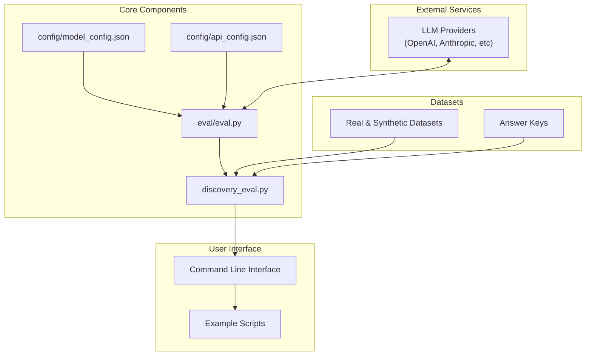
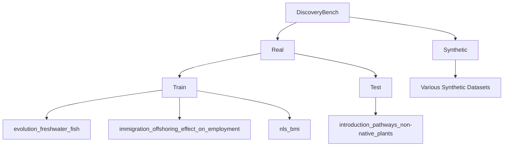
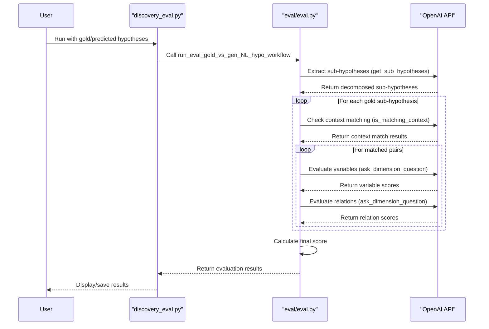
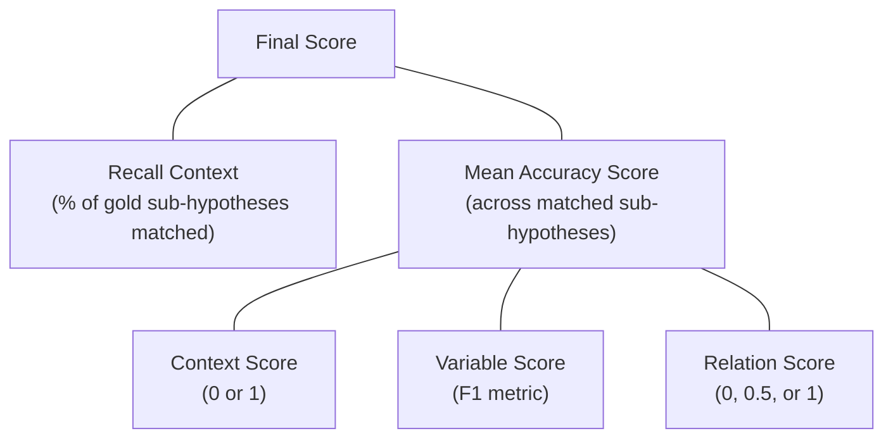
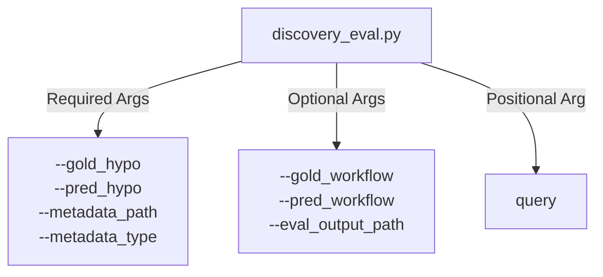
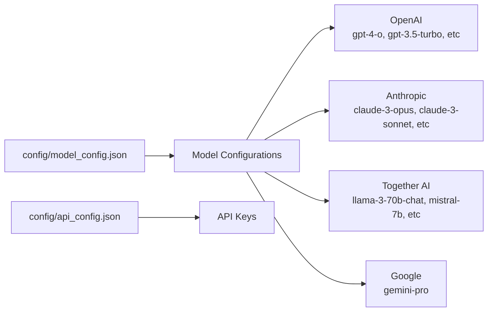
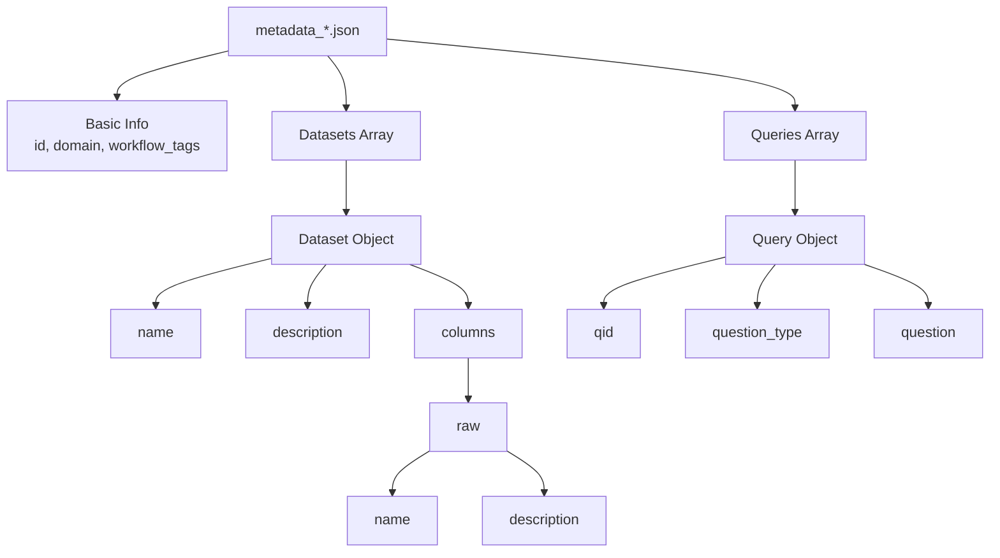

<!-- source: DeepWiki mcp.deepwiki.com · repo allenai/discoverybench · page 1 Overview · fetched 2026-10-26 -->

# Overview

<details>
<summary>Relevant source files</summary>

The following files were used as context for generating this wiki page:

- [config/api_config.json](config/api_config.json)
- [config/model_config.json](config/model_config.json)
- [discovery_eval.py](discovery_eval.py)
- [discoverybench/real/test/introduction_pathways_non-native_plants/metadata_0.json](discoverybench/real/test/introduction_pathways_non-native_plants/metadata_0.json)
- [eval/eval.py](eval/eval.py)
- [eval/example_eval_scripts/test_synth_eval.sh](eval/example_eval_scripts/test_synth_eval.sh)
- [eval/lm_utils.py](eval/lm_utils.py)

</details>


## Purpose and Scope

DiscoveryBench is a framework for evaluating hypotheses generated from scientific datasets. It provides tools to assess how well language models can discover scientific insights from structured data by comparing generated hypotheses against gold standard hypotheses. This overview document introduces the core components of DiscoveryBench, their relationships, and the primary evaluation workflow.

For detailed information about specific datasets, see [Datasets](#2). For in-depth documentation of the evaluation system, see [Evaluation System](#3).

## System Architecture

DiscoveryBench consists of several core components that work together to evaluate hypothesis quality:



Sources: 
- [discovery_eval.py]()
- [eval/eval.py]()
- [config/model_config.json]()
- [config/api_config.json]()

The architecture centers around two key components:
1. `discovery_eval.py` - The main entry point providing a command-line interface for evaluation
2. `eval/eval.py` - The core evaluation logic that compares generated hypotheses with gold standards

## Datasets

DiscoveryBench includes both real-world and synthetic datasets organized into train and test sets:



Sources:
- [discoverybench/real/test/introduction_pathways_non-native_plants/metadata_0.json]()

Each dataset contains metadata describing its structure, variables, and associated research questions. The metadata is stored in JSON format and includes detailed descriptions of dataset columns and their meanings.

## Hypothesis Evaluation Process

The core functionality of DiscoveryBench is evaluating hypotheses generated by language models against gold standard hypotheses. This evaluation follows a sophisticated workflow:



Sources:
- [discovery_eval.py:40-50]()
- [eval/eval.py:342-438]()
- [eval/eval.py:82-188]()
- [eval/eval.py:218-273]()

## Evaluation Dimensions

DiscoveryBench evaluates hypotheses across three key dimensions:

| Dimension | Description | Function | Score Type |
|-----------|-------------|----------|------------|
| Context | The boundary conditions that limit the scope of a sub-hypothesis | `is_matching_context()` | Boolean (0 or 1) |
| Variables | Identified concepts involved in the hypothesis | `ask_dimension_question(dimension="var")` | F1 score (precision/recall) |
| Relations | How variables relate to each other | `ask_dimension_question(dimension="rel")` | Categorical (0, 0.5, or 1) |

Sources:
- [eval/eval.py:27-80]()
- [eval/eval.py:314-339]()

## Evaluation Scoring

The evaluation produces a composite score based on how well the generated hypothesis matches the gold standard:



Sources:
- [eval/eval.py:432-435]()

The final score is calculated as:
`final_score = recall_context * mean_accuracy_score`

Where:
- `recall_context`: Proportion of gold sub-hypotheses matched by the generated hypothesis
- `mean_accuracy_score`: Average of accuracy scores across all matched sub-hypothesis pairs
- Each sub-hypothesis accuracy score: `context_score * variable_score_f1 * relation_score`

## Command-Line Interface

DiscoveryBench provides a command-line interface for evaluating hypotheses:



Sources:
- [discovery_eval.py:18-35]()
- [eval/example_eval_scripts/test_synth_eval.sh]()

Example usage:
```
python discovery_eval.py --gold_hypo "Gold hypothesis text" --pred_hypo "Predicted hypothesis text" --metadata_path "path/to/metadata.json" --metadata_type "real" "Research question text"
```

## LLM Configuration

DiscoveryBench supports multiple language model providers through a configuration system:



Sources:
- [config/model_config.json]()
- [config/api_config.json]()
- [eval/lm_utils.py]()

The default model for evaluation is `gpt-4-1106-preview` as specified in [discovery_eval.py:47]().

## Datasets and Metadata Format

DiscoveryBench datasets include detailed metadata in JSON format describing their structure:



Sources:
- [discoverybench/real/test/introduction_pathways_non-native_plants/metadata_0.json]()

## Summary

DiscoveryBench provides a robust framework for evaluating hypothesis generation capabilities of language models on scientific datasets. Its core strengths include:

1. Structured evaluation of hypotheses across multiple dimensions (context, variables, relations)
2. Support for both real-world and synthetic datasets
3. Decomposition of complex hypotheses into sub-hypotheses for granular evaluation
4. Integration with multiple LLM providers
5. Flexible command-line interface for evaluation

This framework enables researchers to quantitatively assess how well AI systems can discover meaningful scientific insights from data, an important capability for advancing scientific discovery.

---

