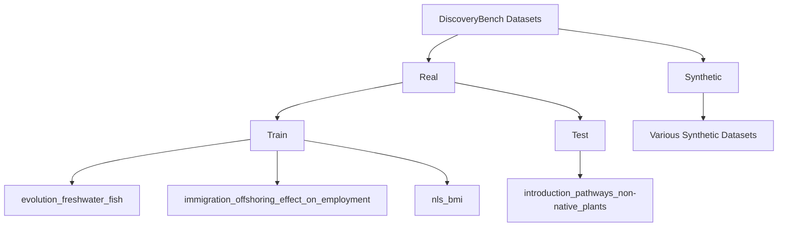
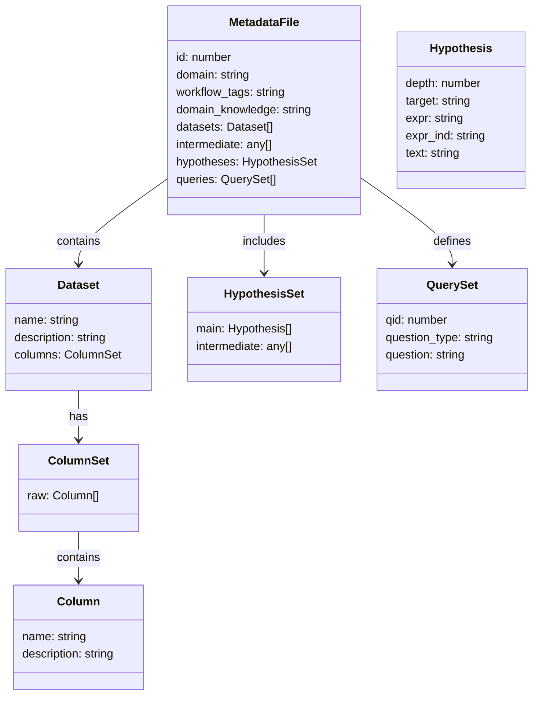
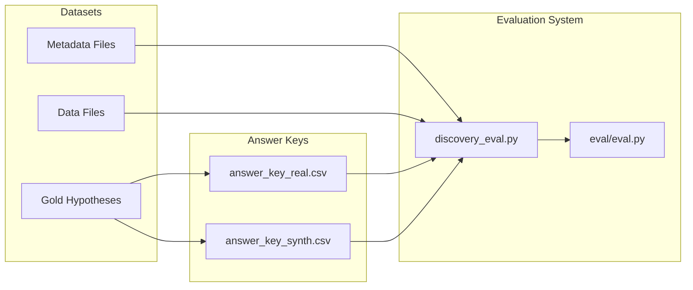

<!-- source: DeepWiki mcp.deepwiki.com · repo allenai/discoverybench · page 2 Datasets · fetched 2026-10-26 -->

# Datasets

Relevant source files

The following files were used as context for generating this wiki page:

- [discoverybench/real/test/introduction_pathways_non-native_plants/metadata_0.json](discoverybench/real/test/introduction_pathways_non-native_plants/metadata_0.json)
- [discoverybench/real/train/evolution_freshwater_fish/metadata_0.json](discoverybench/real/train/evolution_freshwater_fish/metadata_0.json)
- [discoverybench/real/train/immigration_offshoring_effect_on_employment/metadata_0.json](discoverybench/real/train/immigration_offshoring_effect_on_employment/metadata_0.json)
- [discoverybench/real/train/nls_bmi/metadata_0.json](discoverybench/real/train/nls_bmi/metadata_0.json)
- [eval/answer_key_real.csv](eval/answer_key_real.csv)
- [eval/answer_key_synth.csv](eval/answer_key_synth.csv)

This page documents the datasets included in the DiscoveryBench repository, their organization, structure, and key attributes. DiscoveryBench contains both real-world and synthetic datasets designed for evaluating hypothesis generation capabilities. For information about how these datasets are used in the evaluation process, see [Evaluation System](#3).

## Dataset Organization

DiscoveryBench organizes datasets into two primary categories: "real" and "synthetic", with further subdivisions into "train" and "test" sets. Each dataset contains metadata files describing its structure, variables, and associated research questions.

Sources: [discoverybench/real/test/introduction_pathways_non-native_plants/metadata_0.json](), [discoverybench/real/train/evolution_freshwater_fish/metadata_0.json](), [discoverybench/real/train/immigration_offshoring_effect_on_employment/metadata_0.json](), [discoverybench/real/train/nls_bmi/metadata_0.json]()

## Dataset Metadata Structure

Each dataset in DiscoveryBench comes with detailed metadata files that provide essential information about the dataset. These metadata files are in JSON format and contain:

1. Basic dataset information (domain, workflow tags)
2. File descriptions and column details
3. Research hypotheses
4. Query sets for evaluation

Sources: [discoverybench/real/test/introduction_pathways_non-native_plants/metadata_0.json](), [discoverybench/real/train/evolution_freshwater_fish/metadata_0.json]()

## Real Datasets

### Test Datasets

#### Introduction Pathways for Non-Native Plants

This dataset examines the introduction pathways of non-native plant species in the region of Catalonia. It consists of multiple data files that provide information on temporal trends, invasion success, and ecological characteristics of non-native plant species.

**Key Data Files:**
- `temporal_trends_contingency_table.csv`: Contains temporal trends in introduction pathways
- `phylogenetic_tree.txt`: Evolutionary relationships among plant species
- `invasion_success_pathways.csv`: Information on invaded plots and species characteristics
- `invaded_niche_pathways.csv`: Data for pathway-specific differences in invaded niches

**Research Questions Examples:**
- Over which time period has gardening surpassed agriculture as the main contributor to the non-native flora?
- What activity has replaced agriculture as the main contributor to the non-native flora over the past millennium?

**Sample Columns from `invasion_success_pathways.csv`:**

| Column Name | Description |
|-------------|-------------|
| Scientific_name | Full scientific name of the non-native plant species |
| family | Botanical family to which the species belongs |
| number.of.invaded.plots | Number of different plots where the species has invaded |
| area.of.occupancy.10km | Area of occupancy at a 10 km scale |
| intro.pathway | Pathway through which the species was introduced |
| growth.form | Growth form of the plant species |

Sources: [discoverybench/real/test/introduction_pathways_non-native_plants/metadata_0.json:6-277]()

### Train Datasets

#### Evolution of Freshwater Fish

This dataset contains information on drivers of speciation rates in South American freshwater fishes, considering multiple biotic and abiotic factors.

**Key Data File:**
- `body-size-evolution-in-south-american-freshwater-fishes.csv`

**Main Hypothesis:**
"The rate of maximum body length evolution emerged as the most influential factor explaining spatial variation in speciation rates. The relationship is positive with linear coefficient 0.82."

**Sample Columns:**

| Column Name | Description |
|-------------|-------------|
| HYBAS_ID | Identifier for hydrological basins |
| BAMM_speciation | Average speciation rates of species within each sub-basin |
| MBL_evol | Rates of Maximum Body Length evolution |
| bio1 | Annual mean temperature |
| diversity | Species diversity |

Sources: [discoverybench/real/train/evolution_freshwater_fish/metadata_0.json:6-120]()

#### Immigration and Offshoring Effect on Employment

This dataset examines the relationship between immigration and offshoring on employment patterns.

**Key Data Files:**
- `offshoring_iv_mar2.dta`: Contains measures for exogenous variation in offshoring costs
- `immi_popimputed_00_07.dta`: Provides imputed measures of immigrant employment

**Main Hypothesis:**
"Per unit increased ease of immigration reduces 0.1059 unit of the share of offshore employment"

**Sample Columns from `offshoring_iv_mar2.dta`:**

| Column Name | Description |
|-------------|-------------|
| year | Year of observation |
| beaind | Bureau of Economic Analysis Industry Code |
| iv_offshoring_1 | Instrumental variable capturing exogenous variation in offshoring costs |

Sources: [discoverybench/real/train/immigration_offshoring_effect_on_employment/metadata_0.json:6-59]()

#### NLS BMI Dataset

This dataset from the National Longitudinal Survey of Youth (NLSY79) examines the relationship between time preference indicators and Body Mass Index (BMI).

**Key Data File:**
- `nls_bmi_processed.csv`

**Main Hypothesis:**
"Higher time preference associated with higher BMI for 1989 data. BMI is positively related with if person spent more than their saving with a coefficient 0.3596. BMI is also positively correlated with if the savings of a person remained unchanged with a coefficient 0.4858."

**Sample Columns:**

| Column Name | Description |
|-------------|-------------|
| GENDER | Gender of the respondent |
| AGE | Age of the respondent in the year 1989 |
| INCOME | Income of the respondent in 1989 |
| DISSAVED | Boolean indicator if respondent took more money out than put into savings |
| BMI | Body mass index calculated using height and weight |

Sources: [discoverybench/real/train/nls_bmi/metadata_0.json:6-59]()

## Dataset Integration with Evaluation System

Datasets in DiscoveryBench serve as the foundation for the hypothesis evaluation system. They provide both the raw data for analysis and the gold standard hypotheses (via answer keys) against which generated hypotheses are compared.

Sources: [eval/answer_key_real.csv](), [eval/answer_key_synth.csv]()

## Answer Keys

The hypothesis evaluation system uses answer key files that contain the gold standard hypotheses for each dataset. These files map dataset names and metadata IDs to their corresponding ground truth hypotheses.

**Answer Key Structure:**

| Column | Description |
|--------|-------------|
| dataset | Name of the dataset |
| metadataid | ID of the metadata file |
| query_id | ID of the specific query |
| gold_hypo | The gold standard hypothesis text |

The repository contains two primary answer key files:
- `answer_key_real.csv`: Contains gold hypotheses for real-world datasets
- `answer_key_synth.csv`: Contains gold hypotheses for synthetic datasets

Sources: [eval/answer_key_real.csv](), [eval/answer_key_synth.csv]()

## Usage in Hypothesis Evaluation

The datasets described in this page form the foundation of the DiscoveryBench evaluation system. They provide:

1. Raw data for agents to analyze
2. Metadata describing the structure and context of the data
3. Gold standard hypotheses for evaluation of agent-generated hypotheses

When evaluating a hypothesis generation system, the evaluation workflow uses these datasets along with their corresponding gold hypotheses from the answer keys to measure the quality of generated hypotheses across different dimensions (variables, relations, context).

For further details on how datasets are used in the evaluation process, see [Hypothesis Evaluation Implementation](#3.1).

Sources: [discoverybench/real/test/introduction_pathways_non-native_plants/metadata_0.json](), [eval/answer_key_real.csv](), [eval/answer_key_synth.csv]()

---

