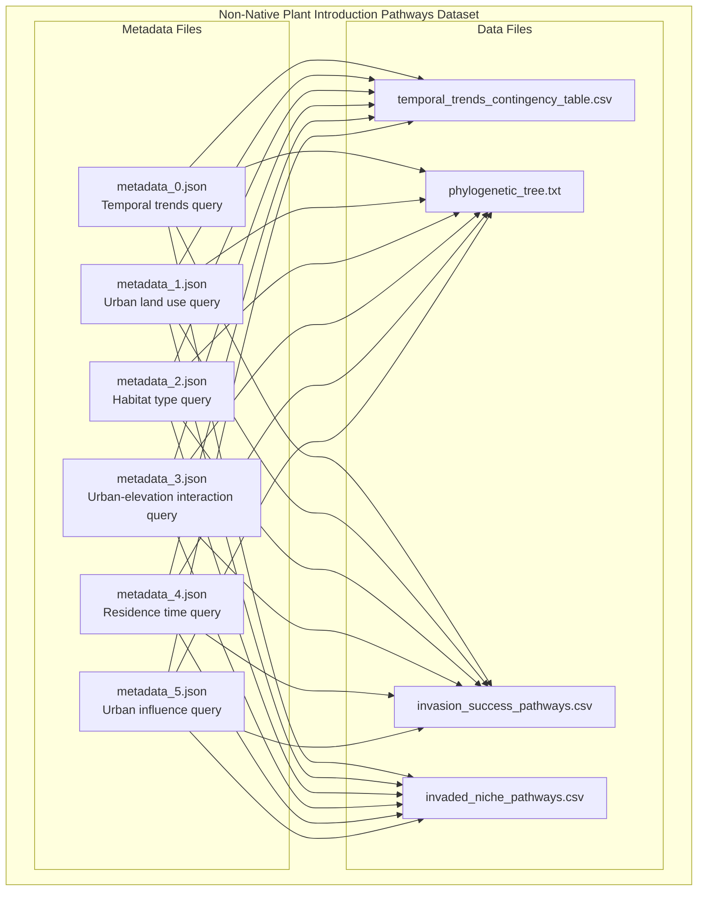
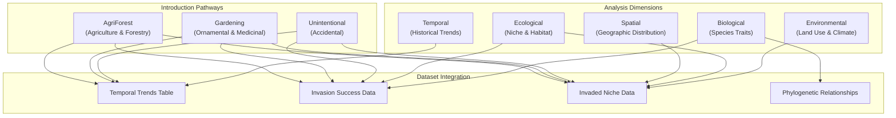
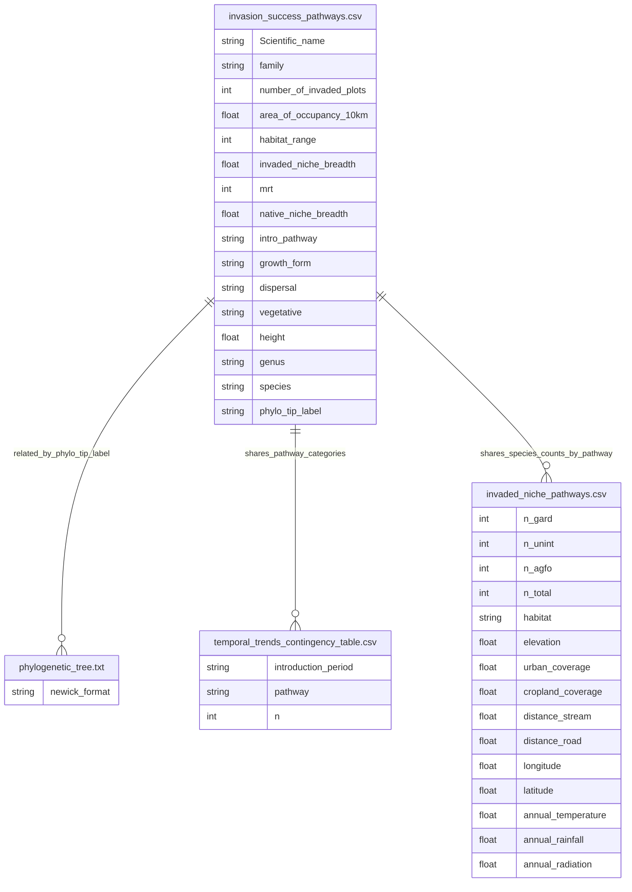
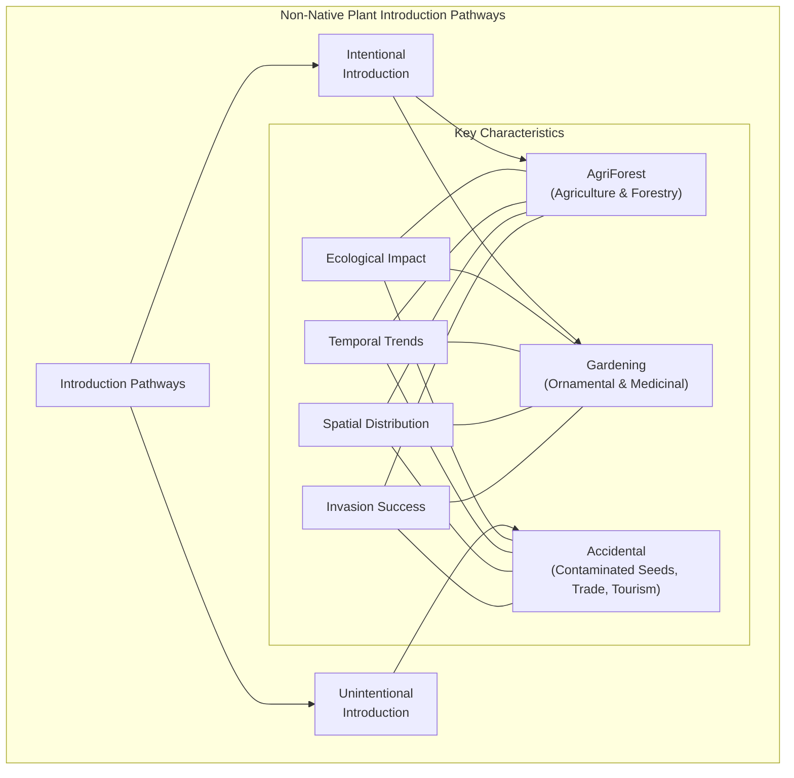

<!-- source: DeepWiki mcp.deepwiki.com · repo allenai/discoverybench · page 2.1 Non-Native Plant Introduction Pathways Dataset · fetched 2026-10-26 -->

# Non-Native Plant Introduction Pathways Dataset

Relevant source files

The following files were used as context for generating this wiki page:

- [discoverybench/real/test/introduction_pathways_non-native_plants/metadata_0.json](discoverybench/real/test/introduction_pathways_non-native_plants/metadata_0.json)
- [discoverybench/real/test/introduction_pathways_non-native_plants/metadata_1.json](discoverybench/real/test/introduction_pathways_non-native_plants/metadata_1.json)
- [discoverybench/real/test/introduction_pathways_non-native_plants/metadata_2.json](discoverybench/real/test/introduction_pathways_non-native_plants/metadata_2.json)
- [discoverybench/real/test/introduction_pathways_non-native_plants/metadata_3.json](discoverybench/real/test/introduction_pathways_non-native_plants/metadata_3.json)
- [discoverybench/real/test/introduction_pathways_non-native_plants/metadata_4.json](discoverybench/real/test/introduction_pathways_non-native_plants/metadata_4.json)
- [discoverybench/real/test/introduction_pathways_non-native_plants/metadata_5.json](discoverybench/real/test/introduction_pathways_non-native_plants/metadata_5.json)

## Overview

The Non-Native Plant Introduction Pathways Dataset provides comprehensive ecological data on non-native plant species in Catalonia, Spain, with a focus on introduction mechanisms, invasion success, and environmental factors. This dataset is part of the DiscoveryBench test collection and serves as a resource for evaluating hypothesis generation related to biological invasions and plant ecology.

This dataset enables the study of how different introduction pathways (gardening, agriculture, or unintentional) influence the distribution, abundance, and ecological impact of non-native plant species across various temporal and spatial scales.

Sources: [discoverybench/real/test/introduction_pathways_non-native_plants/metadata_0.json](), [discoverybench/real/test/introduction_pathways_non-native_plants/metadata_1.json]()

## Dataset Structure

The dataset consists of four primary data files, each capturing different aspects of non-native plant introduction and establishment. Multiple metadata files (metadata_0.json through metadata_5.json) describe these datasets from different analytical perspectives and contain corresponding research questions.

Sources: [discoverybench/real/test/introduction_pathways_non-native_plants/metadata_0.json](), [discoverybench/real/test/introduction_pathways_non-native_plants/metadata_1.json](), [discoverybench/real/test/introduction_pathways_non-native_plants/metadata_2.json](), [discoverybench/real/test/introduction_pathways_non-native_plants/metadata_3.json](), [discoverybench/real/test/introduction_pathways_non-native_plants/metadata_4.json](), [discoverybench/real/test/introduction_pathways_non-native_plants/metadata_5.json]()

## Primary Data Files

### Temporal Trends Contingency Table

The `temporal_trends_contingency_table.csv` file contains historical data on non-native plant introductions in Catalonia, categorized by time period and introduction pathway.

#### Key Variables

| Variable Name | Description |
|---------------|-------------|
| introduction.period | Time period when non-native plant species were introduced |
| pathway | Introduction route: "AgriForest" (agriculture/forestry), "Gardening" (ornamental/medicinal), or "Unintentional" (accidental) |
| n | Count of non-native plant species introductions for each combination of period and pathway |

Sources: [discoverybench/real/test/introduction_pathways_non-native_plants/metadata_0.json:6-25]()

### Phylogenetic Tree

The `phylogenetic_tree.txt` file contains evolutionary relationship data among the non-native plant species in Newick format, with branch lengths representing genetic distances or evolutionary times.

Sources: [discoverybench/real/test/introduction_pathways_non-native_plants/metadata_0.json:27-36]()

### Invasion Success Pathways

The `invasion_success_pathways.csv` file provides detailed information on individual non-native plant species, their ecological characteristics, and invasion metrics in the Barcelona province.

#### Key Variables

| Category | Variables |
|----------|-----------|
| Species Information | Scientific_name, family, genus, species, phylo.tip.label |
| Invasion Metrics | number.of.invaded.plots, area.of.occupancy.10km, habitat.range, invaded.niche.breadth |
| Introduction Data | intro.pathway, mrt (mean residence time) |
| Plant Traits | growth.form, dispersal, vegetative, height, native.niche.breadth |
| Data Management | duplicated, genus.relative, species.relative |

Sources: [discoverybench/real/test/introduction_pathways_non-native_plants/metadata_0.json:38-120]()

### Invaded Niche Pathways

The `invaded_niche_pathways.csv` file contains data for analyzing pathway-specific differences in the invaded ecological niches, including habitat characteristics and landscape factors.

#### Key Variables

| Category | Variables |
|----------|-----------|
| Species Counts | n.gard, n.unint, n.agfo, n.total |
| Habitat Factors | habitat, elevation |
| Temporal Land Use | cropland/urban variables for 1956, 1993, 2009 at 50m, 500m, 1000m buffers |
| Land Use Change | progressive/regressive/no.changes variables for 1956-2009 and 1993-2009 |
| Geographic Factors | distance.stream, distance.road, longitude, latitude |
| Climate Factors | annual.temperature, annual.rainfall, annual.radiation |

Sources: [discoverybench/real/test/introduction_pathways_non-native_plants/metadata_0.json:122-276]()

## Data Relationships and Analysis Dimensions

Sources: [discoverybench/real/test/introduction_pathways_non-native_plants/metadata_0.json](), [discoverybench/real/test/introduction_pathways_non-native_plants/metadata_4.json]()

## Research Questions

The dataset is designed to address several key research questions, as evidenced by the queries in the metadata files:

### Temporal Trends Analysis

- How introduction pathways of non-native plants have shifted over time
- When gardening surpassed agriculture as the main contributor to non-native flora

Sources: [discoverybench/real/test/introduction_pathways_non-native_plants/metadata_0.json:286-303]()

### Urban Land Use Impact

- Relationship between urban land use and gardening-introduced non-native plants
- Quantification of the positive relationship between urban areas and gardening introductions

Sources: [discoverybench/real/test/introduction_pathways_non-native_plants/metadata_1.json:286-297]()

### Habitat-Specific Distributions

- Variation in the prevalence of gardening-introduced plants across different habitat types

Sources: [discoverybench/real/test/introduction_pathways_non-native_plants/metadata_2.json:286-297]()

### Environmental Interactions

- Interaction between urban land use and elevation in affecting gardening-introduced plants
- Factors that significantly interact to influence the proportion of gardening introductions

Sources: [discoverybench/real/test/introduction_pathways_non-native_plants/metadata_3.json:286-302]()

### Invasion Success Factors

- How introduction pathways interact with residence time to affect invasion success
- Differences between intentionally and unintentionally introduced plants in their invasion success

Sources: [discoverybench/real/test/introduction_pathways_non-native_plants/metadata_4.json:286-302]()

### Urban Influence on Invasion

- Scenarios where urban land use promotes specific types of plant invasions

Sources: [discoverybench/real/test/introduction_pathways_non-native_plants/metadata_5.json:286-302]()

## Data Structure and Variables Detail

Sources: [discoverybench/real/test/introduction_pathways_non-native_plants/metadata_0.json:6-276]()

## Introduction Pathways Taxonomy

Sources: [discoverybench/real/test/introduction_pathways_non-native_plants/metadata_0.json:17-19]()

## Integration with DiscoveryBench

This dataset is part of the test collection in the DiscoveryBench framework and is used to evaluate hypothesis generation systems. The dataset is structured to enable testing of various analytical approaches, including:

- Statistical tests
- Regression analysis
- Ecological modeling
- Interaction analysis
- Spatial analysis
- Generalized linear models (GLM)

The multiple metadata files (metadata_0.json through metadata_5.json) represent different analytical perspectives and research questions that can be applied to the same core dataset, enabling comprehensive evaluation of hypothesis generation capabilities.

Sources: [discoverybench/real/test/introduction_pathways_non-native_plants/metadata_0.json:4](), [discoverybench/real/test/introduction_pathways_non-native_plants/metadata_1.json:4](), [discoverybench/real/test/introduction_pathways_non-native_plants/metadata_2.json:4](), [discoverybench/real/test/introduction_pathways_non-native_plants/metadata_3.json:4](), [discoverybench/real/test/introduction_pathways_non-native_plants/metadata_4.json:4](), [discoverybench/real/test/introduction_pathways_non-native_plants/metadata_5.json:4]()

---

