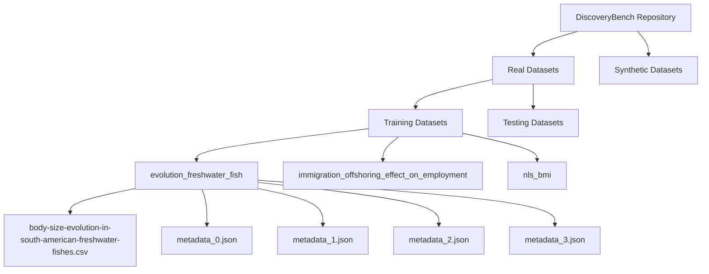
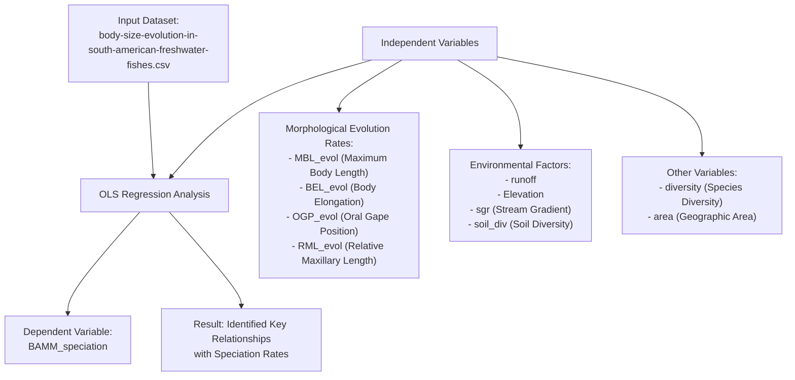
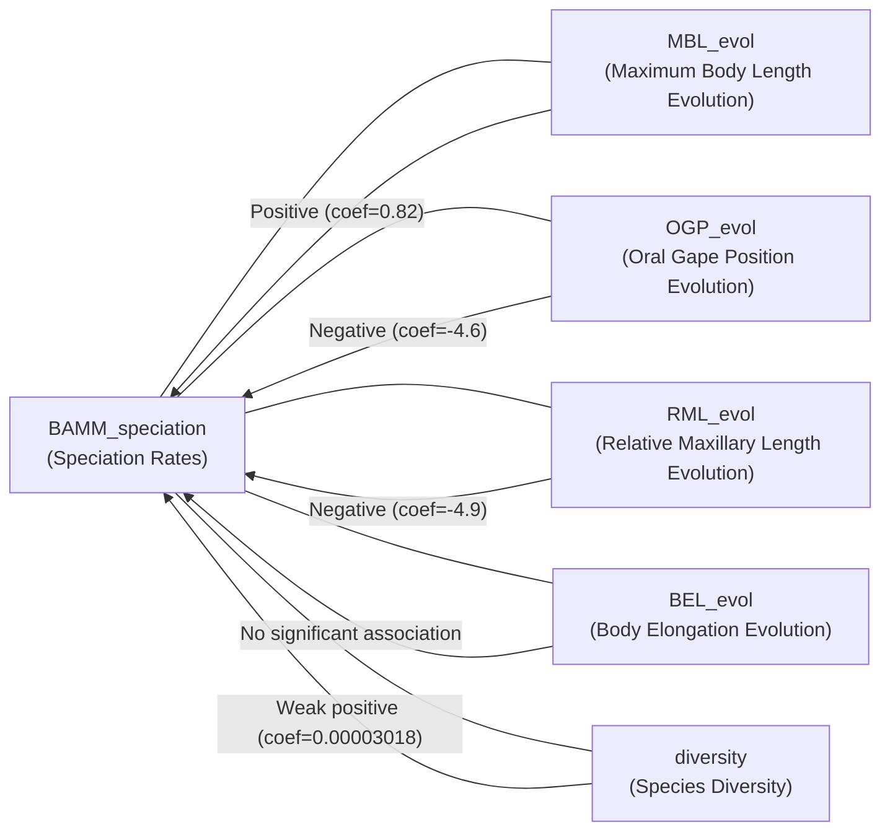
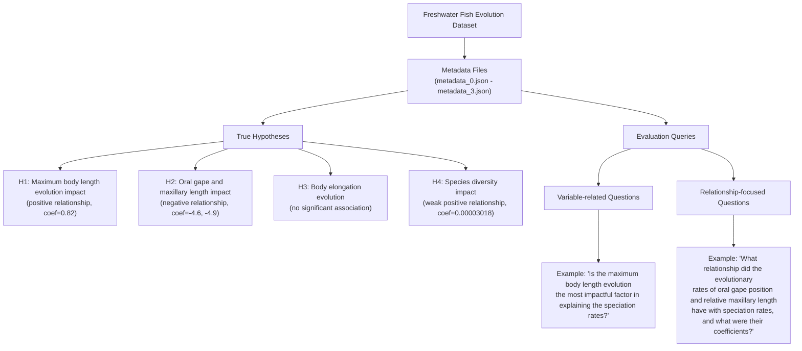

<!-- source: DeepWiki mcp.deepwiki.com · repo allenai/discoverybench · page 2.2 Freshwater Fish Evolution Dataset · fetched 2026-10-26 -->

# Freshwater Fish Evolution Dataset

Relevant source files

The following files were used as context for generating this wiki page:

- [discoverybench/real/train/evolution_freshwater_fish/metadata_0.json](discoverybench/real/train/evolution_freshwater_fish/metadata_0.json)
- [discoverybench/real/train/evolution_freshwater_fish/metadata_1.json](discoverybench/real/train/evolution_freshwater_fish/metadata_1.json)
- [discoverybench/real/train/evolution_freshwater_fish/metadata_2.json](discoverybench/real/train/evolution_freshwater_fish/metadata_2.json)
- [discoverybench/real/train/evolution_freshwater_fish/metadata_3.json](discoverybench/real/train/evolution_freshwater_fish/metadata_3.json)

## Purpose and Scope

This document provides technical documentation for the Freshwater Fish Evolution Dataset included in the DiscoveryBench repository. The dataset focuses on the drivers of speciation rates in South American freshwater fishes, examining both biotic and abiotic factors that influence evolutionary processes. It is designed for evaluating hypotheses about morphological trait evolution and their impact on speciation.

This dataset is part of the real training datasets in DiscoveryBench, used for training and evaluating discovery agents in evolutionary biology.

Sources: [discoverybench/real/train/evolution_freshwater_fish/metadata_0.json:1-158]()

## Dataset Overview

The Freshwater Fish Evolution Dataset (`body-size-evolution-in-south-american-freshwater-fishes.csv`) contains data on South American freshwater fish species, their morphological traits, evolutionary rates, and environmental variables across different hydrological basins. The dataset enables analysis of factors driving speciation rates through regression analysis.

### Dataset Position in DiscoveryBench

Sources: [discoverybench/real/train/evolution_freshwater_fish/metadata_0.json:1-9]()

## Dataset Structure

The dataset contains multiple variables related to fish morphology, evolution rates, and environmental factors. The main dependent variable is `BAMM_speciation`, which represents the average speciation rates of species within each sub-basin.

### Variables and Descriptions

| Category | Variable | Description |
|----------|----------|-------------|
| **Geographic Identifiers** | HYBAS_ID | Identifier for hydrological basins as defined by the HydroBASINS framework |
| | long | Longitude for geographic locations used to map species presence/absence |
| | lat | Latitude for geographic locations used to map species presence/absence |
| **Evolutionary Metrics** | BAMM_speciation | Average speciation rates of species within each sub-basin, as estimated by BAMM |
| | BAMM_extinction | Mean extinction rates for each tip of the phylogenetic tree |
| | BAMM_NetDiv | Net diversification rates (speciation rates minus extinction rates) |
| | DR | Diversification Rate, a transformed measure of evolutionary distinctness |
| **Morphological Evolution Rates** | MBL_evol | Rates of Maximum Body Length evolution |
| | BEL_evol | Rates of Body Elongation evolution |
| | OGP_evol | Rates of Oral Gape Position Evolution |
| | RES_evol | Rates of Relative Eye Size Evolution |
| | RML_evol | Rate of Relative Maxillary Length evolution |
| **Environmental Factors** | bio1 | Annual mean temperature |
| | bio12 | Annual mean precipitation |
| | runoff | Water quantity from precipitation flowing over land surface |
| | aet | Actual evapotranspiration |
| | Elevation | Mean elevation above sea level |
| | sgr | Stream gradient (steepness of stream/river) |
| | soil_div | Diversity of soil types within each sub-basin |
| **Area and Diversity** | area | Geographic area of a sub-basin |
| | diversity | Species diversity in a given area |

Sources: [discoverybench/real/train/evolution_freshwater_fish/metadata_0.json:11-119]()

## Analysis Workflow

The dataset is structured for regression analysis, specifically examining the relationship between various independent variables and speciation rates. The primary analytical approach is Ordinary Least Squares (OLS) regression.

### Analysis Design

Sources: [discoverybench/real/train/evolution_freshwater_fish/metadata_0.json:135-136](), [discoverybench/real/train/evolution_freshwater_fish/metadata_1.json:135-136](), [discoverybench/real/train/evolution_freshwater_fish/metadata_2.json:135-136](), [discoverybench/real/train/evolution_freshwater_fish/metadata_3.json:135-136]()

## Key Hypotheses

The dataset supports several hypotheses about the factors influencing speciation rates in South American freshwater fishes:

### Relationships Between Variables and Speciation Rates

Sources: [discoverybench/real/train/evolution_freshwater_fish/metadata_0.json:123-134](), [discoverybench/real/train/evolution_freshwater_fish/metadata_1.json:123-134](), [discoverybench/real/train/evolution_freshwater_fish/metadata_2.json:123-134](), [discoverybench/real/train/evolution_freshwater_fish/metadata_3.json:123-134]()

### Summary of Key Findings

| Variable | Relationship with Speciation Rates | Coefficient | Statistical Significance |
|----------|-----------------------------------|-------------|--------------------------|
| Maximum Body Length Evolution (MBL_evol) | Positive | 0.82 | Significant (most influential) |
| Oral Gape Position Evolution (OGP_evol) | Negative | -4.6 | Significant |
| Relative Maxillary Length Evolution (RML_evol) | Negative | -4.9 | Significant |
| Body Elongation Evolution (BEL_evol) | None | - | Not significant |
| Species Diversity (diversity) | Positive | 0.00003018 | Significant but weak |

Sources: [discoverybench/real/train/evolution_freshwater_fish/metadata_0.json:130-131](), [discoverybench/real/train/evolution_freshwater_fish/metadata_1.json:130-131](), [discoverybench/real/train/evolution_freshwater_fish/metadata_2.json:130-131](), [discoverybench/real/train/evolution_freshwater_fish/metadata_3.json:130-131]()

## Evaluation in DiscoveryBench

The dataset includes metadata files (`metadata_0.json` through `metadata_3.json`) that contain hypotheses and evaluation queries for testing discovery agents. These are used in the DiscoveryBench evaluation system to assess how well models can derive accurate hypotheses from the data.

### Evaluation Structure

Sources: [discoverybench/real/train/evolution_freshwater_fish/metadata_0.json:136-156](), [discoverybench/real/train/evolution_freshwater_fish/metadata_1.json:136-156](), [discoverybench/real/train/evolution_freshwater_fish/metadata_2.json:136-149](), [discoverybench/real/train/evolution_freshwater_fish/metadata_3.json:136-150]()

## Integration with DiscoveryBench

The Freshwater Fish Evolution Dataset is used to train and evaluate discovery agents on their ability to analyze biological data and generate meaningful hypotheses. The dataset contributes to DiscoveryBench's goal of benchmarking AI systems' capabilities in scientific discovery across multiple domains.

Sources: [discoverybench/real/train/evolution_freshwater_fish/metadata_0.json:1-7]()

---

