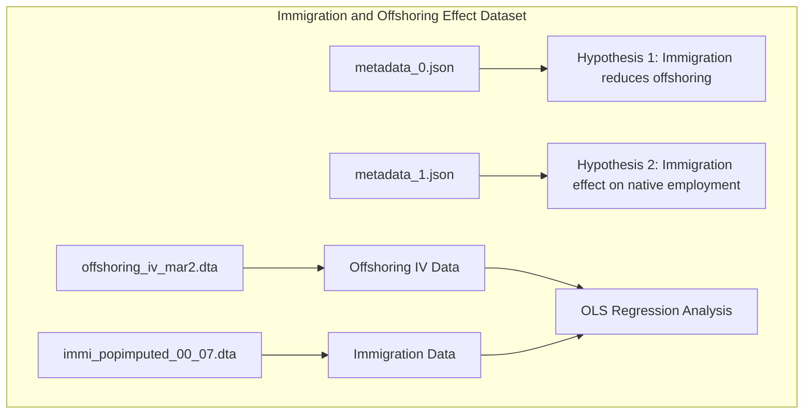
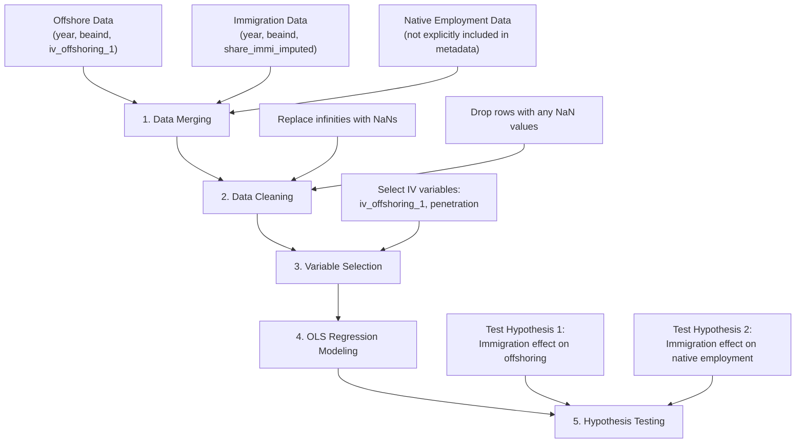
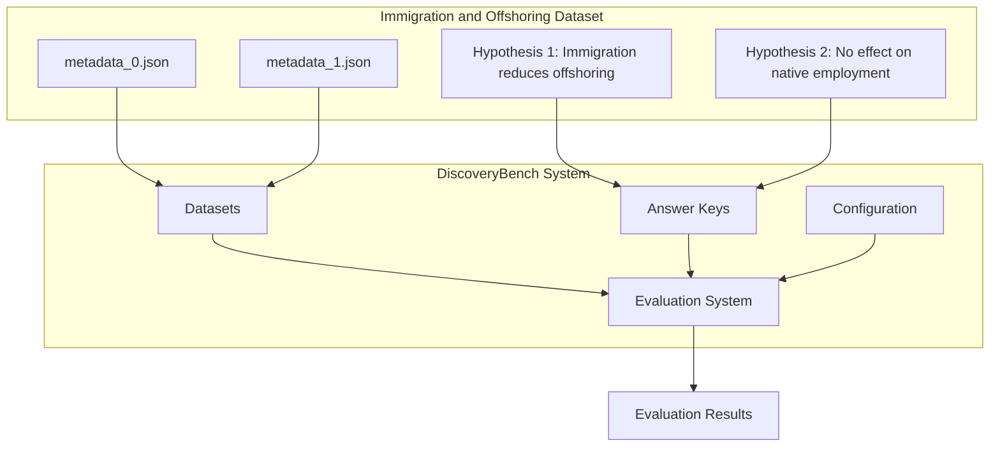

<!-- source: DeepWiki mcp.deepwiki.com · repo allenai/discoverybench · page 2.3 Immigration and Offshoring Effect Dataset · fetched 2026-10-26 -->

# Immigration and Offshoring Effect Dataset

<details>
<summary>Relevant source files</summary>

The following files were used as context for generating this wiki page:

- [discoverybench/real/train/immigration_offshoring_effect_on_employment/metadata_0.json](discoverybench/real/train/immigration_offshoring_effect_on_employment/metadata_0.json)
- [discoverybench/real/train/immigration_offshoring_effect_on_employment/metadata_1.json](discoverybench/real/train/immigration_offshoring_effect_on_employment/metadata_1.json)

</details>


## Purpose and Scope

This document provides detailed information about the Immigration and Offshoring Effect Dataset, a training dataset within DiscoveryBench that examines the relationship between immigration, offshoring, and employment in various industries. The dataset is designed to investigate how changes in immigration patterns influence offshoring activities and native employment shares across different economic sectors.

The dataset focuses specifically on economic analysis using regression techniques to test hypotheses about labor market dynamics. For information about other economic or employment-related datasets, see the [NLS BMI Dataset](#2.4).

## Dataset Overview

The Immigration and Offshoring Effect Dataset explores the relationship between immigration and offshoring through instrumental variables and regression analysis. It contains data spanning multiple years and industries, with metrics on offshoring costs, immigrant employment shares, and employment patterns.



Sources: [discoverybench/real/train/immigration_offshoring_effect_on_employment/metadata_0.json:1-91](), [discoverybench/real/train/immigration_offshoring_effect_on_employment/metadata_1.json:1-91]()

## Dataset Structure

The dataset consists of two primary data files that are designed to be merged for analysis:

### 1. Offshoring Data (`offshoring_iv_mar2.dta`)

This file contains instrumental variables measuring the ease or costs of offshoring across industries and years. It's constructed using variation in offshoring across countries to the U.S., interacting with each industry's initial distribution of offshoring.

| Column Name | Description | Data Type |
|-------------|-------------|-----------|
| year | The year of the observation | Numeric |
| beaind | Bureau of Economic Analysis (BEA) Industry Code | Categorical |
| iv_offshoring_1 | Instrumental variable capturing exogenous variation in the ease/costs of offshoring | Numeric |

### 2. Immigration Data (`immi_popimputed_00_07.dta`)

This file provides imputed measures of immigrant employment aimed at capturing exogenous variation in immigration costs and push-factors across industries and years.

| Column Name | Description | Data Type |
|-------------|-------------|-----------|
| year | The year of the observation | Numeric |
| beaind | Bureau of Economic Analysis (BEA) Industry Code | Categorical |
| share_immi_imputed | Imputed proportion of immigrant employment within total employment | Numeric |
| empl_immi_imputed | Imputed level of immigrant employment (count) | Numeric |

Sources: [discoverybench/real/train/immigration_offshoring_effect_on_employment/metadata_0.json:6-59](), [discoverybench/real/train/immigration_offshoring_effect_on_employment/metadata_1.json:6-59]()

## Data Relationships and Integration

The dataset is designed for integrated analysis through matching industry-year combinations. Both files share common identifier columns (`year` and `beaind`), allowing for merging into a combined dataset for regression analysis.

```mermaid
erDiagram
    OFFSHORING_DATA ||--|| IMMIGRATION_DATA : "merged by"
    OFFSHORING_DATA {
        int year
        string beaind
        float iv_offshoring_1
    }
    IMMIGRATION_DATA {
        int year
        string beaind
        float share_immi_imputed
        int empl_immi_imputed
    }
    
    MERGED_DATASET {
        int year
        string beaind
        float iv_offshoring_1
        float share_immi_imputed
        int empl_immi_imputed
    }
    
    OFFSHORING_DATA --o{ MERGED_DATASET : contains
    IMMIGRATION_DATA --o{ MERGED_DATASET : contains
```

Sources: [discoverybench/real/train/immigration_offshoring_effect_on_employment/metadata_0.json:74](), [discoverybench/real/train/immigration_offshoring_effect_on_employment/metadata_1.json:74]()

## Research Hypotheses

The dataset is used to test two primary hypotheses about the interaction between immigration and employment patterns:

1. **Hypothesis 1**: Per unit increased ease of immigration reduces 0.1059 unit of the share of offshore employment
   - This suggests a substitution effect where industries with greater immigration accessibility tend to reduce their offshoring activities.

2. **Hypothesis 2**: Increased ease of immigration has no significant effect on the share of native employment
   - This suggests that immigration does not significantly displace native workers within industries.

These hypotheses help address important economic questions about labor market dynamics, international trade, and immigration policy effects.

Sources: [discoverybench/real/train/immigration_offshoring_effect_on_employment/metadata_0.json:62-73](), [discoverybench/real/train/immigration_offshoring_effect_on_employment/metadata_1.json:62-73]()

## Analysis Workflow

The standard workflow for analyzing this dataset involves the following steps:



The workflow involves:

1. **Data Merging**: Combining the offshoring, immigration, and native employment datasets using the common `year` and `beaind` columns.
2. **Data Cleaning**: Handling missing values and outliers.
3. **Variable Selection**: Identifying independent variables for the regression model.
4. **OLS Regression**: Fitting an Ordinary Least Squares regression model.
5. **Hypothesis Testing**: Analyzing regression results to confirm or refute hypotheses.

Sources: [discoverybench/real/train/immigration_offshoring_effect_on_employment/metadata_0.json:74](), [discoverybench/real/train/immigration_offshoring_effect_on_employment/metadata_1.json:74]()

## Evaluation Queries

The dataset includes predefined evaluation queries that can be used to test hypothesis generation systems:

### Hypothesis 1 Queries:
1. Variable identification: "Which variable per unit reduces 0.1059 unit of the share of offshore employment?"
2. Relationship determination: "How does per unit increased ease of immigration impact the share of offshore employment?"

### Hypothesis 2 Queries:
1. Relationship determination: "What is the effect of increased ease of immigration on the local job market for native workers?"
2. Relationship determination: "How does increased ease of immigration impact the share of native employment?"

These queries are used to evaluate how well systems can extract relevant variables and relationships from the data.

Sources: [discoverybench/real/train/immigration_offshoring_effect_on_employment/metadata_0.json:75-89](), [discoverybench/real/train/immigration_offshoring_effect_on_employment/metadata_1.json:75-89]()

## Integration with DiscoveryBench

The Immigration and Offshoring Effect Dataset is integrated into the DiscoveryBench framework as a training dataset for hypothesis generation and evaluation. It represents a real-world economic analysis scenario.



When using this dataset for hypothesis evaluation:

1. The dataset serves as input to the evaluation system
2. The defined hypotheses function as "gold standard" answers
3. Generated hypotheses are compared against these standards
4. The evaluation queries assess how well a system extracts variables and relationships

Sources: [discoverybench/real/train/immigration_offshoring_effect_on_employment/metadata_0.json:1-91](), [discoverybench/real/train/immigration_offshoring_effect_on_employment/metadata_1.json:1-91]()

## Technical Implementation Details

The dataset is implemented through JSON metadata files that define the structure, variables, and hypotheses. Each metadata file represents a different research question within the same dataset.

### Metadata Structure

```
immigration_offshoring_effect_on_employment/
├── metadata_0.json  # Hypothesis about immigration impact on offshoring
└── metadata_1.json  # Hypothesis about immigration impact on native employment
```

The metadata files define:

- Dataset domain and workflow tags
- Data file specifications and column descriptions
- Research hypotheses
- Analysis workflow
- Evaluation queries

The data files themselves (`.dta` format) are Stata data files, a common format in economic research that can be loaded using libraries like `pandas` with the `pyreadstat` package.

Sources: [discoverybench/real/train/immigration_offshoring_effect_on_employment/metadata_0.json:1-5](), [discoverybench/real/train/immigration_offshoring_effect_on_employment/metadata_1.json:1-5]()

## Summary

The Immigration and Offshoring Effect Dataset provides a framework for testing hypotheses about the relationship between immigration and labor market outcomes. It includes:

- Two primary data sources on offshoring and immigration
- Common industry-year identifiers for data integration
- Two main research hypotheses about labor market dynamics
- A standardized workflow for data analysis
- Evaluation queries for testing hypothesis generation systems

This dataset serves as a valuable training resource within the DiscoveryBench framework for developing and evaluating hypothesis generation systems in economic research.

---

