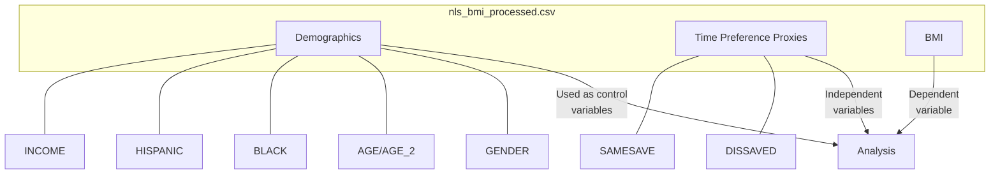
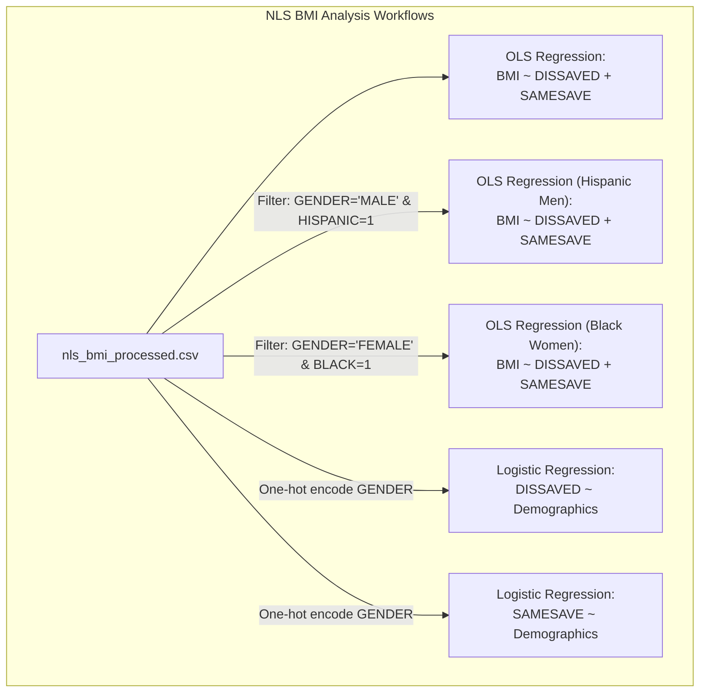
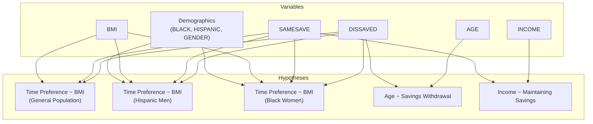

<!-- source: DeepWiki mcp.deepwiki.com · repo allenai/discoverybench · page 2.4 NLS BMI Dataset · fetched 2026-10-26 -->

# NLS BMI Dataset

Relevant source files

The following files were used as context for generating this wiki page:

- [discoverybench/real/train/nls_bmi/metadata_0.json](discoverybench/real/train/nls_bmi/metadata_0.json)
- [discoverybench/real/train/nls_bmi/metadata_1.json](discoverybench/real/train/nls_bmi/metadata_1.json)
- [discoverybench/real/train/nls_bmi/metadata_2.json](discoverybench/real/train/nls_bmi/metadata_2.json)
- [discoverybench/real/train/nls_bmi/metadata_3.json](discoverybench/real/train/nls_bmi/metadata_3.json)
- [discoverybench/real/train/nls_bmi/metadata_4.json](discoverybench/real/train/nls_bmi/metadata_4.json)

## Purpose and Scope

This document details the NLS BMI Dataset from the National Longitudinal Survey of Youth (NLSY79) used in DiscoveryBench for evaluating hypothesis generation in social science contexts. The dataset focuses on exploring relationships between body mass index (BMI), saving behaviors (as proxies for time preference), and demographic characteristics. This page covers the dataset structure, key variables, associated hypotheses, and analysis workflows implemented in the repository.

Sources: [discoverybench/real/train/nls_bmi/metadata_0.json:1-92]()

## Dataset Overview

The NLS BMI dataset is part of the training data in DiscoveryBench's real datasets collection. It contains demographic information, saving behaviors, and body mass index measurements from respondents in the National Longitudinal Survey of Youth from 1989, with height measurements from 1985 and weight from 1989.

The dataset is used primarily to explore the relationship between time preference (using saving behavior as a proxy) and BMI, particularly across different demographic groups.

### Dataset Structure Diagram

Sources: [discoverybench/real/train/nls_bmi/metadata_0.json:6-60]()

## Key Variables

The dataset contains the following key variables:

| Variable | Description | Type | Use in Analysis |
|----------|-------------|------|----------------|
| GENDER | Gender of the respondent (MALE or FEMALE) | Categorical | Control variable |
| AGE | Age of the respondent in 1989 | Numeric | Control/predictor variable |
| AGE_2 | Square of the age of the respondent | Numeric | Control variable for non-linear effects |
| INCOME | Income of the respondent in 1989 | Numeric | Control/predictor variable |
| DISSAVED | 1 if respondent took more money out than put into savings, 0 otherwise | Boolean | Time preference proxy/dependent variable |
| SAMESAVE | 1 if savings level did not change or had no savings, 0 otherwise | Boolean | Time preference proxy/dependent variable |
| BMI | Body mass index calculated using height (1985) and weight (1989) | Numeric | Primary dependent variable |
| BLACK | 1 if respondent is black, 0 otherwise | Boolean | Control/stratification variable |
| HISPANIC | 1 if respondent is hispanic, 0 otherwise | Boolean | Control/stratification variable |

Sources: [discoverybench/real/train/nls_bmi/metadata_0.json:11-58]()

## Domain Knowledge Context

The dataset incorporates an important domain-specific assumption: spending and saving behavior can be used as proxies for an individual's time preference. In economic and behavioral theory, time preference refers to how an individual values present versus future consumption or rewards. Higher time preference indicates valuing present consumption more than future gains.

Sources: [discoverybench/real/train/nls_bmi/metadata_0.json:5](), [discoverybench/real/train/nls_bmi/metadata_1.json:5]()

## Research Hypotheses

The dataset is used to explore several key hypotheses:

### Main Hypothesis

The primary hypothesis examines the relationship between time preference (measured via saving behaviors) and BMI:

> "Higher time preference associated with higher BMI for 1989 data. BMI is positively related with if person spent more than their saving with a coefficient 0.3596. BMI is also positively correlated with if the savings of a person remained unchanged with a coefficient 0.4858."

### Demographic-Specific Hypotheses

Additional hypotheses examine this relationship in specific demographic groups:

1. **Hispanic Men**: 
   > "Time preference is positively associated with Body Mass Index in Hispanic men with coefficients for no change in savings level being 1.5799 (p-value: 0.000) and coefficient for having withdrawn more money from savings than they had put in being 0.9826 (p-value: 0.038)"

2. **Black Women**: 
   > "Time preference is positively associated with Body Mass Index in Black women with coefficients for no change in savings level being 1.1840 (p-value: 0.003) and coefficient for having withdrawn more money from savings than they had put in being 0.5446 (p-value: 0.225)"

### Behavioral Economics Hypotheses

The dataset also explores factors influencing saving behaviors themselves:

1. **Age and Savings Withdrawal**: 
   > "Younger individuals are more likely to withdraw more money from savings than they had put in and with a negative coefficient between age and withdrawing more than putting into savings (-0.0422)."

2. **Income and Savings Maintenance**: 
   > "As income increases, the likelihood of maintaining the same level of savings decreases, supported by a coefficient of -0.0038 (p<0.001) for income."

Sources: [discoverybench/real/train/nls_bmi/metadata_0.json:63-71](), [discoverybench/real/train/nls_bmi/metadata_1.json:63-71](), [discoverybench/real/train/nls_bmi/metadata_2.json:63-71](), [discoverybench/real/train/nls_bmi/metadata_3.json:63-71](), [discoverybench/real/train/nls_bmi/metadata_4.json:63-71]()

## Analysis Workflows

The dataset supports multiple analysis workflows, primarily using regression techniques:

### Analysis Workflow Diagram

Sources: [discoverybench/real/train/nls_bmi/metadata_0.json:75](), [discoverybench/real/train/nls_bmi/metadata_1.json:75](), [discoverybench/real/train/nls_bmi/metadata_2.json:75](), [discoverybench/real/train/nls_bmi/metadata_3.json:75](), [discoverybench/real/train/nls_bmi/metadata_4.json:75]()

### Workflow 1: BMI and Time Preference (General Population)

This workflow examines the relationship between time preference proxies and BMI across the entire dataset:

1. Choose BMI as dependent variable
2. Use time preference variables (DISSAVED, SAMESAVE) as independent variables
3. Fit an OLS regression model
4. Interpret coefficients and significance

Sources: [discoverybench/real/train/nls_bmi/metadata_0.json:75]()

### Workflow 2: BMI and Time Preference (Demographic Subgroups)

This workflow repeats the analysis for specific demographic subgroups:

1. Filter data for specific demographic combinations:
   - Hispanic men (`GENDER="MALE" AND HISPANIC=1`)
   - Black women (`GENDER="FEMALE" AND BLACK=1`)
2. Run OLS regression with BMI as dependent variable and DISSAVED/SAMESAVE as independent variables
3. Interpret coefficients and significance by demographic group

Sources: [discoverybench/real/train/nls_bmi/metadata_1.json:75](), [discoverybench/real/train/nls_bmi/metadata_2.json:75]()

### Workflow 3: Predicting Saving Behaviors

This workflow examines factors that predict saving behaviors:

1. One-hot encode Gender variable into MALE and FEMALE
2. Extract independent variables (AGE, INCOME, BMI, BLACK, HISPANIC, MALE, FEMALE)
3. Use either DISSAVED or SAMESAVE as dependent variable
4. Add constant term for intercept
5. Fit logistic regression model
6. Interpret odds ratios and significance

Sources: [discoverybench/real/train/nls_bmi/metadata_3.json:75](), [discoverybench/real/train/nls_bmi/metadata_4.json:75]()

## Query Types and Evaluation

The dataset includes multiple query types to evaluate hypothesis generation capabilities:

1. **Variables queries**: Identifying factors related to time preference and BMI
2. **Relationship queries**: Determining how variables relate to each other
3. **Context queries**: Exploring behaviors in specific demographic contexts

### Variables to Hypotheses Mapping

Sources: [discoverybench/real/train/nls_bmi/metadata_0.json:76-91](), [discoverybench/real/train/nls_bmi/metadata_1.json:76-84](), [discoverybench/real/train/nls_bmi/metadata_2.json:76-84](), [discoverybench/real/train/nls_bmi/metadata_3.json:76-91](), [discoverybench/real/train/nls_bmi/metadata_4.json:76-84]()

## Dataset File Location

The dataset exists as `nls_bmi_processed.csv` in the repository's real training data directory. It is accompanied by multiple metadata files (`metadata_0.json` through `metadata_4.json`) that define different analysis configurations and hypotheses.

Sources: [discoverybench/real/train/nls_bmi/metadata_0.json:8]()

---

