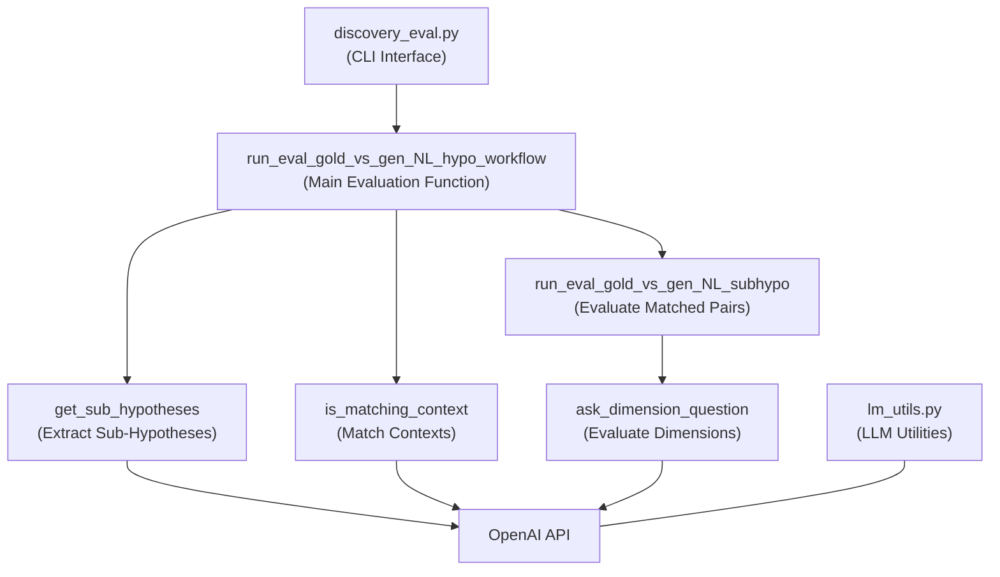
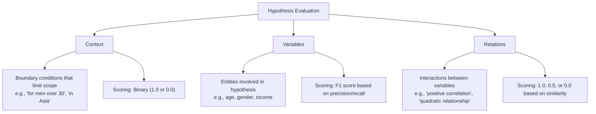
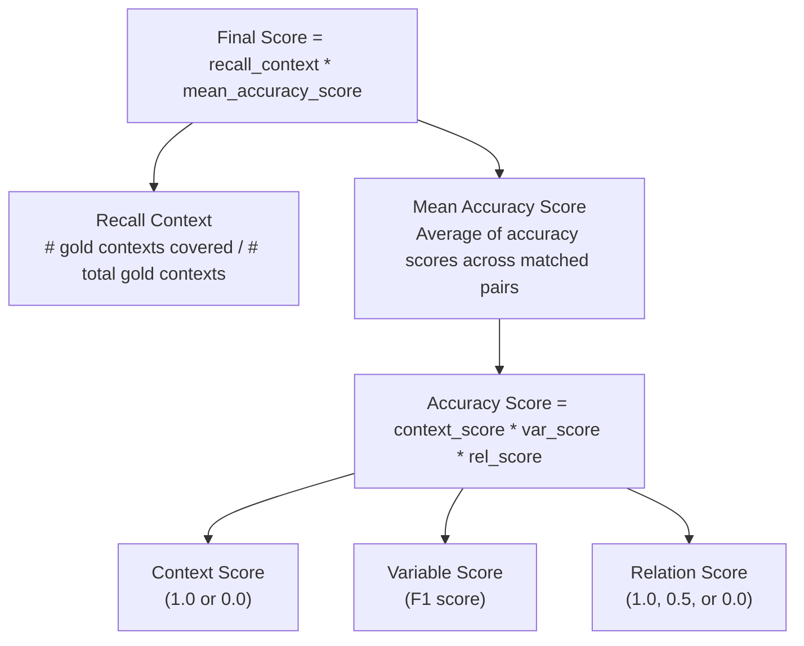
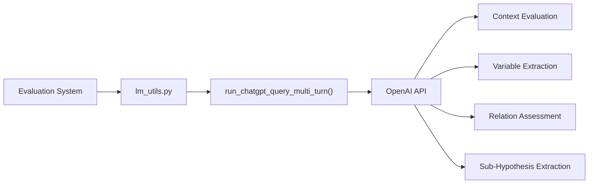

<!-- source: DeepWiki mcp.deepwiki.com · repo allenai/discoverybench · page 3 Evaluation System · fetched 2026-10-26 -->

# Evaluation System

<details>
<summary>Relevant source files</summary>

The following files were used as context for generating this wiki page:

- [discovery_eval.py](discovery_eval.py)
- [eval/eval.py](eval/eval.py)
- [eval/example_eval_scripts/test_synth_eval.sh](eval/example_eval_scripts/test_synth_eval.sh)
- [eval/lm_utils.py](eval/lm_utils.py)
- [eval/new_eval.py](eval/new_eval.py)

</details>


The Evaluation System is a core component of DiscoveryBench responsible for assessing the quality of generated hypotheses by comparing them against gold standard hypotheses. It performs semantic evaluation across multiple dimensions rather than simple string matching, using large language models (LLMs) to understand and score hypotheses based on their contextual, variable, and relational aspects.

For details about specific datasets used in evaluation, see [Datasets](#2). For information about example evaluation scripts and usage, see [Example Evaluation Scripts](#3.4).

## System Architecture

### High-Level Architecture



The evaluation system is built around several key components that work together to process and evaluate hypotheses:

1. **CLI Interface** (`discovery_eval.py`): The entry point for evaluation requests, handling argument parsing and results output
2. **Evaluation Core** (`eval/eval.py`): Contains the main logic for breaking down hypotheses, matching them, and scoring them
3. **LLM Utilities** (`eval/lm_utils.py`): Provides utilities for interacting with OpenAI's API
4. **OpenAI API**: External service used for semantic evaluation of hypotheses

Sources: [discovery_eval.py:1-62](), [eval/eval.py:341-438](), [eval/lm_utils.py:31-65]()

### Evaluation Workflow

```mermaid
sequenceDiagram
    participant User
    participant CLI as discovery_eval.py
    participant Eval as run_eval_gold_vs_gen_NL_hypo_workflow
    participant LLM as OpenAI API
    
    User->>CLI: Input gold & pred hypotheses
    CLI->>Eval: Pass parameters
    
    Eval->>LLM: Extract gold sub-hypotheses
    LLM-->>Eval: Return gold sub-hypotheses
    Eval->>LLM: Extract pred sub-hypotheses
    LLM-->>Eval: Return pred sub-hypotheses
    
    loop For each pred sub-hypothesis
        loop For each gold sub-hypothesis not yet matched
            Eval->>LLM: Match contexts
            LLM-->>Eval: Context match result
            opt Context matches
                Eval->>Eval: Mark gold sub-hypothesis as covered
                Eval->>Eval: Record match
                break
            end
        end
    end
    
    loop For each matched pair
        Eval->>LLM: Evaluate variables
        LLM-->>Eval: Variable scores
        Eval->>LLM: Evaluate relations
        LLM-->>Eval: Relation scores
        Eval->>Eval: Calculate accuracy score
    end
    
    Eval->>Eval: Calculate recall_context
    Eval->>Eval: Calculate mean_accuracy_score
    Eval->>Eval: Calculate final_score
    Eval-->>CLI: Return evaluation result
    CLI-->>User: Display/save results
```

The evaluation process follows a structured workflow:

1. User provides gold hypothesis, predicted hypothesis, dataset metadata, and query
2. System extracts sub-hypotheses from both gold and predicted hypotheses using LLM
3. Each predicted sub-hypothesis is matched with a gold sub-hypothesis based on context
4. For each matched pair, variables and relations are evaluated
5. Final score is calculated as `recall_context * mean_accuracy_score`

Sources: [eval/eval.py:342-438](), [discovery_eval.py:40-58]()

## Evaluation Dimensions

The system evaluates hypotheses across three key dimensions that are crucial for scientific hypothesis validity:



### Context Evaluation

Contexts are the boundary conditions or scope under which a hypothesis is defined. The system evaluates context match using:
- Direct string comparison first
- If not identical, semantic comparison through LLM

```python
# Context matching process
if gold_context == pred_context:
    return True
if "None" in [gold_context, pred_context]:
    return False
return match_context_with_gpt(gold_hyp, gold_context, pred_hyp, pred_context, model=llm_used)
```

Sources: [eval/eval.py:307-312](), [eval/eval.py:275-304]()

### Variables Evaluation

Variables are the concepts or entities involved in the hypothesis. The system evaluates variable overlap using:
- Counting variables in gold hypothesis (sizeA)
- Counting variables in predicted hypothesis (sizeB)
- Counting shared variables (intersection)
- Calculating precision, recall, and F1 score

The variable score is represented as an F1 score that balances precision and recall.

Sources: [eval/eval.py:37-68](), [eval/eval.py:110-123]()

### Relations Evaluation

Relations describe how variables interact within the hypothesis. The system evaluates relations using a three-level scale:
- Very similar (1.0): Relations are essentially identical
- Similar but more general (0.5): Relations are similar but the predicted one is more general
- Different (0.0): Relations differ significantly

Sources: [eval/eval.py:69-80](), [eval/eval.py:125-139]()

## Scoring System

The evaluation system uses a hierarchical scoring approach to combine individual dimension scores into a final assessment.



The final score combines:
1. **Recall Context**: Measures how many gold sub-hypotheses are covered by predicted sub-hypotheses
2. **Mean Accuracy Score**: Measures how well the matched sub-hypotheses align across all dimensions

This balanced approach ensures both coverage (recall_context) and quality (mean_accuracy_score) are considered.

Sources: [eval/eval.py:427-435](), [eval/eval.py:337]()

## Implementation Details

### Sub-Hypothesis Extraction 

The system breaks down complex hypotheses into simpler sub-hypotheses for more precise evaluation:

```python
def get_sub_hypotheses(query, hypo, workflow, dataset_meta, llm_used, dataset_type, use_column_metadata=True):
    # Constructs prompt to extract sub-hypotheses with context, variables, and relations
    # Uses OpenAI API to analyze the hypothesis
    # Returns a structured JSON representation of sub-hypotheses
```

The extraction prompt defines the three dimensions and asks the LLM to identify them in the hypothesis.

Sources: [eval/eval.py:218-273]()

### Dimension Question Generation

The system generates specific prompts for evaluating each dimension:

```python
def ask_dimension_question(query, gold_hypo, gold_workflow, gen_hypo, gen_workflow, dataset_meta, llm_used, dimension, dataset_type, use_column_metadata=True):
    # Constructs a prompt specific to the dimension being evaluated
    # Handles different formats for different dimensions (context, var, rel)
    # Returns the dimension question, LLM answer, and processed score
```

Each dimension has a specific prompt format and scoring logic appropriate to its nature.

Sources: [eval/eval.py:82-188]()

### CLI Interface

The evaluation system is accessible through a command-line interface:

```
python discovery_eval.py \
  --gold_hypo <gold_hypothesis> \
  --pred_hypo <predicted_hypothesis> \
  --metadata_path <path_to_metadata> \
  --metadata_type <real|synth> \
  <query>
```

Key arguments:
- `--gold_hypo`: The reference hypothesis (ground truth)
- `--gold_workflow`: Optional workflow for gold hypothesis
- `--pred_hypo`: The hypothesis to be evaluated
- `--pred_workflow`: Optional workflow for predicted hypothesis
- `--metadata_path`: Path to dataset metadata file
- `--metadata_type`: Type of dataset (real or synthetic)
- `<query>`: The natural language query the hypotheses address

Sources: [discovery_eval.py:18-36]()

## Example Evaluation Process

Here's a detailed example of how the system evaluates hypotheses:

1. **Input**:
   - Query: "Is there a relationship between tourist visits and material usage ratio?"
   - Gold hypothesis: "Structures with lower tourist visits and higher durability tend to have higher material usage ratio..."
   - Predicted hypothesis: "There is a positive linear relationship between translation effectiveness and digitized artifacts..."

2. **Sub-hypothesis extraction**:
   - System extracts sub-hypotheses from gold and predicted hypotheses
   - Each sub-hypothesis includes context, variables, and relations

3. **Context matching**:
   - System matches predicted sub-hypotheses with gold sub-hypotheses based on context
   - If contexts match, the pair proceeds to further evaluation

4. **Dimension evaluation**:
   - For each matched pair, variables and relations are evaluated
   - Variable evaluation produces precision, recall, and F1 scores
   - Relation evaluation produces a score of 1.0, 0.5, or 0.0

5. **Final scoring**:
   - recall_context = number of matched gold sub-hypotheses / total gold sub-hypotheses
   - mean_accuracy_score = average of (context_score * var_score * rel_score) across matched pairs
   - final_score = recall_context * mean_accuracy_score

Sources: [eval/example_eval_scripts/test_synth_eval.sh:1-15](), [eval/eval.py:342-438]()

## Integration with OpenAI API

The evaluation system relies heavily on OpenAI's language models for semantic understanding:



The system uses OpenAI's API for:
1. Breaking down hypotheses into sub-hypotheses
2. Matching contexts semantically
3. Identifying and comparing variables
4. Assessing relation similarity

The `run_chatgpt_query_multi_turn` function handles API interactions with appropriate retry logic.

Sources: [eval/lm_utils.py:31-65](), [eval/eval.py:174-186]()

---

The Evaluation System is a sophisticated component that enables objective assessment of hypothesis quality by leveraging LLMs to understand the semantic content of hypotheses across multiple dimensions. This approach allows for nuanced evaluation that goes beyond surface-level text matching to capture the scientific validity of the hypotheses.

---

