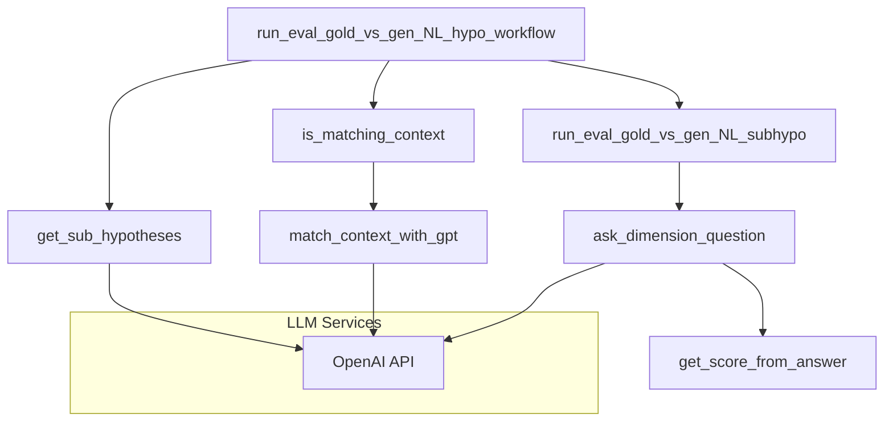
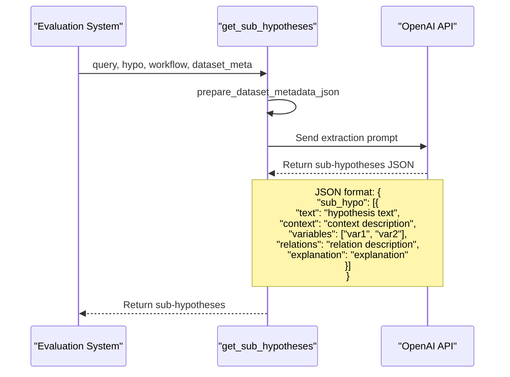
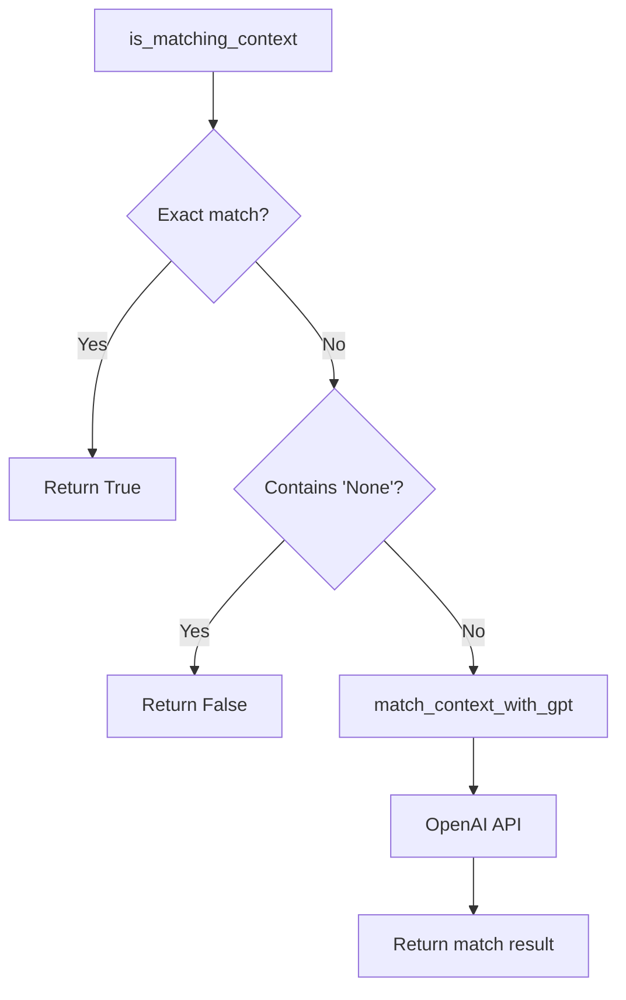

<!-- source: DeepWiki mcp.deepwiki.com · repo allenai/discoverybench · page 3.1 Hypothesis Evaluation Implementation · fetched 2026-10-26 -->

# Hypothesis Evaluation Implementation

<details>
<summary>Relevant source files</summary>

The following files were used as context for generating this wiki page:

- [eval/eval.py](eval/eval.py)
- [eval/example_eval_scripts/test_synth_eval.sh](eval/example_eval_scripts/test_synth_eval.sh)
- [eval/lm_utils.py](eval/lm_utils.py)
- [eval/new_eval.py](eval/new_eval.py)

</details>


## Purpose and Scope

This document provides a detailed technical overview of the hypothesis evaluation implementation in DiscoveryBench. The system evaluates generated natural language hypotheses against gold standard hypotheses by comparing them across multiple dimensions: context, variables, and relations. This page focuses specifically on the core evaluation logic in `eval/eval.py` and explains how the system decomposes complex hypotheses, matches corresponding parts, and calculates evaluation scores.

For information about the command-line interface, see [Evaluation CLI](#3.2). For documentation on the answer key files, see [Answer Keys](#3.3). For guidance on using example scripts, see [Example Evaluation Scripts](#3.4).

## System Overview

The hypothesis evaluation system uses large language models (LLMs) to compare generated hypotheses against reference (gold) hypotheses. The evaluation process involves several key steps:

1. Breaking down complex hypotheses into sub-hypotheses
2. Matching sub-hypotheses between generated and gold based on context
3. Evaluating matched pairs on variables and relations
4. Calculating recall and accuracy scores
5. Computing a final score

### Evaluation Architecture



Sources: [eval/eval.py:342-438](), [eval/eval.py:82-188](), [eval/eval.py:307-309](), [eval/eval.py:27-80]()

## Hypothesis Dimensionality Model

The evaluation system analyzes hypotheses along three key dimensions:

1. **Context**: Boundary conditions that limit the scope of a hypothesis (e.g., "for men over the age of 30", "in Asia and Europe")
2. **Variables**: Concepts that interact in meaningful ways (e.g., "number of sandhill cranes", "material usage ratio")
3. **Relations**: The form of relationship between variables (e.g., "positive linear relationship", "surged by ~10x")

These dimensions provide a structured framework for comparing the semantic content of hypotheses.

Sources: [eval/eval.py:143-150]()

## Sub-Hypothesis Extraction

Complex hypotheses are broken down into sub-hypotheses using the `get_sub_hypotheses` function. This allows for more granular evaluation by ensuring that each sub-hypothesis covers a coherent set of contexts, variables, and relations.

### Sub-Hypothesis Extraction Process



The prompt template for extraction contains detailed instructions for the LLM to identify sub-hypotheses along with their contexts, variables, and relations.

Sources: [eval/eval.py:218-273]()

## Context Matching

Each sub-hypothesis from the gold standard is matched with corresponding sub-hypotheses from the prediction based on context. The system first checks for exact matches, then uses semantic matching through the LLM.

### Context Matching Logic



Sources: [eval/eval.py:307-309](), [eval/eval.py:275-305]()

## Dimension Evaluation

For each matched pair of sub-hypotheses, the system evaluates variables and relations using the `ask_dimension_question` function, which formulates specific questions for the LLM.

### Variable Evaluation

For variables, the evaluation computes precision, recall, and F1 scores based on the intersection of variables between gold and predicted hypotheses. The LLM is prompted to count the variables in each hypothesis and identify the overlapping ones.

```
Variable Score = {
    precision: intersection/sizeB,
    recall: intersection/sizeA,
    F1: 2 * precision * recall / (precision + recall)
}
```

Where:
- sizeA: Number of variables in gold hypothesis
- sizeB: Number of variables in predicted hypothesis
- intersection: Number of variables common to both

Sources: [eval/eval.py:37-68](), [eval/eval.py:110-123]()

### Relation Evaluation

For relations, the evaluation assigns scores based on how closely the predicted relation matches the gold relation:
- 1.0: Very similar relations
- 0.5: Similar but more general than gold
- 0.0: Different relations

Relations are compared considering their specificity (e.g., "positive relationship" is more general than "positive linear relationship").

Sources: [eval/eval.py:69-80](), [eval/eval.py:125-139]()

## Score Calculation

The final score is calculated through a multi-step process:

1. **Sub-hypothesis accuracy**: For each matched pair, multiply context score (0 or 1), variable F1 score (0-1), and relation score (0, 0.5, or 1)
   ```
   accuracy_score = context_score * var_score['f1'] * rel_score
   ```

2. **Mean accuracy**: Average the accuracy scores across all matched pairs

3. **Recall context**: Proportion of gold sub-hypotheses that were matched
   ```
   recall_context = len(gold_subh_covered) / len(gold_sub_hypo_json['sub_hypo'])
   ```

4. **Final score**: Multiply recall context by mean accuracy
   ```
   final_score = recall_context * mean_accuracy_score
   ```

This calculation balances the completeness of coverage (recall) with the quality of matches (accuracy).

Sources: [eval/eval.py:337](), [eval/eval.py:428-435]()

## Complete Evaluation Workflow

The main function `run_eval_gold_vs_gen_NL_hypo_workflow` orchestrates the entire evaluation process. Here's a detailed view of the workflow:

```mermaid
sequenceDiagram
    participant Client
    participant Evaluator as "run_eval_gold_vs_gen_NL_hypo_workflow"
    participant Extractor as "get_sub_hypotheses"
    participant Matcher as "is_matching_context"
    participant DimEval as "run_eval_gold_vs_gen_NL_subhypo"
    participant LLM as "OpenAI API"
    
    Client->>Evaluator: query, gold_hypo, gen_hypo, dataset_meta
    
    %% Extract sub-hypotheses
    Evaluator->>Extractor: Extract gold sub-hypotheses
    Extractor->>LLM: Request extraction
    LLM-->>Extractor: Return gold sub-hypotheses
    Extractor-->>Evaluator: gold_sub_hypo_json
    
    Evaluator->>Extractor: Extract generated sub-hypotheses
    Extractor->>LLM: Request extraction
    LLM-->>Extractor: Return generated sub-hypotheses
    Extractor-->>Evaluator: gen_sub_hypo_json
    
    %% Match contexts
    loop For each generated sub-hypothesis
        loop For each gold sub-hypothesis not yet covered
            Evaluator->>Matcher: Check context match
            Matcher->>LLM: If needed, request semantic match
            LLM-->>Matcher: Return match result
            Matcher-->>Evaluator: context_bool
            
            alt context_bool is True
                Evaluator->>Evaluator: Record match, mark gold as covered
                break
            end
        end
    end
    
    %% Evaluate dimensions
    loop For each matched pair
        Evaluator->>DimEval: Evaluate matched sub-hypotheses
        DimEval->>LLM: Evaluate variables
        LLM-->>DimEval: Return variable scores
        DimEval->>LLM: Evaluate relations
        LLM-->>DimEval: Return relation scores
        DimEval->>DimEval: Calculate accuracy_score
        DimEval-->>Evaluator: Return subh_eval_rec
        Evaluator->>Evaluator: sum_accuracy_score += accuracy_score
    end
    
    %% Calculate final scores
    Evaluator->>Evaluator: Calculate recall_context
    Evaluator->>Evaluator: Calculate mean_accuracy_score
    Evaluator->>Evaluator: final_score = recall_context * mean_accuracy_score
    
    Evaluator-->>Client: Return eval_rec with final_score
```

Sources: [eval/eval.py:342-438]()

## LLM Interaction and Prompt Engineering

The evaluation system relies heavily on well-crafted prompts to guide the LLM's analysis. Each dimension of evaluation has a specific prompt template:

### Context Evaluation Prompt

```
Question: Is HypoB defined in the same context as HypoA?
(Context refers to assumptions/stratification under which the hypotheses are defined.)
Options: A) same   B) different
What is your answer?
```

### Variable Evaluation Prompt

```
Question: For both HypoA and HypoB, what are the different variables found in the hypotheses?
Return your answer as a JSON object in the following format:
{
  "sizeA": num of variables used in HypoA
  "sizeB": num of variables used in HypoB
  "intersection": num of variables common in HypoA and HypoB. Use *fuzzy matching* to determine intersection
  "explanation": a short text explanation about the variables
}
```

### Relation Evaluation Prompt

```
Question: Does HypoB exhibit the same relation as HypoA?
Compare using following example hierarchy of relationships (based on specificity):
"there exists a relationship" > "positive relationship" > "positive AND (linear OR quadratic)" > "positive AND linear".
Options: A) very similar B) similar but general than HypoA C) different
```

Each prompt is wrapped in a larger context that provides the dataset metadata, query, and both hypotheses to provide the LLM with all necessary information.

Sources: [eval/eval.py:103-140](), [eval/eval.py:143-166]()

## Implementation Details and Edge Cases

The system includes several mechanisms to handle edge cases:

1. **Empty sub-hypotheses**: If no sub-hypotheses can be extracted, the system uses the full hypothesis as a single sub-hypothesis with a "None" context.
   ```python
   if len(gold_sub_hypo_json['sub_hypo']) == 0:
       gold_sub_hypo_json['sub_hypo'] = [{"text": gold_hypo, "context": "None", "variables": [], "relations": "", "explanation": "unable to segment"}]
   ```

2. **Failed LLM calls**: The system includes retry logic and fallback mechanisms for API failures.

3. **JSON parsing errors**: For variable evaluation, if JSON parsing fails, default negative scores (-1.0) are returned.

Sources: [eval/eval.py:375-376](), [eval/eval.py:382-383](), [eval/eval.py:63-68](), [eval/lm_utils.py:31-65]()

## Configuration Options

The evaluation system supports several configuration options to adapt to different use cases:

- **LLM selection**: Different LLMs can be specified through the `llm_used` parameter
- **Dataset type**: The system differentiates between "real" and "synthetic" datasets
- **Column metadata**: The `use_column_metadata` flag controls whether column descriptions are included in prompts

Sources: [eval/eval.py:141](), [eval/eval.py:198-214]()

## Summary

The Hypothesis Evaluation Implementation in DiscoveryBench provides a sophisticated framework for comparing generated hypotheses against gold standards. By decomposing hypotheses into sub-hypotheses and evaluating them across multiple dimensions, the system achieves a nuanced assessment that considers both the semantic content and the structural elements of scientific hypotheses. The use of LLMs enables flexible, semantic evaluation that goes beyond simple string matching or keyword analysis.

---

