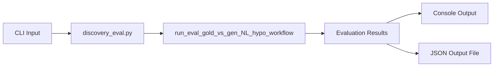
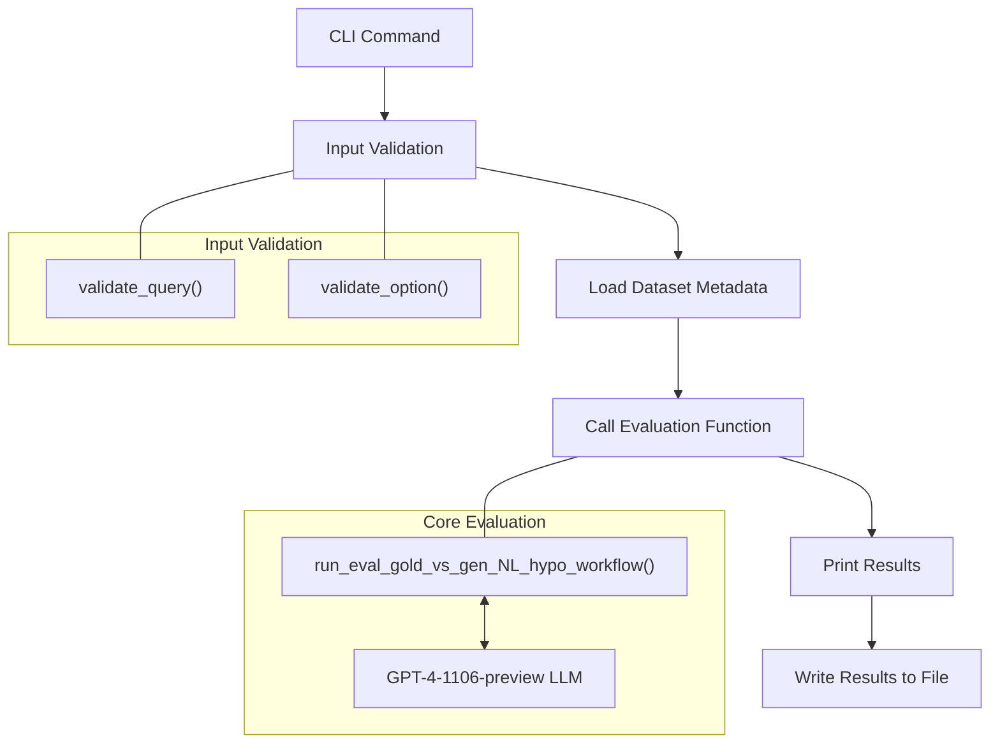
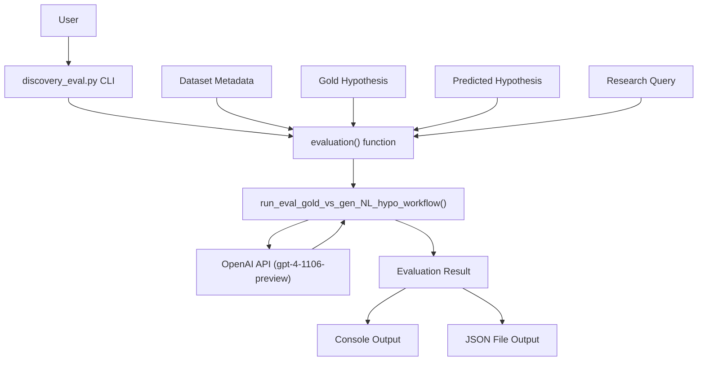

<!-- source: DeepWiki mcp.deepwiki.com · repo allenai/discoverybench · page 3.2 Evaluation CLI · fetched 2026-10-26 -->

# Evaluation CLI

<details>
<summary>Relevant source files</summary>

The following files were used as context for generating this wiki page:

- [discovery_eval.py](discovery_eval.py)

</details>


The Evaluation CLI is a command-line interface for evaluating hypotheses in the DiscoveryBench system. It provides a straightforward way to compare predicted hypotheses against gold standard hypotheses using advanced natural language processing techniques.

For detailed information about the internal evaluation methodology, see [Hypothesis Evaluation Implementation](#3.1).

## Command-Line Interface Structure

The Evaluation CLI is implemented in `discovery_eval.py` and uses the Python Click package to create a user-friendly command-line interface.



Sources: [discovery_eval.py:1-62]()

## Required Parameters

| Parameter | Description |
|-----------|-------------|
| `--gold_hypo` | The gold standard hypothesis text |
| `--pred_hypo` | The predicted hypothesis text to evaluate |
| `--metadata_path` | Path to the metadata file for the dataset |
| `--metadata_type` | Type of metadata ('real' or 'synth') |
| `QUERY` | The research question being addressed |

## Optional Parameters

| Parameter | Default | Description |
|-----------|---------|-------------|
| `--gold_workflow` | None | The gold standard workflow text |
| `--pred_workflow` | None | The predicted workflow text |
| `--eval_output_path` | "eval_output.json" | Path for the evaluation output JSON file |

Sources: [discovery_eval.py:18-26]()

## Implementation Details

The CLI processes input through several stages:



Sources: [discovery_eval.py:6-15](), [discovery_eval.py:37-58]()

Key implementation details:
- Input validation ensures that required parameters are not empty
- The metadata file is loaded as JSON
- The evaluation function is called with fixed settings:
  - Uses 'gpt-4-1106-preview' as the language model
  - Enables column metadata usage (`use_column_metadata=True`)
- Results are printed to the console and written to the specified file

## Usage Examples

### Basic Evaluation

```bash
python discovery_eval.py \
  --gold_hypo "Plants introduced via ornamental pathways have higher invasion success rates than those introduced accidentally." \
  --pred_hypo "Ornamental introduction pathways lead to higher invasion success compared to accidental introductions." \
  --metadata_path "data/real/test/introduction_pathways_non-native_plants/metadata_0.json" \
  --metadata_type "real" \
  "What is the relationship between introduction pathways and invasion success?"
```

### With Custom Output Path

```bash
python discovery_eval.py \
  --gold_hypo "Plants introduced via ornamental pathways have higher invasion success rates than those introduced accidentally." \
  --pred_hypo "Ornamental introduction pathways lead to higher invasion success compared to accidental introductions." \
  --metadata_path "data/real/test/introduction_pathways_non-native_plants/metadata_0.json" \
  --metadata_type "real" \
  --eval_output_path "my_evaluation_results.json" \
  "What is the relationship between introduction pathways and invasion success?"
```

### Including Workflow Evaluation

```bash
python discovery_eval.py \
  --gold_hypo "Plants introduced via ornamental pathways have higher invasion success rates than those introduced accidentally." \
  --gold_workflow "1. Compare invasion success metrics between different pathways\n2. Conduct statistical analysis..." \
  --pred_hypo "Ornamental introduction pathways lead to higher invasion success compared to accidental introductions." \
  --pred_workflow "I analyzed the invasion_success_pathways.csv dataset by grouping by pathway type..." \
  --metadata_path "data/real/test/introduction_pathways_non-native_plants/metadata_0.json" \
  --metadata_type "real" \
  "What is the relationship between introduction pathways and invasion success?"
```

## System Integration

The Evaluation CLI serves as a key interface in the DiscoveryBench system, connecting user inputs to the core evaluation functionality:



Sources: [discovery_eval.py:27-58]()

## Output Format

The evaluation produces a JSON output with detailed scoring information, which is both printed to the console and written to the specified output file. This output contains:

- Overall evaluation scores
- Detailed analysis of hypothesis components
- Comparisons between gold and predicted hypotheses

The exact format depends on the implementation of the core evaluation function `run_eval_gold_vs_gen_NL_hypo_workflow`.

## Relation to Other System Components

The Evaluation CLI is designed to work seamlessly with other components of the DiscoveryBench system:

- It uses dataset metadata from the [Datasets](#2) component
- It leverages the core evaluation logic documented in [Hypothesis Evaluation Implementation](#3.1)
- It can be used to evaluate hypotheses from any of the datasets, including the [Non-Native Plant Introduction Pathways Dataset](#2.1)
- The results can be used by [Example Evaluation Scripts](#3.4) for further analysis

---

