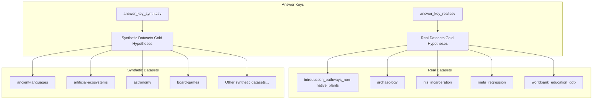
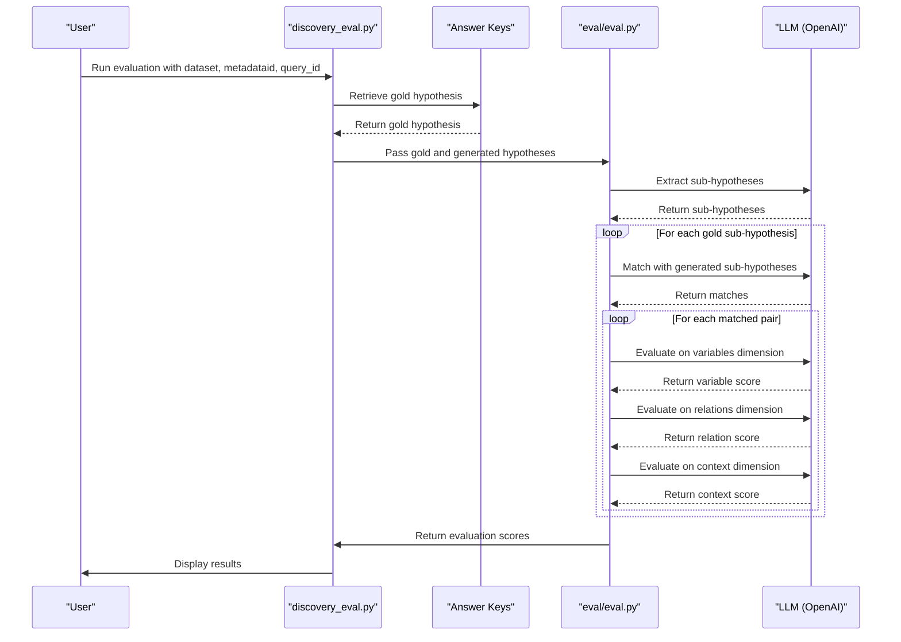
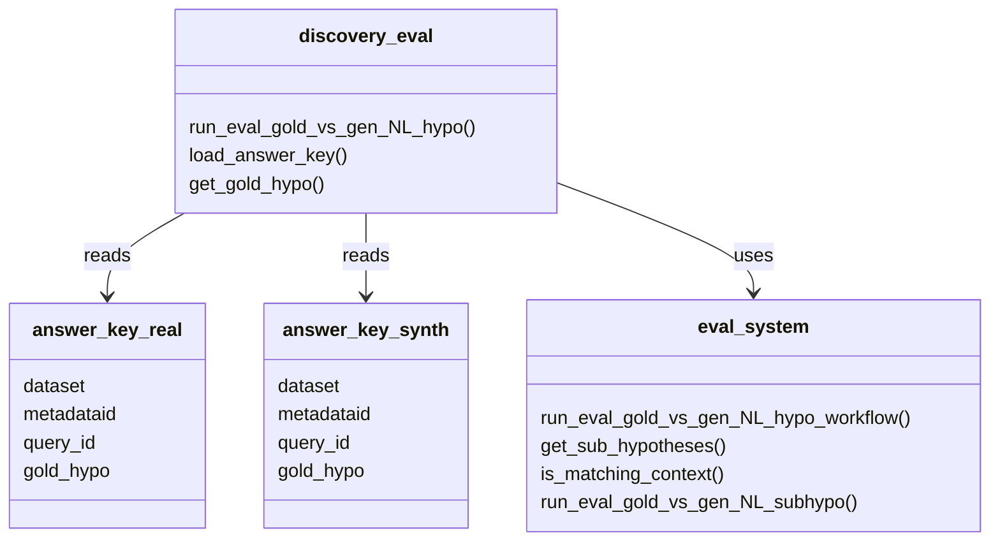

<!-- source: DeepWiki mcp.deepwiki.com · repo allenai/discoverybench · page 3.3 Answer Keys · fetched 2026-10-26 -->

# Answer Keys

<details>
<summary>Relevant source files</summary>

The following files were used as context for generating this wiki page:

- [eval/answer_key_real.csv](eval/answer_key_real.csv)
- [eval/answer_key_synth.csv](eval/answer_key_synth.csv)

</details>


This page documents the answer key files in DiscoveryBench and their role in the hypothesis evaluation system. Answer keys provide the gold standard hypotheses against which generated hypotheses are evaluated.

For information about the overall evaluation system, see [Evaluation System](#3). For implementation details of the evaluation logic, see [Hypothesis Evaluation Implementation](#3.1).

## Purpose and Structure

Answer keys in DiscoveryBench contain the gold standard hypotheses for both real and synthetic datasets. These gold hypotheses serve as the ground truth for evaluating the quality of machine-generated hypotheses.

The answer keys are organized into two CSV files:
- `answer_key_real.csv`: Contains gold hypotheses for real-world datasets
- `answer_key_synth.csv`: Contains gold hypotheses for synthetic datasets

Both files follow the same structure with four columns:

| Column | Description |
|--------|-------------|
| dataset | Name of the dataset |
| metadataid | ID of the metadata file associated with the dataset |
| query_id | Unique identifier for the query |
| gold_hypo | The gold standard hypothesis text |

Sources: [eval/answer_key_real.csv](), [eval/answer_key_synth.csv]()

## Answer Key Organization



The answer keys store gold hypotheses for a variety of datasets, each containing natural language descriptions of relationships or patterns discovered in the data. These hypotheses serve as the reference point for evaluating machine-generated hypotheses.

Sources: [eval/answer_key_real.csv](), [eval/answer_key_synth.csv]()

## Integration with Evaluation System

The answer keys are integral to the hypothesis evaluation workflow in DiscoveryBench. The evaluation system compares generated hypotheses against these gold standards.



The evaluation system accesses the answer key files to retrieve the gold standard hypothesis corresponding to a specific dataset, metadata ID, and query ID. This gold hypothesis is then compared with the generated hypothesis through a process that involves:

1. Decomposing both hypotheses into sub-hypotheses
2. Matching gold sub-hypotheses with generated sub-hypotheses
3. Evaluating each matched pair across multiple dimensions
4. Calculating a final score based on the evaluation results

Sources: [eval/answer_key_real.csv](), [eval/answer_key_synth.csv]()

## Examples of Gold Hypotheses

### Real Dataset Example

For the `introduction_pathways_non-native_plants` dataset, one of the gold hypotheses is:

> "Over the past millennium (time periods ranging from before 1500 to 2019), gardening has replaced agriculture as the main contributor to the non-native flora."

### Synthetic Dataset Example

For the `astronomy` synthetic dataset, one of the gold hypotheses is:

> "Galaxies with higher dark matter density classifications have a calculated increase in galaxy density that depends on various factors such as the distance to the nearest star-forming region, star formation rate, magnetic field presence, galaxy age, dominant stellar age, luminosity variability, presence of binary star systems, velocity dispersion of stars, average surface temperature of stars, presence of ultraviolet emission, cosmic radiation level, proportion of red stars, and blue signature intensity."

These gold hypotheses vary in complexity and specificity, reflecting the diverse nature of the datasets and research questions they address.

Sources: [eval/answer_key_real.csv](), [eval/answer_key_synth.csv]()

## Answer Key Code Integration



The answer keys are accessed by the evaluation system through functions in `discovery_eval.py`, which loads the appropriate answer key file and retrieves the gold hypothesis for a given dataset, metadata ID, and query ID. The evaluation system then uses this gold hypothesis to evaluate generated hypotheses.

Sources: [eval/answer_key_real.csv](), [eval/answer_key_synth.csv]()

## Extending Answer Keys

To add new gold hypotheses to the answer keys, you can append entries to the corresponding CSV file. Each entry should include:

1. The dataset name
2. The metadata ID
3. A unique query ID
4. The gold hypothesis text

This allows for the evaluation system to be extended to new datasets or research questions by providing appropriate gold standard hypotheses.

Example format for adding a new entry to `answer_key_real.csv`:

```
new_dataset,0,0,"This is a gold hypothesis for the new dataset."
```

Sources: [eval/answer_key_real.csv](), [eval/answer_key_synth.csv]()

---

