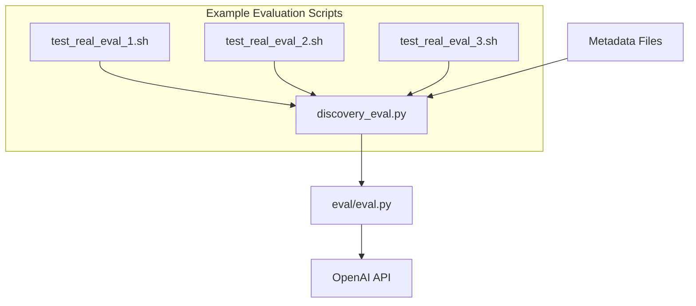
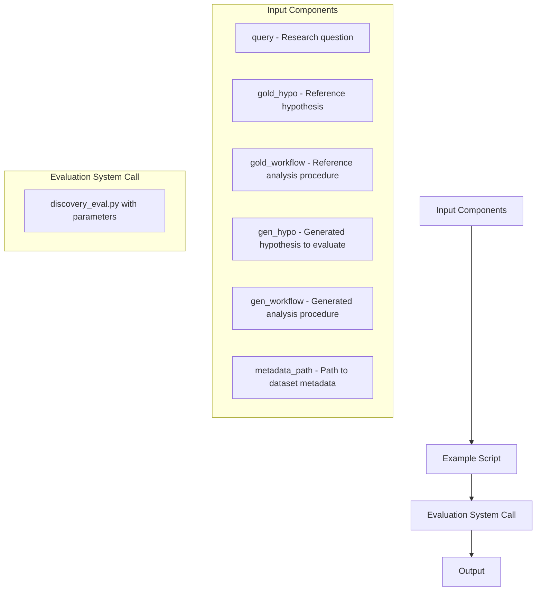
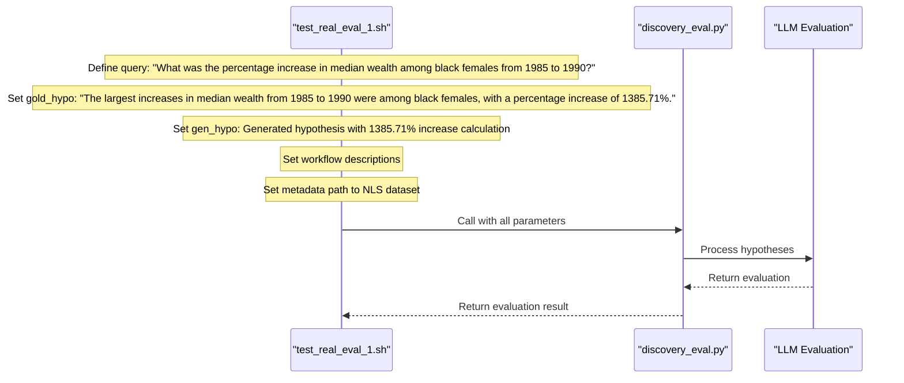
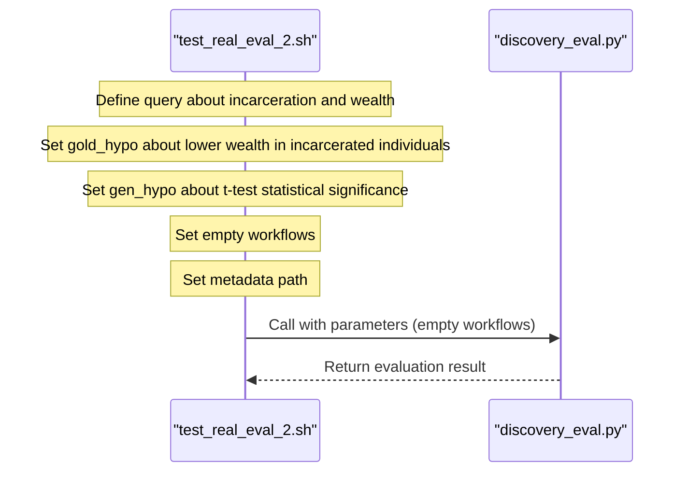
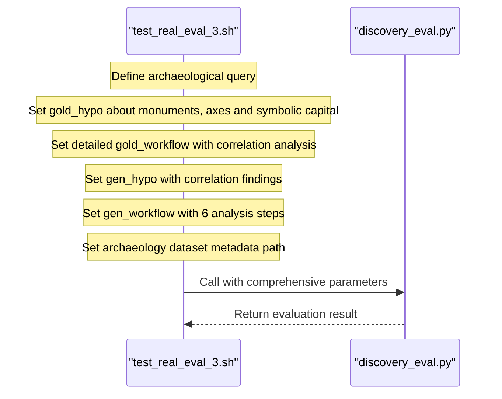
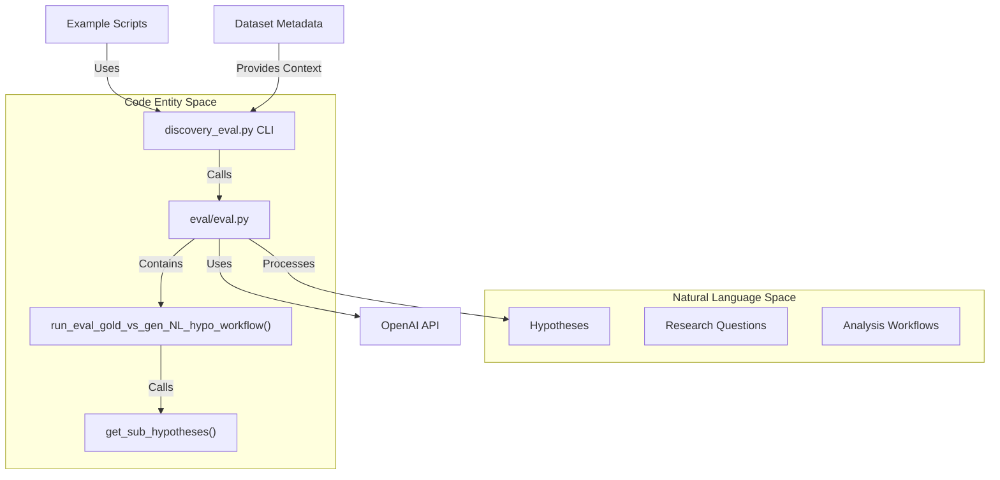

<!-- source: DeepWiki mcp.deepwiki.com · repo allenai/discoverybench · page 3.4 Example Evaluation Scripts · fetched 2026-10-26 -->

# Example Evaluation Scripts

<details>
<summary>Relevant source files</summary>

The following files were used as context for generating this wiki page:

- [eval/example_eval_scripts/test_real_eval_1.sh](eval/example_eval_scripts/test_real_eval_1.sh)
- [eval/example_eval_scripts/test_real_eval_2.sh](eval/example_eval_scripts/test_real_eval_2.sh)
- [eval/example_eval_scripts/test_real_eval_3.sh](eval/example_eval_scripts/test_real_eval_3.sh)

</details>


## Purpose and Scope

This document provides detailed information about the example evaluation scripts in the DiscoveryBench repository. These scripts demonstrate practical usage patterns for the evaluation system, showing how to compare generated hypotheses against gold standards using real datasets. For information about the core evaluation implementation, see [Hypothesis Evaluation Implementation](#3.1). For details on the command-line interface, see [Evaluation CLI](#3.2).

## Overview of Example Scripts

The DiscoveryBench repository includes several example scripts located in the `eval/example_eval_scripts/` directory that demonstrate how to use the evaluation system with different datasets and hypotheses.



Sources: [eval/example_eval_scripts/test_real_eval_1.sh](), [eval/example_eval_scripts/test_real_eval_2.sh](), [eval/example_eval_scripts/test_real_eval_3.sh]()

## Script Structure and Components

Each example script follows a common structure with the following components:



Sources: [eval/example_eval_scripts/test_real_eval_1.sh:3-18](), [eval/example_eval_scripts/test_real_eval_2.sh:3-15](), [eval/example_eval_scripts/test_real_eval_3.sh:3-45]()

## Common Parameters

The example scripts demonstrate passing the following parameters to the evaluation system:

| Parameter | Description | Required |
|-----------|-------------|----------|
| `--gold_hypo` | The reference hypothesis considered to be correct | Yes |
| `--pred_hypo` | The hypothesis generated by a model to be evaluated | Yes |
| `--gold_workflow` | The reference analysis workflow | Optional |
| `--pred_workflow` | The generated analysis workflow | Optional |
| `--metadata_path` | Path to the dataset metadata file | Yes |
| `--metadata_type` | Type of metadata (e.g., "real") | Yes |

Sources: [eval/example_eval_scripts/test_real_eval_1.sh:18](), [eval/example_eval_scripts/test_real_eval_2.sh:15](), [eval/example_eval_scripts/test_real_eval_3.sh:45]()

## Example Script: NLS Wealth Analysis

The `test_real_eval_1.sh` script demonstrates evaluation of a hypothesis about median wealth increase among black females using the NLS incarceration dataset:



Sources: [eval/example_eval_scripts/test_real_eval_1.sh]()

## Example Script: Incarceration Effect Analysis

The `test_real_eval_2.sh` script shows how to evaluate a hypothesis comparing wealth levels between incarcerated and non-incarcerated individuals:



Sources: [eval/example_eval_scripts/test_real_eval_2.sh]()

## Example Script: Archaeological Data Analysis

The `test_real_eval_3.sh` script demonstrates evaluation with archaeological data, analyzing monument and axes changes between 3400-3000 BCE:



Sources: [eval/example_eval_scripts/test_real_eval_3.sh]()

## Running the Example Scripts

To run any of the example scripts, navigate to the script's directory and execute it:

```bash
cd eval/example_eval_scripts
bash test_real_eval_1.sh
```

The script will output the evaluation result, which includes scores comparing the generated hypothesis to the gold standard hypothesis.

## Key Components Relationship

The example scripts demonstrate the integration between the various components of the DiscoveryBench evaluation system:



Sources: [eval/example_eval_scripts/test_real_eval_1.sh](), [eval/example_eval_scripts/test_real_eval_2.sh](), [eval/example_eval_scripts/test_real_eval_3.sh]()

## Best Practices for Creating Custom Evaluation Scripts

Based on the example scripts, here are best practices for creating your own evaluation scripts:

1. **Define clear input parameters**:
   - Formulate a specific research question
   - Provide a well-defined gold standard hypothesis
   - Include analysis workflows when available

2. **Choose appropriate metadata**:
   - Ensure the metadata file corresponds to the dataset being analyzed
   - Use the correct metadata type (e.g., "real" or "synthetic")

3. **Format hypotheses appropriately**:
   - Gold hypotheses should be concise and focused
   - Generated hypotheses can be more detailed but should address the research question

4. **Shell script structure**:
   - Define variables for all parameters
   - Call `discovery_eval.py` with the appropriate flags
   - Capture and handle the output as needed

Sources: [eval/example_eval_scripts/test_real_eval_1.sh](), [eval/example_eval_scripts/test_real_eval_2.sh](), [eval/example_eval_scripts/test_real_eval_3.sh]()

## Summary

The example evaluation scripts provide practical demonstrations of how to use the DiscoveryBench evaluation system to compare generated hypotheses against gold standards across different domains and datasets. By studying these examples, users can understand the key parameters and workflows needed to effectively utilize the evaluation system for their own hypothesis testing needs.

---

