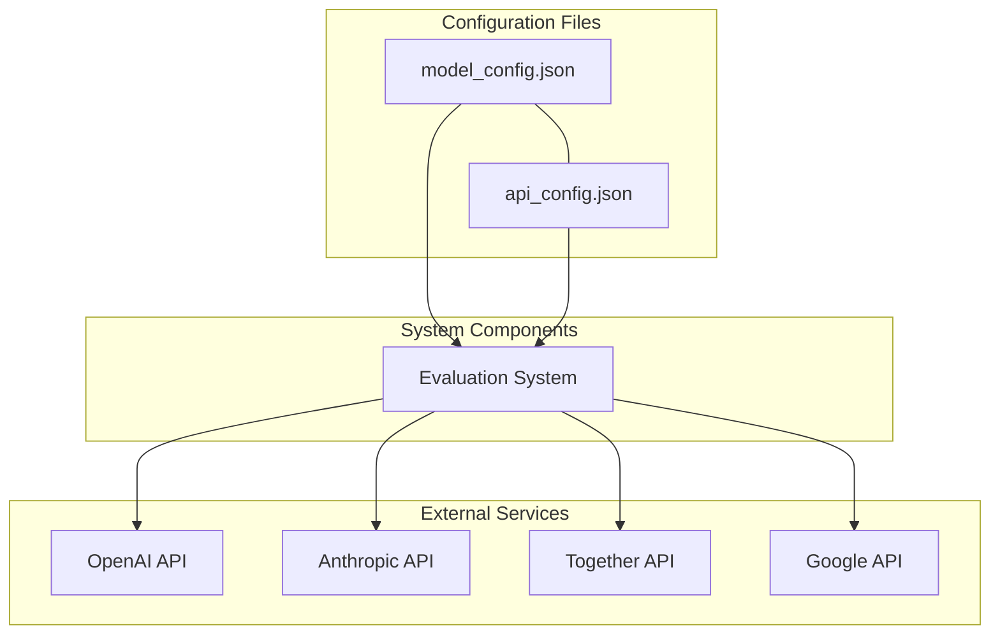
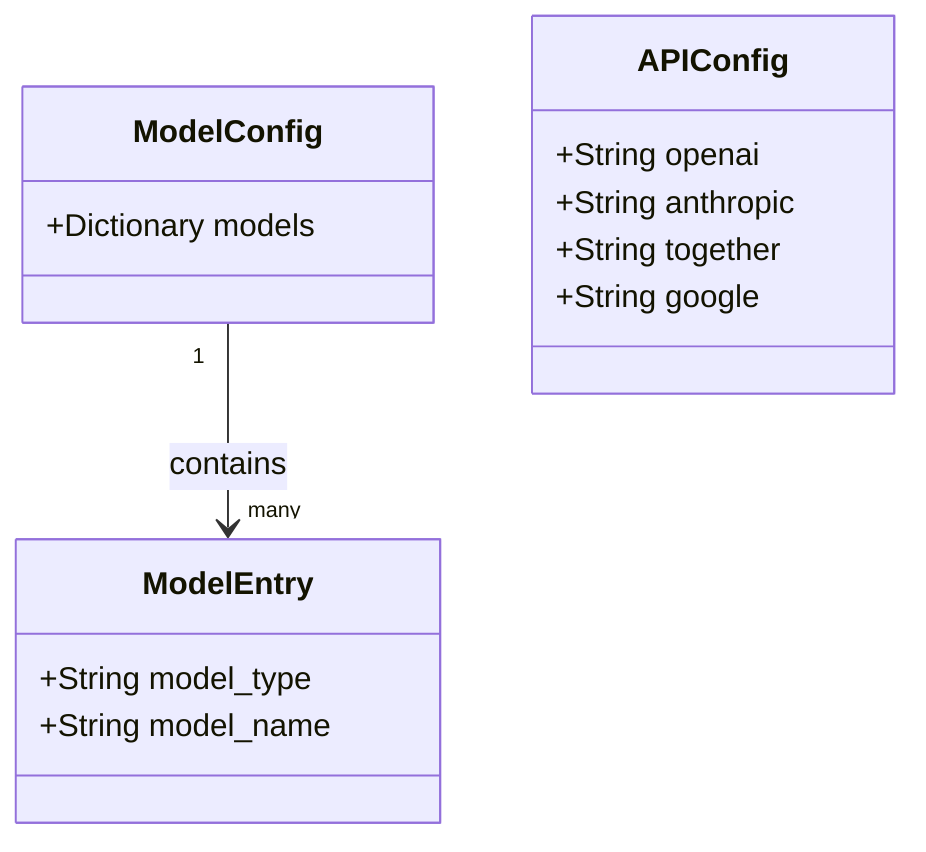
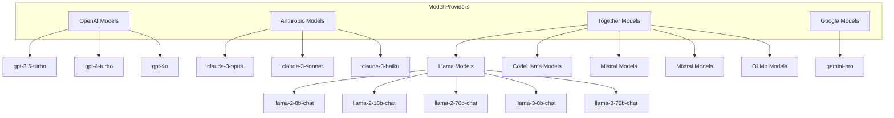
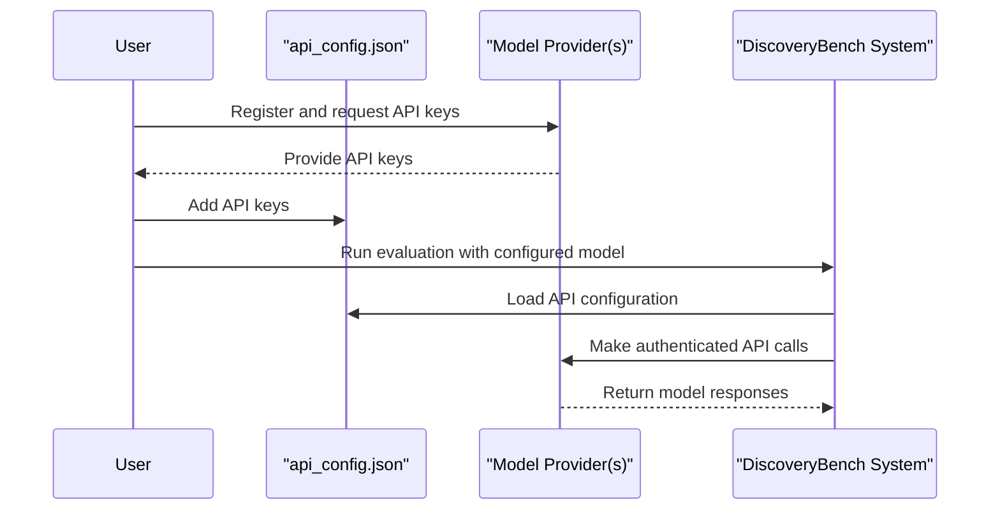
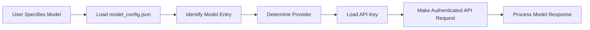

<!-- source: DeepWiki mcp.deepwiki.com · repo allenai/discoverybench · page 4 Configuration · fetched 2026-10-26 -->

# Configuration

<details>
<summary>Relevant source files</summary>

The following files were used as context for generating this wiki page:

- [config/api_config.json](config/api_config.json)
- [config/model_config.json](config/model_config.json)

</details>


This document describes the configuration system for DiscoveryBench, focusing on how to set up and customize language model providers and API access. The configuration system allows users to specify which language models to use for evaluation tasks and provides a standardized way to manage API credentials for different model providers.

For information about using the evaluation system that leverages these configurations, see [Evaluation System](#3).

## Configuration System Overview

The DiscoveryBench configuration system consists of two primary configuration files that manage language model specifications and API credentials. These files work together to enable communication with various language model providers while keeping sensitive credentials separate from model definitions.



Sources: [config/model_config.json](), [config/api_config.json]()

## Configuration Files Structure

The configuration system consists of two primary JSON files located in the `config/` directory:

1. **Model Configuration** (`model_config.json`): Defines available language models with their providers and specific model names
2. **API Configuration** (`api_config.json`): Stores API keys for different language model providers

These files are kept separate to allow for model configurations to be shared while keeping API credentials private.



Sources: [config/model_config.json](), [config/api_config.json]()

## Model Configuration

The `model_config.json` file contains definitions for all supported language models organized by their common name (key) and mapping to their provider-specific details. This allows the system to refer to models by simple names while handling provider-specific implementation details internally.

### Model Configuration Format

Each model entry in `model_config.json` follows this structure:

```
"model-name": {
    "model_type": "provider-name",
    "model_name": "provider-specific-model-id"
}
```

Where:
- `model-name`: User-friendly name for referencing the model in the system
- `model_type`: The provider name (e.g., "openai", "anthropic", "together", "google")
- `model_name`: The specific model name as recognized by the provider

### Supported Model Providers

The configuration system currently supports the following model providers:

| Provider | `model_type` | Description |
|----------|--------------|-------------|
| OpenAI   | `openai`     | OpenAI's GPT models |
| Anthropic | `anthropic` | Anthropic's Claude models |
| Together | `together`   | Together's hosted models including Llama, Mistral, etc. |
| Google   | `google`     | Google's Gemini models |

### Available Models

The system provides configurations for a wide range of models from different providers:



Sources: [config/model_config.json:2-99]()

## API Configuration

The `api_config.json` file stores API keys for each supported model provider. This separation allows model configurations to be shared publicly while keeping private API credentials secure.

### API Configuration Format

The `api_config.json` file contains a simple key-value structure:

```json
{
    "openai": "your-openai-api-key",
    "anthropic": "your-anthropic-api-key",
    "together": "your-together-api-key",
    "google": "your-google-api-key"
}
```

By default, these values are empty strings and must be populated with valid API keys before using the associated models.

Sources: [config/api_config.json:1-6]()

## Setting Up API Credentials

To use language models for hypothesis evaluation, you'll need to obtain API keys from the respective providers and add them to your local `api_config.json` file.

### API Key Setup Process

1. Create a copy of the `api_config.json` file if you're using a shared repository
2. Obtain API keys from the model providers you plan to use:
   - OpenAI: https://platform.openai.com/
   - Anthropic: https://www.anthropic.com/product
   - Together: https://www.together.ai/
   - Google: https://ai.google.dev/
3. Add your API keys to the corresponding fields in `api_config.json`
4. Ensure the file is properly secured (e.g., add to .gitignore to prevent accidental commits)



Sources: [config/api_config.json]()

## Configuring Model Selection

When using the DiscoveryBench evaluation system, you can specify which language model to use for hypothesis evaluation. The model identifier should match one of the keys defined in `model_config.json`.

### Example Model Selection

When using the evaluation CLI, you can specify your model of choice using the appropriate parameter. The system will:

1. Look up the model in `model_config.json`
2. Determine the provider based on `model_type`
3. Use the specific `model_name` for requests to that provider
4. Authenticate using the appropriate API key from `api_config.json`



Sources: [config/model_config.json](), [config/api_config.json]()

## Security Considerations

The configuration system is designed with security in mind:

1. API keys are stored separately from model configurations
2. The default `api_config.json` contains empty strings, not actual keys
3. It's recommended to add `api_config.json` to your `.gitignore` file to prevent accidentally committing API keys
4. For production environments, consider using environment variables or a secure key management system

Following these practices helps ensure that your API credentials remain secure while allowing the system to function properly.

Sources: [config/api_config.json]()

---

