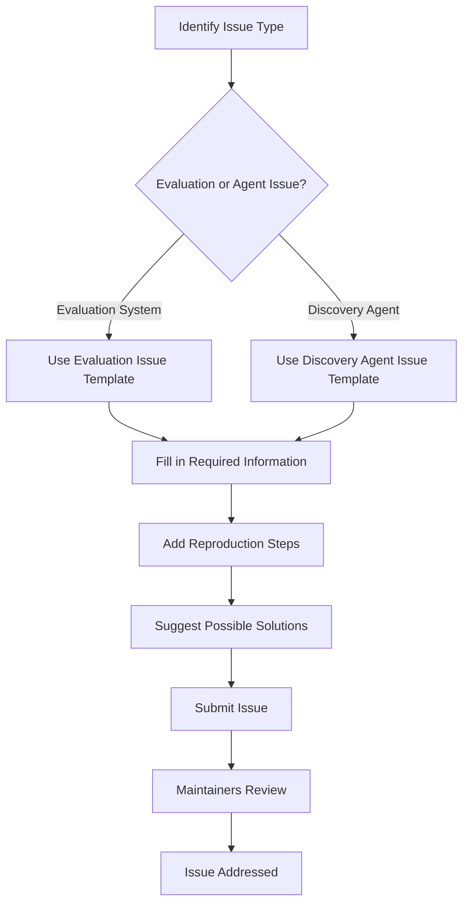
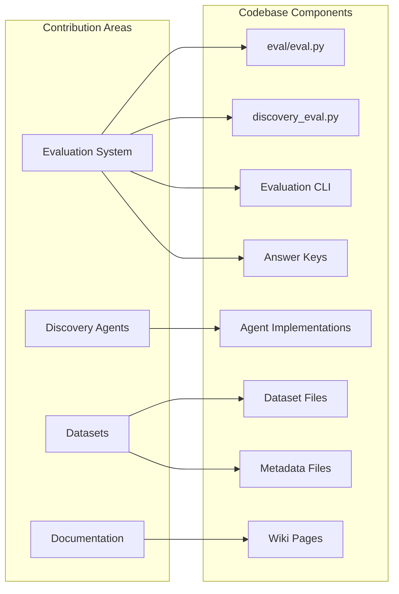
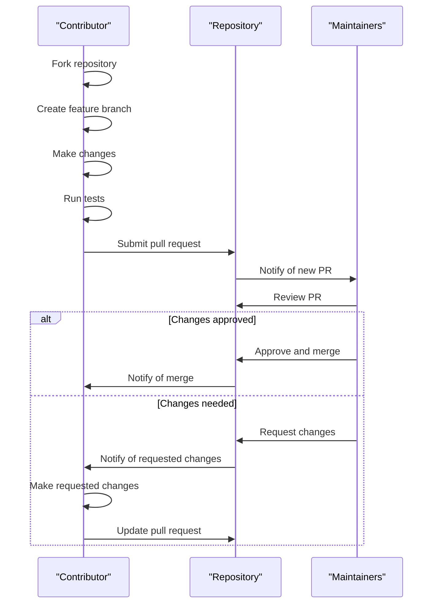
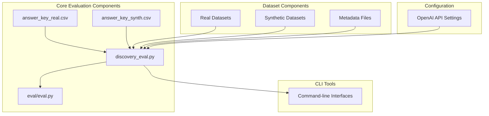

<!-- source: DeepWiki mcp.deepwiki.com · repo allenai/discoverybench · page 5 Contributing · fetched 2026-10-26 -->

# Contributing

<details>
<summary>Relevant source files</summary>

The following files were used as context for generating this wiki page:

- [.github/ISSUE_TEMPLATE/discovery_agent_issue.md](.github/ISSUE_TEMPLATE/discovery_agent_issue.md)
- [.github/ISSUE_TEMPLATE/evaluation_issue.md](.github/ISSUE_TEMPLATE/evaluation_issue.md)
- [.gitignore](.gitignore)

</details>


This document provides guidelines for contributing to the DiscoveryBench repository. It covers how to report issues with the evaluation system, suggest improvements for discovery agents, and understand the structure of the codebase for potential contributors. For information about the evaluation system itself, see [Evaluation System](#3), and for dataset-specific information, see [Datasets](#2).

## Reporting Issues

DiscoveryBench offers specific issue templates to help maintainers address problems efficiently. These templates guide you through providing the necessary information to reproduce and resolve issues.

### Evaluation System Issues

If you encounter problems with the hypothesis evaluation system, use the evaluation issue template to report them.

Key information to include:
- Detailed description of the problem
- Gold and predicted hypotheses that caused the issue
- Expected vs. actual behavior
- Reproduction steps
- Suggestions for possible solutions

Sources: [.github/ISSUE_TEMPLATE/evaluation_issue.md]()

### Discovery Agent Issues

For issues related to discovery agents, use the discovery agent issue template.

Key information to include:
- Description of the issue or enhancement
- Type of discovery agent affected
- Expected vs. current behavior
- Steps to reproduce
- Contextual information
- Potential solutions

Sources: [.github/ISSUE_TEMPLATE/discovery_agent_issue.md]()

## Issue Reporting Workflow

The following diagram illustrates the recommended workflow for reporting issues with DiscoveryBench:



Sources: [.github/ISSUE_TEMPLATE/evaluation_issue.md](), [.github/ISSUE_TEMPLATE/discovery_agent_issue.md]()

## Contribution Areas

DiscoveryBench has several major areas where contributions are welcome. The following diagram maps these areas to the corresponding components in the codebase:



Sources: [.github/ISSUE_TEMPLATE/evaluation_issue.md](), [.github/ISSUE_TEMPLATE/discovery_agent_issue.md]()

## Development Setup

Before contributing to DiscoveryBench, set up your development environment properly.

### Prerequisites

- Python (version specified in requirements)
- Access to OpenAI API (for running evaluation)
- Git for version control

### Environment Setup

1. Clone the repository:
   ```bash
   git clone https://github.com/allenai/discoverybench.git
   cd discoverybench
   ```

2. Set up a virtual environment:
   ```bash
   python -m venv venv
   source venv/bin/activate  # On Windows: venv\Scripts\activate
   ```

3. Install dependencies:
   ```bash
   pip install -r requirements.txt
   ```

4. Configure API keys as specified in the [Configuration](#4) section

Sources: [.gitignore]()

## Contribution Workflow

The following diagram illustrates the recommended workflow for contributing to DiscoveryBench:



### Best Practices

1. **Create a descriptive branch name** that reflects the changes you're making
2. **Make small, focused commits** with clear commit messages
3. **Write or update tests** to verify your changes
4. **Update documentation** to reflect your changes
5. **Ensure backward compatibility** when possible

## Code Organization

Understanding the codebase structure is essential for effective contributions. The following diagram shows the relationship between key components:



### Filenames and Conventions

When contributing, adhere to these naming and organizational conventions:

1. Place evaluation-related code in the `eval/` directory
2. Organize datasets by type (real/synthetic) and purpose (train/test)
3. Include detailed metadata for any new datasets
4. Follow existing code style for consistency

## Testing Contributions

Before submitting a pull request, ensure your changes work as expected by running appropriate tests:

1. For evaluation system changes, test with provided examples
2. For new datasets, include sample evaluations
3. For discovery agents, demonstrate performance on benchmark datasets

## Where to Get Help

If you need assistance with your contributions:

1. Reference the existing codebase for patterns and practices
2. Check related issues for similar problems and solutions
3. Reach out to maintainers through GitHub issues for clarification

## Acknowledging Contributions

Contributors to DiscoveryBench will be acknowledged according to the project's recognition policy. Significant contributions may be highlighted in release notes and documentation.

By following these guidelines, you'll help ensure that your contributions to DiscoveryBench are effective and can be incorporated smoothly into the project.