# Page: Overview

# Overview

<details>
<summary>Relevant source files</summary>

The following files were used as context for generating this wiki page:

- [config/api_config.json](config/api_config.json)
- [config/model_config.json](config/model_config.json)
- [discovery_eval.py](discovery_eval.py)
- [discoverybench/real/test/introduction_pathways_non-native_plants/metadata_0.json](discoverybench/real/test/introduction_pathways_non-native_plants/metadata_0.json)
- [eval/eval.py](eval/eval.py)
- [eval/example_eval_scripts/test_synth_eval.sh](eval/example_eval_scripts/test_synth_eval.sh)
- [eval/lm_utils.py](eval/lm_utils.py)

</details>


## Purpose and Scope

DiscoveryBench is a framework for evaluating hypotheses generated from scientific datasets. It provides tools to assess how well language models can discover scientific insights from structured data by comparing generated hypotheses against gold standard hypotheses. This overview document introduces the core components of DiscoveryBench, their relationships, and the primary evaluation workflow.

For detailed information about specific datasets, see [Datasets](#2). For in-depth documentation of the evaluation system, see [Evaluation System](#3).

## System Architecture

DiscoveryBench consists of several core components that work together to evaluate hypothesis quality:

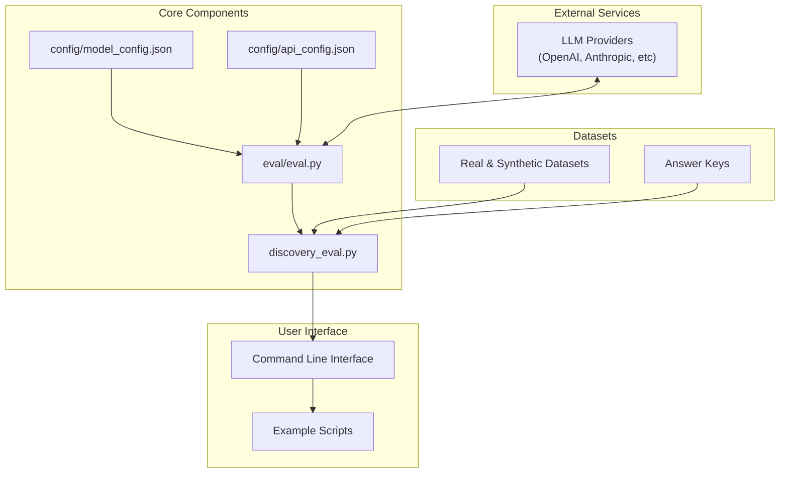

Sources: 
- [discovery_eval.py]()
- [eval/eval.py]()
- [config/model_config.json]()
- [config/api_config.json]()

The architecture centers around two key components:
1. `discovery_eval.py` - The main entry point providing a command-line interface for evaluation
2. `eval/eval.py` - The core evaluation logic that compares generated hypotheses with gold standards

## Datasets

DiscoveryBench includes both real-world and synthetic datasets organized into train and test sets:

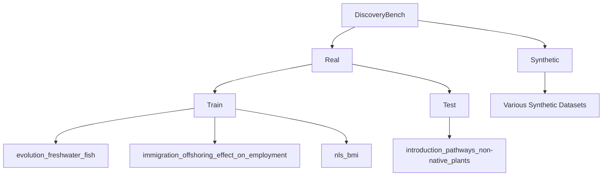

Sources:
- [discoverybench/real/test/introduction_pathways_non-native_plants/metadata_0.json]()

Each dataset contains metadata describing its structure, variables, and associated research questions. The metadata is stored in JSON format and includes detailed descriptions of dataset columns and their meanings.

## Hypothesis Evaluation Process

The core functionality of DiscoveryBench is evaluating hypotheses generated by language models against gold standard hypotheses. This evaluation follows a sophisticated workflow:

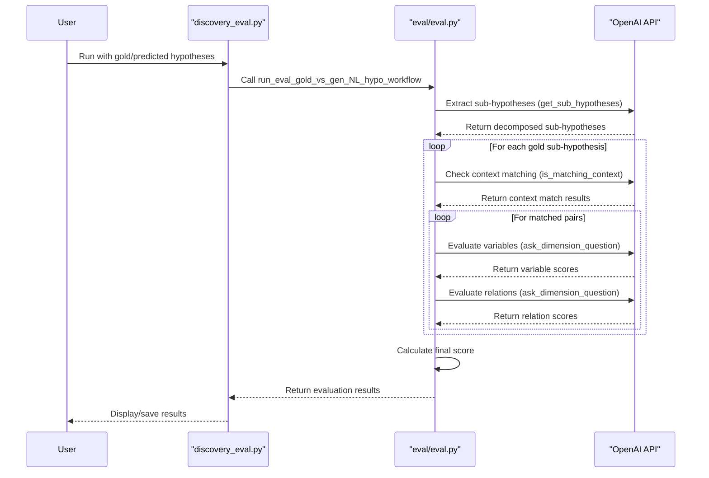

Sources:
- [discovery_eval.py:40-50]()
- [eval/eval.py:342-438]()
- [eval/eval.py:82-188]()
- [eval/eval.py:218-273]()

## Evaluation Dimensions

DiscoveryBench evaluates hypotheses across three key dimensions:

| Dimension | Description | Function | Score Type |
|-----------|-------------|----------|------------|
| Context | The boundary conditions that limit the scope of a sub-hypothesis | `is_matching_context()` | Boolean (0 or 1) |
| Variables | Identified concepts involved in the hypothesis | `ask_dimension_question(dimension="var")` | F1 score (precision/recall) |
| Relations | How variables relate to each other | `ask_dimension_question(dimension="rel")` | Categorical (0, 0.5, or 1) |

Sources:
- [eval/eval.py:27-80]()
- [eval/eval.py:314-339]()

## Evaluation Scoring

The evaluation produces a composite score based on how well the generated hypothesis matches the gold standard:

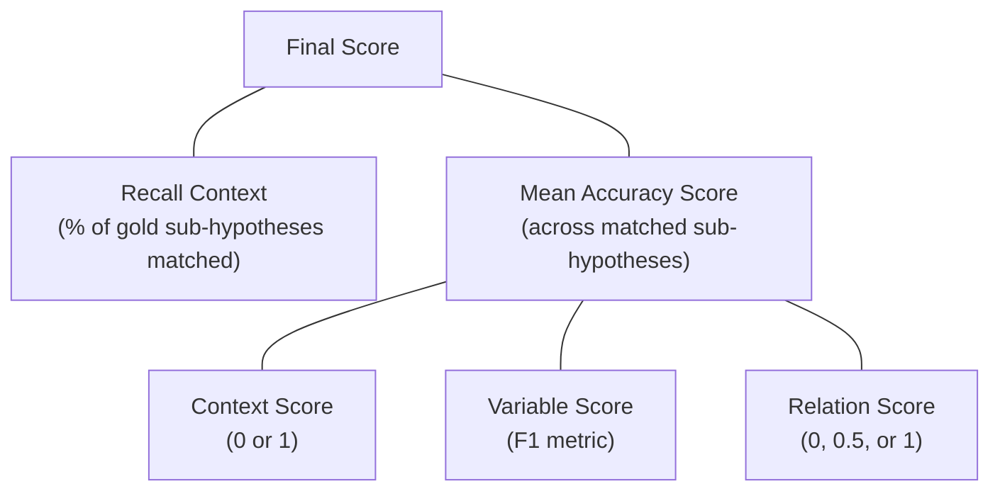

Sources:
- [eval/eval.py:432-435]()

The final score is calculated as:
`final_score = recall_context * mean_accuracy_score`

Where:
- `recall_context`: Proportion of gold sub-hypotheses matched by the generated hypothesis
- `mean_accuracy_score`: Average of accuracy scores across all matched sub-hypothesis pairs
- Each sub-hypothesis accuracy score: `context_score * variable_score_f1 * relation_score`

## Command-Line Interface

DiscoveryBench provides a command-line interface for evaluating hypotheses:

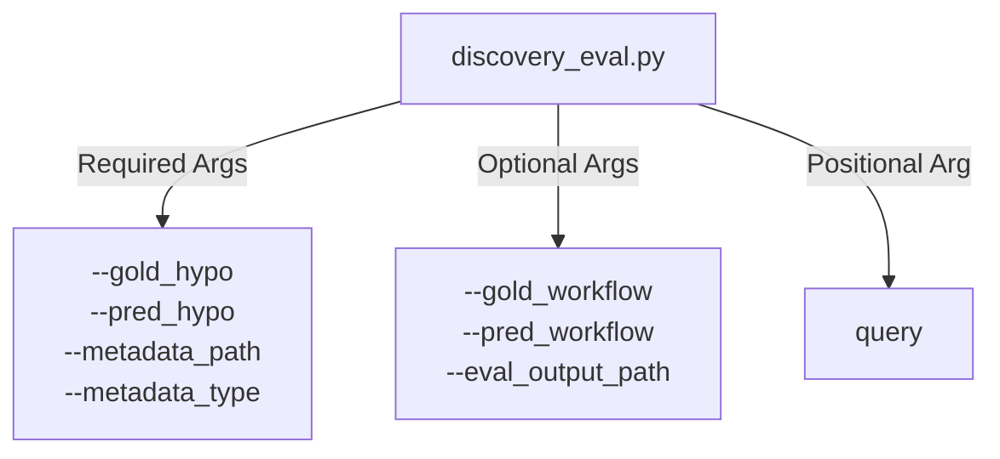

Sources:
- [discovery_eval.py:18-35]()
- [eval/example_eval_scripts/test_synth_eval.sh]()

Example usage:
```
python discovery_eval.py --gold_hypo "Gold hypothesis text" --pred_hypo "Predicted hypothesis text" --metadata_path "path/to/metadata.json" --metadata_type "real" "Research question text"
```

## LLM Configuration

DiscoveryBench supports multiple language model providers through a configuration system:

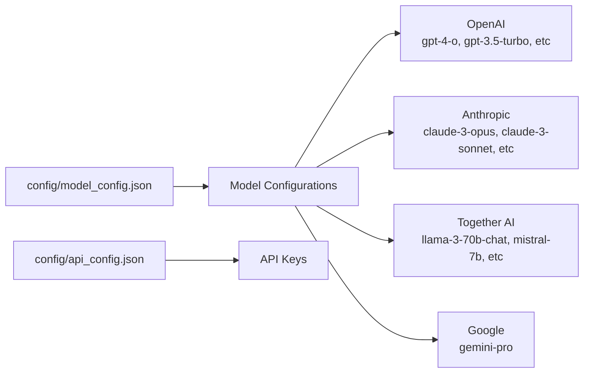

Sources:
- [config/model_config.json]()
- [config/api_config.json]()
- [eval/lm_utils.py]()

The default model for evaluation is `gpt-4-1106-preview` as specified in [discovery_eval.py:47]().

## Datasets and Metadata Format

DiscoveryBench datasets include detailed metadata in JSON format describing their structure:

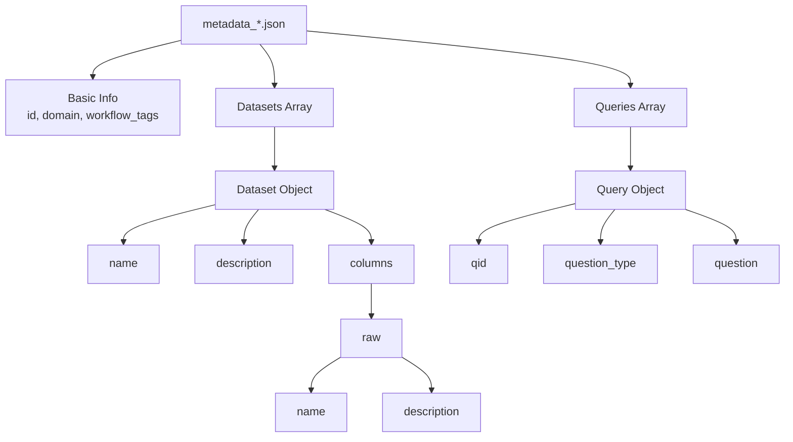

Sources:
- [discoverybench/real/test/introduction_pathways_non-native_plants/metadata_0.json]()

## Summary

DiscoveryBench provides a robust framework for evaluating hypothesis generation capabilities of language models on scientific datasets. Its core strengths include:

1. Structured evaluation of hypotheses across multiple dimensions (context, variables, relations)
2. Support for both real-world and synthetic datasets
3. Decomposition of complex hypotheses into sub-hypotheses for granular evaluation
4. Integration with multiple LLM providers
5. Flexible command-line interface for evaluation

This framework enables researchers to quantitatively assess how well AI systems can discover meaningful scientific insights from data, an important capability for advancing scientific discovery.

---

# Page: Datasets

# Datasets

<details>
<summary>Relevant source files</summary>

The following files were used as context for generating this wiki page:

- [discoverybench/real/test/introduction_pathways_non-native_plants/metadata_0.json](discoverybench/real/test/introduction_pathways_non-native_plants/metadata_0.json)
- [discoverybench/real/train/evolution_freshwater_fish/metadata_0.json](discoverybench/real/train/evolution_freshwater_fish/metadata_0.json)
- [discoverybench/real/train/immigration_offshoring_effect_on_employment/metadata_0.json](discoverybench/real/train/immigration_offshoring_effect_on_employment/metadata_0.json)
- [discoverybench/real/train/nls_bmi/metadata_0.json](discoverybench/real/train/nls_bmi/metadata_0.json)
- [eval/answer_key_real.csv](eval/answer_key_real.csv)
- [eval/answer_key_synth.csv](eval/answer_key_synth.csv)

</details>


This page documents the datasets included in the DiscoveryBench repository, their organization, structure, and key attributes. DiscoveryBench contains both real-world and synthetic datasets designed for evaluating hypothesis generation capabilities. For information about how these datasets are used in the evaluation process, see [Evaluation System](#3).

## Dataset Organization

DiscoveryBench organizes datasets into two primary categories: "real" and "synthetic", with further subdivisions into "train" and "test" sets. Each dataset contains metadata files describing its structure, variables, and associated research questions.

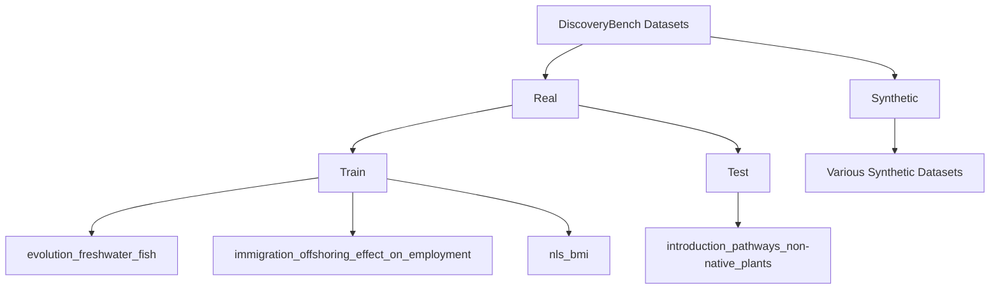

Sources: [discoverybench/real/test/introduction_pathways_non-native_plants/metadata_0.json](), [discoverybench/real/train/evolution_freshwater_fish/metadata_0.json](), [discoverybench/real/train/immigration_offshoring_effect_on_employment/metadata_0.json](), [discoverybench/real/train/nls_bmi/metadata_0.json]()

## Dataset Metadata Structure

Each dataset in DiscoveryBench comes with detailed metadata files that provide essential information about the dataset. These metadata files are in JSON format and contain:

1. Basic dataset information (domain, workflow tags)
2. File descriptions and column details
3. Research hypotheses
4. Query sets for evaluation

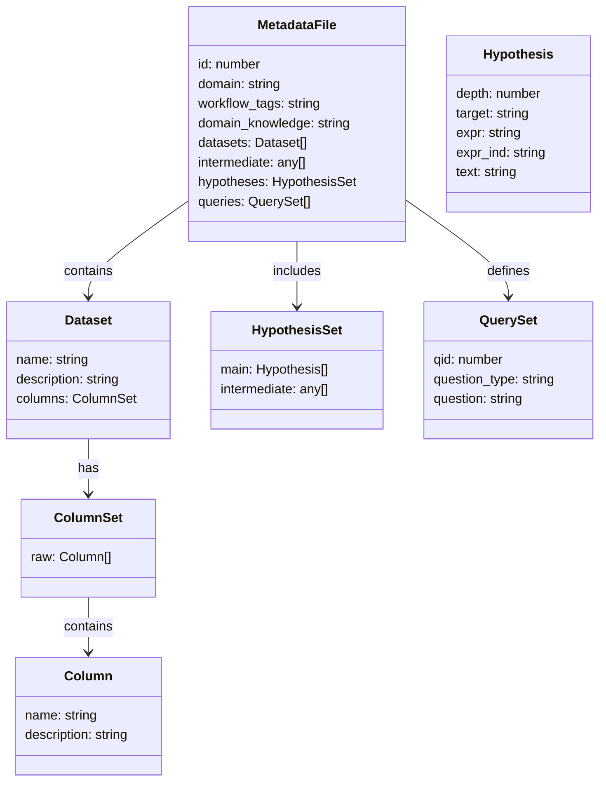

Sources: [discoverybench/real/test/introduction_pathways_non-native_plants/metadata_0.json](), [discoverybench/real/train/evolution_freshwater_fish/metadata_0.json]()

## Real Datasets

### Test Datasets

#### Introduction Pathways for Non-Native Plants

This dataset examines the introduction pathways of non-native plant species in the region of Catalonia. It consists of multiple data files that provide information on temporal trends, invasion success, and ecological characteristics of non-native plant species.

**Key Data Files:**
- `temporal_trends_contingency_table.csv`: Contains temporal trends in introduction pathways
- `phylogenetic_tree.txt`: Evolutionary relationships among plant species
- `invasion_success_pathways.csv`: Information on invaded plots and species characteristics
- `invaded_niche_pathways.csv`: Data for pathway-specific differences in invaded niches

**Research Questions Examples:**
- Over which time period has gardening surpassed agriculture as the main contributor to the non-native flora?
- What activity has replaced agriculture as the main contributor to the non-native flora over the past millennium?

**Sample Columns from `invasion_success_pathways.csv`:**

| Column Name | Description |
|-------------|-------------|
| Scientific_name | Full scientific name of the non-native plant species |
| family | Botanical family to which the species belongs |
| number.of.invaded.plots | Number of different plots where the species has invaded |
| area.of.occupancy.10km | Area of occupancy at a 10 km scale |
| intro.pathway | Pathway through which the species was introduced |
| growth.form | Growth form of the plant species |

Sources: [discoverybench/real/test/introduction_pathways_non-native_plants/metadata_0.json:6-277]()

### Train Datasets

#### Evolution of Freshwater Fish

This dataset contains information on drivers of speciation rates in South American freshwater fishes, considering multiple biotic and abiotic factors.

**Key Data File:**
- `body-size-evolution-in-south-american-freshwater-fishes.csv`

**Main Hypothesis:**
"The rate of maximum body length evolution emerged as the most influential factor explaining spatial variation in speciation rates. The relationship is positive with linear coefficient 0.82."

**Sample Columns:**

| Column Name | Description |
|-------------|-------------|
| HYBAS_ID | Identifier for hydrological basins |
| BAMM_speciation | Average speciation rates of species within each sub-basin |
| MBL_evol | Rates of Maximum Body Length evolution |
| bio1 | Annual mean temperature |
| diversity | Species diversity |

Sources: [discoverybench/real/train/evolution_freshwater_fish/metadata_0.json:6-120]()

#### Immigration and Offshoring Effect on Employment

This dataset examines the relationship between immigration and offshoring on employment patterns.

**Key Data Files:**
- `offshoring_iv_mar2.dta`: Contains measures for exogenous variation in offshoring costs
- `immi_popimputed_00_07.dta`: Provides imputed measures of immigrant employment

**Main Hypothesis:**
"Per unit increased ease of immigration reduces 0.1059 unit of the share of offshore employment"

**Sample Columns from `offshoring_iv_mar2.dta`:**

| Column Name | Description |
|-------------|-------------|
| year | Year of observation |
| beaind | Bureau of Economic Analysis Industry Code |
| iv_offshoring_1 | Instrumental variable capturing exogenous variation in offshoring costs |

Sources: [discoverybench/real/train/immigration_offshoring_effect_on_employment/metadata_0.json:6-59]()

#### NLS BMI Dataset

This dataset from the National Longitudinal Survey of Youth (NLSY79) examines the relationship between time preference indicators and Body Mass Index (BMI).

**Key Data File:**
- `nls_bmi_processed.csv`

**Main Hypothesis:**
"Higher time preference associated with higher BMI for 1989 data. BMI is positively related with if person spent more than their saving with a coefficient 0.3596. BMI is also positively correlated with if the savings of a person remained unchanged with a coefficient 0.4858."

**Sample Columns:**

| Column Name | Description |
|-------------|-------------|
| GENDER | Gender of the respondent |
| AGE | Age of the respondent in the year 1989 |
| INCOME | Income of the respondent in 1989 |
| DISSAVED | Boolean indicator if respondent took more money out than put into savings |
| BMI | Body mass index calculated using height and weight |

Sources: [discoverybench/real/train/nls_bmi/metadata_0.json:6-59]()

## Dataset Integration with Evaluation System

Datasets in DiscoveryBench serve as the foundation for the hypothesis evaluation system. They provide both the raw data for analysis and the gold standard hypotheses (via answer keys) against which generated hypotheses are compared.

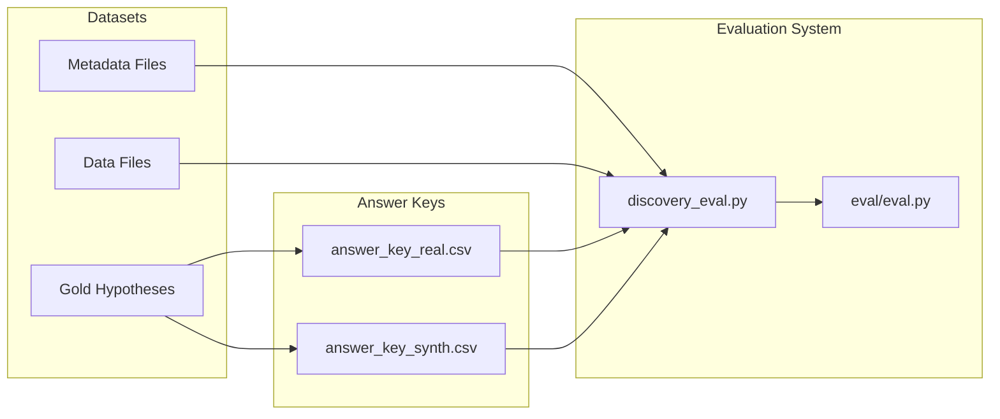

Sources: [eval/answer_key_real.csv](), [eval/answer_key_synth.csv]()

## Answer Keys

The hypothesis evaluation system uses answer key files that contain the gold standard hypotheses for each dataset. These files map dataset names and metadata IDs to their corresponding ground truth hypotheses.

**Answer Key Structure:**

| Column | Description |
|--------|-------------|
| dataset | Name of the dataset |
| metadataid | ID of the metadata file |
| query_id | ID of the specific query |
| gold_hypo | The gold standard hypothesis text |

The repository contains two primary answer key files:
- `answer_key_real.csv`: Contains gold hypotheses for real-world datasets
- `answer_key_synth.csv`: Contains gold hypotheses for synthetic datasets

Sources: [eval/answer_key_real.csv](), [eval/answer_key_synth.csv]()

## Usage in Hypothesis Evaluation

The datasets described in this page form the foundation of the DiscoveryBench evaluation system. They provide:

1. Raw data for agents to analyze
2. Metadata describing the structure and context of the data
3. Gold standard hypotheses for evaluation of agent-generated hypotheses

When evaluating a hypothesis generation system, the evaluation workflow uses these datasets along with their corresponding gold hypotheses from the answer keys to measure the quality of generated hypotheses across different dimensions (variables, relations, context).

For further details on how datasets are used in the evaluation process, see [Hypothesis Evaluation Implementation](#3.1).

Sources: [discoverybench/real/test/introduction_pathways_non-native_plants/metadata_0.json](), [eval/answer_key_real.csv](), [eval/answer_key_synth.csv]()

---

# Page: Non-Native Plant Introduction Pathways Dataset

# Non-Native Plant Introduction Pathways Dataset

<details>
<summary>Relevant source files</summary>

The following files were used as context for generating this wiki page:

- [discoverybench/real/test/introduction_pathways_non-native_plants/metadata_0.json](discoverybench/real/test/introduction_pathways_non-native_plants/metadata_0.json)
- [discoverybench/real/test/introduction_pathways_non-native_plants/metadata_1.json](discoverybench/real/test/introduction_pathways_non-native_plants/metadata_1.json)
- [discoverybench/real/test/introduction_pathways_non-native_plants/metadata_2.json](discoverybench/real/test/introduction_pathways_non-native_plants/metadata_2.json)
- [discoverybench/real/test/introduction_pathways_non-native_plants/metadata_3.json](discoverybench/real/test/introduction_pathways_non-native_plants/metadata_3.json)
- [discoverybench/real/test/introduction_pathways_non-native_plants/metadata_4.json](discoverybench/real/test/introduction_pathways_non-native_plants/metadata_4.json)
- [discoverybench/real/test/introduction_pathways_non-native_plants/metadata_5.json](discoverybench/real/test/introduction_pathways_non-native_plants/metadata_5.json)

</details>


## Overview

The Non-Native Plant Introduction Pathways Dataset provides comprehensive ecological data on non-native plant species in Catalonia, Spain, with a focus on introduction mechanisms, invasion success, and environmental factors. This dataset is part of the DiscoveryBench test collection and serves as a resource for evaluating hypothesis generation related to biological invasions and plant ecology.

This dataset enables the study of how different introduction pathways (gardening, agriculture, or unintentional) influence the distribution, abundance, and ecological impact of non-native plant species across various temporal and spatial scales.

Sources: [discoverybench/real/test/introduction_pathways_non-native_plants/metadata_0.json](), [discoverybench/real/test/introduction_pathways_non-native_plants/metadata_1.json]()

## Dataset Structure

The dataset consists of four primary data files, each capturing different aspects of non-native plant introduction and establishment. Multiple metadata files (metadata_0.json through metadata_5.json) describe these datasets from different analytical perspectives and contain corresponding research questions.

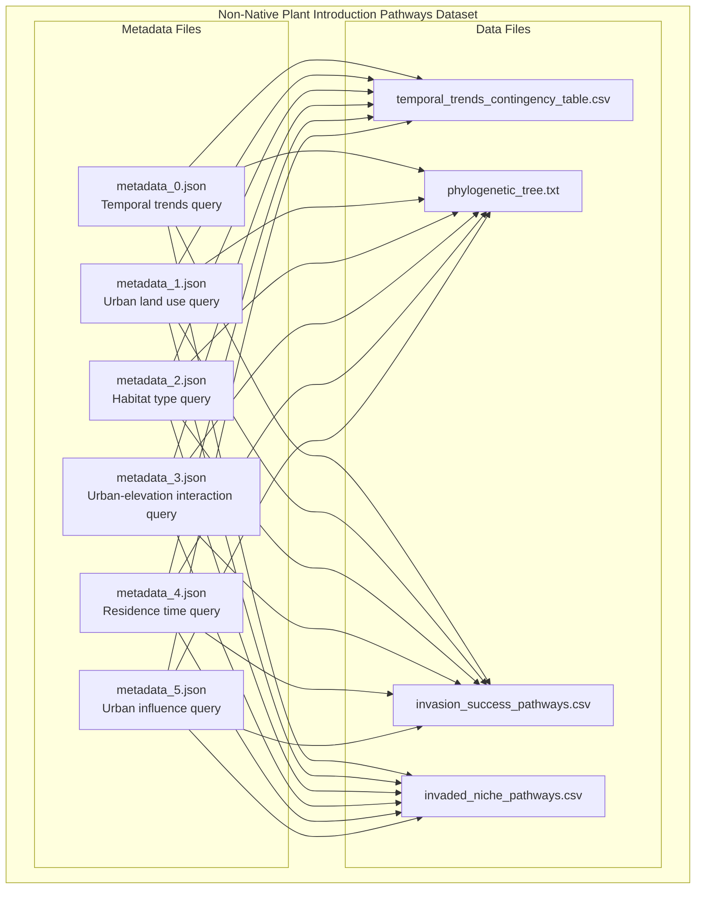

Sources: [discoverybench/real/test/introduction_pathways_non-native_plants/metadata_0.json](), [discoverybench/real/test/introduction_pathways_non-native_plants/metadata_1.json](), [discoverybench/real/test/introduction_pathways_non-native_plants/metadata_2.json](), [discoverybench/real/test/introduction_pathways_non-native_plants/metadata_3.json](), [discoverybench/real/test/introduction_pathways_non-native_plants/metadata_4.json](), [discoverybench/real/test/introduction_pathways_non-native_plants/metadata_5.json]()

## Primary Data Files

### Temporal Trends Contingency Table

The `temporal_trends_contingency_table.csv` file contains historical data on non-native plant introductions in Catalonia, categorized by time period and introduction pathway.

#### Key Variables

| Variable Name | Description |
|---------------|-------------|
| introduction.period | Time period when non-native plant species were introduced |
| pathway | Introduction route: "AgriForest" (agriculture/forestry), "Gardening" (ornamental/medicinal), or "Unintentional" (accidental) |
| n | Count of non-native plant species introductions for each combination of period and pathway |

Sources: [discoverybench/real/test/introduction_pathways_non-native_plants/metadata_0.json:6-25]()

### Phylogenetic Tree

The `phylogenetic_tree.txt` file contains evolutionary relationship data among the non-native plant species in Newick format, with branch lengths representing genetic distances or evolutionary times.

Sources: [discoverybench/real/test/introduction_pathways_non-native_plants/metadata_0.json:27-36]()

### Invasion Success Pathways

The `invasion_success_pathways.csv` file provides detailed information on individual non-native plant species, their ecological characteristics, and invasion metrics in the Barcelona province.

#### Key Variables

| Category | Variables |
|----------|-----------|
| Species Information | Scientific_name, family, genus, species, phylo.tip.label |
| Invasion Metrics | number.of.invaded.plots, area.of.occupancy.10km, habitat.range, invaded.niche.breadth |
| Introduction Data | intro.pathway, mrt (mean residence time) |
| Plant Traits | growth.form, dispersal, vegetative, height, native.niche.breadth |
| Data Management | duplicated, genus.relative, species.relative |

Sources: [discoverybench/real/test/introduction_pathways_non-native_plants/metadata_0.json:38-120]()

### Invaded Niche Pathways

The `invaded_niche_pathways.csv` file contains data for analyzing pathway-specific differences in the invaded ecological niches, including habitat characteristics and landscape factors.

#### Key Variables

| Category | Variables |
|----------|-----------|
| Species Counts | n.gard, n.unint, n.agfo, n.total |
| Habitat Factors | habitat, elevation |
| Temporal Land Use | cropland/urban variables for 1956, 1993, 2009 at 50m, 500m, 1000m buffers |
| Land Use Change | progressive/regressive/no.changes variables for 1956-2009 and 1993-2009 |
| Geographic Factors | distance.stream, distance.road, longitude, latitude |
| Climate Factors | annual.temperature, annual.rainfall, annual.radiation |

Sources: [discoverybench/real/test/introduction_pathways_non-native_plants/metadata_0.json:122-276]()

## Data Relationships and Analysis Dimensions

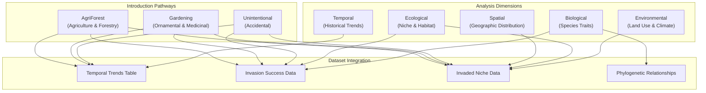

Sources: [discoverybench/real/test/introduction_pathways_non-native_plants/metadata_0.json](), [discoverybench/real/test/introduction_pathways_non-native_plants/metadata_4.json]()

## Research Questions

The dataset is designed to address several key research questions, as evidenced by the queries in the metadata files:

### Temporal Trends Analysis

- How introduction pathways of non-native plants have shifted over time
- When gardening surpassed agriculture as the main contributor to non-native flora

Sources: [discoverybench/real/test/introduction_pathways_non-native_plants/metadata_0.json:286-303]()

### Urban Land Use Impact

- Relationship between urban land use and gardening-introduced non-native plants
- Quantification of the positive relationship between urban areas and gardening introductions

Sources: [discoverybench/real/test/introduction_pathways_non-native_plants/metadata_1.json:286-297]()

### Habitat-Specific Distributions

- Variation in the prevalence of gardening-introduced plants across different habitat types

Sources: [discoverybench/real/test/introduction_pathways_non-native_plants/metadata_2.json:286-297]()

### Environmental Interactions

- Interaction between urban land use and elevation in affecting gardening-introduced plants
- Factors that significantly interact to influence the proportion of gardening introductions

Sources: [discoverybench/real/test/introduction_pathways_non-native_plants/metadata_3.json:286-302]()

### Invasion Success Factors

- How introduction pathways interact with residence time to affect invasion success
- Differences between intentionally and unintentionally introduced plants in their invasion success

Sources: [discoverybench/real/test/introduction_pathways_non-native_plants/metadata_4.json:286-302]()

### Urban Influence on Invasion

- Scenarios where urban land use promotes specific types of plant invasions

Sources: [discoverybench/real/test/introduction_pathways_non-native_plants/metadata_5.json:286-302]()

## Data Structure and Variables Detail

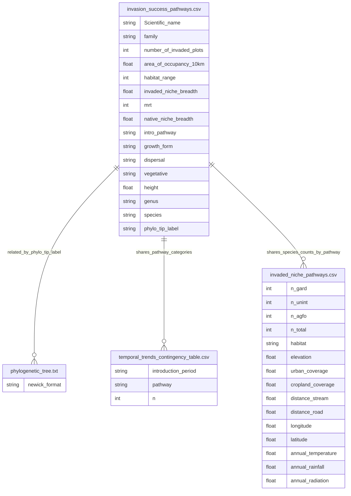

Sources: [discoverybench/real/test/introduction_pathways_non-native_plants/metadata_0.json:6-276]()

## Introduction Pathways Taxonomy

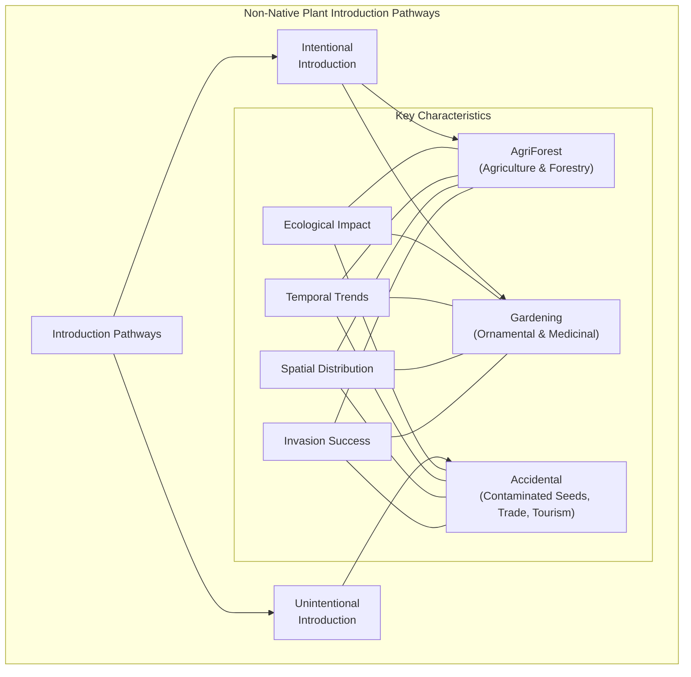

Sources: [discoverybench/real/test/introduction_pathways_non-native_plants/metadata_0.json:17-19]()

## Integration with DiscoveryBench

This dataset is part of the test collection in the DiscoveryBench framework and is used to evaluate hypothesis generation systems. The dataset is structured to enable testing of various analytical approaches, including:

- Statistical tests
- Regression analysis
- Ecological modeling
- Interaction analysis
- Spatial analysis
- Generalized linear models (GLM)

The multiple metadata files (metadata_0.json through metadata_5.json) represent different analytical perspectives and research questions that can be applied to the same core dataset, enabling comprehensive evaluation of hypothesis generation capabilities.

Sources: [discoverybench/real/test/introduction_pathways_non-native_plants/metadata_0.json:4](), [discoverybench/real/test/introduction_pathways_non-native_plants/metadata_1.json:4](), [discoverybench/real/test/introduction_pathways_non-native_plants/metadata_2.json:4](), [discoverybench/real/test/introduction_pathways_non-native_plants/metadata_3.json:4](), [discoverybench/real/test/introduction_pathways_non-native_plants/metadata_4.json:4](), [discoverybench/real/test/introduction_pathways_non-native_plants/metadata_5.json:4]()

---

# Page: Freshwater Fish Evolution Dataset

# Freshwater Fish Evolution Dataset

<details>
<summary>Relevant source files</summary>

The following files were used as context for generating this wiki page:

- [discoverybench/real/train/evolution_freshwater_fish/metadata_0.json](discoverybench/real/train/evolution_freshwater_fish/metadata_0.json)
- [discoverybench/real/train/evolution_freshwater_fish/metadata_1.json](discoverybench/real/train/evolution_freshwater_fish/metadata_1.json)
- [discoverybench/real/train/evolution_freshwater_fish/metadata_2.json](discoverybench/real/train/evolution_freshwater_fish/metadata_2.json)
- [discoverybench/real/train/evolution_freshwater_fish/metadata_3.json](discoverybench/real/train/evolution_freshwater_fish/metadata_3.json)

</details>


## Purpose and Scope

This document provides technical documentation for the Freshwater Fish Evolution Dataset included in the DiscoveryBench repository. The dataset focuses on the drivers of speciation rates in South American freshwater fishes, examining both biotic and abiotic factors that influence evolutionary processes. It is designed for evaluating hypotheses about morphological trait evolution and their impact on speciation.

This dataset is part of the real training datasets in DiscoveryBench, used for training and evaluating discovery agents in evolutionary biology.

Sources: [discoverybench/real/train/evolution_freshwater_fish/metadata_0.json:1-158]()

## Dataset Overview

The Freshwater Fish Evolution Dataset (`body-size-evolution-in-south-american-freshwater-fishes.csv`) contains data on South American freshwater fish species, their morphological traits, evolutionary rates, and environmental variables across different hydrological basins. The dataset enables analysis of factors driving speciation rates through regression analysis.

### Dataset Position in DiscoveryBench

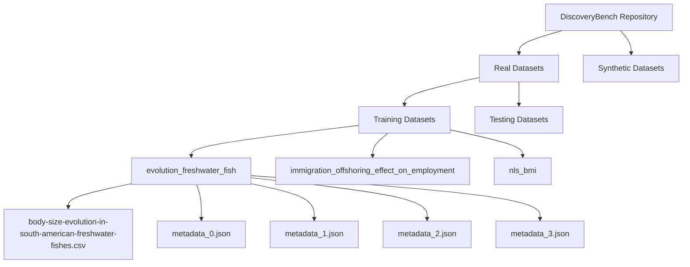

Sources: [discoverybench/real/train/evolution_freshwater_fish/metadata_0.json:1-9]()

## Dataset Structure

The dataset contains multiple variables related to fish morphology, evolution rates, and environmental factors. The main dependent variable is `BAMM_speciation`, which represents the average speciation rates of species within each sub-basin.

### Variables and Descriptions

| Category | Variable | Description |
|----------|----------|-------------|
| **Geographic Identifiers** | HYBAS_ID | Identifier for hydrological basins as defined by the HydroBASINS framework |
| | long | Longitude for geographic locations used to map species presence/absence |
| | lat | Latitude for geographic locations used to map species presence/absence |
| **Evolutionary Metrics** | BAMM_speciation | Average speciation rates of species within each sub-basin, as estimated by BAMM |
| | BAMM_extinction | Mean extinction rates for each tip of the phylogenetic tree |
| | BAMM_NetDiv | Net diversification rates (speciation rates minus extinction rates) |
| | DR | Diversification Rate, a transformed measure of evolutionary distinctness |
| **Morphological Evolution Rates** | MBL_evol | Rates of Maximum Body Length evolution |
| | BEL_evol | Rates of Body Elongation evolution |
| | OGP_evol | Rates of Oral Gape Position Evolution |
| | RES_evol | Rates of Relative Eye Size Evolution |
| | RML_evol | Rate of Relative Maxillary Length evolution |
| **Environmental Factors** | bio1 | Annual mean temperature |
| | bio12 | Annual mean precipitation |
| | runoff | Water quantity from precipitation flowing over land surface |
| | aet | Actual evapotranspiration |
| | Elevation | Mean elevation above sea level |
| | sgr | Stream gradient (steepness of stream/river) |
| | soil_div | Diversity of soil types within each sub-basin |
| **Area and Diversity** | area | Geographic area of a sub-basin |
| | diversity | Species diversity in a given area |

Sources: [discoverybench/real/train/evolution_freshwater_fish/metadata_0.json:11-119]()

## Analysis Workflow

The dataset is structured for regression analysis, specifically examining the relationship between various independent variables and speciation rates. The primary analytical approach is Ordinary Least Squares (OLS) regression.

### Analysis Design

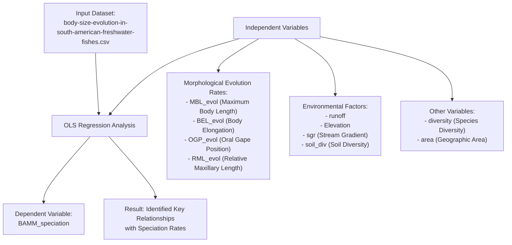

Sources: [discoverybench/real/train/evolution_freshwater_fish/metadata_0.json:135-136](), [discoverybench/real/train/evolution_freshwater_fish/metadata_1.json:135-136](), [discoverybench/real/train/evolution_freshwater_fish/metadata_2.json:135-136](), [discoverybench/real/train/evolution_freshwater_fish/metadata_3.json:135-136]()

## Key Hypotheses

The dataset supports several hypotheses about the factors influencing speciation rates in South American freshwater fishes:

### Relationships Between Variables and Speciation Rates

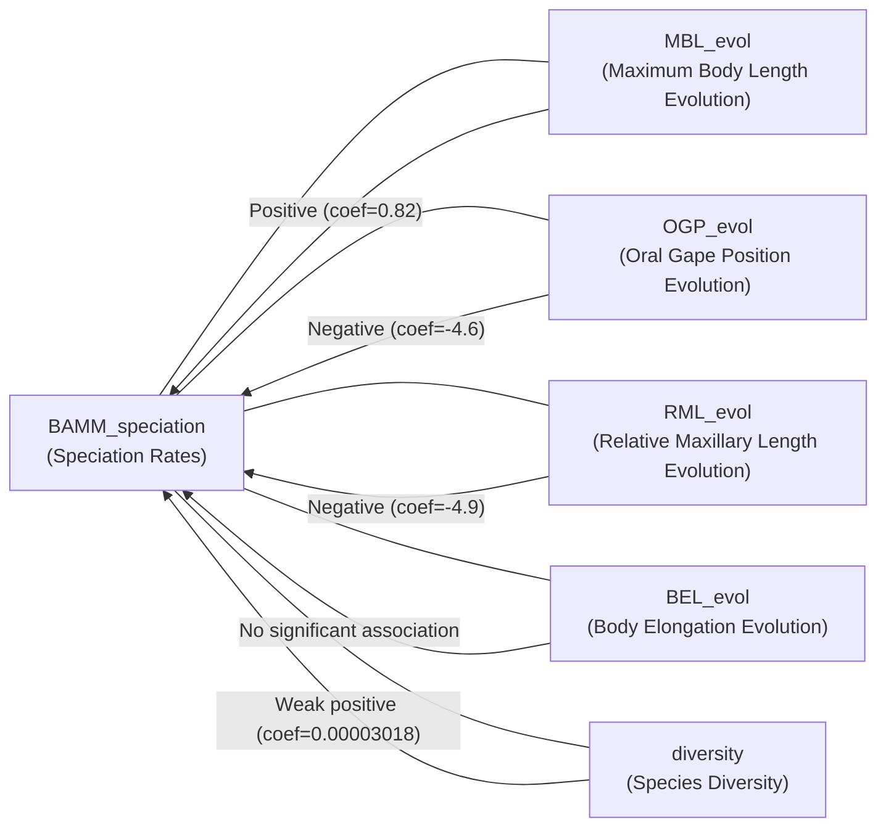

Sources: [discoverybench/real/train/evolution_freshwater_fish/metadata_0.json:123-134](), [discoverybench/real/train/evolution_freshwater_fish/metadata_1.json:123-134](), [discoverybench/real/train/evolution_freshwater_fish/metadata_2.json:123-134](), [discoverybench/real/train/evolution_freshwater_fish/metadata_3.json:123-134]()

### Summary of Key Findings

| Variable | Relationship with Speciation Rates | Coefficient | Statistical Significance |
|----------|-----------------------------------|-------------|--------------------------|
| Maximum Body Length Evolution (MBL_evol) | Positive | 0.82 | Significant (most influential) |
| Oral Gape Position Evolution (OGP_evol) | Negative | -4.6 | Significant |
| Relative Maxillary Length Evolution (RML_evol) | Negative | -4.9 | Significant |
| Body Elongation Evolution (BEL_evol) | None | - | Not significant |
| Species Diversity (diversity) | Positive | 0.00003018 | Significant but weak |

Sources: [discoverybench/real/train/evolution_freshwater_fish/metadata_0.json:130-131](), [discoverybench/real/train/evolution_freshwater_fish/metadata_1.json:130-131](), [discoverybench/real/train/evolution_freshwater_fish/metadata_2.json:130-131](), [discoverybench/real/train/evolution_freshwater_fish/metadata_3.json:130-131]()

## Evaluation in DiscoveryBench

The dataset includes metadata files (`metadata_0.json` through `metadata_3.json`) that contain hypotheses and evaluation queries for testing discovery agents. These are used in the DiscoveryBench evaluation system to assess how well models can derive accurate hypotheses from the data.

### Evaluation Structure

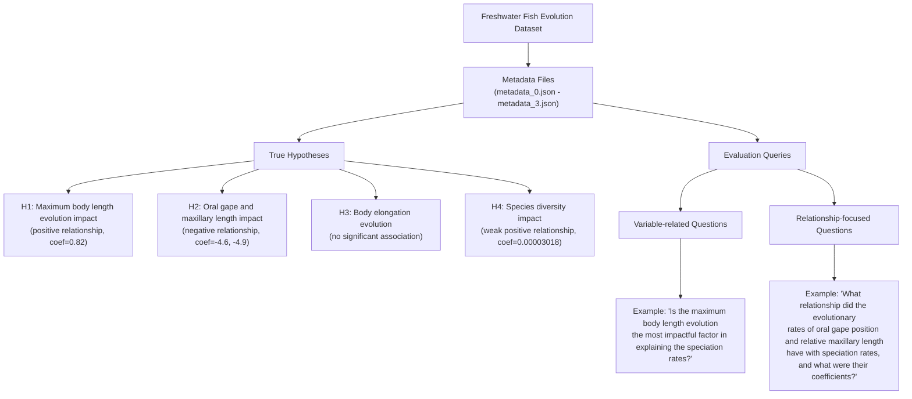

Sources: [discoverybench/real/train/evolution_freshwater_fish/metadata_0.json:136-156](), [discoverybench/real/train/evolution_freshwater_fish/metadata_1.json:136-156](), [discoverybench/real/train/evolution_freshwater_fish/metadata_2.json:136-149](), [discoverybench/real/train/evolution_freshwater_fish/metadata_3.json:136-150]()

## Integration with DiscoveryBench

The Freshwater Fish Evolution Dataset is used to train and evaluate discovery agents on their ability to analyze biological data and generate meaningful hypotheses. The dataset contributes to DiscoveryBench's goal of benchmarking AI systems' capabilities in scientific discovery across multiple domains.

Sources: [discoverybench/real/train/evolution_freshwater_fish/metadata_0.json:1-7]()

---

# Page: Immigration and Offshoring Effect Dataset

# Immigration and Offshoring Effect Dataset

<details>
<summary>Relevant source files</summary>

The following files were used as context for generating this wiki page:

- [discoverybench/real/train/immigration_offshoring_effect_on_employment/metadata_0.json](discoverybench/real/train/immigration_offshoring_effect_on_employment/metadata_0.json)
- [discoverybench/real/train/immigration_offshoring_effect_on_employment/metadata_1.json](discoverybench/real/train/immigration_offshoring_effect_on_employment/metadata_1.json)

</details>


## Purpose and Scope

This document provides detailed information about the Immigration and Offshoring Effect Dataset, a training dataset within DiscoveryBench that examines the relationship between immigration, offshoring, and employment in various industries. The dataset is designed to investigate how changes in immigration patterns influence offshoring activities and native employment shares across different economic sectors.

The dataset focuses specifically on economic analysis using regression techniques to test hypotheses about labor market dynamics. For information about other economic or employment-related datasets, see the [NLS BMI Dataset](#2.4).

## Dataset Overview

The Immigration and Offshoring Effect Dataset explores the relationship between immigration and offshoring through instrumental variables and regression analysis. It contains data spanning multiple years and industries, with metrics on offshoring costs, immigrant employment shares, and employment patterns.

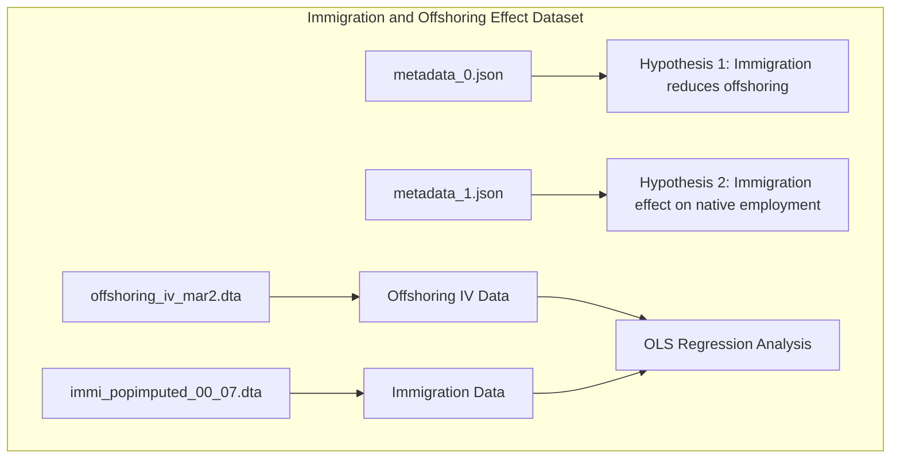

Sources: [discoverybench/real/train/immigration_offshoring_effect_on_employment/metadata_0.json:1-91](), [discoverybench/real/train/immigration_offshoring_effect_on_employment/metadata_1.json:1-91]()

## Dataset Structure

The dataset consists of two primary data files that are designed to be merged for analysis:

### 1. Offshoring Data (`offshoring_iv_mar2.dta`)

This file contains instrumental variables measuring the ease or costs of offshoring across industries and years. It's constructed using variation in offshoring across countries to the U.S., interacting with each industry's initial distribution of offshoring.

| Column Name | Description | Data Type |
|-------------|-------------|-----------|
| year | The year of the observation | Numeric |
| beaind | Bureau of Economic Analysis (BEA) Industry Code | Categorical |
| iv_offshoring_1 | Instrumental variable capturing exogenous variation in the ease/costs of offshoring | Numeric |

### 2. Immigration Data (`immi_popimputed_00_07.dta`)

This file provides imputed measures of immigrant employment aimed at capturing exogenous variation in immigration costs and push-factors across industries and years.

| Column Name | Description | Data Type |
|-------------|-------------|-----------|
| year | The year of the observation | Numeric |
| beaind | Bureau of Economic Analysis (BEA) Industry Code | Categorical |
| share_immi_imputed | Imputed proportion of immigrant employment within total employment | Numeric |
| empl_immi_imputed | Imputed level of immigrant employment (count) | Numeric |

Sources: [discoverybench/real/train/immigration_offshoring_effect_on_employment/metadata_0.json:6-59](), [discoverybench/real/train/immigration_offshoring_effect_on_employment/metadata_1.json:6-59]()

## Data Relationships and Integration

The dataset is designed for integrated analysis through matching industry-year combinations. Both files share common identifier columns (`year` and `beaind`), allowing for merging into a combined dataset for regression analysis.

```mermaid
erDiagram
    OFFSHORING_DATA ||--|| IMMIGRATION_DATA : "merged by"
    OFFSHORING_DATA {
        int year
        string beaind
        float iv_offshoring_1
    }
    IMMIGRATION_DATA {
        int year
        string beaind
        float share_immi_imputed
        int empl_immi_imputed
    }
    
    MERGED_DATASET {
        int year
        string beaind
        float iv_offshoring_1
        float share_immi_imputed
        int empl_immi_imputed
    }
    
    OFFSHORING_DATA --o{ MERGED_DATASET : contains
    IMMIGRATION_DATA --o{ MERGED_DATASET : contains
```

Sources: [discoverybench/real/train/immigration_offshoring_effect_on_employment/metadata_0.json:74](), [discoverybench/real/train/immigration_offshoring_effect_on_employment/metadata_1.json:74]()

## Research Hypotheses

The dataset is used to test two primary hypotheses about the interaction between immigration and employment patterns:

1. **Hypothesis 1**: Per unit increased ease of immigration reduces 0.1059 unit of the share of offshore employment
   - This suggests a substitution effect where industries with greater immigration accessibility tend to reduce their offshoring activities.

2. **Hypothesis 2**: Increased ease of immigration has no significant effect on the share of native employment
   - This suggests that immigration does not significantly displace native workers within industries.

These hypotheses help address important economic questions about labor market dynamics, international trade, and immigration policy effects.

Sources: [discoverybench/real/train/immigration_offshoring_effect_on_employment/metadata_0.json:62-73](), [discoverybench/real/train/immigration_offshoring_effect_on_employment/metadata_1.json:62-73]()

## Analysis Workflow

The standard workflow for analyzing this dataset involves the following steps:

```mermaid
flowchart TD
    A["1. Data Merging"] --> B["2. Data Cleaning"]
    B --> C["3. Variable Selection"]
    C --> D["4. OLS Regression Modeling"]
    D --> E["5. Hypothesis Testing"]
    
    A1["Offshore Data\n(year, beaind, iv_offshoring_1)"] --> A
    A2["Immigration Data\n(year, beaind, share_immi_imputed)"] --> A
    A3["Native Employment Data\n(not explicitly included in metadata)"] --> A
    
    B1["Replace infinities with NaNs"] --> B
    B2["Drop rows with any NaN values"] --> B
    
    C1["Select IV variables:\niv_offshoring_1, penetration"] --> C
    
    E1["Test Hypothesis 1:\nImmigration effect on offshoring"] --> E
    E2["Test Hypothesis 2:\nImmigration effect on native employment"] --> E
    
    style A stroke-width:1px
    style B stroke-width:1px
    style C stroke-width:1px
    style D stroke-width:1px
    style E stroke-width:1px
```

The workflow involves:

1. **Data Merging**: Combining the offshoring, immigration, and native employment datasets using the common `year` and `beaind` columns.
2. **Data Cleaning**: Handling missing values and outliers.
3. **Variable Selection**: Identifying independent variables for the regression model.
4. **OLS Regression**: Fitting an Ordinary Least Squares regression model.
5. **Hypothesis Testing**: Analyzing regression results to confirm or refute hypotheses.

Sources: [discoverybench/real/train/immigration_offshoring_effect_on_employment/metadata_0.json:74](), [discoverybench/real/train/immigration_offshoring_effect_on_employment/metadata_1.json:74]()

## Evaluation Queries

The dataset includes predefined evaluation queries that can be used to test hypothesis generation systems:

### Hypothesis 1 Queries:
1. Variable identification: "Which variable per unit reduces 0.1059 unit of the share of offshore employment?"
2. Relationship determination: "How does per unit increased ease of immigration impact the share of offshore employment?"

### Hypothesis 2 Queries:
1. Relationship determination: "What is the effect of increased ease of immigration on the local job market for native workers?"
2. Relationship determination: "How does increased ease of immigration impact the share of native employment?"

These queries are used to evaluate how well systems can extract relevant variables and relationships from the data.

Sources: [discoverybench/real/train/immigration_offshoring_effect_on_employment/metadata_0.json:75-89](), [discoverybench/real/train/immigration_offshoring_effect_on_employment/metadata_1.json:75-89]()

## Integration with DiscoveryBench

The Immigration and Offshoring Effect Dataset is integrated into the DiscoveryBench framework as a training dataset for hypothesis generation and evaluation. It represents a real-world economic analysis scenario.

```mermaid
graph TD
    subgraph "DiscoveryBench System"
        DS["Datasets"] --> EVAL["Evaluation System"]
        AK["Answer Keys"] --> EVAL
        CONF["Configuration"] --> EVAL
    end
    
    subgraph "Immigration and Offshoring Dataset"
        MD0["metadata_0.json"] --> DS
        MD1["metadata_1.json"] --> DS
        H1["Hypothesis 1: Immigration reduces offshoring"] --> AK
        H2["Hypothesis 2: No effect on native employment"] --> AK
    end
    
    EVAL --> RES["Evaluation Results"]
    
    style DS stroke-width:1px
    style EVAL stroke-width:1px
    style AK stroke-width:1px
    style CONF stroke-width:1px
    style MD0 stroke-width:1px
    style MD1 stroke-width:1px
    style H1 stroke-width:1px
    style H2 stroke-width:1px
    style RES stroke-width:1px
```

When using this dataset for hypothesis evaluation:

1. The dataset serves as input to the evaluation system
2. The defined hypotheses function as "gold standard" answers
3. Generated hypotheses are compared against these standards
4. The evaluation queries assess how well a system extracts variables and relationships

Sources: [discoverybench/real/train/immigration_offshoring_effect_on_employment/metadata_0.json:1-91](), [discoverybench/real/train/immigration_offshoring_effect_on_employment/metadata_1.json:1-91]()

## Technical Implementation Details

The dataset is implemented through JSON metadata files that define the structure, variables, and hypotheses. Each metadata file represents a different research question within the same dataset.

### Metadata Structure

```
immigration_offshoring_effect_on_employment/
├── metadata_0.json  # Hypothesis about immigration impact on offshoring
└── metadata_1.json  # Hypothesis about immigration impact on native employment
```

The metadata files define:

- Dataset domain and workflow tags
- Data file specifications and column descriptions
- Research hypotheses
- Analysis workflow
- Evaluation queries

The data files themselves (`.dta` format) are Stata data files, a common format in economic research that can be loaded using libraries like `pandas` with the `pyreadstat` package.

Sources: [discoverybench/real/train/immigration_offshoring_effect_on_employment/metadata_0.json:1-5](), [discoverybench/real/train/immigration_offshoring_effect_on_employment/metadata_1.json:1-5]()

## Summary

The Immigration and Offshoring Effect Dataset provides a framework for testing hypotheses about the relationship between immigration and labor market outcomes. It includes:

- Two primary data sources on offshoring and immigration
- Common industry-year identifiers for data integration
- Two main research hypotheses about labor market dynamics
- A standardized workflow for data analysis
- Evaluation queries for testing hypothesis generation systems

This dataset serves as a valuable training resource within the DiscoveryBench framework for developing and evaluating hypothesis generation systems in economic research.

---

# Page: NLS BMI Dataset

# NLS BMI Dataset

<details>
<summary>Relevant source files</summary>

The following files were used as context for generating this wiki page:

- [discoverybench/real/train/nls_bmi/metadata_0.json](discoverybench/real/train/nls_bmi/metadata_0.json)
- [discoverybench/real/train/nls_bmi/metadata_1.json](discoverybench/real/train/nls_bmi/metadata_1.json)
- [discoverybench/real/train/nls_bmi/metadata_2.json](discoverybench/real/train/nls_bmi/metadata_2.json)
- [discoverybench/real/train/nls_bmi/metadata_3.json](discoverybench/real/train/nls_bmi/metadata_3.json)
- [discoverybench/real/train/nls_bmi/metadata_4.json](discoverybench/real/train/nls_bmi/metadata_4.json)

</details>


## Purpose and Scope

This document details the NLS BMI Dataset from the National Longitudinal Survey of Youth (NLSY79) used in DiscoveryBench for evaluating hypothesis generation in social science contexts. The dataset focuses on exploring relationships between body mass index (BMI), saving behaviors (as proxies for time preference), and demographic characteristics. This page covers the dataset structure, key variables, associated hypotheses, and analysis workflows implemented in the repository.

Sources: [discoverybench/real/train/nls_bmi/metadata_0.json:1-92]()

## Dataset Overview

The NLS BMI dataset is part of the training data in DiscoveryBench's real datasets collection. It contains demographic information, saving behaviors, and body mass index measurements from respondents in the National Longitudinal Survey of Youth from 1989, with height measurements from 1985 and weight from 1989.

The dataset is used primarily to explore the relationship between time preference (using saving behavior as a proxy) and BMI, particularly across different demographic groups.

### Dataset Structure Diagram

```mermaid
flowchart TD
    subgraph "nls_bmi_processed.csv"
        A["Demographics"]
        B["Time Preference Proxies"]
        C["BMI"]
    end
    
    A --> |"Used as control\nvariables"| D["Analysis"]
    B --> |"Independent\nvariables"| D
    C --> |"Dependent\nvariable"| D
    
    A --- A1["GENDER"]
    A --- A2["AGE/AGE_2"]
    A --- A3["BLACK"]
    A --- A4["HISPANIC"]
    A --- A5["INCOME"]
    
    B --- B1["DISSAVED"]
    B --- B2["SAMESAVE"]
```

Sources: [discoverybench/real/train/nls_bmi/metadata_0.json:6-60]()

## Key Variables

The dataset contains the following key variables:

| Variable | Description | Type | Use in Analysis |
|----------|-------------|------|----------------|
| GENDER | Gender of the respondent (MALE or FEMALE) | Categorical | Control variable |
| AGE | Age of the respondent in 1989 | Numeric | Control/predictor variable |
| AGE_2 | Square of the age of the respondent | Numeric | Control variable for non-linear effects |
| INCOME | Income of the respondent in 1989 | Numeric | Control/predictor variable |
| DISSAVED | 1 if respondent took more money out than put into savings, 0 otherwise | Boolean | Time preference proxy/dependent variable |
| SAMESAVE | 1 if savings level did not change or had no savings, 0 otherwise | Boolean | Time preference proxy/dependent variable |
| BMI | Body mass index calculated using height (1985) and weight (1989) | Numeric | Primary dependent variable |
| BLACK | 1 if respondent is black, 0 otherwise | Boolean | Control/stratification variable |
| HISPANIC | 1 if respondent is hispanic, 0 otherwise | Boolean | Control/stratification variable |

Sources: [discoverybench/real/train/nls_bmi/metadata_0.json:11-58]()

## Domain Knowledge Context

The dataset incorporates an important domain-specific assumption: spending and saving behavior can be used as proxies for an individual's time preference. In economic and behavioral theory, time preference refers to how an individual values present versus future consumption or rewards. Higher time preference indicates valuing present consumption more than future gains.

Sources: [discoverybench/real/train/nls_bmi/metadata_0.json:5](), [discoverybench/real/train/nls_bmi/metadata_1.json:5]()

## Research Hypotheses

The dataset is used to explore several key hypotheses:

### Main Hypothesis

The primary hypothesis examines the relationship between time preference (measured via saving behaviors) and BMI:

> "Higher time preference associated with higher BMI for 1989 data. BMI is positively related with if person spent more than their saving with a coefficient 0.3596. BMI is also positively correlated with if the savings of a person remained unchanged with a coefficient 0.4858."

### Demographic-Specific Hypotheses

Additional hypotheses examine this relationship in specific demographic groups:

1. **Hispanic Men**: 
   > "Time preference is positively associated with Body Mass Index in Hispanic men with coefficients for no change in savings level being 1.5799 (p-value: 0.000) and coefficient for having withdrawn more money from savings than they had put in being 0.9826 (p-value: 0.038)"

2. **Black Women**: 
   > "Time preference is positively associated with Body Mass Index in Black women with coefficients for no change in savings level being 1.1840 (p-value: 0.003) and coefficient for having withdrawn more money from savings than they had put in being 0.5446 (p-value: 0.225)"

### Behavioral Economics Hypotheses

The dataset also explores factors influencing saving behaviors themselves:

1. **Age and Savings Withdrawal**: 
   > "Younger individuals are more likely to withdraw more money from savings than they had put in and with a negative coefficient between age and withdrawing more than putting into savings (-0.0422)."

2. **Income and Savings Maintenance**: 
   > "As income increases, the likelihood of maintaining the same level of savings decreases, supported by a coefficient of -0.0038 (p<0.001) for income."

Sources: [discoverybench/real/train/nls_bmi/metadata_0.json:63-71](), [discoverybench/real/train/nls_bmi/metadata_1.json:63-71](), [discoverybench/real/train/nls_bmi/metadata_2.json:63-71](), [discoverybench/real/train/nls_bmi/metadata_3.json:63-71](), [discoverybench/real/train/nls_bmi/metadata_4.json:63-71]()

## Analysis Workflows

The dataset supports multiple analysis workflows, primarily using regression techniques:

### Analysis Workflow Diagram

```mermaid
flowchart TD
    subgraph "NLS BMI Analysis Workflows"
        A["nls_bmi_processed.csv"]
        
        B["OLS Regression:\nBMI ~ DISSAVED + SAMESAVE"]
        C["OLS Regression (Hispanic Men):\nBMI ~ DISSAVED + SAMESAVE"]
        D["OLS Regression (Black Women):\nBMI ~ DISSAVED + SAMESAVE"]
        E["Logistic Regression:\nDISSAVED ~ Demographics"]
        F["Logistic Regression:\nSAMESAVE ~ Demographics"]
        
        A --> B
        A --> |"Filter: GENDER='MALE' & HISPANIC=1"| C
        A --> |"Filter: GENDER='FEMALE' & BLACK=1"| D
        A --> |"One-hot encode GENDER"| E
        A --> |"One-hot encode GENDER"| F
    end
```

Sources: [discoverybench/real/train/nls_bmi/metadata_0.json:75](), [discoverybench/real/train/nls_bmi/metadata_1.json:75](), [discoverybench/real/train/nls_bmi/metadata_2.json:75](), [discoverybench/real/train/nls_bmi/metadata_3.json:75](), [discoverybench/real/train/nls_bmi/metadata_4.json:75]()

### Workflow 1: BMI and Time Preference (General Population)

This workflow examines the relationship between time preference proxies and BMI across the entire dataset:

1. Choose BMI as dependent variable
2. Use time preference variables (DISSAVED, SAMESAVE) as independent variables
3. Fit an OLS regression model
4. Interpret coefficients and significance

Sources: [discoverybench/real/train/nls_bmi/metadata_0.json:75]()

### Workflow 2: BMI and Time Preference (Demographic Subgroups)

This workflow repeats the analysis for specific demographic subgroups:

1. Filter data for specific demographic combinations:
   - Hispanic men (`GENDER="MALE" AND HISPANIC=1`)
   - Black women (`GENDER="FEMALE" AND BLACK=1`)
2. Run OLS regression with BMI as dependent variable and DISSAVED/SAMESAVE as independent variables
3. Interpret coefficients and significance by demographic group

Sources: [discoverybench/real/train/nls_bmi/metadata_1.json:75](), [discoverybench/real/train/nls_bmi/metadata_2.json:75]()

### Workflow 3: Predicting Saving Behaviors

This workflow examines factors that predict saving behaviors:

1. One-hot encode Gender variable into MALE and FEMALE
2. Extract independent variables (AGE, INCOME, BMI, BLACK, HISPANIC, MALE, FEMALE)
3. Use either DISSAVED or SAMESAVE as dependent variable
4. Add constant term for intercept
5. Fit logistic regression model
6. Interpret odds ratios and significance

Sources: [discoverybench/real/train/nls_bmi/metadata_3.json:75](), [discoverybench/real/train/nls_bmi/metadata_4.json:75]()

## Query Types and Evaluation

The dataset includes multiple query types to evaluate hypothesis generation capabilities:

1. **Variables queries**: Identifying factors related to time preference and BMI
2. **Relationship queries**: Determining how variables relate to each other
3. **Context queries**: Exploring behaviors in specific demographic contexts

### Variables to Hypotheses Mapping

```mermaid
graph TD
    subgraph "Variables"
        V1["DISSAVED"]
        V2["SAMESAVE"]
        V3["BMI"]
        V4["AGE"]
        V5["INCOME"]
        V6["Demographics\n(BLACK, HISPANIC, GENDER)"]
    end
    
    subgraph "Hypotheses"
        H1["Time Preference ~ BMI\n(General Population)"]
        H2["Time Preference ~ BMI\n(Hispanic Men)"]
        H3["Time Preference ~ BMI\n(Black Women)"]
        H4["Age ~ Savings Withdrawal"]
        H5["Income ~ Maintaining Savings"]
    end
    
    V1 --> H1
    V2 --> H1
    V3 --> H1
    
    V1 --> H2
    V2 --> H2
    V3 --> H2
    V6 --> H2
    
    V1 --> H3
    V2 --> H3
    V3 --> H3
    V6 --> H3
    
    V4 --> H4
    V1 --> H4
    
    V5 --> H5
    V2 --> H5
```

Sources: [discoverybench/real/train/nls_bmi/metadata_0.json:76-91](), [discoverybench/real/train/nls_bmi/metadata_1.json:76-84](), [discoverybench/real/train/nls_bmi/metadata_2.json:76-84](), [discoverybench/real/train/nls_bmi/metadata_3.json:76-91](), [discoverybench/real/train/nls_bmi/metadata_4.json:76-84]()

## Dataset File Location

The dataset exists as `nls_bmi_processed.csv` in the repository's real training data directory. It is accompanied by multiple metadata files (`metadata_0.json` through `metadata_4.json`) that define different analysis configurations and hypotheses.

Sources: [discoverybench/real/train/nls_bmi/metadata_0.json:8]()

---

# Page: Evaluation System

# Evaluation System

<details>
<summary>Relevant source files</summary>

The following files were used as context for generating this wiki page:

- [discovery_eval.py](discovery_eval.py)
- [eval/eval.py](eval/eval.py)
- [eval/example_eval_scripts/test_synth_eval.sh](eval/example_eval_scripts/test_synth_eval.sh)
- [eval/lm_utils.py](eval/lm_utils.py)
- [eval/new_eval.py](eval/new_eval.py)

</details>


The Evaluation System is a core component of DiscoveryBench responsible for assessing the quality of generated hypotheses by comparing them against gold standard hypotheses. It performs semantic evaluation across multiple dimensions rather than simple string matching, using large language models (LLMs) to understand and score hypotheses based on their contextual, variable, and relational aspects.

For details about specific datasets used in evaluation, see [Datasets](#2). For information about example evaluation scripts and usage, see [Example Evaluation Scripts](#3.4).

## System Architecture

### High-Level Architecture

```mermaid
graph TD
    CLI["discovery_eval.py<br>(CLI Interface)"] --> EVAL["run_eval_gold_vs_gen_NL_hypo_workflow<br>(Main Evaluation Function)"]
    EVAL --> SUB_HYPO["get_sub_hypotheses<br>(Extract Sub-Hypotheses)"]
    EVAL --> MATCH["is_matching_context<br>(Match Contexts)"]
    EVAL --> EVAL_SUB["run_eval_gold_vs_gen_NL_subhypo<br>(Evaluate Matched Pairs)"]
    
    SUB_HYPO --> LLM["OpenAI API"]
    MATCH --> LLM
    EVAL_SUB --> DIM["ask_dimension_question<br>(Evaluate Dimensions)"]
    DIM --> LLM
    
    UTILS["lm_utils.py<br>(LLM Utilities)"] --- LLM
```

The evaluation system is built around several key components that work together to process and evaluate hypotheses:

1. **CLI Interface** (`discovery_eval.py`): The entry point for evaluation requests, handling argument parsing and results output
2. **Evaluation Core** (`eval/eval.py`): Contains the main logic for breaking down hypotheses, matching them, and scoring them
3. **LLM Utilities** (`eval/lm_utils.py`): Provides utilities for interacting with OpenAI's API
4. **OpenAI API**: External service used for semantic evaluation of hypotheses

Sources: [discovery_eval.py:1-62](), [eval/eval.py:341-438](), [eval/lm_utils.py:31-65]()

### Evaluation Workflow

```mermaid
sequenceDiagram
    participant User
    participant CLI as discovery_eval.py
    participant Eval as run_eval_gold_vs_gen_NL_hypo_workflow
    participant LLM as OpenAI API
    
    User->>CLI: Input gold & pred hypotheses
    CLI->>Eval: Pass parameters
    
    Eval->>LLM: Extract gold sub-hypotheses
    LLM-->>Eval: Return gold sub-hypotheses
    Eval->>LLM: Extract pred sub-hypotheses
    LLM-->>Eval: Return pred sub-hypotheses
    
    loop For each pred sub-hypothesis
        loop For each gold sub-hypothesis not yet matched
            Eval->>LLM: Match contexts
            LLM-->>Eval: Context match result
            opt Context matches
                Eval->>Eval: Mark gold sub-hypothesis as covered
                Eval->>Eval: Record match
                break
            end
        end
    end
    
    loop For each matched pair
        Eval->>LLM: Evaluate variables
        LLM-->>Eval: Variable scores
        Eval->>LLM: Evaluate relations
        LLM-->>Eval: Relation scores
        Eval->>Eval: Calculate accuracy score
    end
    
    Eval->>Eval: Calculate recall_context
    Eval->>Eval: Calculate mean_accuracy_score
    Eval->>Eval: Calculate final_score
    Eval-->>CLI: Return evaluation result
    CLI-->>User: Display/save results
```

The evaluation process follows a structured workflow:

1. User provides gold hypothesis, predicted hypothesis, dataset metadata, and query
2. System extracts sub-hypotheses from both gold and predicted hypotheses using LLM
3. Each predicted sub-hypothesis is matched with a gold sub-hypothesis based on context
4. For each matched pair, variables and relations are evaluated
5. Final score is calculated as `recall_context * mean_accuracy_score`

Sources: [eval/eval.py:342-438](), [discovery_eval.py:40-58]()

## Evaluation Dimensions

The system evaluates hypotheses across three key dimensions that are crucial for scientific hypothesis validity:

```mermaid
graph TD
    H["Hypothesis Evaluation"]
    
    H --> C["Context"]
    H --> V["Variables"]
    H --> R["Relations"]
    
    C --> C1["Boundary conditions that limit scope<br>e.g., 'for men over 30', 'in Asia'"]
    V --> V1["Entities involved in hypothesis<br>e.g., age, gender, income"]
    R --> R1["Interactions between variables<br>e.g., 'positive correlation', 'quadratic relationship'"]
    
    C --> CS["Scoring: Binary (1.0 or 0.0)"]
    V --> VS["Scoring: F1 score based on precision/recall"]
    R --> RS["Scoring: 1.0, 0.5, or 0.0 based on similarity"]
```

### Context Evaluation

Contexts are the boundary conditions or scope under which a hypothesis is defined. The system evaluates context match using:
- Direct string comparison first
- If not identical, semantic comparison through LLM

```python
# Context matching process
if gold_context == pred_context:
    return True
if "None" in [gold_context, pred_context]:
    return False
return match_context_with_gpt(gold_hyp, gold_context, pred_hyp, pred_context, model=llm_used)
```

Sources: [eval/eval.py:307-312](), [eval/eval.py:275-304]()

### Variables Evaluation

Variables are the concepts or entities involved in the hypothesis. The system evaluates variable overlap using:
- Counting variables in gold hypothesis (sizeA)
- Counting variables in predicted hypothesis (sizeB)
- Counting shared variables (intersection)
- Calculating precision, recall, and F1 score

The variable score is represented as an F1 score that balances precision and recall.

Sources: [eval/eval.py:37-68](), [eval/eval.py:110-123]()

### Relations Evaluation

Relations describe how variables interact within the hypothesis. The system evaluates relations using a three-level scale:
- Very similar (1.0): Relations are essentially identical
- Similar but more general (0.5): Relations are similar but the predicted one is more general
- Different (0.0): Relations differ significantly

Sources: [eval/eval.py:69-80](), [eval/eval.py:125-139]()

## Scoring System

The evaluation system uses a hierarchical scoring approach to combine individual dimension scores into a final assessment.

```mermaid
graph TD
    FS["Final Score = recall_context * mean_accuracy_score"]
    
    FS --> RC["Recall Context<br># gold contexts covered / # total gold contexts"]
    FS --> MAS["Mean Accuracy Score<br>Average of accuracy scores across matched pairs"]
    
    MAS --> AS["Accuracy Score = context_score * var_score * rel_score"]
    
    AS --> CS["Context Score<br>(1.0 or 0.0)"]
    AS --> VS["Variable Score<br>(F1 score)"]
    AS --> RS["Relation Score<br>(1.0, 0.5, or 0.0)"]
```

The final score combines:
1. **Recall Context**: Measures how many gold sub-hypotheses are covered by predicted sub-hypotheses
2. **Mean Accuracy Score**: Measures how well the matched sub-hypotheses align across all dimensions

This balanced approach ensures both coverage (recall_context) and quality (mean_accuracy_score) are considered.

Sources: [eval/eval.py:427-435](), [eval/eval.py:337]()

## Implementation Details

### Sub-Hypothesis Extraction 

The system breaks down complex hypotheses into simpler sub-hypotheses for more precise evaluation:

```python
def get_sub_hypotheses(query, hypo, workflow, dataset_meta, llm_used, dataset_type, use_column_metadata=True):
    # Constructs prompt to extract sub-hypotheses with context, variables, and relations
    # Uses OpenAI API to analyze the hypothesis
    # Returns a structured JSON representation of sub-hypotheses
```

The extraction prompt defines the three dimensions and asks the LLM to identify them in the hypothesis.

Sources: [eval/eval.py:218-273]()

### Dimension Question Generation

The system generates specific prompts for evaluating each dimension:

```python
def ask_dimension_question(query, gold_hypo, gold_workflow, gen_hypo, gen_workflow, dataset_meta, llm_used, dimension, dataset_type, use_column_metadata=True):
    # Constructs a prompt specific to the dimension being evaluated
    # Handles different formats for different dimensions (context, var, rel)
    # Returns the dimension question, LLM answer, and processed score
```

Each dimension has a specific prompt format and scoring logic appropriate to its nature.

Sources: [eval/eval.py:82-188]()

### CLI Interface

The evaluation system is accessible through a command-line interface:

```
python discovery_eval.py \
  --gold_hypo <gold_hypothesis> \
  --pred_hypo <predicted_hypothesis> \
  --metadata_path <path_to_metadata> \
  --metadata_type <real|synth> \
  <query>
```

Key arguments:
- `--gold_hypo`: The reference hypothesis (ground truth)
- `--gold_workflow`: Optional workflow for gold hypothesis
- `--pred_hypo`: The hypothesis to be evaluated
- `--pred_workflow`: Optional workflow for predicted hypothesis
- `--metadata_path`: Path to dataset metadata file
- `--metadata_type`: Type of dataset (real or synthetic)
- `<query>`: The natural language query the hypotheses address

Sources: [discovery_eval.py:18-36]()

## Example Evaluation Process

Here's a detailed example of how the system evaluates hypotheses:

1. **Input**:
   - Query: "Is there a relationship between tourist visits and material usage ratio?"
   - Gold hypothesis: "Structures with lower tourist visits and higher durability tend to have higher material usage ratio..."
   - Predicted hypothesis: "There is a positive linear relationship between translation effectiveness and digitized artifacts..."

2. **Sub-hypothesis extraction**:
   - System extracts sub-hypotheses from gold and predicted hypotheses
   - Each sub-hypothesis includes context, variables, and relations

3. **Context matching**:
   - System matches predicted sub-hypotheses with gold sub-hypotheses based on context
   - If contexts match, the pair proceeds to further evaluation

4. **Dimension evaluation**:
   - For each matched pair, variables and relations are evaluated
   - Variable evaluation produces precision, recall, and F1 scores
   - Relation evaluation produces a score of 1.0, 0.5, or 0.0

5. **Final scoring**:
   - recall_context = number of matched gold sub-hypotheses / total gold sub-hypotheses
   - mean_accuracy_score = average of (context_score * var_score * rel_score) across matched pairs
   - final_score = recall_context * mean_accuracy_score

Sources: [eval/example_eval_scripts/test_synth_eval.sh:1-15](), [eval/eval.py:342-438]()

## Integration with OpenAI API

The evaluation system relies heavily on OpenAI's language models for semantic understanding:

```mermaid
graph LR
    EVS["Evaluation System"] --> LMU["lm_utils.py"]
    LMU --> RCQ["run_chatgpt_query_multi_turn()"]
    RCQ --> GPT["OpenAI API"]
    
    GPT --> DIM1["Context Evaluation"]
    GPT --> DIM2["Variable Extraction"]
    GPT --> DIM3["Relation Assessment"]
    GPT --> SUB["Sub-Hypothesis Extraction"]
```

The system uses OpenAI's API for:
1. Breaking down hypotheses into sub-hypotheses
2. Matching contexts semantically
3. Identifying and comparing variables
4. Assessing relation similarity

The `run_chatgpt_query_multi_turn` function handles API interactions with appropriate retry logic.

Sources: [eval/lm_utils.py:31-65](), [eval/eval.py:174-186]()

---

The Evaluation System is a sophisticated component that enables objective assessment of hypothesis quality by leveraging LLMs to understand the semantic content of hypotheses across multiple dimensions. This approach allows for nuanced evaluation that goes beyond surface-level text matching to capture the scientific validity of the hypotheses.

---

# Page: Hypothesis Evaluation Implementation

# Hypothesis Evaluation Implementation

<details>
<summary>Relevant source files</summary>

The following files were used as context for generating this wiki page:

- [eval/eval.py](eval/eval.py)
- [eval/example_eval_scripts/test_synth_eval.sh](eval/example_eval_scripts/test_synth_eval.sh)
- [eval/lm_utils.py](eval/lm_utils.py)
- [eval/new_eval.py](eval/new_eval.py)

</details>


## Purpose and Scope

This document provides a detailed technical overview of the hypothesis evaluation implementation in DiscoveryBench. The system evaluates generated natural language hypotheses against gold standard hypotheses by comparing them across multiple dimensions: context, variables, and relations. This page focuses specifically on the core evaluation logic in `eval/eval.py` and explains how the system decomposes complex hypotheses, matches corresponding parts, and calculates evaluation scores.

For information about the command-line interface, see [Evaluation CLI](#3.2). For documentation on the answer key files, see [Answer Keys](#3.3). For guidance on using example scripts, see [Example Evaluation Scripts](#3.4).

## System Overview

The hypothesis evaluation system uses large language models (LLMs) to compare generated hypotheses against reference (gold) hypotheses. The evaluation process involves several key steps:

1. Breaking down complex hypotheses into sub-hypotheses
2. Matching sub-hypotheses between generated and gold based on context
3. Evaluating matched pairs on variables and relations
4. Calculating recall and accuracy scores
5. Computing a final score

### Evaluation Architecture

```mermaid
flowchart TD
    A["run_eval_gold_vs_gen_NL_hypo_workflow"]
    B["get_sub_hypotheses"]
    C["is_matching_context"]
    D["run_eval_gold_vs_gen_NL_subhypo"]
    E["ask_dimension_question"]
    F["match_context_with_gpt"]
    G["get_score_from_answer"]
    
    A --> B
    A --> C
    A --> D
    C --> F
    D --> E
    E --> G
    
    subgraph "LLM Services"
        OpenAI["OpenAI API"]
    end
    
    B --> OpenAI
    F --> OpenAI
    E --> OpenAI
```

Sources: [eval/eval.py:342-438](), [eval/eval.py:82-188](), [eval/eval.py:307-309](), [eval/eval.py:27-80]()

## Hypothesis Dimensionality Model

The evaluation system analyzes hypotheses along three key dimensions:

1. **Context**: Boundary conditions that limit the scope of a hypothesis (e.g., "for men over the age of 30", "in Asia and Europe")
2. **Variables**: Concepts that interact in meaningful ways (e.g., "number of sandhill cranes", "material usage ratio")
3. **Relations**: The form of relationship between variables (e.g., "positive linear relationship", "surged by ~10x")

These dimensions provide a structured framework for comparing the semantic content of hypotheses.

Sources: [eval/eval.py:143-150]()

## Sub-Hypothesis Extraction

Complex hypotheses are broken down into sub-hypotheses using the `get_sub_hypotheses` function. This allows for more granular evaluation by ensuring that each sub-hypothesis covers a coherent set of contexts, variables, and relations.

### Sub-Hypothesis Extraction Process

```mermaid
sequenceDiagram
    participant Client as "Evaluation System"
    participant Extractor as "get_sub_hypotheses"
    participant LLM as "OpenAI API"
    
    Client->>Extractor: query, hypo, workflow, dataset_meta
    Extractor->>Extractor: prepare_dataset_metadata_json
    Extractor->>LLM: Send extraction prompt
    LLM-->>Extractor: Return sub-hypotheses JSON
    
    Note over Extractor,LLM: JSON format: {<br>"sub_hypo": [{<br>  "text": "hypothesis text",<br>  "context": "context description",<br>  "variables": ["var1", "var2"],<br>  "relations": "relation description",<br>  "explanation": "explanation"<br>}]<br>}
    
    Extractor-->>Client: Return sub-hypotheses
```

The prompt template for extraction contains detailed instructions for the LLM to identify sub-hypotheses along with their contexts, variables, and relations.

Sources: [eval/eval.py:218-273]()

## Context Matching

Each sub-hypothesis from the gold standard is matched with corresponding sub-hypotheses from the prediction based on context. The system first checks for exact matches, then uses semantic matching through the LLM.

### Context Matching Logic

```mermaid
flowchart TD
    A["is_matching_context"] --> B{Exact match?}
    B -->|Yes| C["Return True"]
    B -->|No| D{Contains 'None'?}
    D -->|Yes| E["Return False"]
    D -->|No| F["match_context_with_gpt"]
    F --> G["OpenAI API"]
    G --> H["Return match result"]
```

Sources: [eval/eval.py:307-309](), [eval/eval.py:275-305]()

## Dimension Evaluation

For each matched pair of sub-hypotheses, the system evaluates variables and relations using the `ask_dimension_question` function, which formulates specific questions for the LLM.

### Variable Evaluation

For variables, the evaluation computes precision, recall, and F1 scores based on the intersection of variables between gold and predicted hypotheses. The LLM is prompted to count the variables in each hypothesis and identify the overlapping ones.

```
Variable Score = {
    precision: intersection/sizeB,
    recall: intersection/sizeA,
    F1: 2 * precision * recall / (precision + recall)
}
```

Where:
- sizeA: Number of variables in gold hypothesis
- sizeB: Number of variables in predicted hypothesis
- intersection: Number of variables common to both

Sources: [eval/eval.py:37-68](), [eval/eval.py:110-123]()

### Relation Evaluation

For relations, the evaluation assigns scores based on how closely the predicted relation matches the gold relation:
- 1.0: Very similar relations
- 0.5: Similar but more general than gold
- 0.0: Different relations

Relations are compared considering their specificity (e.g., "positive relationship" is more general than "positive linear relationship").

Sources: [eval/eval.py:69-80](), [eval/eval.py:125-139]()

## Score Calculation

The final score is calculated through a multi-step process:

1. **Sub-hypothesis accuracy**: For each matched pair, multiply context score (0 or 1), variable F1 score (0-1), and relation score (0, 0.5, or 1)
   ```
   accuracy_score = context_score * var_score['f1'] * rel_score
   ```

2. **Mean accuracy**: Average the accuracy scores across all matched pairs

3. **Recall context**: Proportion of gold sub-hypotheses that were matched
   ```
   recall_context = len(gold_subh_covered) / len(gold_sub_hypo_json['sub_hypo'])
   ```

4. **Final score**: Multiply recall context by mean accuracy
   ```
   final_score = recall_context * mean_accuracy_score
   ```

This calculation balances the completeness of coverage (recall) with the quality of matches (accuracy).

Sources: [eval/eval.py:337](), [eval/eval.py:428-435]()

## Complete Evaluation Workflow

The main function `run_eval_gold_vs_gen_NL_hypo_workflow` orchestrates the entire evaluation process. Here's a detailed view of the workflow:

```mermaid
sequenceDiagram
    participant Client
    participant Evaluator as "run_eval_gold_vs_gen_NL_hypo_workflow"
    participant Extractor as "get_sub_hypotheses"
    participant Matcher as "is_matching_context"
    participant DimEval as "run_eval_gold_vs_gen_NL_subhypo"
    participant LLM as "OpenAI API"
    
    Client->>Evaluator: query, gold_hypo, gen_hypo, dataset_meta
    
    %% Extract sub-hypotheses
    Evaluator->>Extractor: Extract gold sub-hypotheses
    Extractor->>LLM: Request extraction
    LLM-->>Extractor: Return gold sub-hypotheses
    Extractor-->>Evaluator: gold_sub_hypo_json
    
    Evaluator->>Extractor: Extract generated sub-hypotheses
    Extractor->>LLM: Request extraction
    LLM-->>Extractor: Return generated sub-hypotheses
    Extractor-->>Evaluator: gen_sub_hypo_json
    
    %% Match contexts
    loop For each generated sub-hypothesis
        loop For each gold sub-hypothesis not yet covered
            Evaluator->>Matcher: Check context match
            Matcher->>LLM: If needed, request semantic match
            LLM-->>Matcher: Return match result
            Matcher-->>Evaluator: context_bool
            
            alt context_bool is True
                Evaluator->>Evaluator: Record match, mark gold as covered
                break
            end
        end
    end
    
    %% Evaluate dimensions
    loop For each matched pair
        Evaluator->>DimEval: Evaluate matched sub-hypotheses
        DimEval->>LLM: Evaluate variables
        LLM-->>DimEval: Return variable scores
        DimEval->>LLM: Evaluate relations
        LLM-->>DimEval: Return relation scores
        DimEval->>DimEval: Calculate accuracy_score
        DimEval-->>Evaluator: Return subh_eval_rec
        Evaluator->>Evaluator: sum_accuracy_score += accuracy_score
    end
    
    %% Calculate final scores
    Evaluator->>Evaluator: Calculate recall_context
    Evaluator->>Evaluator: Calculate mean_accuracy_score
    Evaluator->>Evaluator: final_score = recall_context * mean_accuracy_score
    
    Evaluator-->>Client: Return eval_rec with final_score
```

Sources: [eval/eval.py:342-438]()

## LLM Interaction and Prompt Engineering

The evaluation system relies heavily on well-crafted prompts to guide the LLM's analysis. Each dimension of evaluation has a specific prompt template:

### Context Evaluation Prompt

```
Question: Is HypoB defined in the same context as HypoA?
(Context refers to assumptions/stratification under which the hypotheses are defined.)
Options: A) same   B) different
What is your answer?
```

### Variable Evaluation Prompt

```
Question: For both HypoA and HypoB, what are the different variables found in the hypotheses?
Return your answer as a JSON object in the following format:
{
  "sizeA": num of variables used in HypoA
  "sizeB": num of variables used in HypoB
  "intersection": num of variables common in HypoA and HypoB. Use *fuzzy matching* to determine intersection
  "explanation": a short text explanation about the variables
}
```

### Relation Evaluation Prompt

```
Question: Does HypoB exhibit the same relation as HypoA?
Compare using following example hierarchy of relationships (based on specificity):
"there exists a relationship" > "positive relationship" > "positive AND (linear OR quadratic)" > "positive AND linear".
Options: A) very similar B) similar but general than HypoA C) different
```

Each prompt is wrapped in a larger context that provides the dataset metadata, query, and both hypotheses to provide the LLM with all necessary information.

Sources: [eval/eval.py:103-140](), [eval/eval.py:143-166]()

## Implementation Details and Edge Cases

The system includes several mechanisms to handle edge cases:

1. **Empty sub-hypotheses**: If no sub-hypotheses can be extracted, the system uses the full hypothesis as a single sub-hypothesis with a "None" context.
   ```python
   if len(gold_sub_hypo_json['sub_hypo']) == 0:
       gold_sub_hypo_json['sub_hypo'] = [{"text": gold_hypo, "context": "None", "variables": [], "relations": "", "explanation": "unable to segment"}]
   ```

2. **Failed LLM calls**: The system includes retry logic and fallback mechanisms for API failures.

3. **JSON parsing errors**: For variable evaluation, if JSON parsing fails, default negative scores (-1.0) are returned.

Sources: [eval/eval.py:375-376](), [eval/eval.py:382-383](), [eval/eval.py:63-68](), [eval/lm_utils.py:31-65]()

## Configuration Options

The evaluation system supports several configuration options to adapt to different use cases:

- **LLM selection**: Different LLMs can be specified through the `llm_used` parameter
- **Dataset type**: The system differentiates between "real" and "synthetic" datasets
- **Column metadata**: The `use_column_metadata` flag controls whether column descriptions are included in prompts

Sources: [eval/eval.py:141](), [eval/eval.py:198-214]()

## Summary

The Hypothesis Evaluation Implementation in DiscoveryBench provides a sophisticated framework for comparing generated hypotheses against gold standards. By decomposing hypotheses into sub-hypotheses and evaluating them across multiple dimensions, the system achieves a nuanced assessment that considers both the semantic content and the structural elements of scientific hypotheses. The use of LLMs enables flexible, semantic evaluation that goes beyond simple string matching or keyword analysis.

---

# Page: Evaluation CLI

# Evaluation CLI

<details>
<summary>Relevant source files</summary>

The following files were used as context for generating this wiki page:

- [discovery_eval.py](discovery_eval.py)

</details>


The Evaluation CLI is a command-line interface for evaluating hypotheses in the DiscoveryBench system. It provides a straightforward way to compare predicted hypotheses against gold standard hypotheses using advanced natural language processing techniques.

For detailed information about the internal evaluation methodology, see [Hypothesis Evaluation Implementation](#3.1).

## Command-Line Interface Structure

The Evaluation CLI is implemented in `discovery_eval.py` and uses the Python Click package to create a user-friendly command-line interface.

```mermaid
flowchart LR
    A["CLI Input"] --> B["discovery_eval.py"]
    B --> C["run_eval_gold_vs_gen_NL_hypo_workflow"]
    C --> D["Evaluation Results"]
    D --> E["Console Output"]
    D --> F["JSON Output File"]
```

Sources: [discovery_eval.py:1-62]()

## Required Parameters

| Parameter | Description |
|-----------|-------------|
| `--gold_hypo` | The gold standard hypothesis text |
| `--pred_hypo` | The predicted hypothesis text to evaluate |
| `--metadata_path` | Path to the metadata file for the dataset |
| `--metadata_type` | Type of metadata ('real' or 'synth') |
| `QUERY` | The research question being addressed |

## Optional Parameters

| Parameter | Default | Description |
|-----------|---------|-------------|
| `--gold_workflow` | None | The gold standard workflow text |
| `--pred_workflow` | None | The predicted workflow text |
| `--eval_output_path` | "eval_output.json" | Path for the evaluation output JSON file |

Sources: [discovery_eval.py:18-26]()

## Implementation Details

The CLI processes input through several stages:

```mermaid
flowchart TD
    A["CLI Command"] --> B["Input Validation"]
    B --> C["Load Dataset Metadata"]
    C --> D["Call Evaluation Function"]
    D --> E["Print Results"]
    E --> F["Write Results to File"]
    
    subgraph "Input Validation"
        V1["validate_query()"]
        V2["validate_option()"]
    end
    
    subgraph "Core Evaluation"
        E1["run_eval_gold_vs_gen_NL_hypo_workflow()"]
        E2["GPT-4-1106-preview LLM"]
        E1 <--> E2
    end
    
    B --- V1 & V2
    D --- E1
```

Sources: [discovery_eval.py:6-15](), [discovery_eval.py:37-58]()

Key implementation details:
- Input validation ensures that required parameters are not empty
- The metadata file is loaded as JSON
- The evaluation function is called with fixed settings:
  - Uses 'gpt-4-1106-preview' as the language model
  - Enables column metadata usage (`use_column_metadata=True`)
- Results are printed to the console and written to the specified file

## Usage Examples

### Basic Evaluation

```bash
python discovery_eval.py \
  --gold_hypo "Plants introduced via ornamental pathways have higher invasion success rates than those introduced accidentally." \
  --pred_hypo "Ornamental introduction pathways lead to higher invasion success compared to accidental introductions." \
  --metadata_path "data/real/test/introduction_pathways_non-native_plants/metadata_0.json" \
  --metadata_type "real" \
  "What is the relationship between introduction pathways and invasion success?"
```

### With Custom Output Path

```bash
python discovery_eval.py \
  --gold_hypo "Plants introduced via ornamental pathways have higher invasion success rates than those introduced accidentally." \
  --pred_hypo "Ornamental introduction pathways lead to higher invasion success compared to accidental introductions." \
  --metadata_path "data/real/test/introduction_pathways_non-native_plants/metadata_0.json" \
  --metadata_type "real" \
  --eval_output_path "my_evaluation_results.json" \
  "What is the relationship between introduction pathways and invasion success?"
```

### Including Workflow Evaluation

```bash
python discovery_eval.py \
  --gold_hypo "Plants introduced via ornamental pathways have higher invasion success rates than those introduced accidentally." \
  --gold_workflow "1. Compare invasion success metrics between different pathways\n2. Conduct statistical analysis..." \
  --pred_hypo "Ornamental introduction pathways lead to higher invasion success compared to accidental introductions." \
  --pred_workflow "I analyzed the invasion_success_pathways.csv dataset by grouping by pathway type..." \
  --metadata_path "data/real/test/introduction_pathways_non-native_plants/metadata_0.json" \
  --metadata_type "real" \
  "What is the relationship between introduction pathways and invasion success?"
```

## System Integration

The Evaluation CLI serves as a key interface in the DiscoveryBench system, connecting user inputs to the core evaluation functionality:

```mermaid
flowchart TD
    A["User"] --> B["discovery_eval.py CLI"]
    B --> C["evaluation() function"]
    C --> D["run_eval_gold_vs_gen_NL_hypo_workflow()"]
    D --> E["OpenAI API (gpt-4-1106-preview)"]
    E --> D
    D --> F["Evaluation Result"]
    F --> G["Console Output"]
    F --> H["JSON File Output"]
    
    I["Dataset Metadata"] --> C
    J["Gold Hypothesis"] --> C
    K["Predicted Hypothesis"] --> C
    L["Research Query"] --> C
```

Sources: [discovery_eval.py:27-58]()

## Output Format

The evaluation produces a JSON output with detailed scoring information, which is both printed to the console and written to the specified output file. This output contains:

- Overall evaluation scores
- Detailed analysis of hypothesis components
- Comparisons between gold and predicted hypotheses

The exact format depends on the implementation of the core evaluation function `run_eval_gold_vs_gen_NL_hypo_workflow`.

## Relation to Other System Components

The Evaluation CLI is designed to work seamlessly with other components of the DiscoveryBench system:

- It uses dataset metadata from the [Datasets](#2) component
- It leverages the core evaluation logic documented in [Hypothesis Evaluation Implementation](#3.1)
- It can be used to evaluate hypotheses from any of the datasets, including the [Non-Native Plant Introduction Pathways Dataset](#2.1)
- The results can be used by [Example Evaluation Scripts](#3.4) for further analysis

---

# Page: Answer Keys

# Answer Keys

<details>
<summary>Relevant source files</summary>

The following files were used as context for generating this wiki page:

- [eval/answer_key_real.csv](eval/answer_key_real.csv)
- [eval/answer_key_synth.csv](eval/answer_key_synth.csv)

</details>


This page documents the answer key files in DiscoveryBench and their role in the hypothesis evaluation system. Answer keys provide the gold standard hypotheses against which generated hypotheses are evaluated.

For information about the overall evaluation system, see [Evaluation System](#3). For implementation details of the evaluation logic, see [Hypothesis Evaluation Implementation](#3.1).

## Purpose and Structure

Answer keys in DiscoveryBench contain the gold standard hypotheses for both real and synthetic datasets. These gold hypotheses serve as the ground truth for evaluating the quality of machine-generated hypotheses.

The answer keys are organized into two CSV files:
- `answer_key_real.csv`: Contains gold hypotheses for real-world datasets
- `answer_key_synth.csv`: Contains gold hypotheses for synthetic datasets

Both files follow the same structure with four columns:

| Column | Description |
|--------|-------------|
| dataset | Name of the dataset |
| metadataid | ID of the metadata file associated with the dataset |
| query_id | Unique identifier for the query |
| gold_hypo | The gold standard hypothesis text |

Sources: [eval/answer_key_real.csv](), [eval/answer_key_synth.csv]()

## Answer Key Organization

```mermaid
flowchart TD
    subgraph "Answer Keys"
        A["answer_key_real.csv"] --> B["Real Datasets Gold Hypotheses"]
        C["answer_key_synth.csv"] --> D["Synthetic Datasets Gold Hypotheses"]
    end
    
    subgraph "Real Datasets"
        B --> E["introduction_pathways_non-native_plants"]
        B --> F["archaeology"]
        B --> G["nls_incarceration"]
        B --> H["meta_regression"]
        B --> I["worldbank_education_gdp"]
    end
    
    subgraph "Synthetic Datasets"
        D --> J["ancient-languages"]
        D --> K["artificial-ecosystems"]
        D --> L["astronomy"]
        D --> M["board-games"]
        D --> N["Other synthetic datasets..."]
    end
```

The answer keys store gold hypotheses for a variety of datasets, each containing natural language descriptions of relationships or patterns discovered in the data. These hypotheses serve as the reference point for evaluating machine-generated hypotheses.

Sources: [eval/answer_key_real.csv](), [eval/answer_key_synth.csv]()

## Integration with Evaluation System

The answer keys are integral to the hypothesis evaluation workflow in DiscoveryBench. The evaluation system compares generated hypotheses against these gold standards.

```mermaid
sequenceDiagram
    participant U as "User"
    participant DE as "discovery_eval.py"
    participant AK as "Answer Keys"
    participant EV as "eval/eval.py"
    participant LLM as "LLM (OpenAI)"
    
    U->>DE: Run evaluation with dataset, metadataid, query_id
    DE->>AK: Retrieve gold hypothesis
    AK-->>DE: Return gold hypothesis
    DE->>EV: Pass gold and generated hypotheses
    EV->>LLM: Extract sub-hypotheses
    LLM-->>EV: Return sub-hypotheses
    
    loop For each gold sub-hypothesis
        EV->>LLM: Match with generated sub-hypotheses
        LLM-->>EV: Return matches
        
        loop For each matched pair
            EV->>LLM: Evaluate on variables dimension
            LLM-->>EV: Return variable score
            EV->>LLM: Evaluate on relations dimension
            LLM-->>EV: Return relation score
            EV->>LLM: Evaluate on context dimension
            LLM-->>EV: Return context score
        end
    end
    
    EV->>DE: Return evaluation scores
    DE->>U: Display results
```

The evaluation system accesses the answer key files to retrieve the gold standard hypothesis corresponding to a specific dataset, metadata ID, and query ID. This gold hypothesis is then compared with the generated hypothesis through a process that involves:

1. Decomposing both hypotheses into sub-hypotheses
2. Matching gold sub-hypotheses with generated sub-hypotheses
3. Evaluating each matched pair across multiple dimensions
4. Calculating a final score based on the evaluation results

Sources: [eval/answer_key_real.csv](), [eval/answer_key_synth.csv]()

## Examples of Gold Hypotheses

### Real Dataset Example

For the `introduction_pathways_non-native_plants` dataset, one of the gold hypotheses is:

> "Over the past millennium (time periods ranging from before 1500 to 2019), gardening has replaced agriculture as the main contributor to the non-native flora."

### Synthetic Dataset Example

For the `astronomy` synthetic dataset, one of the gold hypotheses is:

> "Galaxies with higher dark matter density classifications have a calculated increase in galaxy density that depends on various factors such as the distance to the nearest star-forming region, star formation rate, magnetic field presence, galaxy age, dominant stellar age, luminosity variability, presence of binary star systems, velocity dispersion of stars, average surface temperature of stars, presence of ultraviolet emission, cosmic radiation level, proportion of red stars, and blue signature intensity."

These gold hypotheses vary in complexity and specificity, reflecting the diverse nature of the datasets and research questions they address.

Sources: [eval/answer_key_real.csv](), [eval/answer_key_synth.csv]()

## Answer Key Code Integration

```mermaid
classDiagram
    class discovery_eval {
        run_eval_gold_vs_gen_NL_hypo()
        load_answer_key()
        get_gold_hypo()
    }
    
    class answer_key_real {
        dataset
        metadataid
        query_id
        gold_hypo
    }
    
    class answer_key_synth {
        dataset
        metadataid
        query_id
        gold_hypo
    }
    
    class eval_system {
        run_eval_gold_vs_gen_NL_hypo_workflow()
        get_sub_hypotheses()
        is_matching_context()
        run_eval_gold_vs_gen_NL_subhypo()
    }
    
    discovery_eval --> answer_key_real : reads
    discovery_eval --> answer_key_synth : reads
    discovery_eval --> eval_system : uses
```

The answer keys are accessed by the evaluation system through functions in `discovery_eval.py`, which loads the appropriate answer key file and retrieves the gold hypothesis for a given dataset, metadata ID, and query ID. The evaluation system then uses this gold hypothesis to evaluate generated hypotheses.

Sources: [eval/answer_key_real.csv](), [eval/answer_key_synth.csv]()

## Extending Answer Keys

To add new gold hypotheses to the answer keys, you can append entries to the corresponding CSV file. Each entry should include:

1. The dataset name
2. The metadata ID
3. A unique query ID
4. The gold hypothesis text

This allows for the evaluation system to be extended to new datasets or research questions by providing appropriate gold standard hypotheses.

Example format for adding a new entry to `answer_key_real.csv`:

```
new_dataset,0,0,"This is a gold hypothesis for the new dataset."
```

Sources: [eval/answer_key_real.csv](), [eval/answer_key_synth.csv]()

---

# Page: Example Evaluation Scripts

# Example Evaluation Scripts

<details>
<summary>Relevant source files</summary>

The following files were used as context for generating this wiki page:

- [eval/example_eval_scripts/test_real_eval_1.sh](eval/example_eval_scripts/test_real_eval_1.sh)
- [eval/example_eval_scripts/test_real_eval_2.sh](eval/example_eval_scripts/test_real_eval_2.sh)
- [eval/example_eval_scripts/test_real_eval_3.sh](eval/example_eval_scripts/test_real_eval_3.sh)

</details>


## Purpose and Scope

This document provides detailed information about the example evaluation scripts in the DiscoveryBench repository. These scripts demonstrate practical usage patterns for the evaluation system, showing how to compare generated hypotheses against gold standards using real datasets. For information about the core evaluation implementation, see [Hypothesis Evaluation Implementation](#3.1). For details on the command-line interface, see [Evaluation CLI](#3.2).

## Overview of Example Scripts

The DiscoveryBench repository includes several example scripts located in the `eval/example_eval_scripts/` directory that demonstrate how to use the evaluation system with different datasets and hypotheses.

```mermaid
flowchart TD
    subgraph "Example Evaluation Scripts"
        A["test_real_eval_1.sh"] --> E["discovery_eval.py"]
        B["test_real_eval_2.sh"] --> E
        C["test_real_eval_3.sh"] --> E
    end
    
    E --> F["eval/eval.py"]
    F --> G["OpenAI API"]
    
    H["Metadata Files"] --> E
```

Sources: [eval/example_eval_scripts/test_real_eval_1.sh](), [eval/example_eval_scripts/test_real_eval_2.sh](), [eval/example_eval_scripts/test_real_eval_3.sh]()

## Script Structure and Components

Each example script follows a common structure with the following components:

```mermaid
flowchart TD
    A["Input Components"] --> B["Example Script"]
    B --> C["Evaluation System Call"]
    C --> D["Output"]
    
    subgraph "Input Components"
        E["query - Research question"]
        F["gold_hypo - Reference hypothesis"]
        G["gold_workflow - Reference analysis procedure"]
        H["gen_hypo - Generated hypothesis to evaluate"]
        I["gen_workflow - Generated analysis procedure"]
        J["metadata_path - Path to dataset metadata"]
    end
    
    subgraph "Evaluation System Call"
        K["discovery_eval.py with parameters"]
    end
```

Sources: [eval/example_eval_scripts/test_real_eval_1.sh:3-18](), [eval/example_eval_scripts/test_real_eval_2.sh:3-15](), [eval/example_eval_scripts/test_real_eval_3.sh:3-45]()

## Common Parameters

The example scripts demonstrate passing the following parameters to the evaluation system:

| Parameter | Description | Required |
|-----------|-------------|----------|
| `--gold_hypo` | The reference hypothesis considered to be correct | Yes |
| `--pred_hypo` | The hypothesis generated by a model to be evaluated | Yes |
| `--gold_workflow` | The reference analysis workflow | Optional |
| `--pred_workflow` | The generated analysis workflow | Optional |
| `--metadata_path` | Path to the dataset metadata file | Yes |
| `--metadata_type` | Type of metadata (e.g., "real") | Yes |

Sources: [eval/example_eval_scripts/test_real_eval_1.sh:18](), [eval/example_eval_scripts/test_real_eval_2.sh:15](), [eval/example_eval_scripts/test_real_eval_3.sh:45]()

## Example Script: NLS Wealth Analysis

The `test_real_eval_1.sh` script demonstrates evaluation of a hypothesis about median wealth increase among black females using the NLS incarceration dataset:

```mermaid
sequenceDiagram
    participant S as "test_real_eval_1.sh"
    participant E as "discovery_eval.py"
    participant LLM as "LLM Evaluation"
    
    Note over S: Define query: "What was the percentage increase in median wealth among black females from 1985 to 1990?"
    Note over S: Set gold_hypo: "The largest increases in median wealth from 1985 to 1990 were among black females, with a percentage increase of 1385.71%."
    Note over S: Set gen_hypo: Generated hypothesis with 1385.71% increase calculation
    Note over S: Set workflow descriptions
    Note over S: Set metadata path to NLS dataset
    
    S->>E: Call with all parameters
    E->>LLM: Process hypotheses
    LLM-->>E: Return evaluation
    E-->>S: Return evaluation result
```

Sources: [eval/example_eval_scripts/test_real_eval_1.sh]()

## Example Script: Incarceration Effect Analysis

The `test_real_eval_2.sh` script shows how to evaluate a hypothesis comparing wealth levels between incarcerated and non-incarcerated individuals:

```mermaid
sequenceDiagram
    participant S as "test_real_eval_2.sh"
    participant E as "discovery_eval.py"
    
    Note over S: Define query about incarceration and wealth
    Note over S: Set gold_hypo about lower wealth in incarcerated individuals
    Note over S: Set gen_hypo about t-test statistical significance
    Note over S: Set empty workflows
    Note over S: Set metadata path
    
    S->>E: Call with parameters (empty workflows)
    E-->>S: Return evaluation result
```

Sources: [eval/example_eval_scripts/test_real_eval_2.sh]()

## Example Script: Archaeological Data Analysis

The `test_real_eval_3.sh` script demonstrates evaluation with archaeological data, analyzing monument and axes changes between 3400-3000 BCE:

```mermaid
sequenceDiagram
    participant S as "test_real_eval_3.sh"
    participant E as "discovery_eval.py"
    
    Note over S: Define archaeological query
    Note over S: Set gold_hypo about monuments, axes and symbolic capital
    Note over S: Set detailed gold_workflow with correlation analysis
    Note over S: Set gen_hypo with correlation findings
    Note over S: Set gen_workflow with 6 analysis steps
    Note over S: Set archaeology dataset metadata path
    
    S->>E: Call with comprehensive parameters
    E-->>S: Return evaluation result
```

Sources: [eval/example_eval_scripts/test_real_eval_3.sh]()

## Running the Example Scripts

To run any of the example scripts, navigate to the script's directory and execute it:

```bash
cd eval/example_eval_scripts
bash test_real_eval_1.sh
```

The script will output the evaluation result, which includes scores comparing the generated hypothesis to the gold standard hypothesis.

## Key Components Relationship

The example scripts demonstrate the integration between the various components of the DiscoveryBench evaluation system:

```mermaid
flowchart TD
    A["Example Scripts"] -->|"Uses"| B["discovery_eval.py CLI"]
    B -->|"Calls"| C["eval/eval.py"]
    C -->|"Processes"| D["Hypotheses"]
    C -->|"Uses"| E["OpenAI API"]
    F["Dataset Metadata"] -->|"Provides Context"| B
    
    subgraph "Natural Language Space"
        D
        G["Research Questions"]
        H["Analysis Workflows"]
    end
    
    subgraph "Code Entity Space"
        B
        C
        I["run_eval_gold_vs_gen_NL_hypo_workflow()"]
        J["get_sub_hypotheses()"]
    end
    
    C -->|"Contains"| I
    I -->|"Calls"| J
```

Sources: [eval/example_eval_scripts/test_real_eval_1.sh](), [eval/example_eval_scripts/test_real_eval_2.sh](), [eval/example_eval_scripts/test_real_eval_3.sh]()

## Best Practices for Creating Custom Evaluation Scripts

Based on the example scripts, here are best practices for creating your own evaluation scripts:

1. **Define clear input parameters**:
   - Formulate a specific research question
   - Provide a well-defined gold standard hypothesis
   - Include analysis workflows when available

2. **Choose appropriate metadata**:
   - Ensure the metadata file corresponds to the dataset being analyzed
   - Use the correct metadata type (e.g., "real" or "synthetic")

3. **Format hypotheses appropriately**:
   - Gold hypotheses should be concise and focused
   - Generated hypotheses can be more detailed but should address the research question

4. **Shell script structure**:
   - Define variables for all parameters
   - Call `discovery_eval.py` with the appropriate flags
   - Capture and handle the output as needed

Sources: [eval/example_eval_scripts/test_real_eval_1.sh](), [eval/example_eval_scripts/test_real_eval_2.sh](), [eval/example_eval_scripts/test_real_eval_3.sh]()

## Summary

The example evaluation scripts provide practical demonstrations of how to use the DiscoveryBench evaluation system to compare generated hypotheses against gold standards across different domains and datasets. By studying these examples, users can understand the key parameters and workflows needed to effectively utilize the evaluation system for their own hypothesis testing needs.

---

# Page: Configuration

# Configuration

<details>
<summary>Relevant source files</summary>

The following files were used as context for generating this wiki page:

- [config/api_config.json](config/api_config.json)
- [config/model_config.json](config/model_config.json)

</details>


This document describes the configuration system for DiscoveryBench, focusing on how to set up and customize language model providers and API access. The configuration system allows users to specify which language models to use for evaluation tasks and provides a standardized way to manage API credentials for different model providers.

For information about using the evaluation system that leverages these configurations, see [Evaluation System](#3).

## Configuration System Overview

The DiscoveryBench configuration system consists of two primary configuration files that manage language model specifications and API credentials. These files work together to enable communication with various language model providers while keeping sensitive credentials separate from model definitions.

```mermaid
flowchart TD
    subgraph "Configuration Files"
        A["model_config.json"] --- B["api_config.json"]
    end
    
    subgraph "System Components"
        C["Evaluation System"]
    end
    
    subgraph "External Services"
        D["OpenAI API"]
        E["Anthropic API"]
        F["Together API"]
        G["Google API"]
    end
    
    A --> C
    B --> C
    C --> D & E & F & G
```

Sources: [config/model_config.json](), [config/api_config.json]()

## Configuration Files Structure

The configuration system consists of two primary JSON files located in the `config/` directory:

1. **Model Configuration** (`model_config.json`): Defines available language models with their providers and specific model names
2. **API Configuration** (`api_config.json`): Stores API keys for different language model providers

These files are kept separate to allow for model configurations to be shared while keeping API credentials private.

```mermaid
classDiagram
    class ModelConfig {
        +Dictionary models
    }
    
    class ModelEntry {
        +String model_type
        +String model_name
    }
    
    class APIConfig {
        +String openai
        +String anthropic 
        +String together
        +String google
    }
    
    ModelConfig "1" --> "many" ModelEntry: contains
```

Sources: [config/model_config.json](), [config/api_config.json]()

## Model Configuration

The `model_config.json` file contains definitions for all supported language models organized by their common name (key) and mapping to their provider-specific details. This allows the system to refer to models by simple names while handling provider-specific implementation details internally.

### Model Configuration Format

Each model entry in `model_config.json` follows this structure:

```
"model-name": {
    "model_type": "provider-name",
    "model_name": "provider-specific-model-id"
}
```

Where:
- `model-name`: User-friendly name for referencing the model in the system
- `model_type`: The provider name (e.g., "openai", "anthropic", "together", "google")
- `model_name`: The specific model name as recognized by the provider

### Supported Model Providers

The configuration system currently supports the following model providers:

| Provider | `model_type` | Description |
|----------|--------------|-------------|
| OpenAI   | `openai`     | OpenAI's GPT models |
| Anthropic | `anthropic` | Anthropic's Claude models |
| Together | `together`   | Together's hosted models including Llama, Mistral, etc. |
| Google   | `google`     | Google's Gemini models |

### Available Models

The system provides configurations for a wide range of models from different providers:

```mermaid
flowchart TD
    subgraph "Model Providers"
        A["OpenAI Models"] 
        B["Anthropic Models"]
        C["Together Models"]
        D["Google Models"]
    end
    
    A --> A1["gpt-3.5-turbo"]
    A --> A2["gpt-4-turbo"]
    A --> A3["gpt-4o"]
    
    B --> B1["claude-3-opus"]
    B --> B2["claude-3-sonnet"]
    B --> B3["claude-3-haiku"]
    
    C --> C1["Llama Models"]
    C --> C2["CodeLlama Models"]
    C --> C3["Mistral Models"]
    C --> C4["Mixtral Models"]
    C --> C5["OLMo Models"]
    
    D --> D1["gemini-pro"]
    
    C1 --> C1a["llama-2-8b-chat"]
    C1 --> C1b["llama-2-13b-chat"]
    C1 --> C1c["llama-2-70b-chat"]
    C1 --> C1d["llama-3-8b-chat"]
    C1 --> C1e["llama-3-70b-chat"]
```

Sources: [config/model_config.json:2-99]()

## API Configuration

The `api_config.json` file stores API keys for each supported model provider. This separation allows model configurations to be shared publicly while keeping private API credentials secure.

### API Configuration Format

The `api_config.json` file contains a simple key-value structure:

```json
{
    "openai": "your-openai-api-key",
    "anthropic": "your-anthropic-api-key",
    "together": "your-together-api-key",
    "google": "your-google-api-key"
}
```

By default, these values are empty strings and must be populated with valid API keys before using the associated models.

Sources: [config/api_config.json:1-6]()

## Setting Up API Credentials

To use language models for hypothesis evaluation, you'll need to obtain API keys from the respective providers and add them to your local `api_config.json` file.

### API Key Setup Process

1. Create a copy of the `api_config.json` file if you're using a shared repository
2. Obtain API keys from the model providers you plan to use:
   - OpenAI: https://platform.openai.com/
   - Anthropic: https://www.anthropic.com/product
   - Together: https://www.together.ai/
   - Google: https://ai.google.dev/
3. Add your API keys to the corresponding fields in `api_config.json`
4. Ensure the file is properly secured (e.g., add to .gitignore to prevent accidental commits)

```mermaid
sequenceDiagram
    participant User
    participant ConfigFile as "api_config.json"
    participant ModelProvider as "Model Provider(s)"
    participant DiscoveryBench as "DiscoveryBench System"
    
    User->>ModelProvider: Register and request API keys
    ModelProvider-->>User: Provide API keys
    User->>ConfigFile: Add API keys
    User->>DiscoveryBench: Run evaluation with configured model
    DiscoveryBench->>ConfigFile: Load API configuration
    DiscoveryBench->>ModelProvider: Make authenticated API calls
    ModelProvider-->>DiscoveryBench: Return model responses
```

Sources: [config/api_config.json]()

## Configuring Model Selection

When using the DiscoveryBench evaluation system, you can specify which language model to use for hypothesis evaluation. The model identifier should match one of the keys defined in `model_config.json`.

### Example Model Selection

When using the evaluation CLI, you can specify your model of choice using the appropriate parameter. The system will:

1. Look up the model in `model_config.json`
2. Determine the provider based on `model_type`
3. Use the specific `model_name` for requests to that provider
4. Authenticate using the appropriate API key from `api_config.json`

```mermaid
flowchart LR
    A["User Specifies Model"] --> B["Load model_config.json"]
    B --> C["Identify Model Entry"]
    C --> D["Determine Provider"]
    D --> E["Load API Key"]
    E --> F["Make Authenticated API Request"]
    F --> G["Process Model Response"]
```

Sources: [config/model_config.json](), [config/api_config.json]()

## Security Considerations

The configuration system is designed with security in mind:

1. API keys are stored separately from model configurations
2. The default `api_config.json` contains empty strings, not actual keys
3. It's recommended to add `api_config.json` to your `.gitignore` file to prevent accidentally committing API keys
4. For production environments, consider using environment variables or a secure key management system

Following these practices helps ensure that your API credentials remain secure while allowing the system to function properly.

Sources: [config/api_config.json]()

---

# Page: Contributing

# Contributing

<details>
<summary>Relevant source files</summary>

The following files were used as context for generating this wiki page:

- [.github/ISSUE_TEMPLATE/discovery_agent_issue.md](.github/ISSUE_TEMPLATE/discovery_agent_issue.md)
- [.github/ISSUE_TEMPLATE/evaluation_issue.md](.github/ISSUE_TEMPLATE/evaluation_issue.md)
- [.gitignore](.gitignore)

</details>


This document provides guidelines for contributing to the DiscoveryBench repository. It covers how to report issues with the evaluation system, suggest improvements for discovery agents, and understand the structure of the codebase for potential contributors. For information about the evaluation system itself, see [Evaluation System](#3), and for dataset-specific information, see [Datasets](#2).

## Reporting Issues

DiscoveryBench offers specific issue templates to help maintainers address problems efficiently. These templates guide you through providing the necessary information to reproduce and resolve issues.

### Evaluation System Issues

If you encounter problems with the hypothesis evaluation system, use the evaluation issue template to report them.

Key information to include:
- Detailed description of the problem
- Gold and predicted hypotheses that caused the issue
- Expected vs. actual behavior
- Reproduction steps
- Suggestions for possible solutions

Sources: [.github/ISSUE_TEMPLATE/evaluation_issue.md]()

### Discovery Agent Issues

For issues related to discovery agents, use the discovery agent issue template.

Key information to include:
- Description of the issue or enhancement
- Type of discovery agent affected
- Expected vs. current behavior
- Steps to reproduce
- Contextual information
- Potential solutions

Sources: [.github/ISSUE_TEMPLATE/discovery_agent_issue.md]()

## Issue Reporting Workflow

The following diagram illustrates the recommended workflow for reporting issues with DiscoveryBench:

```mermaid
flowchart TD
    A["Identify Issue Type"] --> B{"Evaluation or Agent Issue?"}
    B -->|"Evaluation System"| C["Use Evaluation Issue Template"]
    B -->|"Discovery Agent"| D["Use Discovery Agent Issue Template"]
    
    C --> E["Fill in Required Information"]
    D --> E
    
    E --> F["Add Reproduction Steps"]
    F --> G["Suggest Possible Solutions"]
    G --> H["Submit Issue"]
    
    H --> I["Maintainers Review"]
    I --> J["Issue Addressed"]
```

Sources: [.github/ISSUE_TEMPLATE/evaluation_issue.md](), [.github/ISSUE_TEMPLATE/discovery_agent_issue.md]()

## Contribution Areas

DiscoveryBench has several major areas where contributions are welcome. The following diagram maps these areas to the corresponding components in the codebase:

```mermaid
flowchart LR
    subgraph "Contribution Areas"
        A1["Evaluation System"]
        A2["Discovery Agents"]
        A3["Datasets"]
        A4["Documentation"]
    end

    subgraph "Codebase Components"
        B1["eval/eval.py"]
        B2["discovery_eval.py"]
        B3["Evaluation CLI"]
        B4["Agent Implementations"]
        B5["Dataset Files"]
        B6["Metadata Files"]
        B7["Answer Keys"]
        B8["Wiki Pages"]
    end

    A1 --> B1 & B2 & B3 & B7
    A2 --> B4
    A3 --> B5 & B6
    A4 --> B8
```

Sources: [.github/ISSUE_TEMPLATE/evaluation_issue.md](), [.github/ISSUE_TEMPLATE/discovery_agent_issue.md]()

## Development Setup

Before contributing to DiscoveryBench, set up your development environment properly.

### Prerequisites

- Python (version specified in requirements)
- Access to OpenAI API (for running evaluation)
- Git for version control

### Environment Setup

1. Clone the repository:
   ```bash
   git clone https://github.com/allenai/discoverybench.git
   cd discoverybench
   ```

2. Set up a virtual environment:
   ```bash
   python -m venv venv
   source venv/bin/activate  # On Windows: venv\Scripts\activate
   ```

3. Install dependencies:
   ```bash
   pip install -r requirements.txt
   ```

4. Configure API keys as specified in the [Configuration](#4) section

Sources: [.gitignore]()

## Contribution Workflow

The following diagram illustrates the recommended workflow for contributing to DiscoveryBench:

```mermaid
sequenceDiagram
    participant C as "Contributor"
    participant R as "Repository"
    participant M as "Maintainers"
    
    C->>C: Fork repository
    C->>C: Create feature branch
    C->>C: Make changes
    C->>C: Run tests
    C->>R: Submit pull request
    R->>M: Notify of new PR
    M->>R: Review PR
    
    alt Changes approved
        M->>R: Approve and merge
        R->>C: Notify of merge
    else Changes needed
        M->>R: Request changes
        R->>C: Notify of requested changes
        C->>C: Make requested changes
        C->>R: Update pull request
    end
```

### Best Practices

1. **Create a descriptive branch name** that reflects the changes you're making
2. **Make small, focused commits** with clear commit messages
3. **Write or update tests** to verify your changes
4. **Update documentation** to reflect your changes
5. **Ensure backward compatibility** when possible

## Code Organization

Understanding the codebase structure is essential for effective contributions. The following diagram shows the relationship between key components:

```mermaid
graph TD
    subgraph "Core Evaluation Components"
        A["discovery_eval.py"] --> B["eval/eval.py"]
        C["answer_key_real.csv"] --> A
        D["answer_key_synth.csv"] --> A
    end
    
    subgraph "Dataset Components"
        E["Real Datasets"]
        F["Synthetic Datasets"]
        G["Metadata Files"]
    end
    
    subgraph "Configuration"
        H["OpenAI API Settings"]
    end
    
    subgraph "CLI Tools"
        I["Command-line Interfaces"]
    end
    
    E --> A
    F --> A
    G --> A
    H --> A
    A --> I
```

### Filenames and Conventions

When contributing, adhere to these naming and organizational conventions:

1. Place evaluation-related code in the `eval/` directory
2. Organize datasets by type (real/synthetic) and purpose (train/test)
3. Include detailed metadata for any new datasets
4. Follow existing code style for consistency

## Testing Contributions

Before submitting a pull request, ensure your changes work as expected by running appropriate tests:

1. For evaluation system changes, test with provided examples
2. For new datasets, include sample evaluations
3. For discovery agents, demonstrate performance on benchmark datasets

## Where to Get Help

If you need assistance with your contributions:

1. Reference the existing codebase for patterns and practices
2. Check related issues for similar problems and solutions
3. Reach out to maintainers through GitHub issues for clarification

## Acknowledging Contributions

Contributors to DiscoveryBench will be acknowledged according to the project's recognition policy. Significant contributions may be highlighted in release notes and documentation.

By following these guidelines, you'll help ensure that your contributions to DiscoveryBench are effective and can be incorporated smoothly into the project.