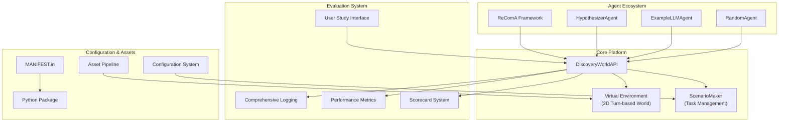
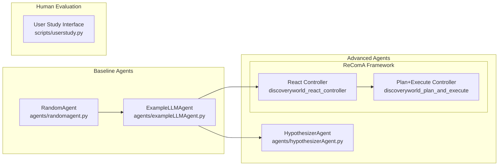
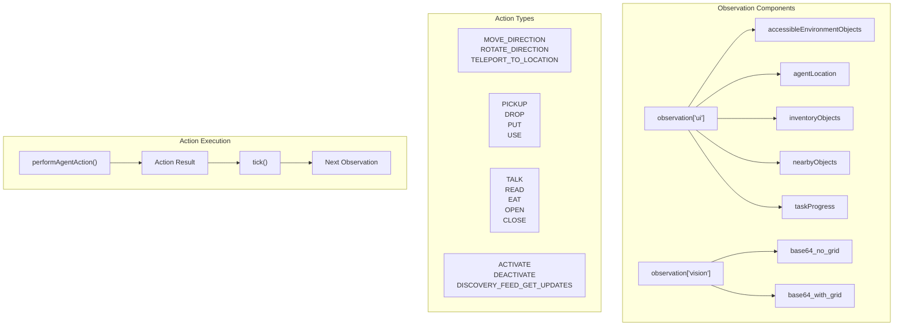
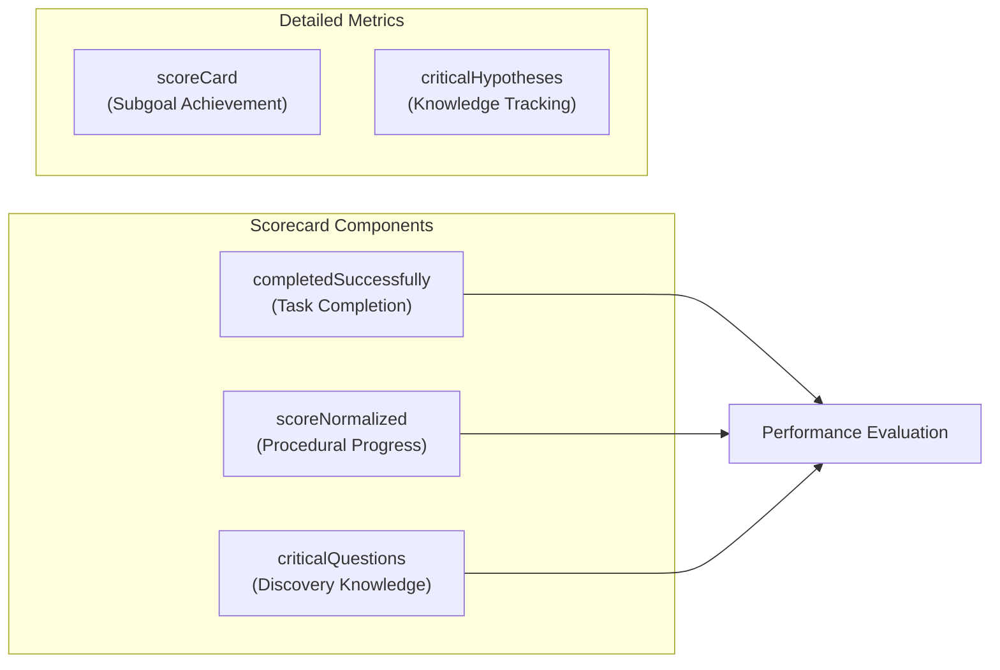
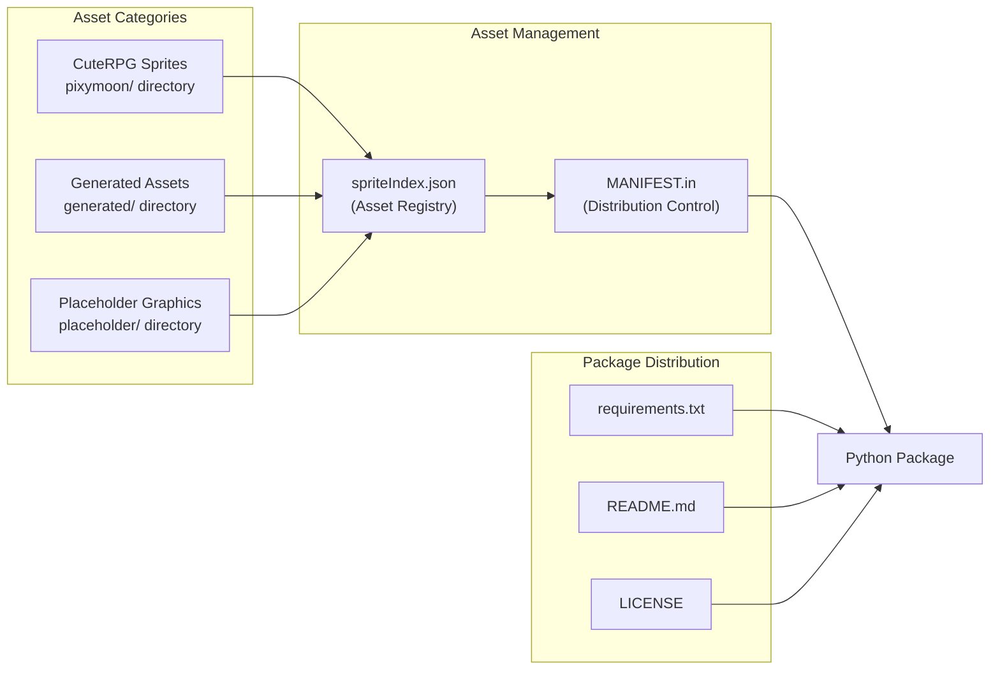

<!-- source: DeepWiki mcp.deepwiki.com · repo allenai/discoveryworld · page 1 Overview · fetched 2026-10-26 -->

# Overview

<details>
<summary>Relevant source files</summary>

The following files were used as context for generating this wiki page:

- [MANIFEST.in](MANIFEST.in)
- [README.md](README.md)

</details>


## Purpose and Scope

This document provides a comprehensive overview of DiscoveryWorld, a virtual environment platform designed for developing and evaluating automated scientific discovery agents. DiscoveryWorld presents agents with complex scientific tasks across multiple domains including proteomics, chemistry, archaeology, and plant biology, requiring them to conduct experiments, form hypotheses, and make discoveries in a 2D turn-based world.

This overview covers the core architecture, main components, and their interactions. For detailed API documentation, see [API Reference](#2.1). For specific agent development guidance, see [Agent Development](#3). For configuration of the ReComA framework, see [ReComA Framework](#5).

## Core Architecture

DiscoveryWorld operates as a comprehensive evaluation platform with several interconnected systems. The architecture centers around the `DiscoveryWorldAPI` class, which provides the main interface for agent interaction, and supports multiple agent implementations ranging from simple baselines to sophisticated multimodal agents.

### Main System Components



Sources: [README.md:1-503](), [MANIFEST.in:1-54]()

### Agent Implementation Hierarchy

The system provides a clear progression from simple baseline agents to sophisticated multimodal implementations:



Sources: [README.md:118-119](), [README.md:23-25]()

## API and Environment System

### Core API Structure

The `DiscoveryWorldAPI` serves as the central interface following OpenAI Gym-style patterns. Key methods include:

| Method | Purpose | Return Type |
|--------|---------|-------------|
| `loadScenario()` | Initialize specific task scenario | Boolean success |
| `getAgentObservation()` | Retrieve current environment state | Observation dict |
| `performAgentAction()` | Execute agent action | Result dict |
| `tick()` | Update environment state | None |
| `getTaskScorecard()` | Get detailed performance metrics | Scorecard dict |

The API initialization requires unique thread IDs for concurrent execution:

```python
api = DiscoveryWorldAPI(threadID=1)
success = api.loadScenario(scenarioName="Proteomics", difficultyStr="Normal", randomSeed=0, numUserAgents=1)
```

Sources: [README.md:122-131](), [README.md:154-156]()

### Observation and Action Framework



Sources: [README.md:160-182](), [README.md:214-236](), [README.md:262-269]()

## Task and Scenario System

### Scientific Domains and Scenarios

DiscoveryWorld provides 9 distinct scientific scenarios accessible through `SCENARIO_NAMES`:

| Domain | Focus Area | Experimental Tasks |
|--------|------------|-------------------|
| Proteomics | Protein analysis | Mass spectrometry, protein separation |
| Chemistry | Chemical reactions | Synthesis, analysis, reaction discovery |
| Archaeology | Artifact analysis | Dating, material composition |
| Plant Nutrients | Botanical research | Growth conditions, nutrient effects |
| Reactor Lab | Nuclear science | Radiation measurement, safety protocols |

Each scenario supports three difficulty levels (`Easy`, `Normal`, `Challenge`) with parametric variations controlled by random seeds (0-4 for official benchmark, 5+ for extended variations).

Sources: [README.md:134-150]()

### Scoring and Evaluation

The evaluation system provides three key metrics through the `getTaskScorecard()` method:



Sources: [README.md:242-259]()

## Asset Management and Distribution

### Asset Pipeline Organization

The distribution system uses `MANIFEST.in` to selectively include assets while optimizing package size:



The system prunes most assets (`prune discoveryworld/assets/`) but selectively includes essential graphics and the sprite index for runtime asset resolution.

Sources: [MANIFEST.in:1-54]()

## Logging and Data Capture

DiscoveryWorld provides comprehensive logging capabilities through `api.world.exportWorldHistoryJSON()`, capturing:

- Complete world state at each timestep
- Agent actions and environmental responses  
- Frame-by-frame visual capture for video generation
- Detailed object properties and interactions

The logging system splits large histories into 100-step segments with `partXofY` suffixes to manage file sizes effectively.

Sources: [README.md:99-101](), [README.md:272-326]()

## Development and Extension Points

The platform supports multiple development approaches:

1. **Simple Agent Development**: Using `ExampleLLMAgent` as a template for basic LLM integration
2. **Advanced Agent Frameworks**: ReComA system with React and Plan+Execute patterns
3. **Custom Scenario Creation**: Through the `ScenarioMaker` system
4. **Evaluation Studies**: Human baseline collection via `scripts/userstudy.py`

For agent development guidance, see [Getting Started with Agents](#3.1). For ReComA framework configuration, see [ReComA Setup & Configuration](#5.1).

Sources: [README.md:23-25](), [README.md:329-464]()

---

