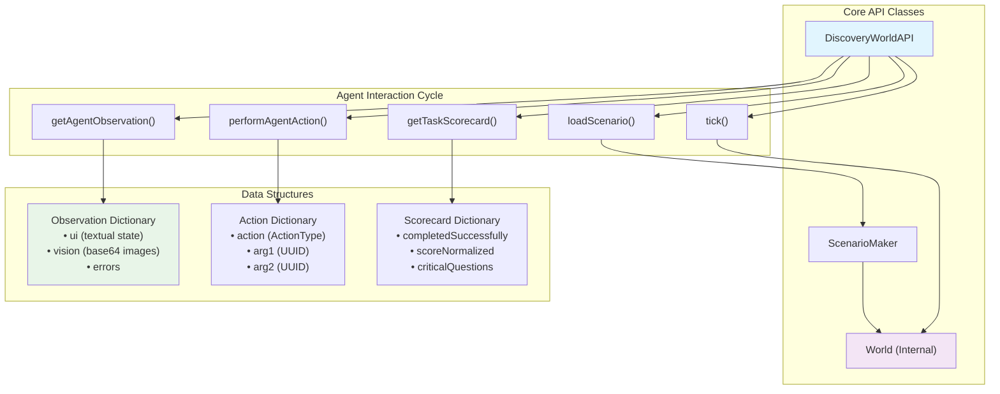
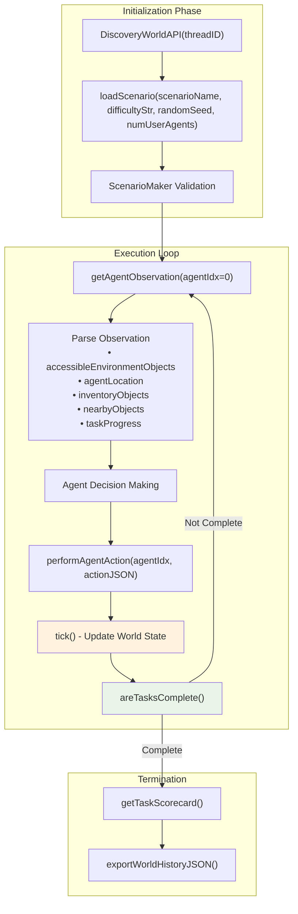

<!-- source: DeepWiki mcp.deepwiki.com · repo allenai/discoveryworld · page 2 Core API & Environment · fetched 2026-10-26 -->

# Core API & Environment

<details>
<summary>Relevant source files</summary>

The following files were used as context for generating this wiki page:

- [README.md](README.md)

</details>


This document provides comprehensive documentation of the DiscoveryWorldAPI, environment mechanics, observation/action systems, and scenario management. It covers the core interfaces that agents use to interact with the DiscoveryWorld virtual environment.

For agent development patterns and examples, see [Agent Development](#3). For configuration of specific agent implementations, see [Built-in Agents](#4) and [ReComA Framework](#5). For evaluation and metrics, see [User Studies & Human Evaluation](#6).

## API Architecture Overview

The DiscoveryWorld environment follows an OpenAI Gym-style API pattern with manual environment updates. The core workflow involves initialization, observation-action loops, and explicit world state progression.



Sources: [README.md:105-270]()

## Environment Lifecycle and State Management

The environment operates as a discrete, turn-based simulation where agent actions are queued and processed during explicit world updates.



Sources: [README.md:122-130](), [README.md:262-269](), [README.md:410-451]()

## DiscoveryWorldAPI Class

The `DiscoveryWorldAPI` serves as the primary interface for all agent-environment interactions. It encapsulates world state, scenario loading, and action processing.

### Initialization and Thread Management

```python
api = DiscoveryWorldAPI(threadID=1)
```

The `threadID` parameter ensures unique output directories for concurrent runs and prevents log file overwrites. Each concurrent DiscoveryWorld instance requires a unique thread identifier.

Sources: [README.md:125](), [README.md:152-156]()

### Core Methods

| Method | Purpose | Returns |
|--------|---------|---------|
| `loadScenario()` | Initialize specific task scenario | Boolean success status |
| `getAgentObservation()` | Retrieve current environment state | Observation dictionary |
| `performAgentAction()` | Submit agent action for processing | Action result dictionary |
| `tick()` | Update world state and process actions | None |
| `getTaskScorecard()` | Retrieve performance metrics | Scorecard dictionary |
| `listKnownActions()` | Get available action descriptions | Action reference dictionary |
| `areTasksComplete()` | Check task completion status | Boolean |

Sources: [README.md:122-269]()

## Scenario Loading and Configuration

Scenarios define the task themes, difficulty levels, and parametric variations that create the specific challenges agents encounter.

### Scenario Parameters

```python
success = api.loadScenario(
    scenarioName="Proteomics", 
    difficultyStr="Normal", 
    randomSeed=0, 
    numUserAgents=1
)
```

#### Available Configurations

| Parameter | Source | Valid Values |
|-----------|--------|--------------|
| `scenarioName` | `SCENARIO_NAMES` | 9 scientific task themes |
| `difficultyStr` | `SCENARIO_DIFFICULTY_OPTIONS` | "Easy", "Normal", "Challenge" |
| `randomSeed` | Integer | 0-4 (official), 5+ (extended) |
| `numUserAgents` | Integer | 1 (multi-agent untested) |

Sources: [README.md:134-150]()

### Scenario Access

```python
from discoveryworld.ScenarioMaker import SCENARIO_NAMES
from discoveryworld.ScenarioMaker import SCENARIO_DIFFICULTY_OPTIONS
```

The scenario system supports parametric variation through seed values, where seeds 0-4 represent the official benchmark variations, and higher values generate additional unsupported variations.

Sources: [README.md:136-150]()

## Observation System

Observations provide comprehensive environment state information through structured dictionaries containing textual descriptions and visual data.

### Observation Structure

The observation dictionary contains three primary sections:

#### UI Section (`observation["ui"]`)

| Key | Description | Usage |
|-----|-------------|-------|
| `accessibleEnvironmentObjects` | Objects within interaction range | Direct action targeting |
| `agentLocation` | Current position, facing direction, movement options | Navigation planning |
| `inventoryObjects` | Items carried by agent | Inventory management |
| `nearbyObjects` | Objects within 3 tiles, organized by direction | Spatial awareness |
| `taskProgress` | Current task description and completion status | Goal tracking |
| `lastActionMessage` | Plain text result of previous action | Action feedback |
| `dialog_box` | Dialog state information | Conversation handling |
| `discoveryFeed` | Recent social media posts | Information gathering |
| `world_steps` | Environment step counter | Progress tracking |

#### Vision Section (`observation["vision"]`)

| Key | Description | Format |
|-----|-------------|--------|
| `base64_no_grid` | 16x24 tile environment view | Base64 encoded image |
| `base64_with_grid` | Environment view with grid overlay | Base64 encoded image |

#### Errors Section (`observation["errors"]`)

Contains error information when problems occur during observation generation.

Sources: [README.md:159-185]()

### Observation Example

Complete observation examples are available for reference, demonstrating the full structure and data types returned by the system.

Sources: [README.md:184-185]()

## Action System

Actions are submitted as JSON dictionaries containing action types and object references. All object targeting uses UUID-based identification for precise interaction.

### Action Structure

```python
actionCommand = {
    "action": "USE",
    "arg1": object1_uuid,
    "arg2": object2_uuid
}
result = api.performAgentAction(agentIdx=0, actionJSON=actionCommand)
```

### Available Actions

The action system supports comprehensive environment interaction through standardized action types:

| Action Type | Arguments | Description |
|-------------|-----------|-------------|
| `PICKUP` | arg1 | Pick up specified object |
| `DROP` | arg1 | Drop specified object |
| `PUT` | arg1, arg2 | Place object1 in/on object2 or give to agent2 |
| `OPEN/CLOSE` | arg1 | Open or close specified object |
| `ACTIVATE/DEACTIVATE` | arg1 | Activate or deactivate specified object |
| `USE` | arg1, arg2 | Use object1 on object2 |
| `TALK` | arg1 | Initiate conversation with agent |
| `EAT` | arg1 | Consume specified object |
| `READ` | arg1 | Read text from specified object |

#### Movement Actions

| Action Type | Arguments | Description |
|-------------|-----------|-------------|
| `MOVE_DIRECTION` | arg1 | Move in specified direction (north/east/south/west) |
| `ROTATE_DIRECTION` | arg1 | Rotate to face specified direction |
| `TELEPORT_TO_LOCATION` | arg1 | Teleport to named location |
| `TELEPORT_TO_OBJECT` | arg1 | Teleport beside specified object UUID |

#### Discovery Feed Actions

| Action Type | Arguments | Description |
|-------------|-----------|-------------|
| `DISCOVERY_FEED_GET_UPDATES` | None | Read latest discovery feed posts |
| `DISCOVERY_FEED_GET_POST_BY_ID` | arg1 | Read specific post by ID |

Sources: [README.md:212-237]()

### Action Result Processing

Each action returns a result dictionary containing success status, descriptive messages, and any relevant state changes. This feedback enables agents to understand action outcomes and plan subsequent behavior.

Sources: [README.md:189-210]()

## Environment Updates and World Tick

Unlike standard OpenAI Gym environments, DiscoveryWorld requires explicit world state updates through the `tick()` function. This design separates action submission from world progression, enabling precise control over simulation timing.

### Tick Mechanics

```python
# Submit agent action
result = api.performAgentAction(agentIdx=0, actionJSON=actionCommand)

# Process world update
api.tick()

# Get updated observation
observation = api.getAgentObservation(agentIdx=0)
```

The `tick()` function processes all pending actions, updates object states, advances NPC behaviors, and progresses environmental systems. This explicit update model ensures deterministic simulation behavior and enables sophisticated multi-agent coordination scenarios.

Sources: [README.md:262-269]()

## Scoring and Evaluation

The scoring system provides comprehensive performance evaluation through detailed scorecards that track task completion, procedural progress, and knowledge acquisition.

### Scorecard Structure

```python
scorecard = api.getTaskScorecard()
```

| Key | Purpose | Evaluation Usage |
|-----|---------|------------------|
| `completedSuccessfully` | Binary task completion | Task completion scoring |
| `scoreNormalized` | Normalized progress (0-1) | Procedural progress scoring |
| `criticalQuestions` | Binary knowledge questions | Discovery knowledge scoring |
| `scoreCard` | Detailed subgoal tracking | Progress analysis |
| `taskName` | Internal task identifier | Result organization |
| `taskDescription` | Human-readable task description | Context understanding |

### Evaluation Dimensions

The scoring system supports three primary evaluation dimensions aligned with scientific discovery assessment:

1. **Task Completion**: Binary success/failure for overall task achievement
2. **Procedural Progress**: Normalized scoring of incremental progress toward completion
3. **Discovery Knowledge**: Assessment of scientific knowledge acquisition through critical questions

Sources: [README.md:240-259]()

### Logging and Analysis

The environment provides comprehensive logging capabilities for detailed behavioral analysis:

```python
api.world.exportWorldHistoryJSON(logInfo, filename, None, None, None)
```

Log files contain complete world state history, object properties, and action sequences across all timesteps. Large files are automatically split into 100-step segments with indexed filenames for manageable processing.

Sources: [README.md:271-326]()

---

