<!-- source: DeepWiki mcp.deepwiki.com · repo allenai/discoveryworld · page 2.1 API Reference · fetched 2026-10-26 -->

# API Reference

<details>
<summary>Relevant source files</summary>

The following files were used as context for generating this wiki page:

- [README.md](README.md)
- [agents/ExampleLLMAgentPseudocode.py](agents/ExampleLLMAgentPseudocode.py)

</details>


This document provides a complete reference for the `DiscoveryWorldAPI` class and its methods, which serve as the primary interface for agents interacting with the DiscoveryWorld virtual environment. This covers initialization, observation retrieval, action execution, scoring, and data export functionality.

For information about developing custom agents using this API, see [Getting Started with Agents](#3.1). For details about specific scenarios and tasks available through the API, see [Scenarios & Tasks](#2.3). For advanced agent frameworks that build on this API, see [ReComA Framework](#5).

## Core API Architecture

The following diagram shows the primary components of the `DiscoveryWorldAPI` and how they interact:

```mermaid
graph TB
    subgraph "DiscoveryWorldAPI Core"
        API["DiscoveryWorldAPI"]
        WORLD["world"]
        SCENARIO["ScenarioMaker"]
    end
    
    subgraph "Initialization Methods"
        LOAD["loadScenario()"]
        THREAD["threadID"]
        AGENTS["numUserAgents"]
    end
    
    subgraph "Observation Methods"
        GET_OBS["getAgentObservation()"]
        UI_DATA["ui: dict"]
        VISION_DATA["vision: dict"]
        ERRORS["errors: dict"]
    end
    
    subgraph "Action Methods"
        PERFORM["performAgentAction()"]
        LIST_ACTIONS["listKnownActions()"]
        TELEPORT_LOCS["listTeleportLocationsDict()"]
        DIALOG_CHECK["isAgentInDialog()"]
    end
    
    subgraph "Scoring Methods"
        SCORECARD["getTaskScorecard()"]
        TASK_COMPLETE["areTasksComplete()"]
    end
    
    subgraph "Environment Control"
        TICK["tick()"]
        EXPORT["world.exportWorldHistoryJSON()"]
    end
    
    API --> LOAD
    API --> GET_OBS
    API --> PERFORM
    API --> SCORECARD
    API --> TICK
    
    LOAD --> SCENARIO
    GET_OBS --> UI_DATA
    GET_OBS --> VISION_DATA
    PERFORM --> LIST_ACTIONS
    PERFORM --> TELEPORT_LOCS
    
    style API fill:#e1f5fe
    style GET_OBS fill:#f3e5f5
    style PERFORM fill:#fff3e0
```



Sources: [README.md:104-465](), [agents/ExampleLLMAgentPseudocode.py:1-129]()

## API Initialization

The `DiscoveryWorldAPI` must be initialized with a unique thread ID and then loaded with a specific scenario configuration.

### Constructor

| Parameter | Type | Description |
|-----------|------|-------------|
| `threadID` | int | Unique identifier for concurrent instances |

### loadScenario Method

| Parameter | Type | Description |
|-----------|------|-------------|
| `scenarioName` | str | Task theme from `SCENARIO_NAMES` |
| `difficultyStr` | str | Difficulty level from `SCENARIO_DIFFICULTY_OPTIONS` |
| `randomSeed` | int | Parametric variation seed (0-4 official) |
| `numUserAgents` | int | Number of user agents (currently set to 1) |

**Returns:** `bool` - Success status of scenario loading

```python
api = DiscoveryWorldAPI(threadID=1)
success = api.loadScenario(
    scenarioName="Proteomics", 
    difficultyStr="Normal", 
    randomSeed=0, 
    numUserAgents=1
)
```

Sources: [README.md:122-132](), [agents/ExampleLLMAgentPseudocode.py:82-87]()

## Observation System

The observation system provides comprehensive information about the agent's current state and environment through the `getAgentObservation()` method.

### Observation Data Structure

```mermaid
graph TB
    subgraph "getAgentObservation() Return"
        OBS_ROOT["observation: dict"]
    end
    
    subgraph "UI Dictionary Keys"
        ACCESS_OBJS["accessibleEnvironmentObjects"]
        AGENT_LOC["agentLocation"]
        DIALOG["dialog_box"]
        DISCOVERY["discoveryFeed"]
        EXTENDED["extended_action_message"]
        INVENTORY["inventoryObjects"]
        LAST_ACTION["lastActionMessage"]
        NEARBY_AGENTS["nearbyAgents"]
        NEARBY_OBJS["nearbyObjects"]
        TASK_PROG["taskProgress"]
        WORLD_STEPS["world_steps"]
    end
    
    subgraph "Vision Dictionary Keys"
        IMG_NO_GRID["base64_no_grid"]
        IMG_WITH_GRID["base64_with_grid"]
    end
    
    subgraph "Error Handling"
        ERRORS_KEY["errors"]
    end
    
    OBS_ROOT --> ACCESS_OBJS
    OBS_ROOT --> AGENT_LOC
    OBS_ROOT --> DIALOG
    OBS_ROOT --> DISCOVERY
    OBS_ROOT --> EXTENDED
    OBS_ROOT --> INVENTORY
    OBS_ROOT --> LAST_ACTION
    OBS_ROOT --> NEARBY_AGENTS
    OBS_ROOT --> NEARBY_OBJS
    OBS_ROOT --> TASK_PROG
    OBS_ROOT --> WORLD_STEPS
    
    OBS_ROOT --> IMG_NO_GRID
    OBS_ROOT --> IMG_WITH_GRID
    OBS_ROOT --> ERRORS_KEY
    
    style OBS_ROOT fill:#e1f5fe
    style ACCESS_OBJS fill:#f3e5f5
    style IMG_NO_GRID fill:#fff3e0
```



### Key Observation Components

| Component | Description |
|-----------|-------------|
| `accessibleEnvironmentObjects` | Objects within interaction range with UUIDs and descriptions |
| `agentLocation` | Current position, facing direction, and movement constraints |
| `inventoryObjects` | Items currently held by the agent |
| `nearbyObjects` | Objects within 3 tiles, organized by direction |
| `taskProgress` | Current task description and completion status |
| `lastActionMessage` | Plain text result of the previous action |

Sources: [README.md:159-186](), [agents/ExampleLLMAgentPseudocode.py:95-96]()

## Action System

Actions are executed through the `performAgentAction()` method using JSON-formatted action commands.

### Action Structure

| Field | Type | Description |
|-------|------|-------------|
| `action` | str | Action type from `ActionType` enum |
| `arg1` | str/None | First argument (usually object UUID) |
| `arg2` | str/None | Second argument (usually object UUID) |

### Available Actions

The `listKnownActions()` method returns all available actions with their argument requirements:

| Action | Arguments | Description |
|--------|-----------|-------------|
| `PICKUP` | `["arg1"]` | Pick up an object |
| `DROP` | `["arg1"]` | Drop an object |
| `PUT` | `["arg1", "arg2"]` | Put object in/on another or give to agent |
| `USE` | `["arg1", "arg2"]` | Use one object on another |
| `MOVE_DIRECTION` | `["arg1"]` | Move in specified direction |
| `TALK` | `["arg1"]` | Talk to another agent |
| `DISCOVERY_FEED_GET_UPDATES` | `[]` | Read latest discovery feed posts |

### Teleportation Support

The `listTeleportLocationsDict()` method provides valid teleport destinations for easier navigation.

Sources: [README.md:188-238](), [agents/ExampleLLMAgentPseudocode.py:24-31]()

## Scoring System

The scoring system provides detailed performance metrics through the `getTaskScorecard()` method.

### Scorecard Structure

| Field | Type | Description |
|-------|------|-------------|
| `taskName` | str | Internal unique task identifier |
| `taskDescription` | str | Plain text task description |
| `completed` | bool | Task completion status |
| `completedSuccessfully` | bool | Task success status (used for task completion scoring) |
| `scoreNormalized` | float | Normalized (0-1) partial progress score (used for procedural progress) |
| `scoreCard` | list | Detailed subgoal completion status |
| `criticalQuestions` | dict | Binary questions for discovery knowledge scoring |

### Task Completion Check

The `areTasksComplete()` method provides a simple boolean check for task completion status.

Sources: [README.md:240-260](), [agents/ExampleLLMAgentPseudocode.py:108-116]()

## Environment Management

### World State Updates

Unlike standard gym environments, DiscoveryWorld requires manual environment updates through the `tick()` method after each action.

```python
# Perform action
result = api.performAgentAction(agentIdx=0, actionJSON=actionCommand)

# Update environment state
api.tick()
```

### Dialog State Management

The `isAgentInDialog()` method checks if the agent is currently engaged in a dialog interaction, which requires special handling.

Sources: [README.md:262-269](), [agents/ExampleLLMAgentPseudocode.py:46]()

## Logging and Data Export

### World History Export

The `world.exportWorldHistoryJSON()` method provides comprehensive logging of all world states and agent actions.

#### Export Configuration

| Parameter | Description |
|-----------|-------------|
| `logInfo` | Dictionary containing run metadata |
| `verboseLogFilename` | Output file path |
| Additional parameters | Currently set to `None` |

#### Log File Characteristics

- Contains serialized world state for all timesteps
- Includes all object properties for entire world grid
- Split into multiple files (100 steps each) for large runs
- Files named with `partXofY` suffix for sequential assembly

### Video Generation

Frame capture functionality is built into the API for generating gameplay videos, controlled through the `includeImages` and `exportVideo` parameters in the log configuration.

Sources: [README.md:271-327]()

---

