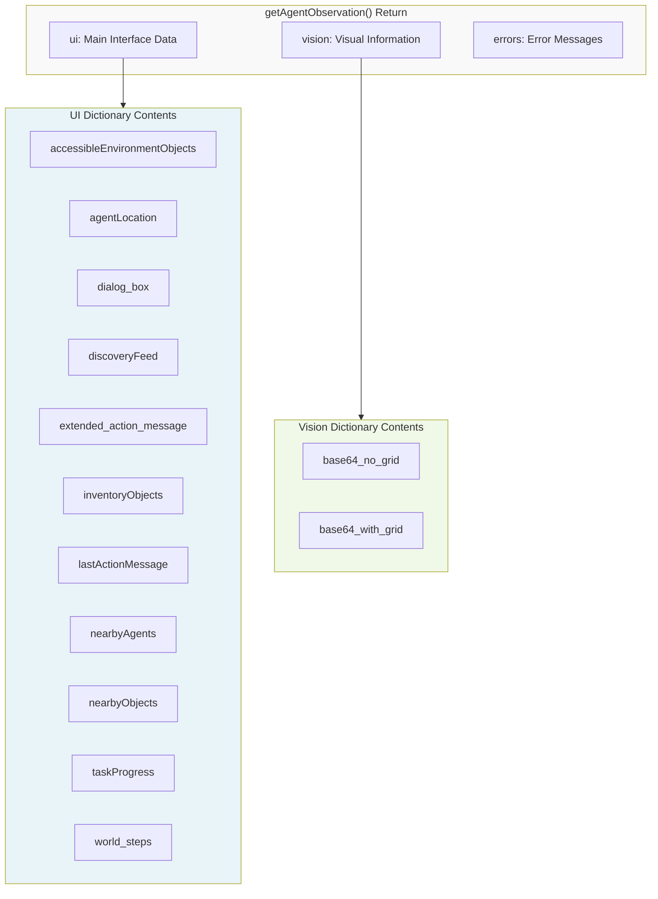
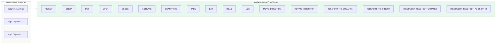
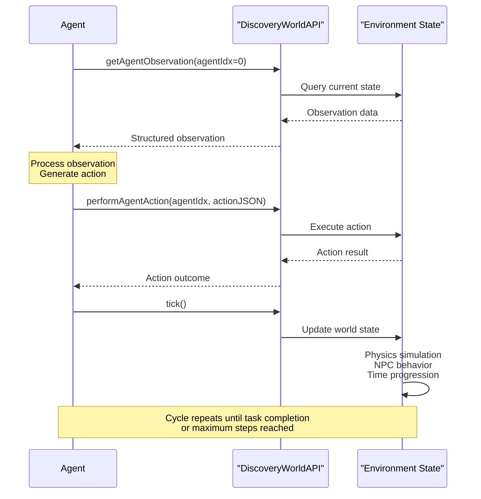

<!-- source: DeepWiki mcp.deepwiki.com · repo allenai/discoveryworld · page 2.2 Observation & Action Systems · fetched 2026-10-26 -->

# Observation & Action Systems

<details>
<summary>Relevant source files</summary>

The following files were used as context for generating this wiki page:

- [README.md](README.md)
- [agents/ExampleLLMAgentPseudocode.py](agents/ExampleLLMAgentPseudocode.py)

</details>


This document explains the observation and action systems that form the core agent-environment interface in DiscoveryWorld. It covers the structure of observations returned by the environment, the types of actions agents can perform, and the interaction cycle that governs agent behavior.

For information about the broader API methods and initialization, see [API Reference](#2.1). For details about specific scenarios and tasks, see [Scenarios & Tasks](#2.3).

## Overview

The observation and action systems implement a turn-based interaction model where agents receive structured observations from the environment and respond with actions. This follows the OpenAI Gym paradigm but with DiscoveryWorld-specific extensions for multi-modal observations and scientific discovery tasks.

## Observation Structure

Observations are retrieved using the `getAgentObservation()` method and contain comprehensive information about the agent's current state and surroundings.

### Core Observation Components



**Observation Data Structure**

| Component | Type | Description |
|-----------|------|-------------|
| `accessibleEnvironmentObjects` | List | Objects within interaction range, including UUIDs and descriptions |
| `agentLocation` | Dict | Current position, facing direction, and movement constraints |
| `dialog_box` | Dict | Dialog state and available conversation options |
| `discoveryFeed` | Dict | Recent posts from the internal social media system |
| `inventoryObjects` | List | Items currently carried by the agent |
| `lastActionMessage` | String | Plain text result of the previous action |
| `nearbyAgents` | Dict | Recent actions of other agents within proximity |
| `nearbyObjects` | Dict | All objects within 3 tiles, organized by direction |
| `taskProgress` | List | Current task description and completion status |
| `world_steps` | Integer | Current environment step counter |

Sources: [README.md:159-182]()

### Visual Observations

For agents that process visual information, two base64-encoded images are provided:

- `base64_no_grid`: Clean 16x24 tile view matching the user interface
- `base64_with_grid`: Same view with grid overlay for spatial reference

Sources: [README.md:178-181]()

## Action System

Actions are executed using the `performAgentAction()` method with structured JSON commands containing action types and object references.

### Action Structure



**Action Categories**

| Category | Actions | Arguments |
|----------|---------|-----------|
| Object Manipulation | `PICKUP`, `DROP`, `PUT` | Object UUIDs |
| Container Operations | `OPEN`, `CLOSE` | Container UUID |
| Device Control | `ACTIVATE`, `DEACTIVATE` | Device UUID |
| Interaction | `TALK`, `EAT`, `READ`, `USE` | Target UUID(s) |
| Movement | `MOVE_DIRECTION`, `ROTATE_DIRECTION` | Direction string |
| Teleportation | `TELEPORT_TO_LOCATION`, `TELEPORT_TO_OBJECT` | Location name or object UUID |
| Information | `DISCOVERY_FEED_GET_UPDATES`, `DISCOVERY_FEED_GET_POST_BY_ID` | None or post ID |

Sources: [README.md:216-237]()

### Action Arguments

Arguments (`arg1`, `arg2`) typically contain UUIDs of objects found in the observation's `accessibleEnvironmentObjects` or `nearbyObjects` sections. For movement actions, arguments contain direction strings (`"north"`, `"east"`, `"south"`, `"west"`).

Sources: [README.md:200-210]()

## Agent-Environment Interaction Cycle

The interaction follows a specific sequence that must be maintained for proper environment operation.



**Critical Sequence Requirements**

1. **Observation First**: Always call `getAgentObservation()` before deciding on an action
2. **Action Execution**: Submit actions via `performAgentAction()` with proper JSON structure
3. **Environment Update**: Call `tick()` after actions to advance the simulation
4. **Error Handling**: Check the `errors` field in observations for execution problems

Sources: [README.md:108-113](), [README.md:263-269]()

### Example Interaction Flow

```mermaid
graph TD
    start["Start Turn"] --> getObs["observation = api.getAgentObservation(agentIdx=0)"]
    getObs --> parseObs["Parse observation['ui'] for environment state"]
    parseObs --> genAction["Generate actionJSON based on observation"]
    genAction --> execAction["result = api.performAgentAction(agentIdx=0, actionJSON)"]
    execAction --> tick["api.tick()"]
    tick --> checkComplete["Check api.areTasksComplete()"]
    checkComplete -->|No| getObs
    checkComplete -->|Yes| end["Task Complete"]
    
    style start fill:#e8f4f8
    style end fill:#f0f8e8
    style getObs fill:#fff3e0
    style execAction fill:#fff3e0
    style tick fill:#f3e5f5
```

Sources: [agents/ExampleLLMAgentPseudocode.py:89-116]()

## Dialog System Integration

When agents enter dialog with NPCs, the observation and action flow changes to handle conversation states.

### Dialog State Detection

Agents can check if they're in dialog using `api.isAgentInDialog(agentIdx=0)`. During dialog:

- The `dialog_box` field contains conversation context and available responses
- Actions should be dialog selections rather than standard environment actions
- Response format uses `chosen_dialog_option_int` instead of standard action structure

Sources: [agents/ExampleLLMAgentPseudocode.py:46-54]()

## Teleportation System

DiscoveryWorld provides teleportation actions to facilitate navigation in large environments.

### Teleport Locations

Available teleport destinations are retrieved via `api.listTeleportLocationsDict()` and used with:

```json
{
  "action": "TELEPORT_TO_LOCATION",
  "arg1": "school"
}
```

This system allows agents to quickly navigate between major areas without tedious pathfinding.

Sources: [agents/ExampleLLMAgentPseudocode.py:27-31]()

## Error Handling

The observation structure includes an `errors` field that provides diagnostic information when actions fail or unexpected conditions occur. Agents should check this field to understand why actions may not have succeeded.

Sources: [README.md:182]()

---

