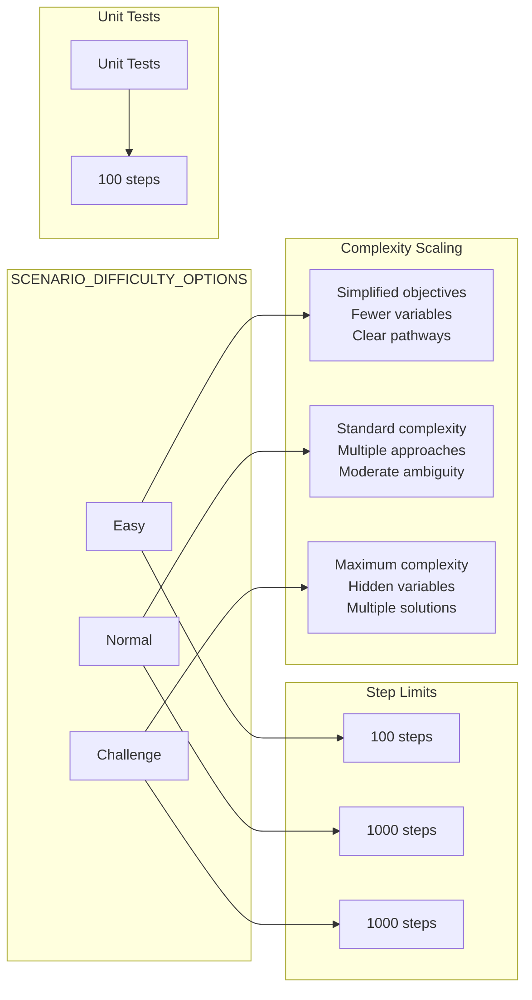
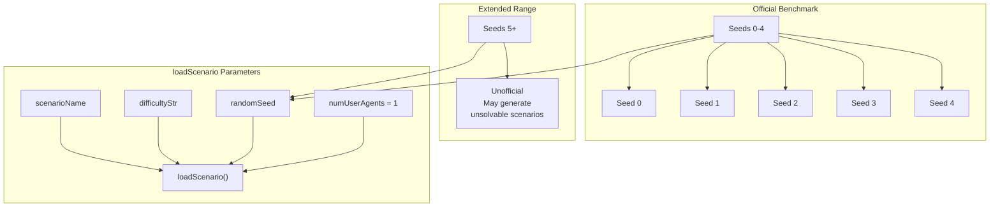
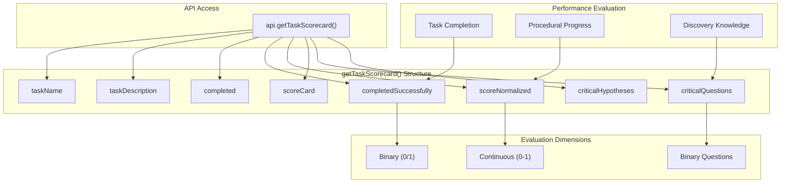
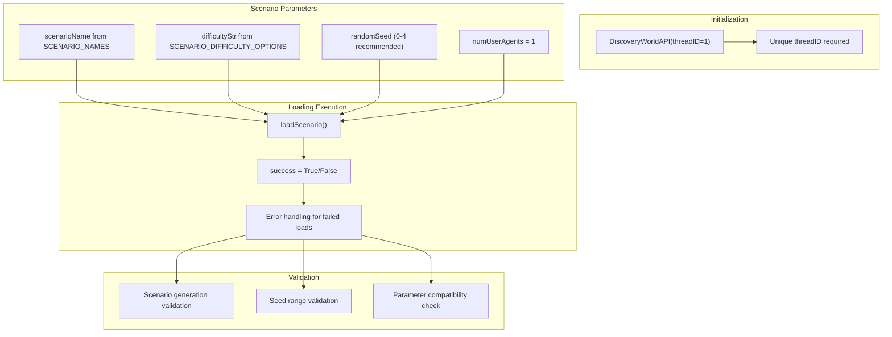

<!-- source: DeepWiki mcp.deepwiki.com · repo allenai/discoveryworld · page 2.3 Scenarios & Tasks · fetched 2026-10-26 -->

# Scenarios & Tasks

<details>
<summary>Relevant source files</summary>

The following files were used as context for generating this wiki page:

- [README.md](README.md)
- [agents/README.md](agents/README.md)

</details>


This page provides a comprehensive overview of DiscoveryWorld's scenario system, including available task themes, difficulty levels, parametric variations, and evaluation metrics. It covers how scenarios are organized, configured, and scored within the environment.

For information about the core API methods for loading scenarios, see [API Reference](#2.1). For details about agent development patterns, see [Agent Development](#3).

## Scenario Organization

DiscoveryWorld organizes tasks into three main categories: Discovery Tasks, Unit Tests, and Tutorial scenarios. Each scenario represents a complete scientific discovery challenge with specific learning objectives and evaluation criteria.

### Scenario Taxonomy

```mermaid
graph TB
    subgraph "ScenarioMaker Module"
        SCENARIO_NAMES["SCENARIO_NAMES"]
        SCENARIO_DIFFICULTY_OPTIONS["SCENARIO_DIFFICULTY_OPTIONS"]
        loadScenario["loadScenario()"]
    end
    
    subgraph "Discovery Tasks"
        Proteomics["Proteomics"]
        Chemistry["Combinatorial Chemistry"]
        Archaeology["Archaeology Dating"]
        PlantNutrients["Plant Nutrients"]
        ReactorLab["Reactor Lab"]
        Translation["Lost in Translation"]
        SpaceSick["Space Sick"]
        RocketScience["It's (not) Rocket Science!"]
    end
    
    subgraph "Unit Tests"
        DialogTest["Small Skills: Dialog Test"]
        PickPlaceTest["Small Skills: Pick and Place Test"]
        PickGiveTest["Small Skills: Pick and Give Test"]
        InstrumentTest["Small Skills: Instrument Measurement Test"]
        DoorsTest["Small Skills: Doors Test"]
        DoorsKeysTest["Small Skills: Doors with Keys Test"]
        NavigationTest["Small Skills: Navigation in a House Test"]
        SearchTest["Small Skills: Search Test"]
        FeedTest["Small Skills: Discovery Feed Test"]
        MovingTest["Small Skills: Moving Agents Test"]
    end
    
    subgraph "Tutorial"
        TutorialScenario["Tutorial"]
    end
    
    SCENARIO_NAMES --> Proteomics
    SCENARIO_NAMES --> Chemistry
    SCENARIO_NAMES --> Archaeology
    SCENARIO_NAMES --> PlantNutrients
    SCENARIO_NAMES --> ReactorLab
    SCENARIO_NAMES --> Translation
    SCENARIO_NAMES --> SpaceSick
    SCENARIO_NAMES --> RocketScience
    SCENARIO_NAMES --> DialogTest
    SCENARIO_NAMES --> PickPlaceTest
    SCENARIO_NAMES --> PickGiveTest
    SCENARIO_NAMES --> InstrumentTest
    SCENARIO_NAMES --> DoorsTest
    SCENARIO_NAMES --> DoorsKeysTest
    SCENARIO_NAMES --> NavigationTest
    SCENARIO_NAMES --> SearchTest
    SCENARIO_NAMES --> FeedTest
    SCENARIO_NAMES --> MovingTest
    SCENARIO_NAMES --> TutorialScenario
    
    loadScenario --> SCENARIO_NAMES
    loadScenario --> SCENARIO_DIFFICULTY_OPTIONS
```



Sources: [README.md:134-150](), [agents/README.md:17-50]()

### Discovery Tasks

Discovery Tasks represent complex scientific challenges that require multi-step reasoning, hypothesis formation, and experimental validation. These scenarios form the core evaluation benchmark.

| Task Theme | Focus Area | Typical Complexity |
|------------|------------|-------------------|
| Proteomics | Protein structure analysis | High |
| Combinatorial Chemistry | Chemical reaction discovery | High |
| Archaeology Dating | Historical artifact analysis | Medium |
| Plant Nutrients | Agricultural science | Medium |
| Reactor Lab | Nuclear physics simulation | High |
| Lost in Translation | Linguistic decoding | Medium |
| Space Sick | Medical diagnosis in space | Medium |
| It's (not) Rocket Science! | Aerospace engineering | High |

Sources: [agents/README.md:20-30]()

### Unit Tests

Unit Tests validate specific agent capabilities in isolation, serving as diagnostic tools and development checkpoints.

| Unit Test | Skill Validated | Purpose |
|-----------|----------------|---------|
| Dialog Test | Conversation handling | NPC interaction capability |
| Pick and Place Test | Object manipulation | Basic motor skills |
| Pick and Give Test | Social interaction | Agent-to-agent transfers |
| Instrument Measurement Test | Tool usage | Scientific instrument operation |
| Doors Test | Environment navigation | Obstacle handling |
| Doors with Keys Test | Complex navigation | Multi-step access control |
| Navigation in a House Test | Spatial reasoning | Large-scale movement |
| Search Test | Information retrieval | Systematic exploration |
| Discovery Feed Test | Communication systems | Social media interaction |
| Moving Agents Test | Dynamic environments | Multi-agent coordination |

Sources: [agents/README.md:32-44]()

## Difficulty Levels

DiscoveryWorld provides three difficulty levels that scale both task complexity and available time steps.

### Difficulty Configuration



Sources: [README.md:142-146](), [agents/README.md:5-6](), [agents/README.md:52-53]()

| Difficulty | Max Steps | Target Audience | Characteristics |
|------------|-----------|----------------|-----------------|
| Easy | 100 | Development/Testing | Simplified objectives, clear success paths |
| Normal | 1000 | Baseline Evaluation | Standard complexity, multiple solution approaches |
| Challenge | 1000 | Advanced Evaluation | Maximum complexity, ambiguous success criteria |

Note: Unit Tests always run with a 100-step limit regardless of difficulty setting.

## Parametric Seeds

Scenarios support parametric variation through seeds, enabling multiple instances of each task theme and difficulty combination.

### Seed Configuration



Sources: [README.md:148-150](), [README.md:122-130](), [agents/README.md:55-58]()

The official benchmark uses seeds 0-4, providing 5 parametric variations for each scenario-difficulty combination. This yields 120 total evaluation instances (8 Discovery Tasks × 3 Difficulties × 5 Seeds).

Seeds beyond 4 are supported but may generate unsolvable scenarios due to insufficient validation. When using extended seeds, implement error handling around scenario loading:

```python
# Example from API documentation
success = api.loadScenario(scenarioName=scenarioName, difficultyStr=difficultyStr, 
                          randomSeed=seed, numUserAgents=1)
if not success:
    print(f"Error: Could not load scenario '{scenarioName}' with difficulty '{difficultyStr}'.")
```

Sources: [README.md:122-130]()

## Task Evaluation System

DiscoveryWorld employs a multi-dimensional scoring system that evaluates different aspects of agent performance.

### Scoring Pipeline



Sources: [README.md:240-259](), [agents/README.md:111-114]()

### Scorecard Structure

The `getTaskScorecard()` function returns a comprehensive evaluation object with the following keys:

| Key | Type | Purpose | Usage |
|-----|------|---------|-------|
| `taskName` | String | Internal unique task identifier | Logging and identification |
| `taskDescription` | String | Human-readable task description | Agent context and documentation |
| `completed` | Boolean | Whether task reached terminal state | Process tracking |
| `completedSuccessfully` | Boolean | Whether task was solved correctly | **Primary success metric** |
| `scoreNormalized` | Float (0-1) | Partial progress completion | **Procedural progress metric** |
| `scoreCard` | List | Detailed subgoal completion status | Diagnostic analysis |
| `criticalQuestions` | List | Binary knowledge validation questions | **Discovery knowledge metric** |
| `criticalHypotheses` | List | Descriptive knowledge hypotheses | Extended analysis (not in paper) |

Sources: [README.md:247-256]()

### Evaluation Dimensions

**Task Completion**: Binary success measurement using `completedSuccessfully`. Distinguishes between reaching a terminal state (`completed`) and achieving the correct solution.

**Procedural Progress**: Continuous measurement using `scoreNormalized` (0-1 scale). Tracks incremental progress toward task completion through subgoal achievement.

**Discovery Knowledge**: Binary assessment using `criticalQuestions`. Evaluates whether agents acquire and retain key scientific insights during task execution.

Sources: [README.md:251-254](), [agents/README.md:111-114]()

## Scenario Loading and Configuration

Scenarios are loaded through the `DiscoveryWorldAPI` using the `loadScenario()` method with specific parameters.

### Loading Process



Sources: [README.md:122-132](), [README.md:152-157]()

### Thread Management

Each concurrent DiscoveryWorld instance requires a unique `threadID` to prevent resource conflicts. The threadID is used for:

- Creating unique output directories for frame storage
- Preventing log file overwrites across concurrent runs
- Isolating temporary resources during execution

Example thread management:
```python
# Each concurrent run needs unique threadID
api = DiscoveryWorldAPI(threadID=unique_thread_id)
```

Sources: [README.md:152-157]()

### Error Handling

Scenario loading can fail due to invalid parameters or unsolvable seed configurations. Implement robust error checking:

```python
success = api.loadScenario(scenarioName=scenarioName, difficultyStr=difficultyStr, 
                          randomSeed=seed, numUserAgents=1)
if not success:
    # Handle failed scenario loading
    print(f"Error: Could not load scenario '{scenarioName}' with difficulty '{difficultyStr}'.")
    return None
```

Sources: [README.md:126-130]()

---

