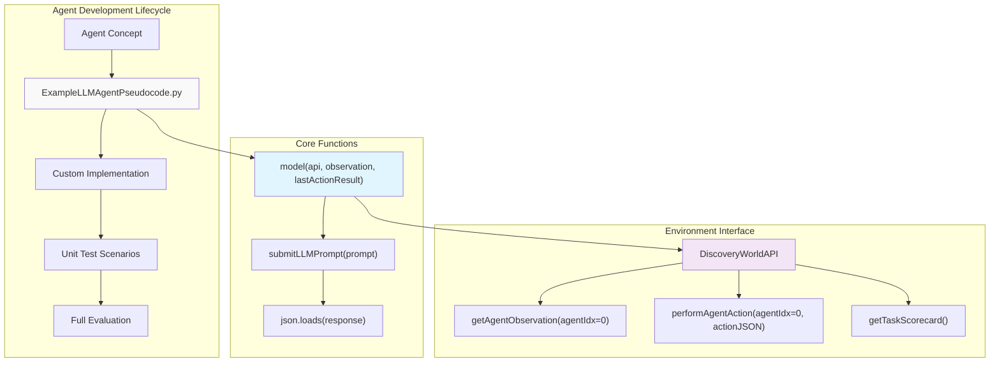
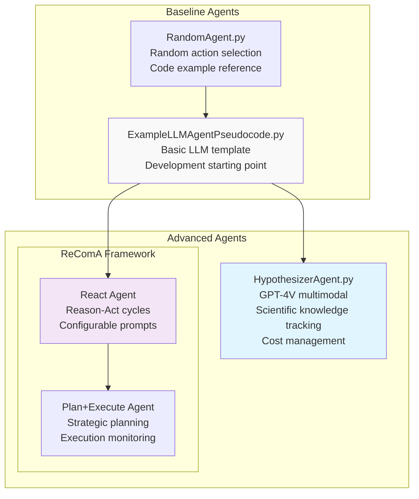

<!-- source: DeepWiki mcp.deepwiki.com · repo allenai/discoveryworld · page 3 Agent Development · fetched 2026-10-26 -->

# Agent Development

<details>
<summary>Relevant source files</summary>

The following files were used as context for generating this wiki page:

- [agents/ExampleLLMAgentPseudocode.py](agents/ExampleLLMAgentPseudocode.py)
- [agents/README.md](agents/README.md)

</details>


## Purpose and Scope

This section provides a comprehensive guide for developing custom agents in DiscoveryWorld. It covers the fundamental patterns, architecture, and best practices for creating agents that can interact with the virtual environment and complete scientific discovery tasks.

For step-by-step tutorials on creating your first agent, see [Getting Started with Agents](#3.1). For advanced language model integration techniques, see [LLM Integration Patterns](#3.2). For documentation of existing agent implementations, see [Built-in Agents](#4).

## Agent Architecture Overview

DiscoveryWorld agents follow a standardized architecture that enables consistent interaction with the environment through the `DiscoveryWorldAPI`. All agents implement a core observe-act cycle where they receive observations, process them, and return actions in JSON format.

### Core Agent Pattern



**Sources:** [agents/ExampleLLMAgentPseudocode.py:1-129](), [agents/README.md:1-181]()

### Agent-Environment Interaction Loop

```mermaid
graph LR
    subgraph "Observation Processing"
        GET_OBS["api.getAgentObservation(agentIdx=0)"]
        UI_DATA["observation['ui']"]
        TASK_DESC["taskProgress[0]['description']"]
        DIALOG_BOX["observation['ui']['dialog_box']"]
    end
    
    subgraph "Action Generation"
        MODEL_FUNC["model(api, observation, lastActionResult)"]
        PROMPT_BUILD["Build prompt with task + observations"]
        LLM_CALL["submitLLMPrompt(prompt)"]
        JSON_PARSE["json.loads(response)"]
    end
    
    subgraph "Action Execution"
        ACTION_JSON["{'action': 'USE', 'arg1': uuid1, 'arg2': uuid2}"]
        PERFORM["api.performAgentAction(agentIdx=0, actionJSON)"]
        RESULT["Action execution result"]
        CHECK_COMPLETE["api.areTasksComplete()"]
    end
    
    GET_OBS --> UI_DATA
    UI_DATA --> TASK_DESC
    UI_DATA --> DIALOG_BOX
    
    UI_DATA --> MODEL_FUNC
    TASK_DESC --> MODEL_FUNC
    MODEL_FUNC --> PROMPT_BUILD
    PROMPT_BUILD --> LLM_CALL
    LLM_CALL --> JSON_PARSE
    JSON_PARSE --> ACTION_JSON
    
    ACTION_JSON --> PERFORM
    PERFORM --> RESULT
    RESULT --> CHECK_COMPLETE
    CHECK_COMPLETE --> GET_OBS
    
    style MODEL_FUNC fill:#e1f5fe
    style ACTION_JSON fill:#f3e5f5
    style PERFORM fill:#fff3e0
```



**Sources:** [agents/ExampleLLMAgentPseudocode.py:7-71](), [agents/ExampleLLMAgentPseudocode.py:89-116]()

## Development Patterns

### Basic Agent Structure

All DiscoveryWorld agents implement a consistent pattern centered around a `model` function that processes observations and returns actions:

| Component | Purpose | Key Functions |
|-----------|---------|---------------|
| **Observation Processing** | Parse environment state | `observation["ui"]`, `taskProgress[0]["description"]` |
| **Action Generation** | Decide what to do next | `api.listKnownActions()`, `api.listTeleportLocationsDict()` |
| **Dialog Handling** | Manage conversations | `api.isAgentInDialog()`, `observation["ui"]["dialog_box"]` |
| **Execution Loop** | Run agent continuously | `api.performAgentAction()`, `api.areTasksComplete()` |

### Agent Types by Complexity



**Sources:** [agents/README.md:62-181]()

## Key Components

### Observation Structure

Agents receive observations in a standardized JSON format containing:

- **UI State**: Current interface elements, task progress, inventory
- **Visual Data**: Base64-encoded environment images
- **Dialog State**: Active conversations and available responses
- **Action Results**: Feedback from previous actions

Key observation fields include:
- `observation["ui"]["taskProgress"][0]["description"]` - Current task description
- `observation["ui"]["dialog_box"]` - Active dialog interface
- `observation["ui"]` - Complete UI state information

### Action Space

Actions are specified as JSON dictionaries with the following structure:

```json
{
    "action": "ACTION_NAME",
    "arg1": "object_uuid_or_parameter",
    "arg2": "optional_second_parameter"
}
```

Common action types include:
- **Object Manipulation**: `USE`, `PICK_UP`, `PUT_DOWN`
- **Movement**: `MOVE_DIRECTION`, `TELEPORT_TO_LOCATION`
- **Discovery**: `ADD_TO_DISCOVERY_FEED`
- **Dialog**: `chosen_dialog_option_int`

### Dialog Handling

Dialog interactions require special handling as they use pre-scripted dialog trees:

```python
if api.isAgentInDialog(agentIdx=0):
    # Extract dialog options from observation
    dialog = observation["ui"]["dialog_box"]
    # Return dialog choice instead of regular action
    return {"chosen_dialog_option_int": selected_option}
```

**Sources:** [agents/ExampleLLMAgentPseudocode.py:44-54](), [agents/README.md:77-80]()

## Development Workflow

### 1. Environment Setup

Initialize the DiscoveryWorld environment with scenario, difficulty, and seed parameters:

```python
api = DiscoveryWorldAPI(threadID=0)
success = api.loadScenario(
    scenarioName=scenarioName, 
    difficultyStr=difficultyStr, 
    randomSeed=randomSeed, 
    numUserAgents=1
)
```

### 2. Core Agent Loop

Implement the standard observe-act cycle:

```python
for stepNum in range(0, maxSteps):
    # Get observation
    observation = api.getAgentObservation(agentIdx=0)
    
    # Generate action
    actionJSON = model(api, observation, lastActionResult)
    
    # Execute action
    result = api.performAgentAction(agentIdx=0, actionJSON=actionJSON)
    lastActionResult = result
    
    # Check completion
    if api.areTasksComplete():
        break
```

### 3. Helper Functions

Utilize API helper functions for development:

| Function | Purpose |
|----------|---------|
| `api.listKnownActions(limited=False)` | Get available actions with descriptions |
| `api.listTeleportLocationsDict()` | Get valid teleport destinations |
| `api.getActionDescriptions()` | Get JSON-formatted action descriptions for LLMs |
| `api.areTasksComplete()` | Check if all tasks are finished |
| `api.getTaskScorecard()` | Get detailed performance metrics |

**Sources:** [agents/ExampleLLMAgentPseudocode.py:75-117](), [agents/README.md:9-14]()

## Testing and Evaluation

### Development Recommendations

1. **Start with Unit Tests**: Use "Small Skills" scenarios for initial development
2. **Keep Runs Short**: Limit steps during development to reduce costs and time
3. **Use Random Agent**: Reference `RandomAgent.py` for action space examples
4. **Test Dialog Handling**: Ensure proper dialog state management

### Evaluation Metrics

Agents are evaluated using two primary metrics:

- **Task Completion Score**: `completedSuccessfully` - whether tasks were solved correctly
- **Procedural Progress Score**: `finalNormalizedScore` - progress toward task completion

### Official Benchmarking

The standard evaluation protocol runs:
- Each task theme + difficulty combination (24 total)
- Seeds 0-4 (5 runs per combination)
- Easy/Unit Tests: 100 steps maximum
- Normal/Challenge: 1000 steps maximum

**Sources:** [agents/README.md:5-8](), [agents/README.md:111-114]()

---

