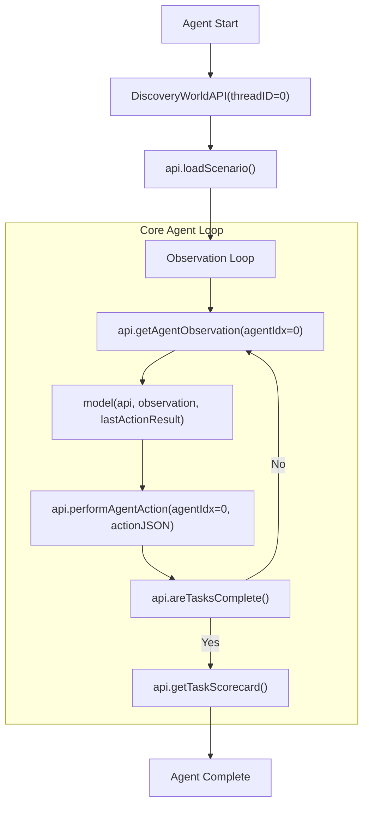
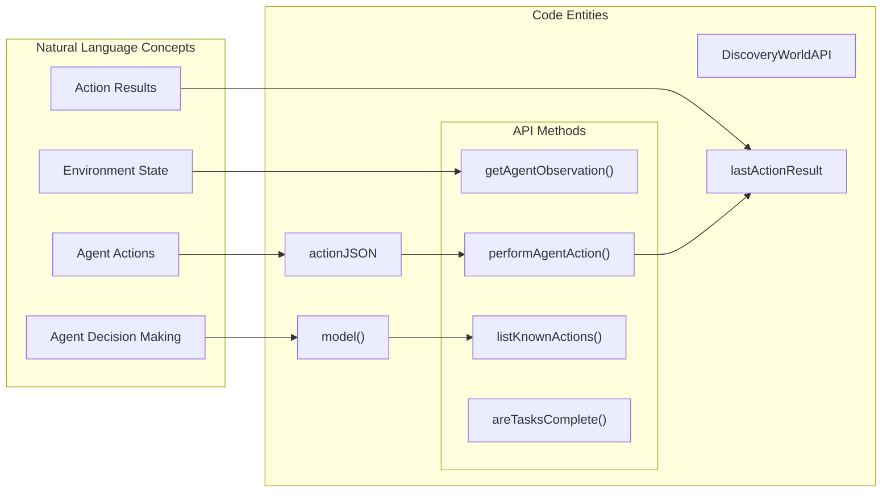
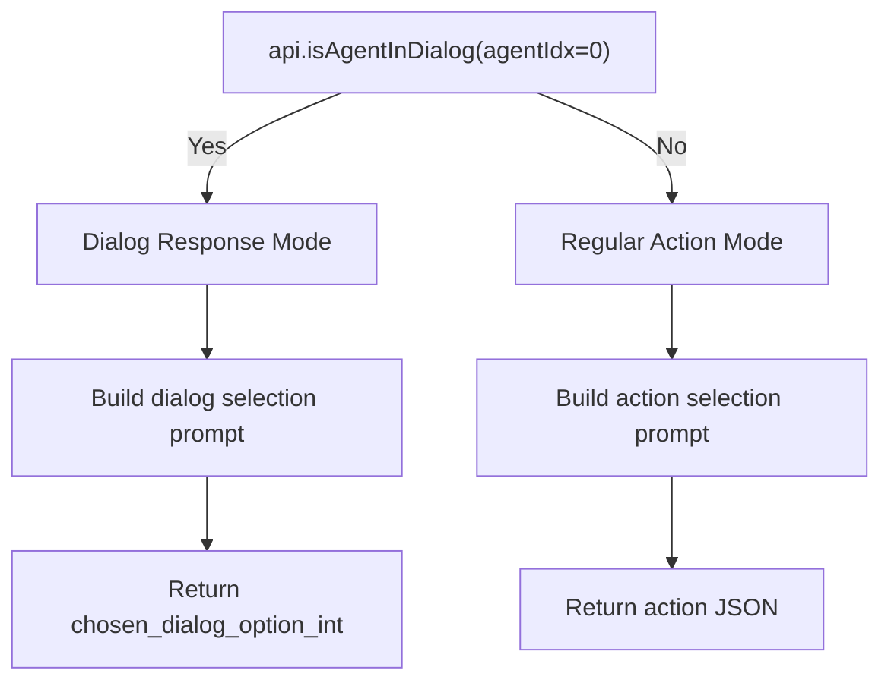

<!-- source: DeepWiki mcp.deepwiki.com · repo allenai/discoveryworld · page 3.1 Getting Started with Agents · fetched 2026-10-26 -->

# Getting Started with Agents

<details>
<summary>Relevant source files</summary>

The following files were used as context for generating this wiki page:

- [agents/ExampleLLMAgentPseudocode.py](agents/ExampleLLMAgentPseudocode.py)

</details>


This page provides a tutorial for creating your first agent in DiscoveryWorld using the example LLM agent as a template. It covers the basic agent development pattern, key code entities, and step-by-step implementation guidance.

For detailed API documentation, see [API Reference](#2.1). For comprehensive information about observation structures and action types, see [Observation & Action Systems](#2.2). For advanced LLM integration patterns, see [LLM Integration Patterns](#3.2).

## Basic Agent Architecture

Every agent in DiscoveryWorld follows a standard observe-think-act cycle. The agent receives observations from the environment, processes them through a decision-making model, and returns actions to be executed.

### Agent Development Pattern



Sources: [agents/ExampleLLMAgentPseudocode.py:74-117]()

### Code Entity Mapping



Sources: [agents/ExampleLLMAgentPseudocode.py:1-2, 7-70, 90-117]()

## Core Components Walkthrough

### The Model Function

The `model()` function is the heart of any agent implementation. It takes three parameters and returns an action JSON:

| Parameter | Type | Description |
|-----------|------|-------------|
| `api` | `DiscoveryWorldAPI` | Environment interface for querying actions and state |
| `observation` | `dict` | Current environment observation including UI state |
| `lastActionResult` | `dict` | Result from the previous action execution |

The function builds a prompt containing:
- Task description from `observation["ui"]["taskProgress"][0]["description"]` [agents/ExampleLLMAgentPseudocode.py:12-13]()
- Current observation state as JSON [agents/ExampleLLMAgentPseudocode.py:16-19]()
- Available actions from `api.listKnownActions(limited=False)` [agents/ExampleLLMAgentPseudocode.py:22-25]()
- Teleport locations from `api.listTeleportLocationsDict()` [agents/ExampleLLMAgentPseudocode.py:28-31]()
- Previous action result [agents/ExampleLLMAgentPseudocode.py:34-37]()

Sources: [agents/ExampleLLMAgentPseudocode.py:7-70]()

### Dialog Handling

The agent checks if it's currently in a dialog using `api.isAgentInDialog(agentIdx=0)`. When in dialog mode, the agent should respond with a `chosen_dialog_option_int` instead of a regular action.



Sources: [agents/ExampleLLMAgentPseudocode.py:44-54]()

### The Example Loop

The `exampleLoop()` function demonstrates the complete agent execution pattern:

1. **Initialization**: Create `DiscoveryWorldAPI(threadID=0)` instance [agents/ExampleLLMAgentPseudocode.py:83]()
2. **Scenario Loading**: Call `api.loadScenario()` with scenario name, difficulty, and seed [agents/ExampleLLMAgentPseudocode.py:84]()
3. **Agent Loop**: Execute observe-think-act cycle for specified steps [agents/ExampleLLMAgentPseudocode.py:91-112]()
4. **Completion Check**: Use `api.areTasksComplete()` to detect task completion [agents/ExampleLLMAgentPseudocode.py:109]()
5. **Final Scoring**: Retrieve scorecard with `api.getTaskScorecard()` [agents/ExampleLLMAgentPseudocode.py:114]()

Sources: [agents/ExampleLLMAgentPseudocode.py:75-117]()

## Action JSON Format

All agent actions follow a standardized JSON format:

```json
{
    "action": "ACTION_NAME",
    "arg1": "OBJECT_UUID_OR_VALUE",
    "arg2": "OPTIONAL_SECOND_ARG"
}
```

The `action` field contains the action name from `api.listKnownActions()`. Arguments `arg1` and `arg2` are typically UUIDs of objects in the environment, though some actions use other value types.

Sources: [agents/ExampleLLMAgentPseudocode.py:62-67]()

## Getting Started Steps

### Step 1: Set Up the Basic Structure

Create a new Python file with the required imports:

```python
from discoveryworld.DiscoveryWorldAPI import DiscoveryWorldAPI
from discoveryworld.ScenarioMaker import SCENARIOS, SCENARIO_DIFFICULTY_OPTIONS
import json
```

### Step 2: Implement the Model Function

Replace the `submitLLMPrompt()` placeholder with your actual LLM integration:

```python
def model(api, observation, lastActionResult):
    # Build prompt (see example code)
    prompt = buildPrompt(api, observation, lastActionResult)
    
    # Replace this with your LLM implementation
    response = your_llm_function(prompt)
    
    # Parse and return action JSON
    actionJSON = json.loads(response)
    return actionJSON
```

### Step 3: Configure Scenario Parameters

Choose your scenario and parameters:

| Parameter | Options | Description |
|-----------|---------|-------------|
| `scenarioName` | `SCENARIOS[0-8]` | Available scientific scenarios |
| `difficultyStr` | `SCENARIO_DIFFICULTY_OPTIONS[0-2]` | Easy, Normal, or Challenge |
| `randomSeed` | `0-4` (official), `5+` (extended) | Parametric variations |

### Step 4: Run Your Agent

Execute the agent loop with your chosen parameters:

```python
exampleLoop(
    scenarioName=SCENARIOS[0], 
    difficultyStr=SCENARIO_DIFFICULTY_OPTIONS[0], 
    randomSeed=0, 
    maxSteps=100
)
```

### Step 5: Analyze Results

The final scorecard provides detailed performance metrics including task completion status, procedural progress, and discovery knowledge tracking.

Sources: [agents/ExampleLLMAgentPseudocode.py:122-129]()

## Implementation Requirements

Your agent implementation must:
- Implement the `model()` function signature exactly as shown
- Handle both regular actions and dialog responses
- Parse LLM responses into valid JSON format
- Handle potential JSON parsing errors gracefully
- Return action dictionaries with the correct structure

For advanced agent patterns and LLM integration best practices, see [LLM Integration Patterns](#3.2). For production-ready implementations, examine the built-in agents documented in [Built-in Agents](#4).

Sources: [agents/ExampleLLMAgentPseudocode.py:1-129]()

---

