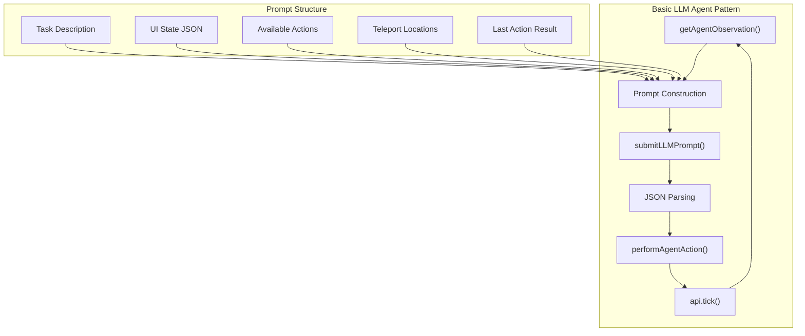
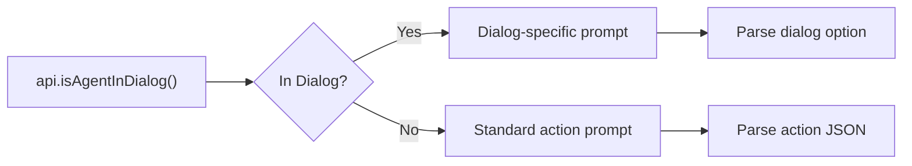
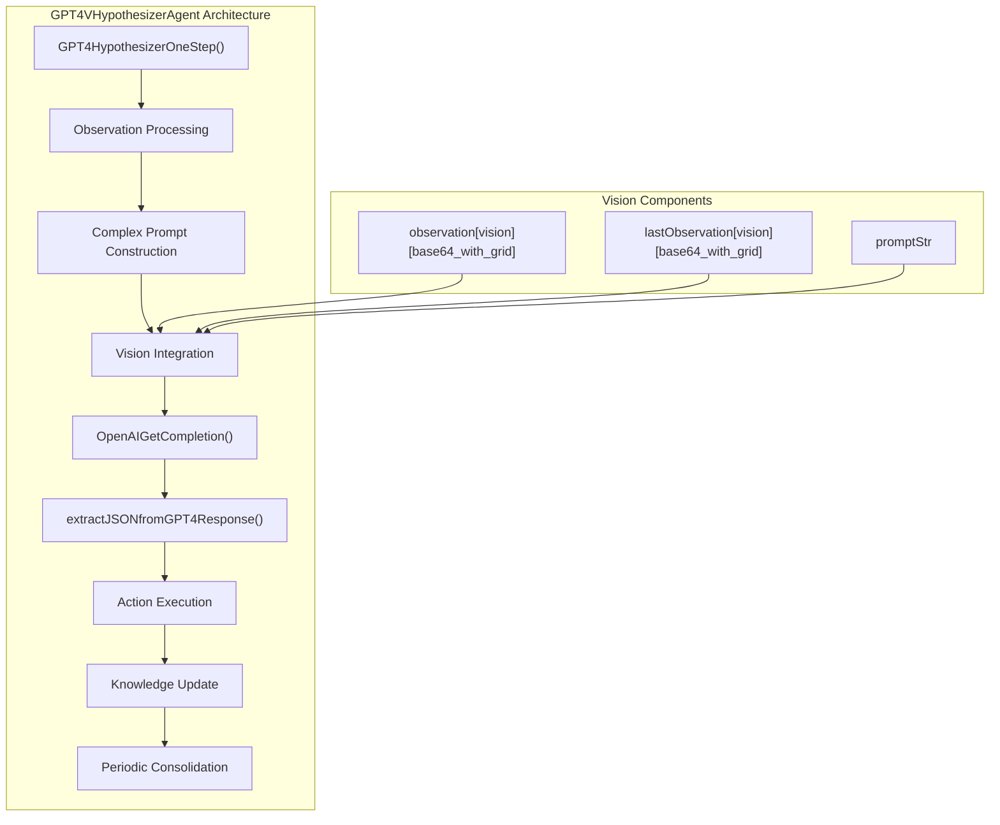
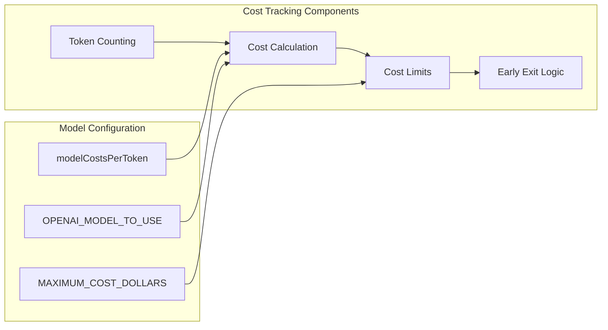
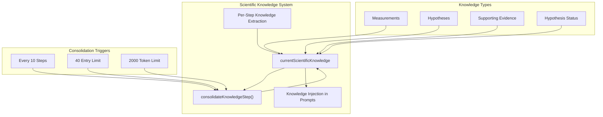
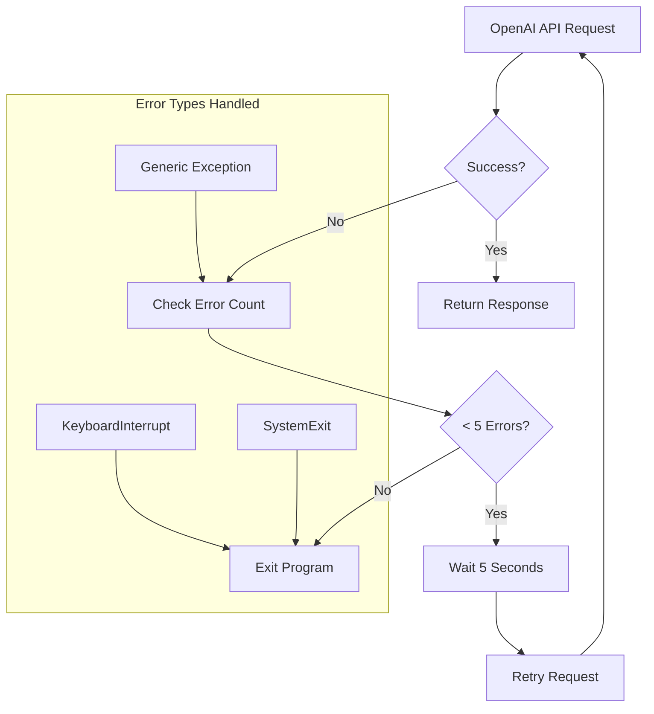
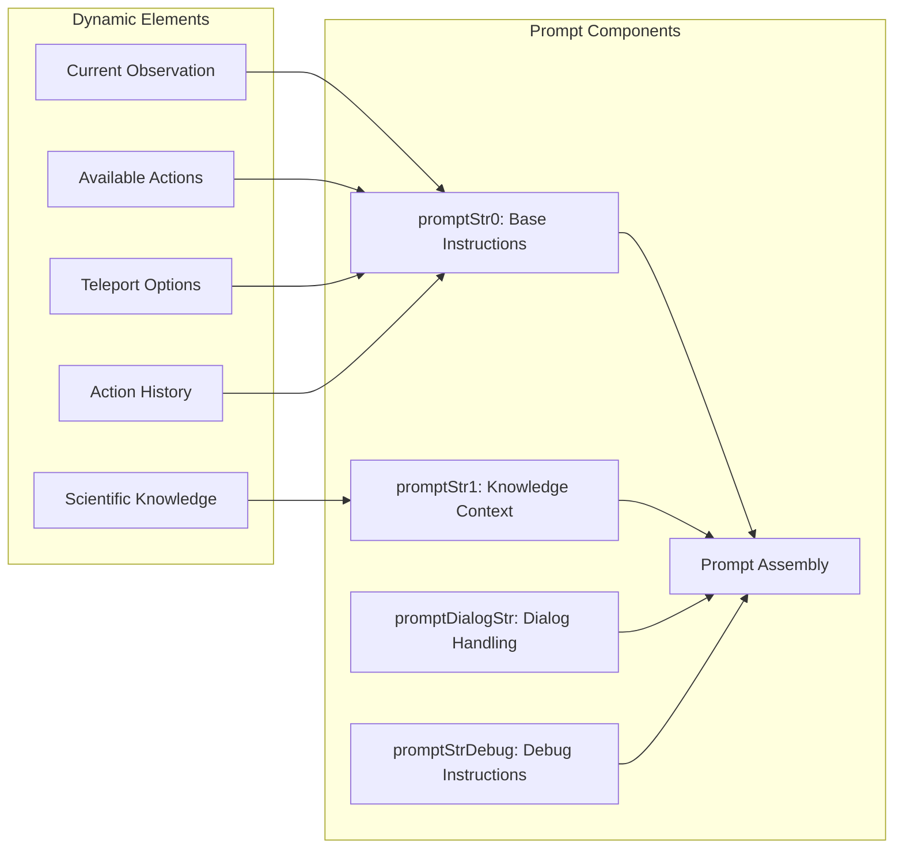
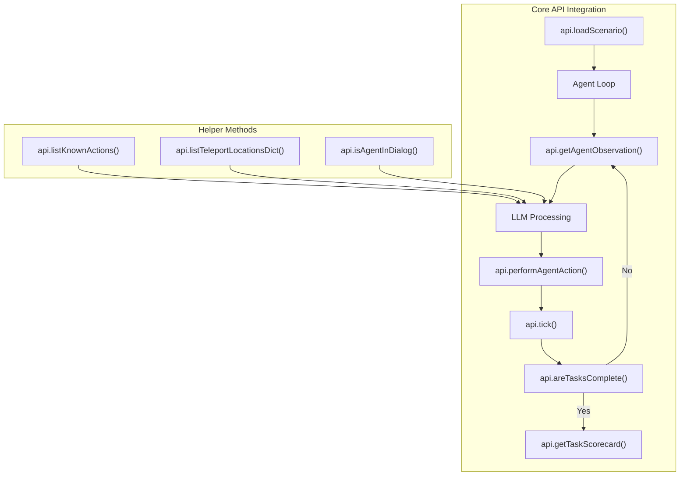
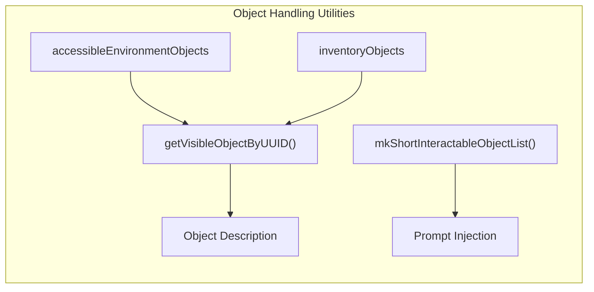

<!-- source: DeepWiki mcp.deepwiki.com · repo allenai/discoveryworld · page 3.2 LLM Integration Patterns · fetched 2026-10-26 -->

# LLM Integration Patterns

Relevant source files

The following files were used as context for generating this wiki page:

- [agents/ExampleLLMAgentPseudocode.py](agents/ExampleLLMAgentPseudocode.py)
- [agents/HypothesizerAgent.py](agents/HypothesizerAgent.py)

This document covers the patterns and best practices for integrating Large Language Models (LLMs) with DiscoveryWorld agents. It focuses on the technical implementation details, prompt engineering strategies, cost management, and error handling patterns used in the agent implementations.

For basic agent development concepts, see [Getting Started with Agents](#3.1). For specific agent implementations, see [Built-in Agents](#4). For advanced agent frameworks, see [ReComA Framework](#5).

## Basic LLM Integration Pattern

The simplest pattern for LLM integration is demonstrated in the `ExampleLLMAgentPseudocode.py` file, which provides a template for building LLM-powered agents.

### Core Components

**Sources:** [agents/ExampleLLMAgentPseudocode.py:6-71]()

### Prompt Construction Strategy

The basic pattern constructs prompts by combining several key components:

| Component | Source | Purpose |
|-----------|--------|---------|
| Task Description | `observation["ui"]["taskProgress"][0]["description"]` | Provides the agent's objective |
| UI State | `observation["ui"]` | Current environment state |
| Available Actions | `api.listKnownActions(limited=False)` | Valid action space |
| Teleport Locations | `api.listTeleportLocationsDict()` | Movement shortcuts |
| Last Action Result | `lastActionResult` | Feedback from previous step |

**Sources:** [agents/ExampleLLMAgentPseudocode.py:11-37]()

### Dialog Handling

The basic pattern includes conditional logic for handling dialog interactions:

**Sources:** [agents/ExampleLLMAgentPseudocode.py:45-54]()

## Advanced LLM Integration Patterns

The `HypothesizerAgent.py` demonstrates sophisticated LLM integration patterns for complex scientific discovery tasks.

### Multi-Modal Vision Integration

**Sources:** [agents/HypothesizerAgent.py:327-441]()

### Cost Management System

The advanced pattern includes comprehensive cost tracking:

**Sources:** [agents/HypothesizerAgent.py:44-65](), [agents/HypothesizerAgent.py:245-279]()

### Knowledge Management Pattern

The advanced pattern implements a sophisticated knowledge management system:

**Sources:** [agents/HypothesizerAgent.py:642-763](), [agents/HypothesizerAgent.py:776-782]()

## Error Handling and Retry Logic

### OpenAI Request Error Handling

The advanced pattern implements robust error handling for LLM API calls:

**Sources:** [agents/HypothesizerAgent.py:142-175]()

### JSON Parsing Recovery

Both patterns include JSON parsing recovery mechanisms:

| Recovery Strategy | Implementation | Use Case |
|-------------------|----------------|----------|
| Memory Recovery | Search backwards through action history | Missing memory fields |
| Hypothesis Recovery | Search backwards for running hypotheses | Missing hypothesis tracking |
| Error Action | Generate error action with context | Invalid JSON response |

**Sources:** [agents/HypothesizerAgent.py:454-517]()

## Prompt Engineering Patterns

### Structured Prompt Assembly

The advanced pattern uses a modular prompt construction approach:

**Sources:** [agents/HypothesizerAgent.py:348-421]()

### Context Management

The system manages context size through several strategies:

| Strategy | Implementation | Benefit |
|----------|----------------|---------|
| Action History Limiting | Last 3 actions only | Prevents context overflow |
| Knowledge Consolidation | Periodic compression | Maintains relevant information |
| Image Context | Previous + current images | Visual continuity |
| Object Filtering | Accessible objects only | Reduces irrelevant data |

**Sources:** [agents/HypothesizerAgent.py:368-374](), [agents/HypothesizerAgent.py:862-864]()

## Integration with DiscoveryWorld API

### API Method Usage Patterns

**Sources:** [agents/ExampleLLMAgentPseudocode.py:83-116](), [agents/HypothesizerAgent.py:975-1010]()

### Object Management

Both patterns include utilities for managing game objects:

**Sources:** [agents/HypothesizerAgent.py:96-131](), [agents/HypothesizerAgent.py:519-533]()

## Best Practices Summary

### Implementation Guidelines

1. **Start Simple**: Begin with the `ExampleLLMAgentPseudocode.py` pattern for basic functionality
2. **Add Complexity Gradually**: Implement advanced features like vision and knowledge management incrementally
3. **Handle Errors Gracefully**: Always include retry logic and graceful degradation
4. **Manage Costs**: Implement token counting and cost limits for production use
5. **Optimize Context**: Use consolidation and filtering to manage prompt size

### Performance Considerations

| Pattern | Token Usage | Response Time | Cost Impact |
|---------|-------------|---------------|-------------|
| Basic Text-Only | Low | Fast | Minimal |
| Vision Integration | High | Slower | Significant |
| Knowledge Management | Variable | Variable | Depends on consolidation |
| Error Recovery | Minimal | Fast | Minimal overhead |

**Sources:** [agents/HypothesizerAgent.py:870-909](), [agents/ExampleLLMAgentPseudocode.py:75-129]()

---

