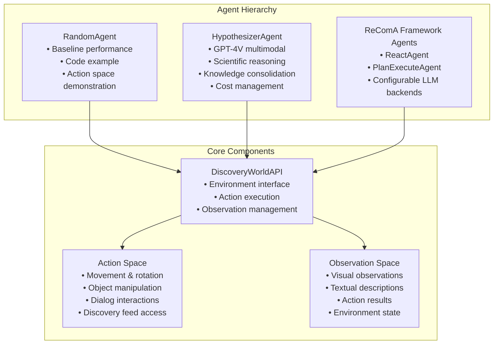
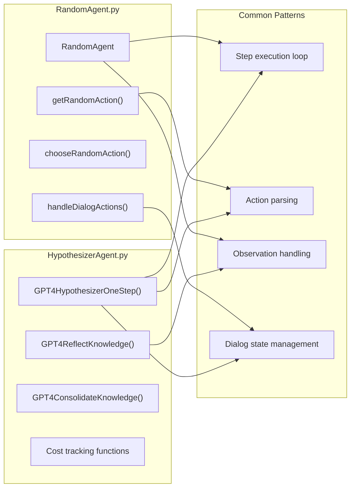
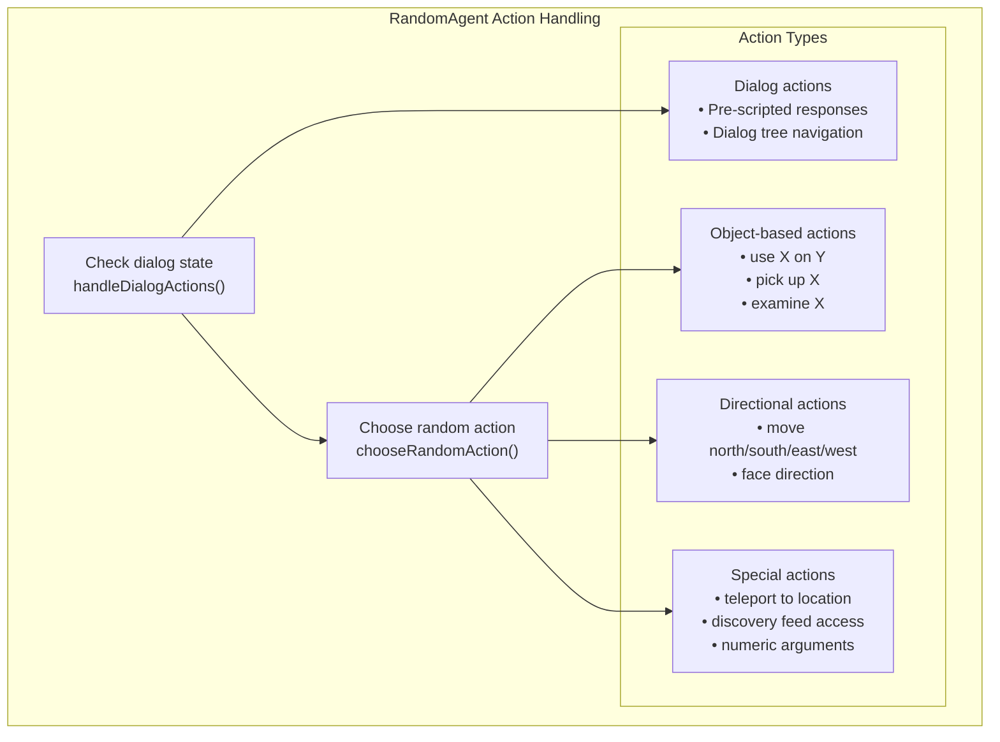
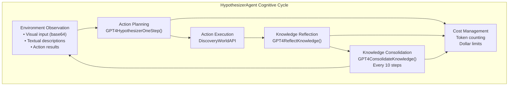

<!-- source: DeepWiki mcp.deepwiki.com · repo allenai/discoveryworld · page 4 Built-in Agents · fetched 2026-10-26 -->

# Built-in Agents

<details>
<summary>Relevant source files</summary>

The following files were used as context for generating this wiki page:

- [agents/README.md](agents/README.md)

</details>


This page documents the agent implementations included with DiscoveryWorld. These agents serve as baselines for performance comparison, code examples for development, and reference implementations demonstrating different approaches to scientific discovery tasks.

The built-in agents range from simple random baselines to sophisticated multimodal language model agents. For information about developing custom agents, see [Agent Development](#3). For advanced agent frameworks like ReComA, see [ReComA Framework](#5).

## Agent Architecture Overview

DiscoveryWorld includes three categories of built-in agents, each serving different purposes in the evaluation ecosystem:



**Sources:** [agents/README.md:1-181]()

## Implementation Patterns

The built-in agents demonstrate different architectural patterns for agent development:



**Sources:** [agents/README.md:62-181]()

## Random Agent

The `RandomAgent` serves as both a performance baseline and a comprehensive code example for agent development. It demonstrates the full action space and provides readable implementation patterns.

### Purpose and Design

The Random Agent fulfills multiple roles:
- **Performance baseline**: Establishes minimum expected performance for comparison
- **Code example**: Demonstrates proper action space usage and argument handling
- **Development reference**: Shows implementation patterns for common agent operations

### Key Implementation Features

| Feature | Implementation | Line Reference |
|---------|---------------|----------------|
| Random action selection | Core selection logic | [agents/RandomAgent.py:150]() |
| Object-based actions | Actions with environment object references | [agents/RandomAgent.py:185]() |
| Special case actions | Movement, teleport, numeric arguments | [agents/RandomAgent.py:199]() |
| Dialog handling | Dialog tree navigation | [agents/RandomAgent.py:114]() |

### Action Space Demonstration

The Random Agent illustrates all major action categories:



### Usage

Run the Random Agent using the following command pattern:

```bash
python agents/RandomAgent.py --scenario="TASK_THEME" --difficulty="DIFFICULTY" --seed=SEED --numSteps=NUM_STEPS
```

Example execution:
```bash
python agents/RandomAgent.py --scenario="Space Sick" --difficulty="Challenge" --seed=0 --numSteps=10
```

### Output Format

The Random Agent produces a summary JSON file with performance metrics:

```json
{
    "agentName": "RandomAgent",
    "completed": 0,
    "completedSuccessfully": 0,
    "difficulty": "Challenge", 
    "finalNormalizedScore": 0.0,
    "numSteps": 10,
    "scenario": "Space Sick",
    "seed": 0,
    "stepsPerSecond": 3.6337145107164717,
    "threadId": 6638643
}
```

**Sources:** [agents/README.md:62-115]()

## Hypothesizer Agent

The `HypothesizerAgent` demonstrates advanced multimodal reasoning using GPT-4V. It implements scientific discovery patterns including hypothesis formation, knowledge tracking, and cost-conscious operation.

### Architecture and Capabilities

The Hypothesizer Agent implements an act-then-reflect cognitive architecture:



### Core Components

| Component | Function | Implementation Reference |
|-----------|----------|-------------------------|
| Action planning | GPT-4V reasoning for next action | [agents/HypothesizerAgent.py:348]() |
| Knowledge reflection | Post-action learning integration | [agents/HypothesizerAgent.py:555]() |
| Dialog handling | Special prompting for dialog trees | [agents/HypothesizerAgent.py:405]() |
| Knowledge consolidation | Memory compression every 10 steps | [agents/HypothesizerAgent.py:642]() |
| Environment initialization | DiscoveryWorld setup and execution | [agents/HypothesizerAgent.py:975]() |

### Scientific Reasoning Features

The agent implements several advanced capabilities:

- **Multimodal input processing**: Handles both visual and textual observations
- **Hypothesis formation**: Develops and tests scientific hypotheses
- **Knowledge accumulation**: Maintains working memory of discoveries
- **Cost management**: Tracks and limits API usage costs
- **Memory consolidation**: Prevents working memory overflow

### Usage and Configuration

The Hypothesizer Agent requires OpenAI API access and produces comprehensive output logs:

```bash
python agents/HypothesizerAgent.py --scenario="Combinatorial Chemistry" --difficulty="Normal" --numSteps=10 --seed=0 --model=gpt-4o-2024-05-13 --video --maxCostDollars=5
```

**Prerequisites:**
- OpenAI API key in `openai_key.txt` file
- Optional: FFmpeg for video generation

### Output Artifacts

The agent generates multiple output files for analysis:

| File Type | Content | Purpose |
|-----------|---------|---------|
| `output_allhistory*.json` | Step-by-step observations, actions, knowledge, scores | Detailed behavior analysis |
| `output_consolodatedKnowledge*.json` | Knowledge consolidation events | Learning progression tracking |
| `output_costAnalysis*.json` | API usage and costs | Resource management analysis |
| `logs/out*partXofY.zip` | World state logs and frame captures | Environment state tracking |
| `output*.mp4` | Gameplay video (with `--video` flag) | Visual behavior analysis |

**Sources:** [agents/README.md:116-177]()

## ReComA Framework Agents

The ReComA (Reason, Compose, and Manage) framework provides additional sophisticated agent implementations including `ReactAgent` and `PlanExecuteAgent`. These agents offer configurable LLM backends, strategic planning capabilities, and advanced reasoning patterns.

For detailed documentation of ReComA agents, including setup, configuration, and usage instructions, see [ReComA Framework](#5).

**Sources:** [agents/README.md:178-181]()

---

