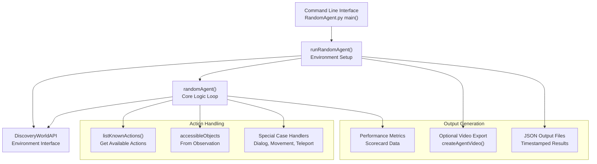
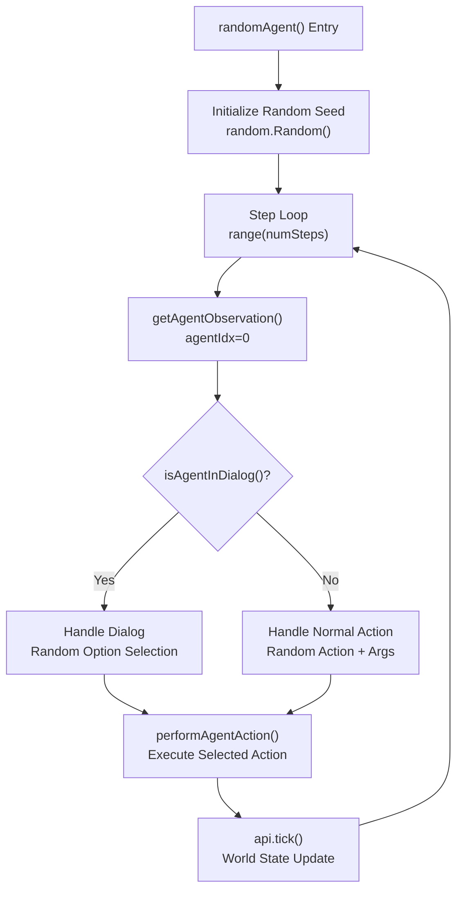
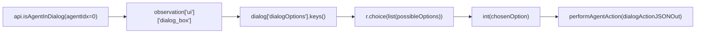
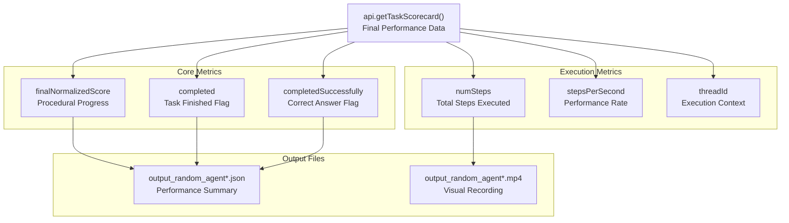

<!-- source: DeepWiki mcp.deepwiki.com · repo allenai/discoveryworld · page 4.1 Random Agent · fetched 2026-10-26 -->

# Random Agent

<details>
<summary>Relevant source files</summary>

The following files were used as context for generating this wiki page:

- [agents/README.md](agents/README.md)
- [agents/RandomAgent.py](agents/RandomAgent.py)

</details>


This document covers the Random Agent implementation in DiscoveryWorld, which serves as a baseline agent for performance comparison and action space demonstration. The Random Agent randomly selects actions at each step, providing both a minimal performance baseline and a readable code example for new agent developers.

For information about other baseline agents, see [Built-in Agents](#4). For advanced agent development patterns, see [Agent Development](#3).

## Purpose and Architecture

The Random Agent serves three primary functions in the DiscoveryWorld ecosystem:

1. **Performance Baseline**: Provides a minimal baseline to verify that tasks are sufficiently challenging
2. **Code Example**: Demonstrates the complete action space and proper argument handling for agent developers  
3. **System Testing**: Helps identify edge cases and bugs through comprehensive random exploration

### System Integration



Sources: [agents/RandomAgent.py:254-302](), [agents/RandomAgent.py:64-248]()

## Core Implementation

The Random Agent's core logic is implemented in the `randomAgent()` function, which operates in a simple step-based loop:

### Main Loop Structure



Sources: [agents/RandomAgent.py:64-248](), [agents/RandomAgent.py:90-240]()

### Action Selection Mechanism

The agent implements sophisticated random action selection that handles the full DiscoveryWorld action space:

| Action Category | Implementation | Code Reference |
|-----------------|----------------|----------------|
| Standard Actions | Random selection from `listKnownActions()` with object UUIDs | [agents/RandomAgent.py:147-197]() |
| Dialog Actions | Random choice from `dialog["dialogOptions"].keys()` | [agents/RandomAgent.py:114-137]() |
| Movement Actions | Direction selection from `["north", "east", "south", "west"]` | [agents/RandomAgent.py:201-208]() |
| Teleportation | Random location from `listTeleportLocationsDict()` | [agents/RandomAgent.py:209-220]() |
| Discovery Feed | Random post ID generation for feed access | [agents/RandomAgent.py:221-224]() |

## Dialog Handling

The Random Agent includes comprehensive dialog state handling, which is critical since many DiscoveryWorld objects (soil computers, crystal reactors) use dialog trees for interaction:



Sources: [agents/RandomAgent.py:114-137](), [agents/README.md:77-80]()

## Usage and Configuration

### Command Line Interface

The Random Agent supports both single scenario execution and batch processing:

```bash
# Single scenario execution
python agents/RandomAgent.py --scenario="Space Sick" --difficulty="Challenge" --seed=0 --numSteps=10

# Batch execution of all scenarios
python agents/RandomAgent.py --runall --numSteps=100 --video
```

### Configuration Parameters

| Parameter | Type | Description | Default |
|-----------|------|-------------|---------|
| `--scenario` | choice | Scenario name from `SCENARIO_NAMES` | None |
| `--difficulty` | choice | Difficulty level from `SCENARIO_DIFFICULTY_OPTIONS` | None |
| `--seed` | int | Random seed for reproducible runs | 0 |
| `--numSteps` | int | Maximum steps to execute | 100 |
| `--runall` | flag | Execute all scenario/difficulty combinations | False |
| `--video` | flag | Export video of agent actions | False |
| `--threadId` | int | Thread identifier for parallel execution | Random |

Sources: [agents/RandomAgent.py:317-326](), [agents/RandomAgent.py:436-470]()

## Output and Evaluation

### Performance Metrics

The Random Agent generates comprehensive performance data in JSON format:



### Batch Processing Results

When using `--runall`, the agent generates aggregated statistics across all scenario/difficulty combinations:

```json
{
    "scores_avg": {"ScenarioName-Difficulty-avg": 0.15},
    "scores_raw": {"ScenarioName-Difficulty": [0.1, 0.2, 0.0, 0.3, 0.15]},
    "completed_avg": {"ScenarioName-Difficulty-avg": 0.2},
    "completedSuccessfully_avg": {"ScenarioName-Difficulty-avg": 0.0}
}
```

Sources: [agents/RandomAgent.py:294-301](), [agents/RandomAgent.py:417-433](), [agents/README.md:95-114]()

## Error Handling and Robustness

The Random Agent includes robust error handling for development and testing scenarios:

- **Crash Recovery**: Automatic restart with up to 10 attempts for failed runs in batch mode
- **Thread Safety**: Unique thread IDs prevent conflicts in parallel execution  
- **Seed Management**: Deterministic random behavior for reproducible testing
- **Parameter Validation**: Scenario and difficulty validation against known configurations

Sources: [agents/RandomAgent.py:354-386](), [agents/RandomAgent.py:438-455]()

---

