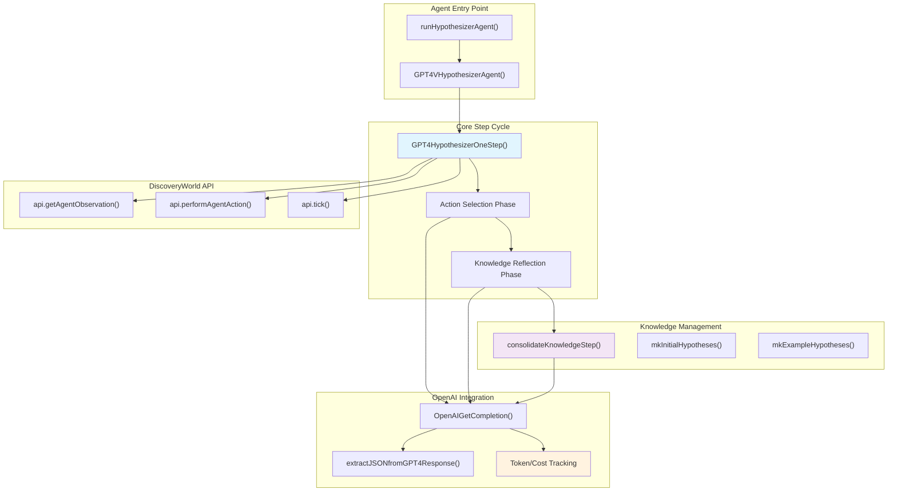
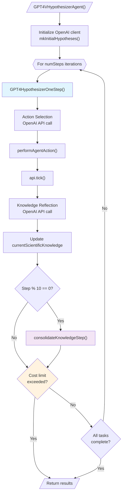
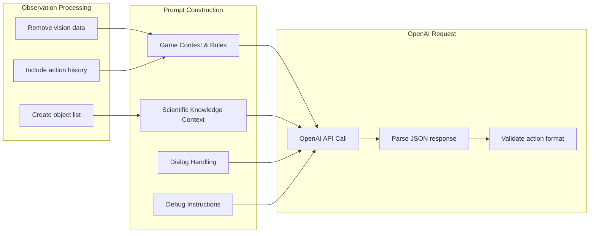
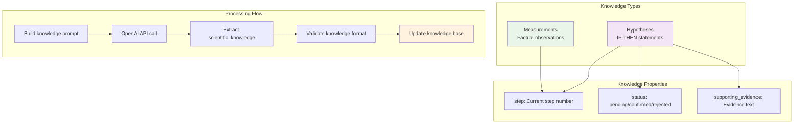
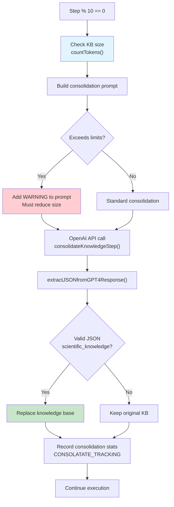
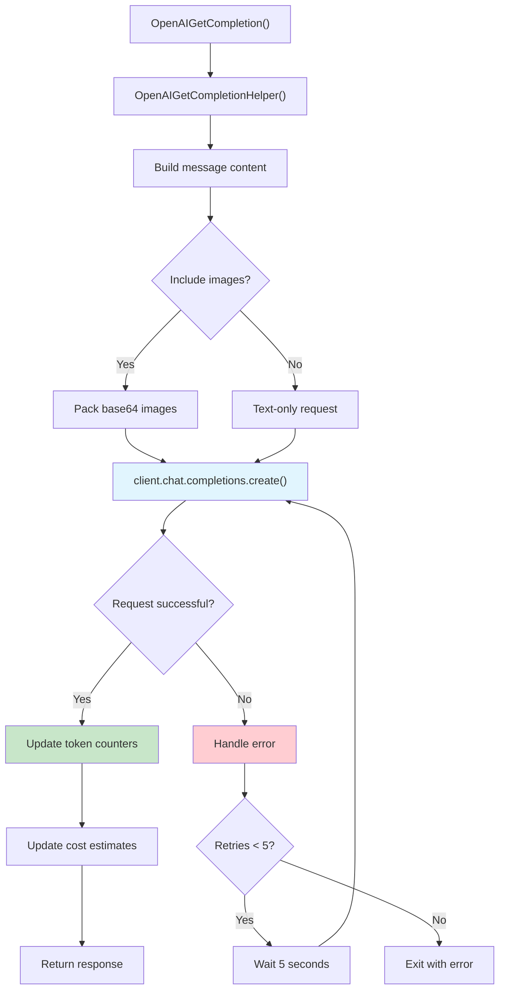

<!-- source: DeepWiki mcp.deepwiki.com · repo allenai/discoveryworld · page 4.2 Hypothesizer Agent · fetched 2026-10-26 -->

# Hypothesizer Agent

<details>
<summary>Relevant source files</summary>

The following files were used as context for generating this wiki page:

- [agents/HypothesizerAgent.py](agents/HypothesizerAgent.py)
- [agents/README.md](agents/README.md)

</details>


The Hypothesizer Agent is an advanced GPT-4V multimodal agent designed for scientific discovery tasks in DiscoveryWorld. It features sophisticated scientific knowledge tracking, automatic cost management, and hypothesis formation capabilities. This agent implements an act-then-reflect cycle where it performs actions in the environment and then explicitly tracks scientific measurements and hypotheses from its observations.

For basic agent development patterns, see [Getting Started with Agents](#3.1). For LLM integration fundamentals, see [LLM Integration Patterns](#3.2). For alternative agent implementations, see [ReComA Framework](#5).

## Architecture Overview

The Hypothesizer Agent operates through a two-phase cycle at each step: action selection and knowledge reflection. It maintains scientific knowledge across steps and periodically consolidates this knowledge to manage memory constraints.

**Hypothesizer Agent Architecture**



Sources: [agents/HypothesizerAgent.py:786-990](), [agents/HypothesizerAgent.py:327-633]()

## Core Components

### Agent Execution Loop

The main execution happens in `GPT4VHypothesizerAgent`, which runs the agent for a specified number of steps while tracking costs and scientific knowledge.

| Component | Function | Purpose |
|-----------|----------|---------|
| Main Loop | `GPT4VHypothesizerAgent` | Orchestrates multi-step execution with error handling |
| Single Step | `GPT4HypothesizerOneStep` | Handles one complete action-reflection cycle |
| Knowledge Init | `mkInitialHypotheses` | Creates empty scientific knowledge structure |
| Consolidation | `consolidateKnowledgeStep` | Compresses knowledge every 10 steps |

**Core Execution Flow**



Sources: [agents/HypothesizerAgent.py:820-937](), [agents/HypothesizerAgent.py:327-633]()

### Action Selection Phase

The action phase constructs a comprehensive prompt including environment observation, action history, and current scientific knowledge, then requests a JSON-formatted action from GPT-4V.

**Action Phase Components**



Sources: [agents/HypothesizerAgent.py:348-441](), [agents/HypothesizerAgent.py:116-131]()

### Knowledge Reflection Phase

After each action, the agent reflects on what scientific knowledge it has gained, formulating measurements and hypotheses that get added to its persistent knowledge base.

**Knowledge Reflection Structure**



Sources: [agents/HypothesizerAgent.py:557-618](), [agents/HypothesizerAgent.py:766-782]()

## Knowledge Management System

### Knowledge Structure

The agent maintains scientific knowledge in a structured format with measurements and hypotheses. Each entry includes metadata about when it was discovered and its validation status.

```json
{
  "scientific_knowledge": [
    {
      "step": 1,
      "measurement": "The tree (uuid: 123) has a temperature of 10 degrees celsius when measured using the thermometer."
    },
    {
      "step": 3,
      "hypothesis": "if (object:substance) is (action:heated) then (object:substance) will have (property:temperature) increase.",
      "supporting_evidence": "...",
      "status": "pending"
    }
  ]
}
```

Sources: [agents/HypothesizerAgent.py:766-774]()

### Knowledge Consolidation

Every 10 steps, the agent consolidates its knowledge to prevent memory bloat. This process removes duplicates, combines related entries, and discards irrelevant information while maintaining essential scientific insights.

| Parameter | Value | Purpose |
|-----------|-------|---------|
| `KNOWLEDGEBASE_MAX_SIZE_ENTRIES` | 40 | Maximum number of knowledge entries |
| `KNOWLEDGEBASE_MAX_SIZE_TOKENS` | 2000 | Maximum token count for knowledge base |
| Consolidation Frequency | Every 10 steps | Balance between memory and performance |

**Knowledge Consolidation Process**



Sources: [agents/HypothesizerAgent.py:642-762](), [agents/HypothesizerAgent.py:635-638]()

## Cost Management

The agent implements comprehensive cost tracking for OpenAI API usage with configurable spending limits and real-time monitoring.

### Token and Cost Tracking

| Global Variable | Purpose |
|-----------------|---------|
| `TOTAL_TOKENS_SENT` | Cumulative input tokens |
| `TOTAL_TOKENS_RECEIVED` | Cumulative output tokens |
| `TOTAL_COST_SENT` | Estimated input cost |
| `TOTAL_COST_RECEIVED` | Estimated output cost |
| `MAXIMUM_COST_DOLLARS` | Spending limit (configurable) |

### Model Cost Configuration

The agent supports multiple OpenAI models with different pricing structures:

```python
modelCostsPerToken = {
    "gpt-4o": {
        "send": 5.0 / 1000000.0,      # $5 per 1M tokens
        "receive": 15.0 / 1000000.0   # $15 per 1M tokens
    },
    "gpt-4-turbo-2024-04-09": {
        "send": 10.0 / 1000000.0,     # $10 per 1M tokens
        "receive": 30.0 / 1000000.0   # $30 per 1M tokens
    }
}
```

Sources: [agents/HypothesizerAgent.py:44-65](), [agents/HypothesizerAgent.py:246-279](), [agents/HypothesizerAgent.py:890-937]()

## OpenAI Integration

### API Call Management

The agent implements robust error handling and retry logic for OpenAI API calls with automatic recovery from transient failures.

**OpenAI Request Flow**



Sources: [agents/HypothesizerAgent.py:142-175](), [agents/HypothesizerAgent.py:179-280]()

### Response Processing

The agent extracts JSON responses from GPT-4 using markdown code block parsing with fallback error handling.

```python
def extractJSONfromGPT4Response(strIn):
    # Find between code brackets ```json
    startMarker = "```json"
    endMarker = "```"
    # ... parsing logic
```

Sources: [agents/HypothesizerAgent.py:284-321]()

## Usage and Configuration

### Command Line Interface

The agent supports extensive command-line configuration for different scenarios and execution parameters.

| Parameter | Options | Default | Purpose |
|-----------|---------|---------|---------|
| `--scenario` | See [Scenarios & Tasks](#2.3) | Required | Task theme to run |
| `--difficulty` | Easy, Normal, Challenge | Required | Difficulty level |
| `--seed` | Integer | 0 | Parametric seed |
| `--numSteps` | Integer | 100 | Maximum steps |
| `--model` | OpenAI model name | gpt-4o | LLM model |
| `--maxCostDollars` | Float | 0.0 | Spending limit |
| `--noimages` | Flag | False | Disable vision |
| `--video` | Flag | False | Export video |

### Environment Setup

The agent requires an OpenAI API key stored in `openai_key.txt` in the repository root directory.

```bash
python agents/HypothesizerAgent.py \
  --scenario="Combinatorial Chemistry" \
  --difficulty="Normal" \
  --seed=0 \
  --numSteps=100 \
  --model=gpt-4o \
  --maxCostDollars=10.0 \
  --video
```

Sources: [agents/HypothesizerAgent.py:1067-1083](), [agents/HypothesizerAgent.py:789-791]()

## Output and Logging

### Generated Files

The agent produces comprehensive logs and analysis files with descriptive filenames:

| File Pattern | Content |
|--------------|---------|
| `output_allhistory*.json` | Complete step-by-step execution log |
| `output_observationHistory*.json` | Environment observations and actions |
| `output_costAnalysis*.json` | Token usage and cost breakdown |
| `output_consolidatedKnowledge*.json` | Knowledge consolidation tracking |
| `logs/hypothesizer-*/out-*.json` | Detailed world state history |
| `output_hypothesizer_agent*.mp4` | Video recording (if enabled) |

### Performance Metrics

The agent tracks and reports key performance indicators:

```json
{
  "agentName": "GPT4VHypothesizerAgent",
  "finalNormalizedScore": 0.85,
  "stepsPerSecond": 2.1,
  "total_cost": 3.47,
  "cost_per_step": 0.035
}
```

Sources: [agents/HypothesizerAgent.py:912-920](), [agents/HypothesizerAgent.py:1011-1015](), [agents/HypothesizerAgent.py:1019-1057]()

---

