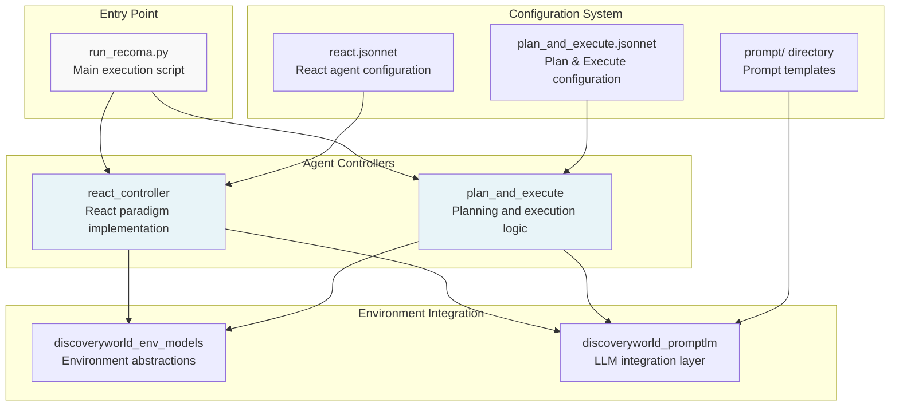
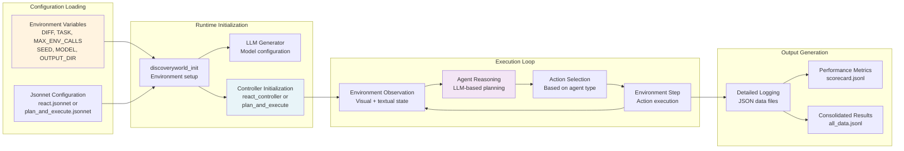
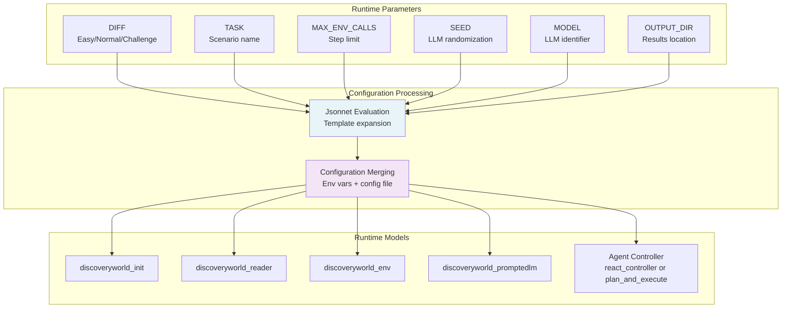

<!-- source: DeepWiki mcp.deepwiki.com · repo allenai/discoveryworld · page 5 ReComA Framework · fetched 2026-10-26 -->

# ReComA Framework

<details>
<summary>Relevant source files</summary>

The following files were used as context for generating this wiki page:

- [agents/recoma/README.md](agents/recoma/README.md)
- [agents/recoma/__init__.py](agents/recoma/__init__.py)

</details>


The ReComA (Reason, Compose, and Manage) Framework provides sophisticated agent implementations for DiscoveryWorld that support both React and Plan & Execute paradigms. This framework enables advanced language model-based agents to perform complex scientific discovery tasks through structured reasoning, planning, and execution cycles.

This document covers the ReComA framework architecture, configuration system, and usage patterns. For basic agent development concepts, see [Agent Development](#3). For specific configuration details of React and Plan & Execute agents, see [ReComA Setup & Configuration](#5.1), [React Agent Configuration](#5.3), and [Plan & Execute Agent Configuration](#5.4).

## Framework Architecture

The ReComA framework provides a modular architecture that separates core agent logic, environment interaction, language model integration, and configuration management into distinct components.

### Core Framework Components



**Sources:** [agents/recoma/__init__.py:1-4](), [agents/recoma/README.md:24-26]()

### Agent Execution Flow



**Sources:** [agents/recoma/README.md:18-27](), [agents/recoma/README.md:61-63]()

## Agent Types

The ReComA framework implements two distinct agent paradigms, each optimized for different types of reasoning and task execution patterns.

### React Agent Implementation

The React agent follows a Reason-Act cycle where the agent alternates between reasoning about the current situation and taking actions based on that reasoning.

| Component | Description | Configuration |
|-----------|-------------|---------------|
| **Reasoning Cycle** | Iterative reason-then-act pattern | `max_history` parameter |
| **Memory Management** | Maintains conversation history up to token limits | `max_output_length=10000` |
| **Prompt Structure** | Uses `react_prompt.txt` template | Located in `prompt/` directory |
| **Action Selection** | Direct action generation from reasoning | Single-step decision making |

### Plan & Execute Agent Implementation

The Plan & Execute agent separates high-level planning from low-level execution, enabling more strategic task completion.

| Component | Description | Configuration |
|-----------|-------------|---------------|
| **Planning Phase** | Generates high-level task strategy | `planner_prompt.txt` template |
| **Execution Phase** | Implements planned actions step-by-step | `executor_prompt.txt` template |
| **Search Strategy** | Uses best-first search for plan optimization | Configurable stopping conditions |
| **Resource Management** | Tracks execution progress and resource usage | `max_llm_cost` limits |

**Sources:** [agents/recoma/README.md:13-27](), [agents/recoma/README.md:31-45](), [agents/recoma/README.md:58]()

## Configuration System

The ReComA framework uses a sophisticated configuration system based on Jsonnet files that define agent behavior, model selection, and execution parameters.

### Environment Variable Integration



**Sources:** [agents/recoma/README.md:18-26](), [agents/recoma/README.md:36-44]()

### Configuration Options

The framework provides extensive configuration options for customizing agent behavior:

| Configuration Area | Options | Description |
|-------------------|---------|-------------|
| **Scenario Selection** | `limit_prefixes`, `limit_difficulties`, `limit_seeds` | Controls which tasks to run |
| **Model Selection** | `MODEL` environment variable | Supports OpenAI, TogetherAI, Azure models |
| **Resource Limits** | `max_env_calls`, `max_llm_cost` | Prevents runaway execution |
| **Agent Memory** | `max_history`, `max_output_length` | Controls conversation history |
| **Search Parameters** | `best_first` strategy | Plan & Execute optimization |

**Sources:** [agents/recoma/README.md:50-58]()

## Usage Patterns

### Basic Execution

To run a ReComA agent, you specify the agent type through configuration files and control execution through environment variables:

```bash
# React agent execution
python agents/recoma/run_recoma.py \
  --output_dir ${OUTPUT_DIR} \
  --config agents/recoma/configs/react.jsonnet

# Plan & Execute agent execution  
python agents/recoma/run_recoma.py \
  --output_dir ${OUTPUT_DIR} \
  --config agents/recoma/configs/plan_and_execute.jsonnet
```

### Output Structure

The framework generates structured output files for analysis and evaluation:

| File Type | Content | Location Pattern |
|-----------|---------|------------------|
| **Individual Results** | Scenario-specific data with costs and steps | `{task}_{difficulty}_{seed}_data.json` |
| **Scorecards** | Performance metrics per run | `scorecard.jsonl` files |
| **Consolidated Data** | All results aggregated | `all_data.jsonl` |
| **Video Recordings** | Visual gameplay capture | Generated alongside JSON data |

**Sources:** [agents/recoma/README.md:60-63](), [agents/recoma/README.md:29]()

### Experiment Configuration

The framework supports running systematic experiments across multiple scenarios, difficulties, and seeds:

```bash
# Running across multiple scenarios
for t in "Archaeology Dating" "Plant Nutrients" "Space Sick"; do
  export TASK=${t}
  python agents/recoma/run_recoma.py \
    --output_dir ${OUTPUT_DIR} \
    --config agents/recoma/configs/react.jsonnet
done
```

**Sources:** [agents/recoma/README.md:88-98](), [agents/recoma/README.md:103-113]()

## Model Integration

The ReComA framework supports multiple language model providers through a unified interface that handles authentication, rate limiting, and cost tracking.

### Supported Model Providers

| Provider | Configuration | Authentication |
|----------|---------------|----------------|
| **OpenAI** | `gpt-4o-2024-05-13`, `gpt-4-turbo` | `OPENAI_API_KEY` environment variable |
| **TogetherAI** | `togetherai_llama3_70B`, `togetherai_mixtral` | TogetherAI API credentials |
| **Azure OpenAI** | Azure-specific model identifiers | Azure-specific configuration |

The framework uses LiteLLM for unified model access, enabling easy switching between providers without code changes.

**Sources:** [agents/recoma/README.md:11](), [agents/recoma/README.md:56]()

---

