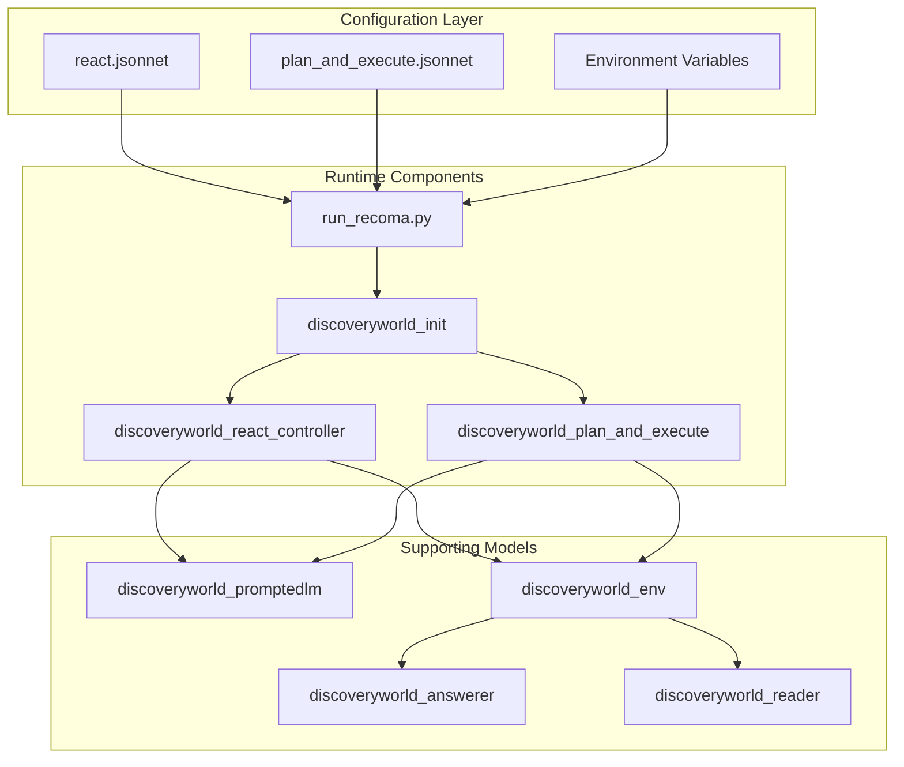
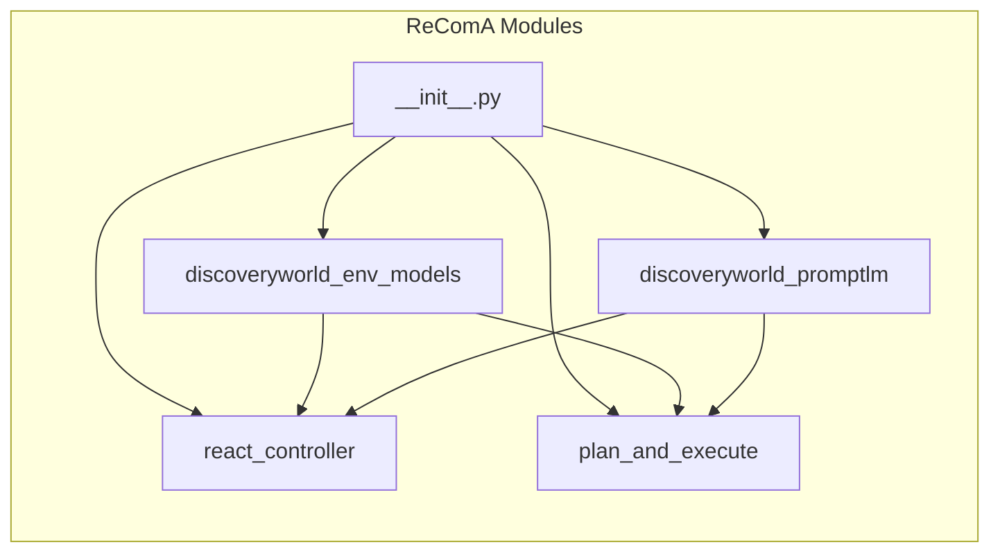

<!-- source: DeepWiki mcp.deepwiki.com · repo allenai/discoveryworld · page 5.1 ReComA Setup & Configuration · fetched 2026-10-26 -->

# ReComA Setup & Configuration

<details>
<summary>Relevant source files</summary>

The following files were used as context for generating this wiki page:

- [agents/recoma/README.md](agents/recoma/README.md)
- [agents/recoma/__init__.py](agents/recoma/__init__.py)

</details>


This document covers the installation, environment setup, and basic configuration of the ReComA (Reason, Compose, and Manage) framework within DiscoveryWorld. ReComA provides advanced agent implementations using React and Plan & Execute paradigms that can be configured to work with various language models and experimental parameters.

For detailed language model configurations, see [Language Model Configurations](#5.2). For specific React agent configuration options, see [React Agent Configuration](#5.3). For Plan & Execute agent configuration, see [Plan & Execute Agent Configuration](#5.4).

## Installation Requirements

ReComA requires installation of the external Recoma library as a dependency. The framework integrates with DiscoveryWorld through a specific commit version to ensure compatibility.

### Core Dependencies

```bash
pip install git+https://github.com/allenai/recoma.git@b262ab5476841551c5d6874e8ddecef78c71a072
```

The installation provides access to the underlying reasoning and action execution framework that powers both React and Plan & Execute agents.

**Sources:** [agents/recoma/README.md:5-9]()

### API Key Configuration

ReComA requires language model API access through environment variables:

```bash
export OPENAI_API_KEY="your-openai-api-key"
```

Additional API providers are supported through LiteLLM, including TogetherAI and Azure. Configuration for alternative providers requires setting appropriate environment variables as documented in the LiteLLM provider documentation.

**Sources:** [agents/recoma/README.md:11-11](), [agents/recoma/README.md:56-56]()

## Environment Setup

ReComA uses environment variables to configure experimental parameters, making it easy to run experiments across different scenarios, difficulties, and models without modifying configuration files.

### Required Environment Variables

| Variable | Purpose | Example Values |
|----------|---------|----------------|
| `DIFF` | Difficulty level | `Easy`, `Normal`, `Challenge` |
| `TASK` | Scenario name | `"Space Sick"`, `"Plant Nutrients"` |
| `MAX_ENV_CALLS` | Maximum environment steps | `100`, `1000` |
| `SEED` | Random seed for LLM | `123` |
| `MODEL` | Language model identifier | `gpt-4o-2024-05-13` |
| `OUTPUT_DIR` | Results directory path | `output_dir/react/...` |

### Environment Variable Configuration Example

```bash
export DIFF=Easy
export TASK="Space Sick"
export MAX_ENV_CALLS=100
export SEED=123
export MODEL=gpt-4o-2024-05-13
export OUTPUT_DIR=output_dir/react/${DIFF}_${MAX_ENV_CALLS}env_${MODEL}_s${SEED}/${TASK// /_}
```

**Sources:** [agents/recoma/README.md:18-26]()

## Configuration System Architecture

ReComA uses a hierarchical configuration system combining Jsonnet configuration files, environment variables, and modular components for flexible experiment setup.

### Configuration File Structure



**Sources:** [agents/recoma/README.md:24-26](), [agents/recoma/README.md:42-44](), [agents/recoma/__init__.py:1-4]()

### Module Import Structure

The ReComA framework initializes several specialized modules for DiscoveryWorld integration:



**Sources:** [agents/recoma/__init__.py:1-4]()

## Quick Start Guide

### Running React Agent

To execute a React agent experiment:

```bash
python agents/recoma/run_recoma.py \
   --output_dir ${OUTPUT_DIR} \
   --config agents/recoma/configs/react.jsonnet
```

### Running Plan & Execute Agent

To execute a Plan & Execute agent experiment:

```bash
python agents/recoma/run_recoma.py \
  --output_dir ${OUTPUT_DIR} \
  --config agents/recoma/configs/plan_and_execute.jsonnet
```

The main execution script `run_recoma.py` handles both agent types based on the specified configuration file.

**Sources:** [agents/recoma/README.md:24-26](), [agents/recoma/README.md:42-44]()

## Output Directory Structure

ReComA generates structured output directories that organize results by agent type, experimental parameters, and scenarios.

### Directory Naming Convention

```
output_dir/
├── react/
│   └── {DIFF}_{MAX_ENV_CALLS}env_{MODEL}_s{SEED}/
│       └── {TASK_NAME}/
│           └── {TASK} {DIFF} {SEED} data.json
└── pne/
    └── {DIFF}_{MAX_ENV_CALLS}env_{MODEL}_s{SEED}/
        └── {TASK_NAME}/
            └── {TASK} {DIFF} {SEED} data.json
```

### Output File Contents

Each experiment generates detailed JSON files containing:
- Scenario metadata and configuration
- LLM usage costs and token counts
- Number of environment steps taken
- Performance scorecards and metrics
- Complete execution trace data

**Sources:** [agents/recoma/README.md:61-63]()

## Basic Configuration Parameters

### Experiment Scope Configuration

Experiments can be limited to specific scenarios and seeds by modifying configuration file parameters:

- `limit_prefixes`: Filter scenarios by name prefix
- `limit_difficulties`: Restrict to specific difficulty levels  
- `limit_seeds`: Target specific random seeds

### Resource Limits

- `max_env_calls`: Maximum environment interaction steps
- `max_llm_cost`: Budget limit for language model API calls
- `max_output_length`: Character limit for model outputs (default: 10000)

### Model Configuration

- `max_history`: React agent conversation history length (-1 for maximum possible)
- Language model selection through `MODEL` environment variable
- Provider-specific authentication via environment variables

**Sources:** [agents/recoma/README.md:50-58]()

## Scenario Coverage

ReComA supports all DiscoveryWorld scenarios across three difficulty levels:

### Available Scenarios
- Archaeology Dating
- Plant Nutrients  
- Space Sick
- Combinatorial Chemistry
- Reactor Lab
- Lost in Translation
- Proteomics
- It's (not) [Rocket Science]
- Small Skills (special testing scenario)

### Difficulty Levels
- **Easy**: 100 environment steps maximum
- **Normal**: 1000 environment steps maximum  
- **Challenge**: 1000 environment steps maximum with increased complexity

**Sources:** [agents/recoma/README.md:88-98](), [agents/recoma/README.md:102-128]()

---

