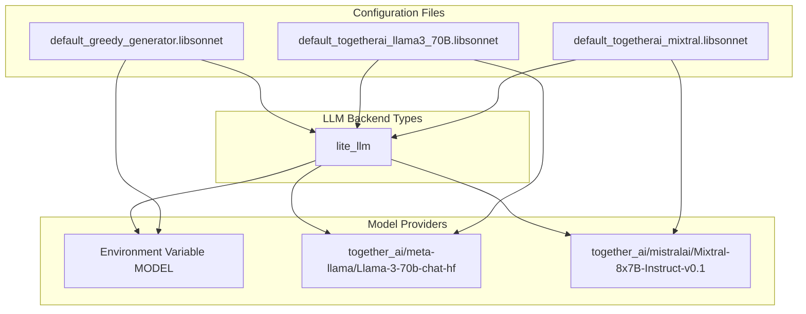
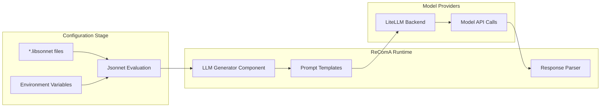

<!-- source: DeepWiki mcp.deepwiki.com · repo allenai/discoveryworld · page 5.2 Language Model Configurations · fetched 2026-10-26 -->

# Language Model Configurations

Relevant source files

The following files were used as context for generating this wiki page:

- [agents/recoma/configs/default_greedy_generator.libsonnet](agents/recoma/configs/default_greedy_generator.libsonnet)
- [agents/recoma/configs/default_togetherai_llama3_70B.libsonnet](agents/recoma/configs/default_togetherai_llama3_70B.libsonnet)
- [agents/recoma/configs/default_togetherai_mixtral.libsonnet](agents/recoma/configs/default_togetherai_mixtral.libsonnet)

This document covers the language model configuration system within the ReComA framework, including the structure of configuration files, available templates, and parameter options for different LLM providers. For general ReComA setup and installation, see [ReComA Setup & Configuration](#5.1). For configuring specific agent types that use these language models, see [React Agent Configuration](#5.3) and [Plan & Execute Agent Configuration](#5.4).

## Configuration File Structure

The ReComA framework uses Jsonnet files to define language model configurations. These configurations specify which model to use, connection parameters, generation settings, and other behavioral options.

### Basic Configuration Schema

All language model configurations follow a common schema with the following core components:

| Parameter | Type | Purpose | Required |
|-----------|------|---------|----------|
| `type` | String | Specifies the LLM backend type | Yes |
| `model` | String | Model identifier or path | Yes |
| `max_tokens` | Integer | Maximum tokens to generate | Yes |
| `temperature` | Float | Randomness in generation (0.0-1.0) | Yes |
| `use_cache` | Boolean | Enable response caching | No |
| `stop` | Array | Stop sequences for generation | No |

### Configuration Types and Model Mapping

**Sources:** [agents/recoma/configs/default_greedy_generator.libsonnet:1-9](), [agents/recoma/configs/default_togetherai_llama3_70B.libsonnet:1-9](), [agents/recoma/configs/default_togetherai_mixtral.libsonnet:1-9]()

## Available Configuration Templates

The ReComA framework provides three pre-configured language model templates for different use cases:

### Default Greedy Generator

The `default_greedy_generator.libsonnet` provides a flexible configuration that uses environment variables to specify the model:

- **Type**: `lite_llm`
- **Model**: Specified via `MODEL` environment variable
- **Temperature**: 0.0 (deterministic generation)
- **Caching**: Enabled for reproducibility
- **Seed**: Uses `SEED` environment variable for reproducible randomness

This configuration is ideal for experiments where you want to test different models without changing configuration files.

### TogetherAI Llama 3 70B Configuration

The `default_togetherai_llama3_70B.libsonnet` configures the Llama 3 70B model via TogetherAI:

- **Model**: `together_ai/meta-llama/Llama-3-70b-chat-hf`
- **Temperature**: 0 (deterministic)
- **Top-p**: 1.0 (nucleus sampling disabled)
- **Caching**: Disabled (for fresh responses)

### TogetherAI Mixtral Configuration

The `default_togetherai_mixtral.libsonnet` configures the Mixtral 8x7B model:

- **Model**: `together_ai/mistralai/Mixtral-8x7B-Instruct-v0.1`
- **Temperature**: 0 (deterministic)
- **Top-p**: 1.0 (nucleus sampling disabled)
- **Caching**: Disabled

## Configuration Parameters

### Core Generation Parameters

| Parameter | Default Greedy | TogetherAI Llama | TogetherAI Mixtral | Description |
|-----------|----------------|------------------|-------------------|-------------|
| `max_tokens` | 100 | 100 | 100 | Maximum tokens in response |
| `temperature` | 0.0 | 0 | 0 | Randomness (0=deterministic) |
| `top_p` | Not set | 1 | 1 | Nucleus sampling threshold |
| `use_cache` | true | false | false | Cache responses for reuse |
| `stop` | `["\n"]` | `["\n"]` | `["\n"]` | Stop generation at newline |

### Environment Variable Integration

The default greedy generator uses Jsonnet's `std.extVar()` function to read environment variables:

- `MODEL`: Specifies which model to use
- `SEED`: Provides reproducible randomness via `std.parseInt()`

This allows runtime configuration without modifying files.

### Provider-Specific Parameters

#### LiteLLM Backend

All configurations use the `lite_llm` type, which provides a unified interface to multiple LLM providers including:

- OpenAI models
- TogetherAI models  
- Local models
- Other LiteLLM-supported providers

The model string format determines the provider routing within LiteLLM.

## Integration with ReComA Components

### Configuration Loading Flow

**Sources:** [agents/recoma/configs/default_greedy_generator.libsonnet:3-7](), [agents/recoma/configs/default_togetherai_llama3_70B.libsonnet:2-4](), [agents/recoma/configs/default_togetherai_mixtral.libsonnet:2-4]()

### Configuration Selection

The ReComA framework allows selecting different language model configurations based on:

- Agent type (React vs Plan & Execute)
- Experimental requirements
- Cost constraints
- Performance needs

Each configuration balances these factors through different parameter settings and model choices.

**Sources:** [agents/recoma/configs/default_greedy_generator.libsonnet:1-9](), [agents/recoma/configs/default_togetherai_llama3_70B.libsonnet:1-9](), [agents/recoma/configs/default_togetherai_mixtral.libsonnet:1-9]()

---

