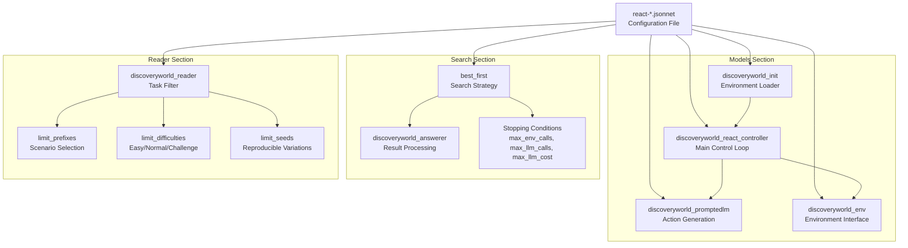
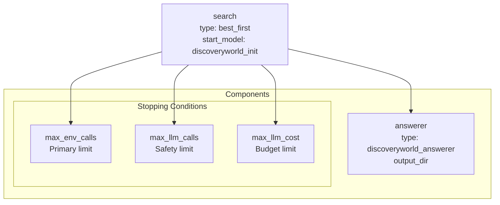

<!-- source: DeepWiki mcp.deepwiki.com · repo allenai/discoveryworld · page 5.3 React Agent Configuration · fetched 2026-10-26 -->

# React Agent Configuration

<details>
<summary>Relevant source files</summary>

The following files were used as context for generating this wiki page:

- [agents/recoma/configs/react-10steps.jsonnet](agents/recoma/configs/react-10steps.jsonnet)
- [agents/recoma/configs/react-easy-100steps-t0.jsonnet](agents/recoma/configs/react-easy-100steps-t0.jsonnet)
- [agents/recoma/configs/react-normal-1000steps-t0.jsonnet](agents/recoma/configs/react-normal-1000steps-t0.jsonnet)

</details>


This document explains how to configure React agents within the ReComA framework for DiscoveryWorld scientific discovery tasks. React agents follow a reason-act cycle where they observe the environment, reason about their next action, and then execute that action iteratively.

For general ReComA setup and installation, see [ReComA Setup & Configuration](#5.1). For language model configuration details, see [Language Model Configurations](#5.2). For Plan & Execute agent configuration, see [Plan & Execute Agent Configuration](#5.4).

## Configuration Architecture

React agent configurations are defined using Jsonnet files that specify the models, search strategy, and task filtering parameters. The configuration system uses a modular approach where different components can be independently configured and combined.

### React Agent Configuration Flow



Sources: [agents/recoma/configs/react-10steps.jsonnet:1-54](), [agents/recoma/configs/react-easy-100steps-t0.jsonnet:1-62](), [agents/recoma/configs/react-normal-1000steps-t0.jsonnet:1-62]()

## Model Configuration

The `models` section defines the core components that work together to implement the React agent functionality.

### Model Component Structure

```mermaid
graph LR
    subgraph "Model Chain"
        LOADER["discoveryworld_init<br/>type: discoveryworld_loader<br/>threadid_offset<br/>next_model: react"]
        
        CONTROLLER["react<br/>type: discoveryworld_react_controller<br/>action_model: action<br/>observation_model: environment<br/>add_roles: true<br/>max_output_length: 10000<br/>max_history: -1"]
        
        LLM["action<br/>type: discoveryworld_promptedlm<br/>prompt_file: react_prompt.txt<br/>generator_params<br/>max_tokens: 400<br/>stop: [\"```\\n\"]"]
        
        ENVMODEL["environment<br/>type: discoveryworld_env<br/>output_dir"]
    end
    
    LOADER --> CONTROLLER
    CONTROLLER --> LLM
    CONTROLLER --> ENVMODEL
```

Sources: [agents/recoma/configs/react-10steps.jsonnet:7-30](), [agents/recoma/configs/react-easy-100steps-t0.jsonnet:7-30]()

### Model Parameters

| Component | Type | Key Parameters | Purpose |
|-----------|------|----------------|---------|
| `discoveryworld_init` | `discoveryworld_loader` | `threadid_offset`, `next_model` | Environment initialization and threading |
| `react` | `discoveryworld_react_controller` | `action_model`, `observation_model`, `add_roles`, `max_history` | Main React loop coordination |
| `action` | `discoveryworld_promptedlm` | `prompt_file`, `generator_params`, `max_tokens`, `stop` | LLM-based action generation |
| `environment` | `discoveryworld_env` | `output_dir` | Environment state management |

**Key Configuration Options:**

- `max_history: -1` - Shows unlimited history steps to the agent
- `add_roles: true` - Includes role information in prompts
- `max_output_length: 10000` - Maximum characters in agent output
- `max_tokens: 400` - Maximum tokens for LLM action generation
- `stop: ["```\n"]` - Stop sequence for LLM generation

Sources: [agents/recoma/configs/react-10steps.jsonnet:13-25](), [agents/recoma/configs/react-easy-100steps-t0.jsonnet:13-25]()

## Search Configuration

The `search` section defines the search strategy and execution limits for the React agent.

### Search Strategy Configuration



Sources: [agents/recoma/configs/react-10steps.jsonnet:31-43](), [agents/recoma/configs/react-normal-1000steps-t0.jsonnet:31-42]()

### Stopping Conditions by Configuration

| Configuration File | `max_env_calls` | `max_llm_calls` | `max_llm_cost` | Use Case |
|-------------------|-----------------|-----------------|----------------|----------|
| `react-10steps.jsonnet` | 10 | 1000 | $50.00 | Quick testing |
| `react-easy-100steps-t0.jsonnet` | 100 | 1000 | $50.00 | Easy difficulty evaluation |
| `react-normal-1000steps-t0.jsonnet` | 1000 | 1500 | $50.00 | Normal difficulty evaluation |

Sources: [agents/recoma/configs/react-10steps.jsonnet:4,39-42](), [agents/recoma/configs/react-easy-100steps-t0.jsonnet:4,39-42](), [agents/recoma/configs/react-normal-1000steps-t0.jsonnet:4,40-42]()

## Reader Configuration

The `reader` section filters which tasks the React agent will attempt, allowing targeted evaluation on specific scenarios, difficulties, and seeds.

### Task Filtering Options

| Parameter | Purpose | Example Values |
|-----------|---------|----------------|
| `limit_prefixes` | Select specific scenarios | `["Combinatorial Chemistry"]`, `["Small Skills"]` |
| `limit_difficulties` | Filter by difficulty level | `["Easy"]`, `["Normal"]`, `["Challenge"]` |
| `limit_seeds` | Choose specific seed variations | `[1, 2, 3, 4, 5]`, `[4, 5]` |

### Available Scenario Prefixes

Based on the configuration files, the following scenario prefixes are available:

- `"Combinatorial Chemistry"`
- `"Archaeology Dating"`
- `"Plant Nutrients"`
- `"Reactor Lab"`
- `"Lost in Translation"`
- `"Space Sick"`
- `"Proteomics"`
- `"It's (not) Rocket Science!"`
- `"Small Skills"`

Sources: [agents/recoma/configs/react-easy-100steps-t0.jsonnet:46-61](), [agents/recoma/configs/react-normal-1000steps-t0.jsonnet:46-61]()

## Common Configuration Patterns

### Development and Testing Pattern

For rapid development and testing, use minimal step limits with specific scenarios:

```json
"max_env_calls": 10,
"limit_prefixes": ["Small Skills"],
"limit_seeds": [1]
```

This pattern is demonstrated in [agents/recoma/configs/react-10steps.jsonnet:4,49,52]().

### Easy Difficulty Evaluation Pattern

For systematic evaluation on easy tasks:

```json
"max_env_calls": 100,
"limit_difficulties": ["Easy"],
"limit_seeds": [1, 2, 3, 4, 5]
```

This pattern is shown in [agents/recoma/configs/react-easy-100steps-t0.jsonnet:4,59-60]().

### Normal Difficulty Evaluation Pattern

For challenging evaluation scenarios:

```json
"max_env_calls": 1000,
"limit_difficulties": ["Normal"],
"limit_seeds": [4, 5]
```

This pattern is used in [agents/recoma/configs/react-normal-1000steps-t0.jsonnet:4,59-60]().

## Environment Variables

React agent configurations support environment variable injection:

- `MODEL` - Specifies the language model to use
- `OUTPUT_DIR` - Directory for saving results and logs

These variables are referenced in the configuration files using `std.extVar()`:

```jsonnet
local model = std.extVar('MODEL');
local output_dir = std.extVar('OUTPUT_DIR');
```

Sources: [agents/recoma/configs/react-10steps.jsonnet:1-2](), [agents/recoma/configs/react-easy-100steps-t0.jsonnet:1-2]()

## Generator Parameters

All React configurations import default generator parameters and can override specific settings:

```jsonnet
local generator_params = import "default_greedy_generator.libsonnet";
"generator_params": generator_params + {"max_tokens": 400, "stop": ["```\n"]}
```

The generator parameters control how the language model generates responses, including token limits and stop sequences.

Sources: [agents/recoma/configs/react-10steps.jsonnet:5,24](), [agents/recoma/configs/react-easy-100steps-t0.jsonnet:5,24]()

---

