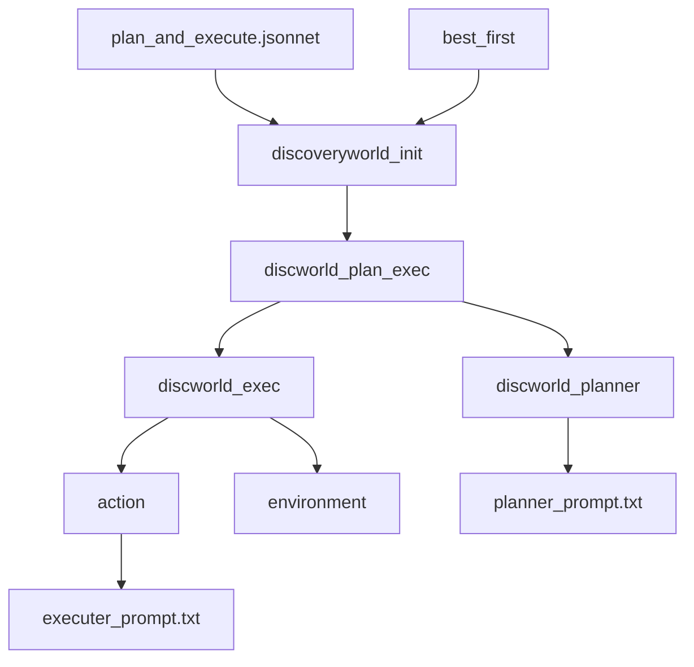
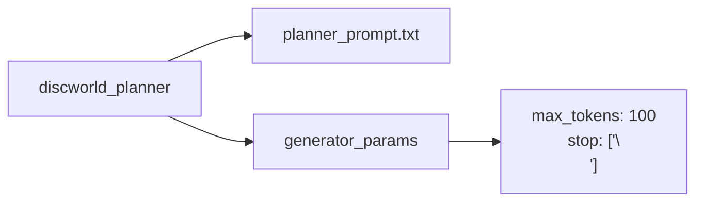
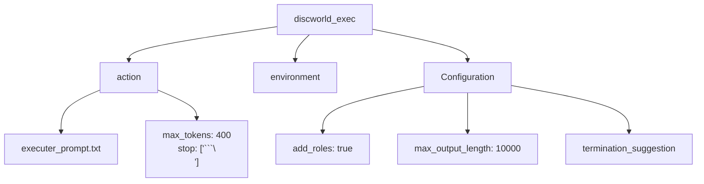
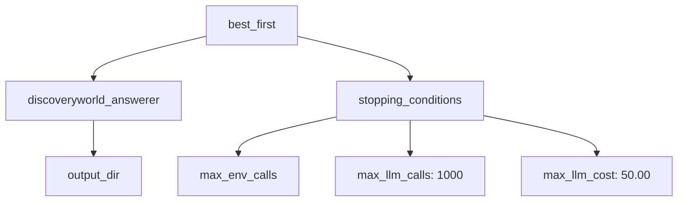

<!-- source: DeepWiki mcp.deepwiki.com · repo allenai/discoveryworld · page 5.4 Plan & Execute Agent Configuration · fetched 2026-10-26 -->

# Plan & Execute Agent Configuration

<details>
<summary>Relevant source files</summary>

The following files were used as context for generating this wiki page:

- [agents/recoma/configs/plan_and_execute.jsonnet](agents/recoma/configs/plan_and_execute.jsonnet)
- [agents/recoma/configs/plan_and_execute_custom.jsonnet](agents/recoma/configs/plan_and_execute_custom.jsonnet)

</details>


This document covers the configuration of Plan & Execute agents within the ReComA framework. Plan & Execute agents use a hierarchical approach where a high-level planner creates strategic plans that are then executed by a reactive executor component. This configuration guide focuses specifically on the Plan & Execute agent architecture and its configuration parameters.

For information about general ReComA setup, see [ReComA Setup & Configuration](#5.1). For React agent configuration, see [React Agent Configuration](#5.3). For language model configuration options, see [Language Model Configurations](#5.2).

## Configuration Architecture Overview

Plan & Execute agents use a two-stage architecture coordinated through Jsonnet configuration files. The system separates strategic planning from tactical execution, allowing for more sophisticated agent behavior in complex environments.



**Plan & Execute Model Architecture**

Sources: [agents/recoma/configs/plan_and_execute.jsonnet:1-61]()

## Model Configuration Structure

The Plan & Execute configuration defines a hierarchical model structure where the `discoveryworld_plan_and_execute` model coordinates between planning and execution phases.

| Model Name | Type | Purpose | Key Parameters |
|------------|------|---------|----------------|
| `discoveryworld_init` | `discoveryworld_loader` | Environment initialization | `threadid_offset`, `next_model` |
| `discworld_plan_exec` | `discoveryworld_plan_and_execute` | Main coordinator | `plan_model`, `exec_model` |
| `discworld_planner` | `discoveryworld_promptedlm` | Strategic planning | `prompt_file`, `generator_params` |
| `discworld_exec` | `discoveryworld_react_controller` | Plan execution | `action_model`, `observation_model` |
| `action` | `discoveryworld_promptedlm` | Action generation | `prompt_file`, `generator_params` |
| `environment` | `discoveryworld_env` | Environment interface | `output_dir` |

The coordinator model `discworld_plan_exec` manages the interaction between the planner and executor components, ensuring that high-level plans are translated into concrete actions.

Sources: [agents/recoma/configs/plan_and_execute.jsonnet:7-40]()

## Planning Configuration

The planning component uses a specialized prompt and constrained generation parameters to create high-level strategic plans.



**Planner Model Configuration**

The planner is configured with specific constraints to ensure concise, actionable plans:

- **Prompt File**: `agents/recoma/prompts/planner_prompt.txt` - defines the planning task and format
- **Max Tokens**: 100 tokens - constrains plan length for focused objectives  
- **Stop Sequence**: `["\n"]` - terminates generation at newlines for single-line plans
- **Generator Type**: Uses `default_greedy_generator` for deterministic planning

Sources: [agents/recoma/configs/plan_and_execute.jsonnet:18-22]()

## Execution Configuration

The execution component uses the React controller pattern to implement plans through environment interactions.



**Executor Configuration Parameters**

The executor component includes several important configuration parameters:

- **Action Model**: `action` - handles action generation using `executer_prompt.txt`
- **Observation Model**: `environment` - processes environment feedback
- **Add Roles**: `true` - includes role information in prompts
- **Max Output Length**: 10000 characters - allows detailed reasoning
- **Termination Suggestion**: `max_env_calls / 5` - suggests termination after significant progress

The action generation uses a higher token limit (400) and different stop sequences (`["```\n"]`) compared to the planner, allowing for more detailed action reasoning.

Sources: [agents/recoma/configs/plan_and_execute.jsonnet:24-35]()

## Search and Resource Management

Plan & Execute agents use best-first search with comprehensive resource management and stopping conditions.



**Resource Management Configuration**

The search configuration includes multiple safety mechanisms:

| Stopping Condition | Standard Value | Custom Value | Purpose |
|-------------------|----------------|--------------|---------|
| `max_env_calls` | Variable | Variable | Primary execution limit |
| `max_llm_calls` | 1000 | 10000 | Prevents runaway LLM usage |
| `max_llm_cost` | $50.00 | $150.00 | Cost protection |

The custom configuration variant provides higher limits for extended experiments while maintaining cost protections.

Sources: [agents/recoma/configs/plan_and_execute.jsonnet:41-53](), [agents/recoma/configs/plan_and_execute_custom.jsonnet:49-54]()

## Configuration Variants

Two configuration variants are provided for different use cases:

### Standard Configuration (`plan_and_execute.jsonnet`)

- **Purpose**: Regular evaluation runs with conservative resource limits
- **LLM Call Limit**: 1000 calls
- **Cost Limit**: $50.00
- **Seed Range**: Fixed seeds 1-5 for reproducible evaluation

### Custom Configuration (`plan_and_execute_custom.jsonnet`)

- **Purpose**: Extended experiments and custom evaluations  
- **LLM Call Limit**: 10000 calls (10x higher)
- **Cost Limit**: $150.00 (3x higher)
- **Seed Configuration**: Single variable seed via `VARIATION` parameter

The custom variant allows for more extensive exploration while maintaining safety limits.

Sources: [agents/recoma/configs/plan_and_execute.jsonnet:50-59](), [agents/recoma/configs/plan_and_execute_custom.jsonnet:51-60]()

## Environment Variable Integration

Plan & Execute configurations use environment variables for runtime customization:

| Variable | Purpose | Usage |
|----------|---------|-------|
| `MODEL` | Language model selection | Imported but not directly used in config |
| `OUTPUT_DIR` | Output directory path | Used by environment and answerer models |
| `MAX_ENV_CALLS` | Environment interaction limit | Used for stopping conditions and thread offset |
| `TASK` | Task prefix filter | Constrains scenario selection |
| `DIFF` | Difficulty level | Filters available difficulty levels |
| `VARIATION` | Seed selection | Custom config only - selects specific seed |

The `threadid_offset` calculation (`200 + (max_env_calls / 100)`) provides unique thread identification for Plan & Execute agents, using 200 as a base offset to distinguish from other agent types.

Sources: [agents/recoma/configs/plan_and_execute.jsonnet:1-11](), [agents/recoma/configs/plan_and_execute_custom.jsonnet:1-11]()

---

