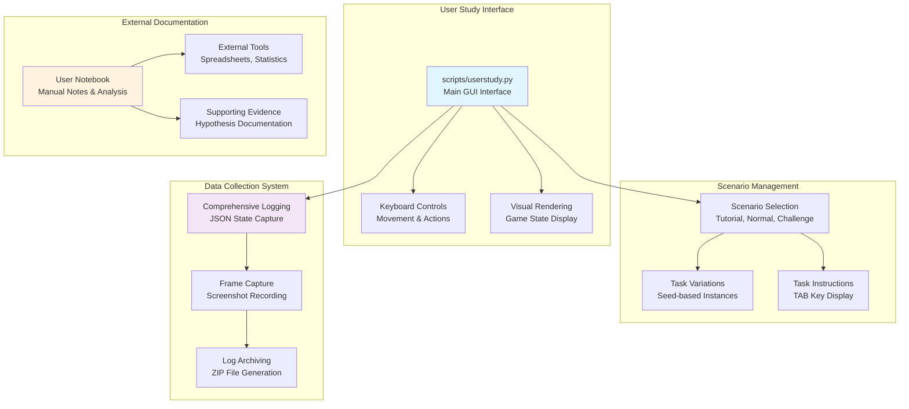
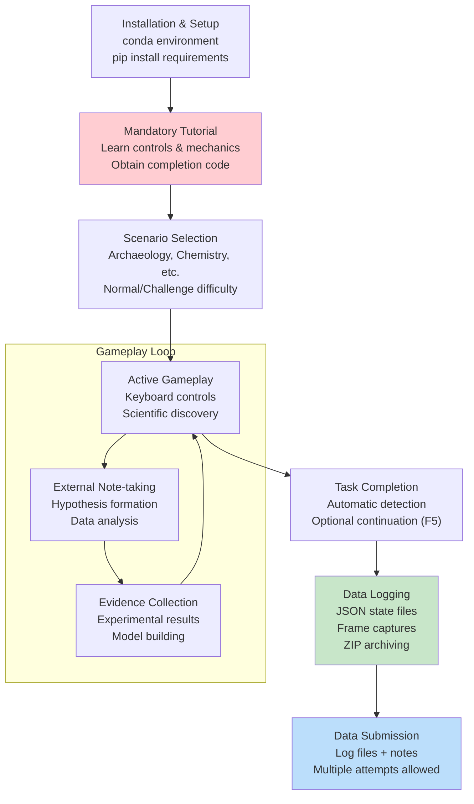
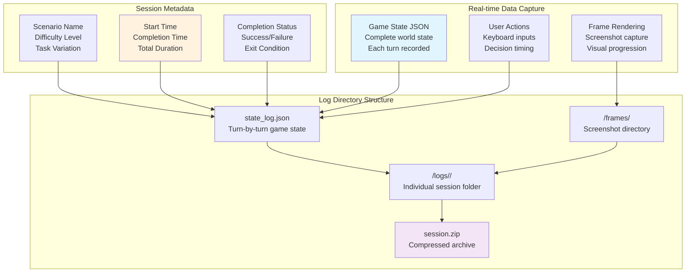
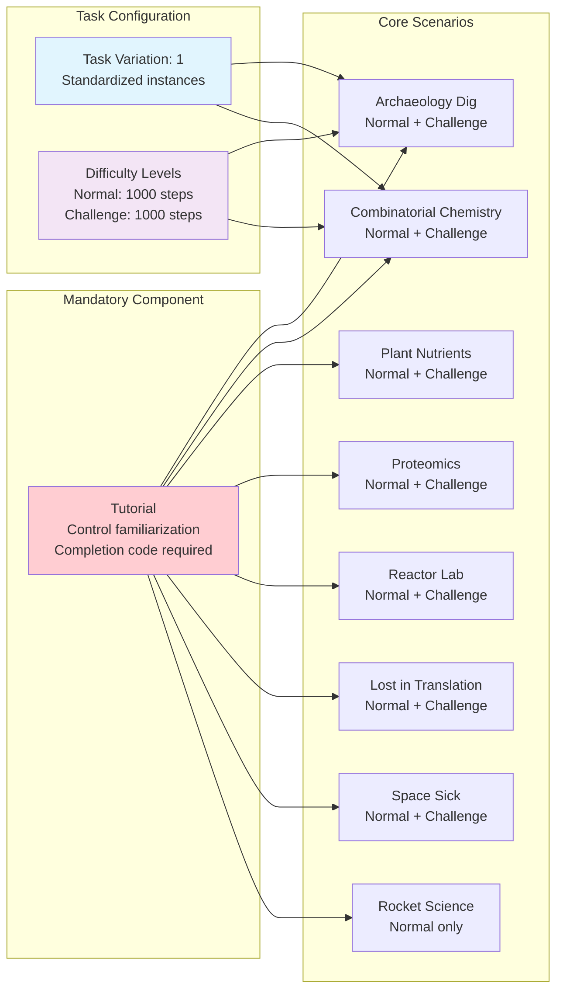
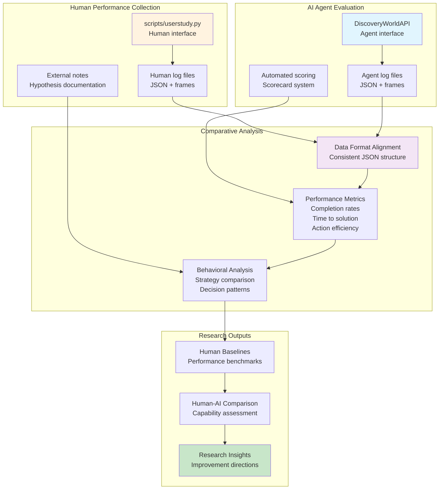

<!-- source: DeepWiki mcp.deepwiki.com · repo allenai/discoveryworld · page 6 User Studies & Human Evaluation · fetched 2026-10-26 -->

# User Studies & Human Evaluation

Relevant source files

The following files were used as context for generating this wiki page:

- [README-USERSTUDY.md](README-USERSTUDY.md)

This page covers the human evaluation system in DiscoveryWorld, which enables researchers to collect baseline human performance data for comparison with AI agents. The user study system provides a standardized interface for human participants to complete the same scientific discovery tasks that AI agents are evaluated on.

For detailed instructions on setting up and running user studies, see [Running User Studies](#6.1). For information about analyzing the collected data and performance metrics, see [Data Collection & Analysis](#6.2). For general information about AI agent evaluation and metrics, see [Scenarios & Tasks](#2.3).

## Overview

The user study system serves as a critical component for establishing human performance baselines across DiscoveryWorld's scientific discovery scenarios. By having humans complete the same tasks under controlled conditions, researchers can meaningfully compare AI agent capabilities against human problem-solving approaches.

The system is built around the `userstudy.py` script, which provides a graphical interface that allows human participants to interact with the same virtual environment and scenarios that AI agents encounter. All participant actions, decisions, and performance metrics are logged in the same format as AI agent data, enabling direct comparison.

## User Study Architecture

### System Components

**Sources:** [README-USERSTUDY.md:1-193]()

### Participant Workflow

**Sources:** [README-USERSTUDY.md:13-17](), [README-USERSTUDY.md:50-132]()

## Data Collection System

### Logging Architecture

The user study system implements comprehensive data collection that mirrors the logging used for AI agent evaluation, ensuring consistent data formats for comparison.

**Sources:** [README-USERSTUDY.md:134-179]()

### Data Format Consistency

The logging system ensures that human performance data is collected in the same format as AI agent data, enabling direct statistical comparison:

| Data Type | Human Study | AI Agent | Purpose |
|-----------|-------------|----------|---------|
| State Logs | JSON per turn | JSON per turn | Complete world state tracking |
| Action Logs | Keyboard inputs | API calls | Decision sequence analysis |
| Frame Captures | Screenshots | Rendered images | Visual behavior analysis |
| Timing Data | Real-time stamps | Processing time | Performance comparison |
| Completion Metrics | Success/failure | Scorecard system | Task evaluation |

**Sources:** [README-USERSTUDY.md:173-179]()

## Scenario Coverage

### Available Scenarios

The user study system covers the same scientific discovery scenarios available to AI agents:

**Sources:** [README-USERSTUDY.md:59-74](), [README-USERSTUDY.md:77-81]()

## Integration with Evaluation Framework

### Human-AI Comparison Pipeline

The user study system integrates with DiscoveryWorld's broader evaluation framework to enable systematic comparison between human and AI agent performance:

**Sources:** [README-USERSTUDY.md:5-8](), [README-USERSTUDY.md:88-94]()

## Controls and Interface

The user study interface provides comprehensive keyboard controls that map human actions to the same action space available to AI agents:

| Control Category | Keys | Function | AI Agent Equivalent |
|------------------|------|----------|-------------------|
| Movement | Arrow keys | Rotate/move forward/backward | `move()`, `rotate()` |
| Object Interaction | Space, d, p | Pick up, drop, put in container | `pickup()`, `drop()`, `put()` |
| Device Control | o, c, a, s | Open/close, activate/deactivate | `open()`, `close()`, `activate()` |
| Communication | t, r | Talk to characters, read objects | `talk()`, `read()` |
| Discovery | v | View discovery feed | Discovery feed access |
| Task Management | TAB | View current task | Task information API |

**Sources:** [README-USERSTUDY.md:140-158]()

The argument selection system uses number keys and bracket keys to specify interaction targets, mirroring the structured argument system used by AI agents when calling environment methods.

**Sources:** [README-USERSTUDY.md:142-143]()

---

