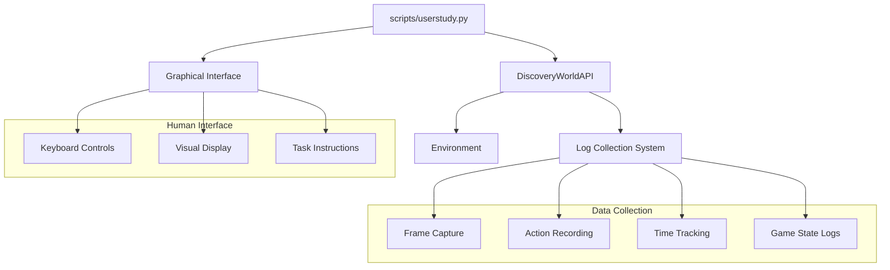
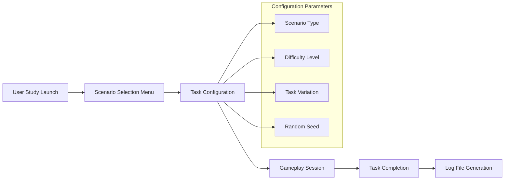
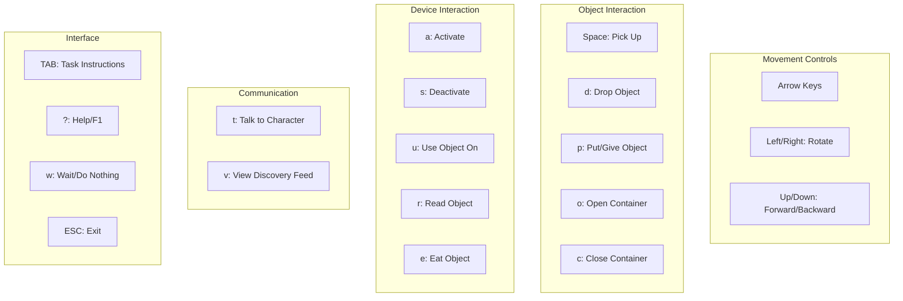
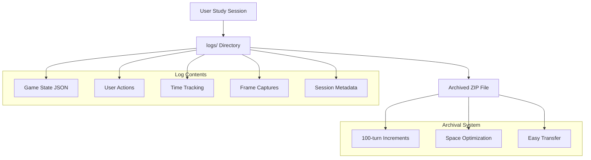

<!-- source: DeepWiki mcp.deepwiki.com · repo allenai/discoveryworld · page 6.1 Running User Studies · fetched 2026-10-26 -->

# Running User Studies

<details>
<summary>Relevant source files</summary>

The following files were used as context for generating this wiki page:

- [README-USERSTUDY.md](README-USERSTUDY.md)

</details>


This document covers the technical process for conducting user studies in DiscoveryWorld to collect human baseline performance data. User studies provide essential control data for comparing AI agent performance against human players on identical scientific discovery tasks.

For information about analyzing the collected user study data and performance metrics, see [Data Collection & Analysis](#6.2). For details about the core API and environment mechanics that power the user study interface, see [Core API & Environment](#2).

## Purpose and Overview

The user study system allows researchers to collect standardized human performance data across DiscoveryWorld's scientific scenarios. This creates a critical baseline for evaluating how AI agents compare to human problem-solving capabilities in discovery tasks.

The system provides a graphical interface that presents the same scenarios, difficulties, and evaluation criteria used for AI agents, ensuring direct comparability between human and artificial intelligence performance.

## User Study Architecture

The user study system integrates with DiscoveryWorld's core components to provide a human-accessible interface while maintaining the same underlying task structure used for AI evaluation.

### System Components Flow



Sources: [README-USERSTUDY.md:1-193]()

### User Study Execution Pipeline



Sources: [README-USERSTUDY.md:57-81]()

## Installation and Setup

### Environment Setup

The user study requires a standard DiscoveryWorld installation with the graphical interface enabled:

```bash
cd discoveryworld
conda create --name discoveryworld python=3.9
conda activate discoveryworld
pip install -r requirements.txt
pip install -e .
```

### Launching the User Study Interface

The user study interface is launched through the dedicated script:

```bash
python scripts/userstudy.py
```

This script provides the graphical interface that humans use to interact with DiscoveryWorld scenarios, while internally using the same `DiscoveryWorldAPI` that AI agents access.

Sources: [README-USERSTUDY.md:19-48]()

## Scenario Configuration

### Available Scenarios and Difficulties

The user study system provides access to a curated set of complete scenarios with multiple difficulty levels:

| Scenario | Normal Difficulty | Challenge Difficulty | Notes |
|----------|------------------|---------------------|--------|
| Tutorial | ✓ | - | Mandatory completion |
| Archaeology Dig | ✓ | ✓ | - |
| Combinatorial Chemistry | ✓ | ✓ | Challenge may take extended time |
| Plant Nutrients | ✓ | ✓ | - |
| Proteomics | ✓ | ✓ | - |
| Reactor Lab | ✓ | ✓ | - |
| Lost in Translation | ✓ | ✓ | - |
| Space Sick | ✓ | ✓ | - |
| It's (not) Rocket Science | ✓ | - | Challenge not ready |

### Task Variation Selection

For standardized comparison, users are directed to select task variation `1` across all scenarios. This ensures consistent baseline data collection across different human participants and enables direct comparison with AI agent performance on identical task instances.

Sources: [README-USERSTUDY.md:57-81]()

## Control Interface

### Input System

The user study interface provides comprehensive keyboard controls that map human input to the same action space available to AI agents:



### Argument Selection System

The interface uses argument boxes for object selection, mirroring the same parameter system used by AI agents:
- Number keys (1-9): Select inventory items for top argument box
- Shift + Number keys: Select for bottom argument box  
- `[` and `]`: Cycle through top argument box
- `;` and `'`: Cycle through bottom argument box

Sources: [README-USERSTUDY.md:138-158]()

## Data Collection System

### Log File Structure

The user study system generates comprehensive logs that capture the complete interaction session:



### Automatic Data Capture

The system automatically records:
- Complete game state at each turn
- All user actions and their timestamps  
- Visual frame captures for video reconstruction
- Task start and completion times
- Environmental state changes

Log files are automatically archived into ZIP files after each session to facilitate data transmission and analysis.

Sources: [README-USERSTUDY.md:134-179]()

## Research Protocol Integration

### Human Documentation Requirements

The user study protocol requires participants to maintain structured documentation that parallels the evaluation criteria used for AI agents:

**Required Documentation Format:**
```
START OF NOTES FOR:
Scenario: [Scenario Name]
Difficulty: [Normal/Challenge]
Variation: [Number]

TOOLS I USED WHEN SOLVING THIS SCENARIO:
[External tools like spreadsheets, statistics software]

HYPOTHESIS: [Solution hypothesis]
SUPPORTING EVIDENCE:
- [Evidence point 1]
- [Evidence point 2]
```

This structured format enables systematic comparison between human reasoning processes and AI agent decision-making patterns.

### External Tool Integration

The protocol encourages use of external analysis tools (spreadsheets, statistical software) to mirror the comprehensive analysis capabilities that AI agents may leverage, ensuring fair comparison conditions.

Sources: [README-USERSTUDY.md:86-119]()

## Session Management

### Completion Handling

The system provides flexible completion management:
- Automatic notification upon task completion
- Optional extended play period (F5 key) for additional evidence gathering
- Graceful handling of early exits or time limits
- Support for multiple attempts with separate log generation

### Multi-Session Support

Each gameplay session generates a separate log directory and ZIP file, enabling:
- Multiple attempts at the same scenario
- Tracking learning effects across sessions  
- Comprehensive data collection for statistical analysis

Sources: [README-USERSTUDY.md:121-133]()

---

