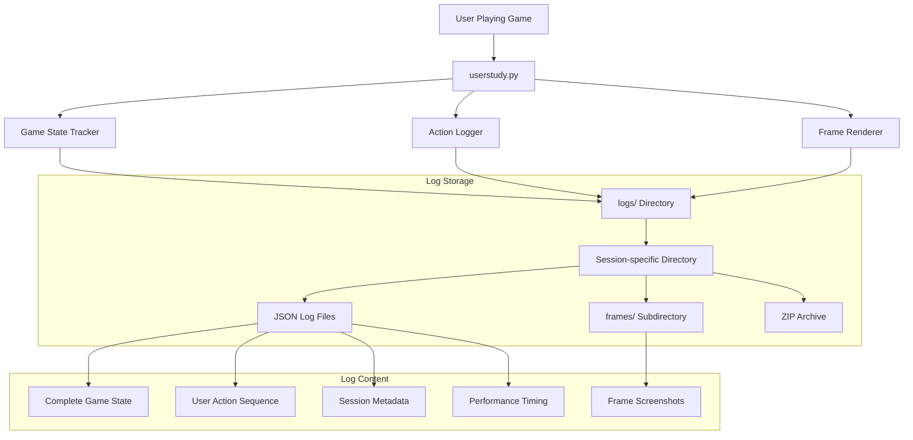
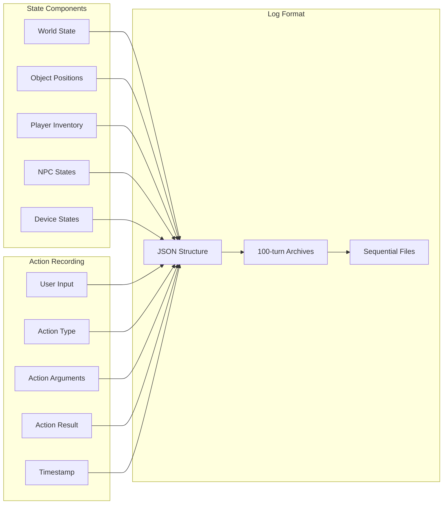
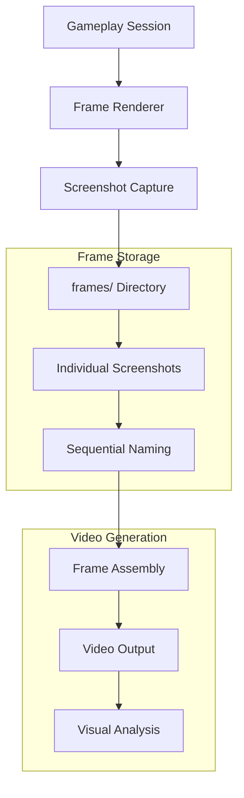
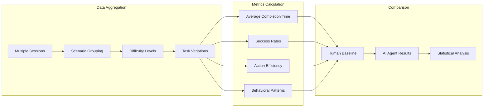

<!-- source: DeepWiki mcp.deepwiki.com · repo allenai/discoveryworld · page 6.2 Data Collection & Analysis · fetched 2026-10-26 -->

# Data Collection & Analysis

Relevant source files

The following files were used as context for generating this wiki page:

- [README-USERSTUDY.md](README-USERSTUDY.md)

This document covers the comprehensive data collection and analysis systems used for evaluating human performance in DiscoveryWorld user studies. It explains the log file formats, performance metrics, video generation, and analysis methods for comparing human baseline performance with AI agent results.

For information about setting up and running user studies, see [Running User Studies](#6.1).

## Log File Architecture

DiscoveryWorld implements a comprehensive logging system that captures detailed gameplay data for analysis. The system automatically generates structured logs during user study sessions.

### Data Collection Flow

Sources: [README-USERSTUDY.md:134-179]()

### Log Directory Structure

Each user study session creates a unique log directory containing comprehensive gameplay data:

| Component | Description | Location |
|-----------|-------------|----------|
| JSON Logs | Game state and actions in 100-turn increments | Session directory root |
| Frame Screenshots | Visual recordings for video generation | `frames/` subdirectory |
| Session Metadata | Start time, completion time, scenario info | Root JSON files |
| ZIP Archive | Compressed complete session data | `logs/` directory |

The logging system creates a new directory for each scenario playthrough, ensuring complete isolation of data between sessions.

Sources: [README-USERSTUDY.md:162-179]()

## Data Collection Mechanisms

### Game State Logging

The system captures the complete game state at each turn, including all object positions, player inventory, NPC states, and device configurations. This enables full reconstruction of gameplay sessions for analysis.

Sources: [README-USERSTUDY.md:174-179]()

### Performance Metrics Collection

The logging system automatically tracks several key performance indicators:

| Metric | Description | Usage |
|--------|-------------|--------|
| Start Time | When the scenario began | Session duration calculation |
| Completion Time | Total time to complete task | Performance comparison |
| Action Count | Number of actions taken | Efficiency analysis |
| Turn Sequence | Step-by-step progression | Behavioral analysis |
| Success Status | Task completion status | Success rate metrics |

### Frame Capture System

The frame capture system records visual screenshots at each game turn, stored in the `frames/` subdirectory. These images can be assembled into videos for visual analysis of player behavior and decision-making patterns.

Sources: [README-USERSTUDY.md:174-175]()

## Analysis Methods

### Log File Inspection

Log files are saved as JSON format and can be viewed with any text editor capable of handling large JSON files. The data structure enables programmatic analysis of:

- **Action Sequences**: Complete record of user decisions
- **State Transitions**: How the game world changed over time  
- **Timing Patterns**: Decision-making speed and pause locations
- **Error Recovery**: How users handled failed actions

### Performance Comparison Framework

The collected data supports multiple analysis approaches:

| Analysis Type | Data Source | Purpose |
|---------------|-------------|---------|
| Completion Rate | Session metadata | Success percentage across scenarios |
| Time Analysis | Start/end timestamps | Efficiency comparison with AI agents |
| Action Efficiency | Action counts vs. optimal paths | Strategy effectiveness |
| Behavioral Patterns | Action sequences | Decision-making strategies |

### Multi-Session Analysis

When users play scenarios multiple times, the system maintains separate log files for each attempt, enabling analysis of learning curves and retry strategies.

Sources: [README-USERSTUDY.md:132-133]()

## Data Transmission and Storage

### Archive Generation

After each gaming session, the system automatically:

1. **Saves** all JSON logs and frame captures
2. **Creates** a ZIP archive of the complete session
3. **Stores** the archive in the `logs/` directory
4. **Provides** a single file for easy transmission

### File Size Management

The logging system implements space-efficient storage:

- **Incremental Archiving**: Logs saved in 100-turn chunks
- **Compression**: ZIP archives reduce transmission size  
- **Frame Optimization**: Screenshots stored efficiently
- **JSON Minification**: Structured data without unnecessary whitespace

Sources: [README-USERSTUDY.md:166-168](), [README-USERSTUDY.md:178-179]()

## Integration with User Study Protocol

The data collection system integrates seamlessly with the user study workflow described in [Running User Studies](#6.1):

- **Automatic Activation**: Logging starts when `userstudy.py` launches
- **Scenario Isolation**: Each task creates separate data collection
- **Completion Triggers**: Data saved on task completion or early exit
- **Extended Play Support**: Continued logging if user plays beyond completion

The comprehensive data collection enables researchers to establish robust human performance baselines for comparison with AI agent capabilities across all DiscoveryWorld scenarios.

Sources: [README-USERSTUDY.md:121-137]()

---

