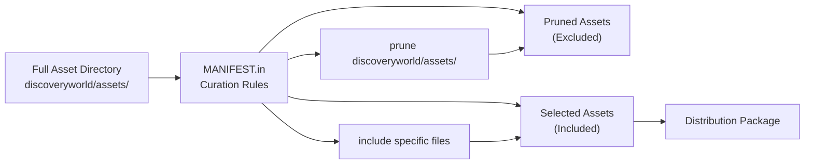
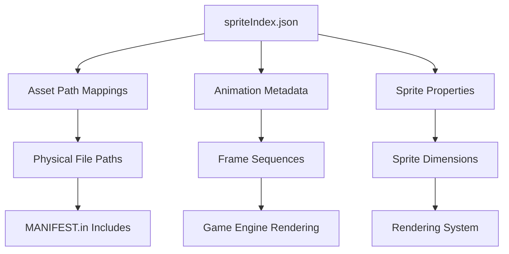
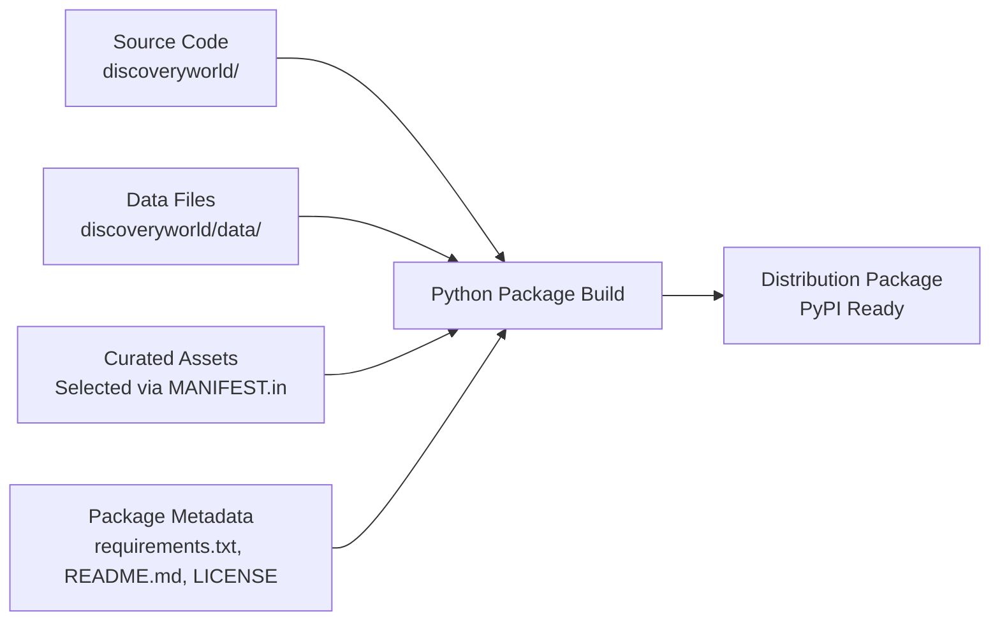

<!-- source: DeepWiki mcp.deepwiki.com · repo allenai/discoveryworld · page 7 Asset Management & Distribution · fetched 2026-10-26 -->

# Asset Management & Distribution

Relevant source files

The following files were used as context for generating this wiki page:

- [MANIFEST.in](MANIFEST.in)

This document covers the asset management pipeline and Python package distribution system for DiscoveryWorld. It explains how visual assets are organized, curated for distribution, and packaged into the final Python package available on PyPI.

For information about configuring and running the asset pipeline in development, see [Asset Pipeline](#7.1). For details about the Python package structure and distribution mechanism, see [Package Distribution](#7.2).

## Purpose and Scope

The asset management system in DiscoveryWorld handles the organization, curation, and distribution of visual assets including sprites, textures, and UI elements. The system uses a selective inclusion strategy to minimize package size while ensuring all necessary assets are available at runtime. The distribution system packages these curated assets into a Python package suitable for PyPI distribution.

## Asset Organization Structure

DiscoveryWorld organizes its assets into several distinct categories within the `discoveryworld/assets/` directory structure:

### Asset Directory Structure

```mermaid
graph TD
    assets["discoveryworld/assets/"]
    assets --> generated["generated/"]
    assets --> pixymoon["pixymoon/"]
    assets --> placeholder["placeholder/"]
    assets --> spriteIndex["spriteIndex.json"]
    
    generated --> flowerpot["flowerpot1_32.png"]
    
    pixymoon --> castle["CuteRPG_Castle_New/"]
    pixymoon --> caves["CuteRPG_Caves/"]
    pixymoon --> desert["CuteRPG_Desert/"]
    pixymoon --> enemies["CuteRPG_Enemies/"]
    pixymoon --> forest["CuteRPG_Forest/"]
    pixymoon --> houses["CuteRPG_Houses/"]
    pixymoon --> interior["CuteRPG_Interior/"]
    pixymoon --> sprites["CuteRPG_Sprites/"]
    pixymoon --> village["CuteRPG_Village/"]
    
    placeholder --> holes["holes.png"]
    placeholder --> instruments1["instruments1.png"]
    placeholder --> instruments2["instruments2.png"]
    placeholder --> missing["missing.png"]
    placeholder --> ui["ui.png"]
    placeholder --> statues["statue-*.png"]
```

**Sources:** [MANIFEST.in:5-53]()

The asset categories serve distinct purposes:

| Category | Purpose | Example Assets |
|----------|---------|----------------|
| `generated/` | Programmatically created assets | `flowerpot1_32.png` |
| `pixymoon/` | Third-party CuteRPG themed sprites | Character sprites, environment tiles |
| `placeholder/` | Development and fallback assets | UI elements, missing texture placeholders |
| `spriteIndex.json` | Asset registry and metadata | Animation frames, sprite mappings |

## Asset Selection and Curation Process

The distribution package uses a selective inclusion strategy implemented through `MANIFEST.in`. This approach minimizes package size by excluding the majority of assets while including only those necessary for runtime operation.

### Asset Curation Strategy

**Sources:** [MANIFEST.in:7-8](), [MANIFEST.in:10-53]()

The curation process follows these rules:

1. **Global Exclusion**: `prune discoveryworld/assets/` excludes the entire assets directory
2. **Selective Inclusion**: Individual `include` statements add back specific required files
3. **Essential Assets**: Only assets referenced by `spriteIndex.json` and core gameplay are included
4. **Size Optimization**: Large or redundant assets are excluded to minimize download size

## Asset Index Management

The `spriteIndex.json` file serves as the central registry for all assets used by the game engine. This file maps logical asset names to physical file paths and contains metadata about animations and sprite properties.

### spriteIndex.json Structure

The sprite index acts as the authoritative source for asset references:

**Sources:** [MANIFEST.in:8]()

The sprite index ensures that:
- Only referenced assets are included in distribution
- Asset paths remain consistent across deployments
- Animation sequences are properly defined
- Sprite metadata is available at runtime

## Distribution Package Structure

The final distribution package includes carefully selected assets alongside the core Python code. The package structure balances functionality with size constraints.

### Package Contents Selection

| File Type | Inclusion Strategy | Examples |
|-----------|-------------------|----------|
| Core Assets | Always included | `spriteIndex.json` |
| Generated Assets | Selected essential items | `flowerpot1_32.png` |
| Third-party Assets | Curated subset | CuteRPG environment tiles |
| Placeholder Assets | Development necessities | `missing.png`, `ui.png` |
| Data Files | Complete inclusion | `recursive-include discoveryworld/data *` |

The package maintains separation between code and assets while ensuring runtime availability of all necessary resources.

### Package Build Process

**Sources:** [MANIFEST.in:1-5](), [MANIFEST.in:7-53]()

The build process ensures that:
- All Python modules are included
- Data files are recursively included
- Only curated assets are packaged
- Standard package metadata is present
- The package meets PyPI distribution requirements

**Sources:** [MANIFEST.in:1-53]()

---

