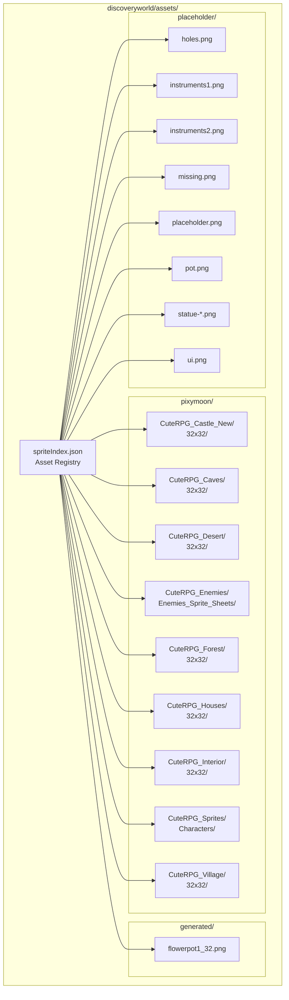

<!-- source: DeepWiki mcp.deepwiki.com · repo allenai/discoveryworld · page 7.1 Asset Pipeline · fetched 2026-10-26 -->

# Asset Pipeline

<details>
<summary>Relevant source files</summary>

The following files were used as context for generating this wiki page:

- [MANIFEST.in](MANIFEST.in)

</details>


## Purpose and Scope

The Asset Pipeline manages the organization, curation, and distribution of visual assets within DiscoveryWorld. This system ensures that only essential assets are included in the distributed package while maintaining a complete development asset repository. The pipeline handles sprite graphics, UI elements, and procedural content through a selective inclusion mechanism.

For information about the broader package distribution system, see [Package Distribution](#7.2).

## Asset Organization Structure

The DiscoveryWorld asset system is organized into distinct categories with different inclusion rules for distribution. The primary asset directory structure follows a hierarchical organization that separates third-party assets, generated content, and placeholder graphics.



Sources: [MANIFEST.in:1-54]()

## Asset Curation System

The asset curation system uses `MANIFEST.in` to implement a "prune and include" strategy. This approach excludes the entire asset directory by default, then selectively includes only the assets required for runtime operation.

### Pruning Strategy

The curation process follows these steps:

| Step | Action | Pattern |
|------|--------|---------|
| 1 | Prune entire directory | `prune discoveryworld/assets/` |
| 2 | Include asset registry | `include discoveryworld/assets/spriteIndex.json` |
| 3 | Include specific assets | Individual `include` statements |

### Included Asset Categories

```mermaid
graph LR
    subgraph "MANIFEST_IN[\"MANIFEST.in Curation\"]"
        PRUNE["prune discoveryworld/assets/"]
        INCLUDE_REGISTRY["include spriteIndex.json"]
        INCLUDE_SPECIFIC["include specific assets"]
    end
    
    subgraph "INCLUDED_ASSETS[\"Included Assets\"]"
        GENERATED_ASSETS["generated/flowerpot1_32.png"]
        
        subgraph "PIXYMOON_ASSETS[\"pixymoon Assets\"]"
            CASTLE_ASSET["CuteRPG_Castle_New.png"]
            CAVES_ASSET["CuteRPG_Caves.png"]
            DESERT_INSIDE["CuteRPG_Desert_Inside.png"]
            DESERT_OUTSIDE["CuteRPG_Desert_Outside_modified.png"]
            ENEMY_SPRITES["Enemy sprite sheets<br/>(6 variants with greyscale)"]
            FOREST_ASSET["CuteRPG_Forest_modified2.png"]
            HOUSE_ASSETS["House and interior assets"]
            CHARACTER_SPRITES["Character sprites<br/>(7 character variants)"]
            VILLAGE_ASSETS["Village assets"]
        end
        
        subgraph "PLACEHOLDER_ASSETS[\"placeholder Assets\"]"
            UI_ELEMENTS["ui.png"]
            INSTRUMENTS["instruments1.png, instruments2.png"]
            STATUES["6 statue variants"]
            MISC_PLACEHOLDERS["holes.png, missing.png, placeholder.png, pot.png"]
        end
    end
    
    PRUNE --> INCLUDE_REGISTRY
    INCLUDE_REGISTRY --> INCLUDE_SPECIFIC
    INCLUDE_SPECIFIC --> GENERATED_ASSETS
    INCLUDE_SPECIFIC --> PIXYMOON_ASSETS
    INCLUDE_SPECIFIC --> PLACEHOLDER_ASSETS
```

Sources: [MANIFEST.in:7-53]()

## Asset Registry System

The `spriteIndex.json` file serves as the central asset registry, providing metadata and mapping information for all visual assets in the system. This registry is always included in distributions as it contains essential runtime information for asset resolution.

### Registry Functions

The sprite index performs several critical functions:

- **Asset Discovery**: Maps logical asset names to file paths
- **Animation Metadata**: Stores frame counts, timing, and sequence information  
- **Resource Mapping**: Links game objects to their visual representations
- **Runtime Resolution**: Enables dynamic asset loading during gameplay

```mermaid
graph TD
    subgraph "SPRITE_INDEX[\"spriteIndex.json Registry\"]"
        METADATA["Animation Metadata<br/>Frame counts, timing"]
        MAPPING["Asset Name Mapping<br/>Logical to physical paths"]
        DISCOVERY["Asset Discovery<br/>Runtime resolution"]
    end
    
    subgraph "GAME_SYSTEMS[\"Game Systems\"]"
        RENDERER["Rendering System"]
        OBJECTS["Game Objects"]
        UI_SYSTEM["UI System"]
    end
    
    subgraph "ASSET_FILES[\"Asset Files\"]"
        PIXYMOON_FILES["pixymoon/*.png"]
        GENERATED_FILES["generated/*.png"]
        PLACEHOLDER_FILES["placeholder/*.png"]
    end
    
    SPRITE_INDEX --> RENDERER
    SPRITE_INDEX --> OBJECTS
    SPRITE_INDEX --> UI_SYSTEM
    
    RENDERER --> PIXYMOON_FILES
    RENDERER --> GENERATED_FILES
    RENDERER --> PLACEHOLDER_FILES
    
    OBJECTS --> PIXYMOON_FILES
    UI_SYSTEM --> PLACEHOLDER_FILES
```

Sources: [MANIFEST.in:8]()

## Asset Categories

### Third-Party Assets (pixymoon)

The pixymoon asset collection provides the primary visual theme for DiscoveryWorld, featuring a consistent CuteRPG art style. These assets are selectively included based on their usage in implemented scenarios.

**Environment Tilesets:**
- `CuteRPG_Castle_New.png` - Castle and fortress environments
- `CuteRPG_Caves.png` - Underground and cave systems  
- `CuteRPG_Desert_Inside.png` / `CuteRPG_Desert_Outside_modified.png` - Desert environments
- `CuteRPG_Forest_modified2.png` - Forest and natural environments
- `CuteRPG_Village.png` / `CuteRPG_Village_House.png` - Village and residential areas

**Character and Entity Assets:**
- Character sprites (009, 015, 016, 017, 018, 032, 035)
- Enemy sprite sheets with both color and greyscale variants
- Interior furniture and objects

### Generated Assets

Generated assets are programmatically created content that fills specific gameplay requirements not covered by third-party assets.

**Current Generated Assets:**
- `flowerpot1_32.png` - Procedural flowerpot graphic for plant-related scenarios

### Placeholder Assets

Placeholder assets provide fallback graphics and development aids for elements that may not have final artwork or require generic representations.

**UI and Development Assets:**
- `ui.png` - User interface elements
- `missing.png` - Missing asset indicator
- `placeholder.png` - Generic placeholder graphic

**Scientific Instruments:**
- `instruments1.png` / `instruments2.png` - Laboratory equipment representations

**Decorative Elements:**
- Various statue graphics (`statue-*.png`) matching enemy sprite variants
- Environmental elements (`holes.png`, `pot.png`)

Sources: [MANIFEST.in:10-53]()

## Distribution Pipeline

The asset pipeline implements a size-optimized distribution strategy that balances functionality with package size constraints. The pipeline selects approximately 50 specific assets from a larger development repository.

```mermaid
graph LR
    subgraph "DEVELOPMENT[\"Development Repository\"]"
        ALL_ASSETS["Complete Asset Library<br/>discoveryworld/assets/"]
        FULL_PIXYMOON["Full pixymoon Collection"]
        DEV_GENERATED["Development Generated Assets"]
        ALL_PLACEHOLDERS["Complete Placeholder Set"]
    end
    
    subgraph "CURATION[\"Curation Process\"]"
        MANIFEST_RULES["MANIFEST.in Rules"]
        USAGE_ANALYSIS["Scenario Usage Analysis"]
        SIZE_OPTIMIZATION["Size Optimization"]
    end
    
    subgraph "DISTRIBUTION[\"Distribution Package\"]"
        REGISTRY_DIST["spriteIndex.json"]
        SELECTED_PIXYMOON["Selected pixymoon Assets"]
        ESSENTIAL_GENERATED["Essential Generated Assets"]
        CORE_PLACEHOLDERS["Core Placeholder Assets"]
    end
    
    ALL_ASSETS --> MANIFEST_RULES
    FULL_PIXYMOON --> USAGE_ANALYSIS
    DEV_GENERATED --> SIZE_OPTIMIZATION
    ALL_PLACEHOLDERS --> SIZE_OPTIMIZATION
    
    MANIFEST_RULES --> REGISTRY_DIST
    USAGE_ANALYSIS --> SELECTED_PIXYMOON
    SIZE_OPTIMIZATION --> ESSENTIAL_GENERATED
    SIZE_OPTIMIZATION --> CORE_PLACEHOLDERS
```

### Optimization Criteria

The asset selection process applies these criteria:

1. **Scenario Requirements**: Assets must be used in at least one implemented scenario
2. **Runtime Dependencies**: Assets referenced by `spriteIndex.json` have priority
3. **Size Constraints**: Preference for smaller file sizes when multiple options exist
4. **Fallback Coverage**: Placeholder assets ensure graceful degradation

Sources: [MANIFEST.in:7-53]()

---

