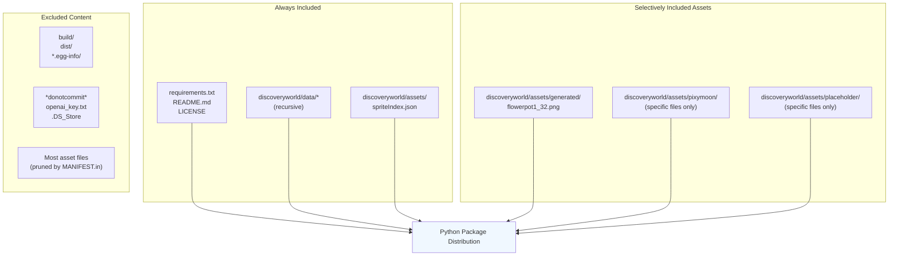
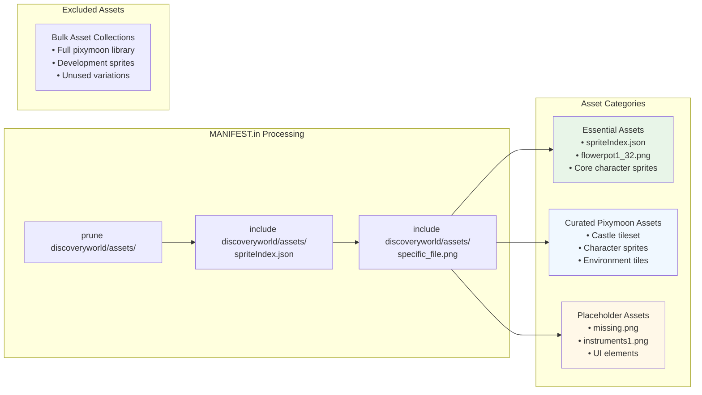
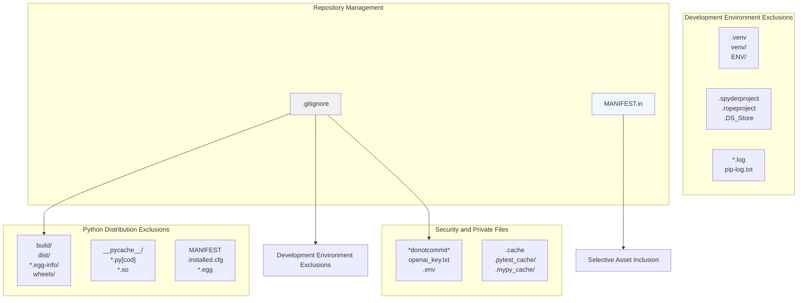
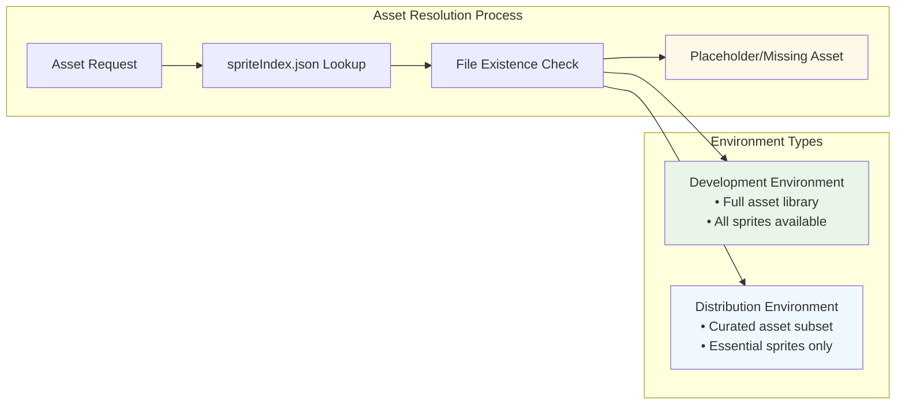

<!-- source: DeepWiki mcp.deepwiki.com · repo allenai/discoveryworld · page 7.2 Package Distribution · fetched 2026-10-26 -->

# Package Distribution

Relevant source files

The following files were used as context for generating this wiki page:

- [.gitignore](.gitignore)
- [MANIFEST.in](MANIFEST.in)

This document explains how DiscoveryWorld is packaged and distributed as a Python package, including the selective asset inclusion strategy and distribution mechanisms. It covers the package structure, asset curation process, and the technical implementation of the distribution pipeline.

For information about the asset organization and sprite management system, see [Asset Pipeline](#7.1). For installation procedures, see [Installation & Setup](#8).

## Package Structure Overview

DiscoveryWorld uses a selective packaging approach to balance functionality with package size. The distribution includes essential game data and a curated subset of visual assets while excluding development artifacts and optional content.

### Core Distribution Components

The package distribution follows a three-tier inclusion strategy:

**Sources:** [MANIFEST.in:1-54](), [.gitignore:1-134]()

## Asset Inclusion Strategy

The distribution uses a prune-and-include approach implemented in `MANIFEST.in` to manage asset size while preserving functionality.

### Pruning and Selective Inclusion

**Sources:** [MANIFEST.in:7-53]()

### Included Asset Breakdown

| Asset Category | File Count | Purpose | Examples |
|----------------|------------|---------|----------|
| **Core Index** | 1 | Asset registry and metadata | `spriteIndex.json` |
| **Generated Assets** | 1 | Procedurally created content | `flowerpot1_32.png` |
| **Pixymoon Tilesets** | 11 | Environment and building tiles | `CuteRPG_Castle_New.png`, `CuteRPG_Forest_modified2.png` |
| **Character Sprites** | 13 | Player and NPC representations | `Character_009.png`, `Enemy_01_04.png` |
| **Placeholder Graphics** | 13 | Development and missing asset fallbacks | `missing.png`, `instruments1.png` |

**Sources:** [MANIFEST.in:8-53]()

## Distribution Mechanism

### Git Exclusion Strategy

The `.gitignore` file implements a comprehensive exclusion strategy for development artifacts:

**Sources:** [.gitignore:9-28](), [.gitignore:104-111](), [.gitignore:130-134]()

### Package Build Process

The distribution process follows Python packaging standards with custom asset curation:

1. **Standard Metadata Inclusion**: Core package files (`requirements.txt`, `README.md`, `LICENSE`) are included unconditionally
2. **Data Directory Recursive Inclusion**: All files in `discoveryworld/data` are included to preserve game configuration and scenario data
3. **Asset Pruning**: The entire `discoveryworld/assets/` directory is initially excluded via `prune`
4. **Selective Asset Inclusion**: Specific asset files are then included individually via explicit `include` directives
5. **Build Artifact Exclusion**: Git and build artifacts are excluded to maintain clean distribution

**Sources:** [MANIFEST.in:1-6](), [MANIFEST.in:7-8](), [MANIFEST.in:10-53]()

## Development vs Distribution Differences

### Size Optimization

The selective inclusion strategy significantly reduces package size:

- **Full Asset Directory**: Contains hundreds of sprite files, tilesets, and development assets
- **Distributed Assets**: Only ~40 essential files for core functionality
- **Index Preservation**: `spriteIndex.json` maintains references to all assets, enabling development with full asset library while distributing minimal set

### Runtime Asset Resolution

The package maintains compatibility between development and distribution environments through the asset index system:

**Sources:** [MANIFEST.in:8](), [MANIFEST.in:43-44]()

This approach ensures that DiscoveryWorld can function in both development environments with full assets and in distributed packages with minimal assets, while maintaining consistent behavior through graceful fallback mechanisms.

---

