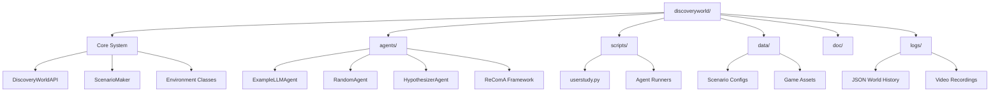
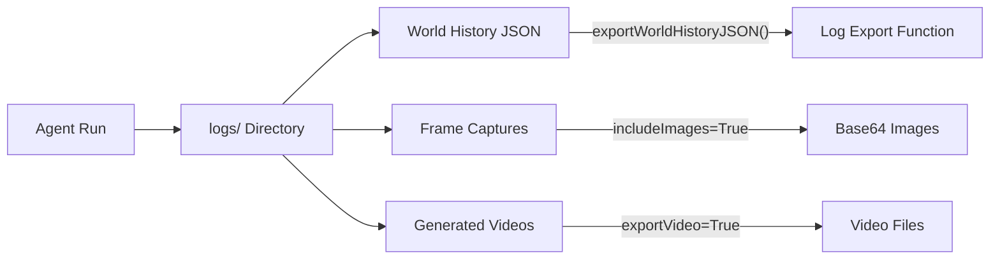

<!-- source: DeepWiki mcp.deepwiki.com · repo allenai/discoveryworld · page 8 Installation & Setup · fetched 2026-10-26 -->

# Installation & Setup

<details>
<summary>Relevant source files</summary>

The following files were used as context for generating this wiki page:

- [.gitignore](.gitignore)
- [README.md](README.md)

</details>


This document provides comprehensive installation and setup instructions for DiscoveryWorld, a virtual environment platform for developing and evaluating automated scientific discovery agents. This covers basic installation for end users, development environment configuration, and system verification procedures.

For information about running agents after installation, see [Agent Development](#3). For details about the ReComA framework setup, see [ReComA Setup & Configuration](#5.1).

## System Requirements

DiscoveryWorld requires Python 3.9 or later and is compatible with Windows, macOS, and Linux systems. The platform uses conda for environment management and pip for package installation.

### Hardware Requirements

| Component | Minimum | Recommended |
|-----------|---------|-------------|
| RAM | 4 GB | 8 GB+ |
| Storage | 1 GB free space | 2 GB+ free space |
| Graphics | Any | Dedicated GPU (for LLM agents) |

### Software Dependencies

- Python 3.9+
- conda or miniconda
- Git
- Internet connection (for package downloads)

Sources: [README.md:44-62]()

## Installation Process

The installation follows a standard Python package workflow with conda environment isolation to prevent dependency conflicts.

### Installation Flow Diagram

```mermaid
graph TD
    START["Start Installation"]
    CLONE["git clone repository"]
    ENV["conda create environment"]
    ACTIVATE["conda activate"]
    DEPS["pip install requirements"]
    INSTALL["pip install -e ."]
    VERIFY["python scripts/userstudy.py"]
    
    START --> CLONE
    CLONE --> ENV
    ENV --> ACTIVATE
    ACTIVATE --> DEPS
    DEPS --> INSTALL
    INSTALL --> VERIFY
    
    CLONE --> |"discoveryworld/"| CLONE_DIR["Repository Directory"]
    ENV --> |"python=3.9"| CONDA_ENV["discoveryworld Environment"]
    DEPS --> |"requirements.txt"| REQ_FILE["Dependency Specifications"]
    INSTALL --> |"-e ."| EDITABLE["Editable Package Install"]
```



Sources: [README.md:46-62]()

### Step-by-Step Installation

1. **Clone the Repository**
   ```bash
   git clone https://github.com/allenai/discoveryworld.git
   cd discoveryworld
   ```

2. **Create Conda Environment**
   ```bash
   conda create --name discoveryworld python=3.9
   conda activate discoveryworld
   ```

3. **Install Dependencies**
   ```bash
   pip install -r requirements.txt
   pip install -e .
   ```

The `-e` flag installs the package in editable mode, allowing modifications to the source code to be reflected immediately without reinstallation.

Sources: [README.md:46-62]()

## Project Structure

Understanding the directory structure helps with development and troubleshooting.

### Key Directory Structure



Sources: [README.md:24-31](), [.gitignore:1-134]()

### Critical Files and Components

| File/Directory | Purpose | Class/Function |
|----------------|---------|----------------|
| `scripts/userstudy.py` | Human GUI interface | Main entry point |
| `discoveryworld/DiscoveryWorldAPI.py` | Core API | `DiscoveryWorldAPI` |
| `discoveryworld/ScenarioMaker.py` | Task management | `SCENARIO_NAMES`, `SCENARIO_DIFFICULTY_OPTIONS` |
| `requirements.txt` | Dependencies | Package specifications |
| `setup.py` or `pyproject.toml` | Package config | Installation metadata |
| `.gitignore` | Version control | Development exclusions |

Sources: [README.md:67-70](), [README.md:138-146]()

## Development Environment Setup

For developers modifying DiscoveryWorld or creating custom agents, additional setup considerations apply.

### Development Dependencies

The standard installation includes development dependencies. Key considerations:

- **Editable Installation**: The `-e` flag enables live code changes
- **Log Directory**: Created automatically at `logs/` for storing run data
- **Asset Management**: Sprites and game data are included in the package
- **Git Workflow**: `.gitignore` excludes build artifacts and logs

### Environment Variables

DiscoveryWorld supports optional environment configuration:

```bash
# Optional: Set custom log directory
export DISCOVERYWORLD_LOG_DIR="/path/to/logs"

# Optional: Configure for headless operation
export DISPLAY=:0  # On Linux systems
```

Sources: [.gitignore:104-111](), [.gitignore:130-134]()

## Configuration and Verification

### Basic Functionality Test

Verify installation by launching the graphical user interface:

```bash
python scripts/userstudy.py
```

This should display a scenario selection menu followed by the game interface. The `userstudy.py` script serves as both the human interface and a verification tool.

### Agent Development Test

Test the API programmatically using the minimal example pattern:

```python
from discoveryworld.DiscoveryWorldAPI import DiscoveryWorldAPI
from discoveryworld.ScenarioMaker import SCENARIO_NAMES, SCENARIO_DIFFICULTY_OPTIONS

# Initialize API with unique thread ID
api = DiscoveryWorldAPI(threadID=1)

# Load a simple scenario
success = api.loadScenario(
    scenarioName=SCENARIO_NAMES[0], 
    difficultyStr=SCENARIO_DIFFICULTY_OPTIONS[0], 
    randomSeed=0, 
    numUserAgents=1
)

if success:
    print("Installation verified successfully")
    observation = api.getAgentObservation(agentIdx=0)
    print(f"Task: {observation['ui']['taskProgress'][0]['description']}")
```

Sources: [README.md:122-130](), [README.md:336-337]()

### Log File Verification

Successful runs generate log files in the `logs/` directory:



Sources: [README.md:99-102](), [README.md:272-279]()

## Common Issues and Troubleshooting

### Dependency Conflicts

If package installation fails:

1. **Clean Environment**: Create a fresh conda environment
2. **Python Version**: Ensure Python 3.9+ is used
3. **pip Update**: Update pip with `pip install --upgrade pip`

### GUI Launch Issues

If `userstudy.py` fails to start:

- **Display Issues**: On Linux, ensure X11 forwarding or local display
- **Missing Assets**: Verify asset files are included in installation
- **Permission Errors**: Check write permissions for `logs/` directory

### Thread ID Conflicts

The `DiscoveryWorldAPI` requires unique `threadID` values for concurrent runs to prevent log file conflicts. Each concurrent instance should use a different integer value.

### Asset Loading Problems

Assets are managed through the package distribution system. If sprites or game data fail to load:

1. Verify package installation completeness
2. Check for corruption during download
3. Reinstall with `pip install -e . --force-reinstall`

Sources: [README.md:152-156](), [.gitignore:1-134]()

## Next Steps

After successful installation:

1. **Try the GUI**: Explore scenarios using `scripts/userstudy.py`
2. **Examine Agents**: Review implementations in `agents/` directory
3. **Read API Docs**: See [API Reference](#2.1) for development details
4. **Run Baseline Agents**: Test provided agent implementations

For advanced setup including ReComA framework configuration, see [ReComA Setup & Configuration](#5.1).

Sources: [README.md:23-40]()

---

