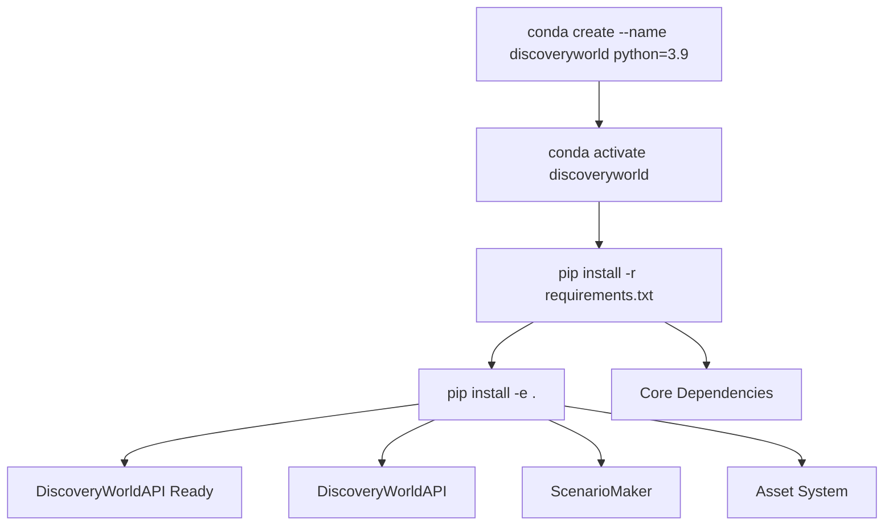
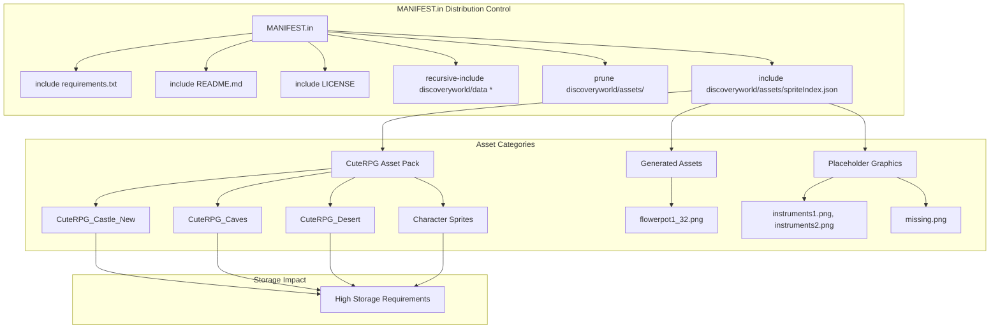
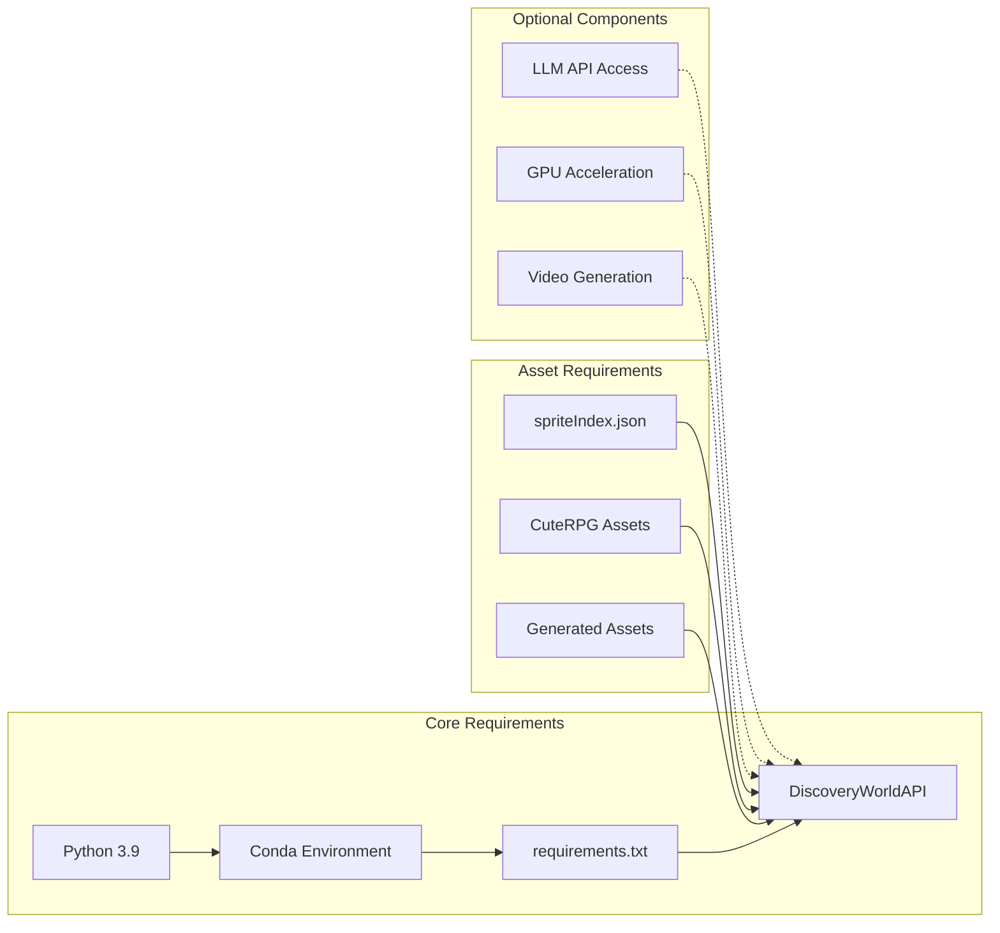

<!-- source: DeepWiki mcp.deepwiki.com · repo allenai/discoveryworld · page 8.1 System Requirements · fetched 2026-10-26 -->

# System Requirements

<details>
<summary>Relevant source files</summary>

The following files were used as context for generating this wiki page:

- [MANIFEST.in](MANIFEST.in)
- [README.md](README.md)

</details>


This document specifies the hardware and software requirements for installing and running DiscoveryWorld, including core dependencies, asset management considerations, and optional components for advanced functionality. For specific installation instructions, see [Installation & Setup](#8). For development environment configuration, see [Development Environment](#8.2).

## Core Software Requirements

### Python Environment

DiscoveryWorld requires **Python 3.9** as specified in the installation instructions. The system uses conda for environment management to ensure consistent dependency resolution across different platforms.

```bash
conda create --name discoveryworld python=3.9
conda activate discoveryworld
```

### Package Management

The system uses a two-stage installation process managed through standard Python packaging tools:

1. **Core Dependencies**: Installed via `requirements.txt`
2. **Package Installation**: Editable installation via `pip install -e .`

The dependency management follows this pattern:
```bash
pip install -r requirements.txt
pip install -e .
```

### Operating System Compatibility

DiscoveryWorld is designed to run on standard Python-compatible operating systems. The graphical user interface component (`scripts/userstudy.py`) requires display capabilities for the 2D tile-based environment rendering.

**Dependency Installation Flow**


Sources: [README.md:52-62]()

## Hardware Requirements

### Memory Requirements

The system has significant memory requirements due to several components:

- **Environment State**: Full world state tracking for all objects and timesteps
- **Asset Loading**: Sprite assets and generated content from the asset pipeline
- **LLM Integration**: Memory overhead for language model operations (when using agents like `HypothesizerAgent`)
- **Logging System**: Detailed world history storage during execution

### Storage Requirements

DiscoveryWorld has substantial storage requirements driven by the asset management system and logging capabilities:

- **Asset Storage**: The distribution includes curated sprite assets from the CuteRPG asset pack
- **Log Files**: Comprehensive world state logs can become quite large, as noted in the API documentation
- **Video Generation**: Frame capture and video assembly require additional storage
- **Parametric Variations**: Multiple scenario seeds generate different world configurations

### Graphics Requirements

The system requires graphics capabilities for:
- 2D tile-based environment rendering (16x24 tile observation grid)
- Real-time visualization during user studies
- Frame capture for video generation
- Base64 image encoding for vision-capable agents

**Asset Management Structure**


Sources: [MANIFEST.in:1-54]()

## Dependency Management

### Requirements Structure

The system uses `requirements.txt` for dependency specification, which is included in the distribution manifest. Dependencies are managed through pip's standard resolution mechanism.

### Package Distribution

The `MANIFEST.in` file controls which components are included in the distributed package:

- **Selective Asset Inclusion**: Most assets are pruned except for essential sprites and the sprite index
- **Data Inclusion**: All scenario data files are recursively included
- **Documentation**: Core documentation files (README, LICENSE) are included

### Asset Pipeline Integration

The asset management system requires specific files to be available at runtime:

- `spriteIndex.json`: Core asset registry for sprite loading
- Selected CuteRPG asset files for environment rendering
- Generated assets for specific game objects
- Placeholder graphics for development and missing assets

Sources: [MANIFEST.in:4-8](), [MANIFEST.in:10-53]()

## Optional Components

### Language Model Integration

For advanced agents like `HypothesizerAgent` and the ReComA framework, additional requirements include:

- **API Access**: Credentials for LLM providers (OpenAI GPT-4o, Together AI, etc.)
- **Network Connectivity**: Stable internet connection for API calls
- **Cost Management**: Budget considerations for LLM API usage

### GPU Acceleration

While not strictly required, GPU acceleration may benefit:
- Large language model inference (if running models locally)
- Graphics rendering performance
- Video encoding operations

### Video Generation

The logging system supports video generation capabilities requiring:
- Frame capture storage capacity
- Video encoding libraries
- Processing power for frame assembly

**System Architecture Requirements**


Sources: [README.md:42-63](), [README.md:272-280]()

## Performance Considerations

### Logging Overhead

The comprehensive logging system has significant performance implications:
- World state is tracked for all objects across all timesteps
- Log files can become quite large for extended runs
- Export operations may take considerable time for long runs
- Files are split into 100-step chunks to manage size

### Concurrent Execution

The system supports concurrent execution through unique `threadID` assignment:
- Each concurrent instance requires a unique `threadID`
- Thread IDs are used to create unique output directories
- Prevents frame capture conflicts between concurrent runs

Sources: [README.md:275-279](), [README.md:152-156]()

---

