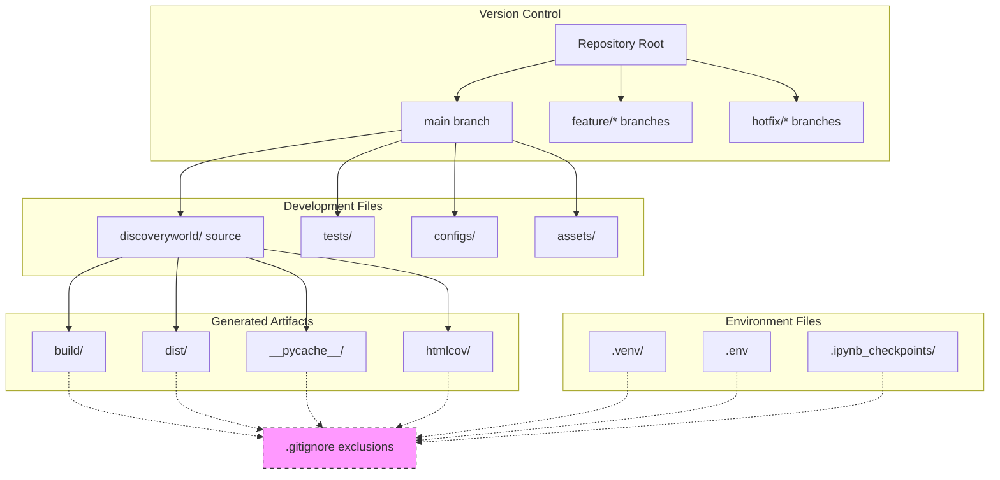
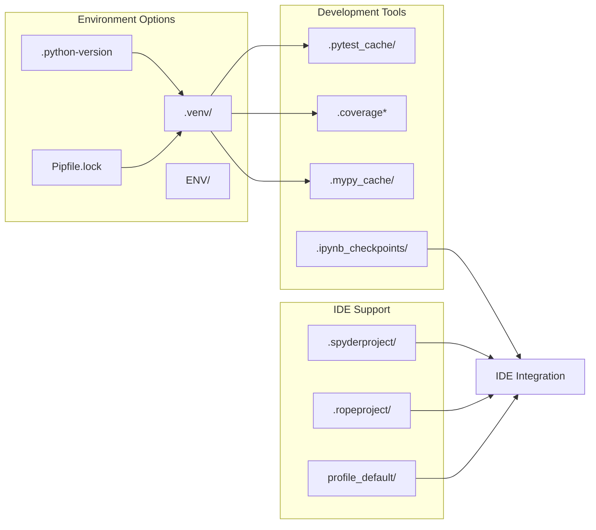
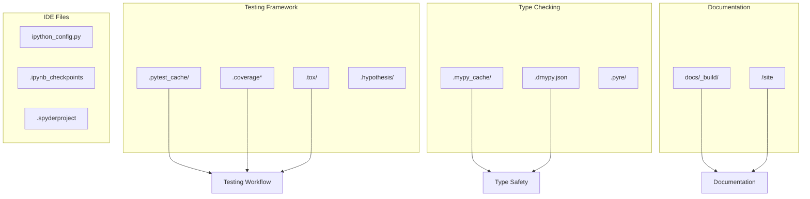
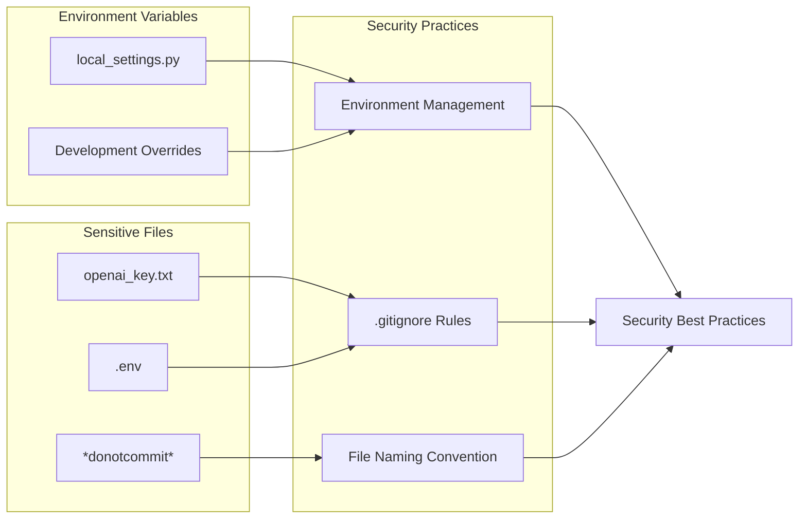
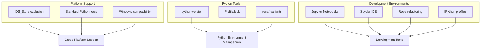

<!-- source: DeepWiki mcp.deepwiki.com · repo allenai/discoveryworld · page 8.2 Development Environment · fetched 2026-10-26 -->

# Development Environment

Relevant source files

The following files were used as context for generating this wiki page:

- [.gitignore](.gitignore)
- [LICENSE.txt](LICENSE.txt)

## Purpose and Scope

This document covers setting up a development environment for contributing to DiscoveryWorld, including workspace configuration, version control workflows, and development best practices. For information about system requirements and initial installation, see [System Requirements](#8.1). For details about the Apache 2.0 licensing terms that govern contributions, see [Legal & Licensing](#9).

## Development Workflow Overview

DiscoveryWorld follows standard Python development practices with specific conventions for handling research assets and sensitive data. The development workflow is designed to support both individual research and collaborative contributions.

### Git Workflow Structure

Sources: [.gitignore:1-134]()

### Development Environment Setup

The project supports multiple Python environment management approaches and development tools:

#### Environment Management

Sources: [.gitignore:84-85,92,104-110,44-52,77-82,113-117]()

## File Organization and Exclusions

### Build and Distribution Artifacts

The development environment excludes several categories of generated files to maintain a clean repository:

| Category | Examples | Purpose |
|----------|----------|---------|
| Python Bytecode | `__pycache__/`, `*.pyc`, `*.pyo` | Compiled Python files |
| Distribution | `build/`, `dist/`, `*.egg-info/` | Package build artifacts |
| Testing | `.pytest_cache/`, `htmlcov/`, `.coverage` | Test execution and coverage data |
| Documentation | `docs/_build/`, `/site` | Generated documentation |
| Environment | `.venv/`, `venv/`, `.env` | Virtual environments and local config |

Sources: [.gitignore:1-28,40-52,104-110,119-120]()

### Development Tool Configuration

Sources: [.gitignore:44-52,72,119-128,77-82,113-117]()

## Security and Sensitive Data Handling

### API Key Management

The project includes specific exclusions for sensitive development data:

Sources: [.gitignore:130-132,104-105,59-60]()

### Development Security Guidelines

1. **API Keys**: Never commit API keys directly. Use environment variables or excluded files like `openai_key.txt`.

2. **Custom Exclusions**: Any file containing `donotcommit` in its name is automatically excluded from version control.

3. **Environment Files**: Local configuration should be stored in `.env` files or similar excluded locations.

4. **Platform Files**: System-specific files like `.DS_Store` (macOS) are excluded to prevent platform conflicts.

Sources: [.gitignore:130-134]()

## Platform and Tool Support

### Cross-Platform Development

The development environment supports multiple operating systems and development workflows:

Sources: [.gitignore:134,84-85,92,104-110,77-82,113-117]()

## Contribution Workflow

### License Compliance

All contributions must comply with the Apache 2.0 license terms. Key requirements include:

1. **Attribution**: Retain copyright notices and license information
2. **Change Documentation**: Mark modified files with prominent notices
3. **License Distribution**: Include license copy with distributions
4. **Patent Grant**: Understand the patent license implications

Sources: [LICENSE.txt:1-202]()

### Development Best Practices

1. **Clean Commits**: Ensure no build artifacts or sensitive data are committed
2. **Environment Isolation**: Use virtual environments for development dependencies
3. **Testing**: Run tests locally before submitting contributions
4. **Documentation**: Update relevant documentation for significant changes

The `.gitignore` configuration ensures that common development artifacts are automatically excluded, reducing the risk of accidentally committing build files or sensitive data.

Sources: [.gitignore:1-134]()

---

