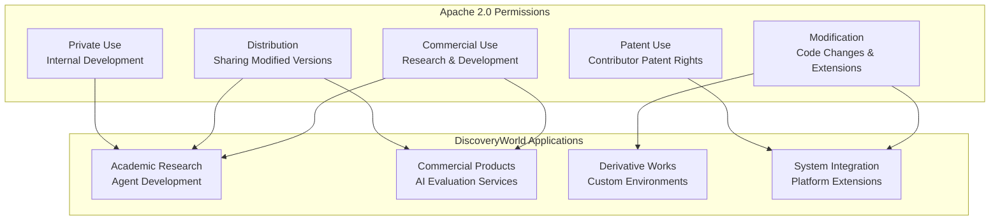
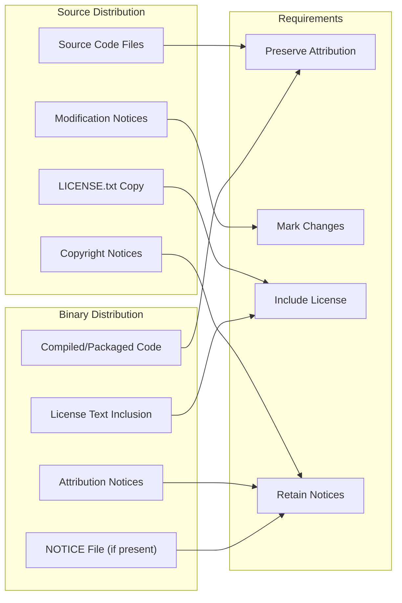
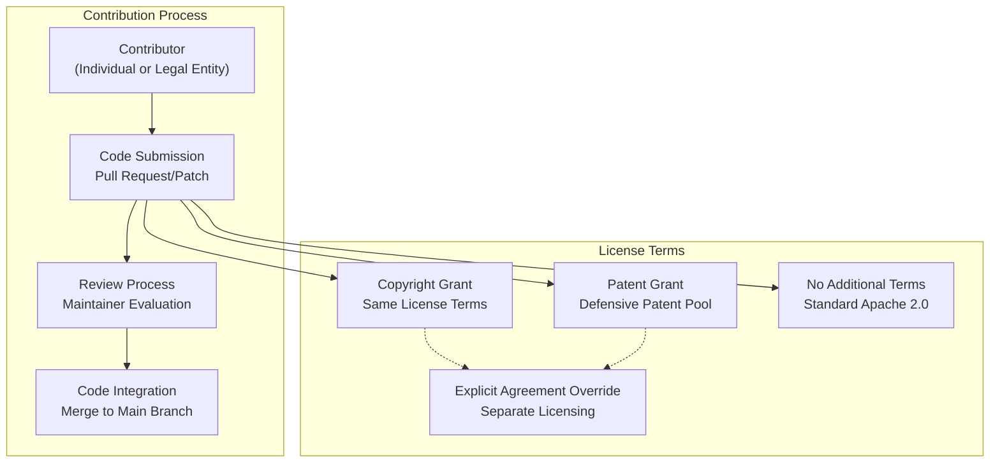
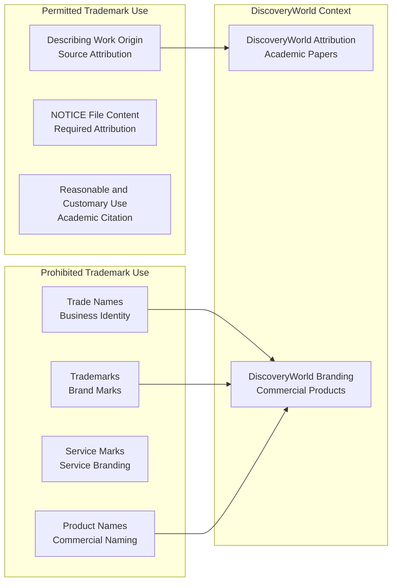

<!-- source: DeepWiki mcp.deepwiki.com · repo allenai/discoveryworld · page 9 Legal & Licensing · fetched 2026-10-26 -->

# Legal & Licensing

Relevant source files

The following files were used as context for generating this wiki page:

- [LICENSE.txt](LICENSE.txt)

This document covers the legal framework governing the use, modification, and distribution of the DiscoveryWorld codebase. It explains the Apache 2.0 license terms, usage rights, contribution requirements, and practical guidelines for researchers and developers working with the platform.

For information about package distribution and asset management, see [Asset Management & Distribution](#7). For development environment setup and contribution workflows, see [Development Environment](#8.2).

## License Overview

DiscoveryWorld is distributed under the Apache License Version 2.0, a permissive open-source license that allows broad usage while maintaining certain requirements for attribution and redistribution.

### Apache 2.0 License Summary

| Permission | Requirement | Limitation |
|------------|-------------|------------|
| Commercial use | License and copyright notice | Liability |
| Modification | State changes | Warranty |
| Distribution | Include license text | Trademark use |
| Patent use | Preserve attribution | - |
| Private use | - | - |

The full license text is available in [LICENSE.txt:1-202]().

**Sources:** [LICENSE.txt:1-202]()

## Usage Rights and Permissions

### Permitted Activities

The Apache 2.0 license grants users extensive rights to work with the DiscoveryWorld codebase:

**Key Rights Granted:**

1. **Copyright License** [LICENSE.txt:66-72](): Perpetual, worldwide, non-exclusive rights to reproduce, modify, display, perform, sublicense, and distribute
2. **Patent License** [LICENSE.txt:73-87](): Protection against patent claims from contributors
3. **Modification Rights** [LICENSE.txt:40-46](): Freedom to create derivative works
4. **Commercial Use** [LICENSE.txt:89-129](): No restrictions on commercial applications

**Sources:** [LICENSE.txt:66-87](), [LICENSE.txt:89-129]()

## Distribution Requirements

### Mandatory Inclusions

When redistributing DiscoveryWorld or derivative works, specific requirements must be met:

**Distribution Checklist:**

1. **License Inclusion** [LICENSE.txt:94-95](): Include a copy of the Apache 2.0 license
2. **Change Notification** [LICENSE.txt:97-98](): Mark modified files with prominent notices
3. **Attribution Preservation** [LICENSE.txt:100-104](): Retain copyright, patent, trademark, and attribution notices
4. **NOTICE File Handling** [LICENSE.txt:106-121](): Include NOTICE file contents if present

**Sources:** [LICENSE.txt:89-129]()

## Contribution Terms

### Contributor License Agreement

The Apache 2.0 license includes an implicit contributor license agreement for all submissions:

**Key Contribution Terms:**

1. **Automatic Licensing** [LICENSE.txt:130-133](): Contributions automatically licensed under Apache 2.0
2. **Patent Grant** [LICENSE.txt:73-87](): Contributors grant patent rights for their submissions
3. **No Additional Terms** [LICENSE.txt:130-136](): Standard Apache 2.0 applies unless explicitly stated otherwise
4. **Separate Agreements** [LICENSE.txt:134-136](): Existing separate license agreements take precedence

**Sources:** [LICENSE.txt:130-136](), [LICENSE.txt:73-87]()

## Warranty and Liability

### Disclaimer of Warranty

The Apache 2.0 license includes comprehensive warranty disclaimers that apply to all DiscoveryWorld usage:

| Aspect | Disclaimer |
|--------|------------|
| Warranty | No express or implied warranties |
| Fitness | No guarantee of fitness for particular purpose |
| Non-infringement | No guarantee against IP infringement |
| Merchantability | No guarantee of commercial viability |
| Title | No guarantee of clear title |

### Limitation of Liability

**Liability Protections** [LICENSE.txt:153-163]():
- No liability for direct, indirect, special, incidental, or consequential damages
- Protection covers loss of goodwill, work stoppage, computer failure, and commercial losses
- Applies to all contributors and licensors
- Protection maintained even with advance notice of potential damages

**Additional Liability** [LICENSE.txt:165-174](): Users may voluntarily accept additional warranty or liability obligations when redistributing, but only on their own behalf.

**Sources:** [LICENSE.txt:143-151](), [LICENSE.txt:153-163](), [LICENSE.txt:165-174]()

## Trademark and Attribution

### Trademark Restrictions

The license specifically limits trademark usage [LICENSE.txt:138-141]():

**Trademark Guidelines:**
- Use "DiscoveryWorld" for attribution and academic citation
- Avoid using "DiscoveryWorld" as part of product or service names
- Include proper attribution in research publications
- Reference the original work appropriately in derivative projects

**Sources:** [LICENSE.txt:138-141]()

## Practical Usage Guidelines

### Common Scenarios

| Use Case | Requirements | Recommendations |
|----------|-------------|-----------------|
| Academic Research | Include license in publications | Cite original paper and repository |
| Commercial Product | Include license, mark changes | Provide clear attribution |
| Modified Distribution | License copy, change notices | Document modifications clearly |
| Integration Project | Preserve attributions | Maintain separate license files |

### Best Practices

1. **License File Management**: Always include [LICENSE.txt]() in distributions
2. **Change Documentation**: Clearly mark and document any modifications to source files
3. **Attribution Practices**: Maintain copyright notices and attribution information
4. **Contribution Workflow**: Ensure all contributors understand the Apache 2.0 terms

**Sources:** [LICENSE.txt:1-202]()