# Page: Overview

# Overview

<details>
<summary>Relevant source files</summary>

The following files were used as context for generating this wiki page:

- [MANIFEST.in](MANIFEST.in)
- [README.md](README.md)

</details>


## Purpose and Scope

This document provides a comprehensive overview of DiscoveryWorld, a virtual environment platform designed for developing and evaluating automated scientific discovery agents. DiscoveryWorld presents agents with complex scientific tasks across multiple domains including proteomics, chemistry, archaeology, and plant biology, requiring them to conduct experiments, form hypotheses, and make discoveries in a 2D turn-based world.

This overview covers the core architecture, main components, and their interactions. For detailed API documentation, see [API Reference](#2.1). For specific agent development guidance, see [Agent Development](#3). For configuration of the ReComA framework, see [ReComA Framework](#5).

## Core Architecture

DiscoveryWorld operates as a comprehensive evaluation platform with several interconnected systems. The architecture centers around the `DiscoveryWorldAPI` class, which provides the main interface for agent interaction, and supports multiple agent implementations ranging from simple baselines to sophisticated multimodal agents.

### Main System Components

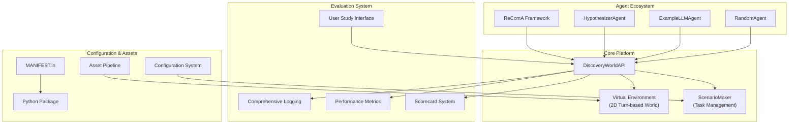

Sources: [README.md:1-503](), [MANIFEST.in:1-54]()

### Agent Implementation Hierarchy

The system provides a clear progression from simple baseline agents to sophisticated multimodal implementations:

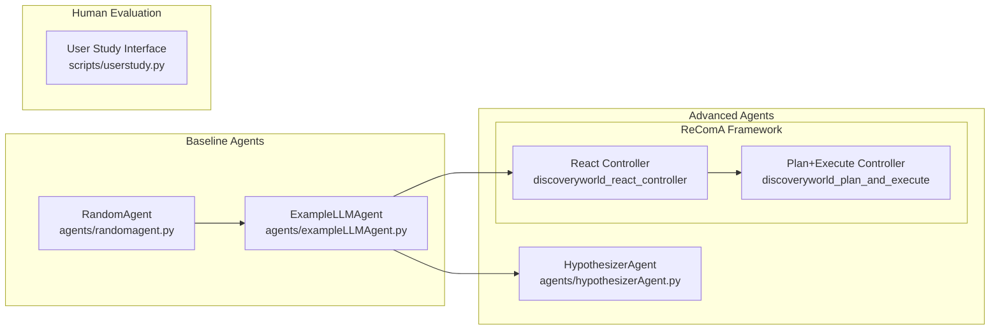

Sources: [README.md:118-119](), [README.md:23-25]()

## API and Environment System

### Core API Structure

The `DiscoveryWorldAPI` serves as the central interface following OpenAI Gym-style patterns. Key methods include:

| Method | Purpose | Return Type |
|--------|---------|-------------|
| `loadScenario()` | Initialize specific task scenario | Boolean success |
| `getAgentObservation()` | Retrieve current environment state | Observation dict |
| `performAgentAction()` | Execute agent action | Result dict |
| `tick()` | Update environment state | None |
| `getTaskScorecard()` | Get detailed performance metrics | Scorecard dict |

The API initialization requires unique thread IDs for concurrent execution:

```python
api = DiscoveryWorldAPI(threadID=1)
success = api.loadScenario(scenarioName="Proteomics", difficultyStr="Normal", randomSeed=0, numUserAgents=1)
```

Sources: [README.md:122-131](), [README.md:154-156]()

### Observation and Action Framework

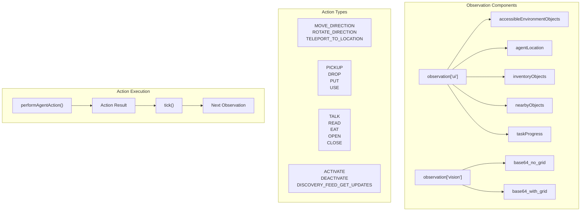

Sources: [README.md:160-182](), [README.md:214-236](), [README.md:262-269]()

## Task and Scenario System

### Scientific Domains and Scenarios

DiscoveryWorld provides 9 distinct scientific scenarios accessible through `SCENARIO_NAMES`:

| Domain | Focus Area | Experimental Tasks |
|--------|------------|-------------------|
| Proteomics | Protein analysis | Mass spectrometry, protein separation |
| Chemistry | Chemical reactions | Synthesis, analysis, reaction discovery |
| Archaeology | Artifact analysis | Dating, material composition |
| Plant Nutrients | Botanical research | Growth conditions, nutrient effects |
| Reactor Lab | Nuclear science | Radiation measurement, safety protocols |

Each scenario supports three difficulty levels (`Easy`, `Normal`, `Challenge`) with parametric variations controlled by random seeds (0-4 for official benchmark, 5+ for extended variations).

Sources: [README.md:134-150]()

### Scoring and Evaluation

The evaluation system provides three key metrics through the `getTaskScorecard()` method:

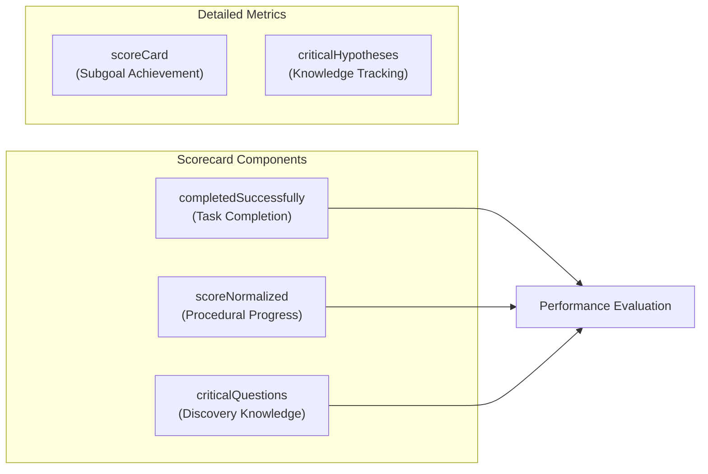

Sources: [README.md:242-259]()

## Asset Management and Distribution

### Asset Pipeline Organization

The distribution system uses `MANIFEST.in` to selectively include assets while optimizing package size:

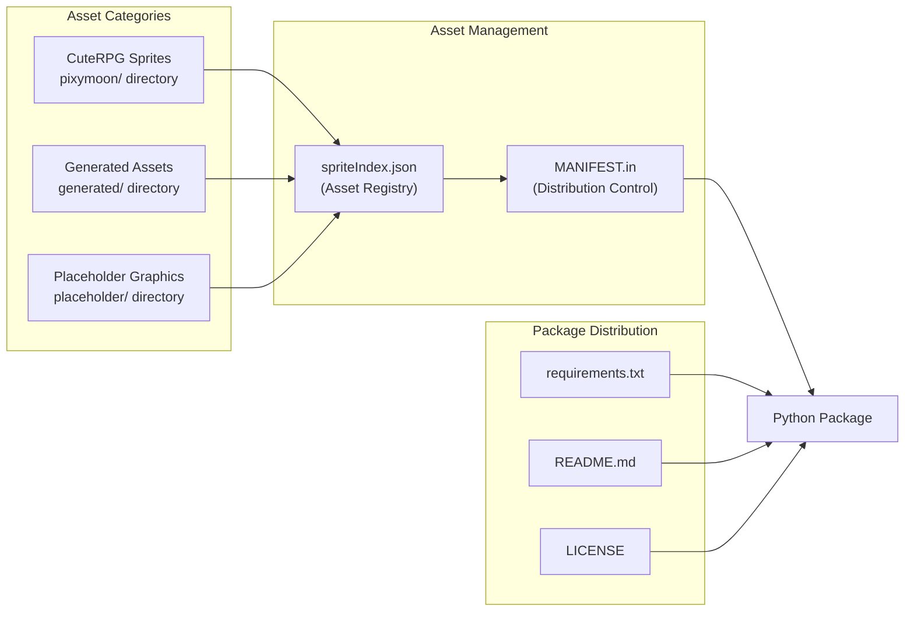

The system prunes most assets (`prune discoveryworld/assets/`) but selectively includes essential graphics and the sprite index for runtime asset resolution.

Sources: [MANIFEST.in:1-54]()

## Logging and Data Capture

DiscoveryWorld provides comprehensive logging capabilities through `api.world.exportWorldHistoryJSON()`, capturing:

- Complete world state at each timestep
- Agent actions and environmental responses  
- Frame-by-frame visual capture for video generation
- Detailed object properties and interactions

The logging system splits large histories into 100-step segments with `partXofY` suffixes to manage file sizes effectively.

Sources: [README.md:99-101](), [README.md:272-326]()

## Development and Extension Points

The platform supports multiple development approaches:

1. **Simple Agent Development**: Using `ExampleLLMAgent` as a template for basic LLM integration
2. **Advanced Agent Frameworks**: ReComA system with React and Plan+Execute patterns
3. **Custom Scenario Creation**: Through the `ScenarioMaker` system
4. **Evaluation Studies**: Human baseline collection via `scripts/userstudy.py`

For agent development guidance, see [Getting Started with Agents](#3.1). For ReComA framework configuration, see [ReComA Setup & Configuration](#5.1).

Sources: [README.md:23-25](), [README.md:329-464]()

---

# Page: Core API & Environment

# Core API & Environment

<details>
<summary>Relevant source files</summary>

The following files were used as context for generating this wiki page:

- [README.md](README.md)

</details>


This document provides comprehensive documentation of the DiscoveryWorldAPI, environment mechanics, observation/action systems, and scenario management. It covers the core interfaces that agents use to interact with the DiscoveryWorld virtual environment.

For agent development patterns and examples, see [Agent Development](#3). For configuration of specific agent implementations, see [Built-in Agents](#4) and [ReComA Framework](#5). For evaluation and metrics, see [User Studies & Human Evaluation](#6).

## API Architecture Overview

The DiscoveryWorld environment follows an OpenAI Gym-style API pattern with manual environment updates. The core workflow involves initialization, observation-action loops, and explicit world state progression.

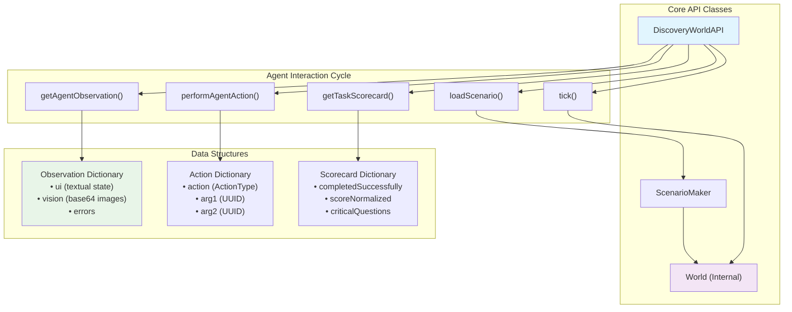

Sources: [README.md:105-270]()

## Environment Lifecycle and State Management

The environment operates as a discrete, turn-based simulation where agent actions are queued and processed during explicit world updates.

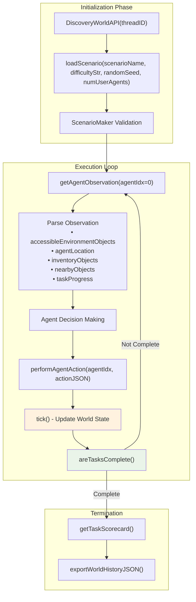

Sources: [README.md:122-130](), [README.md:262-269](), [README.md:410-451]()

## DiscoveryWorldAPI Class

The `DiscoveryWorldAPI` serves as the primary interface for all agent-environment interactions. It encapsulates world state, scenario loading, and action processing.

### Initialization and Thread Management

```python
api = DiscoveryWorldAPI(threadID=1)
```

The `threadID` parameter ensures unique output directories for concurrent runs and prevents log file overwrites. Each concurrent DiscoveryWorld instance requires a unique thread identifier.

Sources: [README.md:125](), [README.md:152-156]()

### Core Methods

| Method | Purpose | Returns |
|--------|---------|---------|
| `loadScenario()` | Initialize specific task scenario | Boolean success status |
| `getAgentObservation()` | Retrieve current environment state | Observation dictionary |
| `performAgentAction()` | Submit agent action for processing | Action result dictionary |
| `tick()` | Update world state and process actions | None |
| `getTaskScorecard()` | Retrieve performance metrics | Scorecard dictionary |
| `listKnownActions()` | Get available action descriptions | Action reference dictionary |
| `areTasksComplete()` | Check task completion status | Boolean |

Sources: [README.md:122-269]()

## Scenario Loading and Configuration

Scenarios define the task themes, difficulty levels, and parametric variations that create the specific challenges agents encounter.

### Scenario Parameters

```python
success = api.loadScenario(
    scenarioName="Proteomics", 
    difficultyStr="Normal", 
    randomSeed=0, 
    numUserAgents=1
)
```

#### Available Configurations

| Parameter | Source | Valid Values |
|-----------|--------|--------------|
| `scenarioName` | `SCENARIO_NAMES` | 9 scientific task themes |
| `difficultyStr` | `SCENARIO_DIFFICULTY_OPTIONS` | "Easy", "Normal", "Challenge" |
| `randomSeed` | Integer | 0-4 (official), 5+ (extended) |
| `numUserAgents` | Integer | 1 (multi-agent untested) |

Sources: [README.md:134-150]()

### Scenario Access

```python
from discoveryworld.ScenarioMaker import SCENARIO_NAMES
from discoveryworld.ScenarioMaker import SCENARIO_DIFFICULTY_OPTIONS
```

The scenario system supports parametric variation through seed values, where seeds 0-4 represent the official benchmark variations, and higher values generate additional unsupported variations.

Sources: [README.md:136-150]()

## Observation System

Observations provide comprehensive environment state information through structured dictionaries containing textual descriptions and visual data.

### Observation Structure

The observation dictionary contains three primary sections:

#### UI Section (`observation["ui"]`)

| Key | Description | Usage |
|-----|-------------|-------|
| `accessibleEnvironmentObjects` | Objects within interaction range | Direct action targeting |
| `agentLocation` | Current position, facing direction, movement options | Navigation planning |
| `inventoryObjects` | Items carried by agent | Inventory management |
| `nearbyObjects` | Objects within 3 tiles, organized by direction | Spatial awareness |
| `taskProgress` | Current task description and completion status | Goal tracking |
| `lastActionMessage` | Plain text result of previous action | Action feedback |
| `dialog_box` | Dialog state information | Conversation handling |
| `discoveryFeed` | Recent social media posts | Information gathering |
| `world_steps` | Environment step counter | Progress tracking |

#### Vision Section (`observation["vision"]`)

| Key | Description | Format |
|-----|-------------|--------|
| `base64_no_grid` | 16x24 tile environment view | Base64 encoded image |
| `base64_with_grid` | Environment view with grid overlay | Base64 encoded image |

#### Errors Section (`observation["errors"]`)

Contains error information when problems occur during observation generation.

Sources: [README.md:159-185]()

### Observation Example

Complete observation examples are available for reference, demonstrating the full structure and data types returned by the system.

Sources: [README.md:184-185]()

## Action System

Actions are submitted as JSON dictionaries containing action types and object references. All object targeting uses UUID-based identification for precise interaction.

### Action Structure

```python
actionCommand = {
    "action": "USE",
    "arg1": object1_uuid,
    "arg2": object2_uuid
}
result = api.performAgentAction(agentIdx=0, actionJSON=actionCommand)
```

### Available Actions

The action system supports comprehensive environment interaction through standardized action types:

| Action Type | Arguments | Description |
|-------------|-----------|-------------|
| `PICKUP` | arg1 | Pick up specified object |
| `DROP` | arg1 | Drop specified object |
| `PUT` | arg1, arg2 | Place object1 in/on object2 or give to agent2 |
| `OPEN/CLOSE` | arg1 | Open or close specified object |
| `ACTIVATE/DEACTIVATE` | arg1 | Activate or deactivate specified object |
| `USE` | arg1, arg2 | Use object1 on object2 |
| `TALK` | arg1 | Initiate conversation with agent |
| `EAT` | arg1 | Consume specified object |
| `READ` | arg1 | Read text from specified object |

#### Movement Actions

| Action Type | Arguments | Description |
|-------------|-----------|-------------|
| `MOVE_DIRECTION` | arg1 | Move in specified direction (north/east/south/west) |
| `ROTATE_DIRECTION` | arg1 | Rotate to face specified direction |
| `TELEPORT_TO_LOCATION` | arg1 | Teleport to named location |
| `TELEPORT_TO_OBJECT` | arg1 | Teleport beside specified object UUID |

#### Discovery Feed Actions

| Action Type | Arguments | Description |
|-------------|-----------|-------------|
| `DISCOVERY_FEED_GET_UPDATES` | None | Read latest discovery feed posts |
| `DISCOVERY_FEED_GET_POST_BY_ID` | arg1 | Read specific post by ID |

Sources: [README.md:212-237]()

### Action Result Processing

Each action returns a result dictionary containing success status, descriptive messages, and any relevant state changes. This feedback enables agents to understand action outcomes and plan subsequent behavior.

Sources: [README.md:189-210]()

## Environment Updates and World Tick

Unlike standard OpenAI Gym environments, DiscoveryWorld requires explicit world state updates through the `tick()` function. This design separates action submission from world progression, enabling precise control over simulation timing.

### Tick Mechanics

```python
# Submit agent action
result = api.performAgentAction(agentIdx=0, actionJSON=actionCommand)

# Process world update
api.tick()

# Get updated observation
observation = api.getAgentObservation(agentIdx=0)
```

The `tick()` function processes all pending actions, updates object states, advances NPC behaviors, and progresses environmental systems. This explicit update model ensures deterministic simulation behavior and enables sophisticated multi-agent coordination scenarios.

Sources: [README.md:262-269]()

## Scoring and Evaluation

The scoring system provides comprehensive performance evaluation through detailed scorecards that track task completion, procedural progress, and knowledge acquisition.

### Scorecard Structure

```python
scorecard = api.getTaskScorecard()
```

| Key | Purpose | Evaluation Usage |
|-----|---------|------------------|
| `completedSuccessfully` | Binary task completion | Task completion scoring |
| `scoreNormalized` | Normalized progress (0-1) | Procedural progress scoring |
| `criticalQuestions` | Binary knowledge questions | Discovery knowledge scoring |
| `scoreCard` | Detailed subgoal tracking | Progress analysis |
| `taskName` | Internal task identifier | Result organization |
| `taskDescription` | Human-readable task description | Context understanding |

### Evaluation Dimensions

The scoring system supports three primary evaluation dimensions aligned with scientific discovery assessment:

1. **Task Completion**: Binary success/failure for overall task achievement
2. **Procedural Progress**: Normalized scoring of incremental progress toward completion
3. **Discovery Knowledge**: Assessment of scientific knowledge acquisition through critical questions

Sources: [README.md:240-259]()

### Logging and Analysis

The environment provides comprehensive logging capabilities for detailed behavioral analysis:

```python
api.world.exportWorldHistoryJSON(logInfo, filename, None, None, None)
```

Log files contain complete world state history, object properties, and action sequences across all timesteps. Large files are automatically split into 100-step segments with indexed filenames for manageable processing.

Sources: [README.md:271-326]()

---

# Page: API Reference

# API Reference

<details>
<summary>Relevant source files</summary>

The following files were used as context for generating this wiki page:

- [README.md](README.md)
- [agents/ExampleLLMAgentPseudocode.py](agents/ExampleLLMAgentPseudocode.py)

</details>


This document provides a complete reference for the `DiscoveryWorldAPI` class and its methods, which serve as the primary interface for agents interacting with the DiscoveryWorld virtual environment. This covers initialization, observation retrieval, action execution, scoring, and data export functionality.

For information about developing custom agents using this API, see [Getting Started with Agents](#3.1). For details about specific scenarios and tasks available through the API, see [Scenarios & Tasks](#2.3). For advanced agent frameworks that build on this API, see [ReComA Framework](#5).

## Core API Architecture

The following diagram shows the primary components of the `DiscoveryWorldAPI` and how they interact:

```mermaid
graph TB
    subgraph "DiscoveryWorldAPI Core"
        API["DiscoveryWorldAPI"]
        WORLD["world"]
        SCENARIO["ScenarioMaker"]
    end
    
    subgraph "Initialization Methods"
        LOAD["loadScenario()"]
        THREAD["threadID"]
        AGENTS["numUserAgents"]
    end
    
    subgraph "Observation Methods"
        GET_OBS["getAgentObservation()"]
        UI_DATA["ui: dict"]
        VISION_DATA["vision: dict"]
        ERRORS["errors: dict"]
    end
    
    subgraph "Action Methods"
        PERFORM["performAgentAction()"]
        LIST_ACTIONS["listKnownActions()"]
        TELEPORT_LOCS["listTeleportLocationsDict()"]
        DIALOG_CHECK["isAgentInDialog()"]
    end
    
    subgraph "Scoring Methods"
        SCORECARD["getTaskScorecard()"]
        TASK_COMPLETE["areTasksComplete()"]
    end
    
    subgraph "Environment Control"
        TICK["tick()"]
        EXPORT["world.exportWorldHistoryJSON()"]
    end
    
    API --> LOAD
    API --> GET_OBS
    API --> PERFORM
    API --> SCORECARD
    API --> TICK
    
    LOAD --> SCENARIO
    GET_OBS --> UI_DATA
    GET_OBS --> VISION_DATA
    PERFORM --> LIST_ACTIONS
    PERFORM --> TELEPORT_LOCS
    
    style API fill:#e1f5fe
    style GET_OBS fill:#f3e5f5
    style PERFORM fill:#fff3e0
```

Sources: [README.md:104-465](), [agents/ExampleLLMAgentPseudocode.py:1-129]()

## API Initialization

The `DiscoveryWorldAPI` must be initialized with a unique thread ID and then loaded with a specific scenario configuration.

### Constructor

| Parameter | Type | Description |
|-----------|------|-------------|
| `threadID` | int | Unique identifier for concurrent instances |

### loadScenario Method

| Parameter | Type | Description |
|-----------|------|-------------|
| `scenarioName` | str | Task theme from `SCENARIO_NAMES` |
| `difficultyStr` | str | Difficulty level from `SCENARIO_DIFFICULTY_OPTIONS` |
| `randomSeed` | int | Parametric variation seed (0-4 official) |
| `numUserAgents` | int | Number of user agents (currently set to 1) |

**Returns:** `bool` - Success status of scenario loading

```python
api = DiscoveryWorldAPI(threadID=1)
success = api.loadScenario(
    scenarioName="Proteomics", 
    difficultyStr="Normal", 
    randomSeed=0, 
    numUserAgents=1
)
```

Sources: [README.md:122-132](), [agents/ExampleLLMAgentPseudocode.py:82-87]()

## Observation System

The observation system provides comprehensive information about the agent's current state and environment through the `getAgentObservation()` method.

### Observation Data Structure

```mermaid
graph TB
    subgraph "getAgentObservation() Return"
        OBS_ROOT["observation: dict"]
    end
    
    subgraph "UI Dictionary Keys"
        ACCESS_OBJS["accessibleEnvironmentObjects"]
        AGENT_LOC["agentLocation"]
        DIALOG["dialog_box"]
        DISCOVERY["discoveryFeed"]
        EXTENDED["extended_action_message"]
        INVENTORY["inventoryObjects"]
        LAST_ACTION["lastActionMessage"]
        NEARBY_AGENTS["nearbyAgents"]
        NEARBY_OBJS["nearbyObjects"]
        TASK_PROG["taskProgress"]
        WORLD_STEPS["world_steps"]
    end
    
    subgraph "Vision Dictionary Keys"
        IMG_NO_GRID["base64_no_grid"]
        IMG_WITH_GRID["base64_with_grid"]
    end
    
    subgraph "Error Handling"
        ERRORS_KEY["errors"]
    end
    
    OBS_ROOT --> ACCESS_OBJS
    OBS_ROOT --> AGENT_LOC
    OBS_ROOT --> DIALOG
    OBS_ROOT --> DISCOVERY
    OBS_ROOT --> EXTENDED
    OBS_ROOT --> INVENTORY
    OBS_ROOT --> LAST_ACTION
    OBS_ROOT --> NEARBY_AGENTS
    OBS_ROOT --> NEARBY_OBJS
    OBS_ROOT --> TASK_PROG
    OBS_ROOT --> WORLD_STEPS
    
    OBS_ROOT --> IMG_NO_GRID
    OBS_ROOT --> IMG_WITH_GRID
    OBS_ROOT --> ERRORS_KEY
    
    style OBS_ROOT fill:#e1f5fe
    style ACCESS_OBJS fill:#f3e5f5
    style IMG_NO_GRID fill:#fff3e0
```

### Key Observation Components

| Component | Description |
|-----------|-------------|
| `accessibleEnvironmentObjects` | Objects within interaction range with UUIDs and descriptions |
| `agentLocation` | Current position, facing direction, and movement constraints |
| `inventoryObjects` | Items currently held by the agent |
| `nearbyObjects` | Objects within 3 tiles, organized by direction |
| `taskProgress` | Current task description and completion status |
| `lastActionMessage` | Plain text result of the previous action |

Sources: [README.md:159-186](), [agents/ExampleLLMAgentPseudocode.py:95-96]()

## Action System

Actions are executed through the `performAgentAction()` method using JSON-formatted action commands.

### Action Structure

| Field | Type | Description |
|-------|------|-------------|
| `action` | str | Action type from `ActionType` enum |
| `arg1` | str/None | First argument (usually object UUID) |
| `arg2` | str/None | Second argument (usually object UUID) |

### Available Actions

The `listKnownActions()` method returns all available actions with their argument requirements:

| Action | Arguments | Description |
|--------|-----------|-------------|
| `PICKUP` | `["arg1"]` | Pick up an object |
| `DROP` | `["arg1"]` | Drop an object |
| `PUT` | `["arg1", "arg2"]` | Put object in/on another or give to agent |
| `USE` | `["arg1", "arg2"]` | Use one object on another |
| `MOVE_DIRECTION` | `["arg1"]` | Move in specified direction |
| `TALK` | `["arg1"]` | Talk to another agent |
| `DISCOVERY_FEED_GET_UPDATES` | `[]` | Read latest discovery feed posts |

### Teleportation Support

The `listTeleportLocationsDict()` method provides valid teleport destinations for easier navigation.

Sources: [README.md:188-238](), [agents/ExampleLLMAgentPseudocode.py:24-31]()

## Scoring System

The scoring system provides detailed performance metrics through the `getTaskScorecard()` method.

### Scorecard Structure

| Field | Type | Description |
|-------|------|-------------|
| `taskName` | str | Internal unique task identifier |
| `taskDescription` | str | Plain text task description |
| `completed` | bool | Task completion status |
| `completedSuccessfully` | bool | Task success status (used for task completion scoring) |
| `scoreNormalized` | float | Normalized (0-1) partial progress score (used for procedural progress) |
| `scoreCard` | list | Detailed subgoal completion status |
| `criticalQuestions` | dict | Binary questions for discovery knowledge scoring |

### Task Completion Check

The `areTasksComplete()` method provides a simple boolean check for task completion status.

Sources: [README.md:240-260](), [agents/ExampleLLMAgentPseudocode.py:108-116]()

## Environment Management

### World State Updates

Unlike standard gym environments, DiscoveryWorld requires manual environment updates through the `tick()` method after each action.

```python
# Perform action
result = api.performAgentAction(agentIdx=0, actionJSON=actionCommand)

# Update environment state
api.tick()
```

### Dialog State Management

The `isAgentInDialog()` method checks if the agent is currently engaged in a dialog interaction, which requires special handling.

Sources: [README.md:262-269](), [agents/ExampleLLMAgentPseudocode.py:46]()

## Logging and Data Export

### World History Export

The `world.exportWorldHistoryJSON()` method provides comprehensive logging of all world states and agent actions.

#### Export Configuration

| Parameter | Description |
|-----------|-------------|
| `logInfo` | Dictionary containing run metadata |
| `verboseLogFilename` | Output file path |
| Additional parameters | Currently set to `None` |

#### Log File Characteristics

- Contains serialized world state for all timesteps
- Includes all object properties for entire world grid
- Split into multiple files (100 steps each) for large runs
- Files named with `partXofY` suffix for sequential assembly

### Video Generation

Frame capture functionality is built into the API for generating gameplay videos, controlled through the `includeImages` and `exportVideo` parameters in the log configuration.

Sources: [README.md:271-327]()

---

# Page: Observation & Action Systems

# Observation & Action Systems

<details>
<summary>Relevant source files</summary>

The following files were used as context for generating this wiki page:

- [README.md](README.md)
- [agents/ExampleLLMAgentPseudocode.py](agents/ExampleLLMAgentPseudocode.py)

</details>


This document explains the observation and action systems that form the core agent-environment interface in DiscoveryWorld. It covers the structure of observations returned by the environment, the types of actions agents can perform, and the interaction cycle that governs agent behavior.

For information about the broader API methods and initialization, see [API Reference](#2.1). For details about specific scenarios and tasks, see [Scenarios & Tasks](#2.3).

## Overview

The observation and action systems implement a turn-based interaction model where agents receive structured observations from the environment and respond with actions. This follows the OpenAI Gym paradigm but with DiscoveryWorld-specific extensions for multi-modal observations and scientific discovery tasks.

## Observation Structure

Observations are retrieved using the `getAgentObservation()` method and contain comprehensive information about the agent's current state and surroundings.

### Core Observation Components

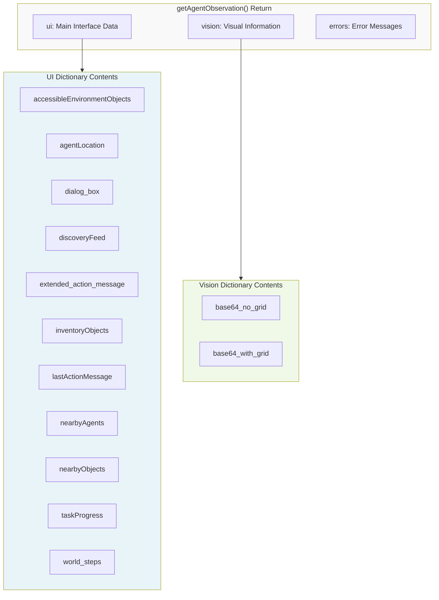

**Observation Data Structure**

| Component | Type | Description |
|-----------|------|-------------|
| `accessibleEnvironmentObjects` | List | Objects within interaction range, including UUIDs and descriptions |
| `agentLocation` | Dict | Current position, facing direction, and movement constraints |
| `dialog_box` | Dict | Dialog state and available conversation options |
| `discoveryFeed` | Dict | Recent posts from the internal social media system |
| `inventoryObjects` | List | Items currently carried by the agent |
| `lastActionMessage` | String | Plain text result of the previous action |
| `nearbyAgents` | Dict | Recent actions of other agents within proximity |
| `nearbyObjects` | Dict | All objects within 3 tiles, organized by direction |
| `taskProgress` | List | Current task description and completion status |
| `world_steps` | Integer | Current environment step counter |

Sources: [README.md:159-182]()

### Visual Observations

For agents that process visual information, two base64-encoded images are provided:

- `base64_no_grid`: Clean 16x24 tile view matching the user interface
- `base64_with_grid`: Same view with grid overlay for spatial reference

Sources: [README.md:178-181]()

## Action System

Actions are executed using the `performAgentAction()` method with structured JSON commands containing action types and object references.

### Action Structure

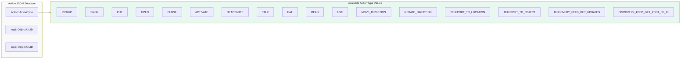

**Action Categories**

| Category | Actions | Arguments |
|----------|---------|-----------|
| Object Manipulation | `PICKUP`, `DROP`, `PUT` | Object UUIDs |
| Container Operations | `OPEN`, `CLOSE` | Container UUID |
| Device Control | `ACTIVATE`, `DEACTIVATE` | Device UUID |
| Interaction | `TALK`, `EAT`, `READ`, `USE` | Target UUID(s) |
| Movement | `MOVE_DIRECTION`, `ROTATE_DIRECTION` | Direction string |
| Teleportation | `TELEPORT_TO_LOCATION`, `TELEPORT_TO_OBJECT` | Location name or object UUID |
| Information | `DISCOVERY_FEED_GET_UPDATES`, `DISCOVERY_FEED_GET_POST_BY_ID` | None or post ID |

Sources: [README.md:216-237]()

### Action Arguments

Arguments (`arg1`, `arg2`) typically contain UUIDs of objects found in the observation's `accessibleEnvironmentObjects` or `nearbyObjects` sections. For movement actions, arguments contain direction strings (`"north"`, `"east"`, `"south"`, `"west"`).

Sources: [README.md:200-210]()

## Agent-Environment Interaction Cycle

The interaction follows a specific sequence that must be maintained for proper environment operation.

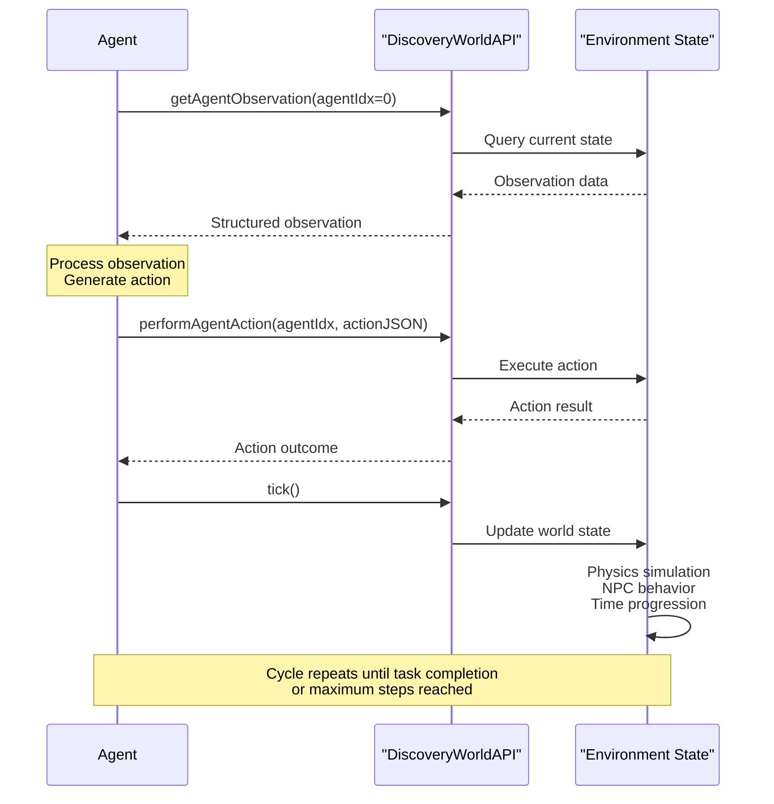

**Critical Sequence Requirements**

1. **Observation First**: Always call `getAgentObservation()` before deciding on an action
2. **Action Execution**: Submit actions via `performAgentAction()` with proper JSON structure
3. **Environment Update**: Call `tick()` after actions to advance the simulation
4. **Error Handling**: Check the `errors` field in observations for execution problems

Sources: [README.md:108-113](), [README.md:263-269]()

### Example Interaction Flow

```mermaid
graph TD
    start["Start Turn"] --> getObs["observation = api.getAgentObservation(agentIdx=0)"]
    getObs --> parseObs["Parse observation['ui'] for environment state"]
    parseObs --> genAction["Generate actionJSON based on observation"]
    genAction --> execAction["result = api.performAgentAction(agentIdx=0, actionJSON)"]
    execAction --> tick["api.tick()"]
    tick --> checkComplete["Check api.areTasksComplete()"]
    checkComplete -->|No| getObs
    checkComplete -->|Yes| end["Task Complete"]
    
    style start fill:#e8f4f8
    style end fill:#f0f8e8
    style getObs fill:#fff3e0
    style execAction fill:#fff3e0
    style tick fill:#f3e5f5
```

Sources: [agents/ExampleLLMAgentPseudocode.py:89-116]()

## Dialog System Integration

When agents enter dialog with NPCs, the observation and action flow changes to handle conversation states.

### Dialog State Detection

Agents can check if they're in dialog using `api.isAgentInDialog(agentIdx=0)`. During dialog:

- The `dialog_box` field contains conversation context and available responses
- Actions should be dialog selections rather than standard environment actions
- Response format uses `chosen_dialog_option_int` instead of standard action structure

Sources: [agents/ExampleLLMAgentPseudocode.py:46-54]()

## Teleportation System

DiscoveryWorld provides teleportation actions to facilitate navigation in large environments.

### Teleport Locations

Available teleport destinations are retrieved via `api.listTeleportLocationsDict()` and used with:

```json
{
  "action": "TELEPORT_TO_LOCATION",
  "arg1": "school"
}
```

This system allows agents to quickly navigate between major areas without tedious pathfinding.

Sources: [agents/ExampleLLMAgentPseudocode.py:27-31]()

## Error Handling

The observation structure includes an `errors` field that provides diagnostic information when actions fail or unexpected conditions occur. Agents should check this field to understand why actions may not have succeeded.

Sources: [README.md:182]()

---

# Page: Scenarios & Tasks

# Scenarios & Tasks

<details>
<summary>Relevant source files</summary>

The following files were used as context for generating this wiki page:

- [README.md](README.md)
- [agents/README.md](agents/README.md)

</details>


This page provides a comprehensive overview of DiscoveryWorld's scenario system, including available task themes, difficulty levels, parametric variations, and evaluation metrics. It covers how scenarios are organized, configured, and scored within the environment.

For information about the core API methods for loading scenarios, see [API Reference](#2.1). For details about agent development patterns, see [Agent Development](#3).

## Scenario Organization

DiscoveryWorld organizes tasks into three main categories: Discovery Tasks, Unit Tests, and Tutorial scenarios. Each scenario represents a complete scientific discovery challenge with specific learning objectives and evaluation criteria.

### Scenario Taxonomy

```mermaid
graph TB
    subgraph "ScenarioMaker Module"
        SCENARIO_NAMES["SCENARIO_NAMES"]
        SCENARIO_DIFFICULTY_OPTIONS["SCENARIO_DIFFICULTY_OPTIONS"]
        loadScenario["loadScenario()"]
    end
    
    subgraph "Discovery Tasks"
        Proteomics["Proteomics"]
        Chemistry["Combinatorial Chemistry"]
        Archaeology["Archaeology Dating"]
        PlantNutrients["Plant Nutrients"]
        ReactorLab["Reactor Lab"]
        Translation["Lost in Translation"]
        SpaceSick["Space Sick"]
        RocketScience["It's (not) Rocket Science!"]
    end
    
    subgraph "Unit Tests"
        DialogTest["Small Skills: Dialog Test"]
        PickPlaceTest["Small Skills: Pick and Place Test"]
        PickGiveTest["Small Skills: Pick and Give Test"]
        InstrumentTest["Small Skills: Instrument Measurement Test"]
        DoorsTest["Small Skills: Doors Test"]
        DoorsKeysTest["Small Skills: Doors with Keys Test"]
        NavigationTest["Small Skills: Navigation in a House Test"]
        SearchTest["Small Skills: Search Test"]
        FeedTest["Small Skills: Discovery Feed Test"]
        MovingTest["Small Skills: Moving Agents Test"]
    end
    
    subgraph "Tutorial"
        TutorialScenario["Tutorial"]
    end
    
    SCENARIO_NAMES --> Proteomics
    SCENARIO_NAMES --> Chemistry
    SCENARIO_NAMES --> Archaeology
    SCENARIO_NAMES --> PlantNutrients
    SCENARIO_NAMES --> ReactorLab
    SCENARIO_NAMES --> Translation
    SCENARIO_NAMES --> SpaceSick
    SCENARIO_NAMES --> RocketScience
    SCENARIO_NAMES --> DialogTest
    SCENARIO_NAMES --> PickPlaceTest
    SCENARIO_NAMES --> PickGiveTest
    SCENARIO_NAMES --> InstrumentTest
    SCENARIO_NAMES --> DoorsTest
    SCENARIO_NAMES --> DoorsKeysTest
    SCENARIO_NAMES --> NavigationTest
    SCENARIO_NAMES --> SearchTest
    SCENARIO_NAMES --> FeedTest
    SCENARIO_NAMES --> MovingTest
    SCENARIO_NAMES --> TutorialScenario
    
    loadScenario --> SCENARIO_NAMES
    loadScenario --> SCENARIO_DIFFICULTY_OPTIONS
```

Sources: [README.md:134-150](), [agents/README.md:17-50]()

### Discovery Tasks

Discovery Tasks represent complex scientific challenges that require multi-step reasoning, hypothesis formation, and experimental validation. These scenarios form the core evaluation benchmark.

| Task Theme | Focus Area | Typical Complexity |
|------------|------------|-------------------|
| Proteomics | Protein structure analysis | High |
| Combinatorial Chemistry | Chemical reaction discovery | High |
| Archaeology Dating | Historical artifact analysis | Medium |
| Plant Nutrients | Agricultural science | Medium |
| Reactor Lab | Nuclear physics simulation | High |
| Lost in Translation | Linguistic decoding | Medium |
| Space Sick | Medical diagnosis in space | Medium |
| It's (not) Rocket Science! | Aerospace engineering | High |

Sources: [agents/README.md:20-30]()

### Unit Tests

Unit Tests validate specific agent capabilities in isolation, serving as diagnostic tools and development checkpoints.

| Unit Test | Skill Validated | Purpose |
|-----------|----------------|---------|
| Dialog Test | Conversation handling | NPC interaction capability |
| Pick and Place Test | Object manipulation | Basic motor skills |
| Pick and Give Test | Social interaction | Agent-to-agent transfers |
| Instrument Measurement Test | Tool usage | Scientific instrument operation |
| Doors Test | Environment navigation | Obstacle handling |
| Doors with Keys Test | Complex navigation | Multi-step access control |
| Navigation in a House Test | Spatial reasoning | Large-scale movement |
| Search Test | Information retrieval | Systematic exploration |
| Discovery Feed Test | Communication systems | Social media interaction |
| Moving Agents Test | Dynamic environments | Multi-agent coordination |

Sources: [agents/README.md:32-44]()

## Difficulty Levels

DiscoveryWorld provides three difficulty levels that scale both task complexity and available time steps.

### Difficulty Configuration

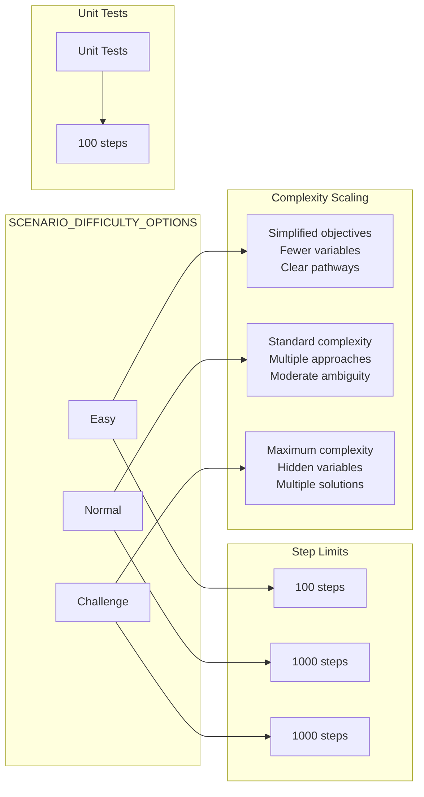

Sources: [README.md:142-146](), [agents/README.md:5-6](), [agents/README.md:52-53]()

| Difficulty | Max Steps | Target Audience | Characteristics |
|------------|-----------|----------------|-----------------|
| Easy | 100 | Development/Testing | Simplified objectives, clear success paths |
| Normal | 1000 | Baseline Evaluation | Standard complexity, multiple solution approaches |
| Challenge | 1000 | Advanced Evaluation | Maximum complexity, ambiguous success criteria |

Note: Unit Tests always run with a 100-step limit regardless of difficulty setting.

## Parametric Seeds

Scenarios support parametric variation through seeds, enabling multiple instances of each task theme and difficulty combination.

### Seed Configuration

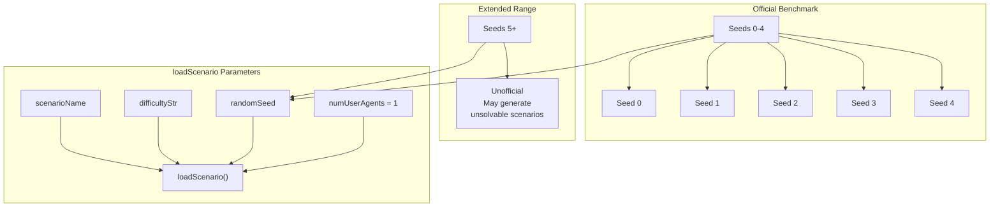

Sources: [README.md:148-150](), [README.md:122-130](), [agents/README.md:55-58]()

The official benchmark uses seeds 0-4, providing 5 parametric variations for each scenario-difficulty combination. This yields 120 total evaluation instances (8 Discovery Tasks × 3 Difficulties × 5 Seeds).

Seeds beyond 4 are supported but may generate unsolvable scenarios due to insufficient validation. When using extended seeds, implement error handling around scenario loading:

```python
# Example from API documentation
success = api.loadScenario(scenarioName=scenarioName, difficultyStr=difficultyStr, 
                          randomSeed=seed, numUserAgents=1)
if not success:
    print(f"Error: Could not load scenario '{scenarioName}' with difficulty '{difficultyStr}'.")
```

Sources: [README.md:122-130]()

## Task Evaluation System

DiscoveryWorld employs a multi-dimensional scoring system that evaluates different aspects of agent performance.

### Scoring Pipeline

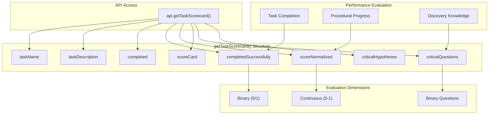

Sources: [README.md:240-259](), [agents/README.md:111-114]()

### Scorecard Structure

The `getTaskScorecard()` function returns a comprehensive evaluation object with the following keys:

| Key | Type | Purpose | Usage |
|-----|------|---------|-------|
| `taskName` | String | Internal unique task identifier | Logging and identification |
| `taskDescription` | String | Human-readable task description | Agent context and documentation |
| `completed` | Boolean | Whether task reached terminal state | Process tracking |
| `completedSuccessfully` | Boolean | Whether task was solved correctly | **Primary success metric** |
| `scoreNormalized` | Float (0-1) | Partial progress completion | **Procedural progress metric** |
| `scoreCard` | List | Detailed subgoal completion status | Diagnostic analysis |
| `criticalQuestions` | List | Binary knowledge validation questions | **Discovery knowledge metric** |
| `criticalHypotheses` | List | Descriptive knowledge hypotheses | Extended analysis (not in paper) |

Sources: [README.md:247-256]()

### Evaluation Dimensions

**Task Completion**: Binary success measurement using `completedSuccessfully`. Distinguishes between reaching a terminal state (`completed`) and achieving the correct solution.

**Procedural Progress**: Continuous measurement using `scoreNormalized` (0-1 scale). Tracks incremental progress toward task completion through subgoal achievement.

**Discovery Knowledge**: Binary assessment using `criticalQuestions`. Evaluates whether agents acquire and retain key scientific insights during task execution.

Sources: [README.md:251-254](), [agents/README.md:111-114]()

## Scenario Loading and Configuration

Scenarios are loaded through the `DiscoveryWorldAPI` using the `loadScenario()` method with specific parameters.

### Loading Process

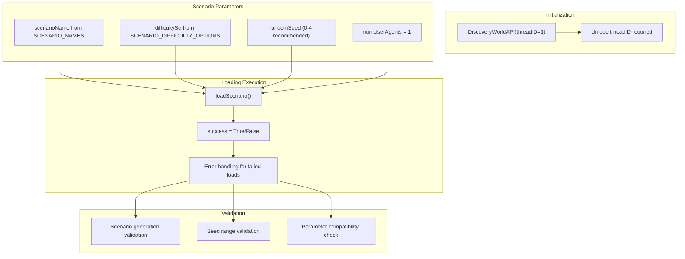

Sources: [README.md:122-132](), [README.md:152-157]()

### Thread Management

Each concurrent DiscoveryWorld instance requires a unique `threadID` to prevent resource conflicts. The threadID is used for:

- Creating unique output directories for frame storage
- Preventing log file overwrites across concurrent runs
- Isolating temporary resources during execution

Example thread management:
```python
# Each concurrent run needs unique threadID
api = DiscoveryWorldAPI(threadID=unique_thread_id)
```

Sources: [README.md:152-157]()

### Error Handling

Scenario loading can fail due to invalid parameters or unsolvable seed configurations. Implement robust error checking:

```python
success = api.loadScenario(scenarioName=scenarioName, difficultyStr=difficultyStr, 
                          randomSeed=seed, numUserAgents=1)
if not success:
    # Handle failed scenario loading
    print(f"Error: Could not load scenario '{scenarioName}' with difficulty '{difficultyStr}'.")
    return None
```

Sources: [README.md:126-130]()

---

# Page: Agent Development

# Agent Development

<details>
<summary>Relevant source files</summary>

The following files were used as context for generating this wiki page:

- [agents/ExampleLLMAgentPseudocode.py](agents/ExampleLLMAgentPseudocode.py)
- [agents/README.md](agents/README.md)

</details>


## Purpose and Scope

This section provides a comprehensive guide for developing custom agents in DiscoveryWorld. It covers the fundamental patterns, architecture, and best practices for creating agents that can interact with the virtual environment and complete scientific discovery tasks.

For step-by-step tutorials on creating your first agent, see [Getting Started with Agents](#3.1). For advanced language model integration techniques, see [LLM Integration Patterns](#3.2). For documentation of existing agent implementations, see [Built-in Agents](#4).

## Agent Architecture Overview

DiscoveryWorld agents follow a standardized architecture that enables consistent interaction with the environment through the `DiscoveryWorldAPI`. All agents implement a core observe-act cycle where they receive observations, process them, and return actions in JSON format.

### Core Agent Pattern

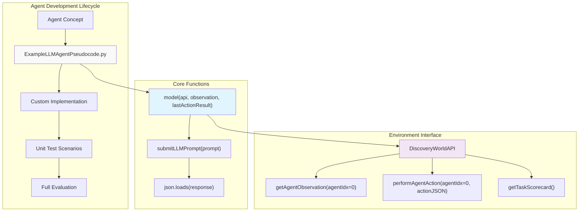

**Sources:** [agents/ExampleLLMAgentPseudocode.py:1-129](), [agents/README.md:1-181]()

### Agent-Environment Interaction Loop

```mermaid
graph LR
    subgraph "Observation Processing"
        GET_OBS["api.getAgentObservation(agentIdx=0)"]
        UI_DATA["observation['ui']"]
        TASK_DESC["taskProgress[0]['description']"]
        DIALOG_BOX["observation['ui']['dialog_box']"]
    end
    
    subgraph "Action Generation"
        MODEL_FUNC["model(api, observation, lastActionResult)"]
        PROMPT_BUILD["Build prompt with task + observations"]
        LLM_CALL["submitLLMPrompt(prompt)"]
        JSON_PARSE["json.loads(response)"]
    end
    
    subgraph "Action Execution"
        ACTION_JSON["{'action': 'USE', 'arg1': uuid1, 'arg2': uuid2}"]
        PERFORM["api.performAgentAction(agentIdx=0, actionJSON)"]
        RESULT["Action execution result"]
        CHECK_COMPLETE["api.areTasksComplete()"]
    end
    
    GET_OBS --> UI_DATA
    UI_DATA --> TASK_DESC
    UI_DATA --> DIALOG_BOX
    
    UI_DATA --> MODEL_FUNC
    TASK_DESC --> MODEL_FUNC
    MODEL_FUNC --> PROMPT_BUILD
    PROMPT_BUILD --> LLM_CALL
    LLM_CALL --> JSON_PARSE
    JSON_PARSE --> ACTION_JSON
    
    ACTION_JSON --> PERFORM
    PERFORM --> RESULT
    RESULT --> CHECK_COMPLETE
    CHECK_COMPLETE --> GET_OBS
    
    style MODEL_FUNC fill:#e1f5fe
    style ACTION_JSON fill:#f3e5f5
    style PERFORM fill:#fff3e0
```

**Sources:** [agents/ExampleLLMAgentPseudocode.py:7-71](), [agents/ExampleLLMAgentPseudocode.py:89-116]()

## Development Patterns

### Basic Agent Structure

All DiscoveryWorld agents implement a consistent pattern centered around a `model` function that processes observations and returns actions:

| Component | Purpose | Key Functions |
|-----------|---------|---------------|
| **Observation Processing** | Parse environment state | `observation["ui"]`, `taskProgress[0]["description"]` |
| **Action Generation** | Decide what to do next | `api.listKnownActions()`, `api.listTeleportLocationsDict()` |
| **Dialog Handling** | Manage conversations | `api.isAgentInDialog()`, `observation["ui"]["dialog_box"]` |
| **Execution Loop** | Run agent continuously | `api.performAgentAction()`, `api.areTasksComplete()` |

### Agent Types by Complexity

```mermaid
graph TB
    subgraph "Baseline Agents"
        RANDOM["RandomAgent.py<br/>Random action selection<br/>Code example reference"]
        EXAMPLE["ExampleLLMAgentPseudocode.py<br/>Basic LLM template<br/>Development starting point"]
    end
    
    subgraph "Advanced Agents"
        HYPO["HypothesizerAgent.py<br/>GPT-4V multimodal<br/>Scientific knowledge tracking<br/>Cost management"]
        
        subgraph "ReComA Framework"
            REACT["React Agent<br/>Reason-Act cycles<br/>Configurable prompts"]
            PLANEXEC["Plan+Execute Agent<br/>Strategic planning<br/>Execution monitoring"]
        end
    end
    
    RANDOM --> EXAMPLE
    EXAMPLE --> HYPO
    EXAMPLE --> REACT
    REACT --> PLANEXEC
    
    style EXAMPLE fill:#f9f9f9
    style HYPO fill:#e1f5fe
    style REACT fill:#f3e5f5
```

**Sources:** [agents/README.md:62-181]()

## Key Components

### Observation Structure

Agents receive observations in a standardized JSON format containing:

- **UI State**: Current interface elements, task progress, inventory
- **Visual Data**: Base64-encoded environment images
- **Dialog State**: Active conversations and available responses
- **Action Results**: Feedback from previous actions

Key observation fields include:
- `observation["ui"]["taskProgress"][0]["description"]` - Current task description
- `observation["ui"]["dialog_box"]` - Active dialog interface
- `observation["ui"]` - Complete UI state information

### Action Space

Actions are specified as JSON dictionaries with the following structure:

```json
{
    "action": "ACTION_NAME",
    "arg1": "object_uuid_or_parameter",
    "arg2": "optional_second_parameter"
}
```

Common action types include:
- **Object Manipulation**: `USE`, `PICK_UP`, `PUT_DOWN`
- **Movement**: `MOVE_DIRECTION`, `TELEPORT_TO_LOCATION`
- **Discovery**: `ADD_TO_DISCOVERY_FEED`
- **Dialog**: `chosen_dialog_option_int`

### Dialog Handling

Dialog interactions require special handling as they use pre-scripted dialog trees:

```python
if api.isAgentInDialog(agentIdx=0):
    # Extract dialog options from observation
    dialog = observation["ui"]["dialog_box"]
    # Return dialog choice instead of regular action
    return {"chosen_dialog_option_int": selected_option}
```

**Sources:** [agents/ExampleLLMAgentPseudocode.py:44-54](), [agents/README.md:77-80]()

## Development Workflow

### 1. Environment Setup

Initialize the DiscoveryWorld environment with scenario, difficulty, and seed parameters:

```python
api = DiscoveryWorldAPI(threadID=0)
success = api.loadScenario(
    scenarioName=scenarioName, 
    difficultyStr=difficultyStr, 
    randomSeed=randomSeed, 
    numUserAgents=1
)
```

### 2. Core Agent Loop

Implement the standard observe-act cycle:

```python
for stepNum in range(0, maxSteps):
    # Get observation
    observation = api.getAgentObservation(agentIdx=0)
    
    # Generate action
    actionJSON = model(api, observation, lastActionResult)
    
    # Execute action
    result = api.performAgentAction(agentIdx=0, actionJSON=actionJSON)
    lastActionResult = result
    
    # Check completion
    if api.areTasksComplete():
        break
```

### 3. Helper Functions

Utilize API helper functions for development:

| Function | Purpose |
|----------|---------|
| `api.listKnownActions(limited=False)` | Get available actions with descriptions |
| `api.listTeleportLocationsDict()` | Get valid teleport destinations |
| `api.getActionDescriptions()` | Get JSON-formatted action descriptions for LLMs |
| `api.areTasksComplete()` | Check if all tasks are finished |
| `api.getTaskScorecard()` | Get detailed performance metrics |

**Sources:** [agents/ExampleLLMAgentPseudocode.py:75-117](), [agents/README.md:9-14]()

## Testing and Evaluation

### Development Recommendations

1. **Start with Unit Tests**: Use "Small Skills" scenarios for initial development
2. **Keep Runs Short**: Limit steps during development to reduce costs and time
3. **Use Random Agent**: Reference `RandomAgent.py` for action space examples
4. **Test Dialog Handling**: Ensure proper dialog state management

### Evaluation Metrics

Agents are evaluated using two primary metrics:

- **Task Completion Score**: `completedSuccessfully` - whether tasks were solved correctly
- **Procedural Progress Score**: `finalNormalizedScore` - progress toward task completion

### Official Benchmarking

The standard evaluation protocol runs:
- Each task theme + difficulty combination (24 total)
- Seeds 0-4 (5 runs per combination)
- Easy/Unit Tests: 100 steps maximum
- Normal/Challenge: 1000 steps maximum

**Sources:** [agents/README.md:5-8](), [agents/README.md:111-114]()

---

# Page: Getting Started with Agents

# Getting Started with Agents

<details>
<summary>Relevant source files</summary>

The following files were used as context for generating this wiki page:

- [agents/ExampleLLMAgentPseudocode.py](agents/ExampleLLMAgentPseudocode.py)

</details>


This page provides a tutorial for creating your first agent in DiscoveryWorld using the example LLM agent as a template. It covers the basic agent development pattern, key code entities, and step-by-step implementation guidance.

For detailed API documentation, see [API Reference](#2.1). For comprehensive information about observation structures and action types, see [Observation & Action Systems](#2.2). For advanced LLM integration patterns, see [LLM Integration Patterns](#3.2).

## Basic Agent Architecture

Every agent in DiscoveryWorld follows a standard observe-think-act cycle. The agent receives observations from the environment, processes them through a decision-making model, and returns actions to be executed.

### Agent Development Pattern

```mermaid
graph TD
    Start["Agent Start"] --> LoadAPI["DiscoveryWorldAPI(threadID=0)"]
    LoadAPI --> LoadScenario["api.loadScenario()"]
    LoadScenario --> ObserveLoop["Observation Loop"]
    
    subgraph "Core Agent Loop"
        ObserveLoop --> GetObs["api.getAgentObservation(agentIdx=0)"]
        GetObs --> ModelDecision["model(api, observation, lastActionResult)"]
        ModelDecision --> PerformAction["api.performAgentAction(agentIdx=0, actionJSON)"]
        PerformAction --> CheckComplete["api.areTasksComplete()"]
        CheckComplete -->|No| GetObs
        CheckComplete -->|Yes| GetScore["api.getTaskScorecard()"]
    end
    
    GetScore --> End["Agent Complete"]
```

Sources: [agents/ExampleLLMAgentPseudocode.py:74-117]()

### Code Entity Mapping

```mermaid
graph LR
    subgraph "Natural Language Concepts"
        Environment["Environment State"]
        Agent["Agent Decision Making"]
        Actions["Agent Actions"]
        Results["Action Results"]
    end
    
    subgraph "Code Entities"
        DiscoveryWorldAPI["DiscoveryWorldAPI"]
        ModelFunction["model()"]
        ActionJSON["actionJSON"]
        LastActionResult["lastActionResult"]
        
        subgraph "API Methods"
            GetObservation["getAgentObservation()"]
            PerformAction["performAgentAction()"]
            ListActions["listKnownActions()"]
            CheckComplete["areTasksComplete()"]
        end
    end
    
    Environment --> GetObservation
    Agent --> ModelFunction
    Actions --> ActionJSON
    Results --> LastActionResult
    
    ModelFunction --> ListActions
    ActionJSON --> PerformAction
    PerformAction --> LastActionResult
```

Sources: [agents/ExampleLLMAgentPseudocode.py:1-2, 7-70, 90-117]()

## Core Components Walkthrough

### The Model Function

The `model()` function is the heart of any agent implementation. It takes three parameters and returns an action JSON:

| Parameter | Type | Description |
|-----------|------|-------------|
| `api` | `DiscoveryWorldAPI` | Environment interface for querying actions and state |
| `observation` | `dict` | Current environment observation including UI state |
| `lastActionResult` | `dict` | Result from the previous action execution |

The function builds a prompt containing:
- Task description from `observation["ui"]["taskProgress"][0]["description"]` [agents/ExampleLLMAgentPseudocode.py:12-13]()
- Current observation state as JSON [agents/ExampleLLMAgentPseudocode.py:16-19]()
- Available actions from `api.listKnownActions(limited=False)` [agents/ExampleLLMAgentPseudocode.py:22-25]()
- Teleport locations from `api.listTeleportLocationsDict()` [agents/ExampleLLMAgentPseudocode.py:28-31]()
- Previous action result [agents/ExampleLLMAgentPseudocode.py:34-37]()

Sources: [agents/ExampleLLMAgentPseudocode.py:7-70]()

### Dialog Handling

The agent checks if it's currently in a dialog using `api.isAgentInDialog(agentIdx=0)`. When in dialog mode, the agent should respond with a `chosen_dialog_option_int` instead of a regular action.

```mermaid
graph TD
    CheckDialog["api.isAgentInDialog(agentIdx=0)"]
    CheckDialog -->|Yes| DialogMode["Dialog Response Mode"]
    CheckDialog -->|No| ActionMode["Regular Action Mode"]
    
    DialogMode --> DialogPrompt["Build dialog selection prompt"]
    DialogPrompt --> DialogResponse["Return chosen_dialog_option_int"]
    
    ActionMode --> ActionPrompt["Build action selection prompt"]
    ActionPrompt --> ActionResponse["Return action JSON"]
```

Sources: [agents/ExampleLLMAgentPseudocode.py:44-54]()

### The Example Loop

The `exampleLoop()` function demonstrates the complete agent execution pattern:

1. **Initialization**: Create `DiscoveryWorldAPI(threadID=0)` instance [agents/ExampleLLMAgentPseudocode.py:83]()
2. **Scenario Loading**: Call `api.loadScenario()` with scenario name, difficulty, and seed [agents/ExampleLLMAgentPseudocode.py:84]()
3. **Agent Loop**: Execute observe-think-act cycle for specified steps [agents/ExampleLLMAgentPseudocode.py:91-112]()
4. **Completion Check**: Use `api.areTasksComplete()` to detect task completion [agents/ExampleLLMAgentPseudocode.py:109]()
5. **Final Scoring**: Retrieve scorecard with `api.getTaskScorecard()` [agents/ExampleLLMAgentPseudocode.py:114]()

Sources: [agents/ExampleLLMAgentPseudocode.py:75-117]()

## Action JSON Format

All agent actions follow a standardized JSON format:

```json
{
    "action": "ACTION_NAME",
    "arg1": "OBJECT_UUID_OR_VALUE",
    "arg2": "OPTIONAL_SECOND_ARG"
}
```

The `action` field contains the action name from `api.listKnownActions()`. Arguments `arg1` and `arg2` are typically UUIDs of objects in the environment, though some actions use other value types.

Sources: [agents/ExampleLLMAgentPseudocode.py:62-67]()

## Getting Started Steps

### Step 1: Set Up the Basic Structure

Create a new Python file with the required imports:

```python
from discoveryworld.DiscoveryWorldAPI import DiscoveryWorldAPI
from discoveryworld.ScenarioMaker import SCENARIOS, SCENARIO_DIFFICULTY_OPTIONS
import json
```

### Step 2: Implement the Model Function

Replace the `submitLLMPrompt()` placeholder with your actual LLM integration:

```python
def model(api, observation, lastActionResult):
    # Build prompt (see example code)
    prompt = buildPrompt(api, observation, lastActionResult)
    
    # Replace this with your LLM implementation
    response = your_llm_function(prompt)
    
    # Parse and return action JSON
    actionJSON = json.loads(response)
    return actionJSON
```

### Step 3: Configure Scenario Parameters

Choose your scenario and parameters:

| Parameter | Options | Description |
|-----------|---------|-------------|
| `scenarioName` | `SCENARIOS[0-8]` | Available scientific scenarios |
| `difficultyStr` | `SCENARIO_DIFFICULTY_OPTIONS[0-2]` | Easy, Normal, or Challenge |
| `randomSeed` | `0-4` (official), `5+` (extended) | Parametric variations |

### Step 4: Run Your Agent

Execute the agent loop with your chosen parameters:

```python
exampleLoop(
    scenarioName=SCENARIOS[0], 
    difficultyStr=SCENARIO_DIFFICULTY_OPTIONS[0], 
    randomSeed=0, 
    maxSteps=100
)
```

### Step 5: Analyze Results

The final scorecard provides detailed performance metrics including task completion status, procedural progress, and discovery knowledge tracking.

Sources: [agents/ExampleLLMAgentPseudocode.py:122-129]()

## Implementation Requirements

Your agent implementation must:
- Implement the `model()` function signature exactly as shown
- Handle both regular actions and dialog responses
- Parse LLM responses into valid JSON format
- Handle potential JSON parsing errors gracefully
- Return action dictionaries with the correct structure

For advanced agent patterns and LLM integration best practices, see [LLM Integration Patterns](#3.2). For production-ready implementations, examine the built-in agents documented in [Built-in Agents](#4).

Sources: [agents/ExampleLLMAgentPseudocode.py:1-129]()

---

# Page: LLM Integration Patterns

# LLM Integration Patterns

<details>
<summary>Relevant source files</summary>

The following files were used as context for generating this wiki page:

- [agents/ExampleLLMAgentPseudocode.py](agents/ExampleLLMAgentPseudocode.py)
- [agents/HypothesizerAgent.py](agents/HypothesizerAgent.py)

</details>


This document covers the patterns and best practices for integrating Large Language Models (LLMs) with DiscoveryWorld agents. It focuses on the technical implementation details, prompt engineering strategies, cost management, and error handling patterns used in the agent implementations.

For basic agent development concepts, see [Getting Started with Agents](#3.1). For specific agent implementations, see [Built-in Agents](#4). For advanced agent frameworks, see [ReComA Framework](#5).

## Basic LLM Integration Pattern

The simplest pattern for LLM integration is demonstrated in the `ExampleLLMAgentPseudocode.py` file, which provides a template for building LLM-powered agents.

### Core Components

```mermaid
graph TB
    subgraph "Basic LLM Agent Pattern"
        OBS["getAgentObservation()"] --> PROMPT["Prompt Construction"]
        PROMPT --> LLM["submitLLMPrompt()"]
        LLM --> PARSE["JSON Parsing"]
        PARSE --> ACTION["performAgentAction()"]
        ACTION --> TICK["api.tick()"]
        TICK --> OBS
    end
    
    subgraph "Prompt Structure"
        TASK["Task Description"] --> PROMPT
        UI["UI State JSON"] --> PROMPT
        ACTIONS["Available Actions"] --> PROMPT
        TELEPORT["Teleport Locations"] --> PROMPT
        LAST["Last Action Result"] --> PROMPT
    end
```

**Sources:** [agents/ExampleLLMAgentPseudocode.py:6-71]()

### Prompt Construction Strategy

The basic pattern constructs prompts by combining several key components:

| Component | Source | Purpose |
|-----------|--------|---------|
| Task Description | `observation["ui"]["taskProgress"][0]["description"]` | Provides the agent's objective |
| UI State | `observation["ui"]` | Current environment state |
| Available Actions | `api.listKnownActions(limited=False)` | Valid action space |
| Teleport Locations | `api.listTeleportLocationsDict()` | Movement shortcuts |
| Last Action Result | `lastActionResult` | Feedback from previous step |

**Sources:** [agents/ExampleLLMAgentPseudocode.py:11-37]()

### Dialog Handling

The basic pattern includes conditional logic for handling dialog interactions:

```mermaid
graph LR
    CHECK["api.isAgentInDialog()"] --> DIALOG{In Dialog?}
    DIALOG -->|Yes| DIALOG_PROMPT["Dialog-specific prompt"]
    DIALOG -->|No| STANDARD["Standard action prompt"]
    DIALOG_PROMPT --> PARSE_DIALOG["Parse dialog option"]
    STANDARD --> PARSE_ACTION["Parse action JSON"]
```

**Sources:** [agents/ExampleLLMAgentPseudocode.py:45-54]()

## Advanced LLM Integration Patterns

The `HypothesizerAgent.py` demonstrates sophisticated LLM integration patterns for complex scientific discovery tasks.

### Multi-Modal Vision Integration

```mermaid
graph TB
    subgraph "GPT4VHypothesizerAgent Architecture"
        API_CALL["GPT4HypothesizerOneStep()"] --> OBS_PROC["Observation Processing"]
        OBS_PROC --> PROMPT_BUILD["Complex Prompt Construction"]
        PROMPT_BUILD --> VISION["Vision Integration"]
        VISION --> OPENAI["OpenAIGetCompletion()"]
        OPENAI --> EXTRACT["extractJSONfromGPT4Response()"]
        EXTRACT --> ACTION_EXEC["Action Execution"]
        ACTION_EXEC --> KNOWLEDGE["Knowledge Update"]
        KNOWLEDGE --> CONSOLIDATE["Periodic Consolidation"]
    end
    
    subgraph "Vision Components"
        CURRENT_IMG["observation[vision][base64_with_grid]"] --> VISION
        PREV_IMG["lastObservation[vision][base64_with_grid]"] --> VISION
        TEXT_PROMPT["promptStr"] --> VISION
    end
```

**Sources:** [agents/HypothesizerAgent.py:327-441]()

### Cost Management System

The advanced pattern includes comprehensive cost tracking:

```mermaid
graph LR
    subgraph "Cost Tracking Components"
        TOKENS["Token Counting"] --> COST_CALC["Cost Calculation"]
        COST_CALC --> LIMITS["Cost Limits"]
        LIMITS --> EARLY_EXIT["Early Exit Logic"]
    end
    
    subgraph "Model Configuration"
        MODEL_COSTS["modelCostsPerToken"] --> COST_CALC
        MODEL_SEL["OPENAI_MODEL_TO_USE"] --> COST_CALC
        MAX_COST["MAXIMUM_COST_DOLLARS"] --> LIMITS
    end
```

**Sources:** [agents/HypothesizerAgent.py:44-65](), [agents/HypothesizerAgent.py:245-279]()

### Knowledge Management Pattern

The advanced pattern implements a sophisticated knowledge management system:

```mermaid
graph TB
    subgraph "Scientific Knowledge System"
        STEP_KNOWLEDGE["Per-Step Knowledge Extraction"] --> KB["currentScientificKnowledge"]
        KB --> CONSOLIDATE["consolidateKnowledgeStep()"]
        CONSOLIDATE --> KB
        KB --> PROMPT_INJECT["Knowledge Injection in Prompts"]
    end
    
    subgraph "Knowledge Types"
        MEASUREMENTS["Measurements"] --> KB
        HYPOTHESES["Hypotheses"] --> KB
        EVIDENCE["Supporting Evidence"] --> KB
        STATUS["Hypothesis Status"] --> KB
    end
    
    subgraph "Consolidation Triggers"
        STEP_COUNT["Every 10 Steps"] --> CONSOLIDATE
        SIZE_LIMIT["40 Entry Limit"] --> CONSOLIDATE
        TOKEN_LIMIT["2000 Token Limit"] --> CONSOLIDATE
    end
```

**Sources:** [agents/HypothesizerAgent.py:642-763](), [agents/HypothesizerAgent.py:776-782]()

## Error Handling and Retry Logic

### OpenAI Request Error Handling

The advanced pattern implements robust error handling for LLM API calls:

```mermaid
graph TB
    REQUEST["OpenAI API Request"] --> SUCCESS{Success?}
    SUCCESS -->|Yes| RESPONSE["Return Response"]
    SUCCESS -->|No| ERROR_CHECK["Check Error Count"]
    ERROR_CHECK --> LIMIT{< 5 Errors?}
    LIMIT -->|Yes| WAIT["Wait 5 Seconds"]
    WAIT --> RETRY["Retry Request"]
    RETRY --> REQUEST
    LIMIT -->|No| EXIT["Exit Program"]
    
    subgraph "Error Types Handled"
        KEYBOARD["KeyboardInterrupt"] --> EXIT
        SYSTEM["SystemExit"] --> EXIT
        GENERIC["Generic Exception"] --> ERROR_CHECK
    end
```

**Sources:** [agents/HypothesizerAgent.py:142-175]()

### JSON Parsing Recovery

Both patterns include JSON parsing recovery mechanisms:

| Recovery Strategy | Implementation | Use Case |
|-------------------|----------------|----------|
| Memory Recovery | Search backwards through action history | Missing memory fields |
| Hypothesis Recovery | Search backwards for running hypotheses | Missing hypothesis tracking |
| Error Action | Generate error action with context | Invalid JSON response |

**Sources:** [agents/HypothesizerAgent.py:454-517]()

## Prompt Engineering Patterns

### Structured Prompt Assembly

The advanced pattern uses a modular prompt construction approach:

```mermaid
graph LR
    subgraph "Prompt Components"
        BASE["promptStr0: Base Instructions"] --> ASSEMBLY["Prompt Assembly"]
        KNOWLEDGE["promptStr1: Knowledge Context"] --> ASSEMBLY
        DIALOG["promptDialogStr: Dialog Handling"] --> ASSEMBLY
        DEBUG["promptStrDebug: Debug Instructions"] --> ASSEMBLY
    end
    
    subgraph "Dynamic Elements"
        OBSERVATION["Current Observation"] --> BASE
        ACTIONS["Available Actions"] --> BASE
        TELEPORT["Teleport Options"] --> BASE
        HISTORY["Action History"] --> BASE
        SCIENTIFIC["Scientific Knowledge"] --> KNOWLEDGE
    end
```

**Sources:** [agents/HypothesizerAgent.py:348-421]()

### Context Management

The system manages context size through several strategies:

| Strategy | Implementation | Benefit |
|----------|----------------|---------|
| Action History Limiting | Last 3 actions only | Prevents context overflow |
| Knowledge Consolidation | Periodic compression | Maintains relevant information |
| Image Context | Previous + current images | Visual continuity |
| Object Filtering | Accessible objects only | Reduces irrelevant data |

**Sources:** [agents/HypothesizerAgent.py:368-374](), [agents/HypothesizerAgent.py:862-864]()

## Integration with DiscoveryWorld API

### API Method Usage Patterns

```mermaid
graph TB
    subgraph "Core API Integration"
        LOAD["api.loadScenario()"] --> LOOP["Agent Loop"]
        LOOP --> GET_OBS["api.getAgentObservation()"]
        GET_OBS --> LLM_CALL["LLM Processing"]
        LLM_CALL --> PERFORM["api.performAgentAction()"]
        PERFORM --> TICK["api.tick()"]
        TICK --> CHECK["api.areTasksComplete()"]
        CHECK -->|No| GET_OBS
        CHECK -->|Yes| SCORE["api.getTaskScorecard()"]
    end
    
    subgraph "Helper Methods"
        ACTIONS["api.listKnownActions()"] --> LLM_CALL
        TELEPORT["api.listTeleportLocationsDict()"] --> LLM_CALL
        DIALOG["api.isAgentInDialog()"] --> LLM_CALL
    end
```

**Sources:** [agents/ExampleLLMAgentPseudocode.py:83-116](), [agents/HypothesizerAgent.py:975-1010]()

### Object Management

Both patterns include utilities for managing game objects:

```mermaid
graph LR
    subgraph "Object Handling Utilities"
        UUID_LOOKUP["getVisibleObjectByUUID()"] --> OBJ_DESC["Object Description"]
        SHORT_LIST["mkShortInteractableObjectList()"] --> PROMPT_INJECT["Prompt Injection"]
        ACCESSIBLE["accessibleEnvironmentObjects"] --> UUID_LOOKUP
        INVENTORY["inventoryObjects"] --> UUID_LOOKUP
    end
```

**Sources:** [agents/HypothesizerAgent.py:96-131](), [agents/HypothesizerAgent.py:519-533]()

## Best Practices Summary

### Implementation Guidelines

1. **Start Simple**: Begin with the `ExampleLLMAgentPseudocode.py` pattern for basic functionality
2. **Add Complexity Gradually**: Implement advanced features like vision and knowledge management incrementally
3. **Handle Errors Gracefully**: Always include retry logic and graceful degradation
4. **Manage Costs**: Implement token counting and cost limits for production use
5. **Optimize Context**: Use consolidation and filtering to manage prompt size

### Performance Considerations

| Pattern | Token Usage | Response Time | Cost Impact |
|---------|-------------|---------------|-------------|
| Basic Text-Only | Low | Fast | Minimal |
| Vision Integration | High | Slower | Significant |
| Knowledge Management | Variable | Variable | Depends on consolidation |
| Error Recovery | Minimal | Fast | Minimal overhead |

**Sources:** [agents/HypothesizerAgent.py:870-909](), [agents/ExampleLLMAgentPseudocode.py:75-129]()

---

# Page: Built-in Agents

# Built-in Agents

<details>
<summary>Relevant source files</summary>

The following files were used as context for generating this wiki page:

- [agents/README.md](agents/README.md)

</details>


This page documents the agent implementations included with DiscoveryWorld. These agents serve as baselines for performance comparison, code examples for development, and reference implementations demonstrating different approaches to scientific discovery tasks.

The built-in agents range from simple random baselines to sophisticated multimodal language model agents. For information about developing custom agents, see [Agent Development](#3). For advanced agent frameworks like ReComA, see [ReComA Framework](#5).

## Agent Architecture Overview

DiscoveryWorld includes three categories of built-in agents, each serving different purposes in the evaluation ecosystem:

```mermaid
graph TB
    subgraph "Agent Hierarchy"
        RandomAgent["RandomAgent<br/>• Baseline performance<br/>• Code example<br/>• Action space demonstration"]
        
        HypothesizerAgent["HypothesizerAgent<br/>• GPT-4V multimodal<br/>• Scientific reasoning<br/>• Knowledge consolidation<br/>• Cost management"]
        
        ReCoMAAgents["ReComA Framework Agents<br/>• ReactAgent<br/>• PlanExecuteAgent<br/>• Configurable LLM backends"]
    end
    
    subgraph "Core Components"
        DiscoveryWorldAPI["DiscoveryWorldAPI<br/>• Environment interface<br/>• Action execution<br/>• Observation management"]
        
        ActionSpace["Action Space<br/>• Movement & rotation<br/>• Object manipulation<br/>• Dialog interactions<br/>• Discovery feed access"]
        
        ObservationSpace["Observation Space<br/>• Visual observations<br/>• Textual descriptions<br/>• Action results<br/>• Environment state"]
    end
    
    RandomAgent --> DiscoveryWorldAPI
    HypothesizerAgent --> DiscoveryWorldAPI
    ReCoMAAgents --> DiscoveryWorldAPI
    
    DiscoveryWorldAPI --> ActionSpace
    DiscoveryWorldAPI --> ObservationSpace
```

**Sources:** [agents/README.md:1-181]()

## Implementation Patterns

The built-in agents demonstrate different architectural patterns for agent development:

```mermaid
graph LR
    subgraph "RandomAgent.py"
        RandomAgent_class["RandomAgent"]
        getRandomAction["getRandomAction()"]
        chooseRandomAction["chooseRandomAction()"]
        handleDialogActions["handleDialogActions()"]
    end
    
    subgraph "HypothesizerAgent.py"
        GPT4HypothesizerOneStep["GPT4HypothesizerOneStep()"]
        GPT4ReflectKnowledge["GPT4ReflectKnowledge()"]
        GPT4ConsolidateKnowledge["GPT4ConsolidateKnowledge()"]
        costTracking["Cost tracking functions"]
    end
    
    subgraph "Common Patterns"
        stepLoop["Step execution loop"]
        actionParsing["Action parsing"]
        observationHandling["Observation handling"]
        dialogManagement["Dialog state management"]
    end
    
    RandomAgent_class --> stepLoop
    GPT4HypothesizerOneStep --> stepLoop
    
    getRandomAction --> actionParsing
    GPT4HypothesizerOneStep --> actionParsing
    
    handleDialogActions --> dialogManagement
    GPT4HypothesizerOneStep --> dialogManagement
    
    RandomAgent_class --> observationHandling
    GPT4ReflectKnowledge --> observationHandling
```

**Sources:** [agents/README.md:62-181]()

## Random Agent

The `RandomAgent` serves as both a performance baseline and a comprehensive code example for agent development. It demonstrates the full action space and provides readable implementation patterns.

### Purpose and Design

The Random Agent fulfills multiple roles:
- **Performance baseline**: Establishes minimum expected performance for comparison
- **Code example**: Demonstrates proper action space usage and argument handling
- **Development reference**: Shows implementation patterns for common agent operations

### Key Implementation Features

| Feature | Implementation | Line Reference |
|---------|---------------|----------------|
| Random action selection | Core selection logic | [agents/RandomAgent.py:150]() |
| Object-based actions | Actions with environment object references | [agents/RandomAgent.py:185]() |
| Special case actions | Movement, teleport, numeric arguments | [agents/RandomAgent.py:199]() |
| Dialog handling | Dialog tree navigation | [agents/RandomAgent.py:114]() |

### Action Space Demonstration

The Random Agent illustrates all major action categories:

```mermaid
graph TD
    subgraph "RandomAgent Action Handling"
        checkDialog["Check dialog state<br/>handleDialogActions()"]
        chooseAction["Choose random action<br/>chooseRandomAction()"]
        
        subgraph "Action Types"
            objectActions["Object-based actions<br/>• use X on Y<br/>• pick up X<br/>• examine X"]
            
            directionalActions["Directional actions<br/>• move north/south/east/west<br/>• face direction"]
            
            specialActions["Special actions<br/>• teleport to location<br/>• discovery feed access<br/>• numeric arguments"]
            
            dialogActions["Dialog actions<br/>• Pre-scripted responses<br/>• Dialog tree navigation"]
        end
    end
    
    checkDialog --> dialogActions
    checkDialog --> chooseAction
    chooseAction --> objectActions
    chooseAction --> directionalActions
    chooseAction --> specialActions
```

### Usage

Run the Random Agent using the following command pattern:

```bash
python agents/RandomAgent.py --scenario="TASK_THEME" --difficulty="DIFFICULTY" --seed=SEED --numSteps=NUM_STEPS
```

Example execution:
```bash
python agents/RandomAgent.py --scenario="Space Sick" --difficulty="Challenge" --seed=0 --numSteps=10
```

### Output Format

The Random Agent produces a summary JSON file with performance metrics:

```json
{
    "agentName": "RandomAgent",
    "completed": 0,
    "completedSuccessfully": 0,
    "difficulty": "Challenge", 
    "finalNormalizedScore": 0.0,
    "numSteps": 10,
    "scenario": "Space Sick",
    "seed": 0,
    "stepsPerSecond": 3.6337145107164717,
    "threadId": 6638643
}
```

**Sources:** [agents/README.md:62-115]()

## Hypothesizer Agent

The `HypothesizerAgent` demonstrates advanced multimodal reasoning using GPT-4V. It implements scientific discovery patterns including hypothesis formation, knowledge tracking, and cost-conscious operation.

### Architecture and Capabilities

The Hypothesizer Agent implements an act-then-reflect cognitive architecture:

```mermaid
graph TB
    subgraph "HypothesizerAgent Cognitive Cycle"
        observation["Environment Observation<br/>• Visual input (base64)<br/>• Textual descriptions<br/>• Action results"]
        
        actionPlanning["Action Planning<br/>GPT4HypothesizerOneStep()"]
        
        actionExecution["Action Execution<br/>DiscoveryWorldAPI"]
        
        reflection["Knowledge Reflection<br/>GPT4ReflectKnowledge()"]
        
        consolidation["Knowledge Consolidation<br/>GPT4ConsolidateKnowledge()<br/>Every 10 steps"]
        
        costTracking["Cost Management<br/>Token counting<br/>Dollar limits"]
    end
    
    observation --> actionPlanning
    actionPlanning --> actionExecution
    actionExecution --> reflection
    reflection --> consolidation
    consolidation --> observation
    
    actionPlanning --> costTracking
    reflection --> costTracking
    consolidation --> costTracking
```

### Core Components

| Component | Function | Implementation Reference |
|-----------|----------|-------------------------|
| Action planning | GPT-4V reasoning for next action | [agents/HypothesizerAgent.py:348]() |
| Knowledge reflection | Post-action learning integration | [agents/HypothesizerAgent.py:555]() |
| Dialog handling | Special prompting for dialog trees | [agents/HypothesizerAgent.py:405]() |
| Knowledge consolidation | Memory compression every 10 steps | [agents/HypothesizerAgent.py:642]() |
| Environment initialization | DiscoveryWorld setup and execution | [agents/HypothesizerAgent.py:975]() |

### Scientific Reasoning Features

The agent implements several advanced capabilities:

- **Multimodal input processing**: Handles both visual and textual observations
- **Hypothesis formation**: Develops and tests scientific hypotheses
- **Knowledge accumulation**: Maintains working memory of discoveries
- **Cost management**: Tracks and limits API usage costs
- **Memory consolidation**: Prevents working memory overflow

### Usage and Configuration

The Hypothesizer Agent requires OpenAI API access and produces comprehensive output logs:

```bash
python agents/HypothesizerAgent.py --scenario="Combinatorial Chemistry" --difficulty="Normal" --numSteps=10 --seed=0 --model=gpt-4o-2024-05-13 --video --maxCostDollars=5
```

**Prerequisites:**
- OpenAI API key in `openai_key.txt` file
- Optional: FFmpeg for video generation

### Output Artifacts

The agent generates multiple output files for analysis:

| File Type | Content | Purpose |
|-----------|---------|---------|
| `output_allhistory*.json` | Step-by-step observations, actions, knowledge, scores | Detailed behavior analysis |
| `output_consolodatedKnowledge*.json` | Knowledge consolidation events | Learning progression tracking |
| `output_costAnalysis*.json` | API usage and costs | Resource management analysis |
| `logs/out*partXofY.zip` | World state logs and frame captures | Environment state tracking |
| `output*.mp4` | Gameplay video (with `--video` flag) | Visual behavior analysis |

**Sources:** [agents/README.md:116-177]()

## ReComA Framework Agents

The ReComA (Reason, Compose, and Manage) framework provides additional sophisticated agent implementations including `ReactAgent` and `PlanExecuteAgent`. These agents offer configurable LLM backends, strategic planning capabilities, and advanced reasoning patterns.

For detailed documentation of ReComA agents, including setup, configuration, and usage instructions, see [ReComA Framework](#5).

**Sources:** [agents/README.md:178-181]()

---

# Page: Random Agent

# Random Agent

<details>
<summary>Relevant source files</summary>

The following files were used as context for generating this wiki page:

- [agents/README.md](agents/README.md)
- [agents/RandomAgent.py](agents/RandomAgent.py)

</details>


This document covers the Random Agent implementation in DiscoveryWorld, which serves as a baseline agent for performance comparison and action space demonstration. The Random Agent randomly selects actions at each step, providing both a minimal performance baseline and a readable code example for new agent developers.

For information about other baseline agents, see [Built-in Agents](#4). For advanced agent development patterns, see [Agent Development](#3).

## Purpose and Architecture

The Random Agent serves three primary functions in the DiscoveryWorld ecosystem:

1. **Performance Baseline**: Provides a minimal baseline to verify that tasks are sufficiently challenging
2. **Code Example**: Demonstrates the complete action space and proper argument handling for agent developers  
3. **System Testing**: Helps identify edge cases and bugs through comprehensive random exploration

### System Integration

```mermaid
graph TB
    CLI["Command Line Interface<br/>RandomAgent.py main()"]
    RUNNER["runRandomAgent()<br/>Environment Setup"]
    CORE["randomAgent()<br/>Core Logic Loop"]
    API["DiscoveryWorldAPI<br/>Environment Interface"]
    
    CLI --> RUNNER
    RUNNER --> API
    RUNNER --> CORE
    CORE --> API
    
    subgraph "Action Handling"
        ACTIONS["listKnownActions()<br/>Get Available Actions"]
        OBJECTS["accessibleObjects<br/>From Observation"]
        SPECIAL["Special Case Handlers<br/>Dialog, Movement, Teleport"]
    end
    
    subgraph "Output Generation"
        METRICS["Performance Metrics<br/>Scorecard Data"]
        VIDEO["Optional Video Export<br/>createAgentVideo()"]
        LOGS["JSON Output Files<br/>Timestamped Results"]
    end
    
    CORE --> ACTIONS
    CORE --> OBJECTS
    CORE --> SPECIAL
    CORE --> METRICS
    RUNNER --> VIDEO
    RUNNER --> LOGS
```

Sources: [agents/RandomAgent.py:254-302](), [agents/RandomAgent.py:64-248]()

## Core Implementation

The Random Agent's core logic is implemented in the `randomAgent()` function, which operates in a simple step-based loop:

### Main Loop Structure

```mermaid
graph TD
    START["randomAgent() Entry"]
    INIT["Initialize Random Seed<br/>random.Random()"]
    LOOP["Step Loop<br/>range(numSteps)"]
    OBS["getAgentObservation()<br/>agentIdx=0"]
    DIALOG{"isAgentInDialog()?"}
    
    DIALOG_ACTION["Handle Dialog<br/>Random Option Selection"]
    NORMAL_ACTION["Handle Normal Action<br/>Random Action + Args"]
    
    PERFORM["performAgentAction()<br/>Execute Selected Action"]
    TICK["api.tick()<br/>World State Update"]
    
    START --> INIT
    INIT --> LOOP
    LOOP --> OBS
    OBS --> DIALOG
    DIALOG -->|Yes| DIALOG_ACTION
    DIALOG -->|No| NORMAL_ACTION
    DIALOG_ACTION --> PERFORM
    NORMAL_ACTION --> PERFORM
    PERFORM --> TICK
    TICK --> LOOP
```

Sources: [agents/RandomAgent.py:64-248](), [agents/RandomAgent.py:90-240]()

### Action Selection Mechanism

The agent implements sophisticated random action selection that handles the full DiscoveryWorld action space:

| Action Category | Implementation | Code Reference |
|-----------------|----------------|----------------|
| Standard Actions | Random selection from `listKnownActions()` with object UUIDs | [agents/RandomAgent.py:147-197]() |
| Dialog Actions | Random choice from `dialog["dialogOptions"].keys()` | [agents/RandomAgent.py:114-137]() |
| Movement Actions | Direction selection from `["north", "east", "south", "west"]` | [agents/RandomAgent.py:201-208]() |
| Teleportation | Random location from `listTeleportLocationsDict()` | [agents/RandomAgent.py:209-220]() |
| Discovery Feed | Random post ID generation for feed access | [agents/RandomAgent.py:221-224]() |

## Dialog Handling

The Random Agent includes comprehensive dialog state handling, which is critical since many DiscoveryWorld objects (soil computers, crystal reactors) use dialog trees for interaction:

```mermaid
graph LR
    CHECK["api.isAgentInDialog(agentIdx=0)"]
    PARSE["observation['ui']['dialog_box']"]
    OPTIONS["dialog['dialogOptions'].keys()"]
    SELECT["r.choice(list(possibleOptions))"]
    CONVERT["int(chosenOption)"]
    ACTION["performAgentAction(dialogActionJSONOut)"]
    
    CHECK --> PARSE
    PARSE --> OPTIONS
    OPTIONS --> SELECT
    SELECT --> CONVERT
    CONVERT --> ACTION
```

Sources: [agents/RandomAgent.py:114-137](), [agents/README.md:77-80]()

## Usage and Configuration

### Command Line Interface

The Random Agent supports both single scenario execution and batch processing:

```bash
# Single scenario execution
python agents/RandomAgent.py --scenario="Space Sick" --difficulty="Challenge" --seed=0 --numSteps=10

# Batch execution of all scenarios
python agents/RandomAgent.py --runall --numSteps=100 --video
```

### Configuration Parameters

| Parameter | Type | Description | Default |
|-----------|------|-------------|---------|
| `--scenario` | choice | Scenario name from `SCENARIO_NAMES` | None |
| `--difficulty` | choice | Difficulty level from `SCENARIO_DIFFICULTY_OPTIONS` | None |
| `--seed` | int | Random seed for reproducible runs | 0 |
| `--numSteps` | int | Maximum steps to execute | 100 |
| `--runall` | flag | Execute all scenario/difficulty combinations | False |
| `--video` | flag | Export video of agent actions | False |
| `--threadId` | int | Thread identifier for parallel execution | Random |

Sources: [agents/RandomAgent.py:317-326](), [agents/RandomAgent.py:436-470]()

## Output and Evaluation

### Performance Metrics

The Random Agent generates comprehensive performance data in JSON format:

```mermaid
graph TD
    SCORECARD["api.getTaskScorecard()<br/>Final Performance Data"]
    
    subgraph "Core Metrics"
        NORM["finalNormalizedScore<br/>Procedural Progress"]
        COMP["completed<br/>Task Finished Flag"]
        SUCC["completedSuccessfully<br/>Correct Answer Flag"]
    end
    
    subgraph "Execution Metrics"
        STEPS["numSteps<br/>Total Steps Executed"]
        SPEED["stepsPerSecond<br/>Performance Rate"]
        THREAD["threadId<br/>Execution Context"]
    end
    
    subgraph "Output Files"
        JSON["output_random_agent*.json<br/>Performance Summary"]
        VIDEO["output_random_agent*.mp4<br/>Visual Recording"]
    end
    
    SCORECARD --> NORM
    SCORECARD --> COMP
    SCORECARD --> SUCC
    SCORECARD --> STEPS
    SCORECARD --> SPEED
    SCORECARD --> THREAD
    
    NORM --> JSON
    COMP --> JSON
    SUCC --> JSON
    STEPS --> VIDEO
```

### Batch Processing Results

When using `--runall`, the agent generates aggregated statistics across all scenario/difficulty combinations:

```json
{
    "scores_avg": {"ScenarioName-Difficulty-avg": 0.15},
    "scores_raw": {"ScenarioName-Difficulty": [0.1, 0.2, 0.0, 0.3, 0.15]},
    "completed_avg": {"ScenarioName-Difficulty-avg": 0.2},
    "completedSuccessfully_avg": {"ScenarioName-Difficulty-avg": 0.0}
}
```

Sources: [agents/RandomAgent.py:294-301](), [agents/RandomAgent.py:417-433](), [agents/README.md:95-114]()

## Error Handling and Robustness

The Random Agent includes robust error handling for development and testing scenarios:

- **Crash Recovery**: Automatic restart with up to 10 attempts for failed runs in batch mode
- **Thread Safety**: Unique thread IDs prevent conflicts in parallel execution  
- **Seed Management**: Deterministic random behavior for reproducible testing
- **Parameter Validation**: Scenario and difficulty validation against known configurations

Sources: [agents/RandomAgent.py:354-386](), [agents/RandomAgent.py:438-455]()

---

# Page: Hypothesizer Agent

# Hypothesizer Agent

<details>
<summary>Relevant source files</summary>

The following files were used as context for generating this wiki page:

- [agents/HypothesizerAgent.py](agents/HypothesizerAgent.py)
- [agents/README.md](agents/README.md)

</details>


The Hypothesizer Agent is an advanced GPT-4V multimodal agent designed for scientific discovery tasks in DiscoveryWorld. It features sophisticated scientific knowledge tracking, automatic cost management, and hypothesis formation capabilities. This agent implements an act-then-reflect cycle where it performs actions in the environment and then explicitly tracks scientific measurements and hypotheses from its observations.

For basic agent development patterns, see [Getting Started with Agents](#3.1). For LLM integration fundamentals, see [LLM Integration Patterns](#3.2). For alternative agent implementations, see [ReComA Framework](#5).

## Architecture Overview

The Hypothesizer Agent operates through a two-phase cycle at each step: action selection and knowledge reflection. It maintains scientific knowledge across steps and periodically consolidates this knowledge to manage memory constraints.

**Hypothesizer Agent Architecture**

```mermaid
graph TB
    subgraph "Agent Entry Point"
        GPT4VHypothesizerAgent["GPT4VHypothesizerAgent()"]
        runHypothesizerAgent["runHypothesizerAgent()"]
    end
    
    subgraph "Core Step Cycle"
        OneStep["GPT4HypothesizerOneStep()"]
        ActionPhase["Action Selection Phase"]
        KnowledgePhase["Knowledge Reflection Phase"]
    end
    
    subgraph "OpenAI Integration"
        OpenAIGetCompletion["OpenAIGetCompletion()"]
        extractJSONfromGPT4Response["extractJSONfromGPT4Response()"]
        TokenTracking["Token/Cost Tracking"]
    end
    
    subgraph "Knowledge Management"
        consolidateKnowledgeStep["consolidateKnowledgeStep()"]
        mkInitialHypotheses["mkInitialHypotheses()"]
        mkExampleHypotheses["mkExampleHypotheses()"]
    end
    
    subgraph "DiscoveryWorld API"
        getAgentObservation["api.getAgentObservation()"]
        performAgentAction["api.performAgentAction()"]
        tick["api.tick()"]
    end
    
    GPT4VHypothesizerAgent --> OneStep
    runHypothesizerAgent --> GPT4VHypothesizerAgent
    
    OneStep --> ActionPhase
    ActionPhase --> KnowledgePhase
    KnowledgePhase --> consolidateKnowledgeStep
    
    ActionPhase --> OpenAIGetCompletion
    KnowledgePhase --> OpenAIGetCompletion
    consolidateKnowledgeStep --> OpenAIGetCompletion
    
    OpenAIGetCompletion --> extractJSONfromGPT4Response
    OpenAIGetCompletion --> TokenTracking
    
    OneStep --> getAgentObservation
    OneStep --> performAgentAction
    OneStep --> tick
    
    style OneStep fill:#e1f5fe
    style consolidateKnowledgeStep fill:#f3e5f5
    style TokenTracking fill:#fff3e0
```

Sources: [agents/HypothesizerAgent.py:786-990](), [agents/HypothesizerAgent.py:327-633]()

## Core Components

### Agent Execution Loop

The main execution happens in `GPT4VHypothesizerAgent`, which runs the agent for a specified number of steps while tracking costs and scientific knowledge.

| Component | Function | Purpose |
|-----------|----------|---------|
| Main Loop | `GPT4VHypothesizerAgent` | Orchestrates multi-step execution with error handling |
| Single Step | `GPT4HypothesizerOneStep` | Handles one complete action-reflection cycle |
| Knowledge Init | `mkInitialHypotheses` | Creates empty scientific knowledge structure |
| Consolidation | `consolidateKnowledgeStep` | Compresses knowledge every 10 steps |

**Core Execution Flow**

```mermaid
flowchart TD
    Start[/"GPT4VHypothesizerAgent()"/] --> Init["Initialize OpenAI client<br/>mkInitialHypotheses()"]
    Init --> StepLoop{{"For numSteps iterations"}}
    
    StepLoop --> OneStep["GPT4HypothesizerOneStep()"]
    OneStep --> ActionPhase["Action Selection<br/>OpenAI API call"]
    ActionPhase --> ActionExec["performAgentAction()"]
    ActionExec --> WorldTick["api.tick()"]
    
    WorldTick --> KnowledgePhase["Knowledge Reflection<br/>OpenAI API call"]
    KnowledgePhase --> UpdateKnowledge["Update currentScientificKnowledge"]
    
    UpdateKnowledge --> ConsolidateCheck{"Step % 10 == 0?"}
    ConsolidateCheck -->|Yes| Consolidate["consolidateKnowledgeStep()"]
    ConsolidateCheck -->|No| CostCheck
    Consolidate --> CostCheck
    
    CostCheck{"Cost limit<br/>exceeded?"} -->|No| TaskComplete{"All tasks<br/>complete?"}
    CostCheck -->|Yes| End
    TaskComplete -->|No| StepLoop
    TaskComplete -->|Yes| End[/"Return results"/]
    
    style OneStep fill:#e1f5fe
    style Consolidate fill:#f3e5f5
    style CostCheck fill:#fff3e0
```

Sources: [agents/HypothesizerAgent.py:820-937](), [agents/HypothesizerAgent.py:327-633]()

### Action Selection Phase

The action phase constructs a comprehensive prompt including environment observation, action history, and current scientific knowledge, then requests a JSON-formatted action from GPT-4V.

**Action Phase Components**

```mermaid
graph LR
    subgraph "Prompt Construction"
        promptStr0["Game Context & Rules"]
        promptStr1["Scientific Knowledge Context"]
        promptDialogStr["Dialog Handling"]
        promptStrDebug["Debug Instructions"]
    end
    
    subgraph "Observation Processing"
        observationNoVision["Remove vision data"]
        mkShortInteractableObjectList["Create object list"]
        lastActionHistory["Include action history"]
    end
    
    subgraph "OpenAI Request"
        OpenAIGetCompletion_Action["OpenAI API Call"]
        extractJSONfromGPT4Response_Action["Parse JSON response"]
        ActionValidation["Validate action format"]
    end
    
    promptStr0 --> OpenAIGetCompletion_Action
    promptStr1 --> OpenAIGetCompletion_Action
    promptDialogStr --> OpenAIGetCompletion_Action
    promptStrDebug --> OpenAIGetCompletion_Action
    
    observationNoVision --> promptStr0
    mkShortInteractableObjectList --> promptStr1
    lastActionHistory --> promptStr0
    
    OpenAIGetCompletion_Action --> extractJSONfromGPT4Response_Action
    extractJSONfromGPT4Response_Action --> ActionValidation
```

Sources: [agents/HypothesizerAgent.py:348-441](), [agents/HypothesizerAgent.py:116-131]()

### Knowledge Reflection Phase

After each action, the agent reflects on what scientific knowledge it has gained, formulating measurements and hypotheses that get added to its persistent knowledge base.

**Knowledge Reflection Structure**

```mermaid
graph TB
    subgraph "Knowledge Types"
        Measurements["Measurements<br/>Factual observations"]
        Hypotheses["Hypotheses<br/>IF-THEN statements"]
    end
    
    subgraph "Knowledge Properties"
        Step["step: Current step number"]
        Status["status: pending/confirmed/rejected"]
        Evidence["supporting_evidence: Evidence text"]
    end
    
    subgraph "Processing Flow"
        KnowledgePrompt["Build knowledge prompt"]
        OpenAICall["OpenAI API call"]
        ExtractKnowledge["Extract scientific_knowledge"]
        ValidateKnowledge["Validate knowledge format"]
        UpdateKB["Update knowledge base"]
    end
    
    Measurements --> Step
    Hypotheses --> Step
    Hypotheses --> Status
    Hypotheses --> Evidence
    
    KnowledgePrompt --> OpenAICall
    OpenAICall --> ExtractKnowledge
    ExtractKnowledge --> ValidateKnowledge
    ValidateKnowledge --> UpdateKB
    
    style Measurements fill:#e8f5e8
    style Hypotheses fill:#f3e5f5
    style UpdateKB fill:#fff3e0
```

Sources: [agents/HypothesizerAgent.py:557-618](), [agents/HypothesizerAgent.py:766-782]()

## Knowledge Management System

### Knowledge Structure

The agent maintains scientific knowledge in a structured format with measurements and hypotheses. Each entry includes metadata about when it was discovered and its validation status.

```json
{
  "scientific_knowledge": [
    {
      "step": 1,
      "measurement": "The tree (uuid: 123) has a temperature of 10 degrees celsius when measured using the thermometer."
    },
    {
      "step": 3,
      "hypothesis": "if (object:substance) is (action:heated) then (object:substance) will have (property:temperature) increase.",
      "supporting_evidence": "...",
      "status": "pending"
    }
  ]
}
```

Sources: [agents/HypothesizerAgent.py:766-774]()

### Knowledge Consolidation

Every 10 steps, the agent consolidates its knowledge to prevent memory bloat. This process removes duplicates, combines related entries, and discards irrelevant information while maintaining essential scientific insights.

| Parameter | Value | Purpose |
|-----------|-------|---------|
| `KNOWLEDGEBASE_MAX_SIZE_ENTRIES` | 40 | Maximum number of knowledge entries |
| `KNOWLEDGEBASE_MAX_SIZE_TOKENS` | 2000 | Maximum token count for knowledge base |
| Consolidation Frequency | Every 10 steps | Balance between memory and performance |

**Knowledge Consolidation Process**

```mermaid
flowchart TD
    Trigger["Step % 10 == 0"] --> CheckLimits["Check KB size<br/>countTokens()"]
    CheckLimits --> BuildPrompt["Build consolidation prompt"]
    BuildPrompt --> LimitWarnings{"Exceeds limits?"}
    
    LimitWarnings -->|Yes| Warning["Add WARNING to prompt<br/>Must reduce size"]
    LimitWarnings -->|No| NoWarning["Standard consolidation"]
    Warning --> OpenAICall
    NoWarning --> OpenAICall
    
    OpenAICall["OpenAI API call<br/>consolidateKnowledgeStep()"] --> ParseResponse["extractJSONfromGPT4Response()"]
    ParseResponse --> ValidateFormat{"Valid JSON<br/>scientific_knowledge?"}
    
    ValidateFormat -->|Yes| UpdateKB["Replace knowledge base"]
    ValidateFormat -->|No| KeepOriginal["Keep original KB"]
    
    UpdateKB --> TrackStats["Record consolidation stats<br/>CONSOLATATE_TRACKING"]
    KeepOriginal --> TrackStats
    TrackStats --> Continue["Continue execution"]
    
    style CheckLimits fill:#e1f5fe
    style Warning fill:#ffcdd2
    style UpdateKB fill:#c8e6c9
```

Sources: [agents/HypothesizerAgent.py:642-762](), [agents/HypothesizerAgent.py:635-638]()

## Cost Management

The agent implements comprehensive cost tracking for OpenAI API usage with configurable spending limits and real-time monitoring.

### Token and Cost Tracking

| Global Variable | Purpose |
|-----------------|---------|
| `TOTAL_TOKENS_SENT` | Cumulative input tokens |
| `TOTAL_TOKENS_RECEIVED` | Cumulative output tokens |
| `TOTAL_COST_SENT` | Estimated input cost |
| `TOTAL_COST_RECEIVED` | Estimated output cost |
| `MAXIMUM_COST_DOLLARS` | Spending limit (configurable) |

### Model Cost Configuration

The agent supports multiple OpenAI models with different pricing structures:

```python
modelCostsPerToken = {
    "gpt-4o": {
        "send": 5.0 / 1000000.0,      # $5 per 1M tokens
        "receive": 15.0 / 1000000.0   # $15 per 1M tokens
    },
    "gpt-4-turbo-2024-04-09": {
        "send": 10.0 / 1000000.0,     # $10 per 1M tokens
        "receive": 30.0 / 1000000.0   # $30 per 1M tokens
    }
}
```

Sources: [agents/HypothesizerAgent.py:44-65](), [agents/HypothesizerAgent.py:246-279](), [agents/HypothesizerAgent.py:890-937]()

## OpenAI Integration

### API Call Management

The agent implements robust error handling and retry logic for OpenAI API calls with automatic recovery from transient failures.

**OpenAI Request Flow**

```mermaid
flowchart TD
    Start["OpenAIGetCompletion()"] --> Helper["OpenAIGetCompletionHelper()"]
    Helper --> BuildContent["Build message content"]
    BuildContent --> AddImages{"Include images?"}
    
    AddImages -->|Yes| PackImages["Pack base64 images"]
    AddImages -->|No| TextOnly["Text-only request"]
    PackImages --> APICall
    TextOnly --> APICall
    
    APICall["client.chat.completions.create()"] --> Success{"Request successful?"}
    Success -->|Yes| TrackTokens["Update token counters"]
    Success -->|No| HandleError["Handle error"]
    
    HandleError --> RetryCheck{"Retries < 5?"}
    RetryCheck -->|Yes| Wait["Wait 5 seconds"]
    RetryCheck -->|No| Exit["Exit with error"]
    Wait --> APICall
    
    TrackTokens --> CalculateCost["Update cost estimates"]
    CalculateCost --> Return["Return response"]
    
    style APICall fill:#e1f5fe
    style HandleError fill:#ffcdd2
    style TrackTokens fill:#c8e6c9
```

Sources: [agents/HypothesizerAgent.py:142-175](), [agents/HypothesizerAgent.py:179-280]()

### Response Processing

The agent extracts JSON responses from GPT-4 using markdown code block parsing with fallback error handling.

```python
def extractJSONfromGPT4Response(strIn):
    # Find between code brackets ```json
    startMarker = "```json"
    endMarker = "```"
    # ... parsing logic
```

Sources: [agents/HypothesizerAgent.py:284-321]()

## Usage and Configuration

### Command Line Interface

The agent supports extensive command-line configuration for different scenarios and execution parameters.

| Parameter | Options | Default | Purpose |
|-----------|---------|---------|---------|
| `--scenario` | See [Scenarios & Tasks](#2.3) | Required | Task theme to run |
| `--difficulty` | Easy, Normal, Challenge | Required | Difficulty level |
| `--seed` | Integer | 0 | Parametric seed |
| `--numSteps` | Integer | 100 | Maximum steps |
| `--model` | OpenAI model name | gpt-4o | LLM model |
| `--maxCostDollars` | Float | 0.0 | Spending limit |
| `--noimages` | Flag | False | Disable vision |
| `--video` | Flag | False | Export video |

### Environment Setup

The agent requires an OpenAI API key stored in `openai_key.txt` in the repository root directory.

```bash
python agents/HypothesizerAgent.py \
  --scenario="Combinatorial Chemistry" \
  --difficulty="Normal" \
  --seed=0 \
  --numSteps=100 \
  --model=gpt-4o \
  --maxCostDollars=10.0 \
  --video
```

Sources: [agents/HypothesizerAgent.py:1067-1083](), [agents/HypothesizerAgent.py:789-791]()

## Output and Logging

### Generated Files

The agent produces comprehensive logs and analysis files with descriptive filenames:

| File Pattern | Content |
|--------------|---------|
| `output_allhistory*.json` | Complete step-by-step execution log |
| `output_observationHistory*.json` | Environment observations and actions |
| `output_costAnalysis*.json` | Token usage and cost breakdown |
| `output_consolidatedKnowledge*.json` | Knowledge consolidation tracking |
| `logs/hypothesizer-*/out-*.json` | Detailed world state history |
| `output_hypothesizer_agent*.mp4` | Video recording (if enabled) |

### Performance Metrics

The agent tracks and reports key performance indicators:

```json
{
  "agentName": "GPT4VHypothesizerAgent",
  "finalNormalizedScore": 0.85,
  "stepsPerSecond": 2.1,
  "total_cost": 3.47,
  "cost_per_step": 0.035
}
```

Sources: [agents/HypothesizerAgent.py:912-920](), [agents/HypothesizerAgent.py:1011-1015](), [agents/HypothesizerAgent.py:1019-1057]()

---

# Page: ReComA Framework

# ReComA Framework

<details>
<summary>Relevant source files</summary>

The following files were used as context for generating this wiki page:

- [agents/recoma/README.md](agents/recoma/README.md)
- [agents/recoma/__init__.py](agents/recoma/__init__.py)

</details>


The ReComA (Reason, Compose, and Manage) Framework provides sophisticated agent implementations for DiscoveryWorld that support both React and Plan & Execute paradigms. This framework enables advanced language model-based agents to perform complex scientific discovery tasks through structured reasoning, planning, and execution cycles.

This document covers the ReComA framework architecture, configuration system, and usage patterns. For basic agent development concepts, see [Agent Development](#3). For specific configuration details of React and Plan & Execute agents, see [ReComA Setup & Configuration](#5.1), [React Agent Configuration](#5.3), and [Plan & Execute Agent Configuration](#5.4).

## Framework Architecture

The ReComA framework provides a modular architecture that separates core agent logic, environment interaction, language model integration, and configuration management into distinct components.

### Core Framework Components

```mermaid
graph TB
    subgraph "Entry Point"
        RUN_RECOMA["run_recoma.py<br/>Main execution script"]
    end
    
    subgraph "Agent Controllers"
        REACT_CONTROLLER["react_controller<br/>React paradigm implementation"]
        PLAN_EXECUTE["plan_and_execute<br/>Planning and execution logic"]
    end
    
    subgraph "Environment Integration"
        ENV_MODELS["discoveryworld_env_models<br/>Environment abstractions"]
        PROMPT_LM["discoveryworld_promptlm<br/>LLM integration layer"]
    end
    
    subgraph "Configuration System"
        REACT_CONFIG["react.jsonnet<br/>React agent configuration"]
        PLAN_CONFIG["plan_and_execute.jsonnet<br/>Plan & Execute configuration"]
        PROMPTS["prompt/ directory<br/>Prompt templates"]
    end
    
    RUN_RECOMA --> REACT_CONTROLLER
    RUN_RECOMA --> PLAN_EXECUTE
    
    REACT_CONTROLLER --> ENV_MODELS
    PLAN_EXECUTE --> ENV_MODELS
    
    REACT_CONTROLLER --> PROMPT_LM
    PLAN_EXECUTE --> PROMPT_LM
    
    REACT_CONFIG --> REACT_CONTROLLER
    PLAN_CONFIG --> PLAN_EXECUTE
    PROMPTS --> PROMPT_LM
    
    style RUN_RECOMA fill:#f9f9f9
    style REACT_CONTROLLER fill:#e8f4f8
    style PLAN_EXECUTE fill:#e8f4f8
```

**Sources:** [agents/recoma/__init__.py:1-4](), [agents/recoma/README.md:24-26]()

### Agent Execution Flow

```mermaid
graph LR
    subgraph "Configuration Loading"
        ENV_VARS["Environment Variables<br/>DIFF, TASK, MAX_ENV_CALLS<br/>SEED, MODEL, OUTPUT_DIR"]
        JSONNET_CONFIG["Jsonnet Configuration<br/>react.jsonnet or<br/>plan_and_execute.jsonnet"]
    end
    
    subgraph "Runtime Initialization"
        DISCOVERYWORLD_INIT["discoveryworld_init<br/>Environment setup"]
        LLM_GENERATOR["LLM Generator<br/>Model configuration"]
        CONTROLLER_INIT["Controller Initialization<br/>react_controller or<br/>plan_and_execute"]
    end
    
    subgraph "Execution Loop"
        OBSERVATION["Environment Observation<br/>Visual + textual state"]
        REASONING["Agent Reasoning<br/>LLM-based planning"]
        ACTION_SELECTION["Action Selection<br/>Based on agent type"]
        ENV_STEP["Environment Step<br/>Action execution"]
    end
    
    subgraph "Output Generation"
        LOGGING["Detailed Logging<br/>JSON data files"]
        SCORECARDS["Performance Metrics<br/>scorecard.jsonl"]
        ALL_DATA["Consolidated Results<br/>all_data.jsonl"]
    end
    
    ENV_VARS --> DISCOVERYWORLD_INIT
    JSONNET_CONFIG --> DISCOVERYWORLD_INIT
    
    DISCOVERYWORLD_INIT --> LLM_GENERATOR
    DISCOVERYWORLD_INIT --> CONTROLLER_INIT
    
    CONTROLLER_INIT --> OBSERVATION
    OBSERVATION --> REASONING
    REASONING --> ACTION_SELECTION
    ACTION_SELECTION --> ENV_STEP
    ENV_STEP --> OBSERVATION
    
    ENV_STEP --> LOGGING
    LOGGING --> SCORECARDS
    LOGGING --> ALL_DATA
    
    style ENV_VARS fill:#fff3e0
    style CONTROLLER_INIT fill:#e8f4f8
    style REASONING fill:#f3e5f5
```

**Sources:** [agents/recoma/README.md:18-27](), [agents/recoma/README.md:61-63]()

## Agent Types

The ReComA framework implements two distinct agent paradigms, each optimized for different types of reasoning and task execution patterns.

### React Agent Implementation

The React agent follows a Reason-Act cycle where the agent alternates between reasoning about the current situation and taking actions based on that reasoning.

| Component | Description | Configuration |
|-----------|-------------|---------------|
| **Reasoning Cycle** | Iterative reason-then-act pattern | `max_history` parameter |
| **Memory Management** | Maintains conversation history up to token limits | `max_output_length=10000` |
| **Prompt Structure** | Uses `react_prompt.txt` template | Located in `prompt/` directory |
| **Action Selection** | Direct action generation from reasoning | Single-step decision making |

### Plan & Execute Agent Implementation

The Plan & Execute agent separates high-level planning from low-level execution, enabling more strategic task completion.

| Component | Description | Configuration |
|-----------|-------------|---------------|
| **Planning Phase** | Generates high-level task strategy | `planner_prompt.txt` template |
| **Execution Phase** | Implements planned actions step-by-step | `executor_prompt.txt` template |
| **Search Strategy** | Uses best-first search for plan optimization | Configurable stopping conditions |
| **Resource Management** | Tracks execution progress and resource usage | `max_llm_cost` limits |

**Sources:** [agents/recoma/README.md:13-27](), [agents/recoma/README.md:31-45](), [agents/recoma/README.md:58]()

## Configuration System

The ReComA framework uses a sophisticated configuration system based on Jsonnet files that define agent behavior, model selection, and execution parameters.

### Environment Variable Integration

```mermaid
graph TB
    subgraph "Runtime Parameters"
        DIFF["DIFF<br/>Easy/Normal/Challenge"]
        TASK["TASK<br/>Scenario name"]
        MAX_ENV_CALLS["MAX_ENV_CALLS<br/>Step limit"]
        SEED["SEED<br/>LLM randomization"]
        MODEL["MODEL<br/>LLM identifier"]
        OUTPUT_DIR["OUTPUT_DIR<br/>Results location"]
    end
    
    subgraph "Configuration Processing"
        JSONNET_EVAL["Jsonnet Evaluation<br/>Template expansion"]
        CONFIG_MERGE["Configuration Merging<br/>Env vars + config file"]
    end
    
    subgraph "Runtime Models"
        DISCOVERYWORLD_INIT["discoveryworld_init"]
        DISCOVERYWORLD_READER["discoveryworld_reader"]
        DISCOVERYWORLD_ENV["discoveryworld_env"]
        DISCOVERYWORLD_PROMPTEDLM["discoveryworld_promptedlm"]
        CONTROLLER["Agent Controller<br/>react_controller or plan_and_execute"]
    end
    
    DIFF --> JSONNET_EVAL
    TASK --> JSONNET_EVAL
    MAX_ENV_CALLS --> JSONNET_EVAL
    SEED --> JSONNET_EVAL
    MODEL --> JSONNET_EVAL
    OUTPUT_DIR --> JSONNET_EVAL
    
    JSONNET_EVAL --> CONFIG_MERGE
    CONFIG_MERGE --> DISCOVERYWORLD_INIT
    CONFIG_MERGE --> DISCOVERYWORLD_READER
    CONFIG_MERGE --> DISCOVERYWORLD_ENV
    CONFIG_MERGE --> DISCOVERYWORLD_PROMPTEDLM
    CONFIG_MERGE --> CONTROLLER
    
    style JSONNET_EVAL fill:#e8f4f8
    style CONFIG_MERGE fill:#f3e5f5
```

**Sources:** [agents/recoma/README.md:18-26](), [agents/recoma/README.md:36-44]()

### Configuration Options

The framework provides extensive configuration options for customizing agent behavior:

| Configuration Area | Options | Description |
|-------------------|---------|-------------|
| **Scenario Selection** | `limit_prefixes`, `limit_difficulties`, `limit_seeds` | Controls which tasks to run |
| **Model Selection** | `MODEL` environment variable | Supports OpenAI, TogetherAI, Azure models |
| **Resource Limits** | `max_env_calls`, `max_llm_cost` | Prevents runaway execution |
| **Agent Memory** | `max_history`, `max_output_length` | Controls conversation history |
| **Search Parameters** | `best_first` strategy | Plan & Execute optimization |

**Sources:** [agents/recoma/README.md:50-58]()

## Usage Patterns

### Basic Execution

To run a ReComA agent, you specify the agent type through configuration files and control execution through environment variables:

```bash
# React agent execution
python agents/recoma/run_recoma.py \
  --output_dir ${OUTPUT_DIR} \
  --config agents/recoma/configs/react.jsonnet

# Plan & Execute agent execution  
python agents/recoma/run_recoma.py \
  --output_dir ${OUTPUT_DIR} \
  --config agents/recoma/configs/plan_and_execute.jsonnet
```

### Output Structure

The framework generates structured output files for analysis and evaluation:

| File Type | Content | Location Pattern |
|-----------|---------|------------------|
| **Individual Results** | Scenario-specific data with costs and steps | `{task}_{difficulty}_{seed}_data.json` |
| **Scorecards** | Performance metrics per run | `scorecard.jsonl` files |
| **Consolidated Data** | All results aggregated | `all_data.jsonl` |
| **Video Recordings** | Visual gameplay capture | Generated alongside JSON data |

**Sources:** [agents/recoma/README.md:60-63](), [agents/recoma/README.md:29]()

### Experiment Configuration

The framework supports running systematic experiments across multiple scenarios, difficulties, and seeds:

```bash
# Running across multiple scenarios
for t in "Archaeology Dating" "Plant Nutrients" "Space Sick"; do
  export TASK=${t}
  python agents/recoma/run_recoma.py \
    --output_dir ${OUTPUT_DIR} \
    --config agents/recoma/configs/react.jsonnet
done
```

**Sources:** [agents/recoma/README.md:88-98](), [agents/recoma/README.md:103-113]()

## Model Integration

The ReComA framework supports multiple language model providers through a unified interface that handles authentication, rate limiting, and cost tracking.

### Supported Model Providers

| Provider | Configuration | Authentication |
|----------|---------------|----------------|
| **OpenAI** | `gpt-4o-2024-05-13`, `gpt-4-turbo` | `OPENAI_API_KEY` environment variable |
| **TogetherAI** | `togetherai_llama3_70B`, `togetherai_mixtral` | TogetherAI API credentials |
| **Azure OpenAI** | Azure-specific model identifiers | Azure-specific configuration |

The framework uses LiteLLM for unified model access, enabling easy switching between providers without code changes.

**Sources:** [agents/recoma/README.md:11](), [agents/recoma/README.md:56]()

---

# Page: ReComA Setup & Configuration

# ReComA Setup & Configuration

<details>
<summary>Relevant source files</summary>

The following files were used as context for generating this wiki page:

- [agents/recoma/README.md](agents/recoma/README.md)
- [agents/recoma/__init__.py](agents/recoma/__init__.py)

</details>


This document covers the installation, environment setup, and basic configuration of the ReComA (Reason, Compose, and Manage) framework within DiscoveryWorld. ReComA provides advanced agent implementations using React and Plan & Execute paradigms that can be configured to work with various language models and experimental parameters.

For detailed language model configurations, see [Language Model Configurations](#5.2). For specific React agent configuration options, see [React Agent Configuration](#5.3). For Plan & Execute agent configuration, see [Plan & Execute Agent Configuration](#5.4).

## Installation Requirements

ReComA requires installation of the external Recoma library as a dependency. The framework integrates with DiscoveryWorld through a specific commit version to ensure compatibility.

### Core Dependencies

```bash
pip install git+https://github.com/allenai/recoma.git@b262ab5476841551c5d6874e8ddecef78c71a072
```

The installation provides access to the underlying reasoning and action execution framework that powers both React and Plan & Execute agents.

**Sources:** [agents/recoma/README.md:5-9]()

### API Key Configuration

ReComA requires language model API access through environment variables:

```bash
export OPENAI_API_KEY="your-openai-api-key"
```

Additional API providers are supported through LiteLLM, including TogetherAI and Azure. Configuration for alternative providers requires setting appropriate environment variables as documented in the LiteLLM provider documentation.

**Sources:** [agents/recoma/README.md:11-11](), [agents/recoma/README.md:56-56]()

## Environment Setup

ReComA uses environment variables to configure experimental parameters, making it easy to run experiments across different scenarios, difficulties, and models without modifying configuration files.

### Required Environment Variables

| Variable | Purpose | Example Values |
|----------|---------|----------------|
| `DIFF` | Difficulty level | `Easy`, `Normal`, `Challenge` |
| `TASK` | Scenario name | `"Space Sick"`, `"Plant Nutrients"` |
| `MAX_ENV_CALLS` | Maximum environment steps | `100`, `1000` |
| `SEED` | Random seed for LLM | `123` |
| `MODEL` | Language model identifier | `gpt-4o-2024-05-13` |
| `OUTPUT_DIR` | Results directory path | `output_dir/react/...` |

### Environment Variable Configuration Example

```bash
export DIFF=Easy
export TASK="Space Sick"
export MAX_ENV_CALLS=100
export SEED=123
export MODEL=gpt-4o-2024-05-13
export OUTPUT_DIR=output_dir/react/${DIFF}_${MAX_ENV_CALLS}env_${MODEL}_s${SEED}/${TASK// /_}
```

**Sources:** [agents/recoma/README.md:18-26]()

## Configuration System Architecture

ReComA uses a hierarchical configuration system combining Jsonnet configuration files, environment variables, and modular components for flexible experiment setup.

### Configuration File Structure

```mermaid
graph TB
    subgraph "Configuration Layer"
        REACT_CONFIG["react.jsonnet"]
        PNE_CONFIG["plan_and_execute.jsonnet"]
        ENV_VARS["Environment Variables"]
    end
    
    subgraph "Runtime Components"
        RUN_SCRIPT["run_recoma.py"]
        INIT_MODEL["discoveryworld_init"]
        REACT_CONTROLLER["discoveryworld_react_controller"]
        PNE_CONTROLLER["discoveryworld_plan_and_execute"]
    end
    
    subgraph "Supporting Models"
        LLM_MODEL["discoveryworld_promptedlm"]
        ENV_MODEL["discoveryworld_env"]
        ANSWERER["discoveryworld_answerer"]
        READER["discoveryworld_reader"]
    end
    
    REACT_CONFIG --> RUN_SCRIPT
    PNE_CONFIG --> RUN_SCRIPT
    ENV_VARS --> RUN_SCRIPT
    
    RUN_SCRIPT --> INIT_MODEL
    INIT_MODEL --> REACT_CONTROLLER
    INIT_MODEL --> PNE_CONTROLLER
    
    REACT_CONTROLLER --> LLM_MODEL
    PNE_CONTROLLER --> LLM_MODEL
    REACT_CONTROLLER --> ENV_MODEL
    PNE_CONTROLLER --> ENV_MODEL
    
    ENV_MODEL --> ANSWERER
    ENV_MODEL --> READER
```

**Sources:** [agents/recoma/README.md:24-26](), [agents/recoma/README.md:42-44](), [agents/recoma/__init__.py:1-4]()

### Module Import Structure

The ReComA framework initializes several specialized modules for DiscoveryWorld integration:

```mermaid
graph LR
    subgraph "ReComA Modules"
        INIT["__init__.py"]
        ENV_MODELS["discoveryworld_env_models"]
        PROMPT_LM["discoveryworld_promptlm"]
        REACT_CTRL["react_controller"]
        PLAN_EXEC["plan_and_execute"]
    end
    
    INIT --> ENV_MODELS
    INIT --> PROMPT_LM
    INIT --> REACT_CTRL
    INIT --> PLAN_EXEC
    
    ENV_MODELS --> REACT_CTRL
    ENV_MODELS --> PLAN_EXEC
    PROMPT_LM --> REACT_CTRL
    PROMPT_LM --> PLAN_EXEC
```

**Sources:** [agents/recoma/__init__.py:1-4]()

## Quick Start Guide

### Running React Agent

To execute a React agent experiment:

```bash
python agents/recoma/run_recoma.py \
   --output_dir ${OUTPUT_DIR} \
   --config agents/recoma/configs/react.jsonnet
```

### Running Plan & Execute Agent

To execute a Plan & Execute agent experiment:

```bash
python agents/recoma/run_recoma.py \
  --output_dir ${OUTPUT_DIR} \
  --config agents/recoma/configs/plan_and_execute.jsonnet
```

The main execution script `run_recoma.py` handles both agent types based on the specified configuration file.

**Sources:** [agents/recoma/README.md:24-26](), [agents/recoma/README.md:42-44]()

## Output Directory Structure

ReComA generates structured output directories that organize results by agent type, experimental parameters, and scenarios.

### Directory Naming Convention

```
output_dir/
├── react/
│   └── {DIFF}_{MAX_ENV_CALLS}env_{MODEL}_s{SEED}/
│       └── {TASK_NAME}/
│           └── {TASK} {DIFF} {SEED} data.json
└── pne/
    └── {DIFF}_{MAX_ENV_CALLS}env_{MODEL}_s{SEED}/
        └── {TASK_NAME}/
            └── {TASK} {DIFF} {SEED} data.json
```

### Output File Contents

Each experiment generates detailed JSON files containing:
- Scenario metadata and configuration
- LLM usage costs and token counts
- Number of environment steps taken
- Performance scorecards and metrics
- Complete execution trace data

**Sources:** [agents/recoma/README.md:61-63]()

## Basic Configuration Parameters

### Experiment Scope Configuration

Experiments can be limited to specific scenarios and seeds by modifying configuration file parameters:

- `limit_prefixes`: Filter scenarios by name prefix
- `limit_difficulties`: Restrict to specific difficulty levels  
- `limit_seeds`: Target specific random seeds

### Resource Limits

- `max_env_calls`: Maximum environment interaction steps
- `max_llm_cost`: Budget limit for language model API calls
- `max_output_length`: Character limit for model outputs (default: 10000)

### Model Configuration

- `max_history`: React agent conversation history length (-1 for maximum possible)
- Language model selection through `MODEL` environment variable
- Provider-specific authentication via environment variables

**Sources:** [agents/recoma/README.md:50-58]()

## Scenario Coverage

ReComA supports all DiscoveryWorld scenarios across three difficulty levels:

### Available Scenarios
- Archaeology Dating
- Plant Nutrients  
- Space Sick
- Combinatorial Chemistry
- Reactor Lab
- Lost in Translation
- Proteomics
- It's (not) [Rocket Science]
- Small Skills (special testing scenario)

### Difficulty Levels
- **Easy**: 100 environment steps maximum
- **Normal**: 1000 environment steps maximum  
- **Challenge**: 1000 environment steps maximum with increased complexity

**Sources:** [agents/recoma/README.md:88-98](), [agents/recoma/README.md:102-128]()

---

# Page: Language Model Configurations

# Language Model Configurations

<details>
<summary>Relevant source files</summary>

The following files were used as context for generating this wiki page:

- [agents/recoma/configs/default_greedy_generator.libsonnet](agents/recoma/configs/default_greedy_generator.libsonnet)
- [agents/recoma/configs/default_togetherai_llama3_70B.libsonnet](agents/recoma/configs/default_togetherai_llama3_70B.libsonnet)
- [agents/recoma/configs/default_togetherai_mixtral.libsonnet](agents/recoma/configs/default_togetherai_mixtral.libsonnet)

</details>


This document covers the language model configuration system within the ReComA framework, including the structure of configuration files, available templates, and parameter options for different LLM providers. For general ReComA setup and installation, see [ReComA Setup & Configuration](#5.1). For configuring specific agent types that use these language models, see [React Agent Configuration](#5.3) and [Plan & Execute Agent Configuration](#5.4).

## Configuration File Structure

The ReComA framework uses Jsonnet files to define language model configurations. These configurations specify which model to use, connection parameters, generation settings, and other behavioral options.

### Basic Configuration Schema

All language model configurations follow a common schema with the following core components:

| Parameter | Type | Purpose | Required |
|-----------|------|---------|----------|
| `type` | String | Specifies the LLM backend type | Yes |
| `model` | String | Model identifier or path | Yes |
| `max_tokens` | Integer | Maximum tokens to generate | Yes |
| `temperature` | Float | Randomness in generation (0.0-1.0) | Yes |
| `use_cache` | Boolean | Enable response caching | No |
| `stop` | Array | Stop sequences for generation | No |

### Configuration Types and Model Mapping

```mermaid
graph TB
    subgraph "Configuration Files"
        DefaultGreedy["default_greedy_generator.libsonnet"]
        TogetherLlama["default_togetherai_llama3_70B.libsonnet"]
        TogetherMixtral["default_togetherai_mixtral.libsonnet"]
    end
    
    subgraph "LLM Backend Types"
        LiteLLM["lite_llm"]
    end
    
    subgraph "Model Providers"
        EnvModel["Environment Variable MODEL"]
        Together1["together_ai/meta-llama/Llama-3-70b-chat-hf"]
        Together2["together_ai/mistralai/Mixtral-8x7B-Instruct-v0.1"]
    end
    
    DefaultGreedy --> LiteLLM
    TogetherLlama --> LiteLLM
    TogetherMixtral --> LiteLLM
    
    LiteLLM --> EnvModel
    LiteLLM --> Together1
    LiteLLM --> Together2
    
    DefaultGreedy --> EnvModel
    TogetherLlama --> Together1
    TogetherMixtral --> Together2
```

**Sources:** [agents/recoma/configs/default_greedy_generator.libsonnet:1-9](), [agents/recoma/configs/default_togetherai_llama3_70B.libsonnet:1-9](), [agents/recoma/configs/default_togetherai_mixtral.libsonnet:1-9]()

## Available Configuration Templates

The ReComA framework provides three pre-configured language model templates for different use cases:

### Default Greedy Generator

The `default_greedy_generator.libsonnet` provides a flexible configuration that uses environment variables to specify the model:

- **Type**: `lite_llm`
- **Model**: Specified via `MODEL` environment variable
- **Temperature**: 0.0 (deterministic generation)
- **Caching**: Enabled for reproducibility
- **Seed**: Uses `SEED` environment variable for reproducible randomness

This configuration is ideal for experiments where you want to test different models without changing configuration files.

### TogetherAI Llama 3 70B Configuration

The `default_togetherai_llama3_70B.libsonnet` configures the Llama 3 70B model via TogetherAI:

- **Model**: `together_ai/meta-llama/Llama-3-70b-chat-hf`
- **Temperature**: 0 (deterministic)
- **Top-p**: 1.0 (nucleus sampling disabled)
- **Caching**: Disabled (for fresh responses)

### TogetherAI Mixtral Configuration

The `default_togetherai_mixtral.libsonnet` configures the Mixtral 8x7B model:

- **Model**: `together_ai/mistralai/Mixtral-8x7B-Instruct-v0.1`
- **Temperature**: 0 (deterministic)
- **Top-p**: 1.0 (nucleus sampling disabled)
- **Caching**: Disabled

## Configuration Parameters

### Core Generation Parameters

| Parameter | Default Greedy | TogetherAI Llama | TogetherAI Mixtral | Description |
|-----------|----------------|------------------|-------------------|-------------|
| `max_tokens` | 100 | 100 | 100 | Maximum tokens in response |
| `temperature` | 0.0 | 0 | 0 | Randomness (0=deterministic) |
| `top_p` | Not set | 1 | 1 | Nucleus sampling threshold |
| `use_cache` | true | false | false | Cache responses for reuse |
| `stop` | `["\n"]` | `["\n"]` | `["\n"]` | Stop generation at newline |

### Environment Variable Integration

The default greedy generator uses Jsonnet's `std.extVar()` function to read environment variables:

- `MODEL`: Specifies which model to use
- `SEED`: Provides reproducible randomness via `std.parseInt()`

This allows runtime configuration without modifying files.

### Provider-Specific Parameters

#### LiteLLM Backend

All configurations use the `lite_llm` type, which provides a unified interface to multiple LLM providers including:

- OpenAI models
- TogetherAI models  
- Local models
- Other LiteLLM-supported providers

The model string format determines the provider routing within LiteLLM.

## Integration with ReComA Components

### Configuration Loading Flow

```mermaid
graph LR
    subgraph "Configuration Stage"
        JsonnetFile["*.libsonnet files"]
        EnvVars["Environment Variables"]
        JsonnetEval["Jsonnet Evaluation"]
    end
    
    subgraph "ReComA Runtime"
        LLMGenerator["LLM Generator Component"]
        PromptTemplate["Prompt Templates"]
        ResponseParser["Response Parser"]
    end
    
    subgraph "Model Providers"
        LiteLLM["LiteLLM Backend"]
        ModelAPI["Model API Calls"]
    end
    
    JsonnetFile --> JsonnetEval
    EnvVars --> JsonnetEval
    JsonnetEval --> LLMGenerator
    
    LLMGenerator --> PromptTemplate
    PromptTemplate --> LiteLLM
    LiteLLM --> ModelAPI
    ModelAPI --> ResponseParser
```

**Sources:** [agents/recoma/configs/default_greedy_generator.libsonnet:3-7](), [agents/recoma/configs/default_togetherai_llama3_70B.libsonnet:2-4](), [agents/recoma/configs/default_togetherai_mixtral.libsonnet:2-4]()

### Configuration Selection

The ReComA framework allows selecting different language model configurations based on:

- Agent type (React vs Plan & Execute)
- Experimental requirements
- Cost constraints
- Performance needs

Each configuration balances these factors through different parameter settings and model choices.

**Sources:** [agents/recoma/configs/default_greedy_generator.libsonnet:1-9](), [agents/recoma/configs/default_togetherai_llama3_70B.libsonnet:1-9](), [agents/recoma/configs/default_togetherai_mixtral.libsonnet:1-9]()

---

# Page: React Agent Configuration

# React Agent Configuration

<details>
<summary>Relevant source files</summary>

The following files were used as context for generating this wiki page:

- [agents/recoma/configs/react-10steps.jsonnet](agents/recoma/configs/react-10steps.jsonnet)
- [agents/recoma/configs/react-easy-100steps-t0.jsonnet](agents/recoma/configs/react-easy-100steps-t0.jsonnet)
- [agents/recoma/configs/react-normal-1000steps-t0.jsonnet](agents/recoma/configs/react-normal-1000steps-t0.jsonnet)

</details>


This document explains how to configure React agents within the ReComA framework for DiscoveryWorld scientific discovery tasks. React agents follow a reason-act cycle where they observe the environment, reason about their next action, and then execute that action iteratively.

For general ReComA setup and installation, see [ReComA Setup & Configuration](#5.1). For language model configuration details, see [Language Model Configurations](#5.2). For Plan & Execute agent configuration, see [Plan & Execute Agent Configuration](#5.4).

## Configuration Architecture

React agent configurations are defined using Jsonnet files that specify the models, search strategy, and task filtering parameters. The configuration system uses a modular approach where different components can be independently configured and combined.

### React Agent Configuration Flow

```mermaid
graph TD
    JSONNET["react-*.jsonnet<br/>Configuration File"]
    
    subgraph "Models Section"
        INIT["discoveryworld_init<br/>Environment Loader"]
        REACT["discoveryworld_react_controller<br/>Main Control Loop"]
        ACTION["discoveryworld_promptedlm<br/>Action Generation"]
        ENV["discoveryworld_env<br/>Environment Interface"]
    end
    
    subgraph "Search Section"
        SEARCH["best_first<br/>Search Strategy"]
        ANSWERER["discoveryworld_answerer<br/>Result Processing"]
        STOPPING["Stopping Conditions<br/>max_env_calls, max_llm_calls, max_llm_cost"]
    end
    
    subgraph "Reader Section"
        READER["discoveryworld_reader<br/>Task Filter"]
        PREFIXES["limit_prefixes<br/>Scenario Selection"]
        DIFFICULTIES["limit_difficulties<br/>Easy/Normal/Challenge"]
        SEEDS["limit_seeds<br/>Reproducible Variations"]
    end
    
    JSONNET --> INIT
    JSONNET --> REACT
    JSONNET --> ACTION
    JSONNET --> ENV
    JSONNET --> SEARCH
    JSONNET --> READER
    
    INIT --> REACT
    REACT --> ACTION
    REACT --> ENV
    SEARCH --> ANSWERER
    SEARCH --> STOPPING
    READER --> PREFIXES
    READER --> DIFFICULTIES
    READER --> SEEDS
```

Sources: [agents/recoma/configs/react-10steps.jsonnet:1-54](), [agents/recoma/configs/react-easy-100steps-t0.jsonnet:1-62](), [agents/recoma/configs/react-normal-1000steps-t0.jsonnet:1-62]()

## Model Configuration

The `models` section defines the core components that work together to implement the React agent functionality.

### Model Component Structure

```mermaid
graph LR
    subgraph "Model Chain"
        LOADER["discoveryworld_init<br/>type: discoveryworld_loader<br/>threadid_offset<br/>next_model: react"]
        
        CONTROLLER["react<br/>type: discoveryworld_react_controller<br/>action_model: action<br/>observation_model: environment<br/>add_roles: true<br/>max_output_length: 10000<br/>max_history: -1"]
        
        LLM["action<br/>type: discoveryworld_promptedlm<br/>prompt_file: react_prompt.txt<br/>generator_params<br/>max_tokens: 400<br/>stop: [\"```\\n\"]"]
        
        ENVMODEL["environment<br/>type: discoveryworld_env<br/>output_dir"]
    end
    
    LOADER --> CONTROLLER
    CONTROLLER --> LLM
    CONTROLLER --> ENVMODEL
```

Sources: [agents/recoma/configs/react-10steps.jsonnet:7-30](), [agents/recoma/configs/react-easy-100steps-t0.jsonnet:7-30]()

### Model Parameters

| Component | Type | Key Parameters | Purpose |
|-----------|------|----------------|---------|
| `discoveryworld_init` | `discoveryworld_loader` | `threadid_offset`, `next_model` | Environment initialization and threading |
| `react` | `discoveryworld_react_controller` | `action_model`, `observation_model`, `add_roles`, `max_history` | Main React loop coordination |
| `action` | `discoveryworld_promptedlm` | `prompt_file`, `generator_params`, `max_tokens`, `stop` | LLM-based action generation |
| `environment` | `discoveryworld_env` | `output_dir` | Environment state management |

**Key Configuration Options:**

- `max_history: -1` - Shows unlimited history steps to the agent
- `add_roles: true` - Includes role information in prompts
- `max_output_length: 10000` - Maximum characters in agent output
- `max_tokens: 400` - Maximum tokens for LLM action generation
- `stop: ["```\n"]` - Stop sequence for LLM generation

Sources: [agents/recoma/configs/react-10steps.jsonnet:13-25](), [agents/recoma/configs/react-easy-100steps-t0.jsonnet:13-25]()

## Search Configuration

The `search` section defines the search strategy and execution limits for the React agent.

### Search Strategy Configuration

```mermaid
graph TB
    SEARCH["search<br/>type: best_first<br/>start_model: discoveryworld_init"]
    
    subgraph "Components"
        ANSWERER["answerer<br/>type: discoveryworld_answerer<br/>output_dir"]
        
        subgraph "Stopping Conditions"
            ENV_CALLS["max_env_calls<br/>Primary limit"]
            LLM_CALLS["max_llm_calls<br/>Safety limit"]
            LLM_COST["max_llm_cost<br/>Budget limit"]
        end
    end
    
    SEARCH --> ANSWERER
    SEARCH --> ENV_CALLS
    SEARCH --> LLM_CALLS
    SEARCH --> LLM_COST
```

Sources: [agents/recoma/configs/react-10steps.jsonnet:31-43](), [agents/recoma/configs/react-normal-1000steps-t0.jsonnet:31-42]()

### Stopping Conditions by Configuration

| Configuration File | `max_env_calls` | `max_llm_calls` | `max_llm_cost` | Use Case |
|-------------------|-----------------|-----------------|----------------|----------|
| `react-10steps.jsonnet` | 10 | 1000 | $50.00 | Quick testing |
| `react-easy-100steps-t0.jsonnet` | 100 | 1000 | $50.00 | Easy difficulty evaluation |
| `react-normal-1000steps-t0.jsonnet` | 1000 | 1500 | $50.00 | Normal difficulty evaluation |

Sources: [agents/recoma/configs/react-10steps.jsonnet:4,39-42](), [agents/recoma/configs/react-easy-100steps-t0.jsonnet:4,39-42](), [agents/recoma/configs/react-normal-1000steps-t0.jsonnet:4,40-42]()

## Reader Configuration

The `reader` section filters which tasks the React agent will attempt, allowing targeted evaluation on specific scenarios, difficulties, and seeds.

### Task Filtering Options

| Parameter | Purpose | Example Values |
|-----------|---------|----------------|
| `limit_prefixes` | Select specific scenarios | `["Combinatorial Chemistry"]`, `["Small Skills"]` |
| `limit_difficulties` | Filter by difficulty level | `["Easy"]`, `["Normal"]`, `["Challenge"]` |
| `limit_seeds` | Choose specific seed variations | `[1, 2, 3, 4, 5]`, `[4, 5]` |

### Available Scenario Prefixes

Based on the configuration files, the following scenario prefixes are available:

- `"Combinatorial Chemistry"`
- `"Archaeology Dating"`
- `"Plant Nutrients"`
- `"Reactor Lab"`
- `"Lost in Translation"`
- `"Space Sick"`
- `"Proteomics"`
- `"It's (not) Rocket Science!"`
- `"Small Skills"`

Sources: [agents/recoma/configs/react-easy-100steps-t0.jsonnet:46-61](), [agents/recoma/configs/react-normal-1000steps-t0.jsonnet:46-61]()

## Common Configuration Patterns

### Development and Testing Pattern

For rapid development and testing, use minimal step limits with specific scenarios:

```json
"max_env_calls": 10,
"limit_prefixes": ["Small Skills"],
"limit_seeds": [1]
```

This pattern is demonstrated in [agents/recoma/configs/react-10steps.jsonnet:4,49,52]().

### Easy Difficulty Evaluation Pattern

For systematic evaluation on easy tasks:

```json
"max_env_calls": 100,
"limit_difficulties": ["Easy"],
"limit_seeds": [1, 2, 3, 4, 5]
```

This pattern is shown in [agents/recoma/configs/react-easy-100steps-t0.jsonnet:4,59-60]().

### Normal Difficulty Evaluation Pattern

For challenging evaluation scenarios:

```json
"max_env_calls": 1000,
"limit_difficulties": ["Normal"],
"limit_seeds": [4, 5]
```

This pattern is used in [agents/recoma/configs/react-normal-1000steps-t0.jsonnet:4,59-60]().

## Environment Variables

React agent configurations support environment variable injection:

- `MODEL` - Specifies the language model to use
- `OUTPUT_DIR` - Directory for saving results and logs

These variables are referenced in the configuration files using `std.extVar()`:

```jsonnet
local model = std.extVar('MODEL');
local output_dir = std.extVar('OUTPUT_DIR');
```

Sources: [agents/recoma/configs/react-10steps.jsonnet:1-2](), [agents/recoma/configs/react-easy-100steps-t0.jsonnet:1-2]()

## Generator Parameters

All React configurations import default generator parameters and can override specific settings:

```jsonnet
local generator_params = import "default_greedy_generator.libsonnet";
"generator_params": generator_params + {"max_tokens": 400, "stop": ["```\n"]}
```

The generator parameters control how the language model generates responses, including token limits and stop sequences.

Sources: [agents/recoma/configs/react-10steps.jsonnet:5,24](), [agents/recoma/configs/react-easy-100steps-t0.jsonnet:5,24]()

---

# Page: Plan & Execute Agent Configuration

# Plan & Execute Agent Configuration

<details>
<summary>Relevant source files</summary>

The following files were used as context for generating this wiki page:

- [agents/recoma/configs/plan_and_execute.jsonnet](agents/recoma/configs/plan_and_execute.jsonnet)
- [agents/recoma/configs/plan_and_execute_custom.jsonnet](agents/recoma/configs/plan_and_execute_custom.jsonnet)

</details>


This document covers the configuration of Plan & Execute agents within the ReComA framework. Plan & Execute agents use a hierarchical approach where a high-level planner creates strategic plans that are then executed by a reactive executor component. This configuration guide focuses specifically on the Plan & Execute agent architecture and its configuration parameters.

For information about general ReComA setup, see [ReComA Setup & Configuration](#5.1). For React agent configuration, see [React Agent Configuration](#5.3). For language model configuration options, see [Language Model Configurations](#5.2).

## Configuration Architecture Overview

Plan & Execute agents use a two-stage architecture coordinated through Jsonnet configuration files. The system separates strategic planning from tactical execution, allowing for more sophisticated agent behavior in complex environments.

```mermaid
graph TD
    jsonnet["plan_and_execute.jsonnet"]
    init["discoveryworld_init"]
    coordinator["discworld_plan_exec"]
    planner["discworld_planner"]
    executor["discworld_exec"]
    action["action"]
    environment["environment"]
    search["best_first"]
    
    jsonnet --> init
    init --> coordinator
    coordinator --> planner
    coordinator --> executor
    executor --> action
    executor --> environment
    search --> init
    
    planner --> planner_prompt["planner_prompt.txt"]
    action --> executor_prompt["executer_prompt.txt"]
```

**Plan & Execute Model Architecture**

Sources: [agents/recoma/configs/plan_and_execute.jsonnet:1-61]()

## Model Configuration Structure

The Plan & Execute configuration defines a hierarchical model structure where the `discoveryworld_plan_and_execute` model coordinates between planning and execution phases.

| Model Name | Type | Purpose | Key Parameters |
|------------|------|---------|----------------|
| `discoveryworld_init` | `discoveryworld_loader` | Environment initialization | `threadid_offset`, `next_model` |
| `discworld_plan_exec` | `discoveryworld_plan_and_execute` | Main coordinator | `plan_model`, `exec_model` |
| `discworld_planner` | `discoveryworld_promptedlm` | Strategic planning | `prompt_file`, `generator_params` |
| `discworld_exec` | `discoveryworld_react_controller` | Plan execution | `action_model`, `observation_model` |
| `action` | `discoveryworld_promptedlm` | Action generation | `prompt_file`, `generator_params` |
| `environment` | `discoveryworld_env` | Environment interface | `output_dir` |

The coordinator model `discworld_plan_exec` manages the interaction between the planner and executor components, ensuring that high-level plans are translated into concrete actions.

Sources: [agents/recoma/configs/plan_and_execute.jsonnet:7-40]()

## Planning Configuration

The planning component uses a specialized prompt and constrained generation parameters to create high-level strategic plans.

```mermaid
graph LR
    planner["discworld_planner"]
    prompt_file["planner_prompt.txt"]
    generator["generator_params"]
    constraints["max_tokens: 100<br/>stop: ['\\n']"]
    
    planner --> prompt_file
    planner --> generator
    generator --> constraints
```

**Planner Model Configuration**

The planner is configured with specific constraints to ensure concise, actionable plans:

- **Prompt File**: `agents/recoma/prompts/planner_prompt.txt` - defines the planning task and format
- **Max Tokens**: 100 tokens - constrains plan length for focused objectives  
- **Stop Sequence**: `["\n"]` - terminates generation at newlines for single-line plans
- **Generator Type**: Uses `default_greedy_generator` for deterministic planning

Sources: [agents/recoma/configs/plan_and_execute.jsonnet:18-22]()

## Execution Configuration

The execution component uses the React controller pattern to implement plans through environment interactions.

```mermaid
graph TD
    executor["discworld_exec"]
    action_model["action"]
    observation_model["environment"]
    config["Configuration"]
    
    executor --> action_model
    executor --> observation_model
    executor --> config
    
    config --> add_roles["add_roles: true"]
    config --> max_output["max_output_length: 10000"]
    config --> termination["termination_suggestion"]
    
    action_model --> action_prompt["executer_prompt.txt"]
    action_model --> action_constraints["max_tokens: 400<br/>stop: ['```\\n']"]
```

**Executor Configuration Parameters**

The executor component includes several important configuration parameters:

- **Action Model**: `action` - handles action generation using `executer_prompt.txt`
- **Observation Model**: `environment` - processes environment feedback
- **Add Roles**: `true` - includes role information in prompts
- **Max Output Length**: 10000 characters - allows detailed reasoning
- **Termination Suggestion**: `max_env_calls / 5` - suggests termination after significant progress

The action generation uses a higher token limit (400) and different stop sequences (`["```\n"]`) compared to the planner, allowing for more detailed action reasoning.

Sources: [agents/recoma/configs/plan_and_execute.jsonnet:24-35]()

## Search and Resource Management

Plan & Execute agents use best-first search with comprehensive resource management and stopping conditions.

```mermaid
graph TD
    search["best_first"]
    answerer["discoveryworld_answerer"]
    conditions["stopping_conditions"]
    
    search --> answerer
    search --> conditions
    
    conditions --> max_env["max_env_calls"]
    conditions --> max_llm["max_llm_calls: 1000"]
    conditions --> max_cost["max_llm_cost: 50.00"]
    
    answerer --> output_dir["output_dir"]
```

**Resource Management Configuration**

The search configuration includes multiple safety mechanisms:

| Stopping Condition | Standard Value | Custom Value | Purpose |
|-------------------|----------------|--------------|---------|
| `max_env_calls` | Variable | Variable | Primary execution limit |
| `max_llm_calls` | 1000 | 10000 | Prevents runaway LLM usage |
| `max_llm_cost` | $50.00 | $150.00 | Cost protection |

The custom configuration variant provides higher limits for extended experiments while maintaining cost protections.

Sources: [agents/recoma/configs/plan_and_execute.jsonnet:41-53](), [agents/recoma/configs/plan_and_execute_custom.jsonnet:49-54]()

## Configuration Variants

Two configuration variants are provided for different use cases:

### Standard Configuration (`plan_and_execute.jsonnet`)

- **Purpose**: Regular evaluation runs with conservative resource limits
- **LLM Call Limit**: 1000 calls
- **Cost Limit**: $50.00
- **Seed Range**: Fixed seeds 1-5 for reproducible evaluation

### Custom Configuration (`plan_and_execute_custom.jsonnet`)

- **Purpose**: Extended experiments and custom evaluations  
- **LLM Call Limit**: 10000 calls (10x higher)
- **Cost Limit**: $150.00 (3x higher)
- **Seed Configuration**: Single variable seed via `VARIATION` parameter

The custom variant allows for more extensive exploration while maintaining safety limits.

Sources: [agents/recoma/configs/plan_and_execute.jsonnet:50-59](), [agents/recoma/configs/plan_and_execute_custom.jsonnet:51-60]()

## Environment Variable Integration

Plan & Execute configurations use environment variables for runtime customization:

| Variable | Purpose | Usage |
|----------|---------|-------|
| `MODEL` | Language model selection | Imported but not directly used in config |
| `OUTPUT_DIR` | Output directory path | Used by environment and answerer models |
| `MAX_ENV_CALLS` | Environment interaction limit | Used for stopping conditions and thread offset |
| `TASK` | Task prefix filter | Constrains scenario selection |
| `DIFF` | Difficulty level | Filters available difficulty levels |
| `VARIATION` | Seed selection | Custom config only - selects specific seed |

The `threadid_offset` calculation (`200 + (max_env_calls / 100)`) provides unique thread identification for Plan & Execute agents, using 200 as a base offset to distinguish from other agent types.

Sources: [agents/recoma/configs/plan_and_execute.jsonnet:1-11](), [agents/recoma/configs/plan_and_execute_custom.jsonnet:1-11]()

---

# Page: User Studies & Human Evaluation

# User Studies & Human Evaluation

<details>
<summary>Relevant source files</summary>

The following files were used as context for generating this wiki page:

- [README-USERSTUDY.md](README-USERSTUDY.md)

</details>


This page covers the human evaluation system in DiscoveryWorld, which enables researchers to collect baseline human performance data for comparison with AI agents. The user study system provides a standardized interface for human participants to complete the same scientific discovery tasks that AI agents are evaluated on.

For detailed instructions on setting up and running user studies, see [Running User Studies](#6.1). For information about analyzing the collected data and performance metrics, see [Data Collection & Analysis](#6.2). For general information about AI agent evaluation and metrics, see [Scenarios & Tasks](#2.3).

## Overview

The user study system serves as a critical component for establishing human performance baselines across DiscoveryWorld's scientific discovery scenarios. By having humans complete the same tasks under controlled conditions, researchers can meaningfully compare AI agent capabilities against human problem-solving approaches.

The system is built around the `userstudy.py` script, which provides a graphical interface that allows human participants to interact with the same virtual environment and scenarios that AI agents encounter. All participant actions, decisions, and performance metrics are logged in the same format as AI agent data, enabling direct comparison.

## User Study Architecture

### System Components

```mermaid
graph TB
    subgraph "User Study Interface"
        userstudy["scripts/userstudy.py<br/>Main GUI Interface"]
        controls["Keyboard Controls<br/>Movement & Actions"]
        display["Visual Rendering<br/>Game State Display"]
    end
    
    subgraph "Scenario Management"
        scenarios["Scenario Selection<br/>Tutorial, Normal, Challenge"]
        variations["Task Variations<br/>Seed-based Instances"]
        instructions["Task Instructions<br/>TAB Key Display"]
    end
    
    subgraph "Data Collection System"
        logger["Comprehensive Logging<br/>JSON State Capture"]
        frames["Frame Capture<br/>Screenshot Recording"]
        archive["Log Archiving<br/>ZIP File Generation"]
    end
    
    subgraph "External Documentation"
        notebook["User Notebook<br/>Manual Notes & Analysis"]
        tools["External Tools<br/>Spreadsheets, Statistics"]
        evidence["Supporting Evidence<br/>Hypothesis Documentation"]
    end
    
    userstudy --> scenarios
    userstudy --> controls
    userstudy --> display
    
    scenarios --> variations
    scenarios --> instructions
    
    userstudy --> logger
    logger --> frames
    frames --> archive
    
    notebook --> tools
    notebook --> evidence
    
    style userstudy fill:#e1f5fe
    style logger fill:#f3e5f5
    style notebook fill:#fff3e0
```

**Sources:** [README-USERSTUDY.md:1-193]()

### Participant Workflow

```mermaid
graph TD
    setup["Installation & Setup<br/>conda environment<br/>pip install requirements"]
    
    tutorial["Mandatory Tutorial<br/>Learn controls & mechanics<br/>Obtain completion code"]
    
    selection["Scenario Selection<br/>Archaeology, Chemistry, etc.<br/>Normal/Challenge difficulty"]
    
    subgraph "Gameplay Loop"
        play["Active Gameplay<br/>Keyboard controls<br/>Scientific discovery"]
        notes["External Note-taking<br/>Hypothesis formation<br/>Data analysis"]
        evidence["Evidence Collection<br/>Experimental results<br/>Model building"]
    end
    
    completion["Task Completion<br/>Automatic detection<br/>Optional continuation (F5)"]
    
    logging["Data Logging<br/>JSON state files<br/>Frame captures<br/>ZIP archiving"]
    
    submission["Data Submission<br/>Log files + notes<br/>Multiple attempts allowed"]
    
    setup --> tutorial
    tutorial --> selection
    selection --> play
    
    play --> notes
    notes --> evidence
    evidence --> play
    
    play --> completion
    completion --> logging
    logging --> submission
    
    style tutorial fill:#ffcdd2
    style logging fill:#c8e6c9
    style submission fill:#bbdefb
```

**Sources:** [README-USERSTUDY.md:13-17](), [README-USERSTUDY.md:50-132]()

## Data Collection System

### Logging Architecture

The user study system implements comprehensive data collection that mirrors the logging used for AI agent evaluation, ensuring consistent data formats for comparison.

```mermaid
graph TB
    subgraph "Real-time Data Capture"
        gamestate["Game State JSON<br/>Complete world state<br/>Each turn recorded"]
        actions["User Actions<br/>Keyboard inputs<br/>Decision timing"]
        frames["Frame Rendering<br/>Screenshot capture<br/>Visual progression"]
    end
    
    subgraph "Log Directory Structure"
        logdir["/logs/<session-id>/<br/>Individual session folder"]
        statelog["state_log.json<br/>Turn-by-turn game state"]
        framedir["/frames/<br/>Screenshot directory"]
        archive["session.zip<br/>Compressed archive"]
    end
    
    subgraph "Session Metadata"
        scenario["Scenario Name<br/>Difficulty Level<br/>Task Variation"]
        timing["Start Time<br/>Completion Time<br/>Total Duration"]
        completion["Completion Status<br/>Success/Failure<br/>Exit Condition"]
    end
    
    gamestate --> statelog
    actions --> statelog
    frames --> framedir
    
    statelog --> logdir
    framedir --> logdir
    logdir --> archive
    
    scenario --> statelog
    timing --> statelog
    completion --> statelog
    
    style gamestate fill:#e1f5fe
    style archive fill:#f3e5f5
    style timing fill:#fff3e0
```

**Sources:** [README-USERSTUDY.md:134-179]()

### Data Format Consistency

The logging system ensures that human performance data is collected in the same format as AI agent data, enabling direct statistical comparison:

| Data Type | Human Study | AI Agent | Purpose |
|-----------|-------------|----------|---------|
| State Logs | JSON per turn | JSON per turn | Complete world state tracking |
| Action Logs | Keyboard inputs | API calls | Decision sequence analysis |
| Frame Captures | Screenshots | Rendered images | Visual behavior analysis |
| Timing Data | Real-time stamps | Processing time | Performance comparison |
| Completion Metrics | Success/failure | Scorecard system | Task evaluation |

**Sources:** [README-USERSTUDY.md:173-179]()

## Scenario Coverage

### Available Scenarios

The user study system covers the same scientific discovery scenarios available to AI agents:

```mermaid
graph LR
    subgraph "Mandatory Component"
        tutorial["Tutorial<br/>Control familiarization<br/>Completion code required"]
    end
    
    subgraph "Core Scenarios"
        archaeology["Archaeology Dig<br/>Normal + Challenge"]
        chemistry["Combinatorial Chemistry<br/>Normal + Challenge"]
        nutrients["Plant Nutrients<br/>Normal + Challenge"]
        proteomics["Proteomics<br/>Normal + Challenge"]
        reactor["Reactor Lab<br/>Normal + Challenge"]
        translation["Lost in Translation<br/>Normal + Challenge"]
        spacesick["Space Sick<br/>Normal + Challenge"]
        rocket["Rocket Science<br/>Normal only"]
    end
    
    subgraph "Task Configuration"
        variation["Task Variation: 1<br/>Standardized instances"]
        difficulty["Difficulty Levels<br/>Normal: 1000 steps<br/>Challenge: 1000 steps"]
    end
    
    tutorial --> archaeology
    tutorial --> chemistry
    tutorial --> nutrients
    tutorial --> proteomics
    tutorial --> reactor
    tutorial --> translation
    tutorial --> spacesick
    tutorial --> rocket
    
    variation --> archaeology
    variation --> chemistry
    difficulty --> archaeology
    difficulty --> chemistry
    
    style tutorial fill:#ffcdd2
    style variation fill:#e1f5fe
    style difficulty fill:#f3e5f5
```

**Sources:** [README-USERSTUDY.md:59-74](), [README-USERSTUDY.md:77-81]()

## Integration with Evaluation Framework

### Human-AI Comparison Pipeline

The user study system integrates with DiscoveryWorld's broader evaluation framework to enable systematic comparison between human and AI agent performance:

```mermaid
graph TB
    subgraph "Human Performance Collection"
        human_ui["scripts/userstudy.py<br/>Human interface"]
        human_logs["Human log files<br/>JSON + frames"]
        human_notes["External notes<br/>Hypothesis documentation"]
    end
    
    subgraph "AI Agent Evaluation"
        agent_api["DiscoveryWorldAPI<br/>Agent interface"]
        agent_logs["Agent log files<br/>JSON + frames"]
        agent_scores["Automated scoring<br/>Scorecard system"]
    end
    
    subgraph "Comparative Analysis"
        format_align["Data Format Alignment<br/>Consistent JSON structure"]
        perf_metrics["Performance Metrics<br/>Completion rates<br/>Time to solution<br/>Action efficiency"]
        behavior_analysis["Behavioral Analysis<br/>Strategy comparison<br/>Decision patterns"]
    end
    
    subgraph "Research Outputs"
        baselines["Human Baselines<br/>Performance benchmarks"]
        comparisons["Human-AI Comparison<br/>Capability assessment"]
        insights["Research Insights<br/>Improvement directions"]
    end
    
    human_ui --> human_logs
    human_logs --> format_align
    human_notes --> behavior_analysis
    
    agent_api --> agent_logs
    agent_logs --> format_align
    agent_scores --> perf_metrics
    
    format_align --> perf_metrics
    perf_metrics --> behavior_analysis
    
    behavior_analysis --> baselines
    baselines --> comparisons
    comparisons --> insights
    
    style human_ui fill:#fff3e0
    style agent_api fill:#e1f5fe
    style format_align fill:#f3e5f5
    style insights fill:#c8e6c9
```

**Sources:** [README-USERSTUDY.md:5-8](), [README-USERSTUDY.md:88-94]()

## Controls and Interface

The user study interface provides comprehensive keyboard controls that map human actions to the same action space available to AI agents:

| Control Category | Keys | Function | AI Agent Equivalent |
|------------------|------|----------|-------------------|
| Movement | Arrow keys | Rotate/move forward/backward | `move()`, `rotate()` |
| Object Interaction | Space, d, p | Pick up, drop, put in container | `pickup()`, `drop()`, `put()` |
| Device Control | o, c, a, s | Open/close, activate/deactivate | `open()`, `close()`, `activate()` |
| Communication | t, r | Talk to characters, read objects | `talk()`, `read()` |
| Discovery | v | View discovery feed | Discovery feed access |
| Task Management | TAB | View current task | Task information API |

**Sources:** [README-USERSTUDY.md:140-158]()

The argument selection system uses number keys and bracket keys to specify interaction targets, mirroring the structured argument system used by AI agents when calling environment methods.

**Sources:** [README-USERSTUDY.md:142-143]()

---

# Page: Running User Studies

# Running User Studies

<details>
<summary>Relevant source files</summary>

The following files were used as context for generating this wiki page:

- [README-USERSTUDY.md](README-USERSTUDY.md)

</details>


This document covers the technical process for conducting user studies in DiscoveryWorld to collect human baseline performance data. User studies provide essential control data for comparing AI agent performance against human players on identical scientific discovery tasks.

For information about analyzing the collected user study data and performance metrics, see [Data Collection & Analysis](#6.2). For details about the core API and environment mechanics that power the user study interface, see [Core API & Environment](#2).

## Purpose and Overview

The user study system allows researchers to collect standardized human performance data across DiscoveryWorld's scientific scenarios. This creates a critical baseline for evaluating how AI agents compare to human problem-solving capabilities in discovery tasks.

The system provides a graphical interface that presents the same scenarios, difficulties, and evaluation criteria used for AI agents, ensuring direct comparability between human and artificial intelligence performance.

## User Study Architecture

The user study system integrates with DiscoveryWorld's core components to provide a human-accessible interface while maintaining the same underlying task structure used for AI evaluation.

### System Components Flow

```mermaid
graph TD
    SCRIPT["scripts/userstudy.py"]
    API["DiscoveryWorldAPI"]
    ENV["Environment"]
    UI["Graphical Interface"]
    LOGS["Log Collection System"]
    
    SCRIPT --> API
    API --> ENV
    SCRIPT --> UI
    API --> LOGS
    
    subgraph "Human Interface"
        CONTROLS["Keyboard Controls"]
        DISPLAY["Visual Display"]
        INSTRUCTIONS["Task Instructions"]
    end
    
    UI --> CONTROLS
    UI --> DISPLAY
    UI --> INSTRUCTIONS
    
    subgraph "Data Collection"
        FRAMES["Frame Capture"]
        ACTIONS["Action Recording"]
        TIMING["Time Tracking"]
        STATE["Game State Logs"]
    end
    
    LOGS --> FRAMES
    LOGS --> ACTIONS  
    LOGS --> TIMING
    LOGS --> STATE
```

Sources: [README-USERSTUDY.md:1-193]()

### User Study Execution Pipeline

```mermaid
graph LR
    START["User Study Launch"]
    MENU["Scenario Selection Menu"]
    CONFIG["Task Configuration"]
    PLAY["Gameplay Session"]
    COMPLETE["Task Completion"]
    SAVE["Log File Generation"]
    
    START --> MENU
    MENU --> CONFIG
    CONFIG --> PLAY
    PLAY --> COMPLETE
    COMPLETE --> SAVE
    
    subgraph "Configuration Parameters"
        SCENARIO["Scenario Type"]
        DIFFICULTY["Difficulty Level"]
        VARIATION["Task Variation"]
        SEED["Random Seed"]
    end
    
    CONFIG --> SCENARIO
    CONFIG --> DIFFICULTY
    CONFIG --> VARIATION
    CONFIG --> SEED
```

Sources: [README-USERSTUDY.md:57-81]()

## Installation and Setup

### Environment Setup

The user study requires a standard DiscoveryWorld installation with the graphical interface enabled:

```bash
cd discoveryworld
conda create --name discoveryworld python=3.9
conda activate discoveryworld
pip install -r requirements.txt
pip install -e .
```

### Launching the User Study Interface

The user study interface is launched through the dedicated script:

```bash
python scripts/userstudy.py
```

This script provides the graphical interface that humans use to interact with DiscoveryWorld scenarios, while internally using the same `DiscoveryWorldAPI` that AI agents access.

Sources: [README-USERSTUDY.md:19-48]()

## Scenario Configuration

### Available Scenarios and Difficulties

The user study system provides access to a curated set of complete scenarios with multiple difficulty levels:

| Scenario | Normal Difficulty | Challenge Difficulty | Notes |
|----------|------------------|---------------------|--------|
| Tutorial | ✓ | - | Mandatory completion |
| Archaeology Dig | ✓ | ✓ | - |
| Combinatorial Chemistry | ✓ | ✓ | Challenge may take extended time |
| Plant Nutrients | ✓ | ✓ | - |
| Proteomics | ✓ | ✓ | - |
| Reactor Lab | ✓ | ✓ | - |
| Lost in Translation | ✓ | ✓ | - |
| Space Sick | ✓ | ✓ | - |
| It's (not) Rocket Science | ✓ | - | Challenge not ready |

### Task Variation Selection

For standardized comparison, users are directed to select task variation `1` across all scenarios. This ensures consistent baseline data collection across different human participants and enables direct comparison with AI agent performance on identical task instances.

Sources: [README-USERSTUDY.md:57-81]()

## Control Interface

### Input System

The user study interface provides comprehensive keyboard controls that map human input to the same action space available to AI agents:

```mermaid
graph TB
    subgraph "Movement Controls"
        ARROWS["Arrow Keys"]
        ROTATE["Left/Right: Rotate"]
        MOVE["Up/Down: Forward/Backward"]
    end
    
    subgraph "Object Interaction"
        SPACE["Space: Pick Up"]
        DROP["d: Drop Object"]
        PUT["p: Put/Give Object"]
        OPEN["o: Open Container"]
        CLOSE["c: Close Container"]
    end
    
    subgraph "Device Interaction"
        ACTIVATE["a: Activate"]
        DEACTIVATE["s: Deactivate"]
        USE["u: Use Object On"]
        READ["r: Read Object"]
        EAT["e: Eat Object"]
    end
    
    subgraph "Communication"
        TALK["t: Talk to Character"]
        DISCOVERY["v: View Discovery Feed"]
    end
    
    subgraph "Interface"
        TAB["TAB: Task Instructions"]
        HELP["?: Help/F1"]
        WAIT["w: Wait/Do Nothing"]
        QUIT["ESC: Exit"]
    end
```

### Argument Selection System

The interface uses argument boxes for object selection, mirroring the same parameter system used by AI agents:
- Number keys (1-9): Select inventory items for top argument box
- Shift + Number keys: Select for bottom argument box  
- `[` and `]`: Cycle through top argument box
- `;` and `'`: Cycle through bottom argument box

Sources: [README-USERSTUDY.md:138-158]()

## Data Collection System

### Log File Structure

The user study system generates comprehensive logs that capture the complete interaction session:

```mermaid
graph TD
    SESSION["User Study Session"]
    LOGDIR["logs/ Directory"]
    ZIPFILE["Archived ZIP File"]
    
    SESSION --> LOGDIR
    LOGDIR --> ZIPFILE
    
    subgraph "Log Contents"
        GAMESTATE["Game State JSON"]
        ACTIONS["User Actions"]
        TIMING["Time Tracking"]
        FRAMES["Frame Captures"]
        METADATA["Session Metadata"]
    end
    
    LOGDIR --> GAMESTATE
    LOGDIR --> ACTIONS
    LOGDIR --> TIMING
    LOGDIR --> FRAMES
    LOGDIR --> METADATA
    
    subgraph "Archival System"
        INCREMENTAL["100-turn Increments"]
        COMPRESSION["Space Optimization"]
        TRANSMISSION["Easy Transfer"]
    end
    
    ZIPFILE --> INCREMENTAL
    ZIPFILE --> COMPRESSION
    ZIPFILE --> TRANSMISSION
```

### Automatic Data Capture

The system automatically records:
- Complete game state at each turn
- All user actions and their timestamps  
- Visual frame captures for video reconstruction
- Task start and completion times
- Environmental state changes

Log files are automatically archived into ZIP files after each session to facilitate data transmission and analysis.

Sources: [README-USERSTUDY.md:134-179]()

## Research Protocol Integration

### Human Documentation Requirements

The user study protocol requires participants to maintain structured documentation that parallels the evaluation criteria used for AI agents:

**Required Documentation Format:**
```
START OF NOTES FOR:
Scenario: [Scenario Name]
Difficulty: [Normal/Challenge]
Variation: [Number]

TOOLS I USED WHEN SOLVING THIS SCENARIO:
[External tools like spreadsheets, statistics software]

HYPOTHESIS: [Solution hypothesis]
SUPPORTING EVIDENCE:
- [Evidence point 1]
- [Evidence point 2]
```

This structured format enables systematic comparison between human reasoning processes and AI agent decision-making patterns.

### External Tool Integration

The protocol encourages use of external analysis tools (spreadsheets, statistical software) to mirror the comprehensive analysis capabilities that AI agents may leverage, ensuring fair comparison conditions.

Sources: [README-USERSTUDY.md:86-119]()

## Session Management

### Completion Handling

The system provides flexible completion management:
- Automatic notification upon task completion
- Optional extended play period (F5 key) for additional evidence gathering
- Graceful handling of early exits or time limits
- Support for multiple attempts with separate log generation

### Multi-Session Support

Each gameplay session generates a separate log directory and ZIP file, enabling:
- Multiple attempts at the same scenario
- Tracking learning effects across sessions  
- Comprehensive data collection for statistical analysis

Sources: [README-USERSTUDY.md:121-133]()

---

# Page: Data Collection & Analysis

# Data Collection & Analysis

<details>
<summary>Relevant source files</summary>

The following files were used as context for generating this wiki page:

- [README-USERSTUDY.md](README-USERSTUDY.md)

</details>


This document covers the comprehensive data collection and analysis systems used for evaluating human performance in DiscoveryWorld user studies. It explains the log file formats, performance metrics, video generation, and analysis methods for comparing human baseline performance with AI agent results.

For information about setting up and running user studies, see [Running User Studies](#6.1).

## Log File Architecture

DiscoveryWorld implements a comprehensive logging system that captures detailed gameplay data for analysis. The system automatically generates structured logs during user study sessions.

### Data Collection Flow

```mermaid
graph TD
    USER["User Playing Game"]
    USERSTUDY["userstudy.py"]
    GAMESTATE["Game State Tracker"]
    ACTIONLOG["Action Logger"]
    FRAMERENDER["Frame Renderer"]
    
    subgraph "Log Storage"
        LOGDIR["logs/ Directory"]
        SESSIONDIR["Session-specific Directory"]
        JSONLOGS["JSON Log Files"]
        FRAMEFILES["frames/ Subdirectory"]
        ZIPARCHIVE["ZIP Archive"]
    end
    
    subgraph "Log Content"
        STATEDATA["Complete Game State"]
        USERACTIONS["User Action Sequence"]
        SCREENSHOTS["Frame Screenshots"]
        METADATA["Session Metadata"]
        TIMING["Performance Timing"]
    end
    
    USER --> USERSTUDY
    USERSTUDY --> GAMESTATE
    USERSTUDY --> ACTIONLOG
    USERSTUDY --> FRAMERENDER
    
    GAMESTATE --> LOGDIR
    ACTIONLOG --> LOGDIR
    FRAMERENDER --> LOGDIR
    
    LOGDIR --> SESSIONDIR
    SESSIONDIR --> JSONLOGS
    SESSIONDIR --> FRAMEFILES
    SESSIONDIR --> ZIPARCHIVE
    
    JSONLOGS --> STATEDATA
    JSONLOGS --> USERACTIONS
    FRAMEFILES --> SCREENSHOTS
    JSONLOGS --> METADATA
    JSONLOGS --> TIMING
```

Sources: [README-USERSTUDY.md:134-179]()

### Log Directory Structure

Each user study session creates a unique log directory containing comprehensive gameplay data:

| Component | Description | Location |
|-----------|-------------|----------|
| JSON Logs | Game state and actions in 100-turn increments | Session directory root |
| Frame Screenshots | Visual recordings for video generation | `frames/` subdirectory |
| Session Metadata | Start time, completion time, scenario info | Root JSON files |
| ZIP Archive | Compressed complete session data | `logs/` directory |

The logging system creates a new directory for each scenario playthrough, ensuring complete isolation of data between sessions.

Sources: [README-USERSTUDY.md:162-179]()

## Data Collection Mechanisms

### Game State Logging

```mermaid
graph LR
    subgraph "State Components"
        WORLDSTATE["World State"]
        OBJECTPOS["Object Positions"]
        INVENTORY["Player Inventory"]
        NPCS["NPC States"]
        DEVICES["Device States"]
    end
    
    subgraph "Action Recording"
        USERINPUT["User Input"]
        ACTIONTYPE["Action Type"]
        ARGS["Action Arguments"]
        RESULT["Action Result"]
        TIMESTAMP["Timestamp"]
    end
    
    subgraph "Log Format"
        JSONFORMAT["JSON Structure"]
        TURNINCREMENT["100-turn Archives"]
        FILESEQUENCE["Sequential Files"]
    end
    
    WORLDSTATE --> JSONFORMAT
    OBJECTPOS --> JSONFORMAT
    INVENTORY --> JSONFORMAT
    NPCS --> JSONFORMAT
    DEVICES --> JSONFORMAT
    
    USERINPUT --> JSONFORMAT
    ACTIONTYPE --> JSONFORMAT
    ARGS --> JSONFORMAT
    RESULT --> JSONFORMAT
    TIMESTAMP --> JSONFORMAT
    
    JSONFORMAT --> TURNINCREMENT
    TURNINCREMENT --> FILESEQUENCE
```

The system captures the complete game state at each turn, including all object positions, player inventory, NPC states, and device configurations. This enables full reconstruction of gameplay sessions for analysis.

Sources: [README-USERSTUDY.md:174-179]()

### Performance Metrics Collection

The logging system automatically tracks several key performance indicators:

| Metric | Description | Usage |
|--------|-------------|--------|
| Start Time | When the scenario began | Session duration calculation |
| Completion Time | Total time to complete task | Performance comparison |
| Action Count | Number of actions taken | Efficiency analysis |
| Turn Sequence | Step-by-step progression | Behavioral analysis |
| Success Status | Task completion status | Success rate metrics |

### Frame Capture System

```mermaid
graph TD
    GAMEPLAY["Gameplay Session"]
    RENDERER["Frame Renderer"]
    CAPTURE["Screenshot Capture"]
    
    subgraph "Frame Storage"
        FRAMEDIR["frames/ Directory"]
        SCREENSHOTS["Individual Screenshots"]
        SEQUENCE["Sequential Naming"]
    end
    
    subgraph "Video Generation"
        ASSEMBLY["Frame Assembly"]
        VIDEOFILE["Video Output"]
        ANALYSIS["Visual Analysis"]
    end
    
    GAMEPLAY --> RENDERER
    RENDERER --> CAPTURE
    CAPTURE --> FRAMEDIR
    FRAMEDIR --> SCREENSHOTS
    SCREENSHOTS --> SEQUENCE
    
    SEQUENCE --> ASSEMBLY
    ASSEMBLY --> VIDEOFILE
    VIDEOFILE --> ANALYSIS
```

The frame capture system records visual screenshots at each game turn, stored in the `frames/` subdirectory. These images can be assembled into videos for visual analysis of player behavior and decision-making patterns.

Sources: [README-USERSTUDY.md:174-175]()

## Analysis Methods

### Log File Inspection

Log files are saved as JSON format and can be viewed with any text editor capable of handling large JSON files. The data structure enables programmatic analysis of:

- **Action Sequences**: Complete record of user decisions
- **State Transitions**: How the game world changed over time  
- **Timing Patterns**: Decision-making speed and pause locations
- **Error Recovery**: How users handled failed actions

### Performance Comparison Framework

The collected data supports multiple analysis approaches:

| Analysis Type | Data Source | Purpose |
|---------------|-------------|---------|
| Completion Rate | Session metadata | Success percentage across scenarios |
| Time Analysis | Start/end timestamps | Efficiency comparison with AI agents |
| Action Efficiency | Action counts vs. optimal paths | Strategy effectiveness |
| Behavioral Patterns | Action sequences | Decision-making strategies |

### Multi-Session Analysis

```mermaid
graph LR
    subgraph "Data Aggregation"
        SESSIONS["Multiple Sessions"]
        SCENARIOS["Scenario Grouping"]
        DIFFICULTIES["Difficulty Levels"]
        VARIATIONS["Task Variations"]
    end
    
    subgraph "Metrics Calculation"
        AVGTIME["Average Completion Time"]
        SUCCESSRATE["Success Rates"]
        ACTIONEFF["Action Efficiency"]
        PATTERNS["Behavioral Patterns"]
    end
    
    subgraph "Comparison"
        HUMANBASELINE["Human Baseline"]
        AIPERFORMANCE["AI Agent Results"]
        STATISTICAL["Statistical Analysis"]
    end
    
    SESSIONS --> SCENARIOS
    SCENARIOS --> DIFFICULTIES
    DIFFICULTIES --> VARIATIONS
    
    VARIATIONS --> AVGTIME
    VARIATIONS --> SUCCESSRATE
    VARIATIONS --> ACTIONEFF
    VARIATIONS --> PATTERNS
    
    AVGTIME --> HUMANBASELINE
    SUCCESSRATE --> HUMANBASELINE
    ACTIONEFF --> HUMANBASELINE
    PATTERNS --> HUMANBASELINE
    
    HUMANBASELINE --> AIPERFORMANCE
    AIPERFORMANCE --> STATISTICAL
```

When users play scenarios multiple times, the system maintains separate log files for each attempt, enabling analysis of learning curves and retry strategies.

Sources: [README-USERSTUDY.md:132-133]()

## Data Transmission and Storage

### Archive Generation

After each gaming session, the system automatically:

1. **Saves** all JSON logs and frame captures
2. **Creates** a ZIP archive of the complete session
3. **Stores** the archive in the `logs/` directory
4. **Provides** a single file for easy transmission

### File Size Management

The logging system implements space-efficient storage:

- **Incremental Archiving**: Logs saved in 100-turn chunks
- **Compression**: ZIP archives reduce transmission size  
- **Frame Optimization**: Screenshots stored efficiently
- **JSON Minification**: Structured data without unnecessary whitespace

Sources: [README-USERSTUDY.md:166-168](), [README-USERSTUDY.md:178-179]()

## Integration with User Study Protocol

The data collection system integrates seamlessly with the user study workflow described in [Running User Studies](#6.1):

- **Automatic Activation**: Logging starts when `userstudy.py` launches
- **Scenario Isolation**: Each task creates separate data collection
- **Completion Triggers**: Data saved on task completion or early exit
- **Extended Play Support**: Continued logging if user plays beyond completion

The comprehensive data collection enables researchers to establish robust human performance baselines for comparison with AI agent capabilities across all DiscoveryWorld scenarios.

Sources: [README-USERSTUDY.md:121-137]()

---

# Page: Asset Management & Distribution

# Asset Management & Distribution

<details>
<summary>Relevant source files</summary>

The following files were used as context for generating this wiki page:

- [MANIFEST.in](MANIFEST.in)

</details>


This document covers the asset management pipeline and Python package distribution system for DiscoveryWorld. It explains how visual assets are organized, curated for distribution, and packaged into the final Python package available on PyPI.

For information about configuring and running the asset pipeline in development, see [Asset Pipeline](#7.1). For details about the Python package structure and distribution mechanism, see [Package Distribution](#7.2).

## Purpose and Scope

The asset management system in DiscoveryWorld handles the organization, curation, and distribution of visual assets including sprites, textures, and UI elements. The system uses a selective inclusion strategy to minimize package size while ensuring all necessary assets are available at runtime. The distribution system packages these curated assets into a Python package suitable for PyPI distribution.

## Asset Organization Structure

DiscoveryWorld organizes its assets into several distinct categories within the `discoveryworld/assets/` directory structure:

### Asset Directory Structure

```mermaid
graph TD
    assets["discoveryworld/assets/"]
    assets --> generated["generated/"]
    assets --> pixymoon["pixymoon/"]
    assets --> placeholder["placeholder/"]
    assets --> spriteIndex["spriteIndex.json"]
    
    generated --> flowerpot["flowerpot1_32.png"]
    
    pixymoon --> castle["CuteRPG_Castle_New/"]
    pixymoon --> caves["CuteRPG_Caves/"]
    pixymoon --> desert["CuteRPG_Desert/"]
    pixymoon --> enemies["CuteRPG_Enemies/"]
    pixymoon --> forest["CuteRPG_Forest/"]
    pixymoon --> houses["CuteRPG_Houses/"]
    pixymoon --> interior["CuteRPG_Interior/"]
    pixymoon --> sprites["CuteRPG_Sprites/"]
    pixymoon --> village["CuteRPG_Village/"]
    
    placeholder --> holes["holes.png"]
    placeholder --> instruments1["instruments1.png"]
    placeholder --> instruments2["instruments2.png"]
    placeholder --> missing["missing.png"]
    placeholder --> ui["ui.png"]
    placeholder --> statues["statue-*.png"]
```

**Sources:** [MANIFEST.in:5-53]()

The asset categories serve distinct purposes:

| Category | Purpose | Example Assets |
|----------|---------|----------------|
| `generated/` | Programmatically created assets | `flowerpot1_32.png` |
| `pixymoon/` | Third-party CuteRPG themed sprites | Character sprites, environment tiles |
| `placeholder/` | Development and fallback assets | UI elements, missing texture placeholders |
| `spriteIndex.json` | Asset registry and metadata | Animation frames, sprite mappings |

## Asset Selection and Curation Process

The distribution package uses a selective inclusion strategy implemented through `MANIFEST.in`. This approach minimizes package size by excluding the majority of assets while including only those necessary for runtime operation.

### Asset Curation Strategy

```mermaid
graph LR
    fullAssets["Full Asset Directory<br/>discoveryworld/assets/"]
    manifest["MANIFEST.in<br/>Curation Rules"]
    pruned["Pruned Assets<br/>(Excluded)"]
    selected["Selected Assets<br/>(Included)"]
    package["Distribution Package"]
    
    fullAssets --> manifest
    manifest --> pruned
    manifest --> selected
    selected --> package
    
    manifest --> prune["prune discoveryworld/assets/"]
    manifest --> include["include specific files"]
    
    prune --> pruned
    include --> selected
```

**Sources:** [MANIFEST.in:7-8](), [MANIFEST.in:10-53]()

The curation process follows these rules:

1. **Global Exclusion**: `prune discoveryworld/assets/` excludes the entire assets directory
2. **Selective Inclusion**: Individual `include` statements add back specific required files
3. **Essential Assets**: Only assets referenced by `spriteIndex.json` and core gameplay are included
4. **Size Optimization**: Large or redundant assets are excluded to minimize download size

## Asset Index Management

The `spriteIndex.json` file serves as the central registry for all assets used by the game engine. This file maps logical asset names to physical file paths and contains metadata about animations and sprite properties.

### spriteIndex.json Structure

The sprite index acts as the authoritative source for asset references:

```mermaid
graph TD
    spriteIndex["spriteIndex.json"]
    spriteIndex --> assetMappings["Asset Path Mappings"]
    spriteIndex --> animationData["Animation Metadata"]
    spriteIndex --> spriteProperties["Sprite Properties"]
    
    assetMappings --> physicalPaths["Physical File Paths"]
    animationData --> frameData["Frame Sequences"]
    spriteProperties --> dimensions["Sprite Dimensions"]
    
    physicalPaths --> manifestIncludes["MANIFEST.in Includes"]
    frameData --> gameEngine["Game Engine Rendering"]
    dimensions --> renderingSystem["Rendering System"]
```

**Sources:** [MANIFEST.in:8]()

The sprite index ensures that:
- Only referenced assets are included in distribution
- Asset paths remain consistent across deployments
- Animation sequences are properly defined
- Sprite metadata is available at runtime

## Distribution Package Structure

The final distribution package includes carefully selected assets alongside the core Python code. The package structure balances functionality with size constraints.

### Package Contents Selection

| File Type | Inclusion Strategy | Examples |
|-----------|-------------------|----------|
| Core Assets | Always included | `spriteIndex.json` |
| Generated Assets | Selected essential items | `flowerpot1_32.png` |
| Third-party Assets | Curated subset | CuteRPG environment tiles |
| Placeholder Assets | Development necessities | `missing.png`, `ui.png` |
| Data Files | Complete inclusion | `recursive-include discoveryworld/data *` |

The package maintains separation between code and assets while ensuring runtime availability of all necessary resources.

### Package Build Process

```mermaid
graph LR
    sourceCode["Source Code<br/>discoveryworld/"]
    dataFiles["Data Files<br/>discoveryworld/data/"]
    curatedAssets["Curated Assets<br/>Selected via MANIFEST.in"]
    metadata["Package Metadata<br/>requirements.txt, README.md, LICENSE"]
    
    buildProcess["Python Package Build"]
    distributionPackage["Distribution Package<br/>PyPI Ready"]
    
    sourceCode --> buildProcess
    dataFiles --> buildProcess
    curatedAssets --> buildProcess
    metadata --> buildProcess
    
    buildProcess --> distributionPackage
```

**Sources:** [MANIFEST.in:1-5](), [MANIFEST.in:7-53]()

The build process ensures that:
- All Python modules are included
- Data files are recursively included
- Only curated assets are packaged
- Standard package metadata is present
- The package meets PyPI distribution requirements

**Sources:** [MANIFEST.in:1-53]()

---

# Page: Asset Pipeline

# Asset Pipeline

<details>
<summary>Relevant source files</summary>

The following files were used as context for generating this wiki page:

- [MANIFEST.in](MANIFEST.in)

</details>


## Purpose and Scope

The Asset Pipeline manages the organization, curation, and distribution of visual assets within DiscoveryWorld. This system ensures that only essential assets are included in the distributed package while maintaining a complete development asset repository. The pipeline handles sprite graphics, UI elements, and procedural content through a selective inclusion mechanism.

For information about the broader package distribution system, see [Package Distribution](#7.2).

## Asset Organization Structure

The DiscoveryWorld asset system is organized into distinct categories with different inclusion rules for distribution. The primary asset directory structure follows a hierarchical organization that separates third-party assets, generated content, and placeholder graphics.

```mermaid
graph TD
    subgraph "discoveryworld/assets/"
        REGISTRY["spriteIndex.json<br/>Asset Registry"]
        
        subgraph "pixymoon/"
            CASTLE["CuteRPG_Castle_New/<br/>32x32/"]
            CAVES["CuteRPG_Caves/<br/>32x32/"]
            DESERT["CuteRPG_Desert/<br/>32x32/"]
            ENEMIES["CuteRPG_Enemies/<br/>Enemies_Sprite_Sheets/"]
            FOREST["CuteRPG_Forest/<br/>32x32/"]
            HOUSES["CuteRPG_Houses/<br/>32x32/"]
            INTERIOR["CuteRPG_Interior/<br/>32x32/"]
            SPRITES["CuteRPG_Sprites/<br/>Characters/"]
            VILLAGE["CuteRPG_Village/<br/>32x32/"]
        end
        
        subgraph "generated/"
            FLOWERPOT["flowerpot1_32.png"]
        end
        
        subgraph "placeholder/"
            HOLES["holes.png"]
            INSTRUMENTS1["instruments1.png"]
            INSTRUMENTS2["instruments2.png"]
            MISSING["missing.png"]
            PLACEHOLDER_IMG["placeholder.png"]
            POT["pot.png"]
            STATUES["statue-*.png"]
            UI["ui.png"]
        end
    end

    REGISTRY --> CASTLE
    REGISTRY --> CAVES
    REGISTRY --> DESERT
    REGISTRY --> ENEMIES
    REGISTRY --> FOREST
    REGISTRY --> HOUSES
    REGISTRY --> INTERIOR
    REGISTRY --> SPRITES
    REGISTRY --> VILLAGE
    REGISTRY --> FLOWERPOT
    REGISTRY --> HOLES
    REGISTRY --> INSTRUMENTS1
    REGISTRY --> INSTRUMENTS2
    REGISTRY --> MISSING
    REGISTRY --> PLACEHOLDER_IMG
    REGISTRY --> POT
    REGISTRY --> STATUES
    REGISTRY --> UI
```

Sources: [MANIFEST.in:1-54]()

## Asset Curation System

The asset curation system uses `MANIFEST.in` to implement a "prune and include" strategy. This approach excludes the entire asset directory by default, then selectively includes only the assets required for runtime operation.

### Pruning Strategy

The curation process follows these steps:

| Step | Action | Pattern |
|------|--------|---------|
| 1 | Prune entire directory | `prune discoveryworld/assets/` |
| 2 | Include asset registry | `include discoveryworld/assets/spriteIndex.json` |
| 3 | Include specific assets | Individual `include` statements |

### Included Asset Categories

```mermaid
graph LR
    subgraph "MANIFEST_IN[\"MANIFEST.in Curation\"]"
        PRUNE["prune discoveryworld/assets/"]
        INCLUDE_REGISTRY["include spriteIndex.json"]
        INCLUDE_SPECIFIC["include specific assets"]
    end
    
    subgraph "INCLUDED_ASSETS[\"Included Assets\"]"
        GENERATED_ASSETS["generated/flowerpot1_32.png"]
        
        subgraph "PIXYMOON_ASSETS[\"pixymoon Assets\"]"
            CASTLE_ASSET["CuteRPG_Castle_New.png"]
            CAVES_ASSET["CuteRPG_Caves.png"]
            DESERT_INSIDE["CuteRPG_Desert_Inside.png"]
            DESERT_OUTSIDE["CuteRPG_Desert_Outside_modified.png"]
            ENEMY_SPRITES["Enemy sprite sheets<br/>(6 variants with greyscale)"]
            FOREST_ASSET["CuteRPG_Forest_modified2.png"]
            HOUSE_ASSETS["House and interior assets"]
            CHARACTER_SPRITES["Character sprites<br/>(7 character variants)"]
            VILLAGE_ASSETS["Village assets"]
        end
        
        subgraph "PLACEHOLDER_ASSETS[\"placeholder Assets\"]"
            UI_ELEMENTS["ui.png"]
            INSTRUMENTS["instruments1.png, instruments2.png"]
            STATUES["6 statue variants"]
            MISC_PLACEHOLDERS["holes.png, missing.png, placeholder.png, pot.png"]
        end
    end
    
    PRUNE --> INCLUDE_REGISTRY
    INCLUDE_REGISTRY --> INCLUDE_SPECIFIC
    INCLUDE_SPECIFIC --> GENERATED_ASSETS
    INCLUDE_SPECIFIC --> PIXYMOON_ASSETS
    INCLUDE_SPECIFIC --> PLACEHOLDER_ASSETS
```

Sources: [MANIFEST.in:7-53]()

## Asset Registry System

The `spriteIndex.json` file serves as the central asset registry, providing metadata and mapping information for all visual assets in the system. This registry is always included in distributions as it contains essential runtime information for asset resolution.

### Registry Functions

The sprite index performs several critical functions:

- **Asset Discovery**: Maps logical asset names to file paths
- **Animation Metadata**: Stores frame counts, timing, and sequence information  
- **Resource Mapping**: Links game objects to their visual representations
- **Runtime Resolution**: Enables dynamic asset loading during gameplay

```mermaid
graph TD
    subgraph "SPRITE_INDEX[\"spriteIndex.json Registry\"]"
        METADATA["Animation Metadata<br/>Frame counts, timing"]
        MAPPING["Asset Name Mapping<br/>Logical to physical paths"]
        DISCOVERY["Asset Discovery<br/>Runtime resolution"]
    end
    
    subgraph "GAME_SYSTEMS[\"Game Systems\"]"
        RENDERER["Rendering System"]
        OBJECTS["Game Objects"]
        UI_SYSTEM["UI System"]
    end
    
    subgraph "ASSET_FILES[\"Asset Files\"]"
        PIXYMOON_FILES["pixymoon/*.png"]
        GENERATED_FILES["generated/*.png"]
        PLACEHOLDER_FILES["placeholder/*.png"]
    end
    
    SPRITE_INDEX --> RENDERER
    SPRITE_INDEX --> OBJECTS
    SPRITE_INDEX --> UI_SYSTEM
    
    RENDERER --> PIXYMOON_FILES
    RENDERER --> GENERATED_FILES
    RENDERER --> PLACEHOLDER_FILES
    
    OBJECTS --> PIXYMOON_FILES
    UI_SYSTEM --> PLACEHOLDER_FILES
```

Sources: [MANIFEST.in:8]()

## Asset Categories

### Third-Party Assets (pixymoon)

The pixymoon asset collection provides the primary visual theme for DiscoveryWorld, featuring a consistent CuteRPG art style. These assets are selectively included based on their usage in implemented scenarios.

**Environment Tilesets:**
- `CuteRPG_Castle_New.png` - Castle and fortress environments
- `CuteRPG_Caves.png` - Underground and cave systems  
- `CuteRPG_Desert_Inside.png` / `CuteRPG_Desert_Outside_modified.png` - Desert environments
- `CuteRPG_Forest_modified2.png` - Forest and natural environments
- `CuteRPG_Village.png` / `CuteRPG_Village_House.png` - Village and residential areas

**Character and Entity Assets:**
- Character sprites (009, 015, 016, 017, 018, 032, 035)
- Enemy sprite sheets with both color and greyscale variants
- Interior furniture and objects

### Generated Assets

Generated assets are programmatically created content that fills specific gameplay requirements not covered by third-party assets.

**Current Generated Assets:**
- `flowerpot1_32.png` - Procedural flowerpot graphic for plant-related scenarios

### Placeholder Assets

Placeholder assets provide fallback graphics and development aids for elements that may not have final artwork or require generic representations.

**UI and Development Assets:**
- `ui.png` - User interface elements
- `missing.png` - Missing asset indicator
- `placeholder.png` - Generic placeholder graphic

**Scientific Instruments:**
- `instruments1.png` / `instruments2.png` - Laboratory equipment representations

**Decorative Elements:**
- Various statue graphics (`statue-*.png`) matching enemy sprite variants
- Environmental elements (`holes.png`, `pot.png`)

Sources: [MANIFEST.in:10-53]()

## Distribution Pipeline

The asset pipeline implements a size-optimized distribution strategy that balances functionality with package size constraints. The pipeline selects approximately 50 specific assets from a larger development repository.

```mermaid
graph LR
    subgraph "DEVELOPMENT[\"Development Repository\"]"
        ALL_ASSETS["Complete Asset Library<br/>discoveryworld/assets/"]
        FULL_PIXYMOON["Full pixymoon Collection"]
        DEV_GENERATED["Development Generated Assets"]
        ALL_PLACEHOLDERS["Complete Placeholder Set"]
    end
    
    subgraph "CURATION[\"Curation Process\"]"
        MANIFEST_RULES["MANIFEST.in Rules"]
        USAGE_ANALYSIS["Scenario Usage Analysis"]
        SIZE_OPTIMIZATION["Size Optimization"]
    end
    
    subgraph "DISTRIBUTION[\"Distribution Package\"]"
        REGISTRY_DIST["spriteIndex.json"]
        SELECTED_PIXYMOON["Selected pixymoon Assets"]
        ESSENTIAL_GENERATED["Essential Generated Assets"]
        CORE_PLACEHOLDERS["Core Placeholder Assets"]
    end
    
    ALL_ASSETS --> MANIFEST_RULES
    FULL_PIXYMOON --> USAGE_ANALYSIS
    DEV_GENERATED --> SIZE_OPTIMIZATION
    ALL_PLACEHOLDERS --> SIZE_OPTIMIZATION
    
    MANIFEST_RULES --> REGISTRY_DIST
    USAGE_ANALYSIS --> SELECTED_PIXYMOON
    SIZE_OPTIMIZATION --> ESSENTIAL_GENERATED
    SIZE_OPTIMIZATION --> CORE_PLACEHOLDERS
```

### Optimization Criteria

The asset selection process applies these criteria:

1. **Scenario Requirements**: Assets must be used in at least one implemented scenario
2. **Runtime Dependencies**: Assets referenced by `spriteIndex.json` have priority
3. **Size Constraints**: Preference for smaller file sizes when multiple options exist
4. **Fallback Coverage**: Placeholder assets ensure graceful degradation

Sources: [MANIFEST.in:7-53]()

---

# Page: Package Distribution

# Package Distribution

<details>
<summary>Relevant source files</summary>

The following files were used as context for generating this wiki page:

- [.gitignore](.gitignore)
- [MANIFEST.in](MANIFEST.in)

</details>


This document explains how DiscoveryWorld is packaged and distributed as a Python package, including the selective asset inclusion strategy and distribution mechanisms. It covers the package structure, asset curation process, and the technical implementation of the distribution pipeline.

For information about the asset organization and sprite management system, see [Asset Pipeline](#7.1). For installation procedures, see [Installation & Setup](#8).

## Package Structure Overview

DiscoveryWorld uses a selective packaging approach to balance functionality with package size. The distribution includes essential game data and a curated subset of visual assets while excluding development artifacts and optional content.

### Core Distribution Components

The package distribution follows a three-tier inclusion strategy:

```mermaid
graph TB
    subgraph "Always Included"
        META["requirements.txt<br/>README.md<br/>LICENSE"]
        DATA["discoveryworld/data/*<br/>(recursive)"]
        INDEX["discoveryworld/assets/<br/>spriteIndex.json"]
    end
    
    subgraph "Selectively Included Assets"
        GENERATED["discoveryworld/assets/generated/<br/>flowerpot1_32.png"]
        PIXYMOON["discoveryworld/assets/pixymoon/<br/>(specific files only)"]
        PLACEHOLDER["discoveryworld/assets/placeholder/<br/>(specific files only)"]
    end
    
    subgraph "Excluded Content"
        BUILD["build/<br/>dist/<br/>*.egg-info/"]
        DEV["*donotcommit*<br/>openai_key.txt<br/>.DS_Store"]
        BULK_ASSETS["Most asset files<br/>(pruned by MANIFEST.in)"]
    end
    
    META --> DIST["Python Package Distribution"]
    DATA --> DIST
    INDEX --> DIST
    GENERATED --> DIST
    PIXYMOON --> DIST
    PLACEHOLDER --> DIST
    
    style DIST fill:#f0f8ff
```

**Sources:** [MANIFEST.in:1-54](), [.gitignore:1-134]()

## Asset Inclusion Strategy

The distribution uses a prune-and-include approach implemented in `MANIFEST.in` to manage asset size while preserving functionality.

### Pruning and Selective Inclusion

```mermaid
graph LR
    subgraph "MANIFEST.in Processing"
        PRUNE["prune discoveryworld/assets/"]
        INCLUDE_INDEX["include discoveryworld/assets/<br/>spriteIndex.json"]
        INCLUDE_SPECIFIC["include discoveryworld/assets/<br/>specific_file.png"]
    end
    
    subgraph "Asset Categories"
        ESSENTIAL["Essential Assets<br/>• spriteIndex.json<br/>• flowerpot1_32.png<br/>• Core character sprites"]
        CURATED["Curated Pixymoon Assets<br/>• Castle tileset<br/>• Character sprites<br/>• Environment tiles"]
        PLACEHOLDERS["Placeholder Assets<br/>• missing.png<br/>• instruments1.png<br/>• UI elements"]
    end
    
    subgraph "Excluded Assets"
        BULK["Bulk Asset Collections<br/>• Full pixymoon library<br/>• Development sprites<br/>• Unused variations"]
    end
    
    PRUNE --> INCLUDE_INDEX
    INCLUDE_INDEX --> INCLUDE_SPECIFIC
    
    INCLUDE_SPECIFIC --> ESSENTIAL
    INCLUDE_SPECIFIC --> CURATED
    INCLUDE_SPECIFIC --> PLACEHOLDERS
    
    style ESSENTIAL fill:#e8f5e8
    style CURATED fill:#f0f8ff
    style PLACEHOLDERS fill:#fff8e8
```

**Sources:** [MANIFEST.in:7-53]()

### Included Asset Breakdown

| Asset Category | File Count | Purpose | Examples |
|----------------|------------|---------|----------|
| **Core Index** | 1 | Asset registry and metadata | `spriteIndex.json` |
| **Generated Assets** | 1 | Procedurally created content | `flowerpot1_32.png` |
| **Pixymoon Tilesets** | 11 | Environment and building tiles | `CuteRPG_Castle_New.png`, `CuteRPG_Forest_modified2.png` |
| **Character Sprites** | 13 | Player and NPC representations | `Character_009.png`, `Enemy_01_04.png` |
| **Placeholder Graphics** | 13 | Development and missing asset fallbacks | `missing.png`, `instruments1.png` |

**Sources:** [MANIFEST.in:8-53]()

## Distribution Mechanism

### Git Exclusion Strategy

The `.gitignore` file implements a comprehensive exclusion strategy for development artifacts:

```mermaid
graph TB
    subgraph "Python Distribution Exclusions"
        BUILD_ARTIFACTS["build/<br/>dist/<br/>*.egg-info/<br/>wheels/"]
        BYTE_CODE["__pycache__/<br/>*.py[cod]<br/>*.so"]
        PACKAGE_META["MANIFEST<br/>.installed.cfg<br/>*.egg"]
    end
    
    subgraph "Development Environment Exclusions"
        VENV[".venv<br/>venv/<br/>ENV/"]
        IDE_SETTINGS[".spyderproject<br/>.ropeproject<br/>.DS_Store"]
        LOGS["*.log<br/>pip-log.txt"]
    end
    
    subgraph "Security and Private Files"
        SECRETS["*donotcommit*<br/>openai_key.txt<br/>.env"]
        CACHE[".cache<br/>.pytest_cache/<br/>.mypy_cache/"]
    end
    
    subgraph "Repository Management"
        GIT_IGNORE[".gitignore"]
        MANIFEST_IN["MANIFEST.in"]
    end
    
    GIT_IGNORE --> BUILD_ARTIFACTS
    GIT_IGNORE --> DEVELOPMENT_ENV["Development Environment Exclusions"]
    GIT_IGNORE --> SECRETS
    
    MANIFEST_IN --> SELECTIVE_INCLUSION["Selective Asset Inclusion"]
    
    style GIT_IGNORE fill:#f0f0f0
    style MANIFEST_IN fill:#f0f8ff
```

**Sources:** [.gitignore:9-28](), [.gitignore:104-111](), [.gitignore:130-134]()

### Package Build Process

The distribution process follows Python packaging standards with custom asset curation:

1. **Standard Metadata Inclusion**: Core package files (`requirements.txt`, `README.md`, `LICENSE`) are included unconditionally
2. **Data Directory Recursive Inclusion**: All files in `discoveryworld/data` are included to preserve game configuration and scenario data
3. **Asset Pruning**: The entire `discoveryworld/assets/` directory is initially excluded via `prune`
4. **Selective Asset Inclusion**: Specific asset files are then included individually via explicit `include` directives
5. **Build Artifact Exclusion**: Git and build artifacts are excluded to maintain clean distribution

**Sources:** [MANIFEST.in:1-6](), [MANIFEST.in:7-8](), [MANIFEST.in:10-53]()

## Development vs Distribution Differences

### Size Optimization

The selective inclusion strategy significantly reduces package size:

- **Full Asset Directory**: Contains hundreds of sprite files, tilesets, and development assets
- **Distributed Assets**: Only ~40 essential files for core functionality
- **Index Preservation**: `spriteIndex.json` maintains references to all assets, enabling development with full asset library while distributing minimal set

### Runtime Asset Resolution

The package maintains compatibility between development and distribution environments through the asset index system:

```mermaid
graph LR
    subgraph "Asset Resolution Process"
        REQUEST["Asset Request"]
        INDEX_LOOKUP["spriteIndex.json Lookup"]
        FILE_CHECK["File Existence Check"]
        FALLBACK["Placeholder/Missing Asset"]
    end
    
    subgraph "Environment Types"
        DEV_ENV["Development Environment<br/>• Full asset library<br/>• All sprites available"]
        DIST_ENV["Distribution Environment<br/>• Curated asset subset<br/>• Essential sprites only"]
    end
    
    REQUEST --> INDEX_LOOKUP
    INDEX_LOOKUP --> FILE_CHECK
    FILE_CHECK --> DEV_ENV
    FILE_CHECK --> DIST_ENV
    FILE_CHECK --> FALLBACK
    
    style DEV_ENV fill:#e8f5e8
    style DIST_ENV fill:#f0f8ff
    style FALLBACK fill:#fff8e8
```

**Sources:** [MANIFEST.in:8](), [MANIFEST.in:43-44]()

This approach ensures that DiscoveryWorld can function in both development environments with full assets and in distributed packages with minimal assets, while maintaining consistent behavior through graceful fallback mechanisms.

---

# Page: Installation & Setup

# Installation & Setup

<details>
<summary>Relevant source files</summary>

The following files were used as context for generating this wiki page:

- [.gitignore](.gitignore)
- [README.md](README.md)

</details>


This document provides comprehensive installation and setup instructions for DiscoveryWorld, a virtual environment platform for developing and evaluating automated scientific discovery agents. This covers basic installation for end users, development environment configuration, and system verification procedures.

For information about running agents after installation, see [Agent Development](#3). For details about the ReComA framework setup, see [ReComA Setup & Configuration](#5.1).

## System Requirements

DiscoveryWorld requires Python 3.9 or later and is compatible with Windows, macOS, and Linux systems. The platform uses conda for environment management and pip for package installation.

### Hardware Requirements

| Component | Minimum | Recommended |
|-----------|---------|-------------|
| RAM | 4 GB | 8 GB+ |
| Storage | 1 GB free space | 2 GB+ free space |
| Graphics | Any | Dedicated GPU (for LLM agents) |

### Software Dependencies

- Python 3.9+
- conda or miniconda
- Git
- Internet connection (for package downloads)

Sources: [README.md:44-62]()

## Installation Process

The installation follows a standard Python package workflow with conda environment isolation to prevent dependency conflicts.

### Installation Flow Diagram

```mermaid
graph TD
    START["Start Installation"]
    CLONE["git clone repository"]
    ENV["conda create environment"]
    ACTIVATE["conda activate"]
    DEPS["pip install requirements"]
    INSTALL["pip install -e ."]
    VERIFY["python scripts/userstudy.py"]
    
    START --> CLONE
    CLONE --> ENV
    ENV --> ACTIVATE
    ACTIVATE --> DEPS
    DEPS --> INSTALL
    INSTALL --> VERIFY
    
    CLONE --> |"discoveryworld/"| CLONE_DIR["Repository Directory"]
    ENV --> |"python=3.9"| CONDA_ENV["discoveryworld Environment"]
    DEPS --> |"requirements.txt"| REQ_FILE["Dependency Specifications"]
    INSTALL --> |"-e ."| EDITABLE["Editable Package Install"]
```

Sources: [README.md:46-62]()

### Step-by-Step Installation

1. **Clone the Repository**
   ```bash
   git clone https://github.com/allenai/discoveryworld.git
   cd discoveryworld
   ```

2. **Create Conda Environment**
   ```bash
   conda create --name discoveryworld python=3.9
   conda activate discoveryworld
   ```

3. **Install Dependencies**
   ```bash
   pip install -r requirements.txt
   pip install -e .
   ```

The `-e` flag installs the package in editable mode, allowing modifications to the source code to be reflected immediately without reinstallation.

Sources: [README.md:46-62]()

## Project Structure

Understanding the directory structure helps with development and troubleshooting.

### Key Directory Structure

```mermaid
graph TD
    ROOT["discoveryworld/"]
    
    ROOT --> CORE["Core System"]
    ROOT --> AGENTS["agents/"]
    ROOT --> SCRIPTS["scripts/"]
    ROOT --> DATA["data/"]
    ROOT --> DOC["doc/"]
    ROOT --> LOGS["logs/"]
    
    CORE --> API["DiscoveryWorldAPI"]
    CORE --> SCENARIO["ScenarioMaker"]
    CORE --> ENV["Environment Classes"]
    
    AGENTS --> EXAMPLE["ExampleLLMAgent"]
    AGENTS --> RANDOM["RandomAgent"] 
    AGENTS --> HYPO["HypothesizerAgent"]
    AGENTS --> RECOMA["ReComA Framework"]
    
    SCRIPTS --> USER["userstudy.py"]
    SCRIPTS --> RUNNER["Agent Runners"]
    
    DATA --> SCENARIOS["Scenario Configs"]
    DATA --> ASSETS["Game Assets"]
    
    LOGS --> JSON["JSON World History"]
    LOGS --> VIDEO["Video Recordings"]
```

Sources: [README.md:24-31](), [.gitignore:1-134]()

### Critical Files and Components

| File/Directory | Purpose | Class/Function |
|----------------|---------|----------------|
| `scripts/userstudy.py` | Human GUI interface | Main entry point |
| `discoveryworld/DiscoveryWorldAPI.py` | Core API | `DiscoveryWorldAPI` |
| `discoveryworld/ScenarioMaker.py` | Task management | `SCENARIO_NAMES`, `SCENARIO_DIFFICULTY_OPTIONS` |
| `requirements.txt` | Dependencies | Package specifications |
| `setup.py` or `pyproject.toml` | Package config | Installation metadata |
| `.gitignore` | Version control | Development exclusions |

Sources: [README.md:67-70](), [README.md:138-146]()

## Development Environment Setup

For developers modifying DiscoveryWorld or creating custom agents, additional setup considerations apply.

### Development Dependencies

The standard installation includes development dependencies. Key considerations:

- **Editable Installation**: The `-e` flag enables live code changes
- **Log Directory**: Created automatically at `logs/` for storing run data
- **Asset Management**: Sprites and game data are included in the package
- **Git Workflow**: `.gitignore` excludes build artifacts and logs

### Environment Variables

DiscoveryWorld supports optional environment configuration:

```bash
# Optional: Set custom log directory
export DISCOVERYWORLD_LOG_DIR="/path/to/logs"

# Optional: Configure for headless operation
export DISPLAY=:0  # On Linux systems
```

Sources: [.gitignore:104-111](), [.gitignore:130-134]()

## Configuration and Verification

### Basic Functionality Test

Verify installation by launching the graphical user interface:

```bash
python scripts/userstudy.py
```

This should display a scenario selection menu followed by the game interface. The `userstudy.py` script serves as both the human interface and a verification tool.

### Agent Development Test

Test the API programmatically using the minimal example pattern:

```python
from discoveryworld.DiscoveryWorldAPI import DiscoveryWorldAPI
from discoveryworld.ScenarioMaker import SCENARIO_NAMES, SCENARIO_DIFFICULTY_OPTIONS

# Initialize API with unique thread ID
api = DiscoveryWorldAPI(threadID=1)

# Load a simple scenario
success = api.loadScenario(
    scenarioName=SCENARIO_NAMES[0], 
    difficultyStr=SCENARIO_DIFFICULTY_OPTIONS[0], 
    randomSeed=0, 
    numUserAgents=1
)

if success:
    print("Installation verified successfully")
    observation = api.getAgentObservation(agentIdx=0)
    print(f"Task: {observation['ui']['taskProgress'][0]['description']}")
```

Sources: [README.md:122-130](), [README.md:336-337]()

### Log File Verification

Successful runs generate log files in the `logs/` directory:

```mermaid
graph LR
    RUN["Agent Run"]
    LOGS["logs/ Directory"]
    JSON["World History JSON"]
    FRAMES["Frame Captures"]
    VIDEO["Generated Videos"]
    
    RUN --> LOGS
    LOGS --> JSON
    LOGS --> FRAMES
    LOGS --> VIDEO
    
    JSON --> |"exportWorldHistoryJSON()"| EXPORT["Log Export Function"]
    FRAMES --> |"includeImages=True"| IMAGES["Base64 Images"]
    VIDEO --> |"exportVideo=True"| MP4["Video Files"]
```

Sources: [README.md:99-102](), [README.md:272-279]()

## Common Issues and Troubleshooting

### Dependency Conflicts

If package installation fails:

1. **Clean Environment**: Create a fresh conda environment
2. **Python Version**: Ensure Python 3.9+ is used
3. **pip Update**: Update pip with `pip install --upgrade pip`

### GUI Launch Issues

If `userstudy.py` fails to start:

- **Display Issues**: On Linux, ensure X11 forwarding or local display
- **Missing Assets**: Verify asset files are included in installation
- **Permission Errors**: Check write permissions for `logs/` directory

### Thread ID Conflicts

The `DiscoveryWorldAPI` requires unique `threadID` values for concurrent runs to prevent log file conflicts. Each concurrent instance should use a different integer value.

### Asset Loading Problems

Assets are managed through the package distribution system. If sprites or game data fail to load:

1. Verify package installation completeness
2. Check for corruption during download
3. Reinstall with `pip install -e . --force-reinstall`

Sources: [README.md:152-156](), [.gitignore:1-134]()

## Next Steps

After successful installation:

1. **Try the GUI**: Explore scenarios using `scripts/userstudy.py`
2. **Examine Agents**: Review implementations in `agents/` directory
3. **Read API Docs**: See [API Reference](#2.1) for development details
4. **Run Baseline Agents**: Test provided agent implementations

For advanced setup including ReComA framework configuration, see [ReComA Setup & Configuration](#5.1).

Sources: [README.md:23-40]()

---

# Page: System Requirements

# System Requirements

<details>
<summary>Relevant source files</summary>

The following files were used as context for generating this wiki page:

- [MANIFEST.in](MANIFEST.in)
- [README.md](README.md)

</details>


This document specifies the hardware and software requirements for installing and running DiscoveryWorld, including core dependencies, asset management considerations, and optional components for advanced functionality. For specific installation instructions, see [Installation & Setup](#8). For development environment configuration, see [Development Environment](#8.2).

## Core Software Requirements

### Python Environment

DiscoveryWorld requires **Python 3.9** as specified in the installation instructions. The system uses conda for environment management to ensure consistent dependency resolution across different platforms.

```bash
conda create --name discoveryworld python=3.9
conda activate discoveryworld
```

### Package Management

The system uses a two-stage installation process managed through standard Python packaging tools:

1. **Core Dependencies**: Installed via `requirements.txt`
2. **Package Installation**: Editable installation via `pip install -e .`

The dependency management follows this pattern:
```bash
pip install -r requirements.txt
pip install -e .
```

### Operating System Compatibility

DiscoveryWorld is designed to run on standard Python-compatible operating systems. The graphical user interface component (`scripts/userstudy.py`) requires display capabilities for the 2D tile-based environment rendering.

**Dependency Installation Flow**
```mermaid
graph TD
    conda["conda create --name discoveryworld python=3.9"] --> activate["conda activate discoveryworld"]
    activate --> requirements["pip install -r requirements.txt"]
    requirements --> editable["pip install -e ."]
    editable --> ready["DiscoveryWorldAPI Ready"]
    
    requirements --> deps["Core Dependencies"]
    editable --> api["DiscoveryWorldAPI"]
    editable --> scenarios["ScenarioMaker"]
    editable --> assets["Asset System"]
```

Sources: [README.md:52-62]()

## Hardware Requirements

### Memory Requirements

The system has significant memory requirements due to several components:

- **Environment State**: Full world state tracking for all objects and timesteps
- **Asset Loading**: Sprite assets and generated content from the asset pipeline
- **LLM Integration**: Memory overhead for language model operations (when using agents like `HypothesizerAgent`)
- **Logging System**: Detailed world history storage during execution

### Storage Requirements

DiscoveryWorld has substantial storage requirements driven by the asset management system and logging capabilities:

- **Asset Storage**: The distribution includes curated sprite assets from the CuteRPG asset pack
- **Log Files**: Comprehensive world state logs can become quite large, as noted in the API documentation
- **Video Generation**: Frame capture and video assembly require additional storage
- **Parametric Variations**: Multiple scenario seeds generate different world configurations

### Graphics Requirements

The system requires graphics capabilities for:
- 2D tile-based environment rendering (16x24 tile observation grid)
- Real-time visualization during user studies
- Frame capture for video generation
- Base64 image encoding for vision-capable agents

**Asset Management Structure**
```mermaid
graph TB
    subgraph "MANIFEST.in Distribution Control"
        manifest["MANIFEST.in"] --> include_req["include requirements.txt"]
        manifest --> include_readme["include README.md"]
        manifest --> include_license["include LICENSE"]
        manifest --> recursive_data["recursive-include discoveryworld/data *"]
        manifest --> prune_assets["prune discoveryworld/assets/"]
        manifest --> sprite_index["include discoveryworld/assets/spriteIndex.json"]
    end
    
    subgraph "Asset Categories"
        sprite_index --> pixymoon["CuteRPG Asset Pack"]
        sprite_index --> generated["Generated Assets"]
        sprite_index --> placeholder["Placeholder Graphics"]
        
        pixymoon --> castle["CuteRPG_Castle_New"]
        pixymoon --> caves["CuteRPG_Caves"]
        pixymoon --> desert["CuteRPG_Desert"]
        pixymoon --> characters["Character Sprites"]
        
        generated --> flowerpot["flowerpot1_32.png"]
        placeholder --> instruments["instruments1.png, instruments2.png"]
        placeholder --> missing["missing.png"]
    end
    
    subgraph "Storage Impact"
        castle --> storage_req["High Storage Requirements"]
        caves --> storage_req
        desert --> storage_req
        characters --> storage_req
    end
```

Sources: [MANIFEST.in:1-54]()

## Dependency Management

### Requirements Structure

The system uses `requirements.txt` for dependency specification, which is included in the distribution manifest. Dependencies are managed through pip's standard resolution mechanism.

### Package Distribution

The `MANIFEST.in` file controls which components are included in the distributed package:

- **Selective Asset Inclusion**: Most assets are pruned except for essential sprites and the sprite index
- **Data Inclusion**: All scenario data files are recursively included
- **Documentation**: Core documentation files (README, LICENSE) are included

### Asset Pipeline Integration

The asset management system requires specific files to be available at runtime:

- `spriteIndex.json`: Core asset registry for sprite loading
- Selected CuteRPG asset files for environment rendering
- Generated assets for specific game objects
- Placeholder graphics for development and missing assets

Sources: [MANIFEST.in:4-8](), [MANIFEST.in:10-53]()

## Optional Components

### Language Model Integration

For advanced agents like `HypothesizerAgent` and the ReComA framework, additional requirements include:

- **API Access**: Credentials for LLM providers (OpenAI GPT-4o, Together AI, etc.)
- **Network Connectivity**: Stable internet connection for API calls
- **Cost Management**: Budget considerations for LLM API usage

### GPU Acceleration

While not strictly required, GPU acceleration may benefit:
- Large language model inference (if running models locally)
- Graphics rendering performance
- Video encoding operations

### Video Generation

The logging system supports video generation capabilities requiring:
- Frame capture storage capacity
- Video encoding libraries
- Processing power for frame assembly

**System Architecture Requirements**
```mermaid
graph LR
    subgraph "Core Requirements"
        python39["Python 3.9"]
        conda_env["Conda Environment"]
        requirements_txt["requirements.txt"]
        discoveryworld_api["DiscoveryWorldAPI"]
    end
    
    subgraph "Asset Requirements"
        sprite_index["spriteIndex.json"]
        cute_rpg["CuteRPG Assets"]
        generated_assets["Generated Assets"]
    end
    
    subgraph "Optional Components"
        llm_apis["LLM API Access"]
        gpu_accel["GPU Acceleration"]
        video_gen["Video Generation"]
    end
    
    python39 --> conda_env
    conda_env --> requirements_txt
    requirements_txt --> discoveryworld_api
    
    sprite_index --> discoveryworld_api
    cute_rpg --> discoveryworld_api
    generated_assets --> discoveryworld_api
    
    llm_apis -.-> discoveryworld_api
    gpu_accel -.-> discoveryworld_api
    video_gen -.-> discoveryworld_api
```

Sources: [README.md:42-63](), [README.md:272-280]()

## Performance Considerations

### Logging Overhead

The comprehensive logging system has significant performance implications:
- World state is tracked for all objects across all timesteps
- Log files can become quite large for extended runs
- Export operations may take considerable time for long runs
- Files are split into 100-step chunks to manage size

### Concurrent Execution

The system supports concurrent execution through unique `threadID` assignment:
- Each concurrent instance requires a unique `threadID`
- Thread IDs are used to create unique output directories
- Prevents frame capture conflicts between concurrent runs

Sources: [README.md:275-279](), [README.md:152-156]()

---

# Page: Development Environment

# Development Environment

<details>
<summary>Relevant source files</summary>

The following files were used as context for generating this wiki page:

- [.gitignore](.gitignore)
- [LICENSE.txt](LICENSE.txt)

</details>


## Purpose and Scope

This document covers setting up a development environment for contributing to DiscoveryWorld, including workspace configuration, version control workflows, and development best practices. For information about system requirements and initial installation, see [System Requirements](#8.1). For details about the Apache 2.0 licensing terms that govern contributions, see [Legal & Licensing](#9).

## Development Workflow Overview

DiscoveryWorld follows standard Python development practices with specific conventions for handling research assets and sensitive data. The development workflow is designed to support both individual research and collaborative contributions.

### Git Workflow Structure

```mermaid
graph TB
    subgraph "Version Control"
        REPO["Repository Root"]
        MAIN["main branch"]
        FEATURE["feature/* branches"]
        HOTFIX["hotfix/* branches"]
    end
    
    subgraph "Development Files"
        SOURCE["discoveryworld/ source"]
        TESTS["tests/"]
        CONFIGS["configs/"]
        ASSETS["assets/"]
    end
    
    subgraph "Generated Artifacts"
        BUILD["build/"]
        DIST["dist/"]
        CACHE["__pycache__/"]
        COVERAGE["htmlcov/"]
    end
    
    subgraph "Environment Files"
        VENV[".venv/"]
        ENV[".env"]
        JUPYTER[".ipynb_checkpoints/"]
    end
    
    REPO --> MAIN
    REPO --> FEATURE
    REPO --> HOTFIX
    
    MAIN --> SOURCE
    MAIN --> TESTS
    MAIN --> CONFIGS
    MAIN --> ASSETS
    
    SOURCE --> BUILD
    SOURCE --> DIST
    SOURCE --> CACHE
    SOURCE --> COVERAGE
    
    BUILD -.-> GITIGNORE[".gitignore exclusions"]
    DIST -.-> GITIGNORE
    CACHE -.-> GITIGNORE
    COVERAGE -.-> GITIGNORE
    VENV -.-> GITIGNORE
    ENV -.-> GITIGNORE
    JUPYTER -.-> GITIGNORE
    
    style GITIGNORE fill:#f9f,stroke:#333,stroke-dasharray: 5 5
```

Sources: [.gitignore:1-134]()

### Development Environment Setup

The project supports multiple Python environment management approaches and development tools:

#### Environment Management

```mermaid
graph LR
    subgraph "Environment Options"
        PYENV[".python-version"]
        PIPENV["Pipfile.lock"]
        VENV[".venv/"]
        CONDA["ENV/"]
    end
    
    subgraph "Development Tools"
        PYTEST[".pytest_cache/"]
        COVERAGE[".coverage*"]
        MYPY[".mypy_cache/"]
        JUPYTER[".ipynb_checkpoints/"]
    end
    
    subgraph "IDE Support"
        SPYDER[".spyderproject/"]
        ROPE[".ropeproject/"]
        PROFILE["profile_default/"]
    end
    
    PYENV --> VENV
    PIPENV --> VENV
    VENV --> PYTEST
    VENV --> COVERAGE
    VENV --> MYPY
    
    JUPYTER --> IDE_SUPPORT["IDE Integration"]
    SPYDER --> IDE_SUPPORT
    ROPE --> IDE_SUPPORT
    PROFILE --> IDE_SUPPORT
```

Sources: [.gitignore:84-85,92,104-110,44-52,77-82,113-117]()

## File Organization and Exclusions

### Build and Distribution Artifacts

The development environment excludes several categories of generated files to maintain a clean repository:

| Category | Examples | Purpose |
|----------|----------|---------|
| Python Bytecode | `__pycache__/`, `*.pyc`, `*.pyo` | Compiled Python files |
| Distribution | `build/`, `dist/`, `*.egg-info/` | Package build artifacts |
| Testing | `.pytest_cache/`, `htmlcov/`, `.coverage` | Test execution and coverage data |
| Documentation | `docs/_build/`, `/site` | Generated documentation |
| Environment | `.venv/`, `venv/`, `.env` | Virtual environments and local config |

Sources: [.gitignore:1-28,40-52,104-110,119-120]()

### Development Tool Configuration

```mermaid
graph TB
    subgraph "Testing Framework"
        PYTEST_CONFIG[".pytest_cache/"]
        COVERAGE_CONFIG[".coverage*"]
        TOX_CONFIG[".tox/"]
        HYPOTHESIS_CONFIG[".hypothesis/"]
    end
    
    subgraph "Type Checking"
        MYPY_CONFIG[".mypy_cache/"]
        DMYPY_CONFIG[".dmypy.json"]
        PYRE_CONFIG[".pyre/"]
    end
    
    subgraph "Documentation"
        SPHINX_BUILD["docs/_build/"]
        MKDOCS_SITE["/site"]
    end
    
    subgraph "IDE Files"
        IPYTHON_CONFIG["ipython_config.py"]
        JUPYTER_CHECKPOINTS[".ipynb_checkpoints"]
        SPYDER_PROJECT[".spyderproject"]
    end
    
    PYTEST_CONFIG --> TESTING_WORKFLOW["Testing Workflow"]
    COVERAGE_CONFIG --> TESTING_WORKFLOW
    TOX_CONFIG --> TESTING_WORKFLOW
    
    MYPY_CONFIG --> TYPE_CHECKING["Type Safety"]
    DMYPY_CONFIG --> TYPE_CHECKING
    
    SPHINX_BUILD --> DOCS_GENERATION["Documentation"]
    MKDOCS_SITE --> DOCS_GENERATION
```

Sources: [.gitignore:44-52,72,119-128,77-82,113-117]()

## Security and Sensitive Data Handling

### API Key Management

The project includes specific exclusions for sensitive development data:

```mermaid
graph LR
    subgraph "Sensitive Files"
        API_KEYS["openai_key.txt"]
        ENV_FILES[".env"]
        CUSTOM_EXCLUDES["*donotcommit*"]
    end
    
    subgraph "Environment Variables"
        LOCAL_SETTINGS["local_settings.py"]
        CONFIG_OVERRIDES["Development Overrides"]
    end
    
    subgraph "Security Practices"
        GITIGNORE_RULES[".gitignore Rules"]
        FILE_NAMING["File Naming Convention"]
        ENV_MANAGEMENT["Environment Management"]
    end
    
    API_KEYS --> GITIGNORE_RULES
    ENV_FILES --> GITIGNORE_RULES
    CUSTOM_EXCLUDES --> FILE_NAMING
    
    LOCAL_SETTINGS --> ENV_MANAGEMENT
    CONFIG_OVERRIDES --> ENV_MANAGEMENT
    
    FILE_NAMING --> SECURITY_BEST_PRACTICES["Security Best Practices"]
    ENV_MANAGEMENT --> SECURITY_BEST_PRACTICES
    GITIGNORE_RULES --> SECURITY_BEST_PRACTICES
```

Sources: [.gitignore:130-132,104-105,59-60]()

### Development Security Guidelines

1. **API Keys**: Never commit API keys directly. Use environment variables or excluded files like `openai_key.txt`.

2. **Custom Exclusions**: Any file containing `donotcommit` in its name is automatically excluded from version control.

3. **Environment Files**: Local configuration should be stored in `.env` files or similar excluded locations.

4. **Platform Files**: System-specific files like `.DS_Store` (macOS) are excluded to prevent platform conflicts.

Sources: [.gitignore:130-134]()

## Platform and Tool Support

### Cross-Platform Development

The development environment supports multiple operating systems and development workflows:

```mermaid
graph TB
    subgraph "Platform Support"
        MACOS[".DS_Store exclusion"]
        LINUX["Standard Python tools"]
        WINDOWS["Windows compatibility"]
    end
    
    subgraph "Python Tools"
        PYENV_SUPPORT[".python-version"]
        PIPENV_SUPPORT["Pipfile.lock"]
        VENV_SUPPORT["venv/ variants"]
    end
    
    subgraph "Development Environments"
        JUPYTER_SUPPORT["Jupyter Notebooks"]
        SPYDER_SUPPORT["Spyder IDE"]
        ROPE_SUPPORT["Rope refactoring"]
        IPYTHON_SUPPORT["IPython profiles"]
    end
    
    MACOS --> CROSS_PLATFORM["Cross-Platform Support"]
    LINUX --> CROSS_PLATFORM
    WINDOWS --> CROSS_PLATFORM
    
    PYENV_SUPPORT --> PYTHON_ENV_MGMT["Python Environment Management"]
    PIPENV_SUPPORT --> PYTHON_ENV_MGMT
    VENV_SUPPORT --> PYTHON_ENV_MGMT
    
    JUPYTER_SUPPORT --> DEV_TOOLS["Development Tools"]
    SPYDER_SUPPORT --> DEV_TOOLS
    ROPE_SUPPORT --> DEV_TOOLS
    IPYTHON_SUPPORT --> DEV_TOOLS
```

Sources: [.gitignore:134,84-85,92,104-110,77-82,113-117]()

## Contribution Workflow

### License Compliance

All contributions must comply with the Apache 2.0 license terms. Key requirements include:

1. **Attribution**: Retain copyright notices and license information
2. **Change Documentation**: Mark modified files with prominent notices
3. **License Distribution**: Include license copy with distributions
4. **Patent Grant**: Understand the patent license implications

Sources: [LICENSE.txt:1-202]()

### Development Best Practices

1. **Clean Commits**: Ensure no build artifacts or sensitive data are committed
2. **Environment Isolation**: Use virtual environments for development dependencies
3. **Testing**: Run tests locally before submitting contributions
4. **Documentation**: Update relevant documentation for significant changes

The `.gitignore` configuration ensures that common development artifacts are automatically excluded, reducing the risk of accidentally committing build files or sensitive data.

Sources: [.gitignore:1-134]()

---

# Page: Legal & Licensing

# Legal & Licensing

<details>
<summary>Relevant source files</summary>

The following files were used as context for generating this wiki page:

- [LICENSE.txt](LICENSE.txt)

</details>


This document covers the legal framework governing the use, modification, and distribution of the DiscoveryWorld codebase. It explains the Apache 2.0 license terms, usage rights, contribution requirements, and practical guidelines for researchers and developers working with the platform.

For information about package distribution and asset management, see [Asset Management & Distribution](#7). For development environment setup and contribution workflows, see [Development Environment](#8.2).

## License Overview

DiscoveryWorld is distributed under the Apache License Version 2.0, a permissive open-source license that allows broad usage while maintaining certain requirements for attribution and redistribution.

### Apache 2.0 License Summary

| Permission | Requirement | Limitation |
|------------|-------------|------------|
| Commercial use | License and copyright notice | Liability |
| Modification | State changes | Warranty |
| Distribution | Include license text | Trademark use |
| Patent use | Preserve attribution | - |
| Private use | - | - |

The full license text is available in [LICENSE.txt:1-202]().

**Sources:** [LICENSE.txt:1-202]()

## Usage Rights and Permissions

### Permitted Activities

The Apache 2.0 license grants users extensive rights to work with the DiscoveryWorld codebase:

```mermaid
graph TD
    subgraph "Apache 2.0 Permissions"
        USE["Commercial Use<br/>Research & Development"]
        MODIFY["Modification<br/>Code Changes & Extensions"]
        DISTRIBUTE["Distribution<br/>Sharing Modified Versions"]
        PATENT["Patent Use<br/>Contributor Patent Rights"]
        PRIVATE["Private Use<br/>Internal Development"]
    end
    
    subgraph "DiscoveryWorld Applications"
        RESEARCH["Academic Research<br/>Agent Development"]
        COMMERCIAL["Commercial Products<br/>AI Evaluation Services"]
        DERIVATIVE["Derivative Works<br/>Custom Environments"]
        INTEGRATION["System Integration<br/>Platform Extensions"]
    end
    
    USE --> RESEARCH
    USE --> COMMERCIAL
    MODIFY --> DERIVATIVE
    MODIFY --> INTEGRATION
    DISTRIBUTE --> COMMERCIAL
    DISTRIBUTE --> RESEARCH
    PATENT --> INTEGRATION
    PRIVATE --> RESEARCH
```

**Key Rights Granted:**

1. **Copyright License** [LICENSE.txt:66-72](): Perpetual, worldwide, non-exclusive rights to reproduce, modify, display, perform, sublicense, and distribute
2. **Patent License** [LICENSE.txt:73-87](): Protection against patent claims from contributors
3. **Modification Rights** [LICENSE.txt:40-46](): Freedom to create derivative works
4. **Commercial Use** [LICENSE.txt:89-129](): No restrictions on commercial applications

**Sources:** [LICENSE.txt:66-87](), [LICENSE.txt:89-129]()

## Distribution Requirements

### Mandatory Inclusions

When redistributing DiscoveryWorld or derivative works, specific requirements must be met:

```mermaid
graph LR
    subgraph "Source Distribution"
        SOURCE_CODE["Source Code Files"]
        LICENSE_COPY["LICENSE.txt Copy"]
        COPYRIGHT_NOTICES["Copyright Notices"]
        CHANGE_NOTICES["Modification Notices"]
    end
    
    subgraph "Binary Distribution"
        COMPILED_CODE["Compiled/Packaged Code"]
        LICENSE_INCLUSION["License Text Inclusion"]
        ATTRIBUTION["Attribution Notices"]
        NOTICE_FILE["NOTICE File (if present)"]
    end
    
    subgraph "Requirements"
        PRESERVE_ATTR["Preserve Attribution"]
        MARK_CHANGES["Mark Changes"]
        INCLUDE_LICENSE["Include License"]
        RETAIN_NOTICES["Retain Notices"]
    end
    
    SOURCE_CODE --> PRESERVE_ATTR
    LICENSE_COPY --> INCLUDE_LICENSE
    COPYRIGHT_NOTICES --> RETAIN_NOTICES
    CHANGE_NOTICES --> MARK_CHANGES
    
    COMPILED_CODE --> PRESERVE_ATTR
    LICENSE_INCLUSION --> INCLUDE_LICENSE
    ATTRIBUTION --> RETAIN_NOTICES
    NOTICE_FILE --> RETAIN_NOTICES
```

**Distribution Checklist:**

1. **License Inclusion** [LICENSE.txt:94-95](): Include a copy of the Apache 2.0 license
2. **Change Notification** [LICENSE.txt:97-98](): Mark modified files with prominent notices
3. **Attribution Preservation** [LICENSE.txt:100-104](): Retain copyright, patent, trademark, and attribution notices
4. **NOTICE File Handling** [LICENSE.txt:106-121](): Include NOTICE file contents if present

**Sources:** [LICENSE.txt:89-129]()

## Contribution Terms

### Contributor License Agreement

The Apache 2.0 license includes an implicit contributor license agreement for all submissions:

```mermaid
graph TD
    subgraph "Contribution Process"
        CONTRIBUTOR["Contributor<br/>(Individual or Legal Entity)"]
        SUBMISSION["Code Submission<br/>Pull Request/Patch"]
        REVIEW["Review Process<br/>Maintainer Evaluation"]
        INTEGRATION["Code Integration<br/>Merge to Main Branch"]
    end
    
    subgraph "License Terms"
        COPYRIGHT_GRANT["Copyright Grant<br/>Same License Terms"]
        PATENT_GRANT["Patent Grant<br/>Defensive Patent Pool"]
        NO_ADDITIONAL["No Additional Terms<br/>Standard Apache 2.0"]
        EXPLICIT_OVERRIDE["Explicit Agreement Override<br/>Separate Licensing"]
    end
    
    CONTRIBUTOR --> SUBMISSION
    SUBMISSION --> REVIEW
    REVIEW --> INTEGRATION
    
    SUBMISSION --> COPYRIGHT_GRANT
    SUBMISSION --> PATENT_GRANT
    SUBMISSION --> NO_ADDITIONAL
    
    COPYRIGHT_GRANT -.-> EXPLICIT_OVERRIDE
    PATENT_GRANT -.-> EXPLICIT_OVERRIDE
```

**Key Contribution Terms:**

1. **Automatic Licensing** [LICENSE.txt:130-133](): Contributions automatically licensed under Apache 2.0
2. **Patent Grant** [LICENSE.txt:73-87](): Contributors grant patent rights for their submissions
3. **No Additional Terms** [LICENSE.txt:130-136](): Standard Apache 2.0 applies unless explicitly stated otherwise
4. **Separate Agreements** [LICENSE.txt:134-136](): Existing separate license agreements take precedence

**Sources:** [LICENSE.txt:130-136](), [LICENSE.txt:73-87]()

## Warranty and Liability

### Disclaimer of Warranty

The Apache 2.0 license includes comprehensive warranty disclaimers that apply to all DiscoveryWorld usage:

| Aspect | Disclaimer |
|--------|------------|
| Warranty | No express or implied warranties |
| Fitness | No guarantee of fitness for particular purpose |
| Non-infringement | No guarantee against IP infringement |
| Merchantability | No guarantee of commercial viability |
| Title | No guarantee of clear title |

### Limitation of Liability

**Liability Protections** [LICENSE.txt:153-163]():
- No liability for direct, indirect, special, incidental, or consequential damages
- Protection covers loss of goodwill, work stoppage, computer failure, and commercial losses
- Applies to all contributors and licensors
- Protection maintained even with advance notice of potential damages

**Additional Liability** [LICENSE.txt:165-174](): Users may voluntarily accept additional warranty or liability obligations when redistributing, but only on their own behalf.

**Sources:** [LICENSE.txt:143-151](), [LICENSE.txt:153-163](), [LICENSE.txt:165-174]()

## Trademark and Attribution

### Trademark Restrictions

The license specifically limits trademark usage [LICENSE.txt:138-141]():

```mermaid
graph LR
    subgraph "Permitted Trademark Use"
        ORIGIN["Describing Work Origin<br/>Source Attribution"]
        NOTICE["NOTICE File Content<br/>Required Attribution"]
        REASONABLE["Reasonable and Customary Use<br/>Academic Citation"]
    end
    
    subgraph "Prohibited Trademark Use"
        TRADE_NAMES["Trade Names<br/>Business Identity"]
        TRADEMARKS["Trademarks<br/>Brand Marks"]
        SERVICE_MARKS["Service Marks<br/>Service Branding"]
        PRODUCT_NAMES["Product Names<br/>Commercial Naming"]
    end
    
    subgraph "DiscoveryWorld Context"
        ATTRIBUTION["DiscoveryWorld Attribution<br/>Academic Papers"]
        FORBIDDEN["DiscoveryWorld Branding<br/>Commercial Products"]
    end
    
    ORIGIN --> ATTRIBUTION
    TRADE_NAMES --> FORBIDDEN
    TRADEMARKS --> FORBIDDEN
    PRODUCT_NAMES --> FORBIDDEN
```

**Trademark Guidelines:**
- Use "DiscoveryWorld" for attribution and academic citation
- Avoid using "DiscoveryWorld" as part of product or service names
- Include proper attribution in research publications
- Reference the original work appropriately in derivative projects

**Sources:** [LICENSE.txt:138-141]()

## Practical Usage Guidelines

### Common Scenarios

| Use Case | Requirements | Recommendations |
|----------|-------------|-----------------|
| Academic Research | Include license in publications | Cite original paper and repository |
| Commercial Product | Include license, mark changes | Provide clear attribution |
| Modified Distribution | License copy, change notices | Document modifications clearly |
| Integration Project | Preserve attributions | Maintain separate license files |

### Best Practices

1. **License File Management**: Always include [LICENSE.txt]() in distributions
2. **Change Documentation**: Clearly mark and document any modifications to source files
3. **Attribution Practices**: Maintain copyright notices and attribution information
4. **Contribution Workflow**: Ensure all contributors understand the Apache 2.0 terms

**Sources:** [LICENSE.txt:1-202]()