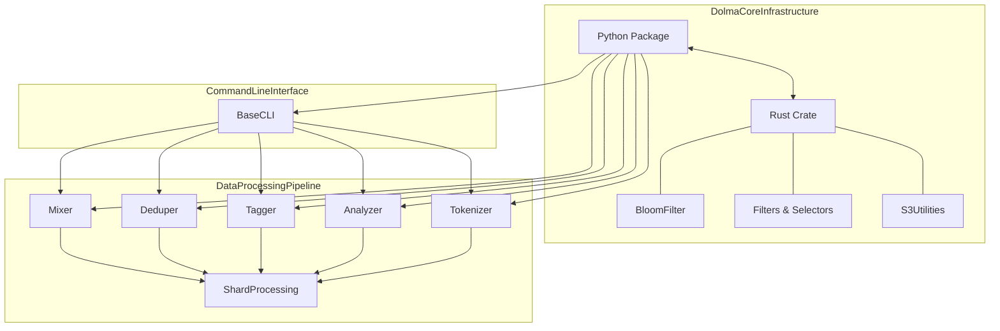
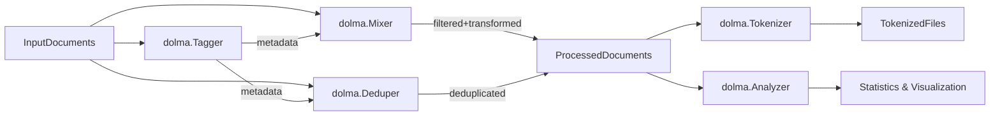
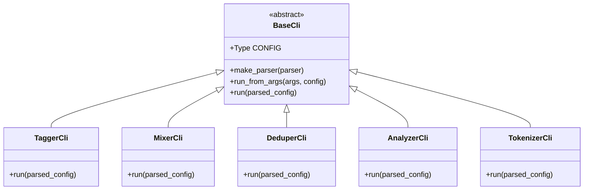
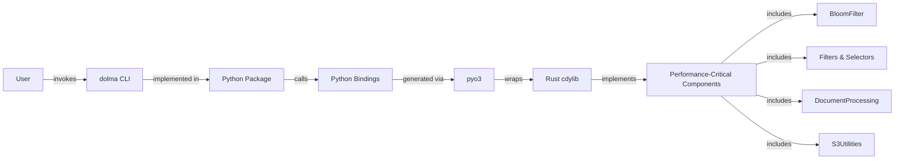

<!-- source: DeepWiki mcp.deepwiki.com · repo allenai/dolma · page 1 Overview · fetched 2026-10-26 -->

# Overview

<details>
<summary>Relevant source files</summary>

The following files were used as context for generating this wiki page:

- [.gitignore](.gitignore)
- [CITATION.cff](CITATION.cff)
- [LICENSE](LICENSE)
- [Makefile](Makefile)
- [README.md](README.md)

</details>


## Purpose and Scope

This document provides an overview of the Dolma toolkit, an open-source system for curating large datasets for machine learning model pre-training. The Dolma toolkit enables efficient processing of billions of documents through a high-performance, hybrid Python-Rust architecture. It was used to create the Dolma dataset, a 3 trillion token corpus used to train the OLMo language model.

For detailed information about the system architecture, see [Architecture](#2). For specifics on data processing components, see [Data Processing Pipeline](#3).

Sources: [README.md:3-15]()

## What is Dolma?

Dolma consists of two distinct but related components:

1. **Dolma Dataset**: An open corpus containing 3 trillion tokens from diverse sources including web content, academic publications, code, books, and encyclopedic materials.

2. **Dolma Toolkit**: A high-performance system for curating large-scale datasets for language model pre-training - the focus of this documentation.

The toolkit implements efficient processing methods for document tagging, filtering, deduplication, and tokenization, allowing researchers to create custom pre-training datasets at scale.

Sources: [README.md:3-15](), [README.md:18-30]()

## System Architecture Overview

Dolma follows a hybrid architecture that combines Python for high-level functionality and Rust for performance-critical operations.

### High-Level Architecture



The architecture consists of three main components:
- **Core Infrastructure**: Python package with Rust integration for performance-critical operations
- **Data Processing Pipeline**: Components for document transformation (mixing, deduplication, tagging, etc.)
- **Command Line Interface**: Unified interface for accessing all tools

Sources: [README.md:20-26]()

## Key Features

### 1. High Performance

Dolma is designed to process billions of documents concurrently using built-in parallelism. The performance-critical components are implemented in Rust, while the higher-level functionality and orchestration are implemented in Python.

### 2. Portability

The toolkit works seamlessly across different computing environments:
- Single machines
- Computing clusters
- Cloud environments

### 3. Built-In Taggers

Dolma includes ready-to-use document taggers that implement common filtering and tagging strategies used in datasets like:
- Gopher
- C4 (Common Crawl)
- OpenWebText

### 4. Fast Deduplication

Document deduplication is implemented using a high-performance Bloom filter written in Rust, enabling efficient processing of large volumes of text.

### 5. Extensibility and Cloud Support

Dolma supports:
- Custom tagging and filtering logic
- AWS S3-compatible storage locations
- Integration with various cloud services

Sources: [README.md:20-26]()

## Data Processing Workflow

The following diagram illustrates how data flows through the Dolma toolkit:



The workflow consists of several stages:
1. **Input Documents**: Raw text from various sources
2. **Processing**: 
   - **Tagging**: Adding metadata (language, quality metrics, etc.)
   - **Mixing**: Combining, filtering, and transforming documents
   - **Deduplication**: Removing duplicate content
3. **Output**:
   - **Tokenization**: Converting text to tokens for model training
   - **Analysis**: Generating statistics and visualizations of the processed data

For detailed information about each component, see [Data Processing Pipeline](#3).

Sources: [README.md:18-30]()

## Core Components

### 1. Tagger

The `Tagger` component analyzes documents and attaches metadata attributes such as language, quality scores, length metrics, and other properties. These attributes can then be used by other components for filtering or analysis.

### 2. Mixer

The `Mixer` component combines, filters, and transforms documents based on configurable rules. It can filter documents based on their attributes, apply transformations, and merge documents from multiple sources.

### 3. Deduper

The `Deduper` identifies and removes duplicate content using a high-performance Bloom filter implementation in Rust. It can operate at document or paragraph level.

### 4. Tokenizer

The `Tokenizer` converts processed text documents into token sequences suitable for language model training. It supports various tokenization schemes.

### 5. Analyzer

The `Analyzer` generates statistics and visualizations about processed documents, helping researchers understand dataset characteristics.

Sources: [README.md:18-30]()

## Command Line Interface

Dolma provides a unified command-line interface for all components. The CLI system is built around a `BaseCli` abstract class with specialized implementations for each tool:



Each specialized CLI handles specific configuration options and executes the corresponding tool. For more details on the CLI system, see [Command Line Interface](#4).

Sources: [README.md:28-30]()

## Python-Rust Integration

One of Dolma's key architectural features is its Python-Rust integration, which provides both ease of use and high performance:



The integration works as follows:
1. Users interact with the Python CLI
2. The Python package orchestrates high-level workflows
3. Performance-critical operations call into compiled Rust code via pyo3 bindings
4. Rust implements computationally intensive components like the Bloom filter and document processors

For more details about this integration, see [Python-Rust Integration](#2.1).

Sources: [Makefile:4-19]()

## Getting Started

To install Dolma, use pip:

```
pip install dolma
```

For detailed tutorials and examples, see [Tutorials and Examples](#8).

Sources: [README.md:28]()

## Citation and Licensing

The Dolma toolkit is licensed under Apache 2.0, while the Dolma dataset is licensed under ODC-BY.

If you use Dolma in your research, please cite the following:

```
@article{dolma,
  title = {{Dolma: An Open Corpus of Three Trillion Tokens for Language Model Pretraining Research}},
  author={Luca Soldaini and Rodney Kinney and [additional authors]},
  year={2024},
  journal={arXiv preprint},
  url={https://arxiv.org/abs/2402.00159}
}
```

Sources: [README.md:32-46](), [LICENSE:1-201](), [CITATION.cff:1-201]()

---

